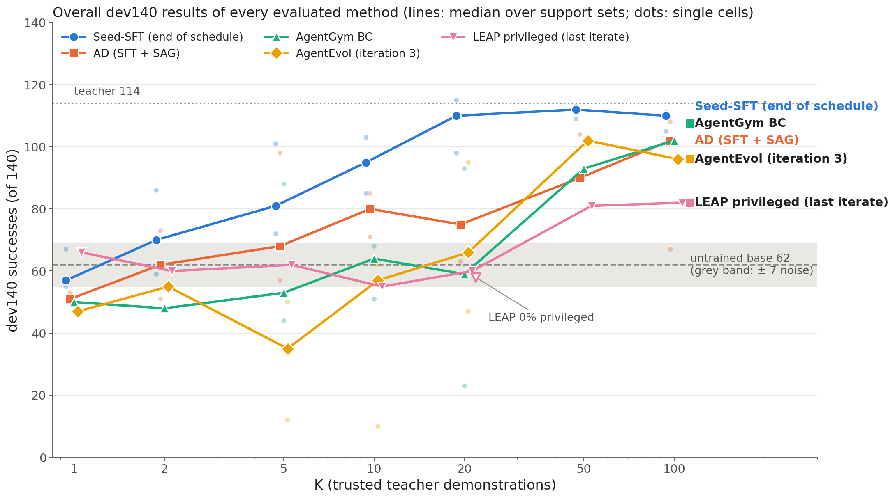
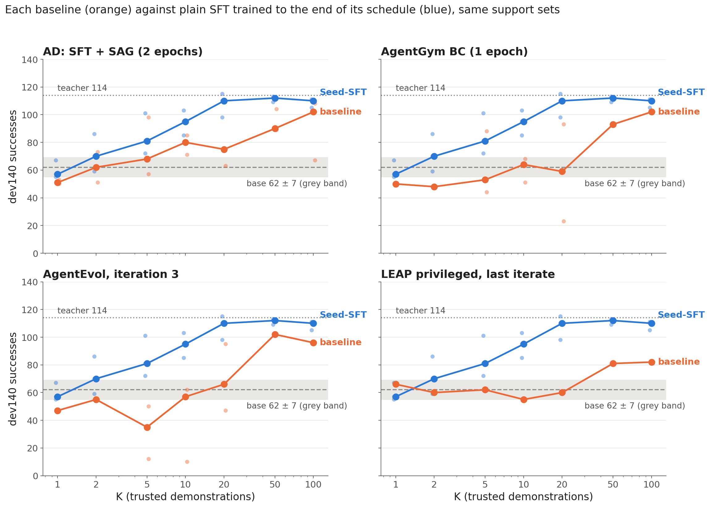
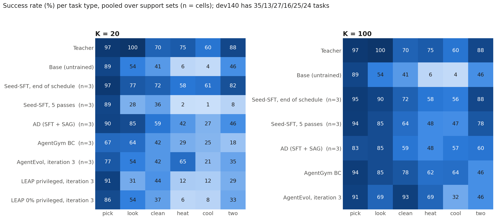
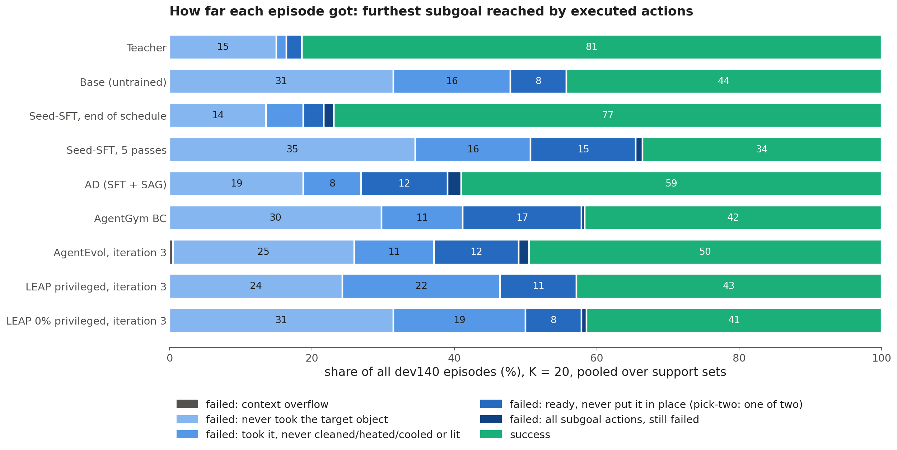
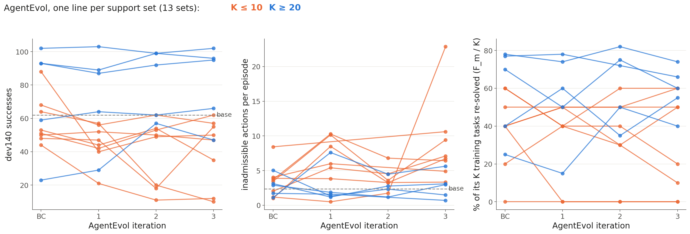
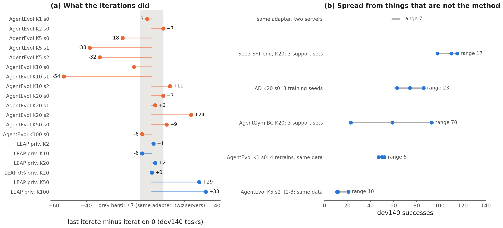

# ALFWorld 上的 agent 蒸馏 baselines：原理、失分点与原因

[English](baseline_failure_analysis.md) · [P1 实证发现](../proposals/P1_empirical_findings_ZH.md) · [理论框架](../../theoretical_framework/README.md)

*状态：纯分析，2026-10-18。本文不提出任何方法。所有数字都来自已经跑完的实验，没有为本页新跑任何东西。表和图可由 [`analysis/baseline_failures/build_data.py`](../../analysis/baseline_failures/build_data.py) 与 [`plot.py`](../../analysis/baseline_failures/plot.py) 重新生成，数据快照是 [`figs/baseline_failures_data.json`](figs/baseline_failures_data.json)。每条结论标注证据性质：**实测**（直接从运行记录读出）、**推导**（由方法定义加实测量推出）、**解读**（对数据的一种读法，数据本身不强制这种读法）。*

---

## 目录

1. [任务与实验设定](#1-setting)（任务、[benchmark](#1-2-benchmark)、示范、设施）
2. [方法](#2-methods)：[Seed-SFT](#m-seedsft)、[AD](#m-ad)、[AgentGym/AgentEvol](#m-agentgym)、[ETO](#m-eto)、[IPR](#m-ipr)、[LEAP](#m-leap)、[只描述未运行的方法](#m-notrun)
3. [总体结果](#3-results)
4. [在 benchmark 上哪里失分](#4-where)
5. [原因：从第一性原理追溯机制](#5-why)
6. [汇总表](#6-summary)
7. [本分析的局限](#7-limits)
8. [数据来源](#8-sources)

<a id="1-setting"></a>

## 1. 任务与实验设定

### 1.1 任务

- **目标。** 从少量可信的教师示范出发，训练一个小的开源学生，在 ALFWorld 家务任务上替代黑盒教师 agent。harness、prompt、动作格式和环境都固定不变。方法能改的只有学生的权重；AD 的方法还会改解码方式。
- **教师。** gpt-6-luna，通过 API 调用，只能拿到它采样出的文本，没有 logits，也没有权重。它在 140 个开发集任务中解出 **114** 个。
- **学生。** Gemma-4-12B-it（revision `707f0a3b`），关闭 thinking，每步最多输出 1,024 个 token。未训练时解出 140 个开发集任务中的 **62** 个，下称 base。
- **可信示范。** $`K`$ 条教师在 TRAIN 任务上的轨迹。每条都在环境里执行过，只有环境确认成功才保留。$`K`$ 数的是轨迹条数，不是任务数或 token 数。
- **方法还能用什么**（用户 10-04 定下）：
  - 只能在这 $`K`$ 个训练任务上探索，不用外部任务池。
  - 只在方法的设计本身要求时才调用教师；在这里只有 LEAP。
  - 封存的测试集从不使用。
- **衡量的结果。** 开发集 dev140 上的成功数（见 [§1.2](#1-2-benchmark)）。

<a id="1-2-benchmark"></a>

### 1.2 Benchmark：ALFWorld

- **是什么。** ALFWorld（Shridhar et al., ICLR 2021）是 ALFRED 家务 benchmark 的文本版，建在 TextWorld 之上。每个 game 是一个 AI2-THOR 场景里的房间，物体、容器和目标都用 PDDL 定义。我们用 ALFWorld 0.4.2、TextWorld 1.7.0。
- **六类任务**（ALFRED 的第七类"可移动容器"不在 ALFWorld 文本任务里）：

| 类型 | agent 要做什么 | dev140 任务数 |
|---|---|---|
| pick-and-place | 找到物体 X，放进或放到容器 Y 上 | 35 |
| look-at-in-light | 找到 X，拿在手里，打开台灯或落地灯 | 13 |
| clean | 找到 X，在水槽洗净，放进 Y | 27 |
| heat | 找到 X，用微波炉加热，放进 Y | 16 |
| cool | 找到 X，用冰箱冷却，放进 Y | 25 |
| pick-two | 找到 X 的两个实例，都放进 Y | 24 |

- **一个 episode。**
  - 开头，agent 看到房间的文字描述和目标，例如"Your task is to: put a clean mug in coffeemachine."
  - 每一轮 agent 写一段思考和一个动作，格式为 `Thought: … / Action: …`，harness 解析最后一行动作。
  - 动作是文本命令：`go to`、`open`、`close`、`take X from Y`、`move X to Y`、`clean/heat/cool X with Y`、`use`、`examine`、`look`、`inventory`。
  - harness 每轮都列出当前合法的动作；不合法的动作不改变状态。
  - 解析失败的回复会得到一轮反馈，这一轮也计入步数上限。
- **成功判定。** 环境在每个动作之后检查目标条件，成功即结束，否则 40 个策略轮次后结束。奖励是二值的。
- **规模与划分。** 以下是经过我们资格检查后的数量：game 文件存在、任务类型受支持。

| 划分 | game 数 | 场景组数 | 我们的用途 |
|---|---|---|---|
| train | 3,553 | 1,465 | 抽取 $`K`$ 条示范的池子，也是方法唯一能探索的任务 |
| valid_seen | 140 | 137 | **dev140**：开发集评估，本页所有数字都来自它 |
| valid_unseen | 134 | 47 | 封存测试集，本阶段从未读取 |

- **评价指标。**
  - 主指标是 dev140 上解出的任务数（满分 140），每个任务跑一个 greedy episode；结果未知的 episode 算作失败。
  - 辅助指标：各任务类型的成功率、每个 episode 的不合法动作数、步数，以及失败 episode 走到了哪一步（[§4.2](#4-where)）。
- **噪声参照。** 同一个 adapter 在两台配置相同的服务器上，dev140 结果相差约 **±7** 个任务；即使开了 batch-invariant 模式，跨服务器也不能逐位复现。这个范围内的差别不作解读。

### 1.3 示范与支持集

- **收集。** 教师用同样的 ReAct 格式完成 TRAIN 任务，只有环境重放确认成功的轨迹才保留。教师失败时，换一个同类型的任务补上；例如 s0 的 K = 100 用了 117 个任务、156 次尝试。
- **抽样。**
  - 按任务类型分层，配额固定；K = 20 时为 heat 4、clean 4、pick-and-place 3、look-at 3、pick-two 3、cool 3。
  - 每个场景组只取一个 trial。
  - 共三个独立的支持集 seed：s0–s2。
- **嵌套。** 同一个支持集 seed 内，K5 ⊂ K10 ⊂ K20 ⊂ K100；K1、K2、K50 都是 K100 的子集。
- **覆盖缺口。** K = 5 时示范条数少于任务类型数，所以每个 K5 集合都缺一类：s0 缺 cool，s1 缺 pick-and-place，s2 缺 look-at。
- **规模。** K20 s0 过一遍约 10.4k 个监督 token。

### 1.4 训练与评估设施

- **硬件。** 训练在 HiPerGator 的 B200 上进行。
- **等价性检查。** 每个 adapter 或检查点评估前都要过一道检查：在固定 prompt 上，HF 与 vLLM 的 token 对数概率须在固定容差内一致。没通过、也没有有效重评的格子被剔除。
- **评估。** 使用 vLLM batch-invariant 服务、greedy 解码、seed 0。每个预先登记的检查点或轮次都评估，不在 dev140 上挑选。
- **baselines 的共同移植规则。**
  - 每个 baseline 都从官方代码移植，每一处改动登记在 `baselines/*/DEVIATIONS.md`。
  - 原始 batch 随数据量缩小：$`b'=\min(b,\max(1,\lfloor N/8\rfloor))`$。
- **证据层级。**
  - 有任务级结果（dev140）：Seed-SFT、AD、AgentGym BC / AgentEvol、LEAP 特权版与 0% 特权版。
  - 只有过程数据：ETO 和 IPR，它们的作业链在 10-14 撤下，没有做 dev140 评估。

**这不是对论文原设定的复现。** 原论文用完整训练集训练，专家轨迹在千条量级，并在大量训练任务上探索；这里证据刻意稀缺。下文展示的是：证据稀缺时，每个方法的原理怎样表现。它们与论文在原设定下报告的提升并不矛盾。

<a id="2-methods"></a>

## 2. 方法

每一小节先按论文的方法部分写出完整流程（含关键公式），再写本项目中的 implementation details。

记号与约定：
- 轨迹记为 $`\tau=(h_t,a_t)_t`$，$`h_t`$ 是历史，$`a_t`$ 是回复（思考加动作）。
- 所有监督损失都算在每一个 assistant 回合上（思考、动作和回合结束 token），system 文本与观测被 mask。
- "更新次数"指优化器步数，引用的数字均为 K = 20、支持集 s0。它衡量的是每个阶段给学生的**训练量**。

<a id="m-seedsft"></a>

### 2.1 Seed-SFT（我们的普通 SFT 参照，不是论文方法）

**流程。**
- 在 $`K`$ 条示范 $`D_0`$ 上做行为克隆：

```math
\mathcal L_{\rm BC}(\theta)=-\sum_{\tau\in D_0}\sum_t\log\pi_\theta(a_t\mid h_t).
```

- 按固定计划保存检查点，每个检查点都评估。不加任何别的东西：不探索，也不再调用教师。

**Implementation details。**
- **模型。** LoRA r16、α32、无 dropout，作用在语言模型的 q/k/v/o/gate/up/down 投影上；base 以 bf16 冻结。
- **优化器。** AdamW（0.9, 0.999, 1e-8），恒定学习率 1e-5，无 warmup，裁剪 1.0，训练 seed 0。
- **batch。** 每次更新装入完整的 episode，直到至少 512 个监督 token；episode 从不拆开。
- **计划。**
  - 检查点设在 3、5、10、20、30、40 遍，以及 100k、200k、400k token 处，训练到其中最大的那一点。
  - K = 20 时，40 遍是 **469 次更新**（416k token），5 遍约 59 次。
- **运行。** 共 21 个 run（7 个 $`K`$ × 3 个支持集）。本文报告"计划末端"（最后一个检查点）和"5 遍"。

<a id="m-ad"></a>

### 2.2 AD：agent distillation（Kang et al., 2025）

**流程。**
- **数据。** 教师 agent 以"推理–动作–观测"循环解题，收集它的轨迹。论文用*首思考前缀*（FTP）改进这些轨迹：先提示教师写出第一步推理，作为它行动前的前缀。
- **训练。** 学生在这些轨迹上用 $`\mathcal L_{\rm BC}`$ 做 SFT。
- **测试时的自洽动作生成（SAG）。**
  - 每一步采样 $`N`$ 个候选回复。
  - 只保留动作合法的候选。论文里"合法"指代码能执行；这里指解析出的动作合法。
  - 返回出现最多的那个动作：

```math
a_t=\arg\max_{a\in\mathcal A_t}\ \sum_{j=1}^{N}\mathbb 1\big[a^{(j)}=a\big],\qquad a^{(j)}\sim\pi_\theta(\cdot\mid h_t).
```

**Implementation details。**
- **数据。** 这 $`K`$ 条示范。**不含 FTP**：其端到端生成流程未发布。
- **模型。** LoRA r64、α128、dropout 0.05，作用在语言模型的 q/k/v/o/gate/up/down 投影上。
- **优化器。** 学习率 2e-4 线性衰减，无 warmup，weight decay 0，裁剪 1.0。
- **计划。** 2 个 epoch，batch 8 条轨迹缩为 $`b'`$。K = 20 时 **20 次更新**；$`K=1,2,5,10,20,50,100`$ 时分别为 2、4、10、20、20、18、26 次。
- **SAG。**
  - $`N=8`$，温度 0.4，top-p 0.8。
  - 平票时取最早出现的那一组；没有合法样本时用第 0 个样本。
- **消融。** 同一个 adapter 用 greedy 解码。
- **格子。** 21 个（7 个 $`K`$ × 3 个支持集），另加 K20 s0 上的训练 seed 1 和 2。

<a id="m-agentgym"></a>

### 2.3 AgentGym BC 与 AgentEvol（Xi et al., 2024）

**流程。**
- **BC。** $`\theta_0`$ 在 $`D_0`$ 上最小化 $`\mathcal L_{\rm BC}`$。
- **AgentEvol，第 $`m=0,1,2`$ 轮。**
  - **探索。** 当前策略 $`\pi_{\theta_m}`$ 去做训练任务。
  - **过滤。** 只保留成功的轨迹：

```math
F_m=\lbrace\tau\sim\pi_{\theta_m}:\ r(\tau)=1\rbrace,\qquad D_{m+1}=F_m\cup D_m .
```

  - **学习。** 在 $`D_{m+1}`$ 上**从 base 模型重新训练**。论文的目标是奖励加权似然 $`\max_\theta\sum_{\tau\in D_{m+1}}r(\tau)\log\pi_\theta(\tau)`$；奖励为二值时，就是在保留下来的轨迹上做 BC。
- 每一轮的模型都评估。

**Implementation details。**
- **探索。** 每轮在每个训练任务上 greedy 地跑一次，而且只在 $`K`$ 个训练任务上跑。保留奖励大于 0.99 的轨迹，每个任务取第一次成功；$`F_m`$ 放在 $`D_m`$ 前面，跨轮不去重。
- **模型。** 全参数微调全部文本参数（FSDP2，fp32 主权重，bf16 计算）。
- **优化器。** AdamW，学习率 1e-5 线性衰减，10% warmup（向下取整），weight decay 0，裁剪 1.0。
- **计划。** 每个阶段 1 个 epoch，全局 batch 32 缩为 $`b'`$。
  - BC：K = 20 时 **10 次更新**，K = 1 时 1 次。
  - AgentEvol 每一轮：K = 20 时 8–10 次。
- **格子。** 13 个支持集：$`K\in\lbrace5,10,20\rbrace`$ × s0–s2，另加 $`K\in\lbrace1,2,50,100\rbrace`$ 的 s0。

<a id="m-eto"></a>

### 2.4 ETO（Song et al., 2024）

**流程。**
- **SFT。** 在 $`D_0`$ 上做行为克隆。
- **每一轮："探索 → 构造对 → DPO"。**
  - **探索。** 当前模型去做训练任务。
  - **构造对。** 每个失败的任务构成一对：专家轨迹 $`y^+`$ 为 chosen，学生的失败轨迹 $`y^-`$ 为 rejected。
  - **DPO**，参考模型 $`\pi_{\rm ref}`$ 冻结：

```math
\ell=-\log\sigma(\beta\Delta),\qquad \Delta=\log\frac{\pi_\theta(y^+)}{\pi_{\rm ref}(y^+)}-\log\frac{\pi_\theta(y^-)}{\pi_{\rm ref}(y^-)},\qquad \nabla_\theta\ell=-\beta\,\sigma(-\beta\Delta)\,\nabla_\theta\Delta .
```

**Implementation details。**
- **SFT。** 全参数微调，学习率 2e-5 cosine，3% warmup，3 个 epoch；K = 20 时 **30 次更新**。
- **构造对。** 每个训练任务 greedy 地跑一次，成功的任务跳过。
- **DPO。**
  - 参考模型是本轮开始时的模型。
  - 第 1 轮 β 0.1、学习率 1e-6；第 2–3 轮 β 0.5、学习率 5e-7。
  - 恒定学习率加 10% warmup，3 个 epoch，无 SFT 项。K20 s0 第 1 轮有 18 对，**27 次更新**。
- **运行情况。** 只跑了 K20 s0。完成了 SFT、explore-1、DPO-1、explore-2、DPO-2、explore-3；作业链在 10-14 撤下，DPO-3 和 dev140 评估都没跑。

<a id="m-ipr"></a>

### 2.5 IPR（Xiong et al., 2024）

**流程。**
- **SFT。** 在 $`D_0`$ 上做行为克隆。
- **用 Monte Carlo 估计步级价值。** 在历史 $`h_t`$ 下做出动作 $`a`$ 后，由 SFT 模型续写 $`n`$ 次：

```math
\hat Q(h_t,a)=\frac1n\sum_{i=1}^n r(\tau_i).
```

- **每一轮。**
  - 沿每条专家轨迹，在前 $`j`$ 个专家动作之后由当前模型接手。
  - 在同一前缀上，学生这一步和专家这一步都用 $`\hat Q`$ 估值。
  - 两者价值之差超过门槛就构成一对，价值高的一侧为 chosen。
  - $`j=0`$ 时按最终奖励比较整条轨迹。
- **损失。** 结果级 DPO 加步级 DPO，再加 chosen 一侧的 NLL：

```math
\mathcal L_{\rm IPR}=\mathcal L_{\rm DPO}^{\rm traj}+\mathcal L_{\rm DPO}^{\rm step}-\sum\log\pi_\theta(y^+).
```

**Implementation details。**
- **SFT。** 同 ETO：K = 20 时 **30 次更新**。
- **MC 估值。** $`n=5`$ 次续写，温度 1，top-p 1；成对门槛 0.01。
- **DPO。** β 0.1，学习率 3e-6 恒定加 10% warmup，3 个 epoch，参考模型为 SFT 模型。第 1 轮有 84 对，**27 次更新**。
- **每轮的 rollout 数。** 1,910 次专家 MC、382 次探索、1,910 次学生 MC。
- **运行情况。** K20 s0。第一轮 DPO 内存溢出；重跑的作业链在 10-14 撤下时，还没有任何一轮 DPO 完成。没有 dev140 结果。

<a id="m-leap"></a>

### 2.6 LEAP（Choudhury & Sodhi, 2025）：特权版与 0% 特权版

**流程。**
- **BC。** 把 $`D_0`$ 拆成步级样本 $`(h_t,a_t)`$ 做行为克隆。
- **特权状态。** 对每个训练任务，跑一次专家，得到学生看不到的事实：关键物体、关键位置和最优动作序列。
- **第 $`i`$ 轮。**
  - **rollout。** 当前模型去做训练任务。
  - **纠正。** 对每条失败的 rollout，教师看到学生的历史和特权状态，为每一步重新标注：$`a_t^\star=T(h_t,\text{priv})`$。
  - **合并。** $`D_i=\lbrace(h_t,a_t^\star)\rbrace`$。在第 $`0..i`$ 轮的合并数据上训练，每轮数据先下采样到最小那一轮的大小：

```math
\mathcal L_i(\theta)=-\sum_{(h,a)\in D_0\cup\cdots\cup D_i}\log\pi_\theta(a\mid h).
```

- **0% 特权消融。** 循环完全相同，只是教师的 prompt 里不含特权状态。这是论文的可实现性消融。

**Implementation details。**
- **BC。** 每步一个样本，完整历史作为上下文。
  - LoRA r128、α64、dropout 0.05，作用在 q_proj 和 v_proj 上。
  - 学习率 3e-5 cosine，warmup 10 步，裁剪 0.3，1 个 epoch，全局 batch 32 缩为 $`b'`$；K = 20 时 **12 次更新**。
- **特权状态。** 执行 ALFWorld 的手写专家，教师用官方模板提取上述事实。专家失败的任务没有特权状态，也得不到纠正。
- **纠正。**
  - 由 gpt-6-luna 用官方纠正模板生成。
  - 标注放在学生原来的历史上；与官方代码一致，不合法的纠正动作也保留。
- **轮次。**
  - 共 3 轮，每轮在上一轮合并后的模型上新训一个 LoRA。
  - 每轮更新次数：K = 50 时 27/48/72/95，K = 100 时 55/108/158/90。
- **运行情况。**
  - 特权版：$`K\in\lbrace1,2,5,10,20,50,100\rbrace`$，s0。
  - 0% 特权版：K20 s0。
  - K1 和 K5 时某一轮没有可用的纠正，run 就此停止。

**从训练充分的学生出发的运行。** 另外以 Seed-SFT K20 s0 训练 40 遍后的状态为起点，跑了 ETO 和 LEAP 的循环；过程数据见 [§5.4](#m4) 和 [§5.5](#m5)。

<a id="m-notrun"></a>

### 2.7 相关方法：只描述，未运行

以下方法在本项目中没有运行，因此没有实测结果。每条依次给出：按论文方法部分写的流程、没有运行的原因、以及按构造会受 [第 5 节](#5-why) 哪些机制影响（*推导*）。

**Structured Agent Distillation，SAD（Liu et al., 2025）**
- **流程。**
  - 按规则把教师的 ReAct 轨迹切成推理段和动作段，分别用掩码 $`m_r`$、$`m_a`$ 标出。
  - 学生在两类段上分别对齐教师的 token 分布：

```math
\mathcal L=\lambda_r\sum_t m_r(t)\,\mathrm{KL}\big(p_T(x_t)\,\Vert\,p_S(x_t)\big)+\lambda_a\sum_t m_a(t)\,\mathrm{KL}\big(p_T(x_t)\,\Vert\,p_S(x_t)\big).
```

  - 训练顺序是一个 curriculum，按复杂度打分排序；复杂度综合了推理长度、动作长度和教师的熵。
- **未运行的原因。**
  - 需要教师的 token 分布 $`p_T`$，黑盒教师给不了。
  - 改用硬标签时，它退化为按段加权的 SFT（A 族）。
  - 代码未发布。
- **适用机制。** §5.1（训练量）和 §5.2（示范之外没有新信息）。

**AgentDistill（Qiu et al., 2025）**
- **流程。** 不训练学生。
  - 教师在解题时写出可执行的工具模块（MCP），保留成功任务中的 MCP。
  - 把这些 MCP 抽象成与具体任务无关的形式，按功能聚类，再合并成一个"MCP box"。
  - 学生在推理时调用 box 里的工具，自身权重不变（$`\nabla_\theta\pi_S=0`$）。box 的选取目标是最大化 $`\mathbb E_{(x,y)}\big[\mathbb 1\lbrace\pi_S(x;\mathcal B)=y\rbrace\big]`$。
- **未运行的原因。** 我们的协议固定了 harness 和动作集合；这个方法唯一的作用渠道（新增工具）不在协议之内，也没有可以比较的学生训练。
- **适用机制。** 不适用。

**Chain-of-Agents，CoA（Li et al., 2025）**
- **流程。**
  - 把一个多 agent 系统（教师）的执行过程记录成单条轨迹，包含状态、被激活的 agent 和观测。
  - 对轨迹做过滤：工具交互至少 5 次、检查正确性、保留带反思的轨迹、上采样纠错成功的轨迹。
  - 做 agentic SFT 时 mask 掉观测：$`\mathcal L_{\rm SFT}=-\sum_{t\notin\mathcal O}\log\pi_\theta(\tau_t\mid\tau_{<t},q)`$。
  - 之后在困难问题上用可验证奖励做 agentic RL（DAPO）。
- **未运行的原因。**
  - 我们的教师是固定 harness 下的单个 agent，于是蒸馏阶段退化为在教师轨迹上做过滤后的 SFT（A 族）。
  - RL 阶段用的是学生自己的奖励，不属于这里对蒸馏方法的比较。
- **适用机制。** SFT 阶段：§5.1、§5.2；成功过滤：§5.3。

**Harness-Aware Distillation，HAD（Choi et al., 2026，arXiv 2610.02858）**
- **流程（on-policy，黑盒教师）。**
  - 学生在共享 harness 下 rollout。
  - 在学生到过的每个状态上问教师两次：一次带 harness 信息（$`\tilde a_t`$），一次不带（$`a_t`$）。
  - 学生一方面学教师的回复，另一方面学"带 harness 优于不带"的动作偏好；偏好在学生自己的推理 $`\tilde z_t`$ 下打分。首选动作与 harness 记录矛盾的对被 mask 掉（$`m_t`$）：

```math
\Delta_t=\tfrac{1}{\lvert\tilde a_t\rvert}\log\pi_\theta(\tilde a_t\mid\tilde x_t,\tilde z_t)-\tfrac{1}{\lvert a_t\rvert}\log\pi_\theta(a_t\mid\tilde x_t,\tilde z_t),\qquad
\mathcal L_{\rm HAD}=\mathbb E\big[\ell_{\rm dist,t}+\lambda\,m_t\,(-\log\sigma(\beta\Delta_t))\big].
```

- **未运行的原因。** 选定 baselines 时没有官方代码（10-04 规则：只跑有官方代码的方法）。它是 10-02 才提交的。
- **适用机制。** 和 LEAP 一样，在学生状态上加入教师标注（§5.5）；和 ETO、IPR 一样，偏好项可能饱和（§5.4）。

**黑盒 on-policy 蒸馏，GAD（Ye et al., 2025）**
- **流程（只有教师文本）。**
  - 学生作为生成器 $`G`$。判别器 $`D`$ 用 Bradley–Terry 损失学习给教师回复打更高的分：$`\min_D\mathbb E\big[-\log\sigma\big(D(y_T)-D(G(x))\big)\big]`$。
  - 学生先在教师回复上做 SFT 预热，再用 GRPO 最大化 $`\mathbb E[D(G(x))]`$。
- **未运行的原因。** 它面向单轮指令跟随，不是多轮 agent，也不在 10-04 选定的 baseline 之列。
- **适用机制。** 奖励是从同一批教师文本中学出来的（§5.2）；它的 on-policy RL 阶段不在这里的测量范围内。

**WKM（Qiao et al., 2024）与 STeCa（Wang et al., 2025）**
- **WKM。** 对比专家轨迹和采样轨迹，合成任务知识与状态知识，再训练一个单独的知识模型来指导 agent。
- **STeCa。** 用 MC 步级奖励找出偏离的步，用 LLM 反思改写它们，再在校准后的轨迹上做 SFT。
- **未运行的原因。** 两者的官方代码都不完整。
- **适用机制。** 两者都是对已有证据的再加工（§5.2）。

<a id="3-results"></a>

## 3. 总体结果



*图 1. 所有已评估方法的 dev140 总体结果，横轴为示范条数 $`K`$。线是各支持集的中位数，淡色点是单个格子。灰带：未训练 base ± 噪声；点线：教师。空心标记是 LEAP 0% 特权版（只有 K20）。*
- *LEAP 在 $`K=1`$ 和 $`K=5`$ 时提前停止，因为某一轮没有产出可用的纠正；它在 $`K=20,50,100`$ 的数值取自运行日志。*
- *ETO 和 IPR 没有 dev140 结果，所以不在图中。*

**表 1.** dev140 成功数，各支持集的中位数 [最小–最大]（*实测*）。base 62，教师 114。

| K | Seed-SFT 计划末端 | AD（SFT+SAG） | AgentGym BC | AgentEvol 第 3 轮 | LEAP 特权版最后一轮 | LEAP 0% |
|---|---|---|---|---|---|---|
| 1 | 57 [55–67] | 51 [50–53] | 50 | 47 | 66（停在第 0 轮） | — |
| 2 | 70 [59–86] | 62 [51–73] | 48 | 55 | 60 | — |
| 5 | 81 [72–101] | 68 [57–98] | 53 [44–88] | 35 [12–50] | 62（停在第 1 轮） | — |
| 10 | 95 [85–103] | 80 [71–85] | 64 [51–68] | 57 [10–62] | 55 | — |
| 20 | 110 [98–115] | 75 [63–110] | 59 [23–93] | 66 [47–95] | 60 | 58 |
| 50 | 112 [109–113] | 90 [89–104] | 93 | 102 | 81 | — |
| 100 | 110 [105–111] | 102 [67–108] | 102 | 96 | 82 | — |

图和表可以读出（*实测*）：
- **在任何 $`K`$ 上，没有一个 baseline 的中位数超过训练到计划末端的普通 SFT。** 最接近的是 $`K=50`$ 的 AgentEvol（102 对 112），以及 $`K=100`$ 的 AD 和 AgentGym BC（102 对 110）。
- **在 $`K\le20`$ 时，除 AD 在 $`K=10`$、$`K=20`$（80、75）外，所有 baseline 的中位数都在未训练的 base 附近或以下。** 它们要到 $`K\ge50`$ 才与 base 拉开。
- **许多 baseline 格子比未训练的 base 还低，且超出噪声**（140 个任务中只解出 54 个或更少）：
  - AgentGym 的 52 格中有 26 格（含所有轮次）；
  - AD 的 24 格中有 4 格；
  - LEAP 特权版的 23 个轮次中有 4 个（计入日志中 $`K=20,50,100`$ 的 run）。
- **baseline 解出的任务，大多是同一支持集上普通 SFT 也能解出的。**
  - AgentGym BC：13 个支持集合计，只有 baseline 解出的 125 个，只有 Seed-SFT 解出的 500 个。
  - AgentEvol 第 3 轮：102 对 579。
  - AD：243 对 550。
  - LEAP 特权版最后一轮（本地格子）：17 对 122。
  - AD 只在两个格子里胜过 Seed-SFT：K2 s2（73 对 59）和 K20 s2（110 对 98）。
- **ETO 和 IPR** 没有 dev140 结果，它们训练各轮的产出见 [§5.4](#m4)。



*图 1b. 同一份数据，每个 baseline 一个子图。每个子图里，橙色是该 baseline，蓝色是同样支持集上训练到计划末端的 Seed-SFT。*

<a id="4-where"></a>

## 4. 在 benchmark 上哪里失分

### 4.1 按任务类型：heat 和 cool



*图 2. 各任务类型的成功率，跨支持集合并；左为 K = 20，右为 K = 100。*

- **实测。**
  - 未训练的学生只解出 6% 的 heat 和 4% 的 cool 任务，pick-and-place 则有 89%。训练必须在这两类上补东西。
  - K = 20 时，训练到计划末端的普通 SFT 达到 heat 58%、cool 61%，接近教师的 75% 和 60%。
  - 同为 K = 20，baselines 低得多：
    - LEAP（特权版 12/12%，0% 特权版 6/8%）和 5 遍的 Seed-SFT（2/1%）在这两类上停在 base 水平；
    - AgentGym BC 到 29/25%，AD 到 42/27%；
    - AgentEvol 三轮后 heat 到 65%，cool 只有 21%。
  - K = 100 时差距缩小：AgentGym BC 62/64%，AD 48/57%，普通 SFT 58/56%。
- **pick-two** 是另一个弱项。K = 20 时 AgentGym BC 只解出 18%，AgentEvol 35%，LEAP 29–33%，Seed-SFT 计划末端则是 82%。

### 4.2 按子目标：先卡在找物体，其次卡在加工步骤



*图 3. 每个 episode 用实际执行的合法动作走到了哪一个子目标（K = 20）。子目标依次是：拿到目标物体 → 清洗、加热、冷却，或打开台灯 → 放进目标容器；pick-two 需要两个不同的实例。一致性自检：2,650 个成功 episode 中有 2,608 个（98.4%）被判为完成了全部子目标，其余 42 个属于环境不需要最后放置就判成功的任务。*

- **实测。**
  - 在所有方法中，失败的最大一类都是**从没拿到目标物体**：占 base 失败的 56%，占教师 26 个失败的 81%。
  - 各方法的差别在于有多少 episode 停在这一步：
    - 教师 15%，Seed-SFT 计划末端 14%；
    - AD 19%，AgentEvol 25%，LEAP 特权版 24%；
    - AgentGym BC 30%，base 31%，LEAP 0% 31%，5 遍的 Seed-SFT 35%。
- **heat/cool 任务的失败分成两部分：找物体，和加工步骤。** base：59% 没找到物体，41% 拿到了物体却从没加热或冷却。
  - LEAP 特权版（K = 20）：64% 的 heat/cool 失败是拿到物体却从没加热或冷却。LEAP 0% 特权版：50%。
  - AgentGym BC：30%。AD：35%。
- **解读。** 这里能看到两种不同的缺口：
  - *找物体*，连教师都难；
  - *知道加工流程*（拿着物体去微波炉或冰箱，再加热或冷却）。示范要训练得足够久才能补上这一点。普通 SFT 到计划末端补上了，baselines 的短训练阶段大多没补上。

### 4.3 按行为：不合法动作与循环

**表 2.** 除另注外均为 K = 20（*实测*）。"循环"指失败 episode 的最后 10 步只用了不超过 3 个不同的动作。

| 格子 | 每个 episode 的不合法动作数 | 撞到 40 步上限的失败 episode | 以循环结束的失败 episode |
|---|---|---|---|
| 教师 | 0.59 | 100% | 4% |
| base | 2.37 | 100% | 28% |
| Seed-SFT 计划末端 | 0.78 | 100% | 25% |
| AD（SFT+SAG） | 1.05 | 100% | 47% |
| AgentGym BC | 3.09 | 100% | 52% |
| AgentEvol 第 3 轮 | 3.40 | 99% | 65% |
| AgentEvol 第 3 轮，K = 5 / K = 10 | 8.93 / 12.13 | 100% | 67% / 61% |
| LEAP 特权版第 3 轮（K = 2–20） | 2.29 | 100% | 47% |
| LEAP 0% 特权版第 3 轮 | 5.61 | 100% | 56% |

- **实测。**
  - 所有失败都跑满 40 步，没有哪个方法提前放弃。
  - baselines 的失败以循环告终的比例远高于教师，也高于 K = 20 的普通 SFT。
  - 小 $`K`$ 下的 AgentEvol 会退化：每个 episode 的不合法动作从 BC 时的 2–4 个，三轮后升到 9–12 个。最差的 K10 s1 达到每个 episode 22.9 个，只解出 10 个任务（[图 5](#fig5)）。

<a id="fig5"></a>



*图 5. AgentEvol，每个支持集一条线（橙色 K ≤ 10，蓝色 K ≥ 20）。左：dev140 成功数。中：每个 dev140 episode 的不合法动作数。右：每一轮的模型重新解出了自己 K 个训练任务中的多少；这些重解就是下一轮加进数据的东西。个别轮次的评估没有逐 episode 记录，那里的点缺失。*

### 4.4 不稳定性：迭代本身，以及迭代周围的方差



*图 4. (a) 每个 AgentEvol 支持集和每个 LEAP run 的"最后一轮减第 0 轮"。(b) 方法之外的因素造成的结果分散。*

- **实测。**
  - **AgentEvol**，13 个支持集：
    - 5 个下降超出噪声（−54、−38、−32、−18、−11）；
    - 3 个上升超出噪声（+11、+24，以及 K = 50 的 +9）；
    - 其余在噪声以内。
  - **LEAP** 在 $`K\le20`$ 时基本不动（−6 到 +2）。在 $`K=50`$ 和 $`K=100`$ 时分别上升 +29 和 +33，但起点（第 0 轮）都低于 base（52 和 49）。
  - **方法之外的因素造成的分散**（除另注外为 K = 20）：
    - AD 在同一个支持集上换三个训练 seed：63/74/86；
    - AgentGym BC 在三个支持集上：23/59/93；
    - 计划末端的普通 SFT 在三个支持集上：98/110/115。
  - **相同数据的重训。** AgentEvol 的设计自带两组天然重复：
    - K = 1 s0 每一轮都没有加进新数据（$`F_m=0`$），四个轮次等于在同一条示范上重训四次：50/52/50/47；
    - K = 5 s2 第 1–3 轮都在同样 7 条轨迹上训练：21/11/12。

<a id="5-why"></a>

## 5. 原因：从第一性原理追溯机制

每一小节依次给出：原理、由原理推出什么、这里的证据、适用于哪些方法、解释不了什么。

<a id="m1"></a>

### 5.1 训练量以 epoch 为单位规定，示范很少时学生几乎没被训练

- **原理。**
  - 训练配方规定的是 epoch 数。优化器的更新次数是 epoch × N/b'，N = K 条示范时只有寥寥几次。
  - 在 Adam 下，早期每次更新的大小由优化器决定，而不是由数据决定。第 1 步时，偏差校正后的矩为 $`\hat m_1=g`$、$`\hat v_1=g^2`$，于是更新为

```math
\Delta\theta_1=-\eta\,\frac{g}{\lvert g\rvert+\epsilon}\approx-\eta\,\mathrm{sign}(g)\quad\text{（逐坐标）。}
```

- **推导。**
  - 头几次更新里，每个被训练的坐标都移动约 $`\eta`$，与信号强弱无关；只有方向来自 batch 里那几条轨迹。
  - 全参数微调（AgentGym、ETO、IPR）时，学生的每一个文本参数都移动 $`\eta`$。LoRA（AD、LEAP、普通 SFT）则把移动限制在 rank-r 的 adapter 里。
  - 这样的几步足以改变模型，却还没把示范教的东西拟合进去。
- **证据（实测）。**
  - K = 1 的 AgentGym BC 只是在 902 个 token 上做了 1 次更新，四次重训得到 50/52/50/47，base 是 62。
  - 3–5 遍的普通 SFT（K = 20 时 35–59 次更新）得到 45–57，同样低于 base；到 40 遍时是 98–115。[发现 B](../proposals/P1_empirical_findings_ZH.md#finding-b) 显示，每个 run 都有这种先降后升。
  - K = 20 时 baselines 的 BC 阶段分别是 10 次（AgentGym）、12 次（LEAP）、20 次（AD）和 30 次（ETO/IPR）更新。这一阶段的得分是 23–93（AgentGym）、58（LEAP 第 0 轮，日志）、63–110（AD），与普通 SFT 在相近遍数下的范围相同或更低。
  - LEAP 在 $`K=50`$ 和 $`K=100`$ 的第 0 轮（27 次和 55 次更新）得 52 和 49，低于 base。
- **适用于。** 每个 baseline 的 BC 阶段，因而也是它们迭代阶段的起点。
- **解释不了。**
  - 它不说明迭代部分本身带来了什么。BC 阶段短只意味着迭代从一个弱而方差大的学生出发。
  - AD 在 $`K\ge50`$ 时（18–26 次更新，学习率 2e-4）达到 89–108：更大的学习率部分抵消了计划的短。

<a id="m2"></a>

### 5.2 对已有证据再加工，带不出证据里本来没有的东西

- **原理（数据处理不等式）。**
  - 设 $`E`$ 是一个方法拥有的证据：$`K`$ 条示范、环境在 $`K`$ 个训练任务上的反馈，以及方法要求时教师的回答。
  - 由 $`E`$ 构造的任何训练集都是 $`E`$ 的（可带随机性的）函数，所以它关于"未见情形下该怎么做"的信息不会多于 $`E`$ 本身。过滤后的自身 rollout、对比对、改写后的思考、合成的知识都在此列。
  - 框架的 [Proposition 2.4](../../theoretical_framework/statements/02-04_post_processing_cannot_reduce_information.md#s2-4) 与 [Corollary 6.7](../../theoretical_framework/statements/06-07_aliasing_zero_value_replay.md#s6-7) 给出了形式化表述。
- **推导。**
  - 在本协议下，A、B、C 三族在示范之外不增加任何教师信息：
    - B 加入的是学生在已有示范的任务上自己成功的 rollout；
    - C 加入的是学生在这些任务上自己的失败。
  - 唯一新增的外部事实，是成功与否的那一位，以及学生沿自己路径在 $`K`$ 个训练任务上看到的观测。
  - 只有 D 族（LEAP）会向教师要新的标注。
- **证据（实测）。**
  - **AgentEvol 自生成的数据，就是对已有示范的那些任务的重解**（13 个支持集的过滤报告）。所有支持集、所有轮次合计，训练任务被重新解出的比例为：
    - pick-and-place 93%，look-at 74%，clean 66%，heat 61%，cool 49%，pick-two 26%；
    - K ≤ 10 时，每轮 $`F_m`$ 只有 0–6 条轨迹；K = 5 s2 第一轮之后为 0；
    - 同一个任务可以多次进入 $`D_m`$，因为跨轮不去重。
  - **示范里缺的类型停在 base 水平。** K5 s0 没有 cool 示范，普通 SFT 训到 400k token，cool 始终只有 25 个中的 0–3 个；另外两个支持集各有一条 cool 示范，升到 7–13（[发现 D](../proposals/P1_empirical_findings_ZH.md#finding-d)）。
  - **改写示范里的思考**（教师改写，动作不变），在一个状态上测得的后果与直接重放相同（[发现 C](../proposals/P1_empirical_findings_ZH.md#finding-c)，P4 ≈ P1）。
- **适用于。** AgentEvol、ETO、IPR，以及 WKM 与 STeCa（知识合成与反思同样属于再加工）。
- **解释不了。**
  - 自生成数据仍然可以*重新分配、强化*学生在训练任务上已经会做的事：K = 20 的 AgentEvol heat 达到 65%，高于普通 SFT 的 58%。
  - 这条原理只给信息量设了上限，并不说明再加工对优化毫无用处。

<a id="m3"></a>

### 5.3 "成功"是轨迹的属性，不是"用它训练对这个学生意味着什么"

- **原理。**
  - 一条训练样本的作用，是这个学生在当前状态、按这套配方用它训练并完成后续训练之后，最终性能的变化。框架称之为 continuation response（[Theorem 3.2](../../theoretical_framework/statements/03-02_continuation_response_characterization.md#s3-2)）。
  - 成功、奖励、正确与否只由轨迹和环境决定。所以静态质量相同的两组数据，作用可以不同，甚至相反（[Proposition 3.1](../../theoretical_framework/statements/03-01_static_value_not_learning_value.md#s3-1)）。
- **推导。** "保留每一条验证过的成功"这样的规则，对其作用的符号没有任何保证。
- **证据（实测）。**
  - AgentEvol 加入的每条轨迹都是验证过的成功，可 13 个支持集上的结果变化从 −54 到 +24（[图 4a](#4-where)）。
  - 这些变化不能只用重训噪声解释：相同数据的重训只差 5（K = 1）和 10（K = 5 s2），而有三次下降超过 30。
  - 方向也不由加入的数据量决定：K5 s1 只加了一条轨迹（5 → 6 条轨迹，5 → 6 次更新），就从 88 掉到 40；K20 s2 两轮共加了 8 条，从 23 升到 57。
  - 成功的 episode 本身是干净的：平均 0–1.1 个不合法动作，而且很短。所以 [§4.3](#4-where) 里不合法动作的暴涨，**不是**照抄被保留的成功里的坏行为。这个假设检查过，不成立。
  - 各轮模型也一直保留推理文本：在检查过的每个 AgentEvol 轮次里（K ≤ 20 的所有支持集，第 0、1、3 轮），97–100% 的步带有思考。所以"格式漂移"也排除了。
- **解读。**
  - 在这个范围里，每一轮都从 base 出发，在 5–60 条轨迹上做约 10 次全参数更新，结果对具体数据和顺序极其敏感。
  - 向下的变化比向上的大：从一个还算能干的模型出发，这么大的改动，伤害的时候多于帮助的时候。
- **适用于。** 直接适用于 AgentEvol；一般地适用于所有静态选择规则（按结果过滤、按结果构造偏好、教师认可）。
- **解释不了。** 数据说不出是*哪些*新增轨迹导致了哪一次下降。那需要逐条测量后果，这些 run 没有做。

<a id="m4"></a>

### 5.4 在几对样本上做对比学习，会迅速饱和，可学的东西很少

- **原理。**
  - DPO 的梯度带权重 $`\sigma(-\beta\Delta)`$（公式见 [§2.4](#m-eto)）。一对样本一旦被分开，这个权重就趋于零，这对样本也就不再教任何东西。
  - 只有在学生没解出、而专家解出的训练任务上才有偏好对，所以每轮的偏好对数不超过失败的训练任务数，也就不超过 $`K`$。
  - ETO 偏好对的 chosen 一侧就是 SFT 已经用过的那条示范；rejected 一侧是学生整条失败轨迹。因为 $`\Delta`$ 对它的所有 token 求和，其中正确的前几步也一起被压低了。
- **证据（实测；ETO 和 IPR 都没有 dev140 结果）。**
  - **ETO，K = 20。**
    - SFT 模型重新解出了 20 个训练任务中的 2 个，于是得到 18 对。第 1 轮 DPO 之后解出 1 个，第 2 轮之后还是 1 个：DPO 各轮连这些偏好对所来自的任务都没提升。
    - 更早的一个 run 有 15 对，到第 2 个 epoch 时损失降到 2e-21。
    - 以训练充分的学生（Seed-SFT p40）为起点时，探索只产生 3 对，训练 9 次更新，损失约 1e-13，梯度范数约 1e-9；训练任务的重解从 20 个中的 17 个降到 15 个。
    - 同一个 SFT 配方的五次工程重跑，重新解出 20 个训练任务中的 0–16 个。所以 DPO 数据的多少由 SFT 的方差决定。
  - **IPR，K = 20，第 1 轮。**
    - 用了 1,910 次专家 MC rollout、382 次探索 rollout 和 1,910 次学生 MC rollout，在 382 次比较中得到 84 对（71 个步级、13 个轨迹级），其余 298 次打平。
    - 84 对里有 76 对选的是专家那一步，方向与在专家步上做 SFT 相同。
    - 每个价值是 5 个二值结果的均值，标准误最高 0.22，而成对的门槛只有 0.01。
    - 一轮 DPO 估计要 9–13 GPU 小时。作业链在 10-14 撤下，没有任务级结果。
- **适用于。** ETO、IPR，以及证据稀缺时任何按结果配对的偏好方法。
- **解释不了。** 这些目标函数在这里能否在任务层面带来帮助，仍然未知；我们只测了它们的训练信号。

<a id="m5"></a>

### 5.5 教师纠正带来新信息，但数量少、部分不合法，还与训练量混在一起

- **原理。**
  - 在学生自己到过的状态上做纠正，是本协议里唯一的新标注来源。
  - 每轮的纠正数不超过 $`K`$ 个训练任务上失败的 rollout 数。
  - 合并规则把每轮数据都下采样到最小那一轮的大小，所以纠正少的那一轮，也会缩小早先数据的训练量。
- **证据（实测）。**
  - **数量。**
    - K ≤ 10：每轮 0–5 条纠正。
    - K = 20：8/4/4（特权版）和 11/7/8（0% 特权版）。
    - K = 50：19/21/20。K = 100：43/42/18。
    - K = 1 和 K = 5 时，某一轮没有可用的纠正，LEAP 就停止了。
  - **排除。** 专家没能给出特权状态的任务不参与纠正：K = 50/100 时每轮 8–19 个。
  - **不合法的标注。** K = 50/100 时，每轮有 4–24 个纠正动作在其标注的状态下并不合法，官方流程照样用它们训练。
  - **K = 20 时特权版对 0% 特权版：** 60 对 58，都在 base 水平。LEAP 的可实现性控制在这个 $`K`$ 下没有差别，8/4/4 条纠正太少，推不动学生。
  - **K = 50 和 K = 100。**
    - 迭代分别带来 +29 和 +33，但起点 52 和 49 都低于 base，终点 81 和 82 也低于计划末端的普通 SFT（112 和 110）。
    - 同样这几轮，每轮的更新次数从 27 增到 95（K = 50），从 55 增到 158 再回到 90（K = 100）。这与普通 SFT 走出训练早期的低谷的方向一致：K = 50 时 3 遍为 49–57，10 遍为 104–114。
    - 这些 run 无法把"纠正"的作用和"多训练"的作用分开。
  - **以训练充分的学生（Seed-SFT p40）为起点时，** LEAP 第一轮有 6 条失败 rollout，全部因为没有特权状态被排除，产出 0 条纠正后停止。
  - **我们自己的 DAgger 类测试（R2，dev300，不是 LEAP）。** 在训练充分的学生的续训中混入 100 个学生状态上的教师动作，成功数反而*下降* 20 个（均匀分配）和 71 个（按学习器加权分配）。每个单动作标注重复约 60 次，这是一个混杂因素（[发现页最后一节](../proposals/P1_empirical_findings_ZH.md#not-yet)）。
- **适用于。** LEAP 与 DAgger 类纠正方法。
- **解释不了。** 在训练量固定的情况下，更多的纠正能否胜过普通 SFT。这一点没有测。

<a id="m6"></a>

### 5.6 对同一个策略的样本投票，修不了系统性错误

- **原理。**
  - 对 $`N`$ 个样本多数投票，估计的是策略在这一步动作分布的众数，而 greedy 解码本来就返回众数。
  - 只有众数不合法（被过滤掉），或采样噪声原本会选中少数动作时，投票才会改变结果。
  - ALFWorld 每一轮都列出合法动作，合法性很少成问题。错误是语义上的：去错地方、顺序错、拿错物体。
- **证据（实测）。**
  - AD，K = 20 s0：SAG 63 对 greedy 66，每个 episode 的不合法动作从 5.34 降到 1.64。
  - 在普通 SFT 上用 SAG（K = 20 s0，p40）：115 对 115，不合法动作从 0.76 降到 0.46。
  - AD 不同训练 seed 之间的差距（63/74/86）远大于 SAG 的任何作用。
- **适用于。** 环境本身已经保证合法性时，测试阶段的 self-consistency。
- **解释不了。** 在 AD 的原设定里，代码执行出错使合法性过滤有用；那个设定这里没有测。

<a id="m7"></a>

### 5.7 在这个范围里，配方本身的方差大于多数方法的作用

- **实测。** K = 20 时，方法以外的因素造成的分散：
  - 跨训练 seed 23 个任务（AD）；
  - 跨支持集 70 个（AgentGym BC）；
  - 跨支持集 17 个（计划末端的普通 SFT）；
  - 相同数据重训 5–10 个（AgentEvol）；
  - 跨服务器 7 个。
- **推导。**
  - 两个方法在单个格子上的差，只有超过这些分散才可读。
  - 以此衡量，AgentEvol 的崩溃和 LEAP 在 K = 50/100 的提升站得住；AD 的 SAG 作用、LEAP 特权与 0% 特权之差，以及多数 AgentEvol 轮次都站不住。
- **实测。** 这种分散取决于配方，而不只是数据少。在同样三个 K = 20 支持集上：
  - 普通 SFT（LoRA r16，学习率 1e-5）从 3 遍到 40 遍的每个检查点上都只分散 3–17；
  - AgentGym BC（全参数，10 次更新）分散 70；
  - AD（LoRA r64，学习率 2e-4）跨支持集分散 47，跨训练 seed 分散 23。
- **解读。** 这与 §5.1 吻合：
  - 全参数微调在每次早期更新中让每个权重都移动约 $`\eta`$；学习率更大，每一步也随之放大；LoRA 则把移动限制在 rank-r 子空间里。
  - 在极少数据上拟合出的几次大幅、近似取符号的移动，会随数据和顺序的不同落到非常不同的地方。

<a id="m8"></a>

### 5.8 每一轮都重启优化器（结构性质；对这些 baselines 未测）

- **实测的方法性质。**
  - AgentEvol 每轮从 base 模型重训。
  - LEAP 在合并后的模型上新开一个 LoRA，优化器从空状态开始。
  - ETO 和 IPR 每轮 DPO 都用新的优化器。
- **本项目中优化器状态确实重要的证据**（不来自这些 baselines）：
  - 参数和数据固定，训练前先填充 Adam 的矩，dev140 结果变化 +11（p10）和 −13（p40）（[发现 E](../proposals/P1_empirical_findings_ZH.md#finding-e)）。
  - 把一段反馈留下的矩移植过去，此后 254 次更新的结果在 dev300 上变化 −18（T1，描述性）。
- **未知。** 重启对这些 baselines 是损失还是帮助、有多大，没有测。

<a id="6-summary"></a>

## 6. 汇总表

| ALFWorld 上的问题 | 机制 | 方法 | 证据强度 |
|---|---|---|---|
| BC 阶段在 base 水平或以下；普通 SFT 要训练很久才达到教师水平 | §5.1：训练量以 epoch 规定；Adam 早期更新近似取符号，大小由 $`\eta`$ 决定 | 所有 baseline 的第一阶段 | 强（每个阶段都有训练量记录；普通 SFT 有 21 个 run 的各检查点） |
| heat、cool 接近 base；示范里缺的类型停在 base | §5.2：没有新证据就没有新信息；§5.1：流程还没拟合进去 | AgentEvol、ETO、IPR（WKM/STeCa 按构造同属此列）；短 BC 阶段 | 缺类型的情形强；heat/cool 中等（也与训练量有关） |
| 小 K 下 AgentEvol 崩溃（−54 到 −11），少数支持集上提升 | §5.3：成功与否不说明对这个学生的作用；再加 §5.7 | AgentEvol（以及任何静态选择规则） | "符号不确定"强；每次下降的具体机制未识别 |
| 退化轮次中不合法动作与循环增多 | 不是照抄被保留的成功（已检查）；与 §5.3/§5.7 的不稳定同时出现 | K ≤ 10 的 AgentEvol | 实测；不稳定之外的原因未识别 |
| 偏好轮次产出的对很少，梯度消失，训练任务成功率不升 | §5.4：偏好对数 ≤ 失败的训练任务数；DPO 饱和；整条轨迹被否定 | ETO、IPR | 只有过程层面 |
| K ≤ 20 时纠正太少；K ≥ 50 的提升与训练量混在一起；部分标注不合法 | §5.5 | LEAP | 中等（没有训练量匹配的对照） |
| 测试时投票不改变成功率 | §5.6：投票估计的就是 greedy 返回的那个众数 | AD SAG | K = 20 时强（两个学生） |
| 跨 seed、支持集、相同数据重训的分散很大 | §5.7 | 所有方法，短计划配方最明显 | 强 |
| 每轮丢弃优化器状态 | §5.8 | 所有迭代式 baseline | 性质已实测；对 baselines 的影响未测 |

<a id="7-limits"></a>

## 7. 本分析的局限

- **协议差异。**
  - 所有方法都在同一个固定的少样本黑盒协议下运行：$`K`$ 条示范、只在这 $`K`$ 个任务上探索、共用 harness、40 步上限，batch 按登记的规则缩小。
  - 原论文用的数据多得多。本文结果描述的是证据稀缺时这些方法的原理，不是它们发表时的设定。
- **移植改动。** 每个 baseline 都从官方代码移植，每一处改动都登记在 `baselines/*/DEVIATIONS.md`，例如 AD 不含 FTP、LEAP 的 merge 策略。
- **每格一个训练 seed。** 例外是 AD 的 K20 s0，有三个。
- **ETO 和 IPR 没有任务级结果。**
- **子目标分类**由执行过的动作字符串判定。少数任务不需要最后放置就判成功，这只影响这些任务的失败如何归类。
- **只用 dev140**（valid_seen），不用封存集。
- **轮次数据来源。** LEAP 在 $`K=20,50,100`$ 的数值来自运行日志，因为那些评估目录没有拷到 rai；其余格子都从评估记录读取。
- **训练量对比**比较的是更新次数和遍数，但各配方的学习率、调度和训练哪些参数都不同。这个对比只有提示作用，不是控制单一变量的检验。

<a id="8-sources"></a>

## 8. 数据来源

- **dev140 评估。** rai 上 `reports/runs/eval/` 下的副本：
  - Seed-SFT sweep：`hpg-seedsft-sweep-bi*`；
  - baselines：`hpg-baselines/{baselines,eval/baselines}`；
  - 教师：`reports/runs/teacher-dev140`。
- **过程记录。**
  - 每个 baseline run 的 `iteration-*.json`。
  - AgentEvol 的过滤报告与 AD 的训练状态，10-18 从 `$B/reports/runs/baselines` 拷来。
- **只记录在 `notes/exp_log.md` 中的数字**，在 `build_data.py` 的 `LOG_ONLY` 里逐行注明出处：
  - LEAP K20/K50/K100 各轮的 dev140；
  - ETO tp2–tp4 的偏好对数与 DPO 损失；
  - IPR r3/r4 的偏好对构成；
  - AD 的训练 seed。

这里 $`B`$ = `/blue/fsu-compsci-dept/xc25.fsu/hq/ICML27_agent_distillation`。
