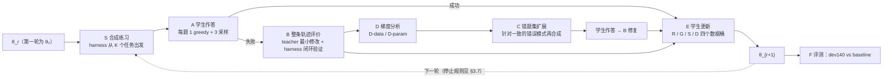

# Few-shot agent 蒸馏框架 v0：方法、第一轮结果与下一步

日期：2026-11-04 CST。设定：ALFWorld，K20，seed 0，第一轮。
- 预注册：`docs/direction/2026-11-02_v0_prereg_ZH.md`（含修订 1、2 和三条执行偏差）；
- 设计：`docs/direction/2026-11-02_framework_v0_end_to_end_ZH.md`；
- 实验记录：`notes/exp_log.md` 中 `v0-k20-r1-*` 各行。

**结论先行**
- 框架完整跑通了一轮。D-data 版本在 dev140 上成功率 69.3%（140 题中 97 题），θ₀ 为 55.7%（78 题）。逐题配对的 McNemar 精确检验 p = 0.0003，提升远大于评测噪声（θ₀ 两次评测相差约 ±3 题）。
- 这个成绩与 AD 持平（AD 三个 seed 为 74.3% / 67.9% / 69.3%，均值 70.5%），还没有超过 AD。
- 均匀权重对照（D-data 的数据，不加权）为 71.4%（100 题），与 D-data 无显著差别（p = 0.66）。提升来自合成、修复、扩展这条数据管线；梯度一致性加权在 K20 上没有可测的作用。第一轮的分组本来就退化为一个大组（134 个修复中 123 个），这个检验的力度有限，K10 的分组更均衡，是更好的检验。
- D-param 版本为 60.7%（85 题），与 θ₀ 无显著差别（p = 0.25），显著低于 D-data（p = 0.023）。D-param 的扩题分配方式和参数限制两处都与 D-data 不同，用 D-param 的数据训练全部参数的对照 B 正在运行，用来区分是哪一处造成的。

---

## 1. 设定与记号

- **学生**：Gemma-4-E4B，参数记为 θ，LoRA 微调。**teacher**：gpt-6-luna，黑盒，只能看到它输出的文本。
- **训练数据的边界**：只有 K = 20 条 teacher 成功轨迹，与所有 baseline 相同。额外的监督只能来自三处：
  - harness 在这 20 个任务自己的游戏上合成的新任务；
  - 学生在合成任务上的作答；
  - teacher 与 harness 的查询。

  不使用其他官方训练任务。dev140 只做最终评测。
- **θ₀**：K20 轨迹 SFT（主网格 `e4b-tsft-k20-e32-lr5e-5`，seed 0），是本框架的起点，也是 baseline "轨迹 SFT" 的 seed 0。
- **记号**：
  - 任务描述 $`x`$；
  - 第 $`t`$ 步的环境观测 $`o_t`$；
  - 第 $`t`$ 步之前的完整历史 $`h_t = (x, o_1, y_1, \dots, y_{t-1}, o_t)`$；
  - 学生在第 $`t`$ 步的输出 $`y_t`$，格式为 `Thought: …` 换行 `Action: a_t`；
  - 学生策略 $`\pi_\theta(y_t \mid h_t)`$。
- **训练样本**：一个决策行是一对 $`(h_t, y_t)`$。训练目标是带权负对数似然：

```math
\mathcal{L}(\theta) = -\sum_{i} w_i \sum_{t \in T_i} \log \pi_\theta(y_{i,t} \mid h_{i,t})
```

  其中 $`i`$ 是 episode，$`T_i`$ 是它被监督的决策（跳过被环境拒绝的动作和重复的被拒动作），$`w_i`$ 是 episode 权重。
- **成功率**一律指 dev140 140 个任务各跑一次 greedy 的完成比例。

## 2. 框架总览



一轮的七个步骤：

| 步骤 | 输入 | 做什么 | 输出 |
|---|---|---|---|
| S 合成练习 | K 个任务的游戏文件 | harness 按改动幅度分四档合成新任务和出错状态，每个都要有可解见证 | 合成训练题，另留出一批合成题，永不训练 |
| A 学生作答 | θ_r，合成题 | 每题 1 次 greedy 加 3 次采样（T = 0.7，top_p = 0.95，H = 40） | 学生轨迹，有成功也有失败 |
| B 评价与修复 | 失败轨迹、harness 逐步标注 | teacher 读整条轨迹，只在走不通的地方做最小修改；harness 真实执行来验证 | 验证成功的修复 episode |
| D 梯度分析 | 修复 episode | 在 θ_r 上计算每个修复的梯度，按 D-data 或 D-param 两种方式使用 | 分组与权重，或选中的参数块 |
| C 错题集扩展 | D 的结果 | 针对一致的错误模式再合成同类题，作答后失败的再走 B | 更多修复，以及学生自己的成功 |
| E 学生更新 | 四个数据桶 | 从 θ₀ 训练 | θ_{r+1} |
| F 评测 | θ_{r+1} | dev140，与 baseline 用同一流程 | 成功率，配对检验 |

**这个框架在主流 agent 训练流程中的位置**：相当于把 SFT/黑盒蒸馏（第 3 步）和 on-policy 交互加自动验证（第 4 步）合成一步。
- 学生在自己访问到的状态上犯错，teacher 只在断点处给出最小修正，harness 用真实执行来验证。
- 理论依据是 DAgger（Ross, Gordon & Bagnell 2011，arXiv 1011.0686）：
  - 离线模仿的误差界随 horizon $`T`$ 按 $`T^2\epsilon`$ 增长（Theorem 2.1）；
  - 在学生自己的状态分布上纠错，误差界变为 $`uT\epsilon`$（Theorem 2.2）。
- 我们与 DAgger 的不同在于不需要专家在每个状态上都给出标注：
  - teacher 只修改走不通的步，与它不同但能完成任务的选择予以保留（殊途同归）；
  - 是否修好由 harness 的真实执行判断，而不是 teacher 说了算。

---

## 3. 新部件：具体做法与第一轮结果

### 3.1 S：harness 合成练习

**为什么需要**：θ₀ 在自己的 20 个原任务上 1 次 greedy 加 3 次采样全部成功（100%），原题上几乎没有错误可修。所以错误必须由合成练习暴露出来，合成是整个框架的入口。

**做法**：从每个 K20 任务自己的游戏出发，按改动幅度分四档。
- **很近**，两种生成器：
  - G1：同任务、同场景，只把目标物体放到另一个能放它的容器里；
  - G3：在原示范中间真实执行一个受控错误（被拒动作、拿错物体、放错位置、一段无效搜索），让学生从那里接着做。
- **中等**（G2）：同任务类型，换目标物体或容器。
- **远**（G2）：同场景，换一种任务类型。
- **很远**（G5）：组合改动，换任务类型、换位置，再加同类干扰物。

接纳条件：
- 能用现有环境加载；
- 任务文本与新目标一致；
- 有成功见证，用 Fast Downward 规划器在 harness 里真实执行成功。见证只用来证明可解，不进入训练文本；
- reset 两次结果相同；
- 与 dev140 及所有冻结集的任务组都不重合。

**结果**：
- 合成 206 个训练题，各档为很近 66、中等 80、远 40、很远 20。另有 71 个留出题，永不训练。
- 与登记比例 50/30/15/5 的偏差：9 个 K20 种子的任务组出现在冻结集中，它们"很近"档的候选全部被排除，所以实际比例是 32/39/19/10%。这条已记为偏差 1。
- 合成阶段不调用 teacher，共 6,352 个环境步。
- θ₀ 在 824 次作答（206 题 × 4 次）中成功 72.9%。至少失败一次的题有 85 个：很近 18/66，中等 43/80，远 16/40，很远 8/20。
- θ₀ 在留出题上至少失败一次的比例：很近 9%，中等 55%，远 45%，很远 50%。没有一档低于停止阈值，所以错误空间还很大。

**设计含义**：错误主要集中在中等以上的改动，也就是换目标物体或任务类型之后。很近的改动学生基本都能处理。这告诉我们学生缺的不是"在熟悉场景里换个位置找东西"，而是"把目标理解对、把动作前提补齐"。

### 3.2 B：整条轨迹评价、最小修改与闭环验证

**做法**：
1. **harness 逐步标注执行事实**：动作是否被拒，前提是否满足（例如加热前是否拿着物体），看过哪些容器、看到了什么，有没有重复。
2. **teacher 读学生的完整轨迹**，给出结构化评价：
   - 学生的计划（子目标序列，附证据步号）；
   - 可以保留的选择（与 teacher 不同但合理）；
   - 走不通的位置和原因，即 breaking point，并标注错误类别；
   - 最小修改：最多 2 个修改块，每块是具体的环境动作。
3. **harness 闭环验证**：
   - 重放到修改处，执行修改，**先重放学生原来的后续动作**；
   - 不成功时交还学生，从修改后的状态继续；
   - 仍然失败，就把新轨迹交给 teacher 再评价，每条失败最多 3 轮。
   - **只有真实执行成功才算修复。**

**为什么这样设计**：
- 早期的开环修补只修好了 1/12 个搜索失败，所以必须闭环；
- 条件引导探针显示，抽象提醒对学生无效，而具体命令有 93% 会被执行，所以修改必须写成具体动作；
- 逐步判断合法性会放行低效搜索，所以按整条轨迹的结果评价。

**结果**：
- 146 条失败作答（每题最多 2 条，共 85 题）中，验证修复成功 134 条（91.8%）。按档：很近 28/29，中等 63/70，远 28/32，很远 15/15。
- 评价轮数：146 条中 109 条只用 1 轮，22 条用了 2 轮，15 条用了 3 轮。
- **修复后的轨迹大部分仍是学生自己的行为**：
  - 学生原来的动作占 69%；
  - 修改后交还学生、学生继续生成的占 14%；
  - teacher 修改的动作只占 17%，平均每个修复约 4.6 个动作。

  因此训练数据在分布上接近学生自己的轨迹，监督也集中在断点处。
- 第一个 breaking point 的类别（134 个修复）：被拒动作 53，目标理解错误 26，缺少前提 23，拿错物体或目标 15，搜索不完整或绕圈 13，其他 4。
- teacher 用量：评价 4.72M 输入 / 0.475M 输出 token。

### 3.3 修改处的理由标签

teacher 修改的动作没有学生风格的 Thought，所以需要补写。理由标签器只看修改处之前的上下文，补写一句与动作一致的 Thought（"前缀一致"），不引用未来才知道的信息。

结果：495 个被修改的决策中，469 个有 teacher 写的理由，26 个只有动作。

### 3.4 D：梯度分析（D-data 与 D-param 两个版本）

在 θ₀ 上，对每个修复 episode $`i`$ 计算 LoRA 参数的梯度：

```math
g_i = \nabla_\theta \Big( -\sum_{t \in E_i} \log \pi_\theta(y_{i,t} \mid h_{i,t}) \Big)\Big|_{\theta = \theta_0}
```

- $`E_i`$ 是被 teacher 修改的决策；
- 计算时关闭 dropout，不执行 optimizer step；
- 有 5 个 episode 的修改只删除动作、没有新动作，它们改用整条 episode 的 loss（偏差 2）。

两个版本对 $`g_i`$ 的用法不同：

| | D-data（比较错题之间） | D-param（比较参数之间） |
|---|---|---|
| 问题 | 哪些错误共享同一种修正方向？ | 哪些参数块被所有修复一致地往同一方向推？ |
| 计算 | 用 CountSketch 把 $`g_i`$ 压到 2,048 维（seed 17）；按余弦距离做 k-medoids（k = min(6, ⌊N/2⌋)）；组一致性 = 组内平均余弦相似度 × 组大小 | 对每个 LoRA 张量 $`p`$ 计算 $`\mathrm{SNR}_p = \lVert \bar g_p \rVert \,/\, \sqrt{\tfrac{1}{N}\sum_i \lVert g_{i,p} - \bar g_p \rVert^2}`$，取最高的 25% |
| C 扩题怎么分配 | 按组一致性分配 | 按 teacher 的错误类别均分 |
| E 训练怎么用 | R 和 G 按组一致性加权（两个桶合起来归一化到均值 1） | 只训练选中的张量，其余冻结，权重均匀 |

**D-data 第一轮结果**：
- 分组退化：134 个修复中 123 个落在同一个大组（组内平均余弦 0.184，一致性 22.6），另有 4 个小组，各 2–4 个成员。
- 加权结果几乎是均匀的：
  - 大组的 R episode 权重 1.088；
  - 小组的 11 个 episode 权重只有 0.007–0.026，几乎被丢掉；
  - G 桶同理：继承大组的 157 个 episode 权重 1.070，其余 9 个为 0.010–0.026。
- 原因：原始梯度的余弦被一个所有修复共享的分量主导，所以几乎所有修复都"很相似"。
- **下一版**：先减去平均梯度再聚类（centered），让分组反映错误之间的差异。

**D-param 第一轮结果**：
- 选中 516 个 LoRA 张量中的 129 个，**全部位于第 20–41 层**（共 42 层）。
- 类型：MLP down 35，MLP up 31，attention o 27，MLP gate 24，attention q 7，attention v 5。
- 可训练参数 39.0M，全部 LoRA 为 139.5M。

这与文献中"任务技能集中在一小部分参数里"的观察一致：
- Skill localization（Panigrahi et al., ICML 2023，arXiv 2302.06600）：约 0.01% 的参数就承担了微调后 95% 以上的性能；
- Surgical fine-tuning（Lee et al., ICLR 2023，arXiv 2210.11466）：只微调一部分层可以持平甚至优于全量微调，而且哪部分层最有效取决于分布偏移的类型。

注意我们的 SNR 是**跨修复的梯度**信噪比，Spectrum（arXiv 2406.06623）用的是**权重矩阵**的信噪比，两者不同。

### 3.5 C：错题集扩展

两个版本各追加 85 个合成题（等于 S 中至少失败一次的题数），仍然只从 K20 原任务出发合成，每题作答 4 次，失败的走 B。

| 版本 | 分配方式 | 作答成功率 | 验证修复 | 进入 G 桶 |
|---|---|---|---|---|
| D-data | 按组一致性（实际近似均匀） | 48%（340 次中 164 次） | 112 条中 107 条（95.5%） | 107 个修复 + 59 个学生成功，3,221 行 |
| D-param | 按错误类别均分（目标理解 15，其余各 14） | 49%（340 次中 165 次） | 108 条中 104 条（96.3%） | 104 个修复 + 58 个学生成功，2,857 行 |

扩展题上学生的成功率（48–49%）明显低于第一批合成题（72.9%），说明扩展确实把练习集中到了学生的薄弱处。

### 3.6 E：训练

四个数据桶，按概率抽样：
- **R（修复）**：134 个 episode，2,915 行，抽样概率 0.50；
- **G（扩展题的修复和学生成功）**：D-data 3,221 行，D-param 2,857 行，抽样概率 0.25；
- **S（学生在合成题上自己的成功，每题最多 1 条）**：175 个 episode，2,616 行，抽样概率 0.15；
- **D（K20 原示范）**：20 行，抽样概率 0.10。

D-data 合计 8,772 行，D-param 合计 8,408 行。

训练配置：
- 从 θ₀ 开始，LoRA 配置与 V2 相同，batch 16；
- 对全部决策行过 4 遍：D-data 2,193 次更新，D-param 2,102 次；
- 不做 checkpoint 选择，直接用最终 checkpoint；
- hpg 2×B200，D-data 用时 4h05。

### 3.7 轮次与停止规则（第二轮起生效）

- 每轮先在新合成的留出题上测学生的失败率。某档失败率的 95% Clopper–Pearson 上界低于 5%，该档就停止出题。
- 所有档都停止，或者已满 3 轮，就停止循环。
- 依据是上面 DAgger 的 $`uT\epsilon`$ 界：把"会让 teacher 无法在剩余步数内完成的动作"计为损失，$`\epsilon`$ 就是学生在自己的状态上犯致命错误的单步概率。合成题上学生与见证之间的差距降到噪声水平以后，同一合成分布上已经没有可降的项。剩余的 dev140 差距来自合成分布与 dev 分布的差异，只能靠扩大生成器的覆盖范围来解决。

---

## 4. dev140 结果

评测流程与所有 baseline 完全相同：hpg B200，tree 46b8527，greedy，BATCH_INVARIANT=1。下表列出 dev140 成功率，以及与 D-data 的逐题配对 McNemar 精确检验（双侧）。

| 方法（K20） | seed 0 | seed 1 | seed 2 | 与 D-data 的 p（seed 0 / 1 / 2） |
|---|---|---|---|---|
| **v0 D-data（第一轮）** | **69.3%**（97） | — | — | — |
| θ₀ = 轨迹 SFT | 55.7%（78） | 55.7%（78） | 64.3%（90） | 0.0003 / 0.0009 / 0.26 |
| AD | 74.3%（104） | 67.9%（95） | 69.3%（97） | 0.32 / 0.88 / 1.0 |
| SmartAD | 60.0%（84） | 64.3%（90） | 70.0%（98） | 0.035 / 0.28 / 1.0 |
| SAD | 37.1%（52） | — | — | < 0.0001 |
| v0 D-param | 60.7%（85） | — | — | 0.023 |
| 对照 A：D-data 数据、均匀权重 | 71.4%（100） | — | — | 0.66 |
| 对照 B：D-param 数据、全部参数 | 训练排队中 | | | |

参照：base 30.7%（43），teacher 81.4%（114）。对照 A、B 是看到 D-data 结果后加的，登记在预注册修订 4。

**D-param 与对照 A 的其他配对比较**：
- D-param：vs AD p = 0.005 / 0.21 / 0.065，vs SmartAD p = 1.0 / 0.49 / 0.047。训练 loss 与 D-data 相近（最后 50 步 0.028 vs 0.020），不是没训够。
- 对照 A：vs θ₀ p = 0.0001（多对 26 题，少对 4 题），vs AD p = 0.64 / 0.57 / 0.77，vs SmartAD p = 0.014 / 0.13 / 0.86。

**评测噪声**：同一个 θ₀ 重新评测一次得到 57.9%（81）。与原来的 55.7%（78）相比，有 15 题结果翻转（6 题对变错、9 题错变对），p = 0.61。所以两次评测之间约有 ±3 题的噪声，比较时只看配对检验，不看单次差几题。

**D-data 相对 θ₀**：多做对 23 题，少做对 4 题，p = 0.0003。与 θ₀ 的重测结果相比也是 p = 0.0025。

**与预注册判定的对照**：
- "框架跑通"（至少一个版本比 θ₀ 显著更好）：**达到**。
- "达到目标"（超过 AD 三个 seed 的均值 70.5%，即 98.7 题）：**未达到**（69.3%）。v0 本来就不要求达到这一条。

**这一轮的成本**：
- teacher：13.87M 输入 / 1.40M 输出 token，按已结算的 ledger 统计，包括两个版本的评价、理由标签和扩展；
- 合成：6,352 个环境步；
- 训练：每个版本约 2,100–2,200 次更新。

**归因上的提醒**：
- D-data 的加权在这一轮近似均匀，所以这 13.6 个百分点的提升主要来自合成、整条轨迹修复、扩展这条数据管线，不能归功于梯度加权。
- 均匀权重对照（对照 A）已经证实了这一点：不加权得到 100 题，与 D-data 的 97 题无显著差别。
- D-param 比 D-data 少 12 题。它的扩题按错误类别均分，并且只训练 25% 的张量（39.0M，D-data 为 139.5M），两处差异要靠对照 B 分开。

---

## 5. 与 weight-space programming blog 的对照与启示

**blog 的事实**（rikiyat.github.io/blog/weight-space-programming，11-04 重读原文）：
- 改权重的是一个 LLM（GPT-6 Astra）。它有一个可以读写目标模型权重的 Python kernel，但没有 GPU，不能训练，也不能用梯度，只能做 10/25/50 批 forward。
- 它找到一个"循环"方向，在第 15 层和第 19 层的 MLP 上各改 64 列，去掉这个方向。共 131,072 个权重，占 0.016%。
- 结果：MATH-500 从 7.9 到 48.1，GSM8K 从 13.8 到 67.1，IFEval 从 21.0 到 62.3。
- 在 Gemma 3 270M 上失败。作者的解释是这种编辑"去掉了遮住能力的障碍，但不能凭空加入能力"。

对我们的启示：

1. **区分"障碍"和"能力缺失"，两者用不同的工具。**
   - θ₀ 在合成题上已经有 72.9% 的作答成功，很多失败更像障碍而不是能力缺失：被拒动作后重复同一个动作、读错目标、漏掉前提。这类错误可能对应少数几个可以移除的方向。
   - 学生确实没学会的技能（例如某类任务的完整步骤），只能靠修复数据去教。
   - 现在的框架只有数据这一种手段；加上权重编辑，就能对两类错误各用合适的工具。

2. **teacher 直接分析并修正学生，不必把"诊断"和"优化"拆成两步。**
   - blog 中的 editor 只能做 forward，预算很小，没有梯度，却仍能找到有效的编辑。我们的 teacher 同样是黑盒，但学生是白盒，而且 harness 能给出真实执行结果，信息比 blog 的设定更多。
   - 所以 D 步目前由固定规则做的事情（加权哪些数据、训练哪些参数），可以改由 teacher 读取学生内部状态后决定：读 logit lens、注意力、激活修补的结果，提出假设，再用 harness 的 rollout 验证。
   - 这就是正在进行的 P0（§6），也是下一版部件 S-agent 的基础。

3. **定位：梯度集中在中后层，但只训练这些层反而变差。**
   - D-param 选出的 129 个张量全部在第 20–41 层，MLP 占 70%。blog 改的也是 MLP（第 15、19 层）。
   - 但只训练这些张量的 D-param 在 dev140 上比 D-data 少 12 题，与 θ₀ 无显著差别。梯度信噪比高的位置不一定是训练时唯一需要改的位置；更可能的情况是，其余参数承担了迁移到 dev140 所需的部分。对照 B 出结果后才能下结论。
   - P0 的固定规则对照取第 20–41 层，可以从另一个角度检验这一点：在这些层做定向编辑能否修正失败。

4. **D-data 的"大组"可能就是一个共享的错误方向。**
   - 134 个修复的梯度有一个共同分量，导致它们几乎都落在同一组。这个共同分量可能对应 blog 中那种单一的"障碍方向"，即所有失败共有的倾向，例如过早结束搜索、或者在动作被拒后照样继续。
   - 这是假设，可以检验：
     - 把共享分量当作编辑方向，在留出的失败上看 rollout 成功率是否提高。这正是 P0 中"固定规则方向"对照所做的事；
     - 把它减掉之后再聚类，看剩下的错误能分成哪些模式。

5. **所有诊断都必须可验证。**
   - blog 用留出的 benchmark 验证编辑；我们用 harness 在没见过的失败状态上做真实 rollout，并检查附带伤害：在学生原本做对的 200 个决策上，编辑改变了多少个。
   - 相关性只算假设，只有真实执行的成功率才算证据。

---

## 6. P0：黑盒 teacher 能否读懂白盒学生（已完成：不成立）

预注册：`docs/direction/2026-11-04_P0_whitebox_diagnosis_prereg_ZH.md`（定稿 6461f09）。

**问题**：只给 gpt-6-luna 读取学生内部状态的工具和 harness，它能否给出可验证的失败诊断，并据此提出一个能推广到没见过的失败上的权重编辑？

**单位**：
- 一个已验证修复中，原失败轨迹与最终验证执行的第一个分叉步 t*：
  - 两者在 t* 之前动作相同、观测相同，所以状态完全一样；
  - a_f 是学生原来的动作，a_r 是 teacher 的修改动作。
- 共 113 对，覆盖 74 个任务实例。按任务实例划分：诊断集 23 对给 teacher 用，测试集 90 对 teacher 永远看不到。

**工具**（作用在学生的单个决策上）：
1. 候选动作打分；
2. 逐层 logit lens；
3. 注意力在各上下文片段上的分布；
4. 改写上下文；
5. 激活修补；
6. 方向构造与权重编辑 $`W \leftarrow W - \alpha\, u u^\top W`$，其中 $`u`$ 是方向 $`d`$ 经过紧随其后的 RMSNorm 权重 $`g`$ 缩放后的单位向量 $`u = g \odot d / \lVert g \odot d \rVert`$；
7. 真实 harness rollout。

每个类别的预算是 60 次工具调用、10 次 rollout、5 个候选编辑。

**判定**：
- 在测试集上，teacher 的编辑要同时优于三个条件：
  - 不编辑；
  - 同样层数和 α 的随机方向（5 个 seed）；
  - 固定规则方向（诊断集上失败与修复的动作 token 残差之差）。
- 主指标是 rollout 成功率，用 McNemar 检验。
- 附带伤害不超过 5%，K20 原题成功率不下降。

**目前进展**：
- 工具已经在 rai 上用真实模型跑通：9 类工具调用都能运行；θ₀ greedy 能复现原失败动作（2/2）；权重编辑可以精确还原；一次 40 步的真实 rollout 用时 70 秒。
- 前两次真实运行暴露了 agent 协议的问题，两次都作废，测试集一次也没碰过：
  - 第一次：prompt 没写清目标和评判方式，teacher 没跑任何 rollout 就提交了编辑；
  - 第二次：teacher 习惯一次发多个工具调用，被旧协议判为格式错误。
- 第三版协议允许一次最多发 8 个调用，提交前必须先用 rollout 验证该编辑，reasoning effort 设为 high。第四版再加上 JSON 输出模式和容错解析，五个类别都正常提交并冻结。
- 冻结的编辑：目标理解错误 第 41 层 down 投影，α = −0.1；缺少前置条件 第 23 层 down，α = 1.0；动作被拒后继续 第 23 层 down，α = 0.5；搜索不完整或循环 第 25–35 层 down，α = −0.1；物体或目标选错 第 41 层 down，α = 1.0。

**结果（11-05 02:55 CST 完成，P0 不成立）**：

测试集 90 个配对，每个条件从分叉状态起做一次 greedy rollout，按配对做 McNemar 精确双侧检验。

| 类别 | N | 不编辑 | teacher 编辑 | 随机方向（5 seed 均值） | 固定规则方向 |
|---|---:|---:|---:|---:|---:|
| 目标理解错误 | 23 | 13.0% | 21.7% | 13.0% | 21.7% |
| 缺少前置条件 | 32 | 28.1% | 31.2% | 26.9% | 37.5% |
| 动作被拒后继续 | 14 | 14.3% | 28.6% | 14.3% | 35.7% |
| 搜索不完整或循环 | 8 | 0.0% | 12.5% | 0.0% | 12.5% |
| 物体或目标选错 | 13 | 46.2% | 46.2% | 40.0% | 38.5% |
| **合并** | 90 | 22.2% | 28.9% | 20.9% | 31.1% |

- teacher 编辑 vs 不编辑：8 对变好、2 对变差，p = 0.11；vs 随机方向：5 个 seed 中最大 p = 0.15（逐个为 0.09 / 0.002 / 0.11 / 0.065 / 0.15）；vs 固定规则方向：10 对 vs 12 对，p = 0.83。
- 固定规则方向 vs 不编辑：16 对 vs 8 对，p = 0.15。
- 附带伤害：每个类别的 teacher 编辑在 200 个原本做对的决策上改变 0–5%，都在 5% 以内；K20 原题仍全部成功。
- 决策翻转率（分母为 θ₀ 能复现 a_f 的 77 对）：teacher 0–25%，固定规则 0–50%，随机方向几乎为 0。
- teacher 自己写的 24 条预测中 19 条在测试集上成立（79%），但大多是"增益 > 0""附带伤害 ≤ 5%"这类宽松的预测。
- teacher 用量：诊断阶段约 7.75M 输入 token。

**结论**：
- 按预注册判定，P0 不成立：teacher 的编辑没有显著优于不编辑，也没有优于固定规则方向。黑盒 teacher 读取学生内部状态之后提出的方向，并不比"失败动作与修复动作的残差之差"这条简单规则更好。
- 秩一权重编辑是安全的（附带伤害小），但效果也小：在没见过的失败上最多提高几个百分点。
- 这与 D-param 的结果一致：到目前为止，在参数层面做定向干预（只训练选中张量、直接编辑权重）都没有带来收益，收益来自数据（teacher 修复的 on-policy 轨迹与合成练习）。
- 因此按预注册不进入 P1（以权重编辑为核心的 S-agent）。下一步的改进放在数据一侧。

---

## 7. 下一步

按"先整体、再部件"的原则排序：

1. **把 D-param 的两处差异分开**：对照 B（D-param 的数据，训练全部参数）已提交 hpg。若它回到 95 题以上并显著高于 D-param，就放弃"只训练选中张量"；若与 D-param 相同，则问题在按类别分配的扩题。K10、K30 每个 K 训练四个版本：D-data、对照 A、D-param、对照 B。
2. **第二轮**：
   - 按 §3.7 用新合成的留出题测失败率，按"失败率 × 修复成功率"重新分配各档的出题份额；
   - 训练起点比较两种：从 θ₀ 用全部数据重训，或者从第一轮 checkpoint 继续训练、只用新数据加回放；
   - 选择只看合成留出题，dev140 最后才用。
3. **D-data 升级**：先减去平均梯度再聚类。均匀权重对照已经说明，现在的加权没有作用；去掉共享分量后，分组才可能真正区分不同的错误模式。
4. **P0 不成立，不做以权重编辑为核心的 S-agent。** teacher 读取内部状态后提出的编辑不比简单规则好，D-param 也没有收益。参数层面的定向干预暂时搁置，诊断结果只用于数据一侧：按 teacher 给出的错误类别和机制假设决定补哪类练习。
5. **事后消融（已预注册）**：每次去掉一类生成器（G1、G2、G3）重新训练，回答 harness 的哪类合成最有用。
6. **必要的对照与扩展**：
   - 在同一批合成题上做 RL（GRPO 类）对照，回答"teacher 的最小修改是否比只用成功信号更有效"；
   - seed 1、2；
   - K10、K30。
7. **评测噪声**：单次评测有约 ±3 题的噪声。最终表格考虑每个模型评测两次取均值，或者报告配对检验的置信区间。
