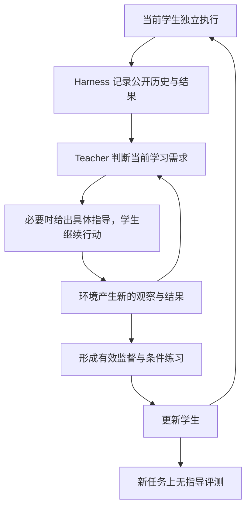

# 学生驱动的交互式 Agent 蒸馏：Teacher 与环境 Harness 联合指导

## TL;DR

我们研究在黑盒 teacher 和少量初始成功示范下，如何提升小模型独立完成 agent 任务的能力。ALFWorld 实验显示，学生能完成训练实例，却仍在新任务中误解目标、遗漏动作前提、忽略执行失败，并沿固定顺序搜索。新的条件提示实验进一步发现：一次性抽象提醒很少改变即时行动；具体行动指导能在部分案例中推动进展，但后续困难会抵消收益。我们据此设计学生驱动的交互式蒸馏：当前学生执行，teacher 与环境 harness 根据公开证据持续审阅决策，必要时给出具体行动指导，并依据新观察调整；随后从局部有效决策和完整成功交互中构造无提示监督，通过条件变化练习检验迁移。方法仍由“发现学习需求、联合指导、学习与迁移”三个部分组成。现阶段优先验证效果，不限制 teacher 或环境交互预算；最终指标是学生在新任务上、没有 teacher 指导时的成功率。

**版本与范围**：v0.3，2026-10-26（CDT）；纳入 CG probe 结果，更新联合指导、监督构造与机制验证计划。
**Teacher**：GPT-6-luna，仅使用黑盒文本接口。  
**Student**：Gemma4-E4B-it。  
**环境与初始示范**：ALFWorld，K ∈ {10, 20, 30, 100}。  
**当前状态**：已完成 baseline 分析、早期执行干预和一次性条件提示 CG probe；teacher 闭环接管、持续联合指导及训练后的独立学习收益仍待验证。

K 表示初始 teacher 成功示范数。训练期间允许使用额外的合法训练任务、学生 rollout、teacher 指导和环境反馈。因此，本设定是“小规模初始示范下的交互式蒸馏”，不把追加监督隐含地算成只有 K 条训练数据。资源用量可以记录，当前不以成本、调用次数或等预算比较作为方法设计目标。

## 1. Motivation

<a id="motivation-1-1"></a>

### 1.1 实验发现：训练实例学会了，新任务中的决策条件仍未掌握

我们在 ALFWorld 上系统分析了离线蒸馏后的学生：
- 四种 baseline（轨迹 SFT、AD、SAD、SmartAD），初始示范 K=10–100，覆盖全部已评测的学生配置，逐条阅读学生的动作、observation 和公开 Thought，并对每个现象做全量统计；
- 冻结学生在困难前缀上的受控续跑。

下面的现象在不同方法、不同 K 和不同任务类型上一致出现，不是个别任务或个别房间的特例。每一项的实验设置、逐条轨迹证据、全量统计、图表和局限，见对应的结果页面。

1. **学生复现了训练实例，却没有学会在新的执行历史中决策。**
   - 小样本蒸馏后的学生在自己的训练任务上全部成功，动作与 teacher 示范逐字相同，多次采样也不改变。
   - 换到同分布、但没训练过的任务，多数执行失败，而且失败分布在各种任务类型上。
   - 训练集上的成功，并不说明学生已经能在新的历史中正确决策。
   → [M1：训练实例与新任务](motivation/M1_train_vs_new_tasks_ZH.md)
2. **失败集中在四类决策条件上，每一类都普遍存在。**

| 学生缺少什么 | 普遍观察到的现象 | 为什么少量成功示范难以补齐 |
|---|---|---|
| 对任务要求的正确理解 | 训练中没出现过的目标表述，成功率持续偏低；学生会看到满足要求的物体却不拿，把表述中的修饰词当成另一类物体，或把最终放置位置与所需操作混为一谈 | 示范覆盖的表达有限，学生可能把词语与某套动作直接绑定，没有稳定区分物体、所需状态和目标位置 |
| 对动作成立条件的掌握 | 违反成功示范中只是隐含的动作前提，例如变换时物体须在手中、一次只能持有一件；把示范中的绕路当成必要步骤 | 成功轨迹中关键前提通常是隐含的，teacher 的绕路也可能被学生当成必要步骤 |
| 根据执行结果更新判断 | 动作被环境拒绝后，仍按"已经生效"继续计划，并重复发出同一个被拒绝的动作 | 示范未必覆盖学生会造成的失败状态，也未明确教会"尝试执行"与"实际生效"的区别 |
| 根据已有观察调整探索 | 在一类位置上逐个穷举，很少切换位置类别；搜索方式不随已经排除的位置而改变，而 teacher 在同样任务上会频繁切换 | 学生容易学到平均搜索顺序，尚未掌握如何结合当前观察、目标类型与剩余行动机会决定下一步 |

   → [M2：失败形态、四类困难与 K 的作用](motivation/M2_failure_analysis_and_K_ZH.md)，其中第 2 节说明了如何从逐条轨迹归纳出这四类。

**统一解释是：少量示范让学生见到了几个实例中的做法，但尚未充分学清楚任务要求什么、这些做法在什么条件下有效，以及条件不满足或信息不足时应该如何调整。**

3. **增加离线示范只能补上一部分。**
   - 示范增多以后，前三类失败明显减少；但探索方式几乎不变，剩下的失败越来越集中在"始终没找到目标"上。
   - 增加的示范补上的，是每类任务的规则和表述覆盖，而不是对具体环境的记忆。
   → [M2 §5](motivation/M2_failure_analysis_and_K_ZH.md#m2-k-effect)
4. **一次性提示的作用有限。**
   - 在冻结学生的困难前缀上，抽象的条件提醒几乎不改变即时行动。
   - 一条具体行动通常会被执行，并能带来局部进展，但只覆盖一步。
   - 学生随后回到原有习惯，或在下一个条件（持有物、被拒绝的动作）上失败。
   - **指导的价值需要沿"行动是否改变、实际是否推进、后续能否完成"分别检验，不能只看学生是否复述条件或最终是否看到目标。**
   → [M3：一次性条件提示（CG probe）](motivation/M3_cg_probe_ZH.md)

这些现象来自已有日志分析和受控续跑。它们支持上述机制假设，但尚未单独证明某一种训练设计导致了这些失败；一次性提示的结果也只针对当前提示内容、插入位置和冻结学生。它们推动我们采用持续、可执行的教学，并将提示响应与学习效果分开验证。

### 1.2 为什么解决这些困难必须认真考虑环境

Agent 的动作会改变环境，环境又决定下一步能看到什么。用 $`x`$ 表示任务，$`h_t`$ 表示截至当前的公开交互历史，学生的行为过程是：

```math
a_t \sim \pi_\theta(\cdot\mid x,h_t),\qquad
o_{t+1}\sim P_{\mathrm{env}}(\cdot\mid h_t,a_t),\qquad
h_{t+1}=h_t\oplus(a_t,o_{t+1}).
```

学生最终需要掌握的是这个闭环中的决策能力。对于前述困难，环境有三项无法由一段静态解释完全替代的作用：

1. **提供执行证据。** 一次 take 是否成功、某个条件是否满足，需要由实际观察确认。Teacher 说某一步合理，不等于该动作已经产生预期结果。
2. **提供尚未获得的信息。** 如果目标物体的位置尚未被观察，teacher 阅读相同的公开历史也不会自动知道答案。需要采取探索动作，再依据新观察继续判断。 探索允许目标位置未知；访问一个尚未确认的位置，不代表学生已经断定目标在那里。指导应帮助选择信息获取行动，并根据结果继续决策。
3. **检验不同路线。** 学生采用与示范不同的顺序或物体实例，仍可能完成目标。应当通过实际结果判断，而不能只以是否匹配 teacher 的一条路线决定对错。

这也是顺序决策中分布偏移问题的来源：学生自己的动作会使它访问 teacher 示范之外的历史。DAgger 的基本思路是在学习者访问的状态上取得专家监督；ReAct 则展示了推理、行动与外部观察交替更新的价值。[R4][R5]

因此，我们提出的设计要求是：**训练过程需要让学生真实执行，并让观察结果影响接下来教什么、怎么教，以及哪些经验可以用于学习。** 这为针对性解决上述困难提供直接证据。现有结果并不支持“没有在线交互就绝对不能提升”这一更强断言；我们要验证的是，交互式反馈能否解决仅靠当前少量离线示范未充分解决的问题。

### 1.3 现有离线 agent distillation 主要在优化什么

我们所评测的离线路线，核心训练形式通常是先生成、筛选或组织 teacher 轨迹，再通过 teacher forcing 让 student 拟合相应输出。不同方法并非只有数据选择这一处差异：

| 路线 | 文献中的主要设计 | 与当前问题有关的局限 |
|---|---|---|
| 轨迹 SFT | 将成功轨迹中的 assistant 输出作为训练目标 | 监督主要来自 teacher 访问的历史，未直接回答当前学生遇到困难后应该怎么办 |
| AD / Kang et al. | 蒸馏 reason–act–observe 轨迹；改进 teacher 轨迹生成，并提出推理时的动作自一致性机制 [R1] | 核心训练仍依赖已生成的轨迹；原论文的推理改进不能等同于训练时学生与环境的反馈闭环 |
| SAD | 区分 reasoning 与 action spans，设计分段对齐目标与课程采样 [R2] | 结构化监督改变“如何匹配”，本身不保证覆盖学生实际产生的历史 |
| SmartAD | 在正确 teacher 候选中，按学生 NLL 选择轨迹，并对不同片段加权 [R3] | 学生对 teacher 轨迹的似然可帮助选择较易学习的数据，但不等于学生在环境中的真实执行表现 |

对黑盒、文本标签实现，可以用下式概括其常见训练形式：

```math
\mathcal L_{\mathrm{offline}}(\theta)
=
\mathbb E_{(c,y)\sim D_T}
\left[-\sum_j w_j\log \pi_\theta(y_j\mid c,y_{<j})\right].
```

其中 $`D_T`$ 是生成、筛选后的 teacher 数据，$`c`$ 包含任务和已有环境观察，$`w_j`$ 表示监督 mask 或片段权重。

其重要限制在于：**训练中的前缀主要由固定数据提供，而不是由更新中的学生实际行动持续产生；当前学生执行后的后果，也没有形成针对该次决策的直接训练反馈。** 数据中可以包含环境 observation，因此不能说这些方法完全没有环境信息。它们缺少的是让环境参与当前学生的教学循环。

同样，不能无条件把 SAD 原论文与普通 SFT 画等号。原文还涉及 teacher 分布和动作空间对齐；只有在具体黑盒实现退化为文本硬标签、使用相同输出空间、mask、权重和归一化等条件下，才可能与对应的 assistant-token SFT 数学等价。本文讨论的是我们实际评测的离线训练路径，不将某种实现的限制泛化为论文的全部设计。

### 1.4 On-policy 文献提供了什么，以及我们还要解决什么

On-policy distillation 的关键不只是“teacher 打一个分”，而是**让监督作用于当前学生自己产生的输出或访问的历史**。GKD 在学生生成序列上利用 teacher 分布反馈；这类概率对齐通常需要 teacher 的 token 概率，不能直接照搬到仅返回文本的商业 API。[R6]

黑盒条件下也已有不同路线。GAD 从 teacher 与 student 的输出训练 discriminator，再用其反馈优化学生；ActionOPD 在学生访问的状态上采样 teacher 动作，以语义动作一致性提供策略优化信号。[R7][R8] 它们分别体现了“从学生样本学习”和“以动作而非逐字推理作为监督单位”的思路。对于我们的研究，仍要进一步考察环境实际结果：与 teacher 相似或不同，并不独自决定一条 agent 路线能否成功。

已有 agent 工作也已使用学生执行和后续指导。OEC 从学生生成的前缀切换到 expert 续做，再进行筛选与 SFT；SCoRe 让 teacher 审阅完整学生轨迹、干预最早错误，并进一步采用短视野 RL。[R9][R10] 因此，“学生 rollout + teacher 反馈”以及“交互式蒸馏”本身都不能作为我们的首创声明。

结合实验，我们进一步提出的研究重点是：

> **让 teacher 理解当前学生的计划与困难，让 harness 持续提供真实证据与验证，形成可随观察更新的教学过程；再检验这种教学能否让学生学会决策条件，并在没有指导的新任务上独立应用。**

这里有三个相互衔接的假设：当前学生的执行能暴露值得教学的问题；teacher 与环境联合指导能改善这些状态下的行为；有效指导经过学习与条件变化练习，能够转化为独立、可迁移的能力。后面的三个方法部分与验证计划分别对应这三个假设。

## 2. Proposed Method

### 2.1 总体设计：发现学习需求、联合指导、学习与迁移

我们将方法组织成三个部分，四类困难作为同一个教学机制的不同内容，不分别搭建四套独立系统。

| 部分 | 解决的问题 | 核心输出 |
|---|---|---|
| A. 当前学生执行，发现学习需求 | 学生究竟在哪些真实历史上需要帮助？ | 独立 rollout、可重放前缀、候选学习需求 |
| B. Teacher 与 harness 联合指导 | 在当前证据下，怎样帮助学生继续推进？ | 随观察更新的具体指导、学生行动及验证结果 |
| C. 学习更新与条件迁移 | 怎样把这次帮助变成学生自己的能力？ | 局部与完整成功经验形成的无提示监督、条件练习和独立策略 |



我们优化的最终目标是：

```math
J(\theta)=
\mathbb E_{x\sim D_{\mathrm{eval}},\,\tau\sim\pi_\theta,P_{\mathrm{env}}}
[\mathbf 1\{\text{原任务成功}\}],
```

其中评测 rollout 没有 teacher 提示、接管或额外决策服务，沿用 baseline 的环境接口、提示格式和 H=40。训练时可以反复探索和验证，但增加训练资源不改变这一评测定义。

方法不要求 teacher logits、hidden states 或梯度。学生的梯度可用于正常训练，但梯度聚类不属于本版核心部件。

### 2.2 A：让当前学生执行，发现真正的学习需求

**设计理由。** 如果只看 teacher 轨迹，就不知道当前学生会在哪些条件下产生错误；如果学生已经掌握原 K 个实例，仅重复这些实例也难以取得新的教学信号。我们根据学习者访问分布的思路，每轮更新后重新采集当前学生的行为。[R4]

**具体流程。**

1. 从已有 K-shot checkpoint 开始，避免重复已有初始化工作。首轮机制验证使用现有 SFT-K20 的 θ₀。
2. 在原 K 个任务和额外训练任务上进行无指导 rollout。额外任务来自合法训练池，排除保留的评测与诊断集合；不从 dev140 提取轨迹回灌训练。
3. 保存任务文本、每一步公开 Thought、Action、observation、终止原因和任务结果。Thought 用于理解学生表达出的计划，不作为内部真实原因的保证。[R11]
4. Teacher 对完整轨迹做事后审阅，形成候选学习需求：目标理解、动作前提、反馈更新、信息获取，也允许“暂不能判断”或多项并存。
5. 将需求关联到可重新访问的公开历史。需要继续探索的案例，从尚有行动空间的前缀或任务起点开始新教学 episode，不在已经耗尽 40 步后宣称可以继续完成原次评测。

这里不把“偏离 teacher 路线”当作错误，不要求总是找到最早错误，也不以最小动作编辑距离决定教学目标。Teacher 应先判断当前计划哪些部分仍然可行，再说明接下来需要补充什么。

**如何保持可重放。** 使用已有 reset 和动作前缀重放能力恢复环境，核对真实 observation。环境状态通过动作恢复，模型上下文通过日志恢复，两者分别处理。不假定 ALFWorld 已提供任意状态编辑或原生 snapshot API。

**如何避免事后信息泄漏。** 完整轨迹可以用于选择教学案例与位置，但生成当前指导时，只输入该位置已经可用的公开历史、任务和一般环境规则。后续才发现的物体位置、实例编号或动作结果不能倒灌到先前的指导中。

**本部分的输出。** 每个教学案例保存一个可复现的起点，以及“学生想做什么、现有证据是什么、哪些条件未知或被否定”的记录。这个记录是待检验的教学假设，不是已经证明的唯一错误归因。

### 2.3 B：Teacher 与 harness 共同提供随观察更新的指导

**设计理由。** Teacher 能解释目标、提出计划和识别可能缺失的条件；harness 提供实际执行结果与事实核对。CG probe 表明，一次性指出“位置未知”没有可靠地改变当前学生的行为。我们的默认教学方式因此采用具体行动指导和逐观察更新，同时保留条件解释作为教学与训练内容。冻结学生能否立刻理解抽象提示，不作为后续学习实验成立的前提。

#### 2.3.1 两者各自负责什么

| Teacher 负责 | Harness 负责 |
|---|---|
| 理解学生表达出的计划和当前困难 | 保存真实动作、observation 与结束原因 |
| 区分任务要求、已知事实、假设和未知信息 | 从公开记录提取可核对事实，并保留证据位置 |
| 结合当前条件提出下一步行动或探索方向 | 执行动作，核对建议是否产生预期后果 |
| 根据新观察调整指导并把行动交回学生 | 验证局部进展与原任务成功，分别记录 |

Harness 的事实表包含已观察的物体位置、持有状态、动作拒绝记录及已有充分观察的位置。每个事实关联原始 observation；观察不足时保留“未知”。访问过但未打开的容器不自动记为已排除，暂时没看到物体也不等于物体不存在。

动作语法依据现有环境接口核对。如果日志中有 admissible commands，可用于离线核验；主方法不默认将原 baseline 未提供的列表加入学生或 teacher 的决策输入。教学新增的事实整理服务用于训练；最终无指导评测沿用 baseline 的接口。

#### 2.3.2 先区分行动条件与探索中的未知信息

| 当前情况 | 应检查的问题 | 指导应落实到什么 |
|---|---|---|
| 已知条件未满足 | 当前动作需要什么，公开观察表明缺少什么？ | 先满足前提，再执行相关操作 |
| 执行结果否定原判断 | 哪个状态变化没有实际发生？ | 更新当前判断，重新选择行动 |
| 任务相关信息未知 | 哪些候选尚未排除，下一次观察有何用途？ | 提出探索行动，并说明如何根据结果继续 |

例如，拿着 creditcard 时尝试拿 newspaper，涉及可核对的持有条件。去尚未检查的 cabinet 6 则可能是合理探索，不要求事先证明目标在那里。Teacher 不能仅凭“位置没有证据支持”就判定搜索动作错误。

对于探索，teacher 应结合公开候选位置、目标类型、已有观察和剩余步数，提出下一步获取信息的行动。一次搜索没有命中，不足以证明建议错误；还要看它是否获得有效的新观察，以及下一步是否使用这些观察。Teacher 对探索价值的判断保留为候选判断，不伪装成已验证的最优策略。

#### 2.3.3 默认教学循环：具体建议、真实执行、再次判断

每个教学 episode 中，每到一个决策点执行以下流程：

1. **学生先提出行动。** Student 根据当前公开历史生成 Thought/Action，作为尚未执行的提案。
2. **Teacher 与 harness 审阅。** Teacher 查看该提案和公开事实，判断是否继续、需要指导，或需要示范。学生的有效替代路线可以保留，不以匹配 teacher 的某个固定答案为接受条件。
3. **需要时给出具体建议。** 指导包含当前事实、待满足条件或信息需求、一条合法格式的候选动作，以及执行后要检查什么。条件解释可以很短，但不能只留下抽象提醒。
4. **学生重新决策并执行。** 建议后允许学生重新生成一次行动。若它仍未落实指导或提出明显不可执行的动作，可以由 teacher 指定一步示范，再交回学生；该步明确记为 teacher 行为。
5. **读取真实 observation，重新审阅。** 发现目标、成功拿取、动作被拒绝或子目标变化后，必须根据新状态重新判断。Teacher 建议也可能被环境否定，需要同步更新。

学生提出其他可行行动时，可以保留该行动，不以是否逐字服从建议作为唯一标准。Teacher 对“可行”的判断仍须由后续执行检验；审阅通过不等于环境已验证。

第一版复用现有提示插入机制：原始 observation 保持原文，教学文字使用单独标记的 Guidance 段追加；日志将环境原文和教学内容分开保存。该格式只是当前可执行接口，不假定学生已可靠掌握其中的抽象概念。最终无指导评测移除 Guidance 段及额外决策服务。

每次指导至少记录以下四项：

| 字段 | 例子 |
|---|---|
| 当前事实 | 公开 observation 确认当前持有 creditcard，已看到 newspaper |
| 条件或信息需求 | 拿取 newspaper 前需要处理当前持有物 |
| 下一步行动 | 使用当前公开的物体和容器标识，给出一条放置 creditcard 的合法动作 |
| 后续检查 | 确认放置生效、持有状态改变，再判断能否拿取 newspaper |

第一版可以在每步观察后调用 teacher，不以减少调用为目标。单个 episode 仍为 H=40；失败后允许重新教学或探索。所有实际动作、teacher 示范及独立验证分支分别记录，不把追加训练交互折算成更长的主评测 episode。

#### 2.3.4 指导需要跟随困难变化，直到完成原任务

四类困难作为同一个教学循环的内容：

| 当前困难 | 联合指导的内容 | 环境需要确认的变化 |
|---|---|---|
| 目标理解有误 | 区分物体、所需状态、数量和目的位置 | 学生采取实现相应目标的行动 |
| 动作前提未满足 | 结合当前观察指出具体缺失条件并给出下一步 | 条件改变后，相关操作合法生效 |
| 动作结果被忽略 | 指出实际未发生的状态转移，更新计划 | 后续行动与真实状态一致 |
| 信息尚不足 | 选择探索行动，读取新观察后调整方向 | 更及时发现目标，并保留完成后续操作的机会 |

Newspaper 展示了这种变化：搜索指导帮助发现报纸后，教学重点转为持有条件；拿取成功后，重点再转为完成任务剩余要求。不能在“看到目标”时停止指导，也不能继续重复已经失去作用的位置提示。

学生已经能正确执行时，teacher 可以仅审阅并放行。帮助的内容随当前需要变化，原来的有效计划和选择继续保留。

#### 2.3.5 将事实、局部进展与完整成功分开验证

我们记录三层证据：

- **事实证据**：解释是否符合当前公开 observation。
- **局部执行证据**：建议是否产生了事先指定的结果，例如腾出手、拿到物体或发现目标。
- **任务证据**：该次交互是否最终完成原任务。

局部进展可以提供训练价值，即使后续另有失败。反过来，整题成功也不证明每句话都正确、每一步都必要。需要判断某项指导的增量价值时，采用相同前缀下的有／无指导续跑，比较预先指定的行为与后果。

Actor 和 teacher 默认只使用各自当前路径上的公开观察。额外分支重放用于验证与后续训练标签筛选，不把另一分支才发现的位置或实例编号返回当前学生。若研究特权信息辅助，应另外定义实验，不能混入主方法。

对于搜索，单纯访问新位置或得到一个负面观察，不自动获得正向行为标签；需要检查其与当前任务的关系，并通过后续执行或对照判断用途。不得把一次偶然发现概括成普遍正确的搜索顺序。

### 2.4 C：把有效交互转成学生自己的能力

**设计理由。** 指导能让一次任务成功，只说明教学当场有用。蒸馏还必须让学生在提示消失后保持相应行为，并能在不同条件下知道何时使用。因此，本部分同时处理“怎么更新”和“怎样检验学到了条件”。

#### 2.4.1 从局部有效决策和完整成功交互建立无提示监督

第一条验证路径沿用现有 SFT trainer，训练目标来自上述交互。这样可以在更新方式不变时，直接检验监督来源与内容的价值。当前学生是否当场理解了条件提示，不决定这些经过验证的行为能否作为学习目标。

训练记录采用：

```math
(x,h_t)\longrightarrow(\hat r_t,\hat a_t),
```

其中输入是学生评测时能获得的任务与公开历史，目标是经执行验证的下一步行动，以及需要时提供的简短、与当前前缀一致的解释。

CG probe 说明，同一条轨迹可以先取得有价值的进展，再在其他条件上失败。因此，不将最终成功作为所有局部监督的唯一入口，也不把一条最终成功轨迹中的全部行动都自动标为正确。按证据区分以下记录：

| 记录类型 | 纳入依据 | 训练用途 |
|---|---|---|
| 局部有效决策 | 实际观察确认了相关进展，例如腾出手、拿到物体或发现目标；理由不依赖未来信息 | 监督该前缀下的具体决策，明确其验证范围 |
| 完整成功行为 | 原任务由环境判定成功，目标与观察逐步一致 | 监督经过检查的决策及有效续程 |
| 失败与未知结果 | 动作被拒绝、后果未确认，或探索价值尚无法判断 | 保留为输入历史或后续教学需求，不自动作为正向行为标签 |

例如，Newspaper 中提前发现目标的行动可以成为局部候选监督；后续拿错物体、非法动作和错误状态判断仍要分别处理。局部成功不意味着该动作在所有房间最优，更不能为后续错误背书。对探索动作的正向使用，优先要求直接任务进展或受控续跑证据，避免仅奖励“多查了一个地方”。

数据构造遵守以下规则：

1. **教师提示不作为学生必须依赖的输入。** 目标表达应当自足，不写“按老师刚才说的做”。一般任务规则可以通过标签教给学生；未来位置、实例编号或 observation 不能预先写入。
2. **失败历史保留为有用上下文。** 被拒绝的 take 及其 observation 可以帮助学习状态更新。它们作为输入，不作为这条记录的正向动作目标。
3. **默认只监督最后一个目标回复。** 对前缀中的旧 assistant 回复设 loss mask，避免同时强化原先失败的行为。
4. **动作与观察必须配套。** 行动发生变化后，实际执行并取得对应 observation，不把新动作拼到旧观察上。
5. **多步目标逐步核对前缀。** 删除 teacher 消息后，若学生文字仍依赖已删除的提示，则重新构造自足样本或不使用该段。事后生成解释时仅提供该步可用的历史。
6. **保留具体证据和来源。** 记录谁提出并执行动作、指导内容、预期后果、实际 observation、局部判定及最终任务结果。Teacher 指定的示范与学生自主行动分开标记。
7. **只训练证据支持的内容。** 仅验证了“动作未生效”的案例可监督状态判断；若还未验证更好的下一步，则不虚构一个正确动作。局部有效标签与完整成功标签保持区别。

初始 K 条示范保留为复习数据。新的监督优先覆盖当前学生真实暴露出的困难。训练配置与对照共享，checkpoint 通过无指导 probe 选择，不依据指导下的训练成功率挑选。

**这一实现仍属于交互式模仿学习。** 它改变了监督的产生、内容和验证过程，不构成新的优化器。若它有效，可以支持闭环教学机制的价值，不能单凭这一结果声称已替代 SFT 目标。

#### 2.4.2 可选的策略优化：直接学习环境中的成功行为

为进一步研究逐字模仿以外的学习方式，第二条路径是在上述指导建立可行行为之后，加入**无提示学生 rollout 上的环境回报优化**。

默认回报定义为：

```math
R(\tau)=
\begin{cases}
1,&\text{环境在 H=40 内判定原任务成功},\\
0,&\text{否则}.
\end{cases}
```

策略优化使用当前学生在无提示条件下生成的轨迹。Teacher 用来安排练习、帮助建立可行行为与解释困难；环境结果决定这些独立轨迹的回报。第一版不把 teacher 的主观评分、与 teacher 动作匹配或单纯“访问了新位置”直接等同于任务奖励。

这一路径可以采用已有的策略梯度实现，并与“仅联合指导 SFT”“仅环境回报训练”比较。Teacher 指定的动作、带提示续写和无提示学生动作具有不同生成分布，不能把它们全部当作同一原始策略的 on-policy 样本直接计算更新。

这里有明确的研究分工：

| 学习版本 | 作用 | 能回答的问题 |
|---|---|---|
| 联合指导 + SFT | 本轮首选机制验证实现 | 新的交互式监督是否比现有离线监督更有效？ |
| 联合指导 + SFT + 无提示环境回报优化 | 后续效果扩展 | 当学生能产生可行行为后，优化真实成功率是否进一步改善独立表现？ |
| 仅环境回报优化 | 解释性对照 | 增益有多少来自交互与回报，有多少需要 teacher 的教学？ |

黑盒 teacher 不妨碍第二条路径，因为策略更新需要的是学生概率和环境回报。完整方法也不是无监督学习：它使用 teacher 指导与环境提供的监督。

#### 2.4.3 用条件变化练习检验“学会何时怎么做”

只重新做对原题，可能仍然是在记忆路线。我们围绕已验证的学习需求安排两类练习：保持关键条件、改变表面形式；改变关键条件、要求相应调整行为。

| 学习需求 | 条件保持练习 | 条件变化练习 | 主要观察 |
|---|---|---|---|
| 目标语义 | 同一任务要求的等义表达、不同物体 | 处理工具与最终放置位置不同；需要的状态不同 | 是否依据目标状态行动，而不是按关键词套动作 |
| 操作前提 | 不同物体上的同类操作 | 持有／未持有；手空／已持有另一件 | 是否根据当前条件决定先做什么 |
| 状态更新 | 不同动作的成功反馈 | 同类动作被环境拒绝的历史 | 是否区分意图与实际结果 |
| 信息获取 | 不同房间中的相似搜索目标 | 已排除的位置不同、观察到的线索不同 | 下一次探索是否随证据改变，并改善发现目标或完成任务的表现 |

优先检索现有合法训练实例，并通过真实动作前缀构造对照。新编写的题目必须对应可执行环境和明确的成功判定。不能只改文字目标而继续使用不一致的原 verifier；也不能把本来允许的多余操作自动判错。

对于“已经拿着物体／尚未拿到”这类条件，对照可以通过不同合法前缀形成。对于搜索，不向学生提供未知物体的位置；通过不同训练实例或自然产生的观察前缀检验策略。单个固定房间里一次幸运找到目标，不足以证明学会了搜索。

Newspaper 的直接条件对照是：在两条都已经看到 newspaper 的合法历史中，一条手空，另一条仍持有无关物体，观察学生是否分别选择拿取和先腾出手。搜索的条件对照则改变已经排除的位置或新增线索，检验下一步选择是否相应变化。评价依据是动作和执行后果，不能仅根据 Thought 中出现“未知”“条件”等词判断已掌握机制。

#### 2.4.4 持续更新，逐步撤除指导

每轮学习后，重新运行更新后的学生，重新确定还需要什么帮助。每个教学案例至少配套一次无提示重新尝试；用于判断稳定掌握时，再观察不同 rollout 和条件变化任务。

教师帮助的减少由无提示表现决定，不由固定消息数决定。单个任务被做对后可以降低其教学优先级，但整个训练不以“所有训练题在指导下做对”为结束标准。实验 checkpoint 以保留 probe 的独立表现选择，最后在固定评测协议下与 baseline 比较。

准确地说，这是**学生策略驱动的在线蒸馏**：无提示采集阶段来自当前学生策略；指导、动作示范或分支选择之后的历史属于引导分布。两种数据来源都需要记录。

## 3. 方法验证的进展与计划

### 3.1 验证逻辑：可行教学 → 学生落实 → 独立学习 → 条件迁移

CG probe 的一次续跑失败，可能来自建议本身无效、学生没有落实建议，或落实后遇到新的困难。因此，将原来的“指导有效性”拆成 V1a 与 V1b，再检验学习和迁移：

| 层次 | 需要正面回答的问题 | 直接证据 |
|---|---|---|
| V1a：后续行为可行性 | Teacher 与 harness 能否从学生实际到达的历史上找到有效后续行为？ | 同前缀 teacher 闭环接管，取得局部进展或完成原任务 |
| V1b：指导落实 | 有效的指导能否通过持续交互变成学生的行动？ | 冻结学生接受指导后改变相应决策，实际结果改善 |
| V2：独立学习 | 这些有效经验能否在参数更新后脱离提示保留下来？ | 更新后的学生无提示执行，行为和成功率优于同起点对照 |
| V3：条件迁移 | 学生掌握的是适用条件，还是原实例路线？ | 新措辞、物体、观察历史和任务上，行为随条件正确变化 |

V1a 是能力参照，teacher 失败不证明任务不可完成；V1b 是受指导执行，不能算学生独立能力。即使冻结学生对抽象提示响应很弱，也可以将验证过的具体行为用于 V2。任何一层的局部成功都不能替代后续独立学习和迁移的证据。

### 3.2 计划一：先检验 teacher 可行续程，再检验持续指导

**起点与复用。** 使用现有 θ₀：e4b-tsft-k20-e32-lr5e-5，seed 0，模型 revision ee0ef602。首先复用 CG probe 的 7 个案例、原始前缀和已有 A 分支，再扩展到 U_mech 的其他失败类型。U_mech 和 CG probe 都用于诊断与方法开发，不回灌训练，不作为最终独立泛化证据。

#### 3.2.1 固定前缀并保留难度分层

CG 的 7 个案例继续从同一记录边界出发：重放前 10 个已执行动作，保持最多 30 个后续动作，按原 runner 的索引和日志复现。观察一致性和实际模型输入上下文分别核对；环境重放通过，本身不证明消息格式、上下文拼接或解码完全相同。

原 7 个案例全部保留。依据已有 A 分支找到率标记为：

- **全零**：Kettle-DiningTable、Lettuce、Egg。
- **介于全零与全对之间**：Newspaper、Apple、Kettle-Shelf；其中 Kettle-Shelf 接近地板。
- **全对**：Potato，用于观察原能力是否保持，不能再称作稳定失败案例。

不只保留 A 找到率在 1/8 到 7/8 的案例。中间难度有利于观察提示效应；A 为零而 teacher 可以完成的案例，可能更能揭示学生尚未掌握的能力。Teacher 也未完成的案例仍保留在总表中，另做诊断，不因缺少收益而删除。

扩展到其他问题时，在查看新指导结果之前固定前缀：首次看到目标后、首次相关动作拒绝后，或预先登记的操作决策点。一个案例可有多个困难，但每个局部对照固定其主要检验需求；后续新困难另记，不更换起点以追求更好结果。

#### 3.2.2 V1a：Teacher 从同一前缀闭环接管

Teacher 从学生的相同公开历史与环境状态出发，独立选择后续动作。每执行一步读取真实 observation，再决定下一步，直到原任务成功或剩余 30 步耗尽。输入不包含 CG 后续 rollout 已经发现的物体位置、成功路线或其他分支信息。

这一实验首先回答：在当前学生已经走到的状态上，teacher 是否具备有效搜索和完成后续任务的能力。记录目标何时被发现、能否拿取、必需操作是否完成，以及失败后如何继续。

如果 teacher 从该前缀失败，另从任务起点按完整 H=40 运行，作为不同条件下的诊断。起点成功但前缀接管失败，提示需要检查原前缀消耗的行动机会或造成的状态；两个条件都失败，提示需要继续检查 teacher 策略与接口。有限运行不提供不可解证明。

此处 teacher 直接控制动作，因此结果标为接管参照，不并入 student 成功率。

#### 3.2.3 V1b：学生执行，teacher 随观察持续指导

采用 §2.3 的默认流程：学生先提出行动；teacher 与 harness 审阅，必要时提供具体建议；执行后重新判断。初步比较如下：

| 组别 | 执行方式 | 回答的问题 |
|---|---|---|
| U：学生自主 | 原有上下文和真实 observation，无额外指导 | 当前学生自然续跑表现 |
| T：Teacher 接管 | Teacher 根据真实 observation 逐步行动 | 是否存在可由当前 teacher 找到的有效后续行为 |
| G：持续联合指导 | 学生提出并执行行动，teacher 与 harness 持续审阅和指导 | 教学能否通过学生执行推进任务 |
| G1：一次性指导 | 与 G 使用相同的首条具体指导，之后撤除指导 | 持续更新指导相比一次提示是否有额外价值 |

CG 已有 A、D 提供历史参照；如果新实验的提示格式或流程发生变化，就重新建立 U／G1 对照，不把旧 D 自动当成严格同条件对照。G1 与 G 的首条指导固定相同；两组均使用真实后续 observation，区别在后续是否继续指导。

所有组使用相同任务起点、行动上限和评价标准。学生续跑复用 CG 的 greedy 与采样设置；teacher 调用和训练探索不设等预算上限。第一轮评估持续教学的整体作用，不把收益单独归因于某个字段或某一句解释。

第一批重点观察：

- **Newspaper**：提前看到报纸后，是否避免拿取无关物体；若已经持有 creditcard，是否先腾出手；take 被拒绝后是否更新状态，继续完成台灯相关要求。
- **Apple**：是否更早转向有效搜索，并把发现时间的改善转成冷却与放置的完成。
- **三个 A 全零案例**：teacher 是否能通过闭环观察找到有效路线，以及学生能否在指导下执行。
- **Kettle-Shelf 与 Potato**：分别检查接近地板时的局部变化，以及本来可以成功时是否受到干扰。

若 G 出现 teacher 直接执行的示范步，单独记录步数和后续交还情况。这些 episode 属于辅助完成，不能解释为学生已经独立解决。

#### 3.2.4 指标必须覆盖发现时间、条件转换和最终完成

| 机制 | 行为与局部指标 | 任务层面指标 |
|---|---|---|
| 指导落实 | 相对 U 是否改变行动；建议动作一致率；teacher 示范步数 | 指导下最终成功率 |
| 搜索 | 首次看到目标的动作数、当时剩余步数、观察后下一次搜索如何变化 | H=40 内任务成功 |
| 持有与操作前提 | 是否腾出手、合法拿取、执行必需变换 | 后续任务是否完成 |
| 状态更新 | 失败后判断与实际状态是否一致；重复无效动作数 | 能否恢复有效推进 |

动作与建议一致，不自动证明是提示造成的；部分动作在无指导时也会发生。因此，同时报告相对 U 的行动改变。Thought 中是否提到提示仅作辅助观察，不作为理解或忽略提示的判据。

发现时间分布包括直到终止仍未找到的案例，不能只比较找到者的中位数。主表报告全部案例的找到、拿到、成功次数；补充每个案例的发现时间和发现后完成情况。不同分支中“已找到”的子集可能不同，条件成功率用于描述后续困难，不单独作为因果结论。

若要直接检验“看到目标之后”的行为，从同一个已发现目标的状态重放，比较有／无持有物等合法条件，而不只比较各分支自行到达的不同状态。

结果按如下方式解释：

| 结果模式 | 优先检查 |
|---|---|
| T 改善，G 没改善 | 指导表达、动作落实、接管与交还是否存在问题 |
| T 和 G 都改善 | 可以进入无提示学习实验，尚未证明能力内化 |
| G 改善局部进展，但最终未完成 | 定位后续新条件，持续教学，同时保留局部监督 |
| T 和 G 都未改善 | Teacher 的后续策略、原前缀留下的完成空间与接口问题 |

持续指导获得可用效果后，再拆分 teacher 文本指导与 harness 事实核对的增量价值。沿用 H（仅事实反馈）、T-text（teacher 读原始 observation）和 HT（联合核对）的对照；T-text 与接管组 T 命名分开。此项消融在已有有效流程上进行，不将全部组件同时展开作为第一步门槛。

### 3.3 计划二：更新学生，检验能否独立学会并迁移

**训练与评测分开。** 从剩余合法训练池采集新的教学案例，不将 U_mech、D_probe、dev140 或原先标记为 probe 的干预案例回灌训练。沿用已固定的 task-group 排除规则；D_probe 的 60 个任务及其中 24 个 quick 任务继续作为无指导验证资源。已经用于反复设计方法的集合，应当在报告中明确其 development 属性。

**第一轮学习对照。** 各组从相同 θ₀ 开始，采用相同 SFT 更新实现；新增任务来自共同训练池，任务清单预先固定。

复用已有继续训练接口，先记录第 1、5、20 次 update 的行为变化，直接观察监督是否开始改变相关决策；这一短程诊断不作为充分训练后的最终成绩。随后继续训练，并按预先固定的 probe 选择规则评估效果，不能因短程尚无收益就判定方法无效。

| 训练组 | 新监督怎样获得 | 主要比较目的 |
|---|---|---|
| CONTINUE | 继续使用原 K 条示范 | 检查仅追加更新是否带来类似收益 |
| OFFLINE | Teacher 在新增任务上独立执行，提供环境验证的成功轨迹 | 检查是否仅因新增任务和成功监督而获益 |
| PREFIX-EXPERT | 当前学生先执行，再由 teacher 从其前缀接管完成 | 与已有 OEC 式学生前缀监督比较 |
| JOINT | 当前学生执行，teacher 与 harness 联合指导，构造无提示决策目标 | 检验共同教学与学生参与的增量价值 |

这些组不需要匹配 teacher API 费用。用于解释学习机制的比较应共享模型起点、训练任务范围、更新设置与 checkpoint 选择规则，并报告实际训练记录量。若新增监督量有明显差异，再用同一记录量或更新量的子集对照排除该解释；这是归因检查，不是本阶段的预算目标。

先完成这一轮，观察 JOINT 是否在脱离指导后改善对应行为。随后在 JOINT 内比较“普通训练任务补充”与“围绕条件组织练习”，检验 V3。策略优化版本另设对照，不与第一轮监督机制验证同时改变所有部件。

新增一个直接针对本轮结果的数据构造对照：在同一批教学日志上，比较“仅使用完整成功 episode 中的合格监督”与“同时使用其中经验证的局部有效决策”。后者不能自动增加对失败动作的正向 loss。优先观察持有条件、拒绝后更新和搜索后续完成等行为，检验局部证据是否提供了前者遗漏的学习机会；记录监督量，必要时再做等记录量的归因比较。

**无提示检验分三种。**

1. **原困难历史续跑**：检查是否学会了当时需要的决策。
2. **同任务从起点重新执行**：检查是否能在自己产生的历史中应用，而非只会从指定前缀继续。
3. **新任务与条件对照**：检查换措辞、换物体、换观察历史或换任务实例后是否仍有效。

尤其要区分“更少做出无效动作”和“动作被拒绝后更会处理”。后者需要在固定的拒绝后历史上直接比较，不能从总体拒绝次数下降推断。

**与主网格连接。** K20 完成上述机制检验后，沿用同一方法扩展 K10、K30、K100，复用已有 trajectory SFT、AD、SmartAD、SAD 的 checkpoint 与评测协议。主表报告 dev140 的无提示成功率及四类行为变化；dev140 继续称 development 集。需要最终泛化主张时，再使用未参与方法开发的保留集合。

本轮不重新运行全部旧 baseline，也不把少量评测题上的小幅起伏当作主要结论。重点观察机制指标、配对成功变化，以及各 K 下的整体趋势。

若后续形成完整方法的优越性主张，还需要与适配同一设定的学生中心方法比较，优先考虑 SCoRe、OEC 式训练和 ActionOPD；仅超过原有三个离线 baseline，不足以证明超越了现有交互式蒸馏。

### 3.4 已有成果：我们已经确认了什么

以下结果来自已有实验报告与逐轨迹分析，不是本文新联合指导流程已经跑出的结果。

#### 3.4.1 主网格分析：确认了学习需求及 K 的主要作用

已有分析覆盖 33 个已评测格子，涉及四种方法和 K10/K20/K30/K100；崩溃的 SAD K10 未计入该项失败形态汇总。Teacher 在 dev140 的单次运行成功 114/140。

| 已有观察 | 结果 | 对方法设计的含义 |
|---|---|---|
| Teacher 做对、固定 K 下所有已评测学生格子都做错的题数 | K10：7；K20：5；K30：1；K100：0 | 小 K 的覆盖和学习稳定性值得研究，不能直接归因于学生绝对无能力 |
| 操作类失败占 teacher 正确任务上全部学生 episode 的比例 | K10 的 20% → K100 的 6% | 更多示范能帮助掌握操作条件 |
| 从未找到目标的比例，统计范围同上 | 10% → 5% | 搜索也受益于 K，但仍留下明显困难 |
| 失败 episode 中出现目标相关动作被拒绝的比例 | 38% → 12% | 规则掌握有所改善；是否学会失败后更新，需要单独验证 |
| K100 剩余失败中“没找到”的占比 | 41% | 后续不能只关注最后几步操作 |
| K≤30 的训练数据中“put a hot X”的示范数 | 0 | 需要检验语义与条件迁移，不只复现已见表达 |

每个 K 的格子数分别为 8、6、10、9，跨格平均不是独立任务样本。上述结果用于定位问题和形成假设，不用于声称已经完成严格因果识别。

#### 3.4.2 早期执行干预：操作问题有可行案例，搜索暴露了新需求

上一轮方法尝试让 teacher 审阅失败轨迹，提出预写动作候选，再由环境执行验证。Teacher 可以在一轮候选执行后看到结果、再提出候选，但候选内部尚未形成逐观察持续更新的教学过程。

| 已完成实验 | 结果 | 目前能支持的结论 |
|---|---|---|
| θ₀ 在自己的 K20 训练实例上 rollout | 累计 80/80 成功 | 只重复这些实例，当前很难继续获得失败教学信号 |
| θ₀ 在 U_mech 的 20 个新任务上 rollout | 40 次中 29 次失败，涉及 15 个任务 | 新训练侧任务能暴露当前学生的实际困难 |
| Base 学生的 11 个失败案例接受执行干预 | 8/11 得到成功执行 | 部分失败存在可以通过具体指导改善的行为 |
| θ₀ 的 15 个新任务失败案例接受执行干预 | 3/15 得到成功执行 | 原候选动作方式对这一批剩余困难覆盖有限 |
| 两分支的操作流程类失败 | 10/14 成功 | 操作条件与后续行动存在可验证的教学机会 |
| 两分支合并的“未找到／看到未拿取”案例 | 1/12 成功 | 需要拆分信息缺失与目标／行动理解，并改进持续探索指导 |
| 成功执行后的 reasoning 标签检查 | 8/11 通过 | 执行成功与可用于训练的前缀一致监督必须分开 |
| 原计划的 Near/Far 学习配对 | 0 对合格；E2 未运行 | 尚未证明这些干预已经转化为学生学习收益 |

θ₀ 的上述 10 个“未找到／看到未拿取”案例进一步包含 7 个从未看到目标、3 个看到但未拿取。本版验证将它们分开，避免把目标理解问题笼统归为搜索问题。

这批结果也存在明确边界：base 分支使用原 K20 任务，θ₀ 分支使用新任务，两者不能直接用于推断“学生越强，指导越无效”；少数预写候选未成功，也不证明搜索困难无法通过环境交互解决。

#### 3.4.3 CG probe：一次性提示的作用与局限

**设置与来源。** 本实验冻结 θ₀，选择 U_mech 中原 greedy 轨迹未看到目标的 7 个任务；真实 reset 后重放前 10 个动作，剩余最多 30 步。A 自主继续，B 接收一般提醒，C 接收条件提示，D 接收条件提示加一条具体信息获取命令。提示仅追加一次，放在原 observation 末尾的 Guidance 段。每个案例、每个分支运行 1 次 greedy 和 8 次采样，采样 T=0.7、seed 0–7。252/252 次前缀 observation 核对通过。[D3]

预注册为 83b53b4，修订 1 为 acf847d；实际运行代码为 repair-v01-eval 的 9f16962。最终使用 hints_v2，第一版提示未用于 rollout。第一版 D 有 6/7 与学生原下一步相同，因此按修订方案重新生成。该说明用于区分实际实验与早期草案。

**主要结果。** 以下计数根据报告的逐案例表汇总，每个分支共 56 次采样续跑：

| 分支 | 找到目标 | 拿到目标 | 完成原任务 | 首步与建议动作一致 |
|---|---:|---:|---:|---:|
| A：自主继续 | 19/56（0.34） | 12/56（0.21） | 8/56（0.14） | — |
| B：一般提醒 | 19/56（0.34） | 12/56（0.21） | 9/56（0.16） | — |
| C：条件提示 | 24/56（0.43） | 16/56（0.29） | 8/56（0.14） | — |
| D：条件加行动 | 26/56（0.46） | 17/56（0.30） | 13/56（0.23） | 52/56（0.93） |

报告中的找到率配对结果如下；区间按案例 bootstrap，沿用原报告口径：

| 比较 | 找到率差 | 95% 区间 | 变好／变差案例数 | 预注册判定 |
|---|---:|---|---:|---|
| C−B | +0.089 | [0.00, 0.23] | 2／0 | 无明确差别 |
| D−C | +0.036 | [0.00, 0.11] | 1／0 | 无明确差别 |
| B−A | 0.000 | [−0.05, 0.05] | 1／1 | 无明确差别 |
| D−A | +0.125 | [0.02, 0.27] | 3／0 | 无明确差别 |

所有比较均未达到原预注册的明确改善标准。特别是 D−A 的正向点估计与区间，并不改变其低于 0.15 改善幅度门槛的判定。本文保留原判定，不将其解释成效果为零、方法等价或条件学习机制被否定。

**逐案例结果。**

| 案例 | 找到次数 A/B/C/D | 成功次数 A/B/C/D | 主要观察 |
|---|---|---|---|
| Newspaper | 6/7/8/8 | 0/0/0/1 | D 每次在第一个后续动作发现报纸，后续仍受持有条件和执行失败影响 |
| Kettle-Shelf | 1/0/0/2 | 0/0/0/0 | 接近地板，但并非所有分支全零 |
| Kettle-DiningTable | 0/0/0/0 | 0/0/0/0 | 所有当前提示分支均未找到 |
| Lettuce | 0/0/0/0 | 0/0/0/0 | 所有当前提示分支均未找到 |
| Potato | 8/8/8/8 | 8/8/8/8 | 从分支点继续时已能稳定成功 |
| Apple | 4/4/8/8 | 0/1/0/4 | C 未改变慢速搜索顺序；D 提前发现后有更多完成机会 |
| Egg | 0/0/0/0 | 0/0/0/0 | 所有当前提示分支均未找到 |

严格全零的是 Kettle-DiningTable、Lettuce、Egg 三个案例；Kettle-Shelf 接近地板。Potato 的原失败未在这次续跑中复现。环境前缀核对通过，但尚不能仅据此把原失败与后续成功的差异确定归因于 vLLM 非确定性，还需要区分实际模型上下文与运行条件。

Greedy 每格仅一次，结果只作补充描述：找到率 A/B/C/D 分别为 4/7、2/7、3/7、4/7，成功率为 1/7、1/7、1/7、3/7，不与上述采样计数合并。

**过程证据及其解释。**

1. **抽象提示的即时行为影响很弱。** B 的第一步与 A 在 56/56 次中相同，C 仅改变 3/56；第一条 Thought 提及提示内容或位置未知的次数分别为 B 0/56、C 1/56。这支持“当前插入方式没有可靠引导预期行为”，但不能直接证明学生完全没处理文本，或确定原因是未见过该格式。
2. **具体行动在部分案例中推动了进展。** D 中 52/56 次首步与建议一致，但部分建议也可能与自主行动相同，不能将一致率全部归因于服从提示。Newspaper 与 Apple 提供了更具体的路线变化证据。
3. **局部发现可以与最终失败并存。** Newspaper 的 D 分支每次第一步就看到报纸，最终仅成功 1/8。报告记录了后续拿起 creditcard、持有条件限制、非法动作及未根据拒绝更新判断；8 次 D rollout 共出现 95 个非法动作。该结果支持继续检查发现目标后的决策。
4. **发现时间影响可完成性。** Apple 的 A、C 延续逐柜搜索，在找到的续跑中到第 28 个后续动作才看到苹果，难以在剩余步数完成任务。D 在第 2 或第 9 个后续动作发现目标，完成 4/8。C 与 D 都找到 8/8，因此 D 相对 C 的价值在该案例中主要体现为更早发现和后续完成。
5. **一次建议未覆盖持续探索。** 部分 D 建议未直接发现目标，学生随后继续原搜索习惯。这为“根据新观察继续指导”提供研究动机，但 CG 没有实际运行持续指导，不能将其效果写成已有结论。

报告给出的找到所需步数中位数为 A/B/C 的 12、D 的 5.5；未找到案例的具体处理方式未在当前材料中明确，因此这里只保留报告值，不据此单独比较整体搜索速度。后续按 §3.2.4 的口径报告未找到案例、逐案例发现时间及剩余步数。

**本轮推动的设计调整。** 默认教学采用可执行建议与逐观察更新；将未知位置与已被否定的判断区分；保留整体失败中的局部有效监督；将验证拆成 teacher 可行续程、学生落实指导、训练后独立学习和条件迁移。当前提示长度、内容与呈现方式未被分别控制，因此不对它们各自的影响作确定归因。

#### 3.4.4 基础设施已经具备，完整教学与学习收益仍待证明

已有 harness 的 reset／重放、公开 observation 核对、任务成功判断和前缀标签检查已经可以复用。5 个训练任务上的重放验收通过，累计核对 410 个环境步。已有训练代码也具备从 θ₀ 继续更新的接口。

旧流程得到的 11 个成功执行案例中，有 3 个 reasoning 标签引用了当时尚未公开的实例编号，未通过检查。这直接推动了本版“事实证据、执行证据、训练监督分别验证”的设计。旧的 Near/Far 配对还受质量规则冲突及已修复解析问题影响，因此配对失败不能解释成学习方法失败。

当前进展与下一步按以下状态记录：

| 阶段 | 状态 | 当前结论 |
|---|---|---|
| Baseline 及逐轨迹分析 | 已完成 | 定位目标理解、操作条件、状态更新与探索困难 |
| 早期预写动作候选的执行干预 | 已完成 | 部分操作问题可获得有效行为；搜索覆盖有限 |
| 一次性条件提示 CG probe | 已完成 | 未达到预注册明确改善标准；部分具体行动产生局部进展和完成收益 |
| 同前缀 teacher 闭环接管 V1a | 计划中 | 尚无结果 |
| 持续联合指导 V1b | 计划中 | 尚无结果 |
| 无提示学习与条件迁移 V2/V3 | 计划中 | 尚无结果 |

下一步首先从 CG 的同一批前缀运行 V1a，并在 Newspaper、Apple 及困难分层中检验 V1b。随后使用独立训练任务构造局部和完整成功监督，开展 V2/V3。原 CG 案例继续作为诊断材料，不转入训练。动作编辑距离、联合多位置修改与梯度聚类均不作为进入这些实验的前置门槛。

## 参考文献与数据来源

本文对文献的使用限于相关方法与设计依据；本文的联合机制、条件练习及效果预测均为待验证研究设计。

- **[R1]** Kang et al. *Distilling LLM Agent into Small Models with Retrieval and Code Tools.* NeurIPS 2025. [论文](https://arxiv.org/abs/2505.17612)。
- **[R2]** Liu et al. *Structured Agent Distillation for Large Language Model Agents.* AAMAS 2026，参照 arXiv v4. [论文](https://arxiv.org/abs/2505.13820)。
- **[R3]** Tang and Zhao. *SmartAD: Capacity-Aligned Agent Distillation for Small Language Models.* Findings of ACL 2026. [论文](https://aclanthology.org/2026.findings-acl.1349/)。
- **[R4]** Ross, Gordon, and Bagnell. *A Reduction of Imitation Learning and Structured Prediction to No-Regret Online Learning.* AISTATS 2011. [论文](https://proceedings.mlr.press/v15/ross11a.html)。
- **[R5]** Yao et al. *ReAct: Synergizing Reasoning and Acting in Language Models.* ICLR 2023. [论文](https://arxiv.org/abs/2210.03629)。
- **[R6]** Agarwal et al. *On-Policy Distillation of Language Models: Learning from Self-Generated Mistakes.* ICLR 2024. [论文](https://proceedings.iclr.cc/paper_files/paper/2024/hash/5be69a584901a26c521c2b51e40a4c20-Abstract-Conference.html)。
- **[R7]** Ye et al. *Black-Box On-Policy Distillation of Large Language Models.* 2025. [论文](https://arxiv.org/abs/2511.10643)。
- **[R8]** Yuan et al. *ActionOPD: Distilling Decisions, Not Tokens.* 2026. [论文](https://arxiv.org/abs/2610.19820)。
- **[R9]** Lauffer et al. *Imitation Learning for Multi-turn LM Agents via On-policy Expert Corrections.* 2025. [论文](https://arxiv.org/abs/2512.14895)。
- **[R10]** Lyu et al. *Student-Centered Distillation Narrows the Agentic Gap Between Small and Large LLMs.* 参照 2026 年 arXiv v3. [论文](https://arxiv.org/abs/2509.14257)。
- **[R11]** Turpin et al. *Language Models Don't Always Say What They Think: Unfaithful Explanations in Chain-of-Thought Prompting.* 2023. [论文](https://arxiv.org/abs/2305.04388)。
- **[D1]** 项目内部分析：*小样本蒸馏后学生的失败形态，四类困难，以及增加 K 补上了什么*，2026-10-26。结果页：[M2](motivation/M2_failure_analysis_and_K_ZH.md)；训练实例与新任务的对比：[M1](motivation/M1_train_vs_new_tasks_ZH.md)。
- **[D2]** 项目内部报告：*新方法第一步机制验证（pipeline v0.1 · 第 14 节）：完整报告*，2026-10-26：[reports/analysis/repair_v01_evidence/mechanism_pilot_report_1026_ZH.md](../../reports/analysis/repair_v01_evidence/mechanism_pilot_report_1026_ZH.md)。本文按实际运行结果引用，并对其中更强的机制解释保留验证边界。
- **[D3]** 项目内部报告：*条件提示小实验（CG probe）结果*，2026-10-26。结果页：[M3](motivation/M3_cg_probe_ZH.md)。预注册 83b53b4、修订 acf847d，运行代码 9f16962；报告数据位置为项目内 reports/runs/repair_pilot/cg_probe/，使用 hints_v2 与 run1。本文引用报告结果，未重新执行实验。

