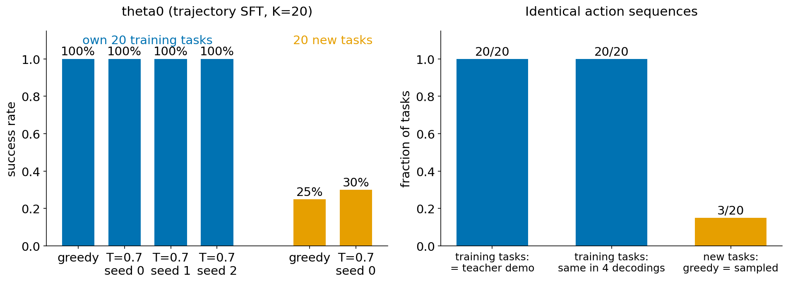

# M1：学生复现了训练实例，但没有学会新任务中的决策

[返回方法设计 §1.1](../agent_distillation_method_design.md#motivation-1-1)

## 结论

1. **小 K 的轨迹 SFT 学生在自己的训练任务上全部成功，而且每一步都与 teacher 示范逐字相同。**
   - 20 个训练任务 × 4 种解码，共 80 次 rollout，80 次全部成功。
   - 每个任务的动作序列在 greedy 和 3 个 T=0.7 采样下完全相同，也与该任务的 teacher 示范完全相同（20/20），连 38 步长的示范也一样。
2. **在 20 个同分布、但没训练过的任务上，同一个学生 40 次 rollout 失败 29 次。**
   - 失败遍及全部 6 种任务类型。
   - 在这些任务上，greedy 与采样的轨迹在 17/20 个任务中不同：学生不再"背诵"，而是在做真正的决策，而这些决策多数失败。
3. **训练集上的成功率不能说明学生学会了在新历史中决策。** 只重复这 K 个实例，几乎得不到失败信号，也就没有可教学的内容。

## 1. 实验设置

| 项目 | 设置 |
|---|---|
| 学生 θ₀ | Gemma-4-E4B-it + LoRA，主网格的轨迹 SFT 格子 `e4b-tsft-k20-e32-lr5e-5`（K=20，seed 0，32 epoch，lr 5e-5） |
| 训练任务 | θ₀ 自己的 20 个 K20 示范任务（`data/verified/seeds_full_train_r2/subsets/k20`），6 种任务类型各 2–5 个 |
| 新任务 U_mech | 从 TRAIN 中另取的 20 个任务组，与 K20 不重叠，6 种类型各 3–4 个；不属于 dev140，也不属于 valid_unseen |
| 环境与协议 | ALFWorld 0.4.2，H=40，与主网格评测相同的 ReAct prompt（Thought + Action），单轮最多 1024 token，enable_thinking=false |
| 解码 | 训练任务：greedy + T=0.7（top_p 0.95）seed 0、1、2，共 4 次；新任务：greedy + T=0.7 seed 0，共 2 次 |
| 服务 | rai 上的 vLLM 服务 θ₀ LoRA，启动时做 HF/vLLM 一致性检查 |
| 数据位置 | `reports/runs/repair_pilot/cov_theta0_k20`、`cov_theta0_k20_extra2`、`cov_theta0_umech` |

"与示范相同"的判定：逐步比较学生的 `action_parsed` 序列与示范 episode 中的 `action_parsed` 序列，要求长度和每一步都相同。

## 2. 观察到的现象

*左：成功率。右：动作序列完全相同的任务比例。数据见 [`data/m1.json`](data/m1.json)。*

### 2.1 训练任务：逐字复现示范

| 指标 | 结果 |
|---|---|
| 成功 | 80/80（4 种解码各 20/20） |
| 4 种解码的动作序列完全相同 | 20/20 个任务 |
| 学生的动作序列 = teacher 示范 | 20/20 个任务 |
| 示范长度 | 3–38 步，中位数 12.5 |

T=0.7 采样本来应该产生不同的轨迹，但在训练任务上，4 次运行的动作完全一样。这说明学生在训练实例上的输出分布已经集中到示范本身。

### 2.2 新任务：大多数失败

| 任务类型 | 任务数 | rollout | 成功 |
|---|---:|---:|---:|
| pick_and_place_simple | 4 | 8 | 6 |
| look_at_obj_in_light | 4 | 8 | 4 |
| pick_cool_then_place_in_recep | 3 | 6 | 1 |
| pick_heat_then_place_in_recep | 3 | 6 | 0 |
| pick_clean_then_place_in_recep | 3 | 6 | 0 |
| pick_two_obj_and_place | 3 | 6 | 0 |
| **合计** | 20 | 40 | **11（失败 29）** |

- 逐任务看：14 个任务两次都失败，5 个两次都成功，1 个只有采样成功，共 15 个任务至少失败一次。
- greedy 与采样的动作序列只在 3/20 个任务中相同。
- 15 个失败任务按原 greedy 失败轨迹的最远进度分类：从未见到目标 7 个，看到但没拿 3 个，拿到但没完成 3 个，放了但没完成 2 个。这些类别的定义与 [M2](M2_failure_analysis_and_K_ZH.md#m2-setup) 相同。

## 3. 重要结论

- **现象**：小样本 SFT 后，学生在训练实例上的行为由逐字记忆决定，到新实例上才暴露出决策困难。训练集上的完美表现与新任务上 28% 的成功率同时存在。
- **对方法的含义**：
  - 想从当前学生的执行中获得教学信号，必须让它在新任务上执行（设计 §2.2 的 A 部分）。重复原 K 个实例几乎得不到失败。
  - 新任务上的失败形态与 [M2](M2_failure_analysis_and_K_ZH.md) 在 dev140 上归纳的四类困难一致：搜索、看到不拿、拿到后操作失败。

## 4. 局限

- 只有一个学生（轨迹 SFT K20，seed 0）。其他方法在训练实例上是否也逐字复现，尚未检查。
- 新任务只有 20 个，每个只有 2 次 rollout，成功率的不确定性较大（11/40）。
- vLLM greedy 不完全可复现：同一前缀的 greedy 重跑可能在若干步后分叉（见 [M3](M3_cg_probe_ZH.md#m3-greedy)）。所以"某次失败"不等于"稳定失败"，逐任务结论应以多次 rollout 为准。
