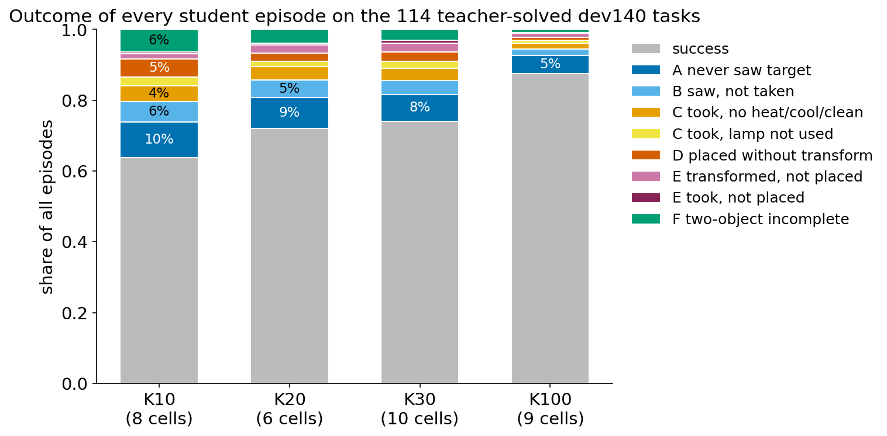
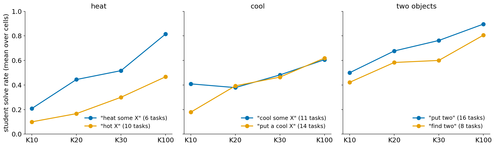
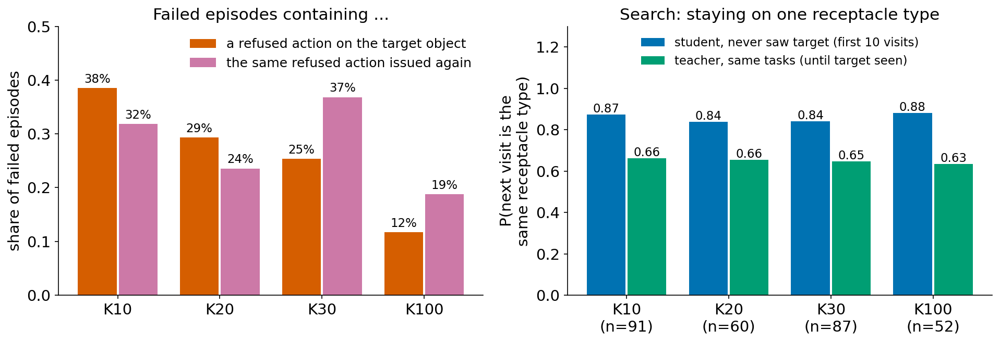

# M2：小样本蒸馏后学生的失败形态，四类困难，以及增加 K 补上了什么

[返回方法设计 §1.1](../agent_distillation_method_design.md#motivation-1-1)

## 结论

1. **"teacher 做对、学生做错"的任务在小 K 下普遍存在，并随 K 增大而减少。**
   - 在 teacher 做对的 114 个 dev140 任务中，同一 K 下所有方法、所有 seed 都做错的任务：K10 7 个，K20 5 个，K30 1 个，K100 0 个。
   - 如果把口径放宽为"该 K 下最多 1/3 的格子做对"，则是 24 / 25 / 8 / 5 个。
2. **学生的失败可以归纳为四类困难。它们出现在所有方法、所有 K 和多种任务类型中，并不是个别案例。**
   1. **目标理解**：
      - 没见过的目标措辞成功率持续偏低，例如 `put a hot X` 与 `heat some X` 相比，K10 时为 0.10 对 0.21，K100 时为 0.47 对 0.81。
      - "看到目标但没拿"在每个 K 下都占失败的 15–17%。
   2. **动作前提**：
      - 两物体任务失败中，"手里拿着一件又去拿第二件被环境拒绝"的比例：K10 60%，K20 50%，K30 33%。
      - heat/cool 任务中，学生把电器当成普通容器，先把物体放进去再尝试变换。
   3. **执行反馈**：失败 episode 中，19–37% 会再次发出已被环境拒绝过的同一个动作，并在下一条 Thought 中把它当作已经生效。
   4. **搜索**：
      - 没找到目标的失败中，学生下一次仍去同类容器的概率是 0.84–0.88，同类连续访问的中位数为 15–18 次。
      - teacher 在同样的任务上，这两个数分别是 0.63–0.66 和 2–3 次。
      - 这一差距在 K10 到 K100 之间基本不变。
3. **增加 K 主要补上前三类困难，第四类基本补不上。**
   - 从 K10 到 K100，操作类失败占全部 episode 的比例从 20% 降到 6%；"从未见到目标"只从 10% 降到 5%，在 K100 剩余失败中反而占 41%。
   - K 补上的是每类任务的示范数（例如 heat 1 → 11 条）和措辞覆盖，而不是对具体房间的记忆：被 K 救回的 7 个任务中，0 个在 K100 训练集里有"同房间、同物体"的示范。

## 1. 实验设置

| 项目 | 设置 |
|---|---|
| 学生 | 主网格 E4B 学生（Gemma-4-E4B-it）的全部已评测格子：4 种方法（轨迹SFT、AD、SmartAD、SAD）× K10/K20/K30/K100 × 训练 seed 0–2。SAD K10 已崩溃（8/140，低于 base 的 43），不计入。共 33 个格子，每个 K 的格子数分别为 8 / 6 / 10 / 9 |
| Teacher | gpt-6-luna 单次运行，dev140 上做对 114/140 |
| 评测集 | dev140（全部来自 valid_seen，用作 development 集；本分析只读日志，不回灌训练） |
| 协议 | ALFWorld 0.4.2，H=40，ReAct prompt；各格子使用主网格的收敛 checkpoint |
| 读取内容 | 每个格子、每个任务的 `episode.json`：动作、observation、学生回复（含 Thought）；共 4,620 个学生 episode，加 140 个 teacher episode |
| 统计范围 | 除特别说明外，只统计 teacher 做对的 114 个任务，以排除 teacher 本身也做不到的题 |

### 失败形态的判定规则

每个失败 episode 按走到的最远一步归类。"合法"指环境没有返回 `Nothing happens.`。

| 代号 | 名称 | 判定 |
|---|---|---|
| A | 从未见到目标 | 初始 observation 和所有后续 observation 中都没有出现目标物体实例（正则 `\b<物体> \d+`） |
| B | 看到没拿 | 见到过目标，但没有合法的 `take <物体> N from ...` |
| C | 拿了没处理 | heat/cool/clean 任务：拿到了，但没有合法的 `heat/cool/clean <物体> N with ...`；look 任务：拿到了但没用台灯 |
| D | 跳过处理 | heat/cool/clean 任务：没有变换，就把物体放到了目标位置 |
| E | 处理了没放 / 拿了没放 | 做了变换但没放到目标位置；simple 任务拿了没放 |
| F | 两物体未完成 | 两物体任务没完成 |

### 其他统计口径

- **目标措辞**：按 dev140 初始 observation 中 "Your task is to:" 后的文本分类。
  - heat：`put a hot X in Y` 或 `heat some X and put it in Y`；
  - cool：`put a cool X in Y` 或 `cool some X and put it in Y`；
  - clean：同理；
  - 两物体：`put two X in Y` 或 `find two X and put them in Y`。
- **训练集中的示范数**：按 K 子集中 teacher 示范的任务类型和措辞计数。K 子集是嵌套的，K10 ⊂ K20 ⊂ K30 ⊂ K100。
- **成功率**：对该 K 所有格子取平均。

## 2. 归纳方法：从逐条轨迹到四类困难

四类困难不是事先设定的。归纳分五步，前两步之后、对每一类困难都另外做了第 4 步的全量检验。

### 第 1 步：先定出"该研究哪些失败"

- 按每个 K 统计"teacher 做对、但该 K 所有格子都做错"的任务。13 个条目，去重后 10 个任务，见第 3 节。
- 再统计"K10 和 K20 下最多 1/3 的格子做对、K100 下至少 2/3 做对"的任务，即"被 K 救回"的 7 个；以及"K100 下最多 1/3 的格子做对"的任务，即"持续困难"的 5 个。
- 这三组共 39 个任务，作为逐条阅读的对象。

### 第 2 步：对全部 episode 自动标注失败形态

- 用上面的 A–F 规则，标注全部 4,620 个学生 episode。
- 对第 1 步的 39 个任务，按"任务 × 格子"列出每个 episode 的最远进度、首次见到目标的步号、是否有被拒绝的动作，以及首次拿取和变换的步号。
- 这一步把阅读集中到最远进度相同、却在不同格子间反复出现的模式上。

### 第 3 步：逐条阅读轨迹

我按"动作 → observation → 下一条 Thought"的顺序，阅读下列轨迹的完整片段：

- **全读**（从开头到第 40 步，含每条 Thought）：
  - heat-Plate-DiningTable-28 的 teacher、轨迹SFT K100、AD K100；
  - heat-Apple-DiningTable-26 的 4 个失败格子，从拿到苹果开始；
  - cool-Apple-Microwave-5 的 3 个 K10 失败；
  - cool-Lettuce-CounterTop-1 的 2 个 K10 失败；
  - cool-Bowl-Cabinet-20 的 AD K10；
  - two-Pan-CounterTop-14 的轨迹SFT K20、SmartAD K20、SmartAD K100（第 12–39 步）。
- **读前 7–14 步的移动顺序**，对照物体实际所在位置（取自成功 episode 拿取的位置）：
  - Newspaper-Sofa-224、Fork-Drawer-8、Tomato-DiningTable-16、Spatula-Drawer-13、Pan-CounterTop-14 的全部格子；
  - Box-Dresser-224、WineBottle-Shelf-7 的 teacher 和 4 个代表格子。
- **另外**：读了 teacher 在 K20/K100 中全部 24 条 heat/cool 示范的变换步骤。

阅读中反复出现的模式有六个：
1. 把目标措辞里的形容词当成物体名称；
2. 把"放进目标电器"当成"完成变换"；
3. 物体放在电器里时尝试变换；
4. 拿着一件物体去拿第二件；
5. 动作被拒绝后，Thought 仍当作已经生效；
6. 同类容器从 1 号起逐个查，很少换类别。

### 第 4 步：对每个模式做全量检验

只看读过的案例，不足以说明一个模式普遍存在。所以每个模式都转成一个可在全部 episode 上计算的指标，检查它是否在所有方法和 K 下都出现，并检查它是否随 K 变化：

| 阅读中的模式 | 全量指标 | 结果位置 |
|---|---|---|
| 形容词被当成物体 | 按措辞分组的成功率；训练集中各措辞的示范数；B 类占失败的比例 | §4.1 |
| 把电器当容器 / 电器里变换 | heat/cool 失败中"把目标放进电器"以及"变换被拒"的比例 | §4.2 |
| 拿着一件拿第二件 | 两物体失败中"手里有目标时再 take 被拒"的比例 | §4.2 |
| 被拒后不更新 | 失败中"对目标的动作被拒"以及"同一被拒动作再次发出"的比例 | §4.3 |
| 同类逐个查 | 没找到目标的失败中，下一次访问同类容器的概率和最长同类连续访问次数，并与 teacher 在同任务上比较 | §4.4 |

### 第 5 步：按"缺少什么知识"合并成四类

问的是：如果学生知道什么，这个失败就不会发生？
- 模式 1、2 缺的是"任务要什么"，归为**目标理解**；
- 模式 2、3、4 缺的是"动作在什么条件下成立"，归为**动作前提**（模式 2 同时属于两类）；
- 模式 5 缺的是"区分尝试与生效"，归为**执行反馈**；
- 模式 6 缺的是"根据已有观察选择下一次探索"，归为**搜索**。

四类之间可以重叠：一个 episode 可能先搜索慢，找到后又违反前提。所以第 4 节报告的是每一类各自的指标，不把每个失败硬分到唯一一类。

## 3. 总体结果

*teacher 做对的 114 个任务上，每个学生 episode 的结局，按 K 汇总。数据见 [`data/m2.json`](data/m2.json)。*

| 失败形态（占该 K 全部失败） | K10 | K20 | K30 | K100 |
|---|---:|---:|---:|---:|
| 失败 episode 数（占全部 episode） | 330（36%） | 191（28%） | 296（26%） | 128（12%） |
| A 从未见到目标 | 28% | 31% | 29% | **41%** |
| B 看到没拿 | 16% | 17% | 15% | 16% |
| C 拿了没处理（含 look 未用台灯） | 19% | 19% | 21% | 18% |
| D 跳过处理 | 14% | 8% | 10% | 7% |
| E 处理了没放 / 拿了没放 | 5% | 10% | 12% | 11% |
| F 两物体未完成 | 18% | 14% | 12% | 7% |

**teacher 做对、该 K 所有格子都做错的任务：**

| K | 任务（目标原文） | 该 K 所有格子中的主要失败形态 |
|---|---|---|
| 10 | heat-Egg-Fridge-14（put a hot egg in fridge） | C 4，B 2 |
| | heat-Plate-DiningTable-28（put a hot plate in diningtable） | B 8/8 |
| | heat-Potato-Fridge-12（put a hot potato in fridge） | A 4，D 2 |
| | heat-Tomato-DiningTable-16（heat some tomato and put it in diningtable） | A 8/8 |
| | heat-Tomato-Fridge-23（heat some tomato and put it in fridge） | C 5 |
| | two-Pan-CounterTop-14（find two pan and put them in countertop） | F 5 |
| | two-Spatula-Drawer-13（put two spatula in drawer） | A 8/8 |
| 20 | clean-ButterKnife-DiningTable-16（put a clean butterknife in diningtable） | A 4 |
| | heat-Mug-SideTable-21（put a hot mug in sidetable） | B 3，A 3 |
| | heat-Plate-DiningTable-28 | B 6/6 |
| | heat-Potato-Fridge-12 | C 3，A 2 |
| | two-Pan-CounterTop-14 | F 6/6 |
| 30 | heat-Plate-DiningTable-28 | B 7，C 3 |
| 100 | 无 | — |

把所有 K 合起来，没有一个 teacher 做对的任务是所有 33 个格子都做错的：每个任务至少被一个格子做对过一次。

## 4. 四类困难：逐条证据与全量统计

### 4.1 目标理解：学生把见过的措辞绑定到一套动作，而不是理解任务要求的状态

**轨迹 1：把 "hot plate" 当成一种物体**。heat-Plate-DiningTable-28，轨迹SFT K100。

| 步 | 动作 | observation | 下一条 Thought |
|---:|---|---|---|
| 9 | open cabinet 5 | In it, you see a plate 3. | Cabinet 5 contains a plate, not the hot plate; I'll continue searching. |
| 19 | open cabinet 11 | In it, you see a plate 4. | Cabinet 11 contains a plate, so I'll check the drawers next. |
| 24 | go to countertop 1 | ... a pan 1, a plate 2, a soapbottle 2, ... | Countertop 1 has no hot plate; I'll check countertop 2. |
| 26 | go to diningtable 1 | ... a bowl 1, a cup 2, and a plate 1. | Dining table 1 has no hot plate; I'll check dining table 2. |

- 学生先后看到 4 个盘子，一个都没拿，一直找到第 40 步。teacher 在第 9 步看到 plate 3，第 10 步就拿了。
- 这个任务在 K10/K20/K30 的 24 个格子里全部失败，K100 只做对 1/9。

**轨迹 2：把"目标位置是微波炉"当成"要用微波炉加热"**。cool-Apple-Microwave-5（cool some apple and put it in microwave），SmartAD K10。

| 步 | 动作 | observation | 下一条 Thought |
|---:|---|---|---|
| 2 | take apple 1 from countertop 2 | You pick up the apple 1 ... | I have the apple; I'll put it in the microwave. |
| 4 | open microwave 1 | The microwave 1 is open. In it, you see nothing. | The microwave is open; I'll place the apple inside. |
| 7 | heat apple 1 with microwave 1 | Nothing happens. | Heating the apple did nothing, so I'll check the microwave again. |
| 13 | move apple 1 to fridge 1 | You move the apple 1 to the fridge 1. | The apple is in the fridge; I'll close it and cool it. |
| 15 | cool apple 1 with fridge 1 | Nothing happens. | Cooling the apple in the fridge did nothing, so I'll take it out. |

- K10 训练集中只有 1 条 cool 示范和 1 条 heat 示范，而且都用 `... some X` 措辞。学生把"微波炉"和"加热"绑在一起。
- 这个任务的成功率：K10 1/8，K100 8/9。

**全量统计。**

| 类型 | 措辞 | dev 任务数 | teacher | 训练集中该措辞的示范数 K10/K20/K30/K100 | 学生成功率 K10 | K20 | K30 | K100 |
|---|---|---:|---:|---|---:|---:|---:|---:|
| heat | heat some X | 6 | 5/6 | 1 / 2 / 3 / 7 | 0.21 | 0.44 | 0.52 | 0.81 |
| heat | **put a hot X** | 10 | 7/10 | **0 / 0 / 0** / 4 | **0.10** | **0.17** | **0.30** | 0.47 |
| cool | cool some X | 11 | 7/11 | 1 / 1 / 2 / 7 | 0.41 | 0.38 | 0.48 | 0.61 |
| cool | **put a cool X** | 14 | 8/14 | **0** / 2 / 2 / 6 | **0.18** | 0.39 | 0.46 | 0.62 |
| clean | clean some X | 12 | 11/12 | 1 / 2 / 3 / 13 | 0.94 | 0.88 | 0.84 | 0.82 |
| clean | put a clean X | 15 | 8/15 | 1 / 1 / 2 / 4 | 0.47 | 0.53 | 0.52 | 0.62 |
| two | put two X | 16 | 15/16 | 2 / 5 / 7 / 24 | 0.50 | 0.68 | 0.76 | 0.90 |
| two | **find two X** | 8 | 6/8 | **0 / 0 / 0 / 0** | 0.42 | 0.58 | 0.60 | 0.81 |

- 训练集中没出现过的措辞，学生成功率一直低于有示范的措辞。
- `put a cool X` 在 K10 时 0 条示范，成功率 0.18；K20 补到 2 条后升到 0.39。
- "看到目标但没拿"（B 类）在每个 K 下都占失败的 15–17%，不随 K 下降。

### 4.2 动作前提：成功示范里隐含的条件没有被学到

**轨迹 3：物体放在微波炉里时尝试加热**。heat-Apple-DiningTable-26，AD K20。

| 步 | 动作 | observation | 下一条 Thought |
|---:|---|---|---|
| 30 | move apple 1 to microwave 1 | You move the apple 1 to the microwave 1. | The apple is inside; I'll close the microwave before heating it. |
| 32 | open microwave 1 | ... you see a apple 1, ... | The apple is inside the open microwave; I'll heat it with the microwave. |
| 33 | heat apple 1 with microwave 1 | Nothing happens. | Heating didn't change the state, so I'll take the apple out and reheat it. |
| 35 | move apple 1 to microwave 1 | You move the apple 1 to the microwave 1. | The apple is inside; I'll close the microwave and then attempt to heat it. |
| 38 | heat apple 1 with microwave 1 | Nothing happens. | Heating didn't change the state; I'll take the apple out and inspect it. |

- 环境中的 heat 命令要求物体拿在手里，站在微波炉前执行。学生把物体放进去、开关、再 heat，循环到步数用完。
- 这个绕路来自 teacher 示范本身：
  - K20 的 2 条 heat 示范里，有 1 条先把物体放进微波炉、开关几次，再拿出来加热；
  - K100 的 11 条 heat 示范里，这样做的有 4 条，直接拿着加热的有 7 条；
  - 所有示范最后都是"拿出来再 heat"，所以都是成功轨迹。
- 示范只有 1–2 条时，学生学到了绕路的表面动作，没学到"必须拿在手里"这个关键条件。

**轨迹 4：拿着一件物体去拿第二件**。two-Pan-CounterTop-14（find two pan and put them in countertop），轨迹SFT K20。

| 步 | 动作 | observation | 下一条 Thought |
|---:|---|---|---|
| 16 | take pan 1 from stoveburner 2 | You pick up the pan 1 ... | I have the first pan; I'll check the other burners for a second. |
| 18 | go to stoveburner 4 | ... you see a pan 2. | I found the second pan on stoveburner 4; I'll pick it up. |
| 19 | take pan 2 from stoveburner 4 | **Nothing happens.** | I have both pans; I'll inspect my inventory to access them. |
| 20 | inventory | You are carrying: a pan 1. | I'm carrying the first pan; I'll head to countertop 1 to place it. |
| 22 | move pan 1 to countertop 1 | You move the pan 1 to the countertop 1. | The first pan is on countertop 1; I'll retrieve the second pan from my inventory. |

- 放下 pan 1 后，学生没有回到 stoveburner 4，而是从 cabinet 1 起重新搜索，第 36 步才回到 pan 2 旁边。
- SmartAD K100 的成功轨迹：看到 pan 2 时先不拿，回台面放下 pan 1，再回去拿 pan 2，第 26 步完成。

**全量统计。**

| 指标 | K10 | K20 | K30 | K100 |
|---|---:|---:|---:|---:|
| 两物体任务失败中，手里有一件目标时再 take 被拒 | 48/80（60%） | 18/36（50%） | 16/48（33%） | 0/15（0%） |
| heat/cool 失败（未完成合法变换）中，把目标放进了电器 | 25/140（18%） | 19/78（24%） | 27/107（25%） | 4/57（7%） |
| heat/cool/clean 失败中，出现被拒绝的变换动作 | 18/175 | 17/110 | 14/168 | 4/91 |
| 操作类失败（C+D+E+F）占全部 episode | 20% | 14% | 14% | 6% |
| 训练集中的示范数：heat / cool / clean / two | 1 / 1 / 2 / 2 | 2 / 3 / 3 / 5 | 3 / 4 / 5 / 7 | 11 / 13 / 17 / 24 |

"手里一次只能拿一件"这条规则在示范中从未被明确展示。示范里自然不会出现"拿第二件被拒"。学生只能从很多条两物体示范的"放下第一件再拿第二件"顺序中间接学到，所以这类失败要到 K100 才消失。

### 4.3 执行反馈：环境说"不行"之后，学生仍按原计划继续

**轨迹 5：被拒绝后仍声称已完成**。two-Pan-CounterTop-14，SmartAD K20。

| 步 | 动作 | observation | 下一条 Thought |
|---:|---|---|---|
| 19 | take pan 2 from stoveburner 4 | **Nothing happens.** | I have both pans; I'll take them to countertop 1. |
| 21 | move pan 1 to countertop 1 | You move the pan 1 to the countertop 1. | The first pan is on countertop 1; I'll place the second pan there too. |
| 22 | move pan 2 to countertop 1 | **Nothing happens.** | Both pans are on countertop 1; the task is complete. |
| 23 | inventory | You are not carrying anything. | I'm not carrying anything, but I know the pans are on countertop 1. |
| 24 | examine countertop 1 | ... (only one pan) | Only one pan is visible on countertop 1; I'll check countertop 2. |

- 两次 `Nothing happens.` 都没有让学生改变判断。直到第 24 步亲眼看到台面上只有一个 pan，它才开始重新搜索，那时已经来不及了。
- 轨迹 3 也是同样的模式：heat 被拒后，学生重复同一套放入、加热的步骤。

**全量统计**（teacher 做对的任务上的学生失败 episode）：

| 指标 | K10 | K20 | K30 | K100 |
|---|---:|---:|---:|---:|
| 出现过对目标物体的动作被拒绝 | 127/330（38%） | 56/191（29%） | 75/296（25%） | 15/128（12%） |
| 同一个被拒动作后来又被发出 | 105/330（32%） | 45/191（24%） | 109/296（37%） | 24/128（19%） |
| 被拒后下一条 Thought 仍声称已生效（粗略匹配，为下界） | ≥51 | ≥17 | ≥21 | ≥1 |

- 被拒比例随 K 下降，主要是因为学生更少做出会被拒绝的动作，即规则学会了。
- "同一被拒动作再次发出"在 K30 时仍有 37%。现有数据不能说明学生学会了"被拒绝之后怎么办"。teacher 的成功示范里本来就没有这类情境（24 条 heat/cool 示范中，被拒绝的变换为 0 次）。

### 4.4 搜索：学生学到的是"先查哪类、逐个查完"的平均习惯，而不是依据观察选择下一步

**轨迹 6：21 个抽屉逐个开**。pick-Box-Dresser-224（FloorPlan 224）。盒子在 sidetable 2 或 sofa 1 上。

| 执行者 | 前 7–14 次移动 | 结果 |
|---|---|---|
| teacher | cabinet 1 → armchair 1 → sidetable 1 → drawer 1 → drawer 4 → sofa 1 | 第 7 个动作在 sofa 上找到 |
| 轨迹SFT K20 | cabinet 1 → drawer 1 → drawer 2 → … → drawer 13 | 失败 |
| 轨迹SFT K100 | drawer 1 → drawer 2 → … → drawer 14 | 失败 |
| SmartAD K100 | drawer 1 → drawer 2 → … → drawer 14 | 失败 |

这个任务在 K10、K20、K30、K100 下分别只做对 1/8、2/6、1/10、2/9。

**轨迹 7：从不查冰箱**。heat-Tomato-DiningTable-16。番茄在冰箱里。
- K10 的 8 个格子都没有去过冰箱，其中 7 个从 cabinet 1 开始逐个开柜子，"从未见到目标"8/8。
- K20 的 6 个格子中有 5 个第一步就去冰箱；K100 做对 8/9。
- K20 比 K10 多了 2 条 cool 示范，示范里都去冰箱。学生学到的是"食物先查冰箱"这个平均先验。

**轨迹 8：K 增大反而把顺序改坏**。clean-Fork-Drawer-8。叉子在 countertop 3 上。
- K10/K20 的多数格子先查台面，做对 7/8 和 6/6。
- K100 的多数格子改为从 cabinet 1 开始逐个开柜子，只做对 2/9。

**全量统计**（在 teacher 做对的任务上，学生整个 episode 都没见到目标的失败；与 teacher 在同一任务上直到看到目标为止的移动比较）：

| 指标 | K10 | K20 | K30 | K100 |
|---|---:|---:|---:|---:|
| episode 数 | 91 | 60 | 87 | 52 |
| 学生：下一次仍访问同类容器的概率（前 10 次移动） | 0.87 | 0.84 | 0.84 | 0.88 |
| teacher（同任务）：同上 | 0.66 | 0.66 | 0.65 | 0.63 |
| 学生：最长同类连续访问次数（中位数） | 18 | 17 | 15 | 18 |
| teacher（同任务）：同上 | 2 | 3 | 3 | 3 |
| 学生：40 步内访问的容器类别数（中位数） | 2 | 2 | 2 | 2 |
| "从未见到目标"占该 K 全部失败 | 28% | 31% | 29% | **41%** |

- 同类容器内部按编号逐个查，学生和 teacher 都很普遍：同类连续移动中，编号恰好加 1 的比例学生为 94–95%，teacher 为 94%。所以问题不在"按编号查"。
- 问题在于学生几乎不切换容器类别：在一类里查到底，40 步内只查 2 类。这一点从 K10 到 K100 没有改善。
- K 改变的只是"先查哪一类"的平均先验，它可能帮助一些房间（轨迹 7），也可能损害另一些房间（轨迹 8）。

## 5. 增加 K 补上了什么

| 证据 | 数字 |
|---|---|
| 每类任务的示范数（K10 → K100） | heat 1 → 11，cool 1 → 13，clean 2 → 17，两物体 2 → 24，look 1 → 10，simple 3 → 25 |
| 操作类失败（C+D+E+F）占全部 episode（K10 → K100） | 20.3% → 5.6% |
| "从未见到目标"占全部 episode（K10 → K100） | 10.0% → 5.1% |
| 失败中"对目标物体的动作被拒绝"（K10 → K100） | 38% → 12% |
| 被 K 救回的 7 个任务中，K100 训练集里有"同房间、同物体"示范的 | 0/7（其他 teacher 做对的任务为 11/102） |
| 被 K 救回的 7 个任务中，K100 训练集里有同房间示范的 | 3/7（其他为 63/102，两者相近） |

"被 K 救回"的定义：K10 和 K20 下最多 1/3 的格子做对，K100 下至少 2/3 做对。共 7 个任务：Newspaper-Sofa-224、cool-Apple-Microwave-5、cool-Tomato-Microwave-18、heat-Potato-Fridge-11、heat-Tomato-Fridge-15、two-Pan-CounterTop-14、two-SprayBottle-Cabinet-407。

**解释**：
- 增加 K 带来的，主要是每类任务更多"关键步骤做对了"的示范，以及更多种目标措辞。学生从中逐渐学会这一类任务的规则。
- 增加 K 带来的不是对具体房间的记忆：救回的任务几乎没有同房间、同物体的示范。
- 搜索方面，K 只改变"先查哪类"的先验，不改变"根据已排除位置切换方向"的行为。

## 6. 重要结论

1. 小样本蒸馏后的失败集中在四类困难：目标理解、动作前提、执行反馈、搜索。每一类都在全部 33 个格子、6 种任务类型中以可测的比例出现，不是个别房间或个别任务的现象。
2. 前三类困难的共同原因是：关键条件在成功示范里只是隐含的，只能靠大量示范间接学到。K 从 10 增加到 100，这三类失败才明显减少。
3. 第四类困难（依据观察切换探索方向）在 K10 到 K100 之间几乎不变，已经成为 K100 剩余失败的主体。
4. 对方法的含义：
   - 前三类需要让学生在自己会出错的状态上得到明确的条件和反馈，例如"手里有东西时先放下"、"Nothing happens 表示没有生效"。
   - 第四类需要能根据新观察持续调整的探索指导。两者都不是"更多同样的成功轨迹"能高效补上的。

## 7. 局限

- 失败形态由动作字符串和 observation 按规则判定。"Thought 仍声称已生效"使用的是粗略正则，只能作为下界。
- teacher 只跑了一次，"teacher 做对"的集合里混有 teacher 自身的随机性。
- 每个 K 的格子数不同（6–10 个），而且包含同一方法的不同 seed。跨格平均不是独立样本；本文只报告描述性比例，不做显著性检验。
- dev140 是长期用于选模的 development 集。这些分析用于定位问题和形成假设，不作为最终泛化证据，也不能单独证明某一种训练设计导致了这些失败。
- "某任务至少被一个格子做对过"不等于"某个固定学生已稳定掌握该任务"。

## 复现

- **数据提取**：`reports/analysis/main_grid_seeds/teacher_only/hk_extract.py`，在 hpg 上运行，输出 29 MB 的 compact episodes，未入库。
- **表格**：`docs/method/motivation/scripts/` 下的 `build_data.py`、`prevalence.py`、`search_runs.py`、`precondition_stats.py`，生成 `data/m2.json`。
- **图**：`scripts/make_figs.py`。
- **较早的分析稿**：`reports/analysis/main_grid_seeds/teacher_only_tasks_ZH.md`。
