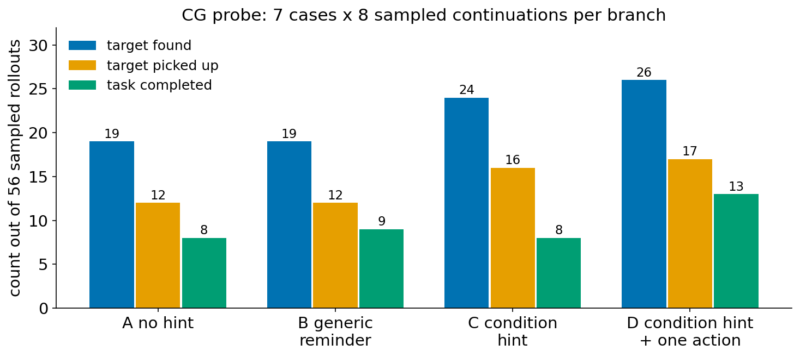
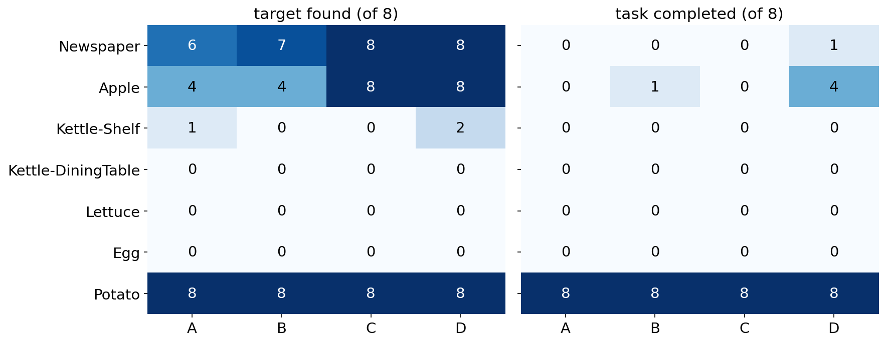

# M3：一次性条件提示（CG probe）：抽象提醒很少改变行为，具体行动只推进一步

[返回方法设计 §1.1](../agent_distillation_method_design.md#motivation-1-1)

## 结论

1. **抽象的文字提示几乎不改变学生的下一步。**
   - 分支点后的第一步动作，与无提示分支相比：一般提醒改变了 0/56，条件提示改变了 3/56。
   - 第一条 Thought 提到提示内容或"位置未知"的：一般提醒 0/56，条件提示 1/56。
2. **一条具体的行动建议会被执行（52/56），但只管一步，而且只有猜对位置时才直接有用。**
   - 换方向的 5 条建议中，只有 1 条直接让学生看到了目标：Newspaper 的 sofa，8/8。
   - Apple 的建议把学生引到了台面区域，相邻的台面上有苹果，4/8 在第 2 步找到。
   - 其余建议没命中，学生执行完那一步，就回到原来的搜索习惯。
3. **"找到目标"之后，失败转移到下一个条件上。**
   - Newspaper 在行动建议下每次都第 1 步看到报纸，却只完成 1/8：学生手里已经拿着 creditcard，环境不提供 `take newspaper`；它反复使用不存在的命令，也不根据拒绝更新判断。
   - Apple 在条件提示下 8/8 找到，但都要到第 28 个后续动作才找到，来不及完成。
4. **按预注册判定规则，所有比较都是"无明确差别"**（找到率差 ≥ 0.15，且多数案例同向，才算有差别）：
   - 找到率：无提示 0.34，一般提醒 0.34，条件提示 0.43，条件提示加行动 0.46。
   - 7 个案例中，4 个在所有分支里都找不到或几乎找不到目标，1 个在所有分支里都成功，有区分度的只有 2 个。
5. **这三点合起来说明**：
   - 当前冻结的学生不会使用测试时的抽象提示。教学需要是具体、可执行的，并且要在每次新观察之后更新。
   - 条件意识要通过训练让学生自己具备，而不是在测试时告诉它。

## 1. 实验设置

| 项目 | 设置 |
|---|---|
| 预注册 | `docs/direction/2026-10-26_condition_guidance_probe_prereg_ZH.md`（83b53b4）；修订 1（acf847d），在任何 rollout 之前完成 |
| 代码 | `repair-v01-eval` 分支 9f16962，从固定 commit 的 worktree 运行 |
| 学生 | θ₀ = 轨迹 SFT K20（`e4b-tsft-k20-e32-lr5e-5`），冻结，不训练 |
| 案例 | θ₀ 在 U_mech（TRAIN 侧新任务）上 greedy 失败、且整条轨迹从未见到目标物体的 7 个任务：Newspaper（look_at_obj_in_light，FloorPlan 224）、Kettle-Shelf、Kettle-DiningTable、Lettuce、Potato、Apple、Egg |
| 分支点 | 真实 reset 后重放原轨迹前 10 个动作（含原 Thought），逐步核对 transition 与原记录一致；学生从动作 10 开始，在原 H=40 内继续，最多 30 步。252/252 个前缀核对通过 |
| 提示的注入方式 | 只注入一次：在动作 9 之后那条 observation 的末尾追加 `\n\nGuidance: <文本>`。之后各轮历史保留这条带提示的 observation，不再追加；系统 prompt、其他 observation 和 admissible commands 都不变 |
| 分支 | A 无提示；B 固定提醒（Review your progress so far, then continue to complete the task.）；C teacher 生成的条件提示；D 为 C 加一条信息获取命令 |
| C/D 的生成 | gpt-6-luna，每个案例一次调用，同时产出 C 和 D；只输入任务、初始 observation、10 步的回复/动作/observation、当前 admissible commands 和步数 |
| 自动校验 | C 不得包含 admissible 命令，不得提到前缀中没去过的容器（实例或类型），最多 70 词；D 的命令必须在 admissible commands 里，动词限 go to/open/examine/look |
| 人工审核 | 我逐条核对 C 与公开历史一致，且不暗示位置或动作，7/7 通过 |
| 解码 | 每个"案例 × 分支"跑 1 次 greedy，再跑 8 次 T=0.7（top_p 0.95，seed 0–7）采样；每轮的 request seed 与分支无关，所以各分支共用同一组随机数 |
| 判定规则 | 主指标为找到率，即 8 次采样中找到的比例对 7 个案例取平均。"X 优于 Y"需要两条同时满足：差 ≥ 0.15；X>Y 的案例数比 X<Y 的多至少 2 个 |
| teacher 用量 | 两版提示合计 23,154 input / 18,119 output token |
| 数据位置 | `reports/runs/repair_pilot/cg_probe/`（hints_v2、run1）；汇总复制到 `reports/analysis/repair_v01_evidence/cg_probe/` |

**修订 1 的原因**：
- 第一版 D 有 6/7 只是学生自己逐个查找的下一步（`go to drawer 4`、`open cabinet 6`……），这样检验不了"行动指导"。
- 因此在 rollout 之前把模板改为：teacher 依据已排除位置和常识，自己选择最可能有信息的位置。
- C 的要求不变，第一版存档，没有使用。

### 1.1 实际使用的提示（第二版）

| 案例 | C（条件提示） | D 追加的命令（理由） |
|---|---|---|
| Newspaper | The current subgoal is finding the newspaper by searching drawers. There is no observational support for the premise that it is in an unchecked drawer; observations rule out the newspaper being in drawer 1, drawer 2, drawer 3, and cabinet 1. | go to sofa 1（Newspapers are commonly left on sofas, ...） |
| Kettle-Shelf | The current subgoal is to locate the kettle by checking cabinets; the premise that it is in cabinet 6 has no observational support. Observations rule out cabinets 1–3 and 5 as containing anything inside, and cabinet 4 as having anything on it. | open cabinet 6（Cabinets commonly store kettles, ...） |
| Kettle-DiningTable | The current subgoal is finding a kettle. The unsupported premise is that it is in unchecked kitchen storage. Observations rule out cabinet 1, which contains a vase, and cabinets 2–5, which are empty. | go to cabinet 6（Kettles are commonly stored in kitchen cabinets, ...） |
| Lettuce | The current subgoal is finding lettuce. Whether lettuce is available in an unchecked place has no observational support. The fridge and the interiors of cabinets 1–3 showed no lettuce; nothing was seen on cabinet 4. | go to countertop 1（... produce is sometimes left on a kitchen countertop） |
| Potato | The current subgoal is locating a potato; whether one is available elsewhere has no observational support. The fridge and cabinets 1–4 have been ruled out as sources. | go to countertop 1（Potatoes are commonly left on kitchen counters, ...） |
| Apple | The current subgoal is finding the apple by continuing the cabinet search; the premise that it is in remaining cabinets has no observational support. The observations have ruled out the fridge and the checked cabinet contents. | go to countertop 1（Apples are commonly left on kitchen counters, ...） |
| Egg | Your current subgoal is to find an egg; whether one is available remains unsupported. The observations rule out cabinets 1–4 as containing it. | go to fridge 1（Eggs are commonly stored in a fridge, ...） |

## 2. 观察到的现象

### 2.1 总体结果

| 分支 | 找到目标 | 拿到目标 | 完成任务 | 第一步与 A 不同 | 第一步 = 建议命令 |
|---|---:|---:|---:|---:|---:|
| A 无提示 | 19/56 | 12/56 | 8/56 | — | — |
| B 一般提醒 | 19/56 | 12/56 | 9/56 | **0/56** | — |
| C 条件提示 | 24/56 | 16/56 | 8/56 | **3/56** | — |
| D 条件提示加行动 | 26/56 | 17/56 | 13/56 | 36/56 | 52/56 |

**找到目标所需的后续动作数**（56 次采样中，未找到的单独计数，不并入中位数）：

| 分支 | 未找到 | 1–5 步 | 6–10 步 | 11–20 步 | 21–30 步 |
|---|---:|---:|---:|---:|---:|
| A | 37 | 0 | 4 | 10 | 5 |
| B | 37 | 0 | 8 | 8 | 3 |
| C | 32 | 8 | 0 | 8 | 8 |
| D | 30 | 13 | 10 | 1 | 2 |

### 2.2 按预注册规则的成对比较（找到率，8 次采样）

| 比较 | 差 | 95% CI（按案例 bootstrap，10,000 次） | 变好 / 变差的案例数 | 判定 |
|---|---:|---|---|---|
| C−B | +0.089 | [0.00, 0.23] | 2 / 0 | 无明确差别 |
| D−C | +0.036 | [0.00, 0.11] | 1 / 0 | 无明确差别 |
| B−A | 0.000 | [−0.05, 0.05] | 1 / 1 | 无明确差别 |
| D−A | +0.125 | [0.02, 0.27] | 3 / 0 | 无明确差别 |

greedy（每格只有 1 次，只作参考）：找到 A 4/7、B 2/7、C 3/7、D 4/7；完成 A 1/7、B 1/7、C 1/7、D 3/7。

### 2.3 逐案例

| 案例 | 找到 A/B/C/D | 完成 A/B/C/D | 区分度 |
|---|---|---|---|
| Newspaper | 6/7/8/8 | 0/0/0/1 | 有 |
| Apple | 4/4/8/8 | 0/1/0/4 | 有 |
| Kettle-Shelf | 1/0/0/2 | 0/0/0/0 | 接近地板 |
| Kettle-DiningTable | 0/0/0/0 | 0/0/0/0 | 地板 |
| Lettuce | 0/0/0/0 | 0/0/0/0 | 地板 |
| Egg | 0/0/0/0 | 0/0/0/0 | 地板 |
| Potato | 8/8/8/8 | 8/8/8/8 | 天花板 |

### 2.4 过程证据

**现象 A：找到目标之后，卡在持有条件和执行反馈上。** Newspaper，D 分支，seed 0。学生在第 2 步拿起了 creditcard。

| 步 | 动作 | observation | 下一条 Thought |
|---:|---|---|---|
| 10 | go to sofa 1 | On the sofa 1, you see a box 2, a creditcard 3, a keychain 3, a newspaper 2 ... | The newspaper is on the sofa with the desklamp turned on. I'll pick it up to examine it. |
| 11 | examine newspaper 2 | Nothing happens. | The lamp is on, and the newspaper is on the sofa. I'll bring the lamp to the sofa ... |
| 13 | carry desklamp 1 from sidetable 1 | Nothing happens. | I've turned the lamp on. I'll carry it to the sofa ... |
| 15 | pick up newspaper 2 | Nothing happens. | I have the lamp on and the newspaper in sight. I'll turn the lamp on ... |
| 16–22 | use desklamp 1 / go to sofa 1 / pick up desklamp 1 ... | Nothing happens.（连续多次） | — |

- 学生手里有 creditcard，admissible commands 里根本没有 `take newspaper 2`。
- 它没有先放下 creditcard，而是使用 `pick up`、`carry` 这些不存在的命令，并在 Thought 里声称"I have the lamp"。这 8 次 rollout 共有 95 个非法动作。

**现象 B：条件提示没有改变搜索方式，具体行动让发现提前。** Apple。
- A 和 C 都继续按编号把 cabinet 6 到 cabinet 21 逐个开完，到第 28 个后续动作（第 37 步）才在 countertop 2 上看到苹果，剩下的步数不够完成冷却和放置。
- C 的 8 次都在同一步找到，A 只有 4 次在 30 步内找到。C 提高了找到率，但找到的时间完全相同，搜索顺序没有变化。
- D 有 4 次第一步就执行了 `go to countertop 1`，第 2 步转到 countertop 2 找到苹果，其中 3 次完成。
- 另外 4 次第一步仍然打开 cabinet 6，但在第 9 个后续动作就离开柜子、找到苹果（A、C 要到第 28 个），其中 1 次完成。
- 这说明即使第一步没照做，提示中的具体位置也影响了几步之后的方向。D 合计完成 4/8。

**现象 C：错误的建议只管一步。**
- Kettle×2（cabinet 6）、Lettuce（countertop 1）、Egg（fridge 1）的建议都没有直接见到目标。
- 学生执行完建议以后，回到原来的逐个查找，30 步内都没找到。

### 2.5 原失败为什么在重跑中没有复现（Potato）

- Potato 的原 greedy 轨迹失败了，但从第 10 步重新开始，4 个分支的 8 次采样和 greedy 全部成功。
- 对比原 greedy 轨迹和 A 分支的 greedy 重跑：前 10 步由重放保证相同；第 10 步的回复也相同；第 11 步的 prompt 逐字相同，但学生回复的措辞不同（"... to search for a potato." 对 "... to search inside."）。随后在第 15 步，动作开始分叉。
- 其他案例也是如此：在 prompt 完全相同的情况下，第一处不同出现在第 11–36 步之间（Kettle-DiningTable 完全相同）。
- 这说明 vLLM 的 greedy 解码在相同输入下不完全可复现。"原 greedy 轨迹失败一次"不能说明该前缀下稳定失败。

## 3. 重要结论

- **测试时的抽象提示对 θ₀ 基本无效。** θ₀ 只在"JSON observation + 动作"的格式上训练过，没学过怎样使用额外的指导文字。B 和 C 几乎没有改变即时行动。
- **具体行动会被执行，但一次性建议的作用有限。**
  - 建议只有猜中时才直接有用（5 条换方向的建议中 1 条直接命中，Apple 的建议引到了相邻台面）。
  - 执行完以后，学生回到原有习惯。要让 teacher 的探索判断持续发挥作用，指导至少需要在每次新观察之后重新给出。
- **教学要覆盖"找到之后"。** 发现目标以后，失败转到持有条件、不存在的命令、忽略拒绝反馈，也就是 [M2](M2_failure_analysis_and_K_ZH.md) 中的动作前提和执行反馈两类困难。一条只针对"位置未知"的提示管不到这些。
- **对方法的含义**：
  - 教学采用可执行的建议，并逐观察更新；
  - 把经过执行验证的局部进展（例如提前发现目标）与完整成功分开，作为训练监督；
  - 条件意识是否能被学会，要在训练后的无提示表现上检验，不能用冻结学生对提示的反应来判断。

## 4. 局限

- 有区分度的案例只有 2–3 个。案例是按"原 greedy 轨迹从未见到目标"选的，而单条 greedy 轨迹不稳定（见 §2.5），导致 4 个地板案例和 1 个天花板案例。
- 下次应先用 A 分支的采样预筛案例，并扩大候选池。
- C 的文本比 B 长，存在长度混杂。不过 B 和 C 都几乎没有改变行为，这个混杂不影响结论。
- "第一步与 A 不同"会把采样随机性也算进去。A、B、C 在同一 seed 下用相同的随机数，所以 B 的 0/56 说明提示对第一步完全没有作用。
- 提示的长度、内容和呈现位置没有分别控制，不能把效果分别归因到其中某一项。

## 5. 复现

- **提示**：`reports/runs/repair_pilot/run_cg_hints_rai.sh`（第二版 `CG_TREE=9f16962`）。
- **审批**：`tools.cg_probe approve`，决定文件为 `hints_v2_decisions.tsv`。
- **rollout**：`run_cg_rollouts_rai.sh run1 <hints> <approval>`，在 rai GPU 1 上运行。
- **汇总**：`tools.cg_probe summarize`。
- **本页的表和图**：`docs/method/motivation/scripts/build_data.py` 生成 `data/m3.json`，再由 `make_figs.py` 画图。
- **较早的报告**：`reports/analysis/repair_v01_evidence/cg_probe_report_1026_ZH.md`。
