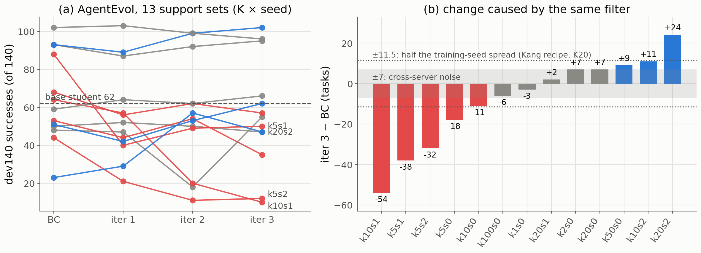
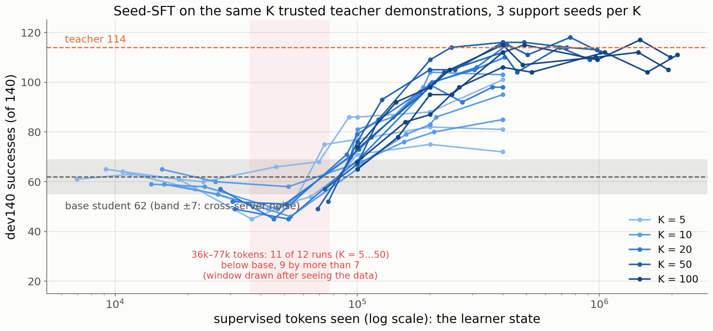
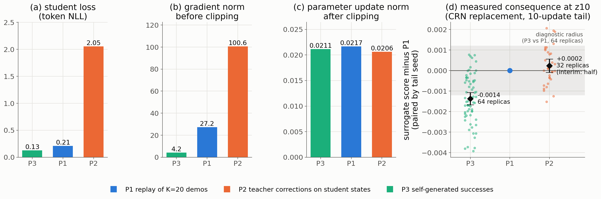
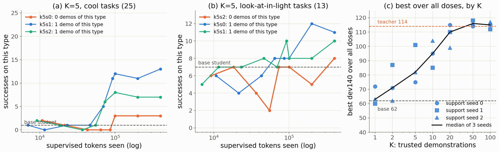
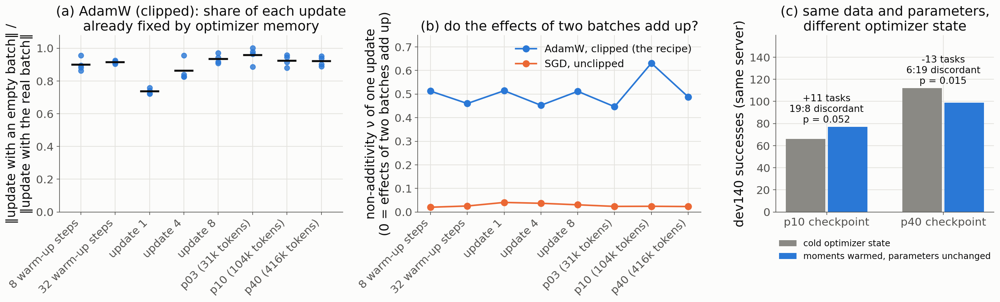

# Proposal 1 · Empirical findings: what goes wrong when distillation is driven by static criteria

[中文版](P1_empirical_findings_ZH.md) · [Proposal 1 (RCD)](P1_response_calibrated_distillation.md) · [Theoretical framework](../../theoretical_framework/README.md)

*Status: 2026-10-14. Every number on this page comes from real-model experiments that have already finished; nothing was run for this page. The figures and numbers can be regenerated with [`analysis/p1_findings/build_data.py`](../../analysis/p1_findings/build_data.py) and [`plot.py`](../../analysis/p1_findings/plot.py), and the data snapshot is [`figs/p1_findings_data.json`](figs/p1_findings_data.json). Each finding states its strength of evidence and its limits; numbers marked "interim" or "exploratory" are not pre-registered conclusions.*

---

## Common setting

- **Environment and evaluation.** ALFWorld. The evaluation set dev140 is all 140 valid_seen tasks; the sealed valid_unseen is never used. Serving is batch-invariant. Every adapter must first pass an HF/vLLM equivalence check; cells that fail it and have no valid re-evaluation are dropped.
- **Noise reference.** The same adapter on two identically configured servers differs by about ±7 tasks (cross-configuration reference). "Beyond noise" below is always relative to this.
- **Student and teacher.** The student is Gemma-4-12B-it; its base model solves 62 dev140 tasks. The teacher is gpt-6-luna and solves 114.
- **Trusted demonstrations.** $`K`$ executed, verified teacher trajectories per task family ("demonstrations" below), sampled stratified by task type, with 3 support seeds per $`K`$.
- **Reference recipe (Seed-SFT).** LoRA r16, AdamW, constant learning rate 1e-5, global gradient clipping at 1.0.
- **Baselines.** Implemented by the method design of their papers, with exploration only on the $`K`$ tasks.

## Overview

| Finding | Flaw | In one sentence | Strength of evidence |
|---|---|---|---|
| [A](#finding-a) | Flaw 1 · value | One "keep only successful trajectories" rule changes the outcome by −54 to +24 tasks across 13 support sets | Medium-strong: effects far beyond noise; one training seed per set |
| [B](#finding-b) | Flaws 1 + 3 | The same correct demonstrations first make the student worse, then better; where the turn happens is set by how far the student has trained | Strong: 11 of 12 runs; the window was drawn after seeing the data |
| [C](#finding-c) | Flaw 1 (+ optimizer) | Data with a 24× larger static "learning signal" has no larger measured consequence; the optimizer first equalizes the three updates | Medium: one state, an uncalibrated surrogate, half the P2 replicas |
| [D](#finding-d) | Flaw 2 · information | A task type missing from the demonstrations stays at base level through 400k tokens of training; one demonstration of it makes it rise | Strong on cool tasks, weak on look-at tasks |
| [E](#finding-e) | Flaw 3 · time | The student is more than its parameters: 72–100% of each update comes from optimizer memory, the effects of two batches do not add, and changing only the optimizer state moves the outcome by 13 tasks | (a)(b) strong; (c) one seed, p = 0.015 |

The three flaws are defined in [Proposal 1, §3](P1_response_calibrated_distillation.md#3-three-shared-flaws).

---

## Finding A · The same static filter has an unpredictable sign

**In one sentence.** AgentEvol's rule is "keep only self-generated trajectories that the environment verifies as successful". Across 13 support sets the same rule changed the final result by −54 to +24 tasks: some sets improved, others collapsed.

**What the static view expects.** Every kept trajectory is a verified success, so all of it is good data; more iterations should make the student steadily better.

**Setting.**
- Method: AgentEvol from the AgentGym paper ([Xi et al., 2024](P1_response_calibrated_distillation.md#ref-agentgym)). BC on the $`K`$ demonstrations, then 3 iterations: the current policy explores the $`K`$ tasks, only trajectories with environment success are kept, and the merged data is trained on again.
- Recipe: full-parameter fine-tuning, as in the official recipe.
- Scale: 13 support sets, $`K\in\lbrace1,2,5,10,20,50,100\rbrace`$ with several seeds, one training seed each.
- Evaluation: every iterate on dev140. Direct evaluations run after the context-overflow fix (10-06) take precedence.

**Results.**

- Iteration 3 minus BC: 5 sets drop by more than noise (−54, −38, −32, −18, −11), 3 rise by more than noise (+9, +11, +24), and 5 stay within noise.
- Two sets end below 25 tasks: k10s1 goes from 64 to 10, and k5s2 from 44 to 12.
- Neither collapse nor gain is decided by the starting point: k5s1 falls from 88 to 50, k20s2 rises from 23 to 47, and k50s0 rises from 93 to 102.
- Two other methods that select feedback by static rules show the same pattern:
  - LEAP (teacher corrections on student states), iteration 3 minus iteration 0: +1 at $`K=2`$, −6 at $`K=10`$, +29 at $`K=50`$ and +33 at $`K=100`$.
  - Starting ETO from a well-trained student (Seed-SFT p40), exploration found only 3 success-versus-failure pairs; the DPO loss was about 1e-13 and the gradient about 1e-9 (training log, 10-07). Pairs chosen by outcome carried almost no learning signal for this student.

**Why this supports Flaw 1.**
- All 13 sets use the same selection criterion, and every kept trajectory is a verified success. If value were a property of the data, the sign of the outcome would not flip. It does flip, and by far more than noise.
- The consequence therefore depends on what the static criterion cannot see: the student's state (where BC left it), the support set and training randomness. This is exactly the case of [Proposition 3.1](../../theoretical_framework/statements/03-01_static_value_not_learning_value.md#s3-1): equal static quantities, different learning value, even of opposite sign.

**Limits.**
- One training seed per support set. Changing only the training seed of Kang's recipe at K20 gives 63/74/86 (a range of 23), so part of the spread may be training randomness. That randomness is itself a property of the learner and recipe, not of the data; and three drops (−32 to −54) far exceed half of that range.
- The support sets also differ in content, so this is not a single-variable controlled experiment.
- AgentGym's BC level itself varies widely across sets (23 to 102), which reflects the instability of the official recipe.

## Finding B · The same correct demonstrations, first harmful, then helpful

**In one sentence.** Continuing to train on the same correct teacher demonstrations makes the student worse than base during one stretch of training, and only after it makes the student better. The turn happens at a similar point of training progress whether there are 5 demonstrations or 50.

**What the static view expects.** The demonstrations are correct, so every one has positive value; how long to train is just a hyperparameter.

**Setting.**
- Recipe: Seed-SFT (the reference recipe).
- Scale: $`K\in\lbrace5,10,20,50,100\rbrace`$ with 3 support seeds each, 15 runs in all.
- Checkpoints: between 3 and 40 passes, and at 100k, 200k and 400k tokens, each evaluated on dev140.
- Horizontal axis: supervised tokens the student has trained on, used as a scale of the learner state.

**Results.**

- Between 36k and 77k tokens, 11 of the 12 runs with $`K=5\ldots50`$ fall below base, 9 of them by more than noise, down to 45. The one exception is K5s1.
- With the same data trained past 100k tokens, all 15 runs reach at least 65; by 400k tokens most are between 95 and 118.
- The data at the turn are very different: $`K=5`$ is 5 demonstrations repeated about 20 times, $`K=20`$ is 20 demonstrations repeated about 5 times. The repetition differs by 4×, yet the number of tokens the student has seen is similar.
- Within a run, continuing to train before the turn is harmful: for example K10s0 scores 59, 55 and 46 at 16k, 27k and 53k tokens.

**Why this supports Flaws 1 and 3.**
- Every training example is a verified correct demonstration, so a static valuation gives them the same positive value at every moment. The measured marginal value is first negative, then positive, and its sign is set by how far the student has trained.
- This is the continuation response of [Theorem 3.2](../../theoretical_framework/statements/03-02_continuation_response_characterization.md#s3-2): the value of the same feedback depends on the state $`z_t`$ in which the student receives it.
- For baselines: a conclusion about whether some data helps, drawn at one fixed dose, can reverse at another dose. The baselines use different recipes, so the location of their turns differs; this point can only be made qualitatively here.

**Limits.**
- The window was drawn after seeing the data.
- One training seed per cell.
- The mechanism of the drop (format drift, early forgetting or something else) has not been identified.

## Finding C · The size of a static "learning signal" is not the consequence

**In one sentence.** At one student state we compared three kinds of data. By static quantities such as loss and gradient, teacher corrections (P2) carry 4 to 24 times the learning signal of the other two. But clipping first makes all three updates almost the same size. The measured consequence of P2 equals that of replay (P1), and the self-generated successes with the lowest loss, the most "learnable" data (P3), come out worst.

**What the static view expects.**
- The "learnability" school (pick the data the student finds most familiar, i.e. lowest loss) chooses P3.
- The "informativeness" school (hard-example mining, or correcting the student where it errs, as in DAgger/LEAP) chooses P2 and expects it to have a far larger effect than the other two.

**Setting.** This is the pre-registered R1 ([Remark 9.4](../../theoretical_framework/statements/09-04_scope_of_evidence.md#s9-4)).
- State: $`z_{10}`$, the complete state at update 115 (p10) of the K20 s0 Seed-SFT run.
- Measurement: replace the next reference update by one batch of a candidate, then run 10 reference tail updates with common random numbers. Within a replica, all candidates share the tail seed. The result is scored by the surrogate $`\tilde F`$, the geometric-mean token probability of 40 held-out teacher successes.
- Candidates and the baseline families they stand for:
  - P1 = replay of the $`K=20`$ demonstrations (BC/SFT);
  - P2 = teacher corrections at the student's failure states (DAgger/LEAP);
  - P3 = environment-verified self-generated successes (AgentEvol/RFT).
- Replicas: 64 each for P1 and P3. P2 has 32 of its 64 replicas so far, so its numbers are interim; the other half is queued.
- Three static quantities are recorded for every batch: the student loss (token NLL), the gradient norm before clipping, and the parameter update norm after clipping.

**Results.**

- **Static quantities** (P3 / P1 / P2):
  - student loss: 0.13 / 0.21 / 2.05;
  - gradient norm before clipping: 4.2 / 27.2 / 100.6;
  - update norm after clipping: 0.0211 / 0.0217 / 0.0206 (clipping was active on 95–100% of batches).
- **Measured consequence** (relative to P1):
  - P3 is −0.0014, with only 7 of 64 replicas above P1. This exceeds the diagnostic radius 0.0012, while the strict radius is 0.325.
  - P2 is +0.0002 ± 0.0002 (interim, 32 replicas, 18 above P1), within noise.
- **Rankings by three static criteria:**
  - Learnability gives P3 > P1 > P2, exactly opposite to the measurement: P3 comes out worst.
  - Informativeness gives P2 ≫ P1 > P3. The order partly agrees, but the magnitude is completely off: P2's gradient is 3.7 times P1's, yet the measured consequence is no different.
  - Source (teacher-sourced over self-generated) agrees with the measurement here. It is also a static criterion that happened to be right this time; there is no way to know in advance which static criterion will be right.

**Why this supports Flaw 1.**
- Static quantities describe how large a signal the data carries in itself; the consequence is only settled after the data passes through the learner.
- In the very first step, the optimizer reshapes the signal: clipping turns three very different gradients into equally sized updates, and Adam then normalizes per coordinate.
- After that, the consequence depends on the state and on the rest of training ([Theorem 3.2](../../theoretical_framework/statements/03-02_continuation_response_characterization.md#s3-2)).

**Limits.**
- The surrogate is uncalibrated and favours teacher-sourced data by construction, since it scores the likelihood of teacher trajectories. Part of P3's deficit may come from that bias.
- Only one state, $`z_{10}`$.
- P2 is interim.
- Only diagnostic radii are available.
- Task-level continuations have not been run yet.

## Finding D · What the demonstrations lack, replay cannot supply

**In one sentence.** One set of $`K=5`$ demonstrations happens to contain no cool task. Training on these 5 demonstrations repeatedly, up to 400k tokens, left cool tasks at base level throughout (0–3 of 25). Two other sets each contain one cool demonstration, and the same training raised them to 7–13.

**What the static view expects.** Training longer, rewriting existing trajectories, adding reflections or forming contrastive pairs all let the student learn more.

**Setting.**
- With $`K=5`$ there are fewer demonstrations than the 6 task types, so stratified sampling leaves each K5 support set missing exactly one type: s0 lacks cool, s1 lacks pick-and-place, and s2 lacks look-at-in-light. This is a natural experiment.
- The training runs are those of Finding B, up to 400k tokens, i.e. 40–190 passes over the 5 demonstrations.
- Successes are counted per type on dev140: 25 cool tasks, 13 look-at tasks, 35 pick-and-place tasks.
- We also record each $`K`$'s best result over all doses.

**Results.**

- **Cool.** K5s0, which lacks cool, scores 0–3 of 25 at every dose (base: 1 of 25). K5s1 and K5s2, with one cool demonstration each, rise to 11–13 and 7–8.
- **Look-at.** K5s2, which lacks this type, scores 5–8 of 13 at high doses (base: 7); the other two sets score 8–12 there. The direction agrees, but with only 13 tasks the evidence is weak.
- **Pick-and-place.** Base already solves 31 of 35, so the ceiling hides any difference; not used.
- **Best result by $`K`$** (median of 3 seeds): 63 at $`K=1`$, 71 at 2, 82 at 5, 95 at 10, 110 at 20, 116 at 50 and 115 at 100 (teacher: 114). The dose decides whether a run gets near its ceiling; the ceiling itself rises with $`K`$.

**Why this supports Flaw 2.**
- Replay is a post-processing of the same evidence, and post-processing cannot reduce the information error ([Proposition 2.4](../../theoretical_framework/statements/02-04_post_processing_cannot_reduce_information.md#s2-4)). In directions the demonstrations cannot see, replay has zero value ([Corollary 6.7](../../theoretical_framework/statements/06-07_aliasing_zero_value_replay.md#s6-7)).
- Here the unseen direction is how cool tasks are done. 400k tokens of replay did not move it; one cool demonstration, i.e. new evidence, did.
- Rewriting, reflection, contrastive pairing and knowledge synthesis are all post-processing of the same trajectories. In the framework's terms they stand where more replay stands, and cannot supply the information missing here.

**Limits.**
- There are only 3 natural "missing type" cases, and the look-at sample is small.
- Rewriting and reflection have not been tested directly yet (the P4 rewrite candidate is queued).
- Demonstrations of heat or clean tasks could in principle transfer to cool; that did not happen here, and the fact holds for this student and recipe.
- "Best result over all doses" picks a maximum on dev, so it is optimistic.

## Finding E · The student is more than its parameters

**In one sentence.** Under the actual AdamW + clipping recipe:
- 72–100% of each parameter update is already fixed by the optimizer's memory;
- about half of the effect of two batches together cannot be obtained by adding their separate effects (about 3% under SGD);
- changing only the optimizer state, with parameters and data unchanged, moved the final result by 13 tasks.

**What the static view expects.** The student is its parameters; the effect of a piece of data is the one update it brings; samples can be scored one by one and the scores added.

**Setting.**
- **(a)(b) Adam response probe.**
  - Measured at 9 saved states of the K20 s0 Seed-SFT run: cold start; after 8 and 32 moment warm-up steps with learning rate 0; after updates 1, 4 and 8; and the checkpoints p03, p10 and p40.
  - At each state, take 4 pairs of disjoint batches A and B, and compute one parameter update in float64 for an empty batch (0), A, B and A∪B. This is done under three optimizers: AdamW with clipping (the actual recipe), AdamW without clipping, and SGD without clipping.
  - Memory share = $`\lVert\Delta\theta(0)\rVert/\lVert\Delta\theta(A\cup B)\rVert`$.
  - Non-additivity $`\nu=\lVert\Delta\theta(A\cup B)-w_A\Delta\theta(A)-w_B\Delta\theta(B)\rVert/\lVert\Delta\theta(A\cup B)-\Delta\theta(0)\rVert`$, where $`w`$ are token weights.
- **(c) Optimizer warm-up pilot (pilot-warm-1010).**
  - The training plan and initial parameters are identical. Before training, the mw32 arm takes 32 AdamW steps with learning rate 0. This fills $`m`$, $`v`$ and the step counter but leaves the parameters unchanged.
  - Evaluation is on dev140 on one server, with a paired McNemar test against the cold arm.

**Results.**

- **(a)** Under AdamW with clipping, the memory share is between 0.72 and 1.00 at every state except the cold start (where it is 0 by definition). An empty batch already produces 72–100% of the update that the real batch produces.
- **(b)** The median non-additivity $`\nu`$ is 0.45–0.63 under AdamW with clipping and 0.02–0.04 under SGD.
- **(c)** At p10 the result rises from 66 to 77 (+11; 19:8 discordant tasks, p = 0.052). At p40 it falls from 112 to 99 (−13; 6:19, p = 0.015).
- The pre-registered R0b also measured non-additivity at the response level: median 0.19 at update 8 and 0.86 at p10.

**Why this supports Flaw 3.**
- **(a)** shows that the immediate parameter change a batch brings is only a small part of that update. Most of its effect is spread over many later steps through $`m`$ (the momentum channel of [Theorem 7.1](../../theoretical_framework/statements/07-01_state_channel_decomposition.md#s7-1)). Judging feedback by its immediate effect at a snapshot misses that part ([Proposition 7.6](../../theoretical_framework/statements/07-06_equal_immediate_parameters_different_continuation.md#s7-6)).
- **(b)** shows that scoring samples one by one and adding the scores, which every static selector assumes, is a good approximation under SGD but not under the AdamW + clipping actually used.
- **(c)** is the real-model counterpart of Proposition 7.6: data and parameters are identical, only the optimizer state differs, and the final result differs significantly, with opposite signs at p10 and p40.

**Limits.**
- (a)(b) are one-step measurements in parameter space, not task outcomes.
- (c) has one training seed. The p40 result, p = 0.015, is significant on its own. With a Bonferroni correction over this pilot's 4 paired tests (two arms × two checkpoints, threshold 0.0125), it is not.
- The mechanism of the sign flip is not yet known. The pre-registered optimizer-state transplant test T1 is queued and will test this directly.

---

## What is not supported yet, and how to strengthen it

| Part of a flaw | Status | Strengthening experiment |
|---|---|---|
| Flaw 2 · new evidence should be allocated by learner | Only the allocation plans: over 24 state clusters, SGD weights and Adam weights send 57 (at $`n=100`$) and 211 (at $`n=400`$) states to different clusters; no outcomes yet | R2 is running (primary criterion pre-registered) |
| Flaw 2 · rewriting and reflection add no information | Finding D tests only replay | R1's P4 (teacher rewrites of demonstrations) is queued; Proposal 1's E2 compares rewrites with new queries at equal cost |
| Finding A · how much is training randomness | One training seed per set | Two more training seeds for each of 3 support sets |
| Finding B · the window was drawn after the fact | One training seed, sparse checkpoints | Denser checkpoints between 20k and 100k tokens, with the window pre-registered |
| Finding C · surrogate bias | Uncalibrated | Finish the other half of P2 and P4; calibrate the surrogate with full-tail task evaluations (Proposal 1's E1) |
| Finding D · a controlled version | Only a natural experiment | Hold the other 4 demonstrations fixed and add or remove one cool demonstration; then compare teacher queries on cool states with rewrites of the 5 demonstrations at equal cost |
| Finding E(c) · robustness | One seed | T1, and a second training seed for mw32 |

## Data sources

- dev140 evaluations: rai copies (`reports/runs/eval/hpg-*`) of `$B/reports/runs/eval/{seedsft-sweep-bi*, baselines}` on hpg.
- R1: `$B/reports/runs/r03/r1/{p1p3-*.jsonl, p2p4-0.jsonl, merge_p1p3_*.json}`.
- Adam probe: `$B/reports/runs/pilot-warm-1010/probe/cold.json`.
- Numbers recorded only in `notes/exp_log.md` are cited line by line in `build_data.py`: the paired counts of pilot-warm-1010, LEAP's per-iteration results at $`K=50/100`$, and ETO's loss and gradient when started from p40.

Here $`B`$ = `/blue/fsu-compsci-dept/xc25.fsu/hq/ICML27_agent_distillation`.
