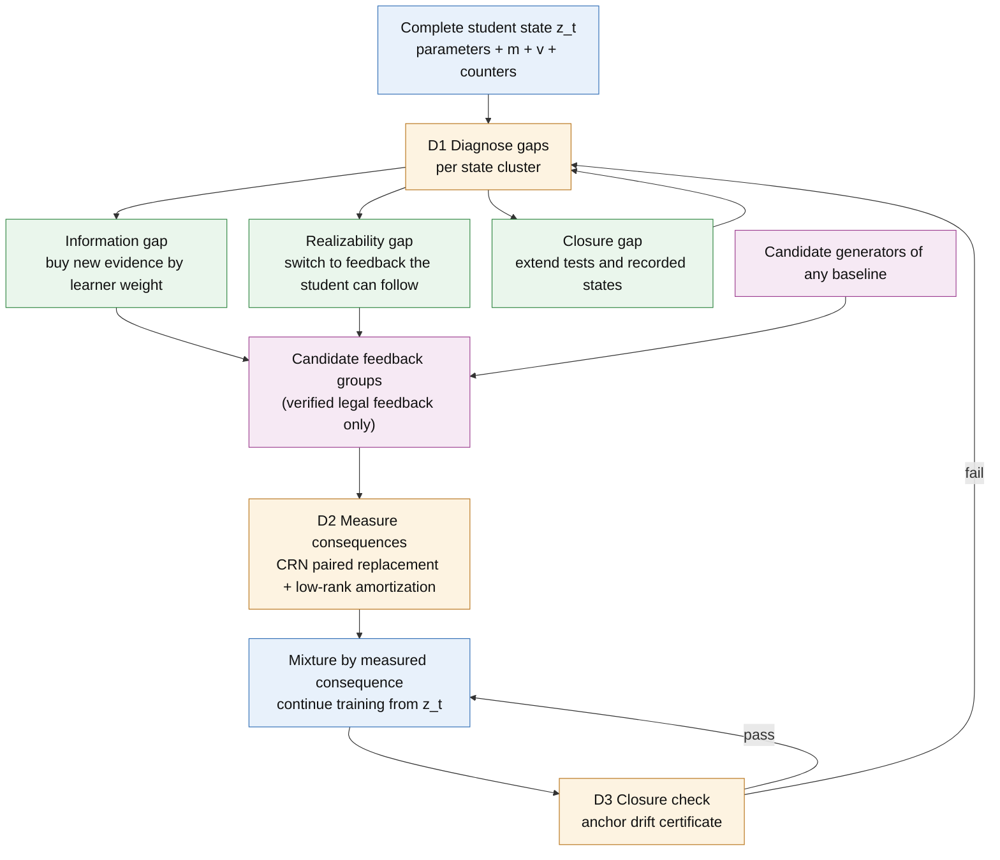

# Proposal 1 · Response-Calibrated Distillation (RCD): fixing the theoretical flaws shared by agent distillation methods

[中文版](P1_response_calibrated_distillation_ZH.md) · [Theoretical framework](../../theoretical_framework/README.md) · [Proposal 2 (world model)](P2_response_equivalent_world_model.md)

*Status: method proposal (2026-10-14). Every theoretical claim links to a statement proved in the framework. Items marked "to prove" are new results this paper must prove. Unless stated otherwise, none of the experiments has been run.*

---

## In one sentence

Existing agent distillation methods share one implicit assumption: **the value of a piece of feedback is a property of the feedback itself**, such as whether the action is correct, whether the trajectory succeeded, or how high its step reward is. The theoretical framework shows that the value of feedback is instead its **consequence**: how much the final performance changes when this student, in its current complete learning state and under this training recipe, absorbs the feedback and then finishes training.

RCD (Response-Calibrated Distillation) is a **general fix** for this shared flaw. It leaves unchanged how any method generates feedback. It replaces static criteria with consequences measured at the student's actual state in three decisions:
- what new evidence to buy;
- how much weight each group of feedback gets;
- when to decide again.

## 1. The problem through an analogy

A teacher preparing study material for a student, as done today, assumes three things:
1. **Material with correct answers is good material.** Yet the same correct material can help one student and hurt another, and it can help the same student at one stage and not at another.
2. **More material, better processed, tells the student more.** Yet restating the same exercise ten ways does not reveal what the exercise never said. New facts come only from new experiments or new questions.
3. **The student is who they are right now.** Yet the student learns with inertia: Adam's momentum and second moment carry this step's material into every later step. Material that fits now may no longer fit a few hundred steps later.

The framework states each of these as a theorem. We first look at what existing methods do, then show which of these results they all violate.

## 2. What existing methods do (method design in the papers only)

| Method | Where new evidence comes from | How each piece of feedback is valued | What "the student" is in the method |
|---|---|---|---|
| FireAct ([Chen et al., 2023](#ref-fireact)); AgentTuning ([Zeng et al., 2023](#ref-agenttuning)) | Teacher trajectories on states the teacher visits | Filtered by task success or reward; kept trajectories weighted equally | Parameters of one training run |
| Agent-FLAN ([Chen et al., 2024](#ref-agentflan)) | No new evidence: existing trajectories reorganized by format and capability, plus constructed negative samples | Mixture ratios per capability | Parameters of one training run |
| NAT ([Wang et al., 2024](#ref-nat)) | Teacher successes and failures | The outcome label (success or failure) is written into the input as a condition | Parameters of one training run |
| AgentGym / AgentEvol ([Xi et al., 2024](#ref-agentgym)) | The student's own exploration | Filtered or weighted by environment reward | A parameter snapshot per iteration |
| ETO ([Song et al., 2024](#ref-eto)) | Failure trajectories from the student's exploration | Expert successes against student failures, as DPO contrastive pairs | A parameter snapshot per iteration |
| IPR ([Xiong et al., 2024](#ref-ipr)) | Student actions from expert prefixes, plus Monte Carlo rollouts | MC-estimated step rewards; step-level pairs where the student's step scores below the expert's | A parameter snapshot per iteration |
| STeCa ([Wang et al., 2025](#ref-steca)) | Student exploration, plus LLM reflection | MC step rewards decide which step deviated; calibrated trajectories from reflection are used for SFT | A parameter snapshot per iteration |
| WKM ([Qiao et al., 2024](#ref-wkm)) | Student-sampled trajectories, compared with expert ones to synthesize task and state knowledge | The synthesized knowledge is treated as a correct prior | Parameters plus a knowledge model |
| DAgger ([Ross et al., 2011](#ref-dagger)); LEAP ([Choudhury & Sodhi, 2025](#ref-leap)) | Teacher corrections on student states (LEAP's teacher has privileged information) | Teacher corrections treated as correct labels and aggregated with equal weight | A parameter snapshot per iteration |
| Kang et al. ([2025](#ref-kang)) | Teacher trajectories, improved with a first-thought prefix | Teacher trajectory quality; self-consistent voting at test time | Parameters of one training run |
| GKD ([Agarwal et al., 2024](#ref-gkd)) | Teacher token distributions on student-sampled sequences (needs a white-box teacher) | Per-token divergence, equal weight | Current parameters |

Reading the table column by column:
- **Third column.** Every criterion is static: success, reward, MC value, teacher correctness, likelihood or divergence. Each is set by the feedback and the teacher or environment alone, independent of the student's current state and of the training recipe.
- **Second column.** New evidence is either absent (reorganization, rewriting, knowledge synthesis) or spent uniformly wherever the student explores or fails. No method allocates it by what information this learner needs. No method separates, state by state, "information is missing" from "the student cannot act on the teacher's label at all". LEAP recognizes that a privileged teacher's corrections may not be realizable by the student and trades this off on the teacher's side. It does not separate the two kinds of gap state by state, or treat them differently.
- **Fourth column.** The student is always its parameters. The method sections discuss parameters only, and none counts optimizer state as part of the student. Iterative methods treat each round as a new training run.

## 3. Three shared flaws

The three flaws are three sides of one misconception, which we call the **static-supervision view**: distillation is understood as imitating good behaviour, and goodness is a property of the behaviour itself. The three sides are value, information and time.

### Flaw 1 · Value: feedback is valued by static criteria ("correct means useful")

- **Implicit assumption.** The more correct a piece of feedback is (successful, high reward, high MC value, endorsed by the teacher), the more it is worth learning.
- **What the framework says.**
  - Static quantities do not decide what a student learns. Two sources can have equally good teachers, equal policy value and equal mean gradients, yet distill different students, and the sign of the difference flips across tasks ([Proposition 3.1](../../theoretical_framework/statements/03-01_static_value_not_learning_value.md#s3-1)).
  - The invariant that decides the outcome is the continuation response: the expected final return after receiving the feedback, applying the actual update and finishing training by the recipe ([Theorem 3.2](../../theoretical_framework/statements/03-02_continuation_response_characterization.md#s3-2)).
  - The same data can be sufficient for one learner and insufficient for another ([Theorem 6.3](../../theoretical_framework/statements/06-03_learner_relative_lower_bound.md#s6-3), [Corollary 6.12](../../theoretical_framework/statements/06-12_learner_separations.md#s6-12)).
- **Consequence.** Nothing guarantees any relation between the signals used to select and weight feedback and the quantity that decides the student's outcome. A method's gains therefore come and go, and it cannot tell in advance on which student, or at which stage, it will help.

### Flaw 2 · Information: processing existing evidence is mistaken for gaining information, and new evidence is not allocated by learner

- **Implicit assumption.** More data, better processed, carries more information; uniformly adding labels where the student errs is enough.
- **What the framework says.**
  - No environment-independent post-processing (replay, rewriting, filtering, contrastive pairing, reflection, knowledge synthesis) can reduce the information error ([Proposition 2.4](../../theoretical_framework/statements/02-04_post_processing_cannot_reduce_information.md#s2-4)). In directions the demonstrations cannot see, no amount of replay has value ([Corollary 6.7](../../theoretical_framework/statements/06-07_aliasing_zero_value_replay.md#s6-7)).
  - Even an everywhere-optimal teacher can leave an information gap that only active experiments close ([Theorem 2.6](../../theoretical_framework/statements/02-06_passive_impossibility_active_attainability.md#s2-6)).
  - The learner decides in which direction the data must carry information: the direction is $`c=\sum_tJ_t^{*}g_t`$ ([Theorem 6.3](../../theoretical_framework/statements/06-03_learner_relative_lower_bound.md#s6-3), [Theorem 6.5](../../theoretical_framework/statements/06-05_achievability.md#s6-5)). In the state-coverage model, queries should flow by water-filling to states with high learner weight and low teacher coverage ([Proposition 6.10](../../theoretical_framework/statements/06-10_water_filling_allocation.md#s6-10)). SGD and Adam weight states differently ([Proposition 6.11](../../theoretical_framework/statements/06-11_learner_weights_sgd_warm_adam.md#s6-11)).
  - If the target lies outside the convex hull of legal feedback, the gap is one of realizability, and buying more labels of the same kind does not help ([Proposition 6.14](../../theoretical_framework/statements/06-14_convex_realizability_legal_pool.md#s6-14)). The information–compilation radius separates missing information from feedback that cannot be realized ([Proposition 6.16](../../theoretical_framework/statements/06-16_information_compilation_radius.md#s6-16)).
- **Consequence.** Rewriting, reflection, contrastive pairs and filtering can only improve how well the student absorbs what it has (the algorithm term); they cannot close an information gap. The budget for new evidence goes to states where the learner is insensitive or the teacher already covers. A privileged teacher may give labels the student cannot follow, and buying more of them is waste.

### Flaw 3 · Time: the student is treated as a snapshot of its current parameters

- **Implicit assumption.** The student is its parameters. Data chosen in one round from the current parameters stays valid afterwards, and rounds are independent training runs.
- **What the framework says.**
  - To first order, what matters is the mean increment of the complete learner state, parameters plus optimizer state (§5, e.g. [Proposition 5.5](../../theoretical_framework/statements/05-05_exact_first_order_statistic_adam.md#s5-5)).
  - Under Adam, the value of a piece of feedback splits exactly into a parameter channel, a momentum channel and a second-moment channel ([Theorem 7.1](../../theoretical_framework/statements/07-01_state_channel_decomposition.md#s7-1)). Two pieces of feedback with exactly the same immediate parameters can still lead to different continuations ([Proposition 7.6](../../theoretical_framework/statements/07-06_equal_immediate_parameters_different_continuation.md#s7-6)).
  - A data interface that is sufficient now need not stay sufficient under further training ([Proposition 4.11](../../theoretical_framework/statements/04-11_static_not_dynamic_closure_error.md#s4-11), [Proposition 4.12](../../theoretical_framework/statements/04-12_response_predictive_state_factorization.md#s4-12)).
  - When the student's return is not additive over data units, how the same units are packaged also changes the outcome ([Proposition 9.1](../../theoretical_framework/statements/09-01_coupling_width.md#s9-1)).
- **Consequence.** Data chosen at a snapshot goes stale as training proceeds. Restarting training every round discards the optimizer's memory. Packaging and order are treated as implementation details that do not matter.

## 4. The general fix: RCD

### 4.1 Core idea

RCD treats any baseline as a **candidate generator**. Replay, teacher corrections, reward-filtered self-generated trajectories, contrastive pairs, step-level pairs, calibrated trajectories and rewrites are just different ways of producing candidate feedback. RCD leaves the generators alone and takes over three decisions, each fixing one flaw:

| Decision | Flaw fixed | What existing methods do | What RCD does |
|---|---|---|---|
| D1 · What new evidence to buy | Flaw 2 | Buy none, or buy uniformly | Diagnose the type of gap first, then allocate by learner weight; derived feedback is accounted separately |
| D2 · How much weight each group of feedback gets | Flaw 1 | Static scores | The consequence measured at the student's actual complete state, with the measurement amortized |
| D3 · When to decide again | Flaw 3 | Start over from a snapshot every round | Train continuously with the complete state kept; closure checks decide when to diagnose again |



### 4.2 Algorithm

**Inputs.**
- The student's initial complete state $`z_0`$ and a fixed training recipe.
- $`K`$ trusted demonstrations per task family.
- A further budget of teacher calls and environment interactions.
- Several candidate generators, taken from the data construction of any baselines.
- The declared deployment tasks, a surrogate used for scoring, and a cap on total cost: teacher calls, environment steps and GPU-hours, with every measurement counted.

**At each decision point $`t`$ (for example every 50 updates):**

1. **Save the complete state.** Save $`z_t`$, including parameters, $`m`$, $`v`$, the step counter and random state. The next training segment continues from $`z_t`$ without resetting the optimizer.
2. **Probe.**
   - Roll out the student on the permitted tasks and cluster the visited states by task type × subgoal phase.
   - For each cluster, estimate the learner weight $`W_s`$: how sensitive the student's final performance is to its behaviour there. It is estimated by grouped CRN replacement with few replicas; Adam's closed-form weights are used only where their conditions hold.
   - Also record the teacher coverage $`k_s`$: how much information the existing demonstrations already provide there.
3. **Diagnose and route (per cluster).**
   - *Information gap*: the existing evidence does not determine what to do, and $`W_s`$ is large. It is detected in practice by two signals: disagreement among several teacher samples, and disagreement that can be checked in the environment. Remedy: buy teacher queries or environment branches by the water-filling formula below.
   - *Realizability gap*: the teacher's label is determined, but the student cannot reach it from what it can observe, because the label depends on information the student does not see. Detection: the label changes when the teacher sees only the student-visible context, or the student still fails after training on these labels. Remedy: stop buying labels of this kind and switch to feedback the student can follow, such as de-privileged teacher corrections, demonstrations that gather information before acting (actions like look, inventory, open), or the student's own successful variants.
   - *Closure gap*: the interface fitted at the previous decision point fails the drift check here. Remedy: extend the tests and recorded states, and refit the interface.
   - Only new evidence counts towards the information budget; derived feedback (rewrites, reflections, pairs) is accounted separately.
4. **Compile legal candidates.**
   - Each generator produces candidate feedback groups; a group is a batch of feedback from one source on one cluster.
   - A teacher correction counts as legal only after it has been executed in the environment from a reset to the student's state and verified. Unverified generated messages are never used.
5. **Measure consequences (amortized).**
   - For some of the candidate groups, compute CRN paired replacement at $`z_t`$, scored by the surrogate ([Theorem 8.8](../../theoretical_framework/statements/08-08_crn_paired_replacement_certificate.md#s8-8)).
   - Fit a low-rank response interface that predicts a group's consequence from its features ([Theorem 4.9](../../theoretical_framework/statements/04-09_spectral_sufficiency.md#s4-9), [Proposition 8.12](../../theoretical_framework/statements/08-12_finite_catalog_spectral_certificate.md#s8-12)), and use it to predict the remaining groups.
   - Measure a small random subset directly to correct the predictions without bias, by two-fidelity estimation ([Proposition 8.15](../../theoretical_framework/statements/08-15_two_fidelity_response_estimation.md#s8-15)).
   - Reuse the interface across decision points, checking with the anchor drift certificate whether it still holds ([Proposition 8.13](../../theoretical_framework/statements/08-13_shared_features_across_checkpoints.md#s8-13), [Proposition 8.14](../../theoretical_framework/statements/08-14_anchor_reuse_drift_certificate.md#s8-14)).
6. **Select and train.**
   - Within the convex hull of the legal pool, set mixture weights by predicted consequence: how much of each generator on each cluster ([Proposition 6.14](../../theoretical_framework/statements/06-14_convex_realizability_legal_pool.md#s6-14)).
   - Continue training from $`z_t`$ to the next decision point.
   - Report strict and diagnostic radii separately.
7. **Calibrate and finish.**
   - Calibrate the surrogate with a few paired audits that run full-tail task evaluations ([Theorem 8.3](../../theoretical_framework/statements/08-03_actual_state_adaptive_audit_fidelity.md#s8-3), [Remark 8.11](../../theoretical_framework/statements/08-11_surrogate_calibration_and_transfer.md#s8-11)).
   - Run a final paired evaluation on the dev set against the noise reference.
   - Freeze the selector, then test transfer on held-out tasks and benchmarks.

The query allocation of step 3 ([Proposition 6.10](../../theoretical_framework/statements/06-10_water_filling_allocation.md#s6-10)) is

```math
n_s^\star=\Big(\sqrt{W_s/\lambda}-k_s\Big)_+ ,
```

where $`\lambda`$ is set by the total query budget.

### 4.3 Why this is a general fix rather than one more method

- **The generators are untouched.** RCD runs on top of any baseline: RCD(SFT), RCD(AgentEvol), RCD(ETO), RCD(IPR), RCD(LEAP). Each method's contribution, how it produces good candidates, is kept in full.
- **With the original method as reference, it is no worse.** Put the original method's own choice into the menu as the reference candidate $`P^0`$. With paired audits on actual states and selection by lower confidence bound, the loss relative to the reference is at most $`\delta`$ ([Theorem 8.3](../../theoretical_framework/statements/08-03_actual_state_adaptive_audit_fidelity.md#s8-3), under its conditions). With a surrogate, a calibration term is added.
- **When the static criterion happens to be right, RCD reduces to the original method.** If the measured consequences rank candidates as the original static scores do, and there is no gap beyond what the original method buys, RCD makes the original method's choice and only pays the measurement cost.
- **Every step corresponds to a proved statement** (linked above); no new heuristic is introduced.

### 4.4 Making it affordable

Measuring every piece of feedback is too expensive. We measured this in R1: one candidate at one state, with 64 replicas and 10 tail updates, costs 1–5 GPU-hours depending on the candidate's length. Whether RCD is feasible therefore depends on amortization:
- **Measure groups.** Measure groups of cluster × generator, not individual pieces of feedback; about 20–50 groups per decision point.
- **Low-rank interface.** Measure only some groups and let the interface predict the rest.
- **Two-fidelity correction.** A small random audit keeps the predictions unbiased and gives an exact cost condition for when amortization pays.
- **Reuse across decision points.** The interface is kept as long as the anchor drift certificate passes.
- **Cost ledger.** Every measurement counts towards total cost, and comparisons with baselines are at equal total cost.

Whether amortization actually saves compute is among the first questions to test (experiment E6).

## 5. What can be said in theory

**Already proved in the framework (each under its stated conditions).** Each step above links to its basis. The composed guarantee is [Corollary 8.16](../../theoretical_framework/statements/08-16_composed_guarantee.md#s8-16): the final error is at most the sum of a statistical term, a surrogate-calibration term, an interface truncation term, a drift term and a realizability term.

**New results this paper must prove (to prove).**
1. **Inconsistency of static selectors.** Consider any selection rule that depends on feedback only through static statistics: teacher correctness, outcome reward, MC action value, student likelihood or mean gradient. For any such rule, there are two learner–task pairs with identical static statistics on which the rule is optimal for one and worse by a constant for the other. The constructions come from [Proposition 3.1](../../theoretical_framework/statements/03-01_static_value_not_learning_value.md#s3-1) and [Proposition 7.6](../../theoretical_framework/statements/07-06_equal_immediate_parameters_different_continuation.md#s7-6). This states Flaw 1 as a theorem about a whole class of methods, not about any one method.
2. **Excess cost of learner-independent allocation.** New evidence allocated uniformly, or by visitation frequency, can have an error ratio, relative to water-filling by learner weight, that grows without bound in the number $`N`$ of long-tail states. See the long-tail case in [Example 6.13](../../theoretical_framework/statements/06-13_long_tail_example.md#s6-13) and the SGD–Adam separation in [Corollary 6.12](../../theoretical_framework/statements/06-12_learner_separations.md#s6-12). This states Flaw 2 as a lower bound for a whole class of methods.
3. **Safety and cost of RCD.** A bound on RCD's loss with the original method as reference, and the cost condition under which amortization pays. They combine [Theorem 8.3](../../theoretical_framework/statements/08-03_actual_state_adaptive_audit_fidelity.md#s8-3), [Proposition 8.15](../../theoretical_framework/statements/08-15_two_fidelity_response_estimation.md#s8-15) and [Corollary 8.16](../../theoretical_framework/statements/08-16_composed_guarantee.md#s8-16).
4. **(Stretch goal) A certificate that scales with the effect.** The current strict certificates are vacuous at measured scale, because they apply concentration inequalities with the a-priori range. Replacing this with a variance-adaptive bound is an open problem of [Remark 8.17](../../theoretical_framework/statements/08-17_open_problems.md#s8-17). If solved, the strict certificates would carry content.

**Honest note.** So far no real-model test supports a framework prediction ([Remark 9.4](../../theoretical_framework/statements/09-04_scope_of_evidence.md#s9-4)). RCD's benefit is a hypothesis, and the experiments below are designed to test it.

## 6. Experiments: testing the key steps

**Common setting.**
- Student: Gemma-4-12B-it (LoRA, AdamW). To test learner relativity we add a second learner: the same student trained with SGD-momentum, and Llama-3.1-8B-Instruct.
- Teacher: black-box gpt-6-luna. $`K`$ trusted demonstrations per task family.
- Environments: ALFWorld first, plus one of ScienceWorld or AppWorld; BFCL V4 multi-turn as auxiliary. Every mechanism is tested on all chosen environments; we never iterate on a single benchmark.
- The sealed test set is never used during development. One seed per configuration while exploring.
- Each experiment's predictions and criteria are pre-registered before it runs. Task-level comparisons use paired McNemar tests against the noise reference (the same adapter on two servers flips 15 of 300 tasks). All comparisons are at equal total cost.
- Baselines are implemented by the method design of their papers (we already have ETO, IPR, AgentGym, LEAP and Kang).

| ID | Key step tested | Procedure | Pre-registered criterion (summary) | Existing basis |
|---|---|---|---|---|
| E1 | Flaw 1: static criteria do not predict consequences | At two checkpoints and two learners, take about 20 candidate groups from the baseline generators; compute both the static score each baseline uses and the consequence measured by CRN | Flaw holds: Spearman $`\lvert\rho\rvert<0.3`$ between static score and consequence, or the ranking flips across checkpoints or learners. If $`\rho\ge0.6`$ in every condition, Flaw 1 does not hold for this recipe and the claim is narrowed | R1 is its prototype at one checkpoint with four candidates (P1 above P3, diagnostic) |
| E2 | Flaw 2: processing does not add information | Use ALFWorld's ground truth to mark information-gap clusters (facts the demonstrations do not reveal but success requires). On these and control clusters, add increasing amounts of derived feedback (rewrites, reflections, contrastive pairs) and new evidence at equal cost (teacher queries, environment branches) | On information-gap clusters, derived feedback gains stay within the noise reference and do not grow with quantity; new evidence gains exceed it | The hidden-fact model (§2) gives testable predictions |
| E3 | Flaw 2: allocating new evidence by learner | Teacher budgets $`n=100`$, $`400`$: no queries / uniform / SGD weights / water-filling by Adam weights; then apply the allocation computed for learner A to learner B | Adam weights minus uniform exceeds the noise reference with McNemar $`p<0.05`$; swapping learners makes it worse | R2 is running (primary criterion pre-registered) |
| E4 | Flaw 2: realizability gaps need different feedback, not more of it | On clusters where privileged information decides the action, compare, at equal teacher calls, privileged corrections (LEAP-style), de-privileged corrections and information-gathering demonstrations | On these clusters, buying more privileged labels does not help (or hurts), while the other two help | LEAP and its 0%-privileged ablation are implemented |
| E5 | Flaw 3: complete state and closure | (i) optimizer-state transplant; (ii) predict consequences at p40 with the interface fitted at p10, against refitting; (iii) at equal data, restarting the optimizer every round against continuous training | (i) per the T1 pre-registration; (ii) the static interface's predictive accuracy drops with training and the drift certificate flags it; (iii) pre-registered threshold | T1 submitted |
| E6 | Feasibility of RCD: amortization saves compute | On E1's groups, fit a low-rank interface on some groups and predict held-out groups and a held-out checkpoint. Compare accuracy and GPU-hours of three ways to pick the best group: (a) measure all directly, (b) interface prediction with two-fidelity correction, (c) static scores only | (b) makes the same decision as (a) (regret at most the diagnostic radius) in under half of (a)'s GPU-hours, and beats (c) | Reuses R1's measurements at z10 |
| E7 | The overall test of the general fix | RCD(Seed-SFT), RCD(AgentEvol-style), RCD(ETO), RCD(LEAP/DAgger) against the original methods at equal total cost (teacher calls + environment steps + GPU-hours, all measurement included), on two environments | In each environment, for at least 3 of 4 baselines, RCD(baseline) − baseline exceeds the noise reference with McNemar $`p<0.05`$; the frozen selector keeps the direction on a held-out benchmark | Depends on E1 and E6 |

**Order and stopping points.**
- Run E1 and E6 first. Both reuse existing checkpoints and measurements, so they are cheap, and their conclusions matter most: E1 tests whether the shared flaw actually exists, and E6 tests whether RCD is affordable.
- If E1 fails, the shared-flaw claim is narrowed. If E6 fails, RCD is usable only at small scale and the paper becomes primarily diagnostic.
- If both hold, run E2–E5 and E7.

## 7. Relation to prior work

- **Agent distillation methods** (the table in §2). RCD does not compete with how they generate candidates; it replaces the decision rule they share. Every comparison in the paper is "original method" against "RCD(original method)".
- **Data selection and attribution** (LESS [Xia et al., 2024](#ref-less), TRAK, datamodels, metagradients). These already make value depend on the learner. They usually compute it once at a single snapshot, without separating new evidence from derived feedback, and without handling legal compilation or closure. They can serve as interface features in RCD's step 5, and they must be compared at equal cost. The framework's [Remark 9.6](../../theoretical_framework/statements/09-06_contribution_units_prior_work.md#s9-6) lists what each line of prior work must be credited with.
- **Machine teaching and DAgger.** Choosing examples by learner, and querying on student states, both have precedents. RCD's increment is to combine information acquisition, realizability, optimizer memory and cost into one decision rule, with executable checks.

## 8. Risks

- **Measurement cost.** In R1, each P2 item took about 4.3 minutes. If amortization fails (E6 does not hold), RCD is usable only at small scale.
- **Surrogate calibration.** The relation between the likelihood score and task success has not been measured yet. E7 must rest on real task evaluation.
- **Effect size against noise.** The dev-set noise reference is 15 of 300 tasks flipping, so task-level differences must be large to be readable.
- **Existing negative results.** R0a's criterion was mis-specified, and R3's amplitude-law prediction had the wrong sign. RCD's claims cannot rest on those restricted-model predictions, only on E1, E6 and E7.

## 9. Resources (rough; re-estimated from pilot sacct before submission)

| Phase | Experiments | B200 GPU-hours | Teacher calls |
|---|---|---|---|
| A | E1, E6 (reusing z10 and R1) | 30–60 | ≤ 2,000 |
| B | E2–E5 (including the running R2 and T1) | 80–150 | ≤ 4,000 |
| C | E7 (two environments × four baselines) | 300–600 | ≤ 10,000 |

Phase A can start within the currently approved budget; phases B and C need separate approval.

## References

<a id="ref-agarwal"></a><a id="ref-gkd"></a>
- Rishabh Agarwal et al. (2024). On-Policy Distillation of Language Models: Learning from Self-Generated Mistakes. *ICLR 2024*. arXiv [2306.13649](https://arxiv.org/abs/2306.13649).

<a id="ref-agentflan"></a>
- Zehui Chen et al. (2024). Agent-FLAN: Designing Data and Methods of Effective Agent Tuning for Large Language Models. *Findings of ACL 2024*. arXiv [2403.12881](https://arxiv.org/abs/2403.12881).

<a id="ref-fireact"></a>
- Baian Chen et al. (2023). FireAct: Toward Language Agent Fine-tuning. arXiv [2310.05915](https://arxiv.org/abs/2310.05915).

<a id="ref-leap"></a>
- Sanjiban Choudhury, Paloma Sodhi (2025). Better than Your Teacher: LLM Agents that Learn from Privileged AI Feedback. *ICLR 2025*. arXiv [2410.05434](https://arxiv.org/abs/2410.05434).

<a id="ref-kang"></a>
- Minki Kang et al. (2025). Distilling LLM Agent into Small Models with Retrieval and Code Tools. arXiv [2505.17612](https://arxiv.org/abs/2505.17612).

<a id="ref-wkm"></a>
- Shuofei Qiao et al. (2024). Agent Planning with World Knowledge Model. *NeurIPS 2024*. arXiv [2405.14205](https://arxiv.org/abs/2405.14205).

<a id="ref-dagger"></a>
- Stéphane Ross, Geoffrey J. Gordon, J. Andrew Bagnell (2011). A Reduction of Imitation Learning and Structured Prediction to No-Regret Online Learning. *AISTATS 2011*.

<a id="ref-eto"></a>
- Yifan Song et al. (2024). Trial and Error: Exploration-Based Trajectory Optimization for LLM Agents. *ACL 2024*. arXiv [2403.02502](https://arxiv.org/abs/2403.02502).

<a id="ref-steca"></a>
- Hanlin Wang et al. (2025). STeCa: Step-level Trajectory Calibration for LLM Agent Learning. arXiv [2502.14276](https://arxiv.org/abs/2502.14276).

<a id="ref-nat"></a>
- Renxi Wang et al. (2024). Learning From Failure: Integrating Negative Examples when Fine-tuning Large Language Models as Agents. arXiv [2402.11651](https://arxiv.org/abs/2402.11651).

<a id="ref-agentgym"></a>
- Zhiheng Xi et al. (2024). AgentGym: Evolving Large Language Model-based Agents across Diverse Environments. arXiv [2406.04151](https://arxiv.org/abs/2406.04151).

<a id="ref-less"></a>
- Mengzhou Xia et al. (2024). LESS: Selecting Influential Data for Targeted Instruction Tuning. *ICML 2024*. arXiv [2402.04333](https://arxiv.org/abs/2402.04333).

<a id="ref-ipr"></a>
- Weimin Xiong et al. (2024). Watch Every Step! LLM Agent Learning via Iterative Step-Level Process Refinement. *EMNLP 2024*. arXiv [2406.11176](https://arxiv.org/abs/2406.11176).

<a id="ref-agenttuning"></a>
- Aohan Zeng et al. (2023). AgentTuning: Enabling Generalized Agent Abilities for LLMs. arXiv [2310.12823](https://arxiv.org/abs/2310.12823).

arXiv IDs and titles were checked one by one against the arXiv API (2026-10-14); venues will be checked again before any use in the paper. Further works cited by the framework pages are listed in [references.md](../../theoretical_framework/references.md).
