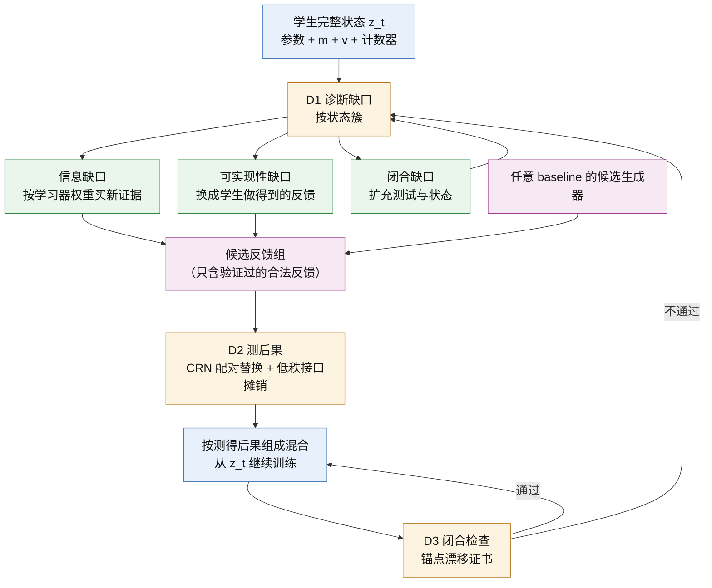

# Proposal 1 · 响应校准蒸馏（RCD）：修正 agent 蒸馏共有的理论缺陷

[English](P1_response_calibrated_distillation.md) · [理论框架](../../theoretical_framework/README_ZH.md) · [Proposal 2（World model）](P2_response_equivalent_world_model_ZH.md)

*状态：方法提案（2026-10-14）。文中的理论结论都链接到框架里已证明的陈述；标为"待证"的是这篇论文需要新证明的内容；所有实验都还没有运行，除非注明。*

---

## 一句话

现有的 agent 蒸馏方法有一个共同的隐含假设：**一条反馈的价值是它自身的属性**，比如动作对不对、轨迹成不成功、步奖励高不高。理论框架表明，反馈的价值其实是它的**后果**：这个学生在它当前的完整学习状态下，按这个训练配方吸收这条反馈、再把训练走完之后，最终表现改变了多少。

RCD（Response-Calibrated Distillation，响应校准蒸馏）是针对这个共同缺陷的**通法**。它不改动任何方法生成反馈的方式，只把三个决策从静态标准换成在学生实际状态上测得的后果：
- 买什么新证据；
- 每组反馈给多大权重；
- 什么时候重新决定。

## 1. 用一个比喻说清问题

老师给学生准备学习材料，现在的做法默认了三件事：
1. **答案正确的材料就是好材料。** 可是同一份正确的材料，对不同的学生效果可能相反；对同一个学生，学到不同阶段效果也不同。
2. **材料越多、加工得越好，学生知道的就越多。** 可是把同一道题换十种说法，学生并不会因此知道题目里没给的信息。要知道新的事实，只能去做新的实验或问新的问题。
3. **学生就是他现在的样子。** 可是学生带着"学习惯性"在学：Adam 的动量和二阶矩会把这一步的材料带进以后的每一步。现在合适的材料，学了几百步以后未必还合适。

框架把这三条分别写成了定理。下面先看现有方法具体怎么做，再说明它们共同违反了哪几条。

## 2. 现有方法在做什么（只看论文的方法设计）

| 方法 | 新证据从哪里来 | 每条反馈怎样被赋值 | 方法里的"学生"是什么 |
|---|---|---|---|
| FireAct（[Chen et al., 2023](#ref-fireact)）；AgentTuning（[Zeng et al., 2023](#ref-agenttuning)） | teacher 在它自己访问的状态上生成的轨迹 | 按任务成功或奖励过滤，保留下来的轨迹等权 | 一次训练的参数 |
| Agent-FLAN（[Chen et al., 2024](#ref-agentflan)） | 不增加新证据：把已有轨迹按格式和能力重新组织，并构造负样本 | 按能力维度定配比 | 一次训练的参数 |
| NAT（[Wang et al., 2024](#ref-nat)） | teacher 的成功与失败轨迹 | 把结果标签（成功/失败）作为条件写进输入 | 一次训练的参数 |
| AgentGym / AgentEvol（[Xi et al., 2024](#ref-agentgym)） | 学生自己探索 | 按环境奖励过滤或加权 | 每轮迭代的参数快照 |
| ETO（[Song et al., 2024](#ref-eto)） | 学生探索得到的失败轨迹 | 专家成功轨迹对学生失败轨迹，组成 DPO 对比对 | 每轮迭代的参数快照 |
| IPR（[Xiong et al., 2024](#ref-ipr)） | 从专家前缀出发的学生动作，加上 Monte Carlo rollout | MC 估计的步奖励；学生步低于专家步时组成步级对比对 | 每轮迭代的参数快照 |
| STeCa（[Wang et al., 2025](#ref-steca)） | 学生探索，加上 LLM 反思 | 用 MC 步奖励判断哪一步偏离；反思得到的校准轨迹拿来做 SFT | 每轮迭代的参数快照 |
| WKM（[Qiao et al., 2024](#ref-wkm)） | 学生采样的轨迹，与专家轨迹对比，合成任务知识与状态知识 | 合成的知识被当作正确的先验 | 参数加一个知识模型 |
| DAgger（[Ross et al., 2011](#ref-dagger)）；LEAP（[Choudhury & Sodhi, 2025](#ref-leap)） | teacher 在学生状态上给出的修正（LEAP 的 teacher 有特权信息） | teacher 的修正当作正确标签，等权聚合 | 每轮迭代的参数快照 |
| Kang et al.（[2025](#ref-kang)） | teacher 轨迹，用 first-thought prefix 提高质量 | 看 teacher 轨迹的质量；测试时用自洽投票 | 一次训练的参数 |
| GKD（[Agarwal et al., 2024](#ref-gkd)） | teacher 在学生采样序列上的 token 分布（需要白盒 teacher） | 逐 token 的散度，等权 | 当前参数 |

逐列看这张表：
- **第三列**里的每一个标准都是静态的：成功、奖励、MC 值、teacher 正确性、似然或散度。它们都只由反馈本身和 teacher/环境决定，与学生当前的状态、训练配方无关。
- **第二列**里，新证据要么没有（重组、改写、知识合成），要么均匀地花在学生探索到或出错的地方。没有一个方法按"这个学习器需要什么信息"来分配，也没有一个方法逐状态区分"缺信息"与"teacher 的标签学生根本做不出来"。LEAP 已经意识到特权 teacher 的修正可能无法被学生实现，并在 teacher 一侧做了权衡；但它没有把这两类缺口逐状态分开，分别处理。
- **第四列**里，学生都是参数：方法部分只讨论参数，没有一个把 optimizer state 当作学生的一部分；迭代式方法把每一轮当成一次新的训练。

## 3. 三个共同缺陷

三个缺陷是同一个误解的三个侧面。这个误解可以叫作**静态监督观**：把蒸馏理解为"模仿好的行为"，好坏由行为本身决定。三个侧面分别是价值、信息和时间。

### 缺陷 1 · 价值：用静态标准给反馈赋值（"正确就是有用"）

- **隐含假设.** 反馈越正确（成功、奖励高、MC 值高、teacher 认可），就越值得学。
- **框架的结论.**
  - 静态量决定不了学生学到什么：两个来源可以有同样好的 teacher、同样的策略价值、同样的梯度均值，却蒸馏出不同的学生，而且换一个任务，差的符号会反过来（[Proposition 3.1](../../theoretical_framework/statements/03-01_static_value_not_learning_value_ZH.md#s3-1)）。
  - 决定结果的不变量是 continuation response：收到这条反馈、执行实际的一步更新、再按配方把训练走完之后的期望最终回报（[Theorem 3.2](../../theoretical_framework/statements/03-02_continuation_response_characterization_ZH.md#s3-2)）。
  - 同一批数据可以对一个学习器充分，对另一个不充分（[Theorem 6.3](../../theoretical_framework/statements/06-03_learner_relative_lower_bound_ZH.md#s6-3)、[Corollary 6.12](../../theoretical_framework/statements/06-12_learner_separations_ZH.md#s6-12)）。
- **后果.** 选择和加权所用的信号，与真正决定学生结果的量之间没有任何保证的关系。所以一个方法的收益时有时无，事先也无法判断它在哪个学生、哪个阶段会有效。

### 缺陷 2 · 信息：把"加工已有证据"当成"获得新信息"，新证据也不按学习器分配

- **隐含假设.** 数据越多、加工越好，学生得到的信息越多；在学生出错的地方均匀地补标签就够了。
- **框架的结论.**
  - 任何与环境无关的后处理（replay、改写、过滤、对比配对、反思、知识合成）都不能降低信息误差（[Proposition 2.4](../../theoretical_framework/statements/02-04_post_processing_cannot_reduce_information_ZH.md#s2-4)）。在示范看不见的方向上，任何数量的 replay 都没有价值（[Corollary 6.7](../../theoretical_framework/statements/06-07_aliasing_zero_value_replay_ZH.md#s6-7)）。
  - 即使 teacher 处处最优，也可能留下只有主动实验才能补上的信息缺口（[Theorem 2.6](../../theoretical_framework/statements/02-06_passive_impossibility_active_attainability_ZH.md#s2-6)）。
  - 数据必须在哪个方向上携带信息，由学习器决定：方向是 $`c=\sum_tJ_t^{*}g_t`$（[Theorem 6.3](../../theoretical_framework/statements/06-03_learner_relative_lower_bound_ZH.md#s6-3)、[Theorem 6.5](../../theoretical_framework/statements/06-05_achievability_ZH.md#s6-5)）。在状态覆盖模型里，查询应该按 water-filling 流向学习器权重高、teacher 覆盖低的状态（[Proposition 6.10](../../theoretical_framework/statements/06-10_water_filling_allocation_ZH.md#s6-10)）。SGD 与 Adam 给状态的权重不同（[Proposition 6.11](../../theoretical_framework/statements/06-11_learner_weights_sgd_warm_adam_ZH.md#s6-11)）。
  - 如果目标落在合法反馈的凸包之外，就是可实现性缺口：再买多少同类标签也没用（[Proposition 6.14](../../theoretical_framework/statements/06-14_convex_realizability_legal_pool_ZH.md#s6-14)）。信息—编译半径能把"缺信息"和"做不到"区分开（[Proposition 6.16](../../theoretical_framework/statements/06-16_information_compilation_radius_ZH.md#s6-16)）。
- **后果.** 改写、反思、对比对、过滤只能改善学生吸收得好不好（算法项），补不了信息缺口。新证据的预算被花在学习器不敏感、或 teacher 已经覆盖的地方。特权 teacher 给出的标签可能学生根本做不到，这时继续买标签是浪费。

### 缺陷 3 · 时间：把学生当成"当前的参数快照"

- **隐含假设.** 学生就是参数；在某一轮按当前参数定下的数据，之后一直有效；轮与轮之间是相互独立的训练。
- **框架的结论.**
  - 一阶意义下，起作用的是完整学习器状态（参数加 optimizer state）的平均增量（§5，例如 [Proposition 5.5](../../theoretical_framework/statements/05-05_exact_first_order_statistic_adam_ZH.md#s5-5)）。
  - 在 Adam 下，一条反馈的价值精确分成参数、动量、二阶矩三个通道（[Theorem 7.1](../../theoretical_framework/statements/07-01_state_channel_decomposition_ZH.md#s7-1)）。即时参数完全相同的两条反馈，后续可以不同（[Proposition 7.6](../../theoretical_framework/statements/07-06_equal_immediate_parameters_different_continuation_ZH.md#s7-6)）。
  - 现在充分的数据接口，继续训练之后未必仍然充分（[Proposition 4.11](../../theoretical_framework/statements/04-11_static_not_dynamic_closure_error_ZH.md#s4-11)、[Proposition 4.12](../../theoretical_framework/statements/04-12_response_predictive_state_factorization_ZH.md#s4-12)）。
  - 当学生的回报对数据单元不可加时，同样的单元怎样打包也会改变结果（[Proposition 9.1](../../theoretical_framework/statements/09-01_coupling_width_ZH.md#s9-1)）。
- **后果.** 按快照选出的数据，随着训练推进会失效；每轮重启训练丢掉了 optimizer 的记忆；打包与顺序被当作无关紧要的实现细节。

## 4. 通法：RCD

### 4.1 核心思想

RCD 把任何 baseline 都看成一个**候选生成器**。replay、teacher 修正、奖励过滤的自生成轨迹、对比对、步级对、校准轨迹、改写，都只是产生候选反馈的不同方式。RCD 不改生成器，只接管三个决策，每个决策修正一个缺陷：

| 决策 | 修正的缺陷 | 现有方法的做法 | RCD 的做法 |
|---|---|---|---|
| D1 · 买什么新证据 | 缺陷 2 | 不买，或者均匀地买 | 先诊断缺口类型，再按学习器权重分配；派生反馈单独记账 |
| D2 · 每组反馈给多大权重 | 缺陷 1 | 按静态分数 | 按在学生实际完整状态上测得的后果，测量经过摊销 |
| D3 · 什么时候重新决定 | 缺陷 3 | 每轮按快照重来 | 保留完整状态连续训练；用闭合检查决定何时重新诊断 |



### 4.2 算法

**输入.**
- 学生的初始完整状态 $`z_0`$，固定的训练配方。
- 每个任务族 $`K`$ 条可信示范。
- teacher 调用与环境交互的额外预算。
- 若干候选生成器，取自任意 baseline 的数据构造方式。
- 声明的部署任务、一个用于打分的 surrogate，以及总成本上限：teacher 调用、环境步与 GPU-h，所有测量都计入。

**每个决策点 $`t`$（例如每 50 次更新）执行：**

1. **保存完整状态.** 保存 $`z_t`$，包括参数、$`m`$、$`v`$、步数与随机状态。下一段训练从 $`z_t`$ 接着跑，不重置 optimizer。
2. **探测.**
   - 让学生在允许的任务上 rollout，把访问到的状态按"任务类型 × 子目标阶段"聚成簇。
   - 对每个簇估计 learner weight $`W_s`$：学生最终表现对这个簇上的行为有多敏感。估计方法是分组 CRN 替换，用少量副本；Adam 的闭式权重只在它的条件成立时使用。
   - 同时统计 teacher 覆盖 $`k_s`$：现有示范在这个簇上提供了多少信息。
3. **诊断缺口，分流处理（每个簇）.**
   - *信息缺口*：现有证据不能确定该怎么做，并且 $`W_s`$ 大。实际中用两种信号检测：teacher 多次采样的分歧，以及在环境里可以验证的分歧。处理：按下面的 water-filling 公式买 teacher 查询或环境分支。
   - *可实现性缺口*：teacher 的标签是确定的，但学生依据它能看到的信息做不出来，也就是标签依赖学生看不到的信息。检测：只给 teacher 学生可见的上下文时，标签会改变；或者学生在这些标签上训练后仍然学不会。处理：不再加买同类标签，改用学生做得到的反馈，例如去特权的 teacher 修正、先收集信息再行动的示范（look、inventory、open 一类动作），或者学生自己的成功变体。
   - *闭合缺口*：上一个决策点拟合的接口，在本点的漂移检查中不通过。处理：增加测试与记录的状态，重新拟合接口。
   - 只有新证据计入信息预算；改写、反思、配对这些派生反馈单独记账。
4. **编译合法候选.**
   - 每个生成器产生若干候选反馈组，每组是同一来源、同一簇的一批反馈。
   - teacher 的修正要先在环境里从学生的状态 reset 后执行，验证通过才算合法；不使用未经验证的生成消息。
5. **测后果（摊销）.**
   - 对一部分候选组，在 $`z_t`$ 上做 CRN 配对替换，用 surrogate 打分（[Theorem 8.8](../../theoretical_framework/statements/08-08_crn_paired_replacement_certificate_ZH.md#s8-8)）。
   - 用这些测量拟合一个低秩响应接口：从候选组的特征预测它的后果（[Theorem 4.9](../../theoretical_framework/statements/04-09_spectral_sufficiency_ZH.md#s4-9)、[Proposition 8.12](../../theoretical_framework/statements/08-12_finite_catalog_spectral_certificate_ZH.md#s8-12)），再用接口预测其余候选组。
   - 随机抽一小部分候选组直接测量，对预测做无偏的双保真校正（[Proposition 8.15](../../theoretical_framework/statements/08-15_two_fidelity_response_estimation_ZH.md#s8-15)）。
   - 接口跨决策点复用，用锚点漂移证书检查它是否还能用（[Proposition 8.13](../../theoretical_framework/statements/08-13_shared_features_across_checkpoints_ZH.md#s8-13)、[Proposition 8.14](../../theoretical_framework/statements/08-14_anchor_reuse_drift_certificate_ZH.md#s8-14)）。
6. **选择与训练.**
   - 在合法池的凸包内，按预测的后果确定混合权重，即每个生成器、每个簇各占多少（[Proposition 6.14](../../theoretical_framework/statements/06-14_convex_realizability_legal_pool_ZH.md#s6-14)）。
   - 从 $`z_t`$ 继续训练到下一个决策点。
   - 严格半径与诊断半径分开报告。
7. **校准与收尾.**
   - 用少量全尾段任务评测的配对 audit 校准 surrogate（[Theorem 8.3](../../theoretical_framework/statements/08-03_actual_state_adaptive_audit_fidelity_ZH.md#s8-3)、[Remark 8.11](../../theoretical_framework/statements/08-11_surrogate_calibration_and_transfer_ZH.md#s8-11)）。
   - 最终在 dev 集上做配对评测，并对照噪声参照。
   - 冻结选择器，再在留出的任务与 benchmark 上检验迁移。

第 3 步的查询分配（[Proposition 6.10](../../theoretical_framework/statements/06-10_water_filling_allocation_ZH.md#s6-10)）是：

```math
n_s^\star=\Big(\sqrt{W_s/\lambda}-k_s\Big)_+ ,
```

其中 $`\lambda`$ 由总查询预算确定。

### 4.3 为什么这是通法，而不是又一个方法

- **不改生成器.** RCD 作用在任意 baseline 之上：RCD(SFT)、RCD(AgentEvol)、RCD(ETO)、RCD(IPR)、RCD(LEAP)。各方法的贡献（怎样产生好的候选）被完整保留。
- **以原方法为参照，不会更差.** 把原方法自己的选择作为参照候选 $`P^0`$ 放进菜单。在实际状态上做配对 audit、按置信下界选择时，相对参照的损失不超过 $`\delta`$（[Theorem 8.3](../../theoretical_framework/statements/08-03_actual_state_adaptive_audit_fidelity_ZH.md#s8-3)，在它的条件下）。用 surrogate 时还要加上校准项。
- **静态标准恰好正确时退化为原方法.** 如果测得的后果与原方法的静态分数排序一致，又没有原方法之外的缺口，RCD 的选择就是原方法的选择，只多付了测量成本。
- **每个步骤都对应一个已证明的陈述**（见上面的链接）；没有引入新的启发式。

### 4.4 让它算得起

逐条测量太贵。我们在 R1 中实测：同一状态上一个候选、64 个副本、10 步尾段，要 1–5 个 GPU-h，取决于候选的长度。所以 RCD 的可行性取决于摊销：
- **按组测量**：在簇 × 生成器的组上测，不在单条反馈上测；一个决策点大约 20–50 组。
- **低秩接口**：只测一部分组，其余由接口预测。
- **双保真校正**：随机抽查一小部分，保证预测无偏，并给出何时值得摊销的精确成本条件。
- **跨决策点复用**：只要锚点漂移证书通过，接口就沿用。
- **成本台账**：所有测量都计入总成本，与 baseline 在同等总成本下比较。

摊销是否真的能省算力，是要检验的第一批问题之一（实验 E6）。

## 5. 理论上能说什么

**框架里已经证明的（各自在所列条件下）.** 上面每一步的依据都有链接。组合起来的保证是 [Corollary 8.16](../../theoretical_framework/statements/08-16_composed_guarantee_ZH.md#s8-16)：最终误差不超过统计项、surrogate 校准项、接口截断项、漂移项与可实现性项之和。

**这篇论文需要新证的（待证）.**
1. **静态选择器的不一致性.** 任何只通过静态统计量（teacher 正确性、结果奖励、MC 动作值、学生似然、梯度均值）依赖反馈的选择规则，都存在两个"学习器—任务"组合：静态统计量完全相同，规则在一个上最优，在另一个上差一个常数。构造来自 [Proposition 3.1](../../theoretical_framework/statements/03-01_static_value_not_learning_value_ZH.md#s3-1) 与 [Proposition 7.6](../../theoretical_framework/statements/07-06_equal_immediate_parameters_different_continuation_ZH.md#s7-6)。这一条把缺陷 1 写成对整类方法成立的定理，而不是针对某一个方法。
2. **学习器无关分配的超额代价.** 均匀分配、或按访问频率分配的新证据，相对按学习器权重的 water-filling，误差之比可以随长尾状态数 $`N`$ 无界增长。长尾例子见 [Example 6.13](../../theoretical_framework/statements/06-13_long_tail_example_ZH.md#s6-13)，SGD 与 Adam 的分离见 [Corollary 6.12](../../theoretical_framework/statements/06-12_learner_separations_ZH.md#s6-12)。这一条把缺陷 2 写成整类方法的下界。
3. **RCD 的安全性与成本.** 以原方法为参照时，RCD 的损失上界，以及摊销划算的成本条件。由 [Theorem 8.3](../../theoretical_framework/statements/08-03_actual_state_adaptive_audit_fidelity_ZH.md#s8-3)、[Proposition 8.15](../../theoretical_framework/statements/08-15_two_fidelity_response_estimation_ZH.md#s8-15) 与 [Corollary 8.16](../../theoretical_framework/statements/08-16_composed_guarantee_ZH.md#s8-16) 组合而来。
4. **（冲击目标）随效应缩放的证书.** 目前的严格证书在实测尺度下是空的，原因是用先验区间做集中不等式。用方差自适应的界替换它，是 [Remark 8.17](../../theoretical_framework/statements/08-17_open_problems_ZH.md#s8-17) 中的开放问题；做到了，严格证书才会变得有内容。

**诚实说明.** 到目前为止，没有一项真实模型检验支持框架的预测（[Remark 9.4](../../theoretical_framework/statements/09-04_scope_of_evidence_ZH.md#s9-4)）。RCD 的收益是待检验的假说，下面的实验就是为检验它而设计的。

## 6. 实验：验证关键步骤

**统一设置.**
- 学生：Gemma-4-12B-it（LoRA，AdamW）。为了检验"学习器相对"，加入第二个学习器：同一学生改用 SGD-momentum，以及 Llama-3.1-8B-Instruct。
- teacher：黑盒 gpt-6-luna。每个任务族 $`K`$ 条可信示范。
- 环境：ALFWorld 为主，另加 ScienceWorld 或 AppWorld 之一；BFCL V4 多轮作辅助。每个机制都在所有选定的环境上检验，不在单一 benchmark 上迭代。
- 封存的测试集在开发期间从不使用。探索阶段每个配置一个 seed。
- 每个实验在运行前预注册预测与判据。任务层面的比较用配对 McNemar，并对照噪声参照（同一 adapter 在两台 server 上有 15/300 个任务翻转）。所有比较都在同等总成本下进行。
- baseline 都按原论文的方法设计实现（我们已有 ETO、IPR、AgentGym、LEAP、Kang 的实现）。

| 编号 | 检验的关键步骤 | 做法 | 预注册判据（摘要） | 已有基础 |
|---|---|---|---|---|
| E1 | 缺陷 1：静态标准预测不了后果 | 在两个 checkpoint、两个学习器上，取各 baseline 生成器的约 20 个候选组，同时计算 baseline 用的静态分数，以及 CRN 测得的后果 | 缺陷成立：静态分数与后果的 Spearman $`\lvert\rho\rvert<0.3`$，或排序在 checkpoint/学习器之间翻转。若各条件下都有 $`\rho\ge0.6`$，缺陷 1 在这个配方上不成立，主张收缩 | R1 是它在一个 checkpoint、四个候选上的雏形（P1 优于 P3，诊断性） |
| E2 | 缺陷 2：加工补不了信息 | 用 ALFWorld 的 ground truth 标出信息缺口簇（示范没有揭示、但成功必需的事实）；在这些簇和对照簇上，分别加入递增量的派生反馈（改写、反思、对比对）与等成本的新证据（teacher 查询、环境分支） | 信息缺口簇上，派生反馈的增益在噪声参照内，且不随数量增加；新证据的增益超过噪声参照 | 隐藏事实模型（§2）给出可检验的预测 |
| E3 | 缺陷 2：按学习器分配新证据 | teacher 预算 $`n=100`$、$`400`$：不查询 / 均匀 / SGD 权重 / Adam 权重的 water-filling；再把为学习器 A 算的分配用在学习器 B 上 | Adam 权重减均匀分配超过噪声参照且 McNemar $`p<0.05`$；交换学习器后变差 | R2 正在运行（主判据已预注册） |
| E4 | 缺陷 2：可实现性缺口要换反馈，不要加量 | 在特权信息决定动作的簇上，比较同等 teacher 调用下的特权修正（LEAP 式）、去特权修正，以及先收集信息的示范 | 这些簇上，加买特权标签不改善（或变差），后两者改善 | LEAP 与它的 0% 特权消融已实现 |
| E5 | 缺陷 3：完整状态与闭合 | (i) optimizer state 移植；(ii) 在 p10 拟合的接口去预测 p40 的后果，对比重新拟合；(iii) 等量数据下，每轮重启 optimizer 与连续训练相比 | (i) 按 T1 预注册；(ii) 静态接口的预测精度随训练下降，漂移证书能报警；(iii) 预注册阈值 | T1 已提交 |
| E6 | RCD 的可行性：摊销能省算力 | 在 E1 的候选组上，用一部分组拟合低秩接口，预测留出的组和留出的 checkpoint。比较三者在"选出最好的候选组"上的正确率与 GPU-h：(a) 全部直接测量，(b) 接口预测加双保真校正，(c) 只看静态分数 | (b) 的决策与 (a) 一致（regret 不超过诊断半径），GPU-h 不到 (a) 的一半，且优于 (c) | 复用 R1 在 z10 上的测量 |
| E7 | 通法的总检验 | RCD(Seed-SFT)、RCD(AgentEvol 式)、RCD(ETO)、RCD(LEAP/DAgger) 分别与原方法比较，同等总成本（teacher 调用 + 环境步 + GPU-h，含所有测量），在两个环境上 | 每个环境上，至少 3/4 的 baseline 满足 RCD(baseline) − baseline 超过噪声参照且 McNemar $`p<0.05`$；冻结的选择器在留出 benchmark 上保持方向 | 依赖 E1、E6 的结果 |

**先后顺序与止损.**
- 先做 E1 和 E6。两者都能复用已有的 checkpoint 与测量，成本低，结论也最关键：E1 检验共同缺陷是否真的存在，E6 检验 RCD 是否算得起。
- E1 不成立，就收缩"共同缺陷"的主张；E6 不成立，RCD 只能在小规模上使用，论文改为以诊断为主。
- 两者都成立，再做 E2–E5 与 E7。

## 7. 与已有工作的关系

- **agent 蒸馏方法**（第 2 节的表）：RCD 不与它们竞争候选的生成方式，而是替换它们共有的决策规则。论文里每个对比都是"原方法"对"RCD(原方法)"。
- **数据选择与归因**（LESS [Xia et al., 2024](#ref-less)、TRAK、datamodels、metagradient）：它们已经让价值依赖于学习器，但通常在单个快照上一次性计算，不区分新证据与派生反馈，也不处理合法编译与闭合。它们可以作为 RCD 第 5 步的接口特征，也必须作为在同等成本下比较的对象。框架的 [Remark 9.6](../../theoretical_framework/statements/09-06_contribution_units_prior_work_ZH.md#s9-6) 列出了每条已有工作必须承认的部分。
- **machine teaching 与 DAgger**：按学习器选样本、在学生状态上查询，都有先例。RCD 的增量在于把信息获取、可实现性、optimizer 记忆与成本组合到一个决策规则里，并给出可执行的检查。

## 8. 风险

- **测量成本.** P2 候选在 R1 里每个 item 约 4.3 分钟。如果摊销失败（E6 不成立），RCD 就只能在小规模上使用。
- **surrogate 校准.** 似然分数与任务成功率之间的关系还没有测。E7 必须以真实任务评测为准。
- **效应量与噪声.** dev 集的噪声参照是 15/300 个任务翻转，任务层面的差异必须足够大才能读出来。
- **已有负面结果.** R0a 的判据设定有误，R3 的振幅定律预测符号相反。RCD 的主张不能依赖这些受限模型的预测，只能依赖 E1、E6 与 E7。

## 9. 资源（粗估，提交前按 pilot 的 sacct 重新估算）

| 阶段 | 实验 | B200 GPU-h | teacher 调用 |
|---|---|---|---|
| A | E1、E6（复用 z10 与 R1） | 30–60 | ≤ 2,000 |
| B | E2–E5（含正在运行的 R2、T1） | 80–150 | ≤ 4,000 |
| C | E7（两个环境 × 四个 baseline） | 300–600 | ≤ 10,000 |

阶段 A 可以在当前已批准的预算内启动；阶段 B 与 C 需要另批。

## 参考文献

<a id="ref-agarwal"></a><a id="ref-gkd"></a>
- Rishabh Agarwal et al. (2024). On-Policy Distillation of Language Models: Learning from Self-Generated Mistakes. *ICLR 2024*. arXiv [2306.13649](https://arxiv.org/abs/2306.13649).

<a id="ref-agentflan"></a>
- Zehui Chen et al. (2024). Agent-FLAN: Designing Data and Methods of Effective Agent Tuning for Large Language Models. *Findings of ACL 2024*. arXiv [2403.12881](https://arxiv.org/abs/2403.12881).

<a id="ref-fireact"></a>
- Baian Chen et al. (2023). FireAct: Toward Language Agent Fine-tuning. arXiv [2310.05915](https://arxiv.org/abs/2310.05915).

<a id="ref-leap"></a>
- Sanjiban Choudhury, Paloma Sodhi (2025). Better than Your Teacher: LLM Agents that Learn from Privileged AI Feedback. *ICLR 2025*. arXiv [2410.05434](https://arxiv.org/abs/2410.05434).

<a id="ref-kang"></a>
- Minki Kang et al. (2025). Distilling LLM Agent into Small Models with Retrieval and Code Tools. arXiv [2505.17612](https://arxiv.org/abs/2505.17612).

<a id="ref-wkm"></a>
- Shuofei Qiao et al. (2024). Agent Planning with World Knowledge Model. *NeurIPS 2024*. arXiv [2405.14205](https://arxiv.org/abs/2405.14205).

<a id="ref-dagger"></a>
- Stéphane Ross, Geoffrey J. Gordon, J. Andrew Bagnell (2011). A Reduction of Imitation Learning and Structured Prediction to No-Regret Online Learning. *AISTATS 2011*.

<a id="ref-eto"></a>
- Yifan Song et al. (2024). Trial and Error: Exploration-Based Trajectory Optimization for LLM Agents. *ACL 2024*. arXiv [2403.02502](https://arxiv.org/abs/2403.02502).

<a id="ref-steca"></a>
- Hanlin Wang et al. (2025). STeCa: Step-level Trajectory Calibration for LLM Agent Learning. arXiv [2502.14276](https://arxiv.org/abs/2502.14276).

<a id="ref-nat"></a>
- Renxi Wang et al. (2024). Learning From Failure: Integrating Negative Examples when Fine-tuning Large Language Models as Agents. arXiv [2402.11651](https://arxiv.org/abs/2402.11651).

<a id="ref-agentgym"></a>
- Zhiheng Xi et al. (2024). AgentGym: Evolving Large Language Model-based Agents across Diverse Environments. arXiv [2406.04151](https://arxiv.org/abs/2406.04151).

<a id="ref-less"></a>
- Mengzhou Xia et al. (2024). LESS: Selecting Influential Data for Targeted Instruction Tuning. *ICML 2024*. arXiv [2402.04333](https://arxiv.org/abs/2402.04333).

<a id="ref-ipr"></a>
- Weimin Xiong et al. (2024). Watch Every Step! LLM Agent Learning via Iterative Step-Level Process Refinement. *EMNLP 2024*. arXiv [2406.11176](https://arxiv.org/abs/2406.11176).

<a id="ref-agenttuning"></a>
- Aohan Zeng et al. (2023). AgentTuning: Enabling Generalized Agent Abilities for LLMs. arXiv [2310.12823](https://arxiv.org/abs/2310.12823).

arXiv 编号与标题已用 arXiv API 逐条核对（2026-10-14）；会议信息写入论文前再核对一次。框架页面引用的其余文献见 [references_ZH.md](../../theoretical_framework/references_ZH.md)。
