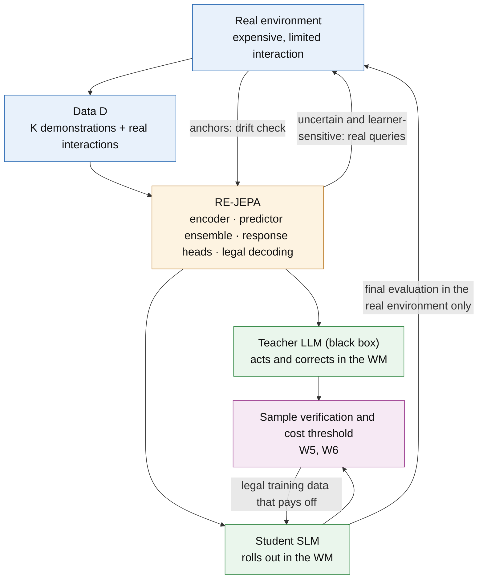

# Proposal 2 · Response-Equivalent World Models: a world model as the simulated environment for agent distillation

[中文版](P2_response_equivalent_world_model_ZH.md) · [Theoretical framework](../../theoretical_framework/README.md) · [Proposal 1 (RCD)](P1_response_calibrated_distillation.md)

*Status: method proposal (2026-10-14). This is a second project, separate from Paper 1. It can use Proposal 1's RCD as its distillation engine but does not depend on it. The framework results linked here are proved; items marked "to prove" are new results this paper must prove; none of the experiments has been run.*

---

## In one sentence

The idea is to replace an expensive real environment with a world model (WM). The teacher LLM acts and gives corrections inside the WM, producing training data to distill a small model (SLM). The common view is "the more realistic the WM, the better". The theoretical framework answers differently. A WM need not be realistic everywhere. It needs to be **response-equivalent**: wherever the student goes, and along the few directions that decide the student's training outcome, it must produce the same training consequences as the real environment. Moreover, a WM cannot create information, its outputs must be legal, and it pays off only above a cost threshold that can be checked in advance.

From this we design **RE-JEPA** (Response-Equivalent JEPA). On top of JEPA's latent prediction it adds response heads, a learner-weighted loss, ensemble uncertainty, legal decoding and anchor refresh; each part corresponds to one derived condition.

## 1. Setting and question

**Setting.** In many agent environments, real interaction is expensive, risky or impossible to reset: web pages, real APIs, robots. We have:
- $`K`$ trusted demonstrations per task family, and a small budget of real interactions;
- a black-box teacher LLM;
- a student SLM to distill.

**Approach.** First train a WM from this data. The teacher then generates trajectories in the WM, and the student rolls out in the WM with corrections from the teacher. These interactions produce training data; the student trains on it and is finally evaluated in the real environment.

**Question.** What must the WM satisfy so that the distilled student is as good as one distilled in the real environment? How should it be designed?

## 2. Six conditions derived from the framework

### W1 · Response equivalence, not realism

**Derivation.**
- Take distillation in the real environment as the reference process and distillation in the WM as the alternative. By the framework's [Theorem 3.2](../../theoretical_framework/statements/03-02_continuation_response_characterization.md#s3-2), the final gap between two training processes is exactly the sum over rounds of one-boundary replacement effects. Each round's effect is the difference made by replacing that round's real feedback with WM feedback. It is measured by the reference continuation value at the states the alternative actually visits.
- Let $`P_t`$ be the feedback law produced in the real environment at round $`t`$, $`\tilde P_t`$ the one produced in the WM, and $`\mathcal G_t`$ the response class at round $`t`$. Then:

```math
\big|F(\text{real})-F(\text{WM})\big|\ \le\ \sum_{t=1}^{R}\ \sup_{g\in\mathcal G_t}\Big|\,\mathbb E_{y\sim P_t}\,g(y)-\mathbb E_{y\sim\tilde P_t}\,g(y)\,\Big| .
```

- At a checkpoint the responses form an operator, and errors act only through its leading singular directions: matching the first $`r`$ modes leaves an error of $`B\sigma_{r+1}`$ ([Theorem 4.9](../../theoretical_framework/statements/04-09_spectral_sufficiency.md#s4-9)).

**Implications.**
- The WM must be accurate along the few directions that decide the student's training consequences, not in every detail. Realism (likelihood or accuracy of the next observation) is **neither necessary nor sufficient**:
  - not necessary, because errors in directions the responses cannot see cost nothing;
  - not sufficient, because a small error that falls on a leading response direction, at states the student visits often, accumulates over rounds.
- This takes the ideas of value equivalence ([Grimm et al., 2020](#ref-grimm)) and objective mismatch ([Lambert et al., 2020](#ref-lambert)) one step further. What must be equivalent is not a policy's value function but the student's continuation response in distillation. It depends on the student and the training recipe, and it changes as training proceeds.

### W2 · Cover where the student goes, and mark a trust region

**Derivation.**
- The expectations above are taken at the states the WM process actually visits: the student's rollout states and the teacher's branches from them. These move as the student trains; they are not the states where the demonstrations lie.
- When the per-round guarantee holds only on certified sets of states, the probability of leaving them is paid once, not once per round ([Theorem 3.2](../../theoretical_framework/statements/03-02_continuation_response_characterization.md#s3-2)).
- Audits run in the WM also pay a coverage (transport) term ([Theorem 8.2](../../theoretical_framework/statements/08-02_frozen_finite_interface_selection_transport.md#s8-2)).

**Implication.** The WM need not be accurate everywhere, but it must know where it is accurate: it needs an explicit trust region. On leaving it, switch to the real environment or stop the rollout. The cost is the probability of leaving, paid once.

### W3 · Equivalence must persist under training (closure)

**Derivation.** Response equivalence at checkpoint $`t`$ need not hold at $`t'`$: an interface that is sufficient now may not be after further training ([Proposition 4.11](../../theoretical_framework/statements/04-11_static_not_dynamic_closure_error.md#s4-11)). Responses factor through the next predictive state of the learning process ([Proposition 4.12](../../theoretical_framework/statements/04-12_response_predictive_state_factorization.md#s4-12)), so equivalence must hold along the student's training path.

**Implication.** The WM must be re-anchored to the real environment periodically. The framework's anchor drift certificate ([Proposition 8.14](../../theoretical_framework/statements/08-14_anchor_reuse_drift_certificate.md#s8-14)) gives an executable check of when the WM can still be used and when it must be updated.

### W4 · No information from nowhere

**Derivation.**
- A WM is trained from data $`D`$ (demonstrations and real interactions) plus a prior $`\Pi`$ (pretrained encoders and language-model knowledge), so it is a post-processing of $`D\cup\Pi`$. No environment-independent post-processing can reduce the information error ([Proposition 2.4](../../theoretical_framework/statements/02-04_post_processing_cannot_reduce_information.md#s2-4)); in directions the demonstrations cannot see, replay has no value ([Corollary 6.7](../../theoretical_framework/statements/06-07_aliasing_zero_value_replay.md#s6-7)). The same holds for WM rollouts.
- Teacher labels on WM states bring information about the teacher. Information about the environment still comes only from $`D\cup\Pi`$.
- The learner decides which uncertainty must be removed: the direction is $`c=\sum_tJ_t^{*}g_t`$ ([Theorem 6.3](../../theoretical_framework/statements/06-03_learner_relative_lower_bound.md#s6-3), [Theorem 6.5](../../theoretical_framework/statements/06-05_achievability.md#s6-5)). Uncertainty that lies only in directions the tests cannot see need not be removed ([Proposition 6.16](../../theoretical_framework/statements/06-16_information_compilation_radius.md#s6-16)).

**Implications.**
- The claim that "WM-synthesized data replaces real interaction" holds only in two cases. One is that it improves the algorithm term (how well the student absorbs what it has) and the cost. The other is that the prior $`\Pi`$ really carries information about this environment, which can be measured.
- The WM must represent its own epistemic uncertainty and spend the scarce real interactions where the WM is uncertain and the learner is sensitive.

### W5 · Outputs must be legal

**Derivation.**
- The messages the student trains on, including WM-generated observations and the teacher's actions on them, must lie in the convex hull of the legal feedback pool: the observations must be ones the real environment can produce, and the actions must be executable. Otherwise there is a realizability error, and it does not go away with more data ([Proposition 6.14](../../theoretical_framework/statements/06-14_convex_realizability_legal_pool.md#s6-14)).
- There is a further risk specific to this setting: inside the WM, the teacher exploits the WM's errors and finds shortcuts that work only in the WM. This is the model exploitation known from model-based RL; here it turns directly into wrong training labels.

**Implications.**
- Decoding must guarantee legality, for example by retrieving real observations or composing them by the environment's grammar.
- A random sample of the data produced in the WM is verified back in the real environment.

### W6 · Paying off: a cost threshold that can be checked in advance

**Derivation.** Treating the WM as the cheap fidelity and the real environment as the expensive one gives the framework's two-fidelity estimation ([Proposition 8.15](../../theoretical_framework/statements/08-15_two_fidelity_response_estimation.md#s8-15)). Let $`v_0,c_0`$ be the variance and cost of the cheap part, $`v_1,c_1`$ those of the paired correction, and $`v_H,c_H`$ those of using the real environment alone. At equal mean squared error, the mixture is cheaper than the real environment alone if and only if

```math
\sqrt{v_0c_0}+\sqrt{v_1c_1}<\sqrt{v_Hc_H} .
```

**Implications.**
- For example, when the two have equal variance, the WM costs one tenth of the real environment and the cheap part of each pair is reused, the WM pays off only if its responses correlate with the real ones above about 0.77.
- This condition can be measured in a small pilot, so whether to use a WM at all can be decided before investing in it.
- One more limit: a WM reduces the number of replicates per cell, not the number of cells that need a real continuation (Proposition 8.15(e)).

## 3. Design: RE-JEPA

### 3.1 Why start from JEPA

The JEPA family predicts in representation space rather than predicting raw observations: I-JEPA ([Assran et al., 2023](#ref-ijepa)), V-JEPA ([Bardes et al., 2024](#ref-vjepa)), and the action-conditioned V-JEPA 2 that supports planning ([Assran et al., 2025](#ref-vjepa2)). DINO-WM ([Zhou et al., 2024](#ref-dinowm)) also shows that latent dynamics learned on pretrained features can support planning. LeJEPA ([Balestriero & LeCun, 2025](#ref-lejepa)) gives a stable training method without heuristic tricks.

This matches W1. W1 says a WM needs to be accurate in only a few directions, and JEPA already allows dropping details that cannot or need not be predicted. What is missing is to let the student's response, rather than a self-supervised objective, decide which directions are kept. RE-JEPA adds exactly that.

### 3.2 Components (each tied to a condition)

| Component | What it does | Condition |
|---|---|---|
| Encoder | A frozen pretrained encoder maps (observation, history) to a latent $`z`$. For text environments, hidden states of the student's base model or a text-embedding model; for visual environments, the V-JEPA 2 encoder. It is frozen so that the WM's representation does not drift with the student's training | W3 |
| Action-conditioned predictor | $`\hat z_{t+1}=f(z_t,a_t)`$, trained JEPA-style by regressing onto a target encoder's representation, with stop-gradient/EMA or LeJEPA's regularizer against collapse | W1 |
| Response heads | From $`\hat z`$, predict three things: reward and termination; the teacher's action distribution (trained from teacher samples on real states); and the learner weight $`W_s`$ (measured at anchors by grouped CRN replacement). Prediction errors are weighted by $`W_s`$. These three are the ingredients of the continuation response in distillation: where the student goes, what the teacher would say there, and how much the student's final performance depends on it | W1 |
| Predictor ensemble | Disagreement among several predictors **on the response-head outputs** serves as epistemic uncertainty. It automatically looks only at response-relevant directions; multiplied by $`W_s`$, it decides where real interactions are spent | W4 |
| Legal decoding | Three options: retrieve from a bank of verified real observations; compose by grammar or template in structured environments; or generate-then-verify, where an LLM proposes an observation that is encoded, compared with the predicted $`\hat z`$, and accepted only if the energy is below a threshold | W5 |
| Trust region and fallback | A rollout continues only while uncertainty and energy are both below threshold; otherwise it switches to the real environment (hybrid rollout) or stops | W2 |
| Anchor refresh | Every $`\Delta`$ updates, run a few paired anchor episodes from the current student, in the real environment and in the WM, and compute the drift certificate; if it fails, update the WM with the new real data | W3 |
| Sample verification | Execute a random sample of the teacher's WM-generated data in the real environment, to estimate the model-exploitation rate and to apply a two-fidelity correction to response estimates | W5, W6 |

### 3.3 Overall flow



**Each round.**
1. The student rolls out in the WM; inside the trust region the teacher corrects it, and outside it the rollout moves to the real environment.
2. Real interactions are allocated by ensemble uncertainty times $`W_s`$, and the new real data is added to $`D`$.
3. A sample of the WM-generated data is verified, giving the exploitation rate and the two-fidelity correction.
4. The student continues training on legal, verified data. The data mixture can be handed to Proposal 1's RCD or kept at fixed ratios.
5. When the anchor drift check fails, the WM is updated.

## 4. Theory: statements this paper must prove

All are **to prove**; each lists the framework results it relies on.

1. **Response-equivalence bound.** The inequality of W1 in §2, plus a one-time cost outside the trust region. Basis: [Theorem 3.2](../../theoretical_framework/statements/03-02_continuation_response_characterization.md#s3-2); truncated to the leading $`r`$ modes with [Theorem 4.9](../../theoretical_framework/statements/04-09_spectral_sufficiency.md#s4-9).
2. **Realism is neither necessary nor sufficient.** Construct two WMs. A has larger next-step prediction error than B, but A's error lies in the null space of the responses, while B's lies along the first response direction. Then A distills the better student. Basis: the style of construction in [Proposition 4.11](../../theoretical_framework/statements/04-11_static_not_dynamic_closure_error.md#s4-11).
3. **No information from nowhere.** The information error of distillation through a WM is no lower than that with $`D\cup\Pi`$ alone. Basis: [Proposition 2.4](../../theoretical_framework/statements/02-04_post_processing_cannot_reduce_information.md#s2-4).
4. **Optimal allocation of real interactions.** Treating the WM's unknown parameters as the unknown of Theorem A, the optimal allocation of real interactions is a c-optimal design with target $`c`$. Basis: [Theorem 6.5](../../theoretical_framework/statements/06-05_achievability.md#s6-5), [Proposition 6.10](../../theoretical_framework/statements/06-10_water_filling_allocation.md#s6-10).
5. **Legal decoding.** Retrieval decoding adds no realizability error. Generate-then-verify adds at most the verifier's false-accept rate times the score range. Basis: [Proposition 6.14](../../theoretical_framework/statements/06-14_convex_realizability_legal_pool.md#s6-14).
6. **When it pays off.** The condition of W6 in §2, certified with variance upper bounds from a pilot ([Proposition 8.15](../../theoretical_framework/statements/08-15_two_fidelity_response_estimation.md#s8-15)(f)).

## 5. Experiments: testing the key steps

**Testbeds.**
- ALFWorld's TextWorld engine is the ground truth. It lets us compute true responses exactly, inject controlled WM errors and decide whether a state is reachable in the real environment, which is exactly what testing each condition needs.
- Real interaction in ALFWorld is in fact cheap. There we impose and charge a real-interaction budget; the main cost–benefit conclusion is drawn in an environment where real interaction really is expensive (one of AppWorld or a web environment).
- Optional: a visual embodied environment, to test JEPA in its native modality.
- Student Gemma-4-12B-it; teacher gpt-6-luna. One seed while exploring; every experiment is pre-registered before it runs; task comparisons use paired McNemar tests against the noise reference; all comparisons are at equal total cost.

| ID | Condition tested | Procedure | Pre-registered criterion (summary) |
|---|---|---|---|
| X1 | W1: response equivalence predicts distillation outcomes better than realism | Inject two kinds of controlled error into the TextWorld engine, sized to give the same loss of realism: (a) errors only in details the responses cannot see (descriptions of irrelevant objects, the order of irrelevant sentences); (b) errors along the leading response directions (locations of target objects, effects of key actions). Distill through each WM and evaluate in the real environment; also measure both errors on several learned WMs | The gap to real-environment distillation is within the noise reference for (a) and exceeds it for (b). On learned WMs, the Spearman correlation between response discrepancy and real success is ≤ −0.6 and larger in magnitude than that of realism |
| X2 | W4: a WM creates no information | Use the ground truth to mark information-gap clusters (necessary facts the demonstrations do not reveal). Compare data from a WM trained on the $`K`$ demonstrations only, replay, and adding real queries allocated by uncertainty | On information-gap clusters, the demonstration-only WM and replay differ by less than the noise reference; adding real queries exceeds it |
| X3 | W4: real interactions allocated by learner | At equal real-interaction budget: allocate by (response-head uncertainty × $`W_s`$), by raw latent uncertainty, uniformly, or not at all | The first beats the other three on both real success and response discrepancy |
| X4 | W5: legal decoding and model exploitation | Compare retrieval decoding, free generative decoding and generate-then-verify on the rate of unreachable states (decidable by the engine), the rate of teacher successes in the WM that fail in the real environment, and the student's real success | Retrieval and generate-then-verify have unreachable-state rates near 0, with student success no lower than free generation |
| X5 | W3: equivalence must persist under training | A fixed WM against an anchor-refreshed one, recording response discrepancy and drift-certificate alarms along training | The fixed WM's response discrepancy grows with training while the refreshed one stays bounded; the drift certificate alarms before the discrepancy crosses the threshold |
| X6 | Design choice: JEPA against other WMs | RE-JEPA; JEPA without response heads; a generative LLM-WM (prompting the teacher to simulate, WebDreamer-style [Gu et al., 2024](#ref-webdreamer), or a fine-tuned Gemma); a Dreamer-style generative latent model ([Hafner et al., 2023](#ref-dreamerv3)) | Response discrepancy per GPU-hour, and real success at equal total cost; RE-JEPA at least beats JEPA without response heads |
| X7 | W6: deciding in advance whether it pays off | In the expensive environment, first run a pilot that measures the correlation and cost of WM and real responses, and predict by W6 whether the WM pays off; then compare "WM + limited real interaction" with "real interaction only" at equal total cost | The prediction matches the outcome; where the condition holds, the WM approach exceeds the noise reference with McNemar $`p<0.05`$ |

**Order and stopping points.**
- Run X1 first: it is the cheapest (the engine already exists) and the most decisive. If X1 fails, response equivalence adds nothing over realism, and the project must be repositioned.
- Then X2 and X4, which test the WM's two basic limits.
- Finally X3, X5, X6 and X7.

## 6. Relation to prior work

- **Value equivalence and objective mismatch** ([Grimm et al., 2020](#ref-grimm); [Lambert et al., 2020](#ref-lambert)): a model need only be accurate on value-relevant functions; a good likelihood does not mean good task performance. The increment here is that the object to be equivalent is the student's continuation response in distillation. It depends on the learner and must persist through training (W3).
- **Model-based RL** (Dreamer [Hafner et al., 2020](#ref-dreamer), [2023](#ref-dreamerv3); MuZero [Schrittwieser et al., 2020](#ref-muzero); MBPO [Janner et al., 2019](#ref-mbpo)): learning in imagination, and when to trust the model. The difference here is that the WM produces training messages for distillation rather than samples for policy optimization. That adds requirements of legality (W5) and information accounting (W4).
- **Latent WMs** (I-JEPA, V-JEPA, V-JEPA 2, DINO-WM, LeJEPA): they provide the backbone. The increment is letting the response decide what the latent keeps, plus legal decoding.
- **LLM WMs for agents** (WebDreamer [Gu et al., 2024](#ref-webdreamer); WKM [Qiao et al., 2024](#ref-wkm)): an LLM simulates the environment for planning, or a knowledge model assists planning. Here the question is what a WM must satisfy when used as the data source for distillation, with testable conditions.

## 7. Risks

- **JEPA has not been validated systematically on text agent environments.** X6 therefore includes generative WMs as controls, and generate-then-verify keeps the generative decoding route open.
- **Response heads need response measurements.** These are expensive and need Proposal 1's amortization. If amortization fails, fall back to the reward and teacher-action heads only.
- **Cost–benefit is convincing only in an expensive environment.** ALFWorld can only test mechanisms.
- **"No information from nowhere" may be seen as obvious.** Its value is in ruling out a common class of claims and in deciding directly where real interactions go (X2, X3).

## 8. Resources (rough; re-estimated from pilot sacct before submission)

| Phase | Experiments | B200 GPU-hours | Teacher calls |
|---|---|---|---|
| A | X1 (injection into the engine; no WM training) | 40–80 | ≤ 3,000 |
| B | X2, X4, X5 (training RE-JEPA and controls) | 100–200 | ≤ 5,000 |
| C | X3, X6, X7 (including the expensive environment) | 200–400 | ≤ 8,000 |

## References

<a id="ref-ijepa"></a>
- Mahmoud Assran et al. (2023). Self-Supervised Learning from Images with a Joint-Embedding Predictive Architecture. *CVPR 2023*. arXiv [2301.08243](https://arxiv.org/abs/2301.08243).

<a id="ref-vjepa2"></a>
- Mido Assran et al. (2025). V-JEPA 2: Self-Supervised Video Models Enable Understanding, Prediction and Planning. arXiv [2506.09985](https://arxiv.org/abs/2506.09985).

<a id="ref-lejepa"></a>
- Randall Balestriero, Yann LeCun (2025). LeJEPA: Provable and Scalable Self-Supervised Learning Without the Heuristics. arXiv [2511.08544](https://arxiv.org/abs/2511.08544).

<a id="ref-vjepa"></a>
- Adrien Bardes et al. (2024). Revisiting Feature Prediction for Learning Visual Representations from Video. arXiv [2404.08471](https://arxiv.org/abs/2404.08471).

<a id="ref-grimm"></a>
- Christopher Grimm, André Barreto, Satinder Singh, David Silver (2020). The Value Equivalence Principle for Model-Based Reinforcement Learning. *NeurIPS 2020*. arXiv [2011.03506](https://arxiv.org/abs/2011.03506).

<a id="ref-webdreamer"></a>
- Yu Gu et al. (2024). Is Your LLM Secretly a World Model of the Internet? Model-Based Planning for Web Agents. arXiv [2411.06559](https://arxiv.org/abs/2411.06559).

<a id="ref-dreamer"></a>
- Danijar Hafner, Timothy Lillicrap, Jimmy Ba, Mohammad Norouzi (2020). Dream to Control: Learning Behaviors by Latent Imagination. *ICLR 2020*. arXiv [1912.01603](https://arxiv.org/abs/1912.01603).

<a id="ref-dreamerv3"></a>
- Danijar Hafner, Jurgis Pasukonis, Jimmy Ba, Timothy Lillicrap (2023). Mastering Diverse Domains through World Models. arXiv [2301.04104](https://arxiv.org/abs/2301.04104).

<a id="ref-mbpo"></a>
- Michael Janner, Justin Fu, Marvin Zhang, Sergey Levine (2019). When to Trust Your Model: Model-Based Policy Optimization. *NeurIPS 2019*. arXiv [1906.08253](https://arxiv.org/abs/1906.08253).

<a id="ref-lambert"></a>
- Nathan Lambert, Brandon Amos, Omry Yadan, Roberto Calandra (2020). Objective Mismatch in Model-based Reinforcement Learning. *L4DC 2020*. arXiv [2002.04523](https://arxiv.org/abs/2002.04523).

<a id="ref-wkm"></a>
- Shuofei Qiao et al. (2024). Agent Planning with World Knowledge Model. *NeurIPS 2024*. arXiv [2405.14205](https://arxiv.org/abs/2405.14205).

<a id="ref-muzero"></a>
- Julian Schrittwieser et al. (2020). Mastering Atari, Go, Chess and Shogi by Planning with a Learned Model. *Nature* 588. arXiv [1911.08265](https://arxiv.org/abs/1911.08265).

<a id="ref-dinowm"></a>
- Gaoyue Zhou, Hengkai Pan, Yann LeCun, Lerrel Pinto (2024). DINO-WM: World Models on Pre-trained Visual Features enable Zero-shot Planning. arXiv [2411.04983](https://arxiv.org/abs/2411.04983).

arXiv IDs and titles were checked one by one against the arXiv API (2026-10-14); venues will be checked again before any use in the paper. Further works cited by the framework pages are listed in [references.md](../../theoretical_framework/references.md).
