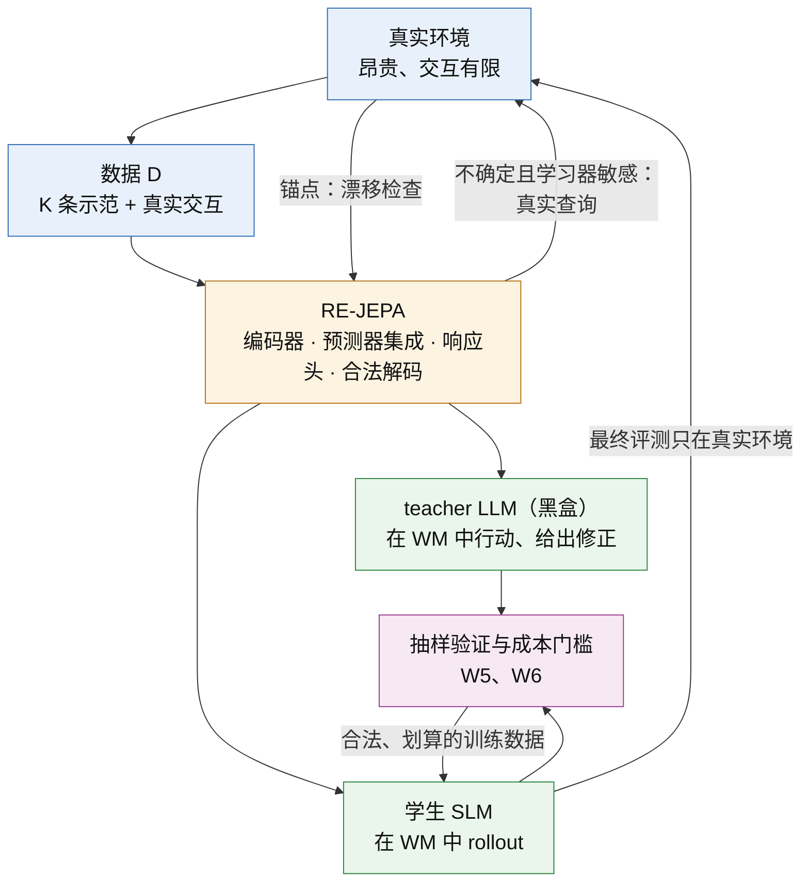

# Proposal 2 · 响应等价的 World Model：把 world model 当作 agent 蒸馏的模拟环境

[English](P2_response_equivalent_world_model.md) · [理论框架](../../theoretical_framework/README_ZH.md) · [Proposal 1（RCD）](P1_response_calibrated_distillation_ZH.md)

*状态：方法提案（2026-10-14）。这是独立于 Paper 1 的第二个项目，可以把 Proposal 1 的 RCD 当作蒸馏引擎，但不依赖它。文中链接的框架结论都已证明；标为"待证"的是这篇论文需要新证明的内容；所有实验都还没有运行。*

---

## 一句话

想用 world model（WM）代替昂贵的真实环境，让 teacher LLM 在 WM 里行动、给出修正，产生训练数据来蒸馏小模型（SLM）。常见的想法是"WM 越逼真越好"。理论框架给出不同的答案：WM 不需要处处逼真，它需要的是**响应等价**，也就是在学生会去的地方、在决定学生训练结果的那几个方向上，与真实环境给出相同的训练后果。同时，WM 不能凭空产生信息，它的输出必须合法，而且只有在一个可以事先检验的成本门槛之上才划算。

我们据此设计 **RE-JEPA**（Response-Equivalent JEPA）：在 JEPA 的潜空间预测之上，加上响应头、按学习器加权的损失、集成不确定性、合法解码与锚点刷新，每一部分对应一个推出的条件。

## 1. 场景与问题

**场景.** 很多 agent 环境的真实交互昂贵、有风险或无法 reset，例如网页、真实 API、机器人。手里有：
- 每个任务族 $`K`$ 条可信示范，以及少量真实交互的预算；
- 一个黑盒 teacher LLM；
- 一个要蒸馏的学生 SLM。

**做法.** 先用这些数据训练一个 WM。然后 teacher 在 WM 里生成轨迹，学生在 WM 里 rollout，再由 teacher 修正。这些交互产生训练数据，学生在上面训练，最后到真实环境里评测。

**问题.** 这个 WM 必须满足什么条件，蒸馏出的学生才和在真实环境里蒸馏的一样好？应该怎样设计它？

## 2. 从框架推出的六个条件

### W1 · 响应等价，而不是逼真

**推导.**
- 把"在真实环境中蒸馏"作为参照过程，"在 WM 中蒸馏"作为替代过程。框架的 [Theorem 3.2](../../theoretical_framework/statements/03-02_continuation_response_characterization_ZH.md#s3-2) 说：两个训练过程的最终差距，精确等于逐轮的单边界替换效应之和。每一轮的效应，就是把这一轮的真实反馈换成 WM 反馈造成的差别，按参照的 continuation value，在替代过程实际到达的状态上计算。
- 令 $`P_t`$ 为第 $`t`$ 轮在真实环境中产生的反馈律，$`\tilde P_t`$ 为在 WM 中产生的反馈律，$`\mathcal G_t`$ 为第 $`t`$ 轮的 response 类。于是：

```math
\big|F(\text{real})-F(\text{WM})\big|\ \le\ \sum_{t=1}^{R}\ \sup_{g\in\mathcal G_t}\Big|\,\mathbb E_{y\sim P_t}\,g(y)-\mathbb E_{y\sim\tilde P_t}\,g(y)\,\Big| .
```

- 在一个 checkpoint 上，response 构成一个算子，误差只在它的前几个奇异方向上起作用：匹配前 $`r`$ 个模式，剩余误差是 $`B\sigma_{r+1}`$（[Theorem 4.9](../../theoretical_framework/statements/04-09_spectral_sufficiency_ZH.md#s4-9)）。

**含义.**
- WM 要准确的，是那几个决定学生训练后果的方向，而不是所有细节。逼真度（下一步观测的似然或准确率）**既不必要，也不充分**：
  - 不必要：落在 response 看不见的方向上的误差，不付任何代价；
  - 不充分：一个很小的误差，如果恰好落在前几个 response 方向上，并且出现在学生常去的状态，就会逐轮累积。
- 这把 value equivalence（[Grimm et al., 2020](#ref-grimm)）与 objective mismatch（[Lambert et al., 2020](#ref-lambert)）的思想推进了一步：要等价的对象不是策略的价值函数，而是学生在蒸馏中的 continuation response。它依赖学生、依赖训练配方，而且随训练变化。

### W2 · 覆盖学生会去的地方，并标出信任区域

**推导.**
- 上式的期望是在 WM 过程实际到达的状态上取的，也就是学生的 rollout 状态，以及 teacher 从这些状态出发的分支。这些状态随学生的训练而移动，而不是示范所在的状态。
- 当逐轮的保证只在认证过的状态集合上成立时，离开这些集合的概率只付一次，而不是每轮付一次（[Theorem 3.2](../../theoretical_framework/statements/03-02_continuation_response_characterization_ZH.md#s3-2)）。
- 用 WM 做 audit 时，还要付覆盖（transport）项（[Theorem 8.2](../../theoretical_framework/statements/08-02_frozen_finite_interface_selection_transport_ZH.md#s8-2)）。

**含义.** WM 不必处处准确，但必须知道自己在哪里准确：要有一个明确的信任区域。离开信任区域时，切换到真实环境，或者停止这条 rollout；代价只是离开的概率，付一次。

### W3 · 随训练保持等价（闭合）

**推导.** 在 checkpoint $`t`$ 上响应等价，到 $`t'`$ 未必还成立：现在充分的接口，继续训练之后可能不再充分（[Proposition 4.11](../../theoretical_framework/statements/04-11_static_not_dynamic_closure_error_ZH.md#s4-11)）。response 经过学习过程的下一步 predictive state 分解（[Proposition 4.12](../../theoretical_framework/statements/04-12_response_predictive_state_factorization_ZH.md#s4-12)），所以等价要沿着学生的训练路径保持。

**含义.** WM 必须定期用真实环境重新锚定。框架里的锚点漂移证书（[Proposition 8.14](../../theoretical_framework/statements/08-14_anchor_reuse_drift_certificate_ZH.md#s8-14)）给出一个可执行的检查：何时还能继续用，何时必须更新。

### W4 · 不凭空产生信息

**推导.**
- WM 是从数据 $`D`$（示范与真实交互）加上先验 $`\Pi`$（预训练的编码器与语言模型知识）训练出来的，所以它是 $`D\cup\Pi`$ 的一种后处理。任何与环境无关的后处理都不能降低信息误差（[Proposition 2.4](../../theoretical_framework/statements/02-04_post_processing_cannot_reduce_information_ZH.md#s2-4)）；在示范看不见的方向上，replay 没有价值（[Corollary 6.7](../../theoretical_framework/statements/06-07_aliasing_zero_value_replay_ZH.md#s6-7)）。WM rollout 也一样。
- teacher 在 WM 状态上给出的标签，带来的是关于 teacher 的信息；关于环境的信息，仍然只来自 $`D\cup\Pi`$。
- 哪些不确定性需要消除，由学习器决定：方向是 $`c=\sum_tJ_t^{*}g_t`$（[Theorem 6.3](../../theoretical_framework/statements/06-03_learner_relative_lower_bound_ZH.md#s6-3)、[Theorem 6.5](../../theoretical_framework/statements/06-05_achievability_ZH.md#s6-5)）。只落在测试看不见的方向上的不确定性，不必消除（[Proposition 6.16](../../theoretical_framework/statements/06-16_information_compilation_radius_ZH.md#s6-16)）。

**含义.**
- "用 WM 合成数据代替真实交互"的说法，只在两种情况下成立：一是它改善的是算法项（学生吸收得好不好）与成本；二是先验 $`\Pi`$ 确实包含关于这个环境的信息，而这一点可以测量。
- WM 必须表示自己的认知不确定性，把有限的真实交互花在"WM 不确定、并且学习器敏感"的地方。

### W5 · 输出必须合法

**推导.**
- 学生训练用的消息，包括 WM 生成的观测和 teacher 在这些观测上的动作，都必须落在合法反馈池的凸包内：观测在真实环境里可以出现，动作可以执行。否则就有可实现性误差，而且这项误差不会因为买更多数据而消失（[Proposition 6.14](../../theoretical_framework/statements/06-14_convex_realizability_legal_pool_ZH.md#s6-14)）。
- 还有一个特有的风险：teacher 在 WM 里会利用 WM 的错误，找到只在 WM 里成立的捷径。这是 model-based RL 中熟知的 model exploitation，在这里它直接变成错误的训练标签。

**含义.**
- 解码要保证合法性，例如检索真实观测，或按环境的语法组合。
- 对 WM 中产生的数据，随机抽一部分回到真实环境验证。

### W6 · 划算：一个可以事先检验的成本门槛

**推导.** 把 WM 当作便宜的保真度、真实环境当作昂贵的保真度，就是框架里的双保真估计（[Proposition 8.15](../../theoretical_framework/statements/08-15_two_fidelity_response_estimation_ZH.md#s8-15)）。设便宜部分的方差与成本是 $`v_0,c_0`$，配对校正的是 $`v_1,c_1`$，只用真实环境的是 $`v_H,c_H`$。在相同的均方误差下，混合使用比只用真实环境便宜，当且仅当

```math
\sqrt{v_0c_0}+\sqrt{v_1c_1}<\sqrt{v_Hc_H} .
```

**含义.**
- 例如两者方差相同、WM 的成本是真实环境的十分之一、配对样本中的便宜部分被复用时，WM 的 response 与真实 response 的相关系数必须超过约 0.77，用 WM 才划算。
- 这是一个可以在小规模 pilot 里测量的条件，所以"要不要用 WM"可以在投入之前就决定。
- 还有一个限制：WM 减少的是每个格子的复现次数，不是需要真实续训的格子数（Proposition 8.15(e)）。

## 3. 设计：RE-JEPA

### 3.1 为什么从 JEPA 出发

JEPA 系列不预测原始观测，而是在表示空间里预测：I-JEPA（[Assran et al., 2023](#ref-ijepa)）、V-JEPA（[Bardes et al., 2024](#ref-vjepa)）、带动作条件、可用于规划的 V-JEPA 2（[Assran et al., 2025](#ref-vjepa2)）。DINO-WM（[Zhou et al., 2024](#ref-dinowm)）也表明，在预训练特征上学潜空间动力学可以支持规划。LeJEPA（[Balestriero & LeCun, 2025](#ref-lejepa)）给出了不依赖启发式技巧的稳定训练方法。

这与 W1 的方向一致：W1 说 WM 只需要在少数方向上准确，而 JEPA 本来就允许丢掉无法预测、也不需要预测的细节。缺的是让"保留哪些方向"由学生的 response 决定，而不是由自监督目标决定。RE-JEPA 补的就是这一点。

### 3.2 组成部分（每部分对应一个条件）

| 部分 | 做什么 | 对应条件 |
|---|---|---|
| 编码器 | 冻结的预训练编码器，把（观测，历史）映到潜表示 $`z`$。文本环境用学生 base 模型的隐状态或一个文本嵌入模型；视觉环境用 V-JEPA 2 的编码器。冻结是为了让 WM 的表示不随学生训练漂移 | W3 |
| 动作条件预测器 | $`\hat z_{t+1}=f(z_t,a_t)`$，以 JEPA 方式训练：在目标编码器的表示上回归，用 stop-gradient/EMA 或 LeJEPA 的正则防止塌缩 | W1 |
| 响应头 | 从 $`\hat z`$ 预测三样东西：奖励与终止；teacher 的动作分布（用 teacher 在真实状态上的采样训练）；learner weight $`W_s`$（在锚点上用分组 CRN 替换测得）。预测误差按 $`W_s`$ 加权。这三样正是蒸馏中 continuation response 的组成部分：学生会到哪里、teacher 在那里会说什么、学生的最终表现有多依赖那里 | W1 |
| 预测器集成 | 多个预测器之间在**响应头输出**上的分歧，作为认知不确定性。它自动只看与 response 有关的方向，再乘以 $`W_s`$，决定真实交互花在哪里 | W4 |
| 合法解码 | 三种方式：检索已验证的真实观测库；在结构化环境里按语法或模板组合；或者"生成—验证"，即由 LLM 提出观测，编码后与预测的 $`\hat z`$ 比较，能量低于阈值才接受 | W5 |
| 信任区域与回退 | rollout 只在不确定性与能量都低于阈值时继续；否则切换到真实环境（混合 rollout），或停止这条 rollout | W2 |
| 锚点刷新 | 每隔 $`\Delta`$ 次更新，从当前学生出发，在真实环境与 WM 中各跑少量配对的锚点回合，计算漂移证书；不通过就用新的真实数据更新 WM | W3 |
| 抽样验证 | teacher 在 WM 中产生的数据，随机抽一部分回到真实环境执行，估计 model exploitation 率，并对 response 估计做双保真校正 | W5、W6 |

### 3.3 整体流程



**每一轮.**
1. 学生在 WM 中 rollout；在信任区域内由 teacher 修正，离开信任区域就转到真实环境。
2. 按集成不确定性乘以 $`W_s`$ 分配真实交互，把新的真实数据加入 $`D`$。
3. 抽样验证 WM 中产生的数据，估计 exploitation 率和双保真校正。
4. 学生在合法、验证过的数据上继续训练。数据的组合可以交给 Proposal 1 的 RCD，也可以用固定配比。
5. 锚点漂移检查不通过时，更新 WM。

## 4. 理论：这篇论文要证明的陈述

都标为**待证**；每条都给出它依赖的框架结论。

1. **响应等价界.** 第 2 节 W1 的不等式，加上信任区域外的一次性代价。依据：[Theorem 3.2](../../theoretical_framework/statements/03-02_continuation_response_characterization_ZH.md#s3-2)；用 [Theorem 4.9](../../theoretical_framework/statements/04-09_spectral_sufficiency_ZH.md#s4-9) 截断到前 $`r`$ 个模式。
2. **逼真度既不必要也不充分.** 构造两个 WM：A 的下一步预测误差更大，B 的更小；但 A 的误差落在 response 的零空间里，B 的误差落在第一个 response 方向上，结果是 A 蒸馏出的学生更好。依据：[Proposition 4.11](../../theoretical_framework/statements/04-11_static_not_dynamic_closure_error_ZH.md#s4-11) 的构造方式。
3. **不凭空产生信息.** 通过 WM 蒸馏的信息误差，不低于只用 $`D\cup\Pi`$ 时的信息误差。依据：[Proposition 2.4](../../theoretical_framework/statements/02-04_post_processing_cannot_reduce_information_ZH.md#s2-4)。
4. **真实交互的最优分配.** 把 WM 的未知参数当作 Theorem A 中的未知量，真实交互的最优分配是以 $`c`$ 为目标的 c-optimal design。依据：[Theorem 6.5](../../theoretical_framework/statements/06-05_achievability_ZH.md#s6-5)、[Proposition 6.10](../../theoretical_framework/statements/06-10_water_filling_allocation_ZH.md#s6-10)。
5. **合法解码.** 检索解码不引入可实现性误差；"生成—验证"引入的可实现性误差，不超过验证器的误接受率乘以得分的范围。依据：[Proposition 6.14](../../theoretical_framework/statements/06-14_convex_realizability_legal_pool_ZH.md#s6-14)。
6. **何时划算.** 第 2 节 W6 的条件，并用 pilot 中的方差上界认证它（[Proposition 8.15](../../theoretical_framework/statements/08-15_two_fidelity_response_estimation_ZH.md#s8-15)(f)）。

## 5. 实验：验证关键步骤

**试验台.**
- ALFWorld 的 TextWorld 引擎就是 ground truth。在它上面可以精确算出真实 response、注入受控的 WM 误差、判断一个状态在真实环境里是否可达，正好用来检验每个条件。
- 但 ALFWorld 的真实交互其实很便宜，所以在 ALFWorld 上我们人为设定真实交互的预算并计价；成本收益的主结论，放在真实交互确实昂贵的环境上（AppWorld 或网页环境之一）。
- 可选：一个视觉具身环境，用来检验 JEPA 在它原本的模态上的表现。
- 学生 Gemma-4-12B-it；teacher gpt-6-luna。探索阶段单 seed；每个实验在运行前预注册；任务比较用配对 McNemar，并对照噪声参照；所有比较都在同等总成本下进行。

| 编号 | 检验的条件 | 做法 | 预注册判据（摘要） |
|---|---|---|---|
| X1 | W1：响应等价比逼真度更能预测蒸馏结果 | 在 TextWorld 引擎上注入两类受控误差，并让两类误差带来相同的逼真度损失：(a) 只影响 response 看不见的细节（无关物体的描述、无关句子的顺序）；(b) 影响前几个 response 方向（目标物体的位置、关键动作的效果）。分别通过每个 WM 蒸馏，在真实环境评测；再对多个学到的 WM 测量两种误差 | (a) 的学生与真实环境蒸馏的差距在噪声参照内，(b) 的差距超过噪声参照；在学到的 WM 上，response 偏差与真实成功率的 Spearman $`\le-0.6`$，且绝对值大于逼真度的相关 |
| X2 | W4：WM 不凭空产生信息 | 用 ground truth 标出信息缺口簇（示范没有揭示的必要事实）。比较：只用 $`K`$ 条示范训练的 WM 生成的数据；replay；以及加入按不确定性分配的真实查询 | 信息缺口簇上，只用示范的 WM 与 replay 相差在噪声参照内；加入真实查询后超过噪声参照 |
| X3 | W4：真实交互按学习器分配 | 同等真实交互预算下：按（响应头不确定性 × $`W_s`$）分配，按原始潜空间不确定性分配，均匀分配，不分配 | 第一种在真实成功率与 response 偏差上都优于其余三种 |
| X4 | W5：合法解码与 model exploitation | 比较检索解码、自由生成解码与"生成—验证"：不可达状态的比例（引擎可以判定）、teacher 在 WM 中成功但在真实环境中失败的比例，以及学生的真实成功率 | 检索与"生成—验证"的不可达率接近 0，学生成功率不低于自由生成 |
| X5 | W3：随训练保持等价 | 固定的 WM 对比锚点刷新的 WM：沿训练记录 response 偏差与漂移证书报警 | 固定 WM 的 response 偏差随训练增大，刷新后保持有界；漂移证书在偏差超过阈值之前报警 |
| X6 | 设计选择：JEPA 与其他 WM | RE-JEPA；没有响应头的 JEPA；生成式 LLM-WM（用 teacher 提示模拟，WebDreamer 式 [Gu et al., 2024](#ref-webdreamer)，或微调的 Gemma）；Dreamer 式生成潜模型（[Hafner et al., 2023](#ref-dreamerv3)） | 每 GPU-h 的 response 偏差，以及同等总成本下的真实成功率；RE-JEPA 至少优于无响应头的 JEPA |
| X7 | W6：事先判断是否划算 | 在昂贵环境上先做 pilot，测 WM 与真实 response 的相关系数与成本，按 W6 预测"用 WM 是否划算"；然后在同等总成本下比较"WM + 有限真实交互"与"只用真实交互" | 预测与实际结果一致；条件成立时，WM 方案超过噪声参照且 McNemar $`p<0.05`$ |

**先后顺序与止损.**
- 先做 X1：它最便宜（引擎是现成的），也最关键。X1 不成立，说明"响应等价"没有比逼真度提供更多东西，项目需要重新定位。
- 再做 X2、X4：它们检验 WM 的两个基本限制。
- 最后做 X3、X5、X6、X7。

## 6. 与已有工作的关系

- **value equivalence 与 objective mismatch**（[Grimm et al., 2020](#ref-grimm)；[Lambert et al., 2020](#ref-lambert)）：模型只需对与价值相关的函数准确；似然好不等于任务好。这里的增量是：要等价的对象是学生在蒸馏中的 continuation response，它依赖学习器，并且必须在训练中保持（W3）。
- **model-based RL**（Dreamer [Hafner et al., 2020](#ref-dreamer)、[2023](#ref-dreamerv3)；MuZero [Schrittwieser et al., 2020](#ref-muzero)；MBPO [Janner et al., 2019](#ref-mbpo)）：在想象中学习，以及"什么时候信任模型"。这里的不同在于：WM 产生的不是策略优化的样本，而是蒸馏的训练消息，所以多了合法性（W5）与信息记账（W4）的要求。
- **潜空间 WM**（I-JEPA、V-JEPA、V-JEPA 2、DINO-WM、LeJEPA）：提供了骨架。这里的增量是让响应决定潜空间该保留什么，并加上合法解码。
- **agent 的 LLM-WM**（WebDreamer [Gu et al., 2024](#ref-webdreamer)；WKM [Qiao et al., 2024](#ref-wkm)）：用 LLM 模拟环境做规划，或用知识模型辅助规划。这里研究的是把 WM 用作蒸馏的数据源时，它必须满足什么，并给出可检验的条件。

## 7. 风险

- **JEPA 在文本 agent 环境上还没有被系统验证.** 所以 X6 包含生成式 WM 作为对照，"生成—验证"也保留了生成式解码的路线。
- **响应头需要 response 的测量.** 测量很贵，要用 Proposal 1 的摊销方法；摊销不成立时，退回到只用奖励与 teacher 动作两个响应头。
- **成本收益要在昂贵环境上才有说服力.** ALFWorld 只能用来检验机制。
- **"不凭空产生信息"可能被认为显然.** 它的价值在于排除一类常见的主张，并直接决定真实交互该花在哪里（X2、X3）。

## 8. 资源（粗估，提交前按 pilot 的 sacct 重新估算）

| 阶段 | 实验 | B200 GPU-h | teacher 调用 |
|---|---|---|---|
| A | X1（引擎注入，无需训练 WM） | 40–80 | ≤ 3,000 |
| B | X2、X4、X5（训练 RE-JEPA 与对照） | 100–200 | ≤ 5,000 |
| C | X3、X6、X7（含昂贵环境） | 200–400 | ≤ 8,000 |

## 参考文献

<a id="ref-ijepa"></a>
- Mahmoud Assran et al. (2023). Self-Supervised Learning from Images with a Joint-Embedding Predictive Architecture. *CVPR 2023*. arXiv [2301.08243](https://arxiv.org/abs/2301.08243).

<a id="ref-vjepa2"></a>
- Mido Assran et al. (2025). V-JEPA 2: Self-Supervised Video Models Enable Understanding, Prediction and Planning. arXiv [2506.09985](https://arxiv.org/abs/2506.09985).

<a id="ref-lejepa"></a>
- Randall Balestriero, Yann LeCun (2025). LeJEPA: Provable and Scalable Self-Supervised Learning Without the Heuristics. arXiv [2511.08544](https://arxiv.org/abs/2511.08544).

<a id="ref-vjepa"></a>
- Adrien Bardes et al. (2024). Revisiting Feature Prediction for Learning Visual Representations from Video. arXiv [2404.08471](https://arxiv.org/abs/2404.08471).

<a id="ref-grimm"></a>
- Christopher Grimm, André Barreto, Satinder Singh, David Silver (2020). The Value Equivalence Principle for Model-Based Reinforcement Learning. *NeurIPS 2020*. arXiv [2011.03506](https://arxiv.org/abs/2011.03506).

<a id="ref-webdreamer"></a>
- Yu Gu et al. (2024). Is Your LLM Secretly a World Model of the Internet? Model-Based Planning for Web Agents. arXiv [2411.06559](https://arxiv.org/abs/2411.06559).

<a id="ref-dreamer"></a>
- Danijar Hafner, Timothy Lillicrap, Jimmy Ba, Mohammad Norouzi (2020). Dream to Control: Learning Behaviors by Latent Imagination. *ICLR 2020*. arXiv [1912.01603](https://arxiv.org/abs/1912.01603).

<a id="ref-dreamerv3"></a>
- Danijar Hafner, Jurgis Pasukonis, Jimmy Ba, Timothy Lillicrap (2023). Mastering Diverse Domains through World Models. arXiv [2301.04104](https://arxiv.org/abs/2301.04104).

<a id="ref-mbpo"></a>
- Michael Janner, Justin Fu, Marvin Zhang, Sergey Levine (2019). When to Trust Your Model: Model-Based Policy Optimization. *NeurIPS 2019*. arXiv [1906.08253](https://arxiv.org/abs/1906.08253).

<a id="ref-lambert"></a>
- Nathan Lambert, Brandon Amos, Omry Yadan, Roberto Calandra (2020). Objective Mismatch in Model-based Reinforcement Learning. *L4DC 2020*. arXiv [2002.04523](https://arxiv.org/abs/2002.04523).

<a id="ref-wkm"></a>
- Shuofei Qiao et al. (2024). Agent Planning with World Knowledge Model. *NeurIPS 2024*. arXiv [2405.14205](https://arxiv.org/abs/2405.14205).

<a id="ref-muzero"></a>
- Julian Schrittwieser et al. (2020). Mastering Atari, Go, Chess and Shogi by Planning with a Learned Model. *Nature* 588. arXiv [1911.08265](https://arxiv.org/abs/1911.08265).

<a id="ref-dinowm"></a>
- Gaoyue Zhou, Hengkai Pan, Yann LeCun, Lerrel Pinto (2024). DINO-WM: World Models on Pre-trained Visual Features enable Zero-shot Planning. arXiv [2411.04983](https://arxiv.org/abs/2411.04983).

arXiv 编号与标题已用 arXiv API 逐条核对（2026-10-14）；会议信息写入论文前再核对一次。框架页面引用的其余文献见 [references_ZH.md](../../theoretical_framework/references_ZH.md)。
