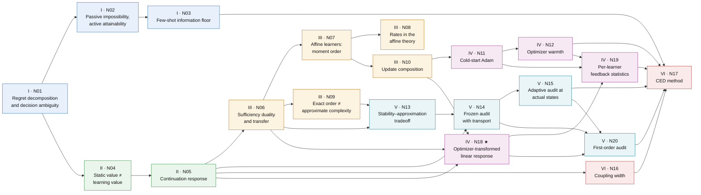

# Environment Information Theory for Agent Distillation — Framework Map

[中文版](README_ZH.md)

**Question.** Relative to declared deployment tasks, permitted experiments and an actual learning procedure, which distinctions between feedback laws can change the final task performance of the distilled student?

**Central result.** Nodes N18–N20 give the framework's central theorem for real learners. To first order, the information that a feedback law must carry is the mean of the *optimizer's complete-state increment*, not the mean gradient. This statistic is sufficient to first order and necessary wherever first-order effects dominate. It is computed for SGD, momentum, Adam/AdamW (cold and warm), clipping, sign/Lion and LoRA. It can be measured at the actual training states.

**Sources.** The [source concordance](#source-concordance) links each node to the exact source sections and original labels.

**How to read this page.** The page goes from the whole to the parts, breadth first:

| Level | Content | After reading it you can answer |
|---|---|---|
| [Level 0](#0-level-0-one-paragraph) | One paragraph on the whole framework | What question the framework answers, and in which steps |
| [Level 1](#1-level-1-six-blocks) | The six blocks and how they connect | What each block asks, what it concludes, what it hands to the next |
| [Level 2](#2-level-2-twenty-nodes) | A plain-language account of the 20 nodes | What each result says, the intuition, and its role in the chain |
| [Level 3](#4-level-3-block-by-block-detail) | Exact statements, with derivation outlines and experimental results | The precise assumptions and formulas, and how they were checked |

The notation used in Level 3 is collected in [Section 3](#3-setting-and-notation). Every node also has two pages of its own: the **proof** page gives the full derivation, and the **experiments** page gives the finite or controlled checks that test the node, recording why each check is run, how it is set up, what it found, and why that supports the node.

**Scope.** Every statement on this page is proved under the assumptions it states and has passed independent finite or controlled checks. Proofs are finite-dimensional or carry explicit regularity assumptions. The experiments are exact finite computations or controlled small networks; they are not real-model or benchmark results.

---

## 0. Level 0: one paragraph

To distill an agent we have a pretrained student, $`K`$ trusted teacher demonstrations per task family, a budget of further permitted experiments (teacher calls, environment branches, resets), and a fixed training recipe (optimizer, learning rate, number of steps). Many feedback sources can be fed to the student: the demonstrations themselves, replays, synthetic rewrites, new queries, different ways of packaging the units. The framework asks: **which differences between these feedback sources actually change the final task performance of the distilled student?** It answers in six steps:

1. **Can the data determine what to do (I)?** The student's regret splits exactly into a representation term, an information term and an algorithm term. An information gap can only be closed by new experiments, never by replay or rewriting, and even an everywhere-optimal teacher can leave one.
2. **What does feedback do to the learner (II)?** Teacher quality, policy value and the mean gradient do not determine what the student learns. The invariant is the *continuation response*: the expected final return after receiving one message, performing the actual update, and finishing training.
3. **How much information must match (III)?** Two feedback sources are equivalent for learning if and only if they agree on the expectation of every response. The number of statistics needed is the dimension of the span of the response class. For simple averaging learners this is a moment order set by the deployment length; nonlinear updates multiply it.
4. **The actual optimizer changes the answer (IV; central theorem N18–N19).** To first order, the feedback must carry the mean of the *optimizer's complete-state increment*, not the mean gradient. SGD, momentum, Adam (cold and warm), gradient clipping, Lion and LoRA each have an explicit statistic; for warm Adam it is an approximation with an explicit error term.
5. **How to check it with finite data (V).** A finite audit is reliable only with a coverage (transport) term. Paired experiments at the states training actually reaches guarantee no loss against the reference, but are expensive. The mean of the first-order statistic needs only gradient evaluations, and it ranks candidates correctly whenever the first-order difference is large enough; but this criterion also needs the continuation-value gradient and the remainder constants, which can at present only be calibrated with full-tail experiments.
6. **The method that follows (VI).** CED (Consequence-Calibrated Experience Distillation): acquire the missing information first, select feedback sources by their measured consequences, match the statistic the learner actually uses, and account for coverage and the cost of verification.

---

## 1. Level 1: six blocks

```mermaid
%%{init: {"flowchart": {"nodeSpacing": 30, "rankSpacing": 40}}}%%
flowchart LR
  I["<b>I · Feasibility and acquisition</b><br/>Can the data determine<br/>what to do?<br/>N01–N03"]:::b1
  II["<b>II · Learning consequence</b><br/>What does feedback make<br/>the student learn?<br/>N04–N05"]:::b2
  III["<b>III · Complexity of sufficiency</b><br/>How many statistics<br/>must match?<br/>N06–N10"]:::b3
  IV["<b>IV · Optimizer state</b><br/>What must feedback carry<br/>for a real optimizer?<br/>N11 · N12 · N18 · N19"]:::b4
  V["<b>V · Verification</b><br/>How can finite data<br/>prove sufficiency?<br/>N13 · N14 · N15 · N20"]:::b5
  VI["<b>VI · Mechanism and method</b><br/>The derived method CED<br/>N16 · N17"]:::b6
  I -->|missing facts must be acquired| II
  II -->|the object of sufficiency| III
  III -->|the learner sets the order| IV
  II -->|continuation decomposition| V
  III -->|width and coefficients| V
  IV -->|the statistic to measure| V
  I -->|demo and query budget| VI
  IV -->|learner statistics| VI
  V -->|certifiable selection| VI
  classDef b1 fill:#e8f1fb,stroke:#2f6db5,color:#111
  classDef b2 fill:#eaf6ec,stroke:#2e8540,color:#111
  classDef b3 fill:#fdf3e1,stroke:#b8741a,color:#111
  classDef b4 fill:#f6e9f4,stroke:#9c3d8f,color:#111
  classDef b5 fill:#e9f5f6,stroke:#1f7f8c,color:#111
  classDef b6 fill:#fbeaea,stroke:#b53b3b,color:#111
```



### I · Feasibility and acquisition (N01–N03)

**Question.** Within the policies the student can execute, can the available data determine what to do? What does it cost to acquire what is missing?

**Conclusion.** The student's regret against the best reference policy splits exactly into three terms: representation error (is the student's policy class good enough), information error (can the data tell the possible environments apart), and algorithm error (does the learner use the data well). All three are nonnegative and none substitutes for another. The information error is zero if and only if all environments consistent with the data share an optimal policy, and no environment-independent post-processing of the data (replay, rewriting, synthesis) can reduce it. Even a teacher that is optimal in every environment can leave an information gap: in two environments the teacher behaves identically, yet the student's optimal policies differ. Only active experiments, such as reset queries, close that gap, at a cost of about $`\log(1/\delta)/\Delta^2`$ queries, where $`\Delta`$ is the value gap between the environments; this order is both sufficient and necessary. The $`K`$ demonstrations and the queries draw on one information budget and can substitute for each other.

**Hand-off.** Missing facts must be acquired. Information alone does not determine what a learner makes of it; that is the question of block II.

### II · Learning consequence (N04–N05)

**Question.** Given a feedback source, what will the student actually learn? What should be compared when two feedback sources are compared?

**Conclusion.** The usual static measures are not enough. Two data sources can have equally good teachers and give every student the same policy value, yet distill different students; two label packages can have the same marginals and the same mean gradient, yet different learning values, and on another task the ordering reverses. The right object is the continuation response: the expected final task return after receiving message $`y`$, performing the actual update, and finishing training under the reference recipe. The gap over a whole training run is exactly a sum over rounds, each term being the effect of replacing that round's reference step by the alternative step, and each term is determined by the response. Hence two message laws are interchangeable if and only if they have the same expectation under every response. When the guarantee holds only on part of the state space, the probability of leaving that part is paid once, not once per round.

**Hand-off.** The object of sufficiency is now the response class $`\mathcal G`$. The next three blocks ask how complex $`\mathcal G`$ is (III), how the actual optimizer changes it (IV), and how it can be checked with finite data (V).

### III · Complexity of sufficiency (N06–N10)

**Question.** How many statistics must two feedback sources agree on to be equivalent for learning?

**Conclusion.** The general answer (N06): when equivalence is judged by the means of a set of features, exact sufficiency holds if and only if every response lies in the span of the features, so the number of statistics needed is the dimension of the span of the response class; approximately, the worst-case error is twice the best uniform approximation error of the responses by those features; an unrestricted learner needs the whole distribution. In a model that can be computed completely (N07–N08): for learners that average independent experience blocks, and deployments with at most $`N`$ decisions, exactly all moments up to order $`N`$ are needed, and every order is necessary; the gap decays with the number $`n`$ of independent blocks at a rate set by the first unmatched cumulant, independently of the number of training rounds, and neither replay nor deterministic synthesis makes it decay. Approximate complexity can be far lower than the exact order, about $`\sqrt N`$, with parity-type values as the exception (N09). Nonlinear updates multiply the required order: a threshold learner breaks first-moment sufficiency with a single decision; for smooth SGD the first-order statistic is the mean gradient, with a second-order correction from the gradient's second moment (N10).

**Hand-off.** What must be matched is decided by the learner itself, so the actual optimizer must be modelled (IV); in approximations, the stability of the coefficients matters (N13 in block V).

### IV · Optimizer state (N11, N12, N18, N19): the central block

**Question.** What must feedback carry for the learners actually in use: Adam, gradient clipping, LoRA?

**Conclusion.** Cold-start Adam's first step looks, to a good approximation, only at the sign of each gradient coordinate, so what must match is the joint sign distribution ($`\epsilon=0`$) or the whole gradient distribution ($`\epsilon>0`$), not moments; momentum then carries the first gradient's magnitude into later steps (N11). Once the second moment has accumulated (small warmth), an Adam step can be approximated by one step of momentum SGD with a fixed preconditioner, with an explicit error bound, and the first-order statistic to match is again the mean preconditioned gradient. Warmth falls roughly as $`1/(\beta_2s)`$ only early in training ($`s(1-\beta_2)\ll1`$); with $`\beta_2`$ fixed it levels off near $`(1-\beta_2)/\beta_2`$ even for stationary gradients, and does not go to zero (N12). The central theorem N18 unifies these. Any stateful first-order optimizer is a map from a gradient to an increment of the complete state (parameters, momentum, second moments, …). To first order, the difference in training outcome caused by two feedback laws equals the sum over rounds of the inner product between the gradient of the continuation value and the difference of mean state increments, with a remainder controlled by second-order quantities of the increment. So, to first order, what must match is the part of the mean state increment in the directions of the continuation-value gradients. It is sufficient, it is necessary where the first-order term dominates, and the number of statistics is the dimension of the linearized response class; higher orders correspond to higher moments of the increment. N19 computes this statistic for each common learner.

**Hand-off.** We now know what to measure: the mean state increment. The next question is how to measure it with finite data and turn it into a certifiable selection (V).

### V · Verification (N13, N14, N15, N20)

**Question.** With finitely many measurements, how can we prove that a feedback source is good enough, or pick a good one from several candidates?

**Conclusion.** An error in measuring a feature is amplified by that feature's coefficient in the response model; a fit with a small residual and huge coefficients is not a proof (N13). Selecting among candidates by discrepancies measured on a fixed set of audit cells requires an explicit coverage (transport) term: if training reaches states the audit does not cover, the audit can report zero discrepancy while the learning gap is 1 (N14). Running paired full-tail experiments for each candidate and the reference at the states training actually reaches, and selecting by a lower confidence bound, guarantees a result no worse than the reference by more than $`\delta`$, but needs on the order of a thousand paired replicas per candidate (N15). The mean of the first-order part is cheap: the mean state increment needs only $`n`$ gradient evaluations at the actual states; in the Euclidean norm, with increments bounded by $`b`$, the error bound is of order $`b/\sqrt n`$ with no explicit dimension, though $`b`$ itself can grow with the dimension. Whenever the first-order difference exceeds the second-order remainder, the first-order score ranks the candidates correctly; but the criterion uses the continuation-value gradient and the remainder constants, which can at present only be calibrated with full-tail experiments (N20).

**Hand-off.** Three certifiable ways to select, with their costs: a frozen audit with a coverage term, a full-tail audit at the actual states, and a first-order audit.

### VI · Mechanism and method (N16, N17)

**Question.** What method follows from the first five blocks? Which mechanisms deserve a test of their own?

**Conclusion.** N16 gives a mechanism test with a strict null: fixing the marginal law of each experience unit and changing only how the units are grouped into joint training packages leaves the outcome unchanged if and only if a package's return is a sum of per-unit contributions; under one SGD step, regrouping changes nothing. N17 turns the earlier results into six design rules for the method CED: acquire before compiling (I); select by measured consequence (II); match the learner's statistic rather than the raw gradient (IV); fit response models with stable coefficients (N13); account for coverage, and use the first-order audit where the first-order difference dominates (V); freeze the selector, then measure transfer. In controlled experiments, none of the static proxies tested reliably predicts the sign of the response; measured short-tail responses usually select correctly while full tails are accurate on every split; and where the first-order difference is large enough, the first-order score computed with the oracle continuation-value gradient makes no errors.

---

## 2. Level 2: twenty nodes

Colors follow the six blocks above; ★ marks the central theorem.



An arrow A → B means that the statement or proof of B uses A. For each node the three lines give what it says, the intuition, and its role in the chain. Exact statements are in [Level 3](#4-level-3-block-by-block-detail).

### Block I nodes

**[N01](#n01--regret-decomposition-and-decision-ambiguity) · Regret decomposition and decision ambiguity**
- *What it says.* The student's expected regret = representation error + information error + algorithm error, all nonnegative. The information error is zero if and only if all environments consistent with the data share an optimal policy; its robust version has a minimax dual; randomized post-processing of the data cannot lower it.
- *Intuition.* The information error is what is lost, even with perfect learning, because the data cannot tell the environments apart. Replay, rewriting and generation can only make existing information easier to learn (lowering the algorithm error); they cannot create a missing fact.
- *Role.* It separates "not enough data" from "learned badly", and every later information-theoretic result starts from it.

**[N02](#n02--passive-impossibility-active-attainability) · Passive impossibility, active attainability**
- *What it says.* Two aliased worlds: the teacher is optimal and behaves identically in both, yet the student's optimal policies are opposite. A learner that sees only demonstrations loses at least $`\Delta`$; with reset queries, about $`\log(1/\delta)/(8\Delta^2)`$ queries suffice, and this order is also necessary. Compiling the acquired fact into the student takes another $`O(\log(1/\delta_L))`$ labels.
- *Intuition.* A perfect demonstration shows what the teacher did, not what a student with different abilities should do; the student has to try.
- *Role.* It explains why the method must contain an active acquisition step, and it separates the cost of acquisition from the cost of compilation.

**[N03](#n03--few-shot-information-floor) · Few-shot information floor**
- *What it says.* In the hidden-bit model, the information loss left after $`K`$ demonstrations is $`\tfrac12\sum_jw_j(1-q_j)^K`$; with a budget of $`n`$ queries, the optimal policy queries the heaviest unseen bits first; in the adaptive case, demonstrations and queries satisfy one linear information-budget inequality.
- *Intuition.* Each demonstration reveals a fact with some probability, and what it does not reveal must be queried; demonstrations and queries substitute for each other within one budget, and replaying a demonstration contributes nothing.
- *Role.* It puts $`K`$ into the theory and gives a quantitative basis for how many queries to spend and on what ([N17(a)](#n17--consequence-calibrated-experience-distillation-ced)).

### Block II nodes

**[N04](#n04--static-value-is-not-learning-value) · Static value is not learning value**
- *What it says.* There are two data sources with equally good teachers that give every student the same policy value, yet the distilled students differ by $`1/40`$; there are two label packages with the same marginals and mean gradient whose learning values differ, with the sign of the difference reversing on another task.
- *Intuition.* What is learned depends on how the data performs in deployment *after the update*, not on how good the data looks in deployment.
- *Role.* It rules out teacher quality, policy value and the mean gradient as sufficiency criteria.

**[N05](#n05--continuation-response-characterization) · Continuation-response characterization**
- *What it says.* The difference in training outcome is the sum over rounds of the effect of replacing the reference step by the alternative step, each term determined by the continuation response; two message laws are interchangeable if and only if they agree on every response; when the guarantee holds only on part of the state space, leaving it is paid once.
- *Intuition.* The response $`g(y)`$ answers "if this round feeds the student $`y`$, what will the final score be"; it builds in the update rule, the rest of training and the deployment task.
- *Role.* It fixes the object of sufficiency $`\mathcal G`$; blocks III, IV and V are all about it.

### Block III nodes

**[N06](#n06--sufficiency-duality-and-transfer) · Sufficiency duality and transfer**
- *What it says.* Judging equivalence by the means of a set of features: exact sufficiency holds if and only if every response lies in the span of the features; the approximate worst-case error is twice the best uniform approximation error; if a response is a linear part plus a small residual, the response difference is at most coefficient size × feature-mean difference + twice the residual; an unrestricted learner needs the whole distribution.
- *Intuition.* Equal feature means only guarantee no difference in the directions the features span; the part of a response outside that span is the risk that cannot be seen.
- *Role.* It turns "how much information is needed" into computable quantities (span dimension, approximation width), used throughout III, IV and V.

**[N07](#n07--affine-learners-moment-order-is-necessary-and-sufficient) · Affine learners: moment order is necessary and sufficient**
- *What it says.* For learners that average independent experience blocks and deployments with at most $`N`$ decisions, two feedback sources are equivalent for every task and every such learner if and only if all moments up to order $`N`$ agree; a counterexample shows that each order is necessary.
- *Intuition.* The deployment value is a degree-$`N`$ polynomial in the student's parameters, and an averaging update turns it into a function of the data's moments up to order $`N`$.
- *Role.* A fully computable instance of N06, showing that the information order is set by the deployment length.

**[N08](#n08--rates-in-the-affine-theory) · Rates in the affine theory**
- *What it says.* The gap bound does not depend on the number of training rounds; when $`n`$ independent blocks are averaged, the gap decays as $`n^{-(r-1)}`$, where $`r`$ is the order of the first unmatched cumulant.
- *Intuition.* Only independent evidence shrinks the gap; replays of a block, or synthetic samples generated deterministically from it, are not new evidence.
- *Role.* It separates the number of independent blocks from the number of epochs, which is the counting discipline of the method.

**[N09](#n09--exact-order-is-not-approximate-complexity) · Exact order is not approximate complexity**
- *What it says.* For values of the form $`p^N`$, matching moments up to order about $`\sqrt{N\log(1/\varepsilon)}`$ brings the error below $`\varepsilon`$, although exact equality needs order $`N`$; parity-type values are the exception, where polynomials of degree below $`N`$ cannot approximate better than $`1/2`$.
- *Intuition.* Smooth responses have good low-order approximations; combinatorial ones do not.
- *Role.* It shows that the approximation width is what matters, which leads to coefficient stability (N13).

**[N10](#n10--update-composition-amplifies-the-information-requirement) · Update composition amplifies the information requirement**
- *What it says.* Composing polynomial updates can make the response's degree in an early data block grow as the product of the per-round degrees; a threshold learner breaks first-moment sufficiency with one decision; for smooth SGD, a one-step difference = first-order term (mean-gradient difference) + second-order term (second-moment difference) + a third-order remainder, and the per-step errors accumulate linearly only under a stability condition.
- *Intuition.* The same data fed to different learners needs different information orders.
- *Role.* It shows that the actual optimizer must be modelled, which leads to block IV.

### Block IV nodes

**[N11](#n11--cold-start-adam-quotient-and-optimizer-memory) · Cold-start Adam quotient and optimizer memory**
- *What it says.* Adam started from a zero state takes a first step that depends only on $`g_i/(\lvert g_i\rvert+\epsilon)`$: with $`\epsilon=0`$ the joint sign distribution must match (per-coordinate sign marginals are not enough), and with $`\epsilon>0`$ the whole gradient distribution must; momentum carries the first gradient's magnitude into the second step, so two histories with the same sign sequence can take second steps in opposite directions.
- *Intuition.* Adam's first step is almost sign-SGD: the gradient magnitude is divided out of the step but kept in the optimizer state.
- *Role.* It shows that moment sufficiency does not transfer to Adam; what must match depends on the optimizer state.

**[N12](#n12--optimizer-warmth-switches-the-first-order-feedback-statistic) · Optimizer warmth switches the first-order feedback statistic**
- *What it says.* A coordinate's warmth is the size of the new squared gradient relative to the accumulated second moment. At small warmth, an Adam step differs from a step of fixed-preconditioner momentum SGD by an explicit bound, and the first-order statistic is the mean preconditioned gradient; at cold steps, feedback with equal means separates already at first order; warmth falls roughly as $`1/(\beta_2s)`$ only early in training, and with $`\beta_2`$ fixed it levels off near $`(1-\beta_2)/\beta_2`$.
- *Intuition.* Adam behaves like a sign optimizer for its first steps and like preconditioned SGD once warm.
- *Role.* It says from which step of training the affine and first-order theory applies; the method therefore records the optimizer state and its warmth.

**[N18](#n18--optimizer-transformed-linear-response-central-theorem) · Optimizer-transformed linear response (central theorem)**
- *What it says.* Write any stateful first-order optimizer (clipping included) as a map from a gradient to an increment of the complete state. The difference in training outcome between two feedback laws is, to first order, the sum over rounds of the inner product between the continuation-value gradient and the difference of mean state increments, with a remainder controlled by the increment's second moments. Matching the projection of the mean state increment onto the span of continuation-value gradients is sufficient to first order, and necessary where the first-order term exceeds the remainder; the number of statistics is the dimension of the linearized response class; higher orders correspond to higher moments of the increment.
- *Intuition.* Feedback affects the student only through the change of state it causes; to first order, only the mean of that change matters, and only in the directions the continuation value cares about.
- *Role.* It unifies N07–N12 and is the framework's central result for real learners; N19 and N20 both follow from it.

**[N19](#n19--what-each-learner-makes-the-feedback-carry) · What each learner makes the feedback carry**
- *What it says.* The statistic of N18 for common learners: for SGD, the mean gradient; for momentum, also the mean gradient, acting through both the parameters and the momentum; for warm Adam, under the frozen-denominator approximation, the mean gradient plus the gradient's second moment (approximation error controlled by N12); for a cold Adam step, the sign distribution; for clipping, the clipped mean, and only the mean direction when clipping is always active; for Lion, flip probabilities; for LoRA initialized at $`B=0`$, $`A`$ does not move at step one and feedback enters only through a rank-$`r`$ sketch.
- *Intuition.* Two feedback sources with the same mean gradient can still differ at first order under cold Adam, clipping or warm Adam.
- *Role.* It tells the method what to match and measure under each training recipe.

### Block V nodes

**[N13](#n13--stabilityapproximation-tradeoff) · Stability–approximation tradeoff**
- *What it says.* When each feature mean may be off by a tolerance, the response difference that can be guaranteed is the minimum over coefficients of twice the approximation residual plus the tolerance-weighted coefficient size.
- *Intuition.* The price of measuring a feature imprecisely is its coefficient in the response model; a small residual with huge coefficients is not a proof.
- *Role.* It decides which features an audit uses and what kind of response model to fit.

**[N14](#n14--frozen-finite-interface-selection-with-transport) · Frozen finite-interface selection with transport**
- *What it says.* Fix the audit cells in advance and select among finitely many candidates by measured discrepancy; the selected candidate's learning gap is at most the measured discrepancy plus statistical error plus an explicit transport term, plus the exit probability. The transport term cannot be removed.
- *Intuition.* An audit sees only the states it covers; when training goes elsewhere, the audit can say 0 while the actual gap is 1.
- *Role.* It gives the correct form of a finite audit and shows its blind spot.

**[N15](#n15--actual-state-adaptive-auditing-fidelity-versus-improvement) · Actual-state adaptive auditing; fidelity versus improvement**
- *What it says.* At the states training actually reaches, run paired full-tail experiments for a candidate and the reference and select by a lower confidence bound; the result is no worse than the reference by more than $`\delta`$ and keeps the measured improvement. Cost: with $`M=4`$, $`\delta=0.05`$ and accuracy $`0.1`$, 1016 paired replicas per candidate (a sufficient number).
- *Intuition.* It measures directly whether replacing this step by the candidate helps, with no extrapolation to unseen states.
- *Role.* Reliable but expensive; the method uses it to calibrate cheaper measurements.

**[N20](#n20--measuring-the-first-order-statistic-at-the-actual-states) · Measuring the first-order statistic at the actual states**
- *What it says.* In the Euclidean norm, the estimation error of the mean state increment falls as $`b/\sqrt n`$ with no explicit dimension ($`b`$ bounds the increment norm and can grow with the dimension), using $`n`$ gradient evaluations and no training tails; when the first-order difference exceeds the second-order remainder, the first-order score ranks two candidates correctly.
- *Intuition.* The mean increment is cheap, but ranking also needs the continuation-value gradient and the remainder constants, which at present need full-tail audits for calibration; and the first-order score can be used on its own only where the first-order difference dominates.
- *Role.* It turns N18 into a cheap, executable measurement, and grounds the method's "screen with the first-order score, then confirm with measured tails".

### Block VI nodes

**[N16](#n16--coupling-width) · Coupling width**
- *What it says.* Fix each experience unit's marginal law and change only how units are combined into joint training packages; this leaves the outcome unchanged if and only if a package's return is a sum of per-unit contributions; under one SGD step, regrouping changes nothing.
- *Intuition.* If the learner only "looks at" each unit by itself, the grouping is irrelevant; it matters only when units interact.
- *Role.* A mechanism test with a strict null.

**[N17](#n17--consequence-calibrated-experience-distillation-ced) · CED method**
- *What it says.* Six design rules: acquire before compiling; select by measured consequence; match the learner's statistic; fit stable response models; account for coverage and use the first-order audit where the first-order difference dominates; freeze the selector, then measure transfer. Each rule is a corollary of earlier nodes.
- *Intuition.* Choose feedback by what happens after this learner consumes it, not by how good the feedback looks by itself.
- *Role.* Where the framework lands; controlled experiments have confirmed the range in which selection by measured consequence and the first-order audit work.

---

## 3. Setting and notation

**Environment and student.** An environment $`E`$ comprises a task distribution, transitions, feedback semantics, scoring and a fixed execution harness. All returns lie in $`[0,1]`$. The student's deployment class is $`\Pi\subseteq\Pi_{\rm ref}`$, with

```math
J_E^\Pi=\max_{\pi\in\Pi}J_E(\pi),\qquad J_E^{\rm ref}=\max_{\pi\in\Pi_{\rm ref}}J_E(\pi).
```

**Information.** $`I_0`$ is the common initial information: the pretrained model, the known rules and the $`K`$ trusted demonstrations per task family. $`D`$ is the transcript of all further accessible information.

**Learning process.** A complete learner state $`z`$ contains the parameters, the optimizer moments, buffers, sampler state, randomness and history. At round $`t`$ a feedback law $`P_t(\cdot\mid z)`$ emits a message $`Y_t`$, and the actual update is $`Z_{t+1}=U_t(z,Y_t,\xi_t)`$. Integrating the update randomness $`\xi_t`$ gives a learning kernel $`K_t`$. We write $`K_t^0`$ for the reference protocol and $`K_t^S`$ for an alternative. Both start from the same initial state law. The final student is scored by $`F_E(z)=J_E(\pi_z)\in[0,1]`$.

**Continuation and response.** Define

```math
V_R^0=F_E,\qquad V_t^0=K_t^0V_{t+1}^0,
```

```math
g_{E,f,t,z}(y)=\mathbb E_{\xi_t}\,V_{t+1}^0\big(U_t(z,y,\xi_t)\big).
```

$`g`$ is the expected final real-task return after receiving message $`y`$, applying the actual update, and completing the declared reference learning tail. For an explicit optimizer/recipe $`o`$ we write $`\psi_{E,o,t,z}`$ [N05](proofs/N05_continuation_response.md). Let $`L_E(S)=\mathbb E\,F_E(Z_R^S)`$, and let $`\mathcal G`$ collect all responses of the declared family.

**Counts that must not be conflated.** $`K`$ is the number of trusted demonstrations, $`n_{\rm query}`$ the number of extra experiments, $`n`$ the number of independent experience blocks, $`R`$ the number of updates, $`N`$ the number of deployment decisions, and $`d`$ the number of linear statistics. Replaying one block $`n`$ times is not $`n`$ independent blocks.

**Check IDs.** The check IDs that appear at the end of each node and on the experiment pages mean the following; each node's experiment page gives the motivation, setup and result of every check.

| ID | Meaning |
|---|---|
| [C1](experiments/N01_decomposition_and_ambiguity.md)–[C23](experiments/N11_adam_cold_start.md#c23-adam-settings--the-regime-where-the-affine-description-fails) | Independent checks of v0.14 (`theory/independent_checks`). [C23](experiments/N11_adam_cold_start.md#c23-adam-settings--the-regime-where-the-affine-description-fails) is a controlled small-network experiment in which Adam departed from the affine comparator |
| [V1](experiments/N14_frozen_audit_transport.md)–[V9](experiments/N20_first_order_audit.md) | Exact finite checks added after v0.15 (`theory/v015_checks`) |
| [E0](experiments/N11_adam_cold_start.md)–[E12](experiments/N20_first_order_audit.md) | Controlled small-network experiments (`theory/v015_checks`) |
| [T01](experiments/N14_frozen_audit_transport.md)–[T13](experiments/N15_adaptive_audit.md) | Checks shipped with the revision package |

---

## 4. Level 3: block-by-block detail

Each node gives its dependencies, the exact statement and a "Next" paragraph, and ends with its proof and experiments links and the checks that support it. The nodes of block I also give a derivation outline and experimental results, with figures.

### I · Feasibility and acquisition

#### N01 · Regret decomposition and decision ambiguity
*Uses:* none. *Used by:* [N02](proofs/N02_passive_vs_active_acquisition.md), [N03](proofs/N03_few_shot_information_floor.md), [N04](proofs/N04_static_vs_learning_sufficiency.md).

**Proposition.** **(a)** For a prior on a finite environment family, let $`B(D)=\max_{\pi\in\Pi}\mathbb E[J_E(\pi)\mid D]`$. For any learner output $`\widehat\pi`$,

```math
\mathbb E[J_E^{\rm ref}-J_E(\widehat\pi)]=\underbrace{\mathbb E[J_E^{\rm ref}-J_E^\Pi]}_{\mathcal R_{\rm rep}}+\underbrace{\mathbb E J_E^\Pi-\mathbb E_D B(D)}_{\mathcal R_{\rm info}}+\underbrace{\mathbb E_D[B(D)-\mathbb E[J_E(\widehat\pi)\mid D]]}_{\mathcal R_{\rm alg}},
```

with all three terms nonnegative. Moreover:

- **(b)** $`\mathcal R_{\rm info}=0`$ if and only if, for a.e. $`D`$, the set $`\bigcap_{E:\Pr(E\mid D)>0}\arg\max_\pi J_E(\pi)`$ is nonempty.
- **(c)** The robust ambiguity equals its minimax dual: $`r(C)=\min_{\rho\in\Delta(\Pi)}\max_{E\in C}\big[J_E^\Pi-\mathbb E_{\pi\sim\rho}J_E(\pi)\big]=\max_{\mu\in\Delta(C)}\big[\sum_E\mu_EJ_E^\Pi-\max_{\pi\in\Pi}\sum_E\mu_EJ_E(\pi)\big]`$.
- **(d)** A randomized post-processing $`D'`$ of $`D`$ cannot decrease $`\mathcal R_{\rm info}`$.

**Derivation outline.**

- **(a)** Adding and subtracting $`\mathbb EJ_E^\Pi`$ and $`\mathbb E_DB(D)`$ in the total regret gives the identity; the only work is nonnegativity. The representation term is nonnegative because $`\Pi\subseteq\Pi_{\rm ref}`$. The information term is nonnegative because $`\mathbb E[J_E(\pi)\mid D]\le\mathbb E[J_E^\Pi\mid D]`$ for every policy, and taking the maximum gives $`B(D)\le\mathbb E[J_E^\Pi\mid D]`$. The algorithm term is nonnegative because, given $`D`$, the learner's output is a convex combination of policies and cannot beat the best of them.
- **(b)** The information term equals $`\sum_D\Pr(D)\big(\mathbb E[J_E^\Pi\mid D]-B(D)\big)`$, a sum of nonnegative brackets; a bracket vanishes exactly when a posterior-optimal policy is optimal in every environment of positive posterior probability, that is, when the intersection is nonempty.
- **(c)** The regret matrix $`M_{E,\pi}=J_E^\Pi-J_E(\pi)`$ defines a finite two-player zero-sum game in which the learner picks a mixture of policies and the adversary a distribution over environments. The von Neumann minimax theorem exchanges min and max, and the inner minimum is attained at a pure policy, which gives the dual.
- **(d)** Because $`E\to D\to D'`$ is a Markov chain, $`\mathbb E[J_E(\pi)\mid D']=\mathbb E\big[\mathbb E[J_E(\pi)\mid D]\,\big|\,D'\big]`$. The maximum of a conditional expectation is at most the conditional expectation of the maximum, so the posterior-optimal value under $`D'`$ is at most that under $`D`$.

**Experimental results.** The independent check [C1](experiments/N01_decomposition_and_ambiguity.md#c1--n01ad) tests (a)–(d) on 500 random finite decision problems in exact rational arithmetic: 5,810 assertions, no violation. The decomposition residual is exactly 0; the primal and dual LPs, solved separately on 220 instances, agree; an adversarial search over deterministic and randomized garblings finds a maximal increase of the posterior-optimal value of exactly 0. In the figure, the left panel decomposes one instance into the three terms: with the same data, changing the learner changes only the algorithm term (yellow). The middle panel shows the information regret rising monotonically as the transcript is garbled, from 0.1217 with the original data to 0.1833 with no data. The right panel shows primal and dual both equal to $`0.1`$ in the two-world instance.


**Next.** Representation, information and learning errors are separate. Generating data cannot create absent facts, so the next question is when demonstrations leave $`\mathcal R_{\rm info}>0`$.

[Proof](proofs/N01_decomposition_and_ambiguity.md) · [Experiments](experiments/N01_decomposition_and_ambiguity.md) · **proved**; [C1](experiments/N01_decomposition_and_ambiguity.md#c1--n01ad) PASS

#### N02 · Passive impossibility, active attainability
*Uses:* [N01](proofs/N01_decomposition_and_ambiguity.md). *Used by:* [N03](proofs/N03_few_shot_information_floor.md).

**Theorem.** Consider the two-world aliased family with known gap $`0<\Delta\le 1/8`$, in which the teacher is optimal in both worlds.

**(a)** Every learner that sees only passive demonstrations has $`\max_v\mathbb E[J_v^\Pi-J_v(\widehat p)]\ge\Delta`$.

**(b)** With reset queries, a $`\Delta/2`$-optimal student in each world with probability $`1-\delta`$ requires

```math
\mathbb E_v n_{\rm query}\ge\frac{\mathrm{kl}(1-\delta,\delta)}{\mathrm{kl}(\tfrac12+2\Delta,\tfrac12-2\Delta)}\ge\frac{\mathrm{kl}(1-\delta,\delta)}{64\Delta^2}.
```

**(c)** $`\lceil\log(1/\delta)/(8\Delta^2)\rceil`$ queries suffice.

**(d)** Compiling the acquired fact into a frequency learner needs $`m\ge\lceil32\log(2/\delta_L)\rceil`$ compiled labels.

**Derivation outline.**

- **(a)** In both worlds a demonstration is, with probability one half each, "choose $`A`$ at $`s=0`$ and succeed" or "choose $`B`$ at $`s=1`$ and succeed", so the law of the demonstrations, and of the learner's output, does not depend on the world. The value is affine in $`p`$; the regrets in the two worlds are $`2\Delta(1-m)`$ and $`2\Delta m`$, with $`m`$ the mean output, and their maximum is at least their average $`\Delta`$.
- **(b)** First reduce "$`\Delta/2`$-optimal in both worlds" to a binary test: the event $`\lbrace\widehat p>1/2\rbrace`$ has probability at least $`1-\delta`$ in world $`+1`$ and at most $`\delta`$ in world $`-1`$. With a stopping time, Wald's identity makes the KL of the whole transcript equal to the expected number of queries times the KL of one query; the data-processing inequality makes it at least $`\mathrm{kl}(1-\delta,\delta)`$. Together these give the lower bound; the constant 64 comes from $`\mathrm{kl}(\tfrac12+u,\tfrac12-u)\le16u^2`$.
- **(c)** Average independent query outcomes and apply the one-sided Hoeffding inequality.
- **(d)** The empirical frequency of the compiled labels is again controlled by Hoeffding; the number of labels does not depend on $`\Delta`$.

**Experimental results.** The independent check [C2](experiments/N02_passive_vs_active_acquisition.md#c2--n02ad-and-the-compilation-paragraph) tests (a)–(d) on 25 values of $`(\Delta,\delta)`$ with exact binomial sums and exact random-walk recursions: 540 assertions, no violation. No exactly computed strategy falls below the lower bound. The SPRT lies exactly on the bound at $`(\Delta,\delta)=(\tfrac18,0.1)`$ and $`(\tfrac18,0.25)`$ (ratio 1.000) and within 5% of it at $`\Delta=\tfrac1{64}`$, so neither the order nor the constant of the bound can be improved. Fixed-sample tests need 1.6–2.4 times the bound. The number of compilation labels depends only on $`\delta_L`$ (119 at $`\delta_L=0.05`$), with exact errors two to four orders of magnitude below $`\delta_L`$. In the figure, the left panel shows the number of queries growing linearly in $`1/\Delta^2`$, the middle panel the ratio of each strategy to the bound, and the right panel the passive learner's regrets trading off between the two worlds with a worst case of at least $`\Delta`$.


**Next.** Perfect demonstrations can be information-insufficient, and acquisition cost is distinct from compilation cost. Node N03 makes $`K`$ explicit.

[Proof](proofs/N02_passive_vs_active_acquisition.md) · [Experiments](experiments/N02_passive_vs_active_acquisition.md) · **proved**; [C2](experiments/N02_passive_vs_active_acquisition.md#c2--n02ad-and-the-compilation-paragraph) PASS

#### N03 · Few-shot information floor
*Uses:* [N01](proofs/N01_decomposition_and_ambiguity.md), [N02](proofs/N02_passive_vs_active_acquisition.md). *Used by:* [N17](proofs/N17_ced_method.md).

**Proposition.** In the hidden-bit model, bits $`\Theta_1,\dots,\Theta_d`$ are independent and fair. A context $`j`$ has weight $`w_j`$. Each trajectory reveals bit $`j`$ with probability $`q_j`$, and reveals nothing about unrevealed bits.

**(a)** After $`K`$ trajectories,

```math
R_{\rm info}(K)=\tfrac12\textstyle\sum_j w_j(1-q_j)^K.
```

**(b)** With a hard budget of $`n`$ queries, $`R_{\rm info}(K,n)=\tfrac12\,\mathbb E\big[\sum_{r>n}w_{(r)}\big]`$, and querying the heaviest unseen bits is optimal. In general $`\mathbb E[(M_K-n)_+]\ne(\mathbb E M_K-n)_+`$.

**(c)** In a two-world adaptive model, $`K\kappa_D+\kappa_X\,\mathbb E N\ge\mathrm{kl}(1-\delta,\delta)`$.

**Derivation outline.**

- **Key lemma.** Given the complete transcript, the unrevealed bits remain independent, fair and independent of the transcript. The only factor of the joint law that depends on them is the constant $`2^{-d}`$: demonstrations leak nothing about unrevealed bits.
- **(a)** Any action guesses an unrevealed bit correctly with probability one half; revealed bits can simply be copied. So the conditional regret is half the total weight of the unseen bits. Bit $`j`$ stays unrevealed in all $`K`$ independent trajectories with probability $`(1-q_j)^K`$, and taking expectations gives the formula.
- **(b)** Induct on the remaining budget. After querying an unseen bit, the key lemma makes the remaining problem independent of the value found, so branching on values gains nothing, and querying the heaviest unseen bit at each step is optimal. Since $`x\mapsto(x-n)_+`$ is convex, Jensen's inequality gives $`\mathbb E[(M_K-n)_+]\ge(\mathbb EM_K-n)_+`$; at $`d=K=3`$, $`n=1`$ the inequality is strict ($`1/54`$ against $`0`$).
- **(c)** The query choices, the stopping rule and the private randomness are the same in both worlds and cancel in the likelihood ratio, leaving the demonstration terms and the query-outcome terms. In expectation the former are at most $`K\kappa_D`$ and the latter at most $`\kappa_X\,\mathbb EN`$; the data-processing inequality requires their sum to be at least $`\mathrm{kl}(1-\delta,\delta)`$.

**Experimental results.**

- **[V5](experiments/N03_few_shot_information_floor.md#v5--n03a-n03b-hidden-bit-coverage-hard-query-budget-adaptivity).** 348 instances, 26,214 assertions, largest residual 0. In all 100 exhaustive cases ($`d\le5`$, $`K\le4`$, $`n\le3`$), the Bayes-optimal risk equals the formula of (a) and the optimal adaptive query tree equals weight-greedy querying; in 80 of the cases one trajectory reveals several bits at once. Moving the positive part outside the expectation is wrong in more than a third of the cases.
- **[V6](experiments/N03_few_shot_information_floor.md#v6--n03c-demonstration-information-credits-the-adaptive-query-budget).** 297 instances; (c) holds for every adaptive query-and-stopping procedure, and the ratio attains exactly 1, so the constant cannot be improved.
- **[E5](experiments/N03_few_shot_information_floor.md#e5--hidden-bit-demonstration-count-curves-replay-and-an-actual-learner).** Replay gains exactly 0 at all 944 exact grid points. With 8 uniform contexts and $`K=4`$, the information risk is 0.2931 without queries; the same budget spent on 4 extra passive demonstrations brings it to 0.1718, and spent on 4 targeted queries to 0.0431. Tabular learners trained with Adam or SGD never go below the information floor; the excess is the algorithm error of N01.

In the figure, the left panel shows the information risk against $`K`$: targeted queries reduce it far faster than extra demonstrations, and the replay curve coincides with "$`K`$ demonstrations only". The middle panel shows every actual learner above the information floor. The right panel shows the KL budget of demonstrations plus queries.


**Next.** $`K`$ and queries trade off within one information budget, and replay adds zero. Information alone does not determine what the learner extracts, which is the subject of Section II.

[Proof](proofs/N03_few_shot_information_floor.md) · [Experiments](experiments/N03_few_shot_information_floor.md) · **proved**; [V5](experiments/N03_few_shot_information_floor.md#v5--n03a-n03b-hidden-bit-coverage-hard-query-budget-adaptivity), [V6](experiments/N03_few_shot_information_floor.md#v6--n03c-demonstration-information-credits-the-adaptive-query-budget), [E5](experiments/N03_few_shot_information_floor.md#e5--hidden-bit-demonstration-count-curves-replay-and-an-actual-learner) PASS

### II · Learning consequence

#### N04 · Static value is not learning value
*Uses:* [N01](proofs/N01_decomposition_and_ambiguity.md). *Used by:* [N05](proofs/N05_continuation_response.md).

**Proposition.**

- **(a)** There are two sources that give every aliased student the same value $`J(\pi_p)=\tfrac12+p/20`$, and the same teacher value $`3/5`$. Yet frequency distillation from them yields expected returns $`43/80`$ and $`41/80`$, a gap of $`1/40`$ for every $`m\ge1`$.
- **(b)** There are two label packets with equal marginals and equal mean gradient whose learning values differ by $`\eta^2/8`$ under $`J(p)=p^2`$. Replacing $`J`$ by $`1-p^2`$ reverses the sign.

**Next.** Neither teacher quality, nor policy value, nor mean gradient determines what a student learns. The invariant must include the update and the deployment, which is what N05 provides.

[Proof](proofs/N04_static_vs_learning_sufficiency.md) · [Experiments](experiments/N04_static_vs_learning_sufficiency.md) · **proved**; [C3](experiments/N04_static_vs_learning_sufficiency.md#c3--n04a-n04b) PASS

#### N05 · Continuation-response characterization
*Uses:* [N04](proofs/N04_static_vs_learning_sufficiency.md). *Used by:* [N06](proofs/N06_sufficiency_duality.md), [N14](proofs/N14_frozen_audit_transport.md), [N15](proofs/N15_adaptive_audit.md), [N16](proofs/N16_coupling_width.md).

**Theorem.** Let $`d_t^S`$ be the actual state occupancy of the alternative process. Then:

**(a)**

```math
L_E(0)-L_E(S)=\sum_{t=0}^{R-1}\mathbb E_{d_t^S}\big[(K_t^0-K_t^S)V_{t+1}^0(Z_t)\big],
```

so $`\lvert L_E(0)-L_E(S)\rvert\le\sum_t\mathbb E_{d_t^S}\varepsilon_t(Z_t)`$.

**(b)** Two message laws are interchangeable for every one-boundary replacement followed by a declared suffix if and only if $`\mathbb E_Pg=\mathbb E_Qg`$ for all $`g\in\mathcal G`$.

**(c)** If guarantees hold only on a certified set with first-exit probability $`\rho`$, then $`\lvert L_E(0)-L_E(S)\rvert\le\mathbb E_S\sum_{t<\tau_{\rm exit}}\varepsilon_t+\rho`$; the penalty is $`\rho`$, not $`R\rho`$.

Here $`\mathcal G`$ is derived by pulling $`F_E`$ backward through the actual updates and the reference kernels.

**Next.** The object of sufficiency is now fixed as the response class $`\mathcal G`$. Sections III–V measure its size, its dependence on the optimizer, and how to check it.

[Proof](proofs/N05_continuation_response.md) · [Experiments](experiments/N05_continuation_response.md) · **proved**; [C4](experiments/N05_continuation_response.md#c4--n05ac), [T12](experiments/N05_continuation_response.md#t12-package--stopped-composition-with-audited-transport) PASS

### III · Complexity of sufficiency

#### N06 · Sufficiency duality and transfer
*Uses:* [N05](proofs/N05_continuation_response.md). *Used by:* [N07](proofs/N07_affine_moment_order.md), [N09](proofs/N09_approximate_complexity.md), [N13](proofs/N13_stability_tradeoff.md).

**Theorem.** Take a finite message alphabet with $`\lvert\mathcal Y\rvert=m`$, features $`\phi_1,\dots,\phi_d`$, and $`H_\phi=\mathrm{span}\lbrace 1,\phi_1,\dots,\phi_d\rbrace`$.

**(a)** **Exact.** Equal feature means imply equal response means for all laws if and only if $`\mathrm{span}\mathcal G\subseteq H_\phi`$. The minimal number of statistics is $`d_0=\dim\mathrm{span}(\lbrace 1\rbrace \cup\mathcal G)-1`$.

**(b)** **Approximate.** The worst-pair unresolved discrepancy satisfies

```math
\mathfrak D_\phi(\mathcal G)=2\sup_{g\in\mathcal G}\inf_{h\in H_\phi}\lVert g-h\rVert_\infty.
```

**(c)** **Transfer.** If $`g=c+b^\top\phi+r`$ with $`\lVert b\rVert_1\le B`$ and $`\lVert r\rVert_\infty\le\tau`$, then $`\lvert(P-Q)g\rvert\le B\lVert\mathbb E_P\phi-\mathbb E_Q\phi\rVert_\infty+2\tau`$.

**(d)** **Unrestricted learners.** For unrestricted learners, $`d_0=m-1`$ and the discrepancy is $`\gamma\,\mathrm{TV}(P,Q)`$.

**Next.** "Sufficient information" becomes the span dimension or approximation width of $`\mathcal G`$. N07–N10 compute these for explicit learners.

[Proof](proofs/N06_sufficiency_duality.md) · [Experiments](experiments/N06_sufficiency_duality.md) · **proved**; [C5](experiments/N06_sufficiency_duality.md#c5--n06ac-and-n06d) PASS

#### N07 · Affine learners: moment order is necessary and sufficient
*Uses:* [N06](proofs/N06_sufficiency_duality.md). *Used by:* [N08](proofs/N08_affine_rates.md), [N10](proofs/N10_update_composition.md).

**Theorem.** Consider a binary-context student $`p\in[0,1]^k`$, at most $`N`$ decisions, and a convex-affine learner $`p_R=w_0p_0+\sum_iw_iZ_i`$ on IID blocks $`Z_i\in[0,1]^k`$.

- **(a)** $`J_E(p)`$ is a polynomial of degree at most $`N`$ with $`\sum_\alpha\lvert c_\alpha\rvert\le3^N`$.
- **(b)** $`\mathbb E_PZ^\alpha=\mathbb E_QZ^\alpha`$ for all $`\lvert\alpha\rvert\le N`$ if and only if the learning values are equal for every task and every affine learner.
- **(c)** Every order is necessary. The scalar witnesses have $`\Delta_N=(-1)^NN!/(2^{N-1}N^N)`$, and the even/odd parity laws give a constant gap of 1.
- **(d)** The exact statistic count on the grid is $`\binom{k+N}{N}-1`$. On $`\lbrace 0,1\rbrace ^k`$ with $`N\ge k`$ and arbitrary terminal rewards, fewer than $`2^k-1`$ statistics leave discrepancy 1.

**Next.** This is an explicit instance of N06, with $`\mathcal G`$ equal to the polynomials and the dimension equal to a moment count. N08 makes it quantitative.

[Proof](proofs/N07_affine_moment_order.md) · [Experiments](experiments/N07_affine_moment_order.md) · **proved**; [C6–C9](experiments/N07_affine_moment_order.md), [C19](experiments/N07_affine_moment_order.md#c19--span-dimension-of-three-same-degree-response-families) PASS

#### N08 · Rates in the affine theory
*Uses:* [N07](proofs/N07_affine_moment_order.md). *Used by:* none.

**Theorem.**

**(a)** For every affine learner, $`\lvert\text{gap}\rvert\le C_J\delta_N(P,Q)\le N3^N\delta_N(P,Q)`$, independent of $`R`$.

**(b)** For averaging $`n`$ independent blocks with equal means and joint cumulants matched below order $`r`$:

```math
\mathbb E_{P^n}J(\bar p_n)-\mathbb E_{Q^n}J(\bar p_n)=\frac{\langle D^rJ(\mu),\kappa_r(P)-\kappa_r(Q)\rangle}{r!\,n^{r-1}}+O(n^{-r}).
```

**(c)** For the scalar witnesses the expansion is exact: $`\Delta_N/n^{N-1}`$.

**Next.** The independent block count $`n`$, not the number of epochs, controls how fast a discrepancy decays. Replaying one block, or deterministic synthetic descendants of it, does not decay.

[Proof](proofs/N08_affine_rates.md) · [Experiments](experiments/N08_affine_rates.md) · **proved**; [C10](experiments/N08_affine_rates.md#c10--n08a-a-discrepancy-bound-that-does-not-grow-with-r), [C11](experiments/N08_affine_rates.md#c11--n08b-and-n08c-the-first-unmatched-cumulant-sets-the-rate), [C18](experiments/N08_affine_rates.md#c18--independent-evidence-versus-replay-versus-synthetic-descendants) PASS

#### N09 · Exact order is not approximate complexity
*Uses:* [N06](proofs/N06_sufficiency_duality.md). *Used by:* [N13](proofs/N13_stability_tradeoff.md).

**Proposition.**

- **(a)** For $`p^N`$, truncating the Chebyshev expansion at order $`q`$ gives error $`\Pr\lbrace \lvert B-N\rvert>q\rbrace \le2e^{-q^2/N}`$ with $`B\sim\mathrm{Bin}(2N,\tfrac12)`$. Matching moments through order $`q\ge\min\lbrace N,\lceil\sqrt{N\log(4/\varepsilon)}\rceil\rbrace`$ therefore bounds the value gap by $`\varepsilon`$, even though exact equality needs order $`N`$.
- **(b)** The parity value [N07(c)](proofs/N07_affine_moment_order.md) has best degree-$`(<N)`$ uniform approximation error exactly $`1/2`$.

**Next.** The operative complexity is the approximation width $`d_\varepsilon`$, not the degree. Coefficient stability then matters, which is N13.

[Proof](proofs/N09_approximate_complexity.md) · [Experiments](experiments/N09_approximate_complexity.md) · **proved**; [C12](experiments/N09_approximate_complexity.md#c12--chebyshev-identity-exact-tails-and-parity-minimax), [C19](experiments/N07_affine_moment_order.md#c19--span-dimension-of-three-same-degree-response-families) PASS

#### N10 · Update composition amplifies the information requirement
*Uses:* [N07](proofs/N07_affine_moment_order.md). *Used by:* [N11](proofs/N11_adam_cold_start.md).

**Theorem.**

**(a)** For polynomial updates of degree $`a_i`$ in the old parameter and $`b_i`$ in the new block, the final response has block-$`i`$ degree at most $`D_i=Nb_i\prod_{t>i}a_t`$. The bound is attained: $`Z_1^{2^{R-1}}`$.

**(b)** A threshold learner breaks first-moment sufficiency already at $`N=1`$.

**(c)** For smooth SGD,

```math
(K^P-K^Q)V=-\eta\nabla V^\top(\mu_P-\mu_Q)+\tfrac{\eta^2}{2}\langle\nabla^2V,M_P-M_Q\rangle+\mathcal E,\qquad \lvert\mathcal E\rvert\le\tfrac{M_3\eta^3}{6}\big(\mathbb E_P\lVert G\rVert^3+\mathbb E_Q\lVert G\rVert^3\big).
```

**(d)** Per-step errors accumulate as $`e_R\le C\eta^2\sum_s(1+\eta L)^s`$. A linear-in-$`R`$ bound needs a stability condition.

**Next.** The learner, not the data alone, sets the order of information required. The actual optimizer must therefore be modeled, which is Section IV.

[Proof](proofs/N10_update_composition.md) · [Experiments](experiments/N10_update_composition.md) · **proved**; [C13](experiments/N10_update_composition.md#c13--degree-composition-attainment-threshold-learner-expansion-n10c), [V7](experiments/N10_update_composition.md#v7--accumulation-of-per-step-errors) PASS; [C23](experiments/N11_adam_cold_start.md#c23-adam-settings--the-regime-where-the-affine-description-fails) shows the SGD regime boundary

### IV · Optimizer state

#### N11 · Cold-start Adam quotient and optimizer memory
*Uses:* [N06](proofs/N06_sufficiency_duality.md), [N10](proofs/N10_update_composition.md). *Used by:* [N12](proofs/N12_optimizer_warmth.md), [N19](proofs/N19_learner_statistics.md).

**Proposition.** Consider bias-corrected Adam with $`\epsilon`$ outside the square root, started from a cold state $`m_0=v_0=0`$.

- **(a)** The first step is $`\theta_1=c-\eta\,h_\epsilon(G)`$, with $`h_\epsilon(g)_i=g_i/(\lvert g_i\rvert+\epsilon)`$.
- **(b)** At $`\epsilon=0`$, equality of all bounded immediate-parameter utilities is equivalent to equality of the joint sign law. With $`s`$ reachable sign patterns, exactly $`s-1`$ statistics are necessary and sufficient. Coordinate sign marginals are not sufficient.
- **(c)** For $`\epsilon>0`$, $`h_\epsilon`$ is injective, so the full gradient law is required ($`m-1`$ statistics).
- **(d)** Margin bound: for Lipschitz utilities the sign approximation costs $`\eta\sum_iL_i[\beta_{P,i}(a)+\beta_{Q,i}(a)+2\epsilon/(a+\epsilon)]`$.
- **(e)** Retained state: $`m_1=(1-\beta_1)G`$. The histories $`(1,-\tfrac34)`$ and $`(2,-\tfrac34)`$ have identical sign sequences, yet their second steps go in opposite directions.

**Next.** Moment sufficiency (N07) does not transfer to Adam, and what must match depends on the optimizer state. N12 quantifies how that dependence decays.

[Proof](proofs/N11_adam_cold_start.md) · [Experiments](experiments/N11_adam_cold_start.md) · **proved**; [V2–V4](experiments/N11_adam_cold_start.md) PASS; [E0–E3](experiments/N11_adam_cold_start.md) confirm the [C23](experiments/N11_adam_cold_start.md#c23-adam-settings--the-regime-where-the-affine-description-fails) Adam gap is a cold-start optimizer effect

#### N12 · Optimizer warmth switches the first-order feedback statistic
*Uses:* [N05](proofs/N05_continuation_response.md), [N10](proofs/N10_update_composition.md), [N11](proofs/N11_adam_cold_start.md). *Used by:* [N17](proofs/N17_ced_method.md), [N19](proofs/N19_learner_statistics.md).

**Definitions.** The warmth of coordinate $`i`$ is $`\kappa_i(y)=(1-\beta_2)G_i(y)^2/(\beta_2v_i)`$, with $`\kappa_i=\infty`$ when $`v_i=0`$. The frozen-denominator surrogate $`\tilde z^+`$ is one momentum-SGD step with the fixed diagonal preconditioner $`P=\mathrm{diag}(1/(a+\epsilon))`$.

**Theorem.**

**(W0)** $`\lvert\theta^+_i-\tilde\theta^+_i\rvert\le\eta\,u_i\min\lbrace \kappa_i/2,1\rbrace`$.

**(W1)** Assume a warm state, $`v_i>0`$ for all $`i`$ (W); Lipschitz continuation (L); second-moment sensitivity (S); and curvature $`H_G`$ of $`F(g)=V(\tilde z^+(g))`$ (H). Then

```math
\big\lvert\psi(y)-c-b^\top G(y)\big\rvert\le\eta\sum_iL_iu_i\min\lbrace \tfrac{\kappa_i}{2},1\rbrace +L_v\max_i\min\lbrace \kappa_i,\bar k\rbrace +\tfrac12H_G\lVert G\rVert_\infty^2=:r(y).
```

Laws with equal mean consumed gradient therefore differ in response by at most $`\mathbb E_{P_0}r+\mathbb E_{P_1}r`$.

**(W2)** At a cold state, laws with equal means separate at first order: the gap is $`\lvert w\rvert\eta/2`$. Laws that agree on all moments below any fixed order $`N`$ still separate, by $`\lvert w\rvert\eta\,2^{2-N}`$.

**(W3)** (a) If $`v`$ has absorbed $`s`$ evaluations of stationary second moment, the mean-field warmth satisfies $`1/(\beta_2s)\le\bar\kappa(s)\le1/(\beta_2^{\,s}s)`$. (b) If $`\max_i\kappa_i\le c/(W+s)`$ at the warm updates, the telescoped non-affine contribution is at most the number of cold updates plus $`\bar A\sum_s\min\lbrace 1,c/(W+s)\rbrace \le\bar A\,c\log(1+R/W)`$ for $`W\ge1`$, plus the curvature terms. With $`W=0`$ the first update is cold and is charged at most 1.

**Next.** The statistic that a feedback source must match switches with optimizer state. Cold Adam requires the joint sign law; warm Adam requires the mean preconditioned gradient. This predicts where the affine theory (N07–N10) applies to few-shot LoRA.

[Proof](proofs/N12_optimizer_warmth.md) · [Experiments](experiments/N12_optimizer_warmth.md) · **proved** (finite-dimensional, explicit assumptions); [E8](experiments/N12_optimizer_warmth.md) PASS

#### N18 · Optimizer-transformed linear response (central theorem)
*Uses:* [N05](proofs/N05_continuation_response.md), [N06](proofs/N06_sufficiency_duality.md), [N10](proofs/N10_update_composition.md). *Used by:* [N19](proofs/N19_learner_statistics.md), [N20](proofs/N20_first_order_audit.md).

**Setting.** The complete state is $`x=(\theta,s)`$, with $`s`$ the optimizer state (for example $`m,v`$). Any stateful first-order optimizer is an increment map $`x^+=x+\Delta_t(x,G)`$ of the consumed gradient $`G`$; clipping is included. The mean increment of a law $`P`$ is $`\mu^P_t(x)=\mathbb E_P\,\Delta_t(x,G)`$.

**Theorem.** Assume the continuation is $`C^{k+1}`$ on the reachable segment ($`S_k`$).

**(a)** One boundary:

```math
(K^P-K^Q)V(x)=\sum_{j=1}^{k}\tfrac1{j!}\big\langle\nabla^jV(x),\mathbb E_P\Delta^{\otimes j}-\mathbb E_Q\Delta^{\otimes j}\big\rangle+r_k,\qquad\lvert r_k\rvert\le\tfrac{M_{k+1}}{(k+1)!}\big(m^P_{k+1}+m^Q_{k+1}\big).
```

**(b)** Whole run:

```math
L(P)-L(Q)=\sum_t\mathbb E_{d_t^Q}\big\langle\nabla V^P_{t+1},\mu^P_t-\mu^Q_t\big\rangle+\mathcal E,\qquad\lvert\mathcal E\rvert\le\sum_t\mathbb E_{d_t^Q}\tfrac{M_{2,t}}2\big(m^P_{2,t}+m^Q_{2,t}\big).
```

This gives a certificate in terms of $`\lVert\mu^P_t-\mu^Q_t\rVert`$, and a stopped version with $`+\rho`$.

**(c)** Let $`U=\mathrm{span}\lbrace\nabla V(x):V\in\mathcal V\rbrace`$. Matching $`\Pi_U\mu`$ is sufficient to first order. A mismatch is detected by some $`V\in\mathcal V`$ whenever its first-order term exceeds the remainder bound. The minimal number of first-order statistics is $`d_0^{(1)}=\dim\mathrm{span}(\lbrace1\rbrace\cup\mathcal G^{(1)})-1\le\min\lbrace\dim U,m-1\rbrace`$; this is [N06(a)–(c)](proofs/N06_sufficiency_duality.md) applied to the linearized response class.

**(d)** If two laws agree on $`\mathbb E\Delta^{\otimes j}`$ for $`j\le k`$, the per-round gap is at most $`\tfrac{M_{k+1}}{(k+1)!}(m^P_{k+1}+m^Q_{k+1})`$; for SGD this is $`O(\eta^{k+1})`$. The information order lives in the optimizer-transformed increment law, not in the raw data.

**Next.** What a feedback law must carry is decided by the optimizer map $`\Delta`$. N19 computes it for the learners used in practice.

[Proof](proofs/N18_optimizer_transformed_response.md) · [Experiments](experiments/N18_optimizer_transformed_response.md) · **proved**; [V8](experiments/N18_optimizer_transformed_response.md#v8--exact-finite-checks-of-n18a-and-n18c) PASS; [E10](experiments/N18_optimizer_transformed_response.md#e10--the-run-level-representation-in-a-controlled-network-across-optimizers) confirms the representation on 11 optimizer configurations (the [C23](experiments/N11_adam_cold_start.md#c23-adam-settings--the-regime-where-the-affine-description-fails) Adam gap $`0.0769`$ is predicted as $`0.0757`$)

#### N19 · What each learner makes the feedback carry
*Uses:* [N11](proofs/N11_adam_cold_start.md), [N12](proofs/N12_optimizer_warmth.md), [N18](proofs/N18_optimizer_transformed_response.md). *Used by:* [N17](proofs/N17_ced_method.md).

**Theorem (first-order statistic by learner).**

| Part | Learner | Statistic the feedback must match to first order |
|---|---|---|
| **(a)** | SGD | mean consumed gradient $`\mathbb EG`$ |
| **(b)** | Heavy-ball, Nesterov | $`\mathbb EG`$, entering through both $`\theta`$ and $`m`$ |
| **(c)** | Adam/AdamW, warm | $`(\mathbb EG,\ \mathbb E\,G^{\odot2})`$: preconditioned mean through $`\theta,m`$; second moment through $`v`$ |
| **(d)** | Adam, cold step | sign law $`\mathbb E\,h_\epsilon(G)`$ in $`\theta`$; $`\mathbb EG`$ and $`\mathbb E\,G^{\odot2}`$ retained in $`m,v`$ |
| **(e)** | Clipping (norm $`c`$) | clipped mean $`\mathbb E\mathrm{clip}_c(G)`$; if clipping is always active, the mean unit direction |
| **(f)** | Lion / sign with momentum | flip probabilities; zero dependence in $`\theta`$ when momentum dominates |
| **(g)** | LoRA at $`B=0`$ | step 1 leaves $`A`$ unchanged; the feedback enters only through the rank-$`r`$ sketch $`\Gamma A_0^\top`$, or its sign law under cold Adam |

**Next.** Two feedback sources with the same mean gradient can therefore differ at first order. This happens under cold Adam, under clipping (different norm tails) and under warm Adam (different second moments). N20 shows how to measure the statistic.

[Proof](proofs/N19_learner_statistics.md) · [Experiments](experiments/N19_learner_statistics.md) · **proved**; [E11](experiments/N19_learner_statistics.md) PASS (five witnesses)

### V · Verification

#### N13 · Stability–approximation tradeoff
*Uses:* [N06](proofs/N06_sufficiency_duality.md), [N09](proofs/N09_approximate_complexity.md). *Used by:* [N14](proofs/N14_frozen_audit_transport.md).

**Theorem.** For tolerances $`\epsilon_j`$ on feature-mean differences,

```math
W_{\mathbf{\epsilon}}(g)=\inf_{b,c}\Big[2\big\lVert g-c-\textstyle\sum_jb_j\phi_j\big\rVert_\infty+\sum_j\epsilon_j\lvert b_j\rvert\Big]=\inf_b\Big[\mathrm{osc}\big(g-\textstyle\sum_jb_j\phi_j\big)+\sum_j\epsilon_j\lvert b_j\rvert\Big].
```

**Next.** Measurement error on a feature costs the size of its coefficient. A small approximation residual with unstable coefficients is therefore not a certificate. This determines how finite audits must be designed.

[Proof](proofs/N13_stability_tradeoff.md) · [Experiments](experiments/N13_stability_tradeoff.md) · **proved**; [C14](experiments/N13_stability_tradeoff.md#c14--primaldual-equality-on-random-instances), [C22](experiments/N13_stability_tradeoff.md#c22--stability-control-with-scaled-features) PASS

#### N14 · Frozen finite-interface selection with transport
*Uses:* [N05](proofs/N05_continuation_response.md), [N13](proofs/N13_stability_tradeoff.md). *Used by:* [N15](proofs/N15_adaptive_audit.md), [N17](proofs/N17_ced_method.md).

**Theorem.**

**(a)** With $`e_0=\sqrt{\log(4Ld/\delta)/(2n_0)}`$ and $`e_S=\sqrt{\log(4MLd/\delta)/(2n_S)}`$, with probability $`1-\delta`$ we have $`\lvert D_j-\widehat D_j\rvert\le e_0+e_S`$ simultaneously for all $`j`$, and $`D_{\widehat j}\le\min_jD_j+2(e_0+e_S)+\eta_{\rm opt}`$.

**(b)** Assume state-to-cell transport error $`a_{t,j}(z)`$ and response decomposition $`(B_t,\tau_t)`$ at certified states. Then

```math
\lvert L_E(0)-L_E(S_{\widehat j})\rvert\le\sum_t\mathbb E_{d_t^{\widehat j}}\Big[1\lbrace t<\sigma\rbrace \big\lbrace B_t(\widehat D_{\widehat j}+e_0+e_S+a_{t,\widehat j}(Z_t))+2\tau_t\big\rbrace \Big]+\rho.
```

**(c)** With exact transport ($`a\equiv0`$), $`\lvert L_E(0)-L_E(\widehat j)\rvert\le\sum_tB_t(\widehat D_{\widehat j}+e_0+e_S)+2\sum_t\tau_t+\rho`$. In the IID-block, convex-affine setting of [N08](proofs/N08_affine_rates.md), when the audited features are the moments $`Z^\alpha`$ ($`1\le\lvert\alpha\rvert\le N`$), $`\lvert L_E(0)-L_E(\widehat j)\rvert\le C_J(\widehat D_{\widehat j}+e_0+e_S)`$.

**(d)** The transport term is necessary: if a trained state is not covered by an audited cell, the audited discrepancy can be zero while the learning gap is 1. The theorem charges such a state either $`a=1`$ or exit probability $`\rho=1`$.

**Next.** A finite audit certifies learning value only through an explicitly measured coverage/transport term. N15 removes that extrapolation by auditing at the actual states.

[Proof](proofs/N14_frozen_audit_transport.md) · [Experiments](experiments/N14_frozen_audit_transport.md) · **proved**; [V1](experiments/N14_frozen_audit_transport.md#v1--exact-finite-training-processes), [C20](experiments/N14_frozen_audit_transport.md#c20--correct-features-an-omitted-feature-and-coverage-with-an-exit-penalty), [T01](experiments/N14_frozen_audit_transport.md#package-checks-t01-and-t02), [T02](experiments/N14_frozen_audit_transport.md#package-checks-t01-and-t02) PASS; [C15](experiments/N14_frozen_audit_transport.md#c15--audit-concentration-and-the-coverage-witness) and [E4](experiments/N14_frozen_audit_transport.md#e4--transport-at-reached-states-of-a-controlled-network) measure the transport term

#### N15 · Actual-state adaptive auditing; fidelity versus improvement
*Uses:* [N05](proofs/N05_continuation_response.md), [N14](proofs/N14_frozen_audit_transport.md). *Used by:* [N17](proofs/N17_ced_method.md).

**Theorem.**

- **(a)** Fidelity: $`L_E(S)-J_E(\pi_0)\ge\gamma-\varepsilon`$.
- **(b)** Signed identity: $`L_E(S)-L_E(0)=\sum_t\mathbb E_{d_t^S}A_t(Z_t,J_t)`$.
- **(c)** Adaptive audit: at each audited actual state, run paired candidate-versus-reference full-tail experiments and select by the lower confidence bound $`\ell_t(j)=\widehat A_t(j)-e_t`$, with $`e_t=\sqrt{2\log(2M_t/\delta_t)/n_t}`$. Then $`L({\rm adaptive})-L(0)\ge-\delta`$ and $`\ge\mathbb E\sum_tB_t-2\delta`$.
- **(d)** Cost: $`M=4`$, $`\delta=.05`$, $`e=.1`$ requires $`1016`$ paired replicas per candidate (sufficient, not necessary).

**Next.** Local certificates are valid but cost on the order of a thousand full training tails per candidate. The method (N17) therefore validates cheaper measurements against such audits and supports method-level claims with whole-run randomized comparisons.

[Proof](proofs/N15_adaptive_audit.md) · [Experiments](experiments/N15_adaptive_audit.md) · **proved**; [C16](experiments/N15_adaptive_audit.md#c16--adaptive-audit-on-a-finite-learning-process), [C21](experiments/N15_adaptive_audit.md#c21--signed-identity-and-fidelity-versus-improvement), [T13](experiments/N15_adaptive_audit.md#t13-and-e7--audit-cost) PASS; [E7](experiments/N15_adaptive_audit.md#t13-and-e7--audit-cost) forecasts 559 replicas (empirical Bernstein)

#### N20 · Measuring the first-order statistic at the actual states
*Uses:* [N14](proofs/N14_frozen_audit_transport.md), [N15](proofs/N15_adaptive_audit.md), [N18](proofs/N18_optimizer_transformed_response.md). *Used by:* [N17](proofs/N17_ced_method.md).

**Theorem.**

- **(a)** Take bounded increments $`\lVert X\rVert\le b`$ in any dimension. Then $`\lVert\bar X-\mu\rVert\le\tfrac b{\sqrt n}(1+\sqrt{2\log(1/\delta)})`$ with probability $`1-\delta`$, and two-sample differences obey the analogous bound. At an actual state, the first-order part of the certificate therefore costs $`n`$ gradient evaluations per law and no training tail. The continuation constants $`\Lambda_t`$ and $`M_{2,t}`$ are calibrated separately by full-tail audits (N15).
- **(b)** If $`\lvert\langle\nabla V(x),\mu^j-\mu^k\rangle\rvert>\tfrac{M_2}2(m_2^j+m_2^k)`$, the first-order score ranks candidates $`j`$ and $`k`$ correctly. The run-level analogue holds as well.

**Next.** A cheap statistic can rank providers only if three conditions hold. It must be the optimizer-transformed mean; it must be paired with the continuation gradient at the actual state; and it must be used where the margin dominates. Otherwise measured tails are required (N17).

[Proof](proofs/N20_first_order_audit.md) · [Experiments](experiments/N20_first_order_audit.md) · **proved**; [V9](experiments/N20_first_order_audit.md#v9--dimension-free-concentration-of-the-mean-increment) PASS; [E12](experiments/N20_first_order_audit.md#e12--the-first-order-margin-on-the-frozen-e6-panels): zero wrong signs above the margin

### VI · Mechanism and method

#### N16 · Coupling width
*Uses:* [N05](proofs/N05_continuation_response.md). *Used by:* [N17](proofs/N17_ced_method.md).

**Proposition.** Fix the marginals of valid units, and let $`H_z`$ be the post-update full-tail return of a joint packet.

- **(a)** The coupling width is zero if and only if $`H_z(i,j)=a_i+b_j`$ on the positive-support product.
- **(b)** $`\lvert(\Gamma-\Gamma')H_z\rvert\le2\inf_{a,b}\lVert H_z-a-b\rVert_\infty`$.
- **(c)** Strict null: one SGD step with identical examples and weights is invariant to regrouping.

**Next.** This gives one controlled mechanism test: does the joint organization of fixed-marginal feedback units change what is learned?

[Proof](proofs/N16_coupling_width.md) · [Experiments](experiments/N16_coupling_width.md) · **proved**; [C17](experiments/N16_coupling_width.md#c17--coupling-polytope-additive-characterization-and-strict-null) PASS; [C23(e)](experiments/N16_coupling_width.md#c23e--regrouping-in-a-controlled-network) controlled neural

#### N17 · Consequence-Calibrated Experience Distillation (CED)
*Uses:* [N03](proofs/N03_few_shot_information_floor.md), [N12](proofs/N12_optimizer_warmth.md), [N14](proofs/N14_frozen_audit_transport.md), [N15](proofs/N15_adaptive_audit.md), [N16](proofs/N16_coupling_width.md), [N19](proofs/N19_learner_statistics.md), [N20](proofs/N20_first_order_audit.md).

**Derived design rules.** Each rule is a consequence of the cited nodes.

1. **(a)** *Acquire before compiling.* Facts that the $`K`$ demonstrations leave ambiguous must come from new permitted experiments. Replay and rewriting cannot supply them (N01, N02, N03).
2. **(b)** *Select by measured consequence.* A provider must be judged by its response under the actual update and a reference tail (N05). Teacher quality, policy value and mean gradient do not determine it (N04).
3. **(c)** *Match the learner's statistic, not the raw gradient.* A provider must match the optimizer-transformed mean increment of the actual learner (N18, N19), for example the clipped mean, the sign law at a cold Adam state, or the preconditioned mean and second moment at a warm one (N11, N12). Responses are therefore measured with the optimizer state and its warmth recorded.
4. **(d)** *Fit stable response models.* Response models are fitted under the bounded-coefficient objective of [N13](proofs/N13_stability_tradeoff.md) (N13).
5. **(e)** *Account for coverage, and use the first-order audit where it is valid.* Selection uses audits with an explicit transport/exit term (N14) or lower confidence bounds at the actual states (N15). Where the first-order margin dominates (N20), the optimizer-transformed score paired with the continuation gradient ranks correctly at the cost of gradient evaluations alone.
6. **(f)** *Freeze, then test transfer.* Method transfer and policy transfer are evaluated separately, with the selector frozen beforehand.

**Established in the controlled learner (experiments page).**

- Static update statistics (mean gradient, sign, $`\Delta\theta`$, $`\Delta\theta`$ with $`m,v`$) do not predict the full-tail response sign on held-out states ([E6](experiments/N17_ced_method.md#e6--held-out-provider-selection-with-frozen-proxies)). Rule 2 therefore cannot be replaced by those statistics.
- Measured short-tail responses select correctly across held-out states, $`\epsilon`$, learning rates and optimizer warmth. On threshold-type tasks short tails fail, and only the full tail is exact on every split ([E6](experiments/N17_ced_method.md#e6--held-out-provider-selection-with-frozen-proxies)).
- Moment warm-up reduces the differences between providers, but leaves static proxies non-predictive ([E9](experiments/N17_ced_method.md#e9--proxy-transfer-under-lr--0-moment-warm-up)).
- Where the first-order margin holds, the oracle optimizer-transformed score makes no sign errors, while static proxies err about 36% of the time on the same rows. Outside the margin, measured tails are needed ([E12](experiments/N20_first_order_audit.md#e12--the-first-order-margin-on-the-frozen-e6-panels), node N20).

[Derivation](proofs/N17_ced_method.md) · [Experiments](experiments/N17_ced_method.md) · design rules **derived**; [E6](experiments/N17_ced_method.md#e6--held-out-provider-selection-with-frozen-proxies), [E9](experiments/N17_ced_method.md#e9--proxy-transfer-under-lr--0-moment-warm-up) controlled findings

---

## 5. What is established

| Statement | Established by |
|---|---|
| N01–N11, N13–N16 under their stated finite assumptions | Complete proofs; independent finite checks [C1](experiments/N01_decomposition_and_ambiguity.md#c1--n01ad), [C2](experiments/N02_passive_vs_active_acquisition.md#c2--n02ad-and-the-compilation-paragraph), [C3](experiments/N04_static_vs_learning_sufficiency.md#c3--n04a-n04b), [C4](experiments/N05_continuation_response.md#c4--n05ac), [C5](experiments/N06_sufficiency_duality.md#c5--n06ac-and-n06d), [C6–C9](experiments/N07_affine_moment_order.md), [C10–C11](experiments/N08_affine_rates.md), [C12](experiments/N09_approximate_complexity.md#c12--chebyshev-identity-exact-tails-and-parity-minimax), [C13](experiments/N10_update_composition.md#c13--degree-composition-attainment-threshold-learner-expansion-n10c), [C14](experiments/N13_stability_tradeoff.md#c14--primaldual-equality-on-random-instances), [C15](experiments/N14_frozen_audit_transport.md#c15--audit-concentration-and-the-coverage-witness), [C16](experiments/N15_adaptive_audit.md#c16--adaptive-audit-on-a-finite-learning-process), [C17](experiments/N16_coupling_width.md#c17--coupling-polytope-additive-characterization-and-strict-null), [C18](experiments/N08_affine_rates.md#c18--independent-evidence-versus-replay-versus-synthetic-descendants), [C19](experiments/N07_affine_moment_order.md#c19--span-dimension-of-three-same-degree-response-families), [C20](experiments/N14_frozen_audit_transport.md#c20--correct-features-an-omitted-feature-and-coverage-with-an-exit-penalty), [C21](experiments/N15_adaptive_audit.md#c21--signed-identity-and-fidelity-versus-improvement), [C22](experiments/N13_stability_tradeoff.md#c22--stability-control-with-scaled-features) ([C15](experiments/N14_frozen_audit_transport.md#c15--audit-concentration-and-the-coverage-witness) is the witness that the transport term is necessary), [V1](experiments/N14_frozen_audit_transport.md#v1--exact-finite-training-processes), [V2–V4](experiments/N11_adam_cold_start.md), [V5–V6](experiments/N03_few_shot_information_floor.md), [V7](experiments/N10_update_composition.md#v7--accumulation-of-per-step-errors), and package checks [T01–T02](experiments/N14_frozen_audit_transport.md), [T03–T08](experiments/N11_adam_cold_start.md), [T09–T11](experiments/N03_few_shot_information_floor.md), [T12](experiments/N05_continuation_response.md#t12-package--stopped-composition-with-audited-transport), [T13](experiments/N15_adaptive_audit.md#t13-and-e7--audit-cost) |
| N12, the warm-Adam response bound in finite dimensions | Complete proof; [E8](experiments/N12_optimizer_warmth.md) checks [N12(W0)](proofs/N12_optimizer_warmth.md)–[N12(W3)](proofs/N12_optimizer_warmth.md) on 1.44M instances |
| [C23](experiments/N11_adam_cold_start.md#c23-adam-settings--the-regime-where-the-affine-description-fails) Adam departures from the affine comparator are a cold-start optimizer effect | [E1](experiments/N11_adam_cold_start.md#e0-and-e1--the-c23-adam-gap-is-the-cold-start-quotient) and [E2](experiments/N11_adam_cold_start.md#e2--optimizer-matched-frozen-jacobian-comparison): the gap persists under a frozen Jacobian; five warm-moment steps reduce it from 0.077 to 0.003 |
| N18–N20, the optimizer-transformed linear response, catalog and first-order audit | Complete proofs; [V8](experiments/N18_optimizer_transformed_response.md#v8--exact-finite-checks-of-n18a-and-n18c), [V9](experiments/N20_first_order_audit.md#v9--dimension-free-concentration-of-the-mean-increment) and [E11](experiments/N19_learner_statistics.md) PASS. [E10](experiments/N18_optimizer_transformed_response.md#e10--the-run-level-representation-in-a-controlled-network-across-optimizers): every smooth optimizer's exact cells are within the bound, and the cold-Adam [C23](experiments/N11_adam_cold_start.md#c23-adam-settings--the-regime-where-the-affine-description-fails) gap is predicted to 1.6%. [E12](experiments/N20_first_order_audit.md#e12--the-first-order-margin-on-the-frozen-e6-panels): zero wrong signs above the margin |
| Selection by measured response (N17, rules 2–3) | [E6](experiments/N17_ced_method.md#e6--held-out-provider-selection-with-frozen-proxies), [E9](experiments/N17_ced_method.md#e9--proxy-transfer-under-lr--0-moment-warm-up) and [E12](experiments/N20_first_order_audit.md#e12--the-first-order-margin-on-the-frozen-e6-panels) in the controlled learner |

## 6. Reproducing the checks

```bash
CUDA_VISIBLE_DEVICES='' theory/.venv/bin/python theory/independent_checks/check_v014_independent.py --output theory/independent_checks/results_independent_v014.json
CUDA_VISIBLE_DEVICES='' theory/.venv/bin/python theory/v015_checks/check_v015.py --output theory/v015_checks/results_v015_independent.json
```

The two commands cover, respectively: [C1](experiments/N01_decomposition_and_ambiguity.md#c1--n01ad)–[C23](experiments/N11_adam_cold_start.md#c23-adam-settings--the-regime-where-the-affine-description-fails); [V1](experiments/N14_frozen_audit_transport.md#v1--exact-finite-training-processes)–[V7](experiments/N10_update_composition.md#v7--accumulation-of-per-step-errors), [E0](experiments/N11_adam_cold_start.md#e0-and-e1--the-c23-adam-gap-is-the-cold-start-quotient)–[E9](experiments/N17_ced_method.md#e9--proxy-transfer-under-lr--0-moment-warm-up).

The package verifiers (`docs/direction/v014_handoff/verify_environment_information_v014.py`, `docs/direction/v015_revision/verify_v015_extensions.py`) reproduce the original T-checks. Figures in `figures/` are regenerated by `figures/make_figures.py` from those result files.

## Source concordance

| Node | Source document and section | Original labels |
|---|---|---|
| [N01](proofs/N01_decomposition_and_ambiguity.md) | [v0.14.1 §2](../docs/direction/v015_revision/Environment_Information_Theory_EN.md#2-first-principles-feasibility-identification-and-use) | Props. 1–3; eqs. (1)–(5) |
| [N02](proofs/N02_passive_vs_active_acquisition.md) | [v0.14.1 §3](../docs/direction/v015_revision/Environment_Information_Theory_EN.md#3-a-complete-acquisition-example-perfect-demonstrations-can-be-insufficient) | Thm. 4; eqs. (6)–(9); compilation paragraph |
| [N03](proofs/N03_few_shot_information_floor.md) | [v0.15 §4](../docs/direction/v015_revision/Optimizer_State_and_Few_Shot_Theory_v015_EN.md#4-make-the-number-of-demonstrations-explicit) | Props. A5–A7; eqs. (A11)–(A16) |
| [N04](proofs/N04_static_vs_learning_sufficiency.md) | [v0.14.1 §4](../docs/direction/v015_revision/Environment_Information_Theory_EN.md#4-why-static-evaluation-is-not-learning-sufficiency) | Props. 5–6; eqs. (10)–(11) |
| [N05](proofs/N05_continuation_response.md) | [v0.14.1 §5.1](../docs/direction/v015_revision/Environment_Information_Theory_EN.md#51-complete-learning-state-and-continuation-response); [v0.14.1 Theorem 7](../docs/direction/v015_revision/Environment_Information_Theory_EN.md#theorem-7-exact-composition-and-operational-necessity); [v0.14.1 §5.2](../docs/direction/v015_revision/Environment_Information_Theory_EN.md#52-the-response-class-is-derived-not-chosen-for-convenience); [v0.15 §1](../docs/direction/v015_revision/Optimizer_State_and_Few_Shot_Theory_v015_EN.md#1-what-the-validation-changes) | Thm. 7; eqs. (12)–(17); §5.2; (A1) |
| [N06](proofs/N06_sufficiency_duality.md) | [v0.14.1 §6](../docs/direction/v015_revision/Environment_Information_Theory_EN.md#6-exact-and-approximate-information-complexity) | Thm. 8; Cor. 9; eqs. (18)–(22) |
| [N07](proofs/N07_affine_moment_order.md) | [v0.14.1 §7](../docs/direction/v015_revision/Environment_Information_Theory_EN.md#7-an-explicit-closed-theory-deployment-dependence-composed-with-learning) | Lemma 10; Thms. 11–13; eqs. (23)–(28) |
| [N08](proofs/N08_affine_rates.md) | [v0.14.1 Theorem 14](../docs/direction/v015_revision/Environment_Information_Theory_EN.md#theorem-14-a-discrepancy-bound-independent-of-training-rounds); [v0.14.1 Theorem 15](../docs/direction/v015_revision/Environment_Information_Theory_EN.md#theorem-15-the-first-unmatched-interaction-controls-averaging-decay) | Thms. 14–15; eqs. (29)–(31) |
| [N09](proofs/N09_approximate_complexity.md) | [v0.14.1 §8](../docs/direction/v015_revision/Environment_Information_Theory_EN.md#8-exact-order-is-not-approximate-information-complexity) | eqs. (32)–(33); Prop. 16; parity paragraph |
| [N10](proofs/N10_update_composition.md) | [v0.14.1 §9](../docs/direction/v015_revision/Environment_Information_Theory_EN.md#9-learning-dynamics-can-amplify-the-information-requirement); [v0.15 §7](../docs/direction/v015_revision/Optimizer_State_and_Few_Shot_Theory_v015_EN.md#7-experiments-that-discriminate-the-theory) | Thm. 17; eqs. (34)–(35); addendum §7 recursion remark |
| [N11](proofs/N11_adam_cold_start.md) | [v0.15 §3](../docs/direction/v015_revision/Optimizer_State_and_Few_Shot_Theory_v015_EN.md#3-what-adam-requires-three-distinct-levels-of-sufficiency) | Props. A2–A4; eqs. (A6)–(A10) |
| [N12](proofs/N12_optimizer_warmth.md) | [warm-Adam §2](../docs/direction/v015_extension/Warm_Adam_Response_EN.md#2-warm-one-step-approximation); [warm-Adam §3](../docs/direction/v015_extension/Warm_Adam_Response_EN.md#3-cold-start-separates-equal-mean-feedback-at-first-order); [warm-Adam §4](../docs/direction/v015_extension/Warm_Adam_Response_EN.md#4-how-warmth-evolves-and-a-free-way-to-warm-the-state) | Lemma W0; Props. W1–W2; Cor. W3 |
| [N13](proofs/N13_stability_tradeoff.md) | [v0.14.1 Theorem 18](../docs/direction/v015_revision/Environment_Information_Theory_EN.md#theorem-18-an-exact-stabilityapproximation-tradeoff) | Thm. 18; eq. (36) |
| [N14](proofs/N14_frozen_audit_transport.md) | [v0.14.1 Theorem 19](../docs/direction/v015_revision/Environment_Information_Theory_EN.md#theorem-19-frozen-finite-interface-selection); [v0.15 §2](../docs/direction/v015_revision/Optimizer_State_and_Few_Shot_Theory_v015_EN.md#2-the-corrected-finite-audit-bridge) | Thm. 19; eqs. (37)–(40), (39a); Prop. A1; eqs. (A2)–(A5) |
| [N15](proofs/N15_adaptive_audit.md) | [v0.14.1 §11](../docs/direction/v015_revision/Environment_Information_Theory_EN.md#11-fidelity-improvement-and-adaptive-verification); [v0.15 §5](../docs/direction/v015_revision/Optimizer_State_and_Few_Shot_Theory_v015_EN.md#5-how-the-new-pieces-compose) | eqs. (41)–(45); Thm. 20; (A17) |
| [N16](proofs/N16_coupling_width.md) | [v0.14.1 §12](../docs/direction/v015_revision/Environment_Information_Theory_EN.md#12-one-derived-mechanism-coupling-valid-experience-units) | Prop. 21; eq. (46) |
| [N17](proofs/N17_ced_method.md) | [v0.14.1 §13](../docs/direction/v015_revision/Environment_Information_Theory_EN.md#13-the-derived-few-shot-method-consequence-calibrated-experience-distillation); [v0.15 §6](../docs/direction/v015_revision/Optimizer_State_and_Few_Shot_Theory_v015_EN.md#6-method-consequence-an-optimizer-aware-instance-of-ced); [warm-Adam §4](../docs/direction/v015_extension/Warm_Adam_Response_EN.md#4-how-warmth-evolves-and-a-free-way-to-warm-the-state); [OTLR §5](../docs/direction/v015_extension/Optimizer_Transformed_Linear_Response_EN.md#5-using-the-statistic-at-the-actual-states) | v0.14.1 §13; addendum §6; warm-Adam §4; OTLR §5 |
| [N18](proofs/N18_optimizer_transformed_response.md) | [OTLR §2](../docs/direction/v015_extension/Optimizer_Transformed_Linear_Response_EN.md#2-the-expansion); [OTLR §3](../docs/direction/v015_extension/Optimizer_Transformed_Linear_Response_EN.md#3-necessity-and-minimality-of-the-first-order-statistic); [OTLR §6](../docs/direction/v015_extension/Optimizer_Transformed_Linear_Response_EN.md#6-higher-order-the-optimizer-transformed-moment-hierarchy) | Theorems C1–C3; Corollary C1′; §6 |
| [N19](proofs/N19_learner_statistics.md) | [OTLR §4](../docs/direction/v015_extension/Optimizer_Transformed_Linear_Response_EN.md#4-what-each-optimizer-makes-the-feedback-carry) | Theorem C4(a)–(g) |
| [N20](proofs/N20_first_order_audit.md) | [OTLR §5](../docs/direction/v015_extension/Optimizer_Transformed_Linear_Response_EN.md#5-using-the-statistic-at-the-actual-states) | Theorems C5–C6; Corollaries C5′, C5″, C6′ |
