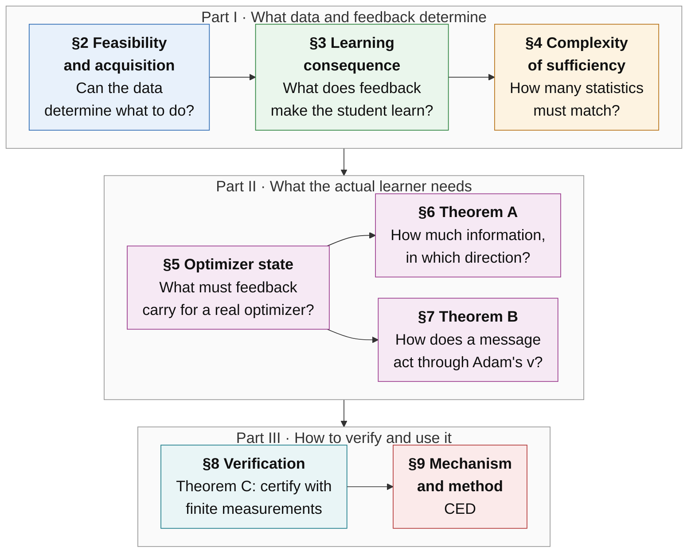
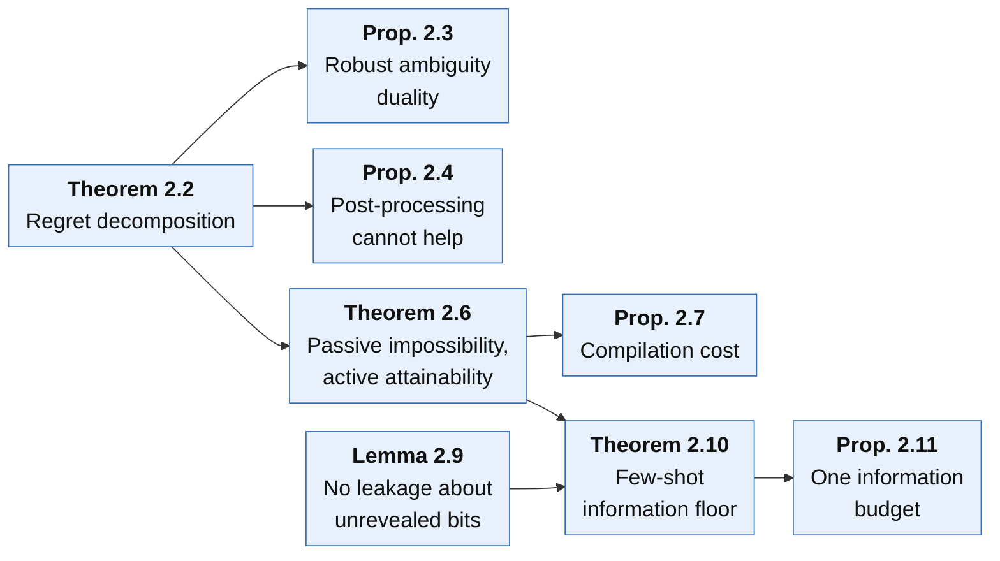
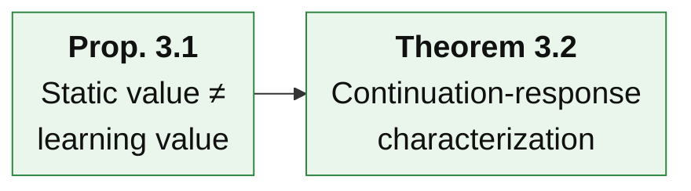
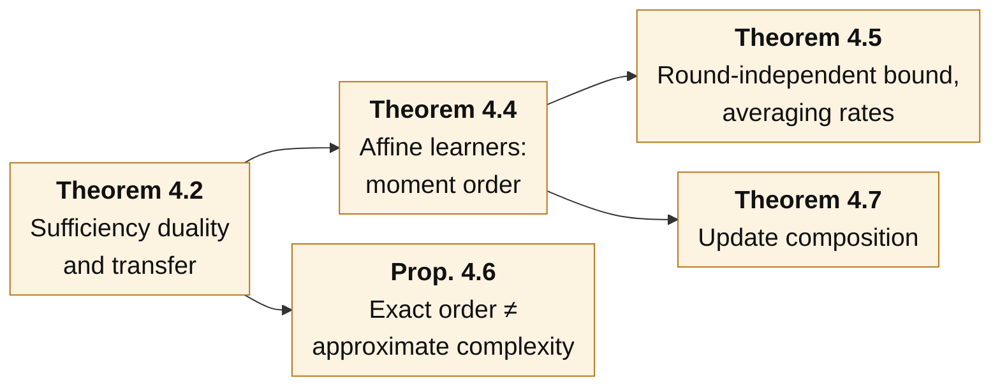
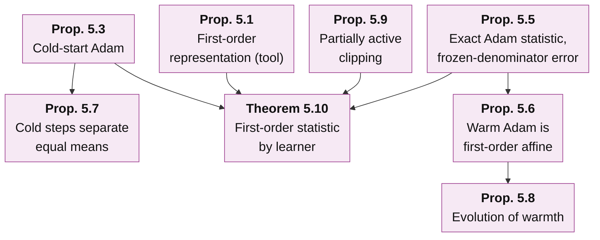
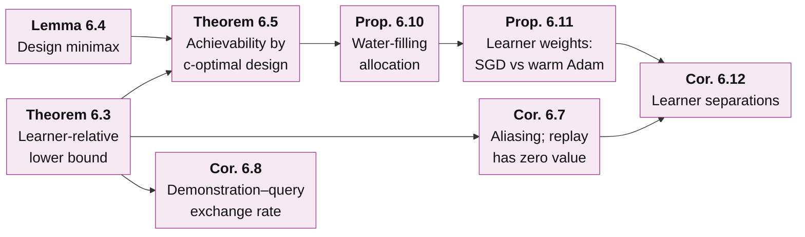
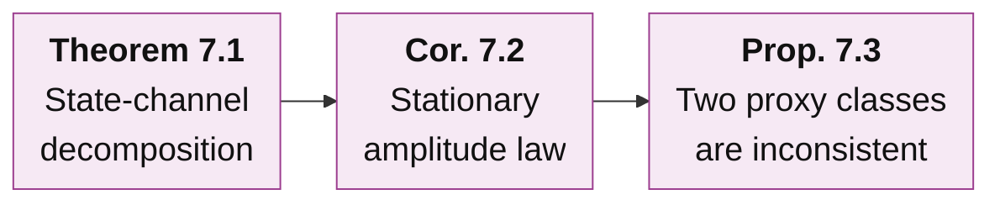
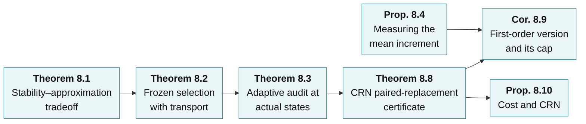
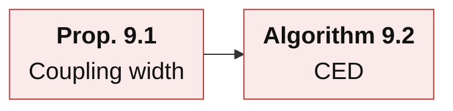

# Learner-Relative Experience Sufficiency for Agent Distillation — Theoretical Framework

[中文版](README_ZH.md)

**Question.** Relative to the declared deployment tasks, the permitted experiments and the actual learning procedure, which differences between feedback sources change the final task performance of a distilled student?

**Central results.**

- **Theorem A (§6, learner-relative information bound).** For any distiller (replay, rewriting and synthesis included), the smallest achievable first-order error is governed by the Fisher information that demonstrations and queries carry about one learner-dependent functional. Its gradient $`c=\sum_tJ_t^{*}g_t`$ combines the learner's Jacobian with the task's continuation gradients. Under identifiability and growth conditions, the bound is attained up to a constant factor by a regularized Elfving c-optimal query design. Hence the same demonstrations can be sufficient for one learner and insufficient for another.
- **Theorem B (§7, Adam's second-moment channel).** Under warm Adam, the first-order value of a message splits exactly into a parameter channel, a momentum channel and a second-moment channel. In a stationary regime the response to a message of relative magnitude $`\lambda`$ has an exact mean-field form. For small increments it is a concave quadratic that peaks at an explicit $`\lambda^*`$ and turns negative near $`2\lambda^*`$. Scores that look only at the parameter step, or only at directions, are therefore inconsistent rankers.
- **Theorem C (§8, auditable certificate).** A common-random-numbers (CRN) paired replacement of one training round measures the finite effect of a feedback law directly. The resulting certificate needs no continuation-value gradient and no curvature constant. Its radius has only a statistical term and a surrogate-calibration term.

These rest on foundations (§2–§5): an exact regret decomposition and the cost of acquiring missing information, the continuation response as the object of sufficiency, the complexity of sufficiency, and the statistic that each optimizer makes feedback carry. §9 derives the method, CED, from all of them.

**How to read this page.** The page goes from the whole to the parts, breadth first.

| Level | Content | After reading it you can answer |
|---|---|---|
| [Level 0](#level-0--one-paragraph) | One paragraph on the whole framework | What question the framework answers, and in which steps |
| [Level 1](#level-1--eight-sections) | The eight sections and how they connect | What each section asks, what it concludes, what it hands on |
| [Level 2](#level-2--the-main-results) | Plain-language account of each main result | What each result says, the intuition, its role in the chain |
| [Level 3](#level-3--statements-by-section) | Exact statements with derivation outlines | The precise assumptions and formulas, and how they are proved |

Notation is fixed in [§1](#1-setting-and-notation). Each of §2–§9 has a **statements** page (exact statements with derivation outlines), **proofs** pages with complete derivations, and **experiments** pages with the checks that test them: why each check is run, its setup, its result and why it supports the statement. Long sections are split over several pages so that every page renders on GitHub. All measured results are on the experiments pages; this page contains statements and illustrative examples only.

**Scope.** Every statement on this page is proved under the assumptions it states. A few are proved to leading order in an explicitly stated asymptotic regime, and the page says so where this happens. Proofs are finite-dimensional or carry explicit regularity assumptions. The checks on the experiments pages are exact finite computations or controlled small networks. Real-model tests of Theorems A–C are designed ([Remark 9.4](proofs/09_mechanism_and_method.md#s9-4)) but have not been run.

---

## Level 0 · One paragraph

To distill an agent we have a pretrained student, $`K`$ trusted teacher demonstrations per task family, a budget of further permitted experiments (teacher calls, environment branches, resets), and a fixed training recipe (optimizer, learning rate, number of steps). Many feedback sources can be fed to the student: the demonstrations themselves, replays, synthetic rewrites, new queries, different packagings of the same units. The framework asks which differences between these sources actually change the final task performance of the distilled student. It answers in eight steps.

1. **Can the data determine what to do? (§2)**
   - The student's regret splits exactly into a representation term, an information term and an algorithm term.
   - An information gap can be closed only by new experiments, never by replay or rewriting, and even an everywhere-optimal teacher can leave one.
   - Closing it costs on the order of $`\log(1/\delta)/\Delta^2`$ queries, and demonstrations and queries draw on one information budget.
2. **What does feedback do to the learner? (§3)**
   - Teacher quality, policy value and the mean gradient do not determine what the student learns.
   - The invariant is the *continuation response*: the expected final return after receiving one message, applying the actual update and finishing training.
3. **How much must two sources agree on? (§4)**
   - Exactly the span of the response class. For averaging learners this is a moment order set by the deployment length.
   - Approximate complexity can be much smaller than the exact order, and nonlinear updates multiply the order.
4. **What does the actual optimizer make feedback carry? (§5)**
   - To first order, what matters is the mean increment of the *complete learner state* (parameters and optimizer state). This first-order representation is a tool, not a claim of novelty.
   - The statistic is explicit for SGD, momentum, cold and warm Adam, clipping, Lion and LoRA. For warm Adam the exact statistic is the mean Adam increment, and the familiar (mean, second moment) description holds only under a frozen-denominator approximation with an explicit error.
   - An Adam coordinate's warmth falls like $`1/(\beta_2s)`$ only early in training; it levels off at $`(1-\beta_2)/\beta_2`$.
5. **How much information is needed, and in which direction? (Theorem A, §6)**
   - The learner decides the direction $`c`$ in which the data must be informative. The minimax error of any distiller is the learner-relative information norm, up to a constant.
   - Consequences: replay has zero value against aliasing, demonstrations and queries trade at a learner-relative exchange rate, queries are allocated by water-filling, and SGD and Adam can need very different data for the same task.
6. **How does a message act through Adam's second moment? (Theorem B, §7)**
   - A message also changes all later step sizes through $`v`$.
   - This gives an amplitude law with an optimal magnitude and, for small increments, a sign change near twice that magnitude. Parameter-only and cosine scores misrank in an explicit region.
7. **How can finite measurements certify a choice? (Theorem C and §8)**
   - Finite audits need a coverage (transport) term, and full-tail audits at the actual states are safe but expensive.
   - First-order scores need the continuation gradient, and they certify a pair only when its first-order term exceeds the second-order remainder; pairs whose mean increments agree along the gradient are never certified.
   - CRN paired replacement measures the finite effect directly. Two problems remain open: a provable range much smaller than the a-priori one, and a testable condition for transferring the surrogate calibration.
8. **The method (§9).**
   - A mechanism test with a strict null (coupling width).
   - Consequence-Calibrated Experience Distillation (CED): acquire by learner-relative design, select by certified measured consequence, match the learner's statistic, account for coverage, freeze and then test transfer.

---

## Level 1 · Eight sections



Arrows show the main flow of the argument. Further dependencies:

- §2 fixes the acquisition budget used by Theorem A (§6).
- §3 supplies the continuation decomposition used throughout §8.
- §4 supplies the approximation width and the coefficient stability used by §8.
- §5 supplies the statistic that §8 measures.

### §2 · Feasibility and acquisition

**Question.** Within the policies the student can execute, can the available data determine what to do, and what does it cost to acquire what is missing?

**Conclusion.**

- The student's regret against the best reference policy splits exactly into representation error, information error and algorithm error. All three are nonnegative, and none can substitute for another.
- The information error is zero if and only if all environments consistent with the data share an optimal policy. No environment-independent post-processing of the data (replay, rewriting, synthesis) can reduce it.
- Even a teacher that is optimal in every environment can leave an information gap. Active experiments such as reset queries close it, at a cost of order $`\log(1/\delta)/\Delta^2`$; this order is both sufficient and necessary. Compiling the acquired fact into the student is a separate, much smaller cost.
- In a hidden-fact model, the information left after $`K`$ demonstrations is explicit, the optimal hard-budget query rule is greedy by weight, and demonstrations and adaptive queries satisfy one linear information-budget inequality.

**Hand-off.** Missing facts must be acquired. What a learner makes of the information is the question of §3, and how much information a *specific* learner needs is answered by Theorem A in §6.

### §3 · Learning consequence

**Question.** Given a feedback source, what will the student actually learn, and what should be compared when two sources are compared?

**Conclusion.**

- Static measures are not enough. Two sources can have equally good teachers and give every student the same policy value, yet distill different students.
- Two label packets can have equal marginals and equal mean gradients, yet different learning values, with the sign of the difference reversing on another task.
- The right object is the continuation response: the expected final task return after receiving message $`y`$, applying the actual update and finishing training under the reference recipe.
- The gap over a whole run is exactly a sum over rounds of one-boundary replacement effects. Two message laws are interchangeable if and only if they have equal expectation under every response.
- When guarantees hold only on part of the state space, the probability of leaving that part is paid once, not once per round.

**Hand-off.** The object of sufficiency is the response class $`\mathcal G`$. §4 measures its complexity, §5–§7 compute it for real optimizers, and §8 checks it with finite data.

### §4 · Complexity of sufficiency

**Question.** How many statistics must two feedback sources agree on to be equivalent for learning?

**Conclusion.**

- When equivalence is judged by the means of a set of features, exact sufficiency holds if and only if every response lies in their span. The number of statistics needed is the dimension of the span of the response class.
- Approximately, the worst-case error is twice the best uniform approximation error of the responses by the features. An unrestricted learner needs the whole distribution.
- For learners that average independent experience blocks and for deployments with at most $`N`$ decisions, exactly the moments up to order $`N`$ are needed, and every order is necessary.
- The gap decays with the number of *independent* blocks at a rate set by the first unmatched cumulant, independently of the number of training rounds. Replay and deterministic synthesis do not make it decay.
- Approximate complexity can be far below the exact order (about $`\sqrt N`$ for smooth values), with parity-type values as the exception.
- Composing nonlinear updates multiplies the required order.

**Hand-off.** What must match is decided by the learner itself, so the actual optimizer must be modelled (§5). In approximations the stability of the coefficients matters (§8).

### §5 · Optimizer state and the first-order representation

**Question.** What must feedback carry for the learners actually in use: SGD, momentum, Adam/AdamW, clipping, Lion, LoRA?

**Conclusion.**

- Write any stateful first-order optimizer as a map from a consumed gradient to an increment of the complete learner state. To first order, the effect of a feedback law on the training outcome is the inner product between the continuation-value gradient and the mean complete-state increment.
- Higher orders correspond to higher moments of the increment. This expansion is a standard Taylor-plus-telescoping computation, in the same family as stochastic modified equations, TracIn and metagradients, and it is used here as a tool.
- What is specific to each optimizer is the increment:
  - Cold-start Adam looks only at gradient signs in its first step, while its state keeps the magnitudes.
  - For warm Adam, the exact first-order statistic is the mean Adam increment. Under a frozen-denominator approximation it reduces to the mean and second moment of the gradient, with an error controlled coordinatewise by the coordinate's warmth.
  - Warmth falls like $`1/(\beta_2s)`$ only while $`s(1-\beta_2)\ll1`$, and then levels off at $`(1-\beta_2)/\beta_2`$, so the frozen-denominator error has a per-step floor.
  - Clipping makes the statistic the clipped mean. When clipping is active with probability $`p_{\rm act}`$, only the mean direction matters, up to an error at most $`c(1-p_{\rm act})`$.

**Hand-off.** The increment map tells us *what* a feedback law must carry. Theorem A (§6) asks how much information the data must hold about it, Theorem B (§7) follows a message through Adam's second moment, and §8 measures it.

### §6 · Theorem A: the learner-relative information bound

**Question.** Given $`K`$ demonstrations and $`n`$ permitted queries, how well can *any* distiller reproduce the first-order effect of the oracle feedback, and how should the queries be spent?

**Conclusion.**

- Let $`c=\sum_tJ_t^*g_t`$, which combines the learner's Jacobian $`J_t`$ (how the mean increment moves with the unknown environment parameter) with the task's continuation gradients $`g_t`$.
- The minimax error of any distiller is, up to a factor between $`1/4`$ and $`1`$, the learner-relative information norm: the largest ratio of $`c^\top h`$ to the Fisher information that demonstrations and queries carry in direction $`h`$.
- Asymptotically optimal queries follow an Elfving c-optimal design with target $`c`$, regularized so that every direction is eventually identified.
- Consequences:
  - directions the demonstrations cannot see make every amount of replay worthless;
  - one demonstration is worth a learner-relative number of queries;
  - in a state-coverage model, queries go by water-filling to states with high learner-relative weight and low teacher coverage;
  - SGD weights a state by the square of its visitation, while warm Adam in the frequent-visit regime weights it by the visitation itself, so Adam amplifies the student's long tail;
  - clipping makes the learner blind to gradient scale.

**Hand-off.** Theorem A says in which direction information is needed. For Adam that direction has a component through the second moment, which §7 analyses.

### §7 · Theorem B: Adam's second-moment channel

**Question.** How does one message act on the final outcome under warm Adam, and when does a larger gradient hurt?

**Conclusion.**

- A message's first-order value splits exactly into parameter, momentum and second-moment channels, with costates given by an explicit backward recursion.
- In a stationary mean-field regime the response to a message of relative magnitude $`\lambda`$ has an exact closed form:
  - for small increments it is a concave quadratic up to a proved relative error of order $`(1-\beta_2)\max\lbrace1,\lambda^2\rbrace`$, with optimum $`\lambda^*=(1-\beta_1^{T+1})/(\rho\,\omega_T)`$ and a sign change near $`2\lambda^*`$;
  - for large $`\lambda`$ the direct effect saturates while the suppression of later steps keeps accumulating; the limit is explicit, and when it is negative the response has a positive zero.
- Parameter-only scores and cosine scores therefore misrank message pairs in an explicit region. Under SGD the value would simply be linear in $`\lambda`$.

**Hand-off.** Where the second-moment channel dominates, increments are large relative to $`v`$, and first-order rankings fail; there one must measure finite replacements (§8).

### §8 · Verification and Theorem C

**Question.** With finitely many measurements, how can we prove that one feedback source is better than another, or select a good one?

**Conclusion.**

- An error in measuring a feature is amplified by that feature's coefficient; a fit with small residual and huge coefficients is not a proof.
- Selecting by discrepancies measured on a fixed set of audit cells requires an explicit coverage (transport) term. If training reaches uncovered states, the audit can read zero while the learning gap is 1.
- Paired full-tail experiments at the actual states, with selection by a lower confidence bound, never lose more than $`\delta`$ against the reference, but they need many paired replicas per candidate.
- The mean increment itself is cheap to estimate. A first-order score, however, needs the continuation gradient and the remainder constants. It certifies a pair only when the pair's first-order term exceeds the second-order remainder, so pairs whose mean increments agree along the gradient are never certified, however large their true gap.
- Theorem C replaces the gradient by a CRN paired replacement of one round. This is exact in expectation, has a radius with only a statistical term and a calibration term, and costs $`(M+1)r`$ surrogate tails per audited state.
- Open: a provable range much smaller than the a-priori one, and a testable calibration-transfer condition. Without them the strict certificate is valid but rarely decisive.

**Hand-off.** §9 assembles acquisition, selection and certification into a method.

### §9 · Mechanism and method

**Question.** What method follows, and which mechanism deserves a test of its own?

**Conclusion.**

- *Coupling width:* fixing each unit's marginal law and regrouping units into joint training packets changes nothing if and only if a packet's return is additive across units. One SGD step is the strict null.
- *CED (Consequence-Calibrated Experience Distillation):* record the complete learner state; acquire missing information by learner-relative design before compiling; select candidate feedback laws by CRN paired-replacement scores, calibrated against full-tail audits and with coverage accounted for; match the learner's statistic and control message magnitude relative to the running second moment; freeze the selector and then test transfer.
- Each design rule is a corollary of a cited statement.

---

## Level 2 · The main results

For each main result, three lines give what it says, the intuition, and its role in the chain. Exact statements are in [Level 3](#level-3--statements-by-section). In each graph an arrow A → B means that B's statement or proof uses A.

### §2 · Feasibility and acquisition — main results



**[Theorem 2.2](proofs/02_feasibility_and_acquisition.md#s2-2) · Regret decomposition and decision ambiguity**
- *What it says.* The student's expected regret is exactly the sum of a representation error (the student class cannot reach the reference optimum), an information error (the data cannot tell the possible environments apart) and an algorithm error (the learner does not use the data well); all three are nonnegative. The information error is zero if and only if, for almost every transcript, all environments consistent with it share an optimal policy.
- *Intuition.* The information error is what is lost even with perfect learning, because the data leave the right decision ambiguous.
- *Role.* It separates "not enough information" from "learned badly"; every later information result starts from it.

**[Proposition 2.3](proofs/02_feasibility_and_acquisition.md#s2-3) · Robust ambiguity duality**
- *What it says.* The best worst-case regret over a set of indistinguishable environments, minimized over policy mixtures, equals the largest Bayes information regret over priors on that set. It is zero exactly when one policy is optimal in all of them.
- *Intuition.* Indistinguishable worlds force the learner to hedge; the price of hedging is the value of a zero-sum game against the least favourable prior.
- *Role.* It gives the information error a computable minimax form and a certificate (a prior) for its size.

**[Proposition 2.4](proofs/02_feasibility_and_acquisition.md#s2-4) · Post-processing cannot reduce information regret**
- *What it says.* Any randomized transformation of the transcript that does not depend on the environment, such as replay, rewriting, paraphrasing or synthesis, can only raise the information error or leave it unchanged; adding data independent of the environment leaves it unchanged.
- *Intuition.* Processing data can make existing information easier to learn, which lowers the algorithm error, but it cannot create a missing fact.
- *Role.* It rules out generated data as a substitute for new experiments; it is generalized to a learner-relative statement in §6.

**[Theorem 2.6](proofs/02_feasibility_and_acquisition.md#s2-6) · Passive impossibility, active attainability**
- *What it says.* In a two-world family the teacher is optimal in both worlds and its demonstrations have the same law in both, yet the student's optimal policies are opposite. Every learner that sees only demonstrations loses at least $`\Delta`$ in one world. With reset queries, order $`\log(1/\delta)/\Delta^2`$ queries are necessary and sufficient, up to a constant factor.
- *Intuition.* A perfect demonstration shows what the teacher did, not what a student with different abilities should do; the student has to try.
- *Role.* It shows why the method needs an active acquisition step, and why demonstration quality is not information sufficiency.

**[Proposition 2.7](proofs/02_feasibility_and_acquisition.md#s2-7) · Compilation cost**
- *What it says.* Once the missing fact is acquired, turning it into the student takes a further $`O(\log(1/\delta_L))`$ compiled labels, independently of the gap $`\Delta`$.
- *Intuition.* Finding out what to do and teaching the student to do it are different problems with different costs.
- *Role.* It separates the acquisition budget (authentic queries) from the compilation budget (synthetic labels) in the accounting of the method.

**[Lemma 2.9](proofs/02_feasibility_and_acquisition.md#s2-9) · Demonstrations leak nothing about unrevealed bits**
- *What it says.* In the hidden-bit model, given everything observed, the bits that no demonstration revealed are still independent fair coins.
- *Intuition.* Demonstrations that reveal some facts by a mechanism independent of the facts carry no evidence about the rest.
- *Role.* It is the key step behind the exact information floor and the optimality of greedy querying.

**[Theorem 2.10](proofs/02_feasibility_and_acquisition.md#s2-10) · Few-shot information floor and optimal hard-budget querying**
- *What it says.* After $`K`$ demonstrations the information floor is $`\tfrac12\sum_jw_j(1-q_j)^K`$, where $`w_j`$ is how often context $`j`$ matters at deployment and $`q_j`$ is how often one demonstration reveals it. With a hard budget of $`n`$ queries, querying the heaviest unseen facts is optimal, and adapting to the revealed values does not help.
- *Intuition.* Each demonstration reveals a fact with some probability; what it leaves unrevealed must be queried, and the most valuable gaps first.
- *Role.* It puts $`K`$ into the theory and is the model case for the query allocation of §6.

**[Proposition 2.11](proofs/02_feasibility_and_acquisition.md#s2-11) · Demonstrations and queries share one information budget**
- *What it says.* To tell two worlds apart with error at most $`\delta`$, the KL information of the $`K`$ demonstrations plus the KL information per query times the expected number of queries must reach $`\mathrm{kl}(1-\delta,\delta)`$, for every adaptive query-and-stop rule.
- *Intuition.* Demonstrations and queries pay into the same account; informative demonstrations reduce the number of queries needed, and replays pay nothing.
- *Role.* It is the exchange rate between $`K`$ and the query budget; §6 makes the rate depend on the learner.

### §3 · Learning consequence — main results



**[Proposition 3.1](proofs/03_learning_consequence.md#s3-1) · Static value is not learning value**
- *What it says.* Two data sources can give every student in the class the same policy value and give the teacher the same value, yet distill students with returns $`\tfrac{43}{80}`$ and $`\tfrac{41}{80}`$. Two label packets can have the same marginals and the same mean gradient, yet learning values that differ by $`\eta^2/8`$, with the sign reversed on another task.
- *Intuition.* What is learned depends on how the data act on the student *through the update*, and on what the deployment rewards; how good the data look by themselves does not decide it.
- *Role.* It rules out teacher quality, policy value and the mean gradient as sufficiency criteria, and motivates the continuation response.

**[Theorem 3.2](proofs/03_learning_consequence.md#s3-2) · Continuation-response characterization**
- *What it says.* The gap between two training processes is exactly the sum over rounds of the effect of replacing that round's reference step by the alternative step, measured by the continuation value at the states the alternative actually visits. Two message laws are interchangeable for every one-boundary replacement if and only if they have the same expectation under every response. When the guarantee holds only on a certified part of the state space, the probability of leaving it is paid once, not once per round.
- *Intuition.* The response $`g(y)`$ answers "if this round feeds the student $`y`$ and training then continues as declared, what is the final score"; it builds in the update rule, the rest of training and the deployment task.
- *Role.* It fixes the object of sufficiency, the response class $`\mathcal G`$; §4 measures its size, §5–§7 its dependence on the optimizer, and §8 how to check it with finite data.

### §4 · Complexity of sufficiency — main results



**[Theorem 4.2](proofs/04_complexity_of_sufficiency.md#s4-2) · Sufficiency duality and transfer**
- *What it says.* Judge two feedback laws by the means of a fixed set of features. Equal feature means imply equal response means exactly when every response lies in the span of the features, so the number of statistics needed is $`\dim\mathrm{span}(\lbrace\mathbf 1\rbrace\cup\mathcal G)-1`$. Approximately, the worst unresolved gap is twice the best uniform approximation error of the responses by the features; a response written as features plus a small residual transfers feature-mean errors with its coefficient size. An unrestricted learner needs the whole distribution.
- *Intuition.* Equal feature means rule out differences only in the directions the features span; whatever part of a response lies outside that span is risk the interface cannot see.
- *Role.* It turns "how much information must match" into computable quantities, a span dimension or an approximation width, used by every later count in §4, §5 and §8.

**[Theorem 4.4](proofs/04_complexity_of_sufficiency.md#s4-4) · Affine learners: moment order is necessary and sufficient**
- *What it says.* For a student with binary-action contexts, deployments with at most $`N`$ decisions and learners that take convex averages of independent experience blocks, two sources are equivalent for every such task and learner exactly when their joint moments agree up to order $`N`$. Every order is necessary, the exact count on a grid is $`\binom{k+N}N-1`$, and on binary blocks fewer than $`2^k-1`$ statistics can leave a gap of 1.
- *Intuition.* The deployment value is a polynomial of degree $`N`$ in the student's action probabilities, and averaging turns its expectation into a combination of block moments of order at most $`N`$.
- *Role.* A fully computable instance of Theorem 4.2, showing that the information order is set by the deployment length.

**[Theorem 4.5](proofs/04_rates_and_composition.md#s4-5) · A round-independent bound and averaging rates**
- *What it says.* For convex-affine learners the learning gap is at most a coefficient mass times the largest moment mismatch, whatever the number of training rounds. When $`n`$ independent blocks are averaged, the gap decays as $`n^{-(r-1)}`$, where $`r`$ is the order of the first unmatched cumulant. Replaying one block, or training on deterministic rewrites of it, gives a gap that does not decay at all.
- *Intuition.* Only independent evidence shrinks the gap. Repetition and deterministic synthesis add exposure, not information.
- *Role.* It separates the number of independent blocks from the number of epochs. This counting discipline is used in §2 and in the method of §9.

**[Proposition 4.6](proofs/04_rates_and_composition.md#s4-6) · Exact order is not approximate complexity**
- *What it says.* For the value $`p^N`$, matching moments up to order about $`\sqrt{N\log(1/\varepsilon)}`$ brings the gap below $`\varepsilon`$, although exact equality needs order $`N`$. For parity, no polynomial of degree below $`N`$ approximates better than $`1/2`$.
- *Intuition.* Smooth responses have good low-order approximations; combinatorial responses do not.
- *Role.* It shows that the operative complexity is the approximation width, not the degree, and leads to the coefficient-stability question answered in §8.

**[Theorem 4.7](proofs/04_rates_and_composition.md#s4-7) · Update composition amplifies the information requirement**
- *What it says.* Composed polynomial updates can multiply the degree of the response in an early block by the degrees of all later updates, and the bound is attained. A threshold learner breaks first-moment sufficiency with a single decision. For one smooth SGD step, the difference between two feedback laws is a mean-gradient term plus a gradient-second-moment term plus a third-order remainder, and per-step errors add up linearly only under a stability condition.
- *Intuition.* The same data fed to different learners needs different amounts of information; what must match is a property of the learner composed with the task.
- *Role.* It shows that the actual optimizer must be modelled, which is the subject of §5.

### §5 · Optimizer state and the first-order representation — main results



**[Proposition 5.1](proofs/05_optimizer_state.md#s5-1) · Optimizer-transformed expansion**
- *What it says.* Write any stateful first-order optimizer, clipping included, as a map from a consumed gradient to an increment of the complete state (parameters, momentum, second moments, counter). The effect of two feedback laws on the training outcome is, to first order, the sum over rounds of the inner product between the continuation-value gradient and the difference of mean state increments; the remainder is controlled by second moments of the increment. Matching the mean increment in the directions of the continuation-value gradients is sufficient to first order, necessary where the first-order term exceeds the remainder, and the number of statistics is the dimension of the linearized response class.
- *Intuition.* Feedback affects the student only through the change of state it causes. To first order only the mean of that change matters, and only in the directions the continuation value cares about.
- *Role.* A tool, of the same kind as stochastic modified equations, TracIn and metagradients (Remark 5.2). Every later statement about what a learner makes the feedback carry, and Theorems A–C, are computed from it.

**[Proposition 5.3](proofs/05_optimizer_state.md#s5-3) · Cold-start Adam: sign quotient and optimizer memory**
- *What it says.* From a zero optimizer state, Adam's first step depends only on $`g_i/(\lvert g_i\rvert+\epsilon)`$. With $`\epsilon=0`$ the joint sign law must match (sign marginals are not enough); with $`\epsilon>0`$ the whole gradient law must. Momentum keeps the first gradient's magnitude, so two histories with the same signs can take second steps in opposite directions.
- *Intuition.* Adam's first step is almost sign descent: the magnitude is divided out of the step but kept in the optimizer state.
- *Role.* Shows that moment sufficiency does not transfer to Adam, and that what must match depends on the optimizer state.

**[Proposition 5.5](proofs/05_warm_adam.md#s5-5) · The exact first-order statistic of Adam and the frozen-denominator error**
- *What it says.* For Adam the first-order statistic is the exact mean Adam increment, which is not determined by the mean and second moment of the gradient. Freezing the denominator at its retained value turns the step into preconditioned momentum SGD, with a per-coordinate error at most $`\eta u_i\min\lbrace\kappa_i/2,1\rbrace`$, where $`\kappa_i`$ is the warmth.
- *Intuition.* Adam divides by a running root-mean-square that the new gradient itself perturbs. When that perturbation is small (small warmth) the step is nearly linear in the gradient.
- *Role.* Separates the two approximations hidden in "warm Adam only needs $`(\mathbb E G,\mathbb E G^{\odot2})`$": the first-order expansion and the frozen denominator.

**[Proposition 5.6](proofs/05_warm_adam.md#s5-6) · Warm Adam is first-order affine in the consumed gradient**
- *What it says.* At a warm state, the one-boundary response is an affine function of the consumed gradient plus an explicit residual: a frozen-denominator term, a second-moment sensitivity term, and a curvature term. Laws with equal mean consumed gradient differ by at most the expected residuals.
- *Intuition.* Once the second moment has accumulated, one Adam step behaves like one preconditioned momentum-SGD step.
- *Role.* Says from which point of training the affine and first-order theory applies to Adam, with a computable error.

**[Proposition 5.7](proofs/05_warm_adam.md#s5-7) · Cold steps separate equal-mean feedback at first order**
- *What it says.* At a cold state two gradient laws with the same mean, or even with all moments below any fixed order equal, give responses that differ at first order in the learning rate.
- *Intuition.* A cold step sees signs relative to zero, and the sign probabilities are not functions of low-order moments.
- *Role.* The witness that the cold window is a genuine first-order effect, not a higher-order correction.

**[Proposition 5.8](proofs/05_warm_adam.md#s5-8) · Evolution of warmth**
- *What it says.* With stationary gradients the mean-field warmth is exactly $`(1-\beta_2)/(\beta_2(1-\beta_2^s))`$ after $`s`$ absorbed evaluations. It falls like $`1/(\beta_2s)`$ only while $`s(1-\beta_2)\ll1`$, then levels off at $`(1-\beta_2)/\beta_2`$. Accumulated over a run, the warmth-controlled error is at most $`c\log(1+R/W)+c(1-\beta_2)R`$; bias correction does not change warmth; learning-rate-zero warm-up advances the second moment exactly like real steps.
- *Intuition.* A fixed $`\beta_2`$ means a fixed averaging window, so every new gradient keeps perturbing the denominator by a fixed relative amount.
- *Role.* Fixes how far into training the warm description is accurate, and shows it never becomes exact under a fixed $`\beta_2`$.

**[Proposition 5.9](proofs/05_learner_statistics.md#s5-9) · Partially active clipping**
- *What it says.* The mean clipped gradient splits exactly into an unclipped part and a clipped-direction part; replacing it by $`c`$ times the mean direction errs by at most $`c(1-p_{\rm act})`$, where $`p_{\rm act}`$ is the probability that clipping is active.
- *Intuition.* Only gradients below the threshold keep their magnitude; the rest contribute only their direction.
- *Role.* Makes the clipping statistic exact for any activation rate and quantifies the "only the direction matters" simplification.

**[Theorem 5.10](proofs/05_learner_statistics.md#s5-10) · The first-order statistic by learner**
- *What it says.* The statistic of Proposition 5.1 for common learners: SGD and momentum — the mean gradient; warm Adam — the exact mean Adam increment, equal to $`(\mathbb EG,\mathbb EG^{\odot2})`$ only under the frozen-denominator approximation, with the second moment entering through $`v`$; a cold Adam step — the sign law in the parameters; clipping — the clipped mean; Lion — flip probabilities; LoRA at $`B=0`$ — a rank-$`r`$ sketch, with $`A`$ fixed at step one.
- *Intuition.* Two feedback sources with the same mean gradient can still differ at first order under cold Adam, clipping, or warm Adam through the second-moment channel.
- *Role.* Tells the method what to match and measure under each training recipe, and feeds the learner Jacobian of Theorem A and the state channels of Theorem B.

### §6 · Theorem A: the learner-relative information bound — main results



**[Theorem 6.3](proofs/06_learner_relative_information.md#s6-3) · Learner-relative lower bound**
- *What it says.* No distiller, replay, rewriting and synthesis included, can match the oracle feedback's first-order effect on the declared task better than a quarter of the learner-relative information norm $`\mathfrak n_{K,n}`$. The norm measures how much the $`K`$ demonstrations and $`n`$ queries reveal about the environment in the one direction $`c`$ that the learner and the task care about.
- *Intuition.* Two environments that the data cannot tell apart, but that this learner would treat differently, force an error on one of them; what counts is the learner's sensitivity $`c`$, not the size of the environment difference.
- *Role.* It is the lower half of Theorem A and the quantitative core of "acquire before compiling"; the aliasing and exchange-rate corollaries follow from it.

**[Lemma 6.4](proofs/06_learner_relative_information.md#s6-4) · Design minimax equality**
- *What it says.* The best variance any query design can achieve for estimating the learner-relative functional equals the square of the information norm, and an optimal design exists. It is the c-optimal (Elfving) design whose target vector is the learner Jacobian applied to the continuation-value gradients.
- *Intuition.* The best way to spend queries is the one that is most informative about the single direction the learner will use; this is a classical design problem with a learner-specific target.
- *Role.* It turns the lower bound into an acquisition rule and makes the upper bound computable.

**[Theorem 6.5](proofs/06_learner_relative_information.md#s6-5) · Achievability**
- *What it says.* Estimating the environment with a (slightly regularized) c-optimal query design and emitting the oracle law at the estimate reaches error $`\mathfrak n_{K,n}(1+o(1))`$. Together with the lower bound, the best achievable first-order error is pinned between $`\mathfrak n_{K,n}/4`$ and $`\mathfrak n_{K,n}`$.
- *Intuition.* Once the information is collected in the right direction, a plug-in distiller loses at most a constant factor.
- *Role.* It is the upper half of Theorem A: the information norm is the right measure of how sufficient a batch of experience is for a given learner.

**[Corollary 6.7](proofs/06_learner_relative_information.md#s6-7) · Aliasing and the zero value of replay**
- *What it says.* If two environments give identical demonstration laws and the learner-relative functional differs between them, every distiller errs by at least half the difference, for every $`K`$; replay and rewriting cannot help.
- *Intuition.* More copies of the same evidence never separate worlds that the evidence cannot separate.
- *Role.* It is the learner-relative form of passive impossibility: whether demonstrations suffice depends on the learner.

**[Corollary 6.8](proofs/06_learner_relative_information.md#s6-8) · Exchange rate between demonstrations and queries**
- *What it says.* Demonstrations and queries enter one linear information budget direction by direction; at the binding direction one demonstration is worth a definite number of queries, and that number depends on the learner.
- *Intuition.* A demonstration and a query are both evidence; their relative value is how much each reveals in the direction this learner cares about.
- *Role.* It gives the trade-off between collecting more demonstrations and spending queries.

**[Proposition 6.10](proofs/06_learner_relative_information.md#s6-10) · Explicit information bound and water-filling**
- *What it says.* When demonstrations cover teacher states and training happens at student states, the error is governed by $`\sum_sW_s/N_s`$, with $`W_s`$ the learner-relative weight of state $`s`$ and $`N_s`$ its sample count. The optimal query allocation is water-filling, $`n_s^\star=(\sqrt{W_s/\lambda}-k_s)_+`$; a state with positive weight and no coverage leaves an irreducible error.
- *Intuition.* Queries should go where the learner is sensitive and the teacher has not been.
- *Role.* It makes Theorem A operational for agent distillation and gives the acquisition step of the method its allocation rule.

**[Proposition 6.11](proofs/06_learner_relative_information.md#s6-11) · Learner weights of SGD and warm Adam**
- *What it says.* For SGD the weight of a state grows like the square of its visitation; for warm Adam in the frequent regime it grows only linearly and includes a second-moment term; for very rare states Adam returns to the squared scaling but sees only the sign of the feedback.
- *Intuition.* Adam normalizes by the running second moment, so rarely visited states take steps as large as common ones; their feedback therefore matters more than under SGD.
- *Role.* It shows that the optimizer changes where information must be collected, and it supplies the constant $`\kappa_{\rm iso}`$ used again in §7.

**[Corollary 6.12](proofs/06_learner_relative_information.md#s6-12) · Learner separations**
- *What it says.* Demonstrations that reveal a feedback direction but not its scale are sufficient for an always-clipped learner and insufficient, for every $`K`$, for SGD. Quantitatively, a long tail of rarely covered states costs warm Adam far more information than SGD.
- *Intuition.* What a learner ignores, it does not need to be told; what it amplifies, it needs to be told precisely.
- *Role.* It is the formal content of "the same demonstrations can be sufficient for one learner and not for another".

### §7 · Theorem B: Adam's second-moment channel — main results



**[Theorem 7.1](proofs/07_second_moment_channel.md#s7-1) · State-channel decomposition**
- *What it says.* For Adam/AdamW (bias correction, decoupled weight decay, $`\epsilon`$ and global-norm clipping included), the gradient of the continuation value with respect to $`(\theta,m,v)`$ is given by an explicit reverse costate recursion. The first-order value of a message then splits exactly into a parameter channel, a momentum channel and a second-moment channel. The last depends on the message only through $`g\odot g`$.
- *Intuition.* A message changes not only the current step but also the running second moment, and through it every later step size. The second-moment channel is the price or benefit of that change.
- *Role.* Makes the optimizer-state part of [Proposition 5.1](proofs/05_optimizer_state.md#s5-1) computable for Adam. It is the object behind the amplitude law (Corollary 7.2) and the failure of parameter-only influence scores (Proposition 7.3).

**[Corollary 7.2](proofs/07_second_moment_channel.md#s7-2) · Stationary amplitude law**
- *What it says.* At a warm stationary state, the mean-field response to a same-direction message of amplitude $`\lambda`$ (in units of the running RMS) is an explicit finite sum, valid for every $`\lambda`$.
  - For small increments it is a concave quadratic with optimum $`\lambda^\star=(1-\beta_1^{T+1})/(\rho\,\omega_T)`$ and sign change near $`2\lambda^\star`$, with an explicit error bound.
  - For very large amplitudes the direct effect saturates. A large message ends up worse than no message exactly when the signal-to-noise ratio $`\rho`$ exceeds $`\kappa_{\rm iso}(T)/\Lambda(T)`$.
- *Intuition.* A big gradient inflates $`v`$ and so shrinks the following steps; beyond some size the shrinkage costs more than the big step gains. Under SGD there is no such effect: bigger is always better.
- *Role.* The first quantitative statement that, under Adam, the value of a message is non-monotone in its magnitude. It tells the method to control message magnitude relative to the running second moment, and it predicts where linearized scores mislead.

**[Proposition 7.3](proofs/07_second_moment_channel.md#s7-3) · Inconsistency of two proxy classes**
- *What it says.* A statistic that ignores the deployment task cannot rank feedback laws correctly for every task. In the regime of Corollary 7.2, parameter-only first-order scores rank two same-direction messages in the wrong order. Examples are TracIn-style scores with Adam steps and fixed-state Adam data Shapley. Cosine scores (LESS-type) cannot separate the two messages at all.
- *Intuition.* The parameter-only score sees the bigger immediate step and misses the damage done through $`v`$; the cosine sees only direction, and the two messages point the same way.
- *Role.* A proof, not just an empirical observation, that two widely used families of influence scores are not consistent rankers under Adam. It is the reason the method selects by measured consequence.

### §8 · Verification and Theorem C — main results



**[Theorem 8.1](proofs/08_verification.md#s8-1) · Stability–approximation tradeoff**
- *What it says.* When each feature mean is known only up to a tolerance, the largest response difference that cannot be ruled out equals the best tradeoff between how well the features approximate the response and how large the coefficients of that approximation are, each coefficient weighted by its feature's tolerance.
- *Intuition.* The cost of measuring a feature imprecisely is its coefficient in the response model. A fit with a small residual and huge coefficients proves nothing.
- *Role.* It decides which features an audit should measure and which response models are acceptable as certificates; the frozen audit of Theorem 8.2 and the method's fitting rule use it.

**[Theorem 8.2](proofs/08_verification.md#s8-2) · Frozen finite-interface selection with transport**
- *What it says.* Fix audit cells and features in advance, measure each candidate's feature discrepancy from the reference, and select the smallest. The selected candidate's learning gap is bounded by the measured discrepancy plus statistical error plus an explicit transport term for the states training actually visits, plus the probability of leaving the certified states. The transport term cannot be dropped.
- *Intuition.* An audit sees only the states it covers. If training goes elsewhere, the audit can report zero discrepancy while the learning gap is maximal.
- *Role.* It gives the correct form of any finite, frozen audit and identifies its blind spot, which the actual-state audits of Theorems 8.3 and 8.8 avoid.

**[Theorem 8.3](proofs/08_verification.md#s8-3) · Actual-state adaptive audit; fidelity versus improvement**
- *What it says.* At the states training actually reaches, run paired full-tail experiments for each candidate against the reference and select by a lower confidence bound. The resulting training procedure is never worse than the reference by more than the confidence level, and it keeps the certified improvement. The required number of paired replicas is explicit and large.
- *Intuition.* It measures directly whether replacing this one round helps, with no extrapolation to unseen states; the price is many full training tails.
- *Role.* It is the reliable but expensive reference audit, used to calibrate cheaper measurements such as the surrogate of Theorem 8.8.

**[Proposition 8.4](proofs/08_certificate.md#s8-4) · Measuring the mean increment at the actual states**
- *What it says.* The mean optimizer increment of a feedback law can be estimated from gradient evaluations alone, with an error that falls like one over the square root of the sample size in the Hilbert norm. Combined with the continuation's gradient norm and curvature, this bounds the one-round effect and, along sampled runs, the whole-run gap.
- *Intuition.* The data side of a first-order certificate is cheap; the continuation side (its gradient and curvature) is not measured by these samples at all.
- *Role.* It is the cheap half of first-order auditing and explains why first-order audits still need calibration constants.

**[Theorem 8.8](proofs/08_certificate.md#s8-8) · CRN paired-replacement certificate (Theorem C)**
- *What it says.* At an audited state, give each candidate one round and then run the same surrogate tail with the same random numbers for every candidate. The mean paired score difference estimates the finite effect of the replacement without bias, and an empirical Bernstein radius plus a surrogate-calibration term turns it into a certificate that holds for all candidate pairs at once.
- *Intuition.* Instead of linearizing and then bounding the error of the linearization, measure the finite effect directly; sharing the random numbers cancels the tail noise that two independent runs would add.
- *Role.* It replaces the oracle continuation gradient by a measurement, and it is the selection step of the method. Its rigor rests on a known score range and a calibrated surrogate, which are the open problems of Remark 8.12.

**[Corollary 8.9](proofs/08_certificate.md#s8-9) · The first-order version, its margin criterion, and its cap**
- *What it says.* A first-order score ranks two candidates correctly whenever their first-order difference exceeds the second-order remainder. Measured by finite differences, the first-order certificate pays a finite-difference term and the remainder on top of the statistical radius, and it can never certify a pair whose first-order term is below the remainder, whatever the true gap.
- *Intuition.* Candidates that differ mainly through second moments of their increments, as under Adam, are invisible to any first-order certificate.
- *Role.* It marks where gradient-based scores are trustworthy and why Theorem 8.8 measures finite replacement instead; it also separates oracle diagnostics from measurable certificates.

**[Proposition 8.10](proofs/08_certificate.md#s8-10) · Cost, and what common random numbers buy**
- *What it says.* The certificate costs one surrogate tail per candidate and replica. Its range term needs on the order of a hundred replicas to be small, and common random numbers reduce the variance of each paired score to the size of the difference between the two candidates' increments.
- *Intuition.* Paired tails with shared randomness differ only because the candidates differ; independent tails also differ because training is noisy.
- *Role.* It sets the replica budget of the method and points to the pathwise Lipschitz bound as the route to a provable range.

### §9 · Mechanism and method — main results



**[Proposition 9.1](proofs/09_mechanism_and_method.md#s9-1) · Coupling width**
- *What it says.* Fix the marginal law of each feedback unit and change only how units are grouped into joint training packets. Every such regrouping leaves the learning outcome unchanged exactly when the joint-packet response is a sum of per-unit contributions; otherwise the change is at most twice the distance of the response from additive tables. One SGD step at a common parameter is exactly invariant to regrouping; sequential steps are not.
- *Intuition.* If the learner "sees" each unit on its own, grouping is irrelevant. Grouping matters only through interactions between units, and those appear once one update feeds into the next.
- *Role.* A mechanism test with a strict null, and the reason a candidate feedback law is specified by the packets it emits, not by a bag of units.

**[Algorithm 9.2](proofs/09_mechanism_and_method.md#s9-2) · Consequence-Calibrated Experience Distillation (CED)**
- *What it says.* Record the complete optimizer state; acquire missing information first, spending queries where the learner-relative weight is high and teacher coverage is low; compile candidate feedback laws; record each candidate's learner statistic and flag messages that are too large relative to the running second moment; measure each candidate's consequence at the actual state by CRN paired replacement, calibrated against a few full-tail audits; select by lower confidence bound, re-audit, freeze, then test transfer. Each output is labelled with the guarantee it carries, or as empirical.
- *Intuition.* Choose feedback by what happens after this learner, in its current state, consumes it, not by how good the feedback looks on its own.
- *Role.* Where the framework lands: every step is a consequence of a statement in §2–§8, and the planned real-model tests R0–R3 test those steps.

**[Remark 9.3](proofs/09_mechanism_and_method.md#s9-3) · The six design rules**
- *What it says.* Acquire before compiling; select by measured consequence; match the learner's statistic, not the raw gradient; fit response models with stable coefficients; account for coverage, certify by paired replacement and use first-order audits only where the margin dominates; freeze, then test transfer. Each rule is a necessary condition for the corresponding guarantee and is derived from cited statements.
- *Intuition.* Each rule closes one way a method can claim more than it knows: inventing information, trusting a proxy, ignoring the optimizer, over-fitting a response model, extrapolating an audit, or tuning on the evaluation.
- *Role.* It explains why Algorithm 9.2 has the steps it has, and it is what an ablation of the method should remove one rule at a time.

---

## 1. Setting and notation

The objects below are used by every section. Section-specific definitions are numbered within their section.

<a id="s1-1"></a>

**Definition 1.1 (Environment, student class, reference class).**

- An environment $`E`$ comprises a task distribution, transitions, feedback semantics, scoring and a fixed execution harness. All returns lie in $`[0,1]`$, and $`J_E(\pi)`$ is the expected return of policy $`\pi`$.
- The student's deployable policies form a class $`\Pi\subseteq\Pi_{\rm ref}`$, where $`\Pi_{\rm ref}`$ is a reference class (for example, the policies the teacher could execute). Write

```math
J_E^\Pi=\max_{\pi\in\Pi}J_E(\pi),\qquad J_E^{\rm ref}=\max_{\pi\in\Pi_{\rm ref}}J_E(\pi).
```

<a id="s1-2"></a>

**Definition 1.2 (Information and distillers).**

- $`I_0`$ is the common initial information: the pretrained student, the known rules, and the $`K`$ trusted demonstrations per task family. The teacher model's pretrained knowledge is part of $`I_0`$; it is the same in every environment of a family.
- $`D`$ is the transcript of all further information obtained from permitted experiments: teacher calls on new states, environment branches, resets. A new teacher call that observes a new state is an experiment, i.e. part of $`D`$.
- A *distiller* is any measurable map from $`(I_0,D)`$ and private randomness (independent of the environment) to a feedback protocol (Definition 1.3). Replay, rewriting and synthesis are distillers. They obtain nothing beyond $`(I_0,D)`$ that depends on the environment.

<a id="s1-3"></a>

**Definition 1.3 (Complete learner state, feedback law, update).**

- The *complete learner state* is $`z=(\theta,o)\in\mathcal Z`$. Here $`\theta`$ is the parameter vector and $`o`$ is the optimizer state (for Adam, the moments $`m,v`$ and the step counter), together with buffers, sampler state and the history that the update uses. $`\mathcal Z`$ is a real Hilbert space with inner product $`\langle\cdot,\cdot\rangle`$, Euclidean in finite dimension.
- At round $`t`$ a *feedback law* $`P_t(\cdot\mid z)`$ emits a message $`Y_t`$. The message yields a *consumed gradient* $`G_t(z,Y_t)`$, defined after accumulation, normalization and any clipping that the stated optimizer includes. The actual update is $`Z_{t+1}=U_t(z,Y_t,\xi_t)`$, with update randomness $`\xi_t`$.
- For a first-order optimizer, $`U_t(z,y,\xi)=z+\Delta_t\big(z,G_t(z,y,\xi)\big)`$. The *increment map* $`\Delta_t`$ contains the learning-rate schedule, momentum, second moments, weight decay and clipping. The *mean increment* of a law $`P`$ is

```math
\mu^P_t(z)=\mathbb E_{Y\sim P_t(\cdot\mid z)}\,\Delta_t\big(z,G_t(z,Y)\big).
```

- A *protocol* $`S`$ is a sequence of feedback laws $`(P^S_t)_{t<R}`$. Integrating $`\xi_t`$ gives its learning kernel $`K^S_t`$. The reference protocol is written $`K^0_t`$. All protocols start from the same initial state law.
- The final student is scored by $`F_E(z)=J_E(\pi_z)\in[0,1]`$, and $`L_E(S)=\mathbb E\,F_E(Z^S_R)`$. For a protocol that uses a single law $`P`$ in every round we write $`L(P)`$.

<a id="s1-4"></a>

**Definition 1.4 (Continuation value, response, declared class).**

- The *continuation value* under the reference tail is

```math
V^0_R=F_E,\qquad V^0_t=K^0_tV^0_{t+1}\quad(t<R).
```

- $`V^0_{t+1}(z)`$ is the expected final score when training continues from state $`z`$ after round $`t`$ under the reference protocol. When the tail starts from a different protocol $`P`$ we write $`V^P_{t+1}`$.
- The *one-boundary response* of message $`y`$ at round $`t`$ and state $`z`$ is

```math
g_{t,z}(y)=\mathbb E_{\xi_t}\,V^0_{t+1}\big(U_t(z,y,\xi_t)\big).
```

- It is the expected final real-task return after receiving $`y`$, applying the actual update, and completing the declared reference tail.
- The *declared class* $`\mathcal V`$ collects the continuation values of the declared deployment tasks and reference tails. The *response class* $`\mathcal G`$ collects the corresponding responses. Both are fixed before any feedback is selected.

<a id="s1-5"></a>

**Definition 1.5 (Counts).** The following counts are never conflated.

| Symbol | Meaning |
|---|---|
| $`K`$ | trusted demonstrations per task family |
| $`n_{\rm query}`$, or $`n`$ in §6 | further permitted experiments (queries) |
| $`n`$ in §4 | independent experience blocks |
| $`R`$ | training updates |
| $`N`$ | decisions in one deployment episode |
| $`d`$ | linear statistics (features) |
| $`r`$, $`M`$ in §8 | CRN replicas per audited state, number of candidate feedback laws |

Replaying one block $`n`$ times is not $`n`$ independent blocks.

**Conventions.**

- Statements are numbered by section with one shared counter (Definition 5.4 is followed by Proposition 5.5).
- *Theorem A* denotes Theorems 6.3 and 6.5, *Theorem B* Theorem 7.1 and Corollary 7.2, and *Theorem C* Theorem 8.8.
- Where a letter is reused locally, the section says so on first use; for example, $`s`$ counts absorbed gradient evaluations in §5 and denotes an agent state in §6.

---

## Level 3 · Statements by section

Each statement carries its number from the proofs page, its exact form, a derivation outline, its dependencies, and links to the proof and to the checks that test it.

**§2 Feasibility and acquisition** — [statements](statements/02_feasibility_and_acquisition.md) · [proofs](proofs/02_feasibility_and_acquisition.md) · [experiments](experiments/02_feasibility_and_acquisition.md)

**What this section does.**

- It asks whether the available data can determine what the student should do, separately from whether the student learns well ([Theorem 2.2](proofs/02_feasibility_and_acquisition.md#s2-2)).
- It shows that no processing of existing data can supply a missing fact ([Proposition 2.4](proofs/02_feasibility_and_acquisition.md#s2-4)), and that even optimal teacher demonstrations can leave one ([Theorem 2.6](proofs/02_feasibility_and_acquisition.md#s2-6)).
- It prices the missing information: active queries at order $`\Delta^{-2}\log(1/\delta)`$, compilation separately ([Proposition 2.7](proofs/02_feasibility_and_acquisition.md#s2-7)).
- It makes the number $`K`$ of demonstrations explicit and shows that demonstrations and queries share one information budget ([Theorem 2.10](proofs/02_feasibility_and_acquisition.md#s2-10), [Proposition 2.11](proofs/02_feasibility_and_acquisition.md#s2-11)).

**§3 Learning consequence** — [statements](statements/03_learning_consequence.md) · [proofs](proofs/03_learning_consequence.md) · [experiments](experiments/03_learning_consequence.md)

**What this section does.**

- It shows that static measures of feedback (teacher quality, policy value, label marginals, the mean gradient) do not determine what the student learns ([Proposition 3.1](proofs/03_learning_consequence.md#s3-1)).
- It identifies the right object: the continuation response, the expected final task return after one message, the actual update and the declared rest of training ([Theorem 3.2](proofs/03_learning_consequence.md#s3-2)).
- It shows that two message laws are interchangeable exactly when they agree on every response, and that coverage failures are paid once ([Theorem 3.2(b),(c)](proofs/03_learning_consequence.md#s3-2)).
- It fixes the response class $`\mathcal G`$ as the object that §4–§8 measure ([Remark 3.3](proofs/03_learning_consequence.md#s3-3)).

**§4 Complexity of sufficiency** — [statements](statements/04_complexity_of_sufficiency.md) · [proofs 4.1–4.4](proofs/04_complexity_of_sufficiency.md), [proofs 4.5–4.7](proofs/04_rates_and_composition.md) · [experiments](experiments/04_complexity_of_sufficiency.md)

**What this section does.**

- It measures how much information two feedback laws must share to be interchangeable for learning, given that interchangeability means agreement on the response class $`\mathcal G`$ ([Theorem 3.2](proofs/03_learning_consequence.md#s3-2)).
- In general the answer is a span dimension or an approximation width of $`\mathcal G`$ ([Theorem 4.2](proofs/04_complexity_of_sufficiency.md#s4-2)).
- For convex-affine learners it is computed completely: the joint moments up to the deployment length, with rates in the number of independent blocks ([Theorems 4.4](proofs/04_complexity_of_sufficiency.md#s4-4) and [4.5](proofs/04_rates_and_composition.md#s4-5)); approximate complexity can be much smaller than the exact order ([Proposition 4.6](proofs/04_rates_and_composition.md#s4-6)).
- Nonlinear or composed updates change the required order, so the learner itself must be modelled ([Theorem 4.7](proofs/04_rates_and_composition.md#s4-7)).

**§5 Optimizer state and the first-order representation** — [statements](statements/05_optimizer_state.md) · [proofs 5.1–5.3](proofs/05_optimizer_state.md), [5.4–5.8](proofs/05_warm_adam.md), [5.9–5.11](proofs/05_learner_statistics.md) · [experiments 5.1–5.7](experiments/05_optimizer_state.md), [5.8–5.18](experiments/05_warm_adam_and_learners.md)

**What this section does.**

- Writes every stateful first-order optimizer as an increment map on the complete learner state and expands a feedback law's effect in the moments of that increment (Proposition 5.1, a tool).
- Computes, for Adam, how the first-order statistic depends on the optimizer state: the sign law at a cold state, the exact mean Adam increment at a warm state, and the frozen-denominator approximation with its error (Propositions 5.3–5.7).
- Gives the exact evolution of warmth under a fixed $`\beta_2`$ (Proposition 5.8) and the exact clipping statistic at any activation rate (Proposition 5.9).
- Lists the first-order statistic of each common learner (Theorem 5.10).

**§6 Theorem A: the learner-relative information bound** — [statements](statements/06_learner_relative_information.md) · [proofs](proofs/06_learner_relative_information.md) · [experiments](experiments/06_learner_relative_information.md)

**What this section does.**

- It measures how much $`K`$ demonstrations and $`n`$ queries reveal about the oracle feedback in the one direction that matters for the actual learner and the declared task, and shows that this learner-relative information norm sets the best achievable first-order fidelity of any distiller, up to a factor between $`1/4`$ and $`1`$ (Theorem A: [Theorem 6.3](proofs/06_learner_relative_information.md#s6-3) and [Theorem 6.5](proofs/06_learner_relative_information.md#s6-5)).
- It identifies the optimal queries as a c-optimal design whose target vector is set by the optimizer ([Lemma 6.4](proofs/06_learner_relative_information.md#s6-4)).
- It derives aliasing, the zero value of replay and a demonstration–query exchange rate in learner-relative form ([Corollary 6.7](proofs/06_learner_relative_information.md#s6-7), [Corollary 6.8](proofs/06_learner_relative_information.md#s6-8)).
- For the state-coverage structure of agent distillation it gives explicit formulas, the water-filling query allocation and the learner weights of SGD and warm Adam, and shows that the same demonstrations can be sufficient for one learner and not for another ([Proposition 6.10](proofs/06_learner_relative_information.md#s6-10)–[Corollary 6.12](proofs/06_learner_relative_information.md#s6-12)).

**§7 Theorem B: Adam's second-moment channel** — [statements](statements/07_second_moment_channel.md) · [proofs](proofs/07_second_moment_channel.md) · [experiments](experiments/07_second_moment_channel.md)

**What this section does.**

- Computes the continuation-value gradient of Adam/AdamW by a reverse costate recursion, and splits the first-order value of a message into parameter, momentum and second-moment channels (Theorem 7.1).
- Solves the warm, stationary, linear-response case exactly for every message amplitude: an optimal amplitude, a sign change, and a large-amplitude criterion (Corollary 7.2).
- Derives from it that parameter-only and cosine influence scores are not consistent rankers under Adam (Proposition 7.3), and states where every first-order ranker is unreliable (Remark 7.5).
- "Theorem B" denotes Theorem 7.1 together with Corollary 7.2.

**§8 Verification and Theorem C** — [statements](statements/08_verification.md) · [proofs 8.1–8.3](proofs/08_verification.md), [proofs 8.4–8.12, Theorem C](proofs/08_certificate.md) · [experiments](experiments/08_verification.md)

**What this section does.**

- It asks how finitely many measurements can certify that a feedback law is good enough, or rank candidate laws, and it compares four kinds of measurement: feature means on frozen cells, full-tail paired contrasts at the actual states, mean optimizer increments, and CRN paired-replacement scores on a surrogate tail.
- It shows that a frozen audit needs an explicit transport term, and that auditing at the actual states with full tails is reliable but expensive.
- Its main result, **Theorem C** ([Theorem 8.8](proofs/08_certificate.md#s8-8)), measures the finite effect of a one-round replacement directly, so the certificate needs no continuation gradient and no second-order remainder.
- It states exactly where first-order scores can be trusted ([Corollary 8.9](proofs/08_certificate.md#s8-9)) and what remains open ([Remark 8.12](proofs/08_certificate.md#s8-12)).

**§9 Mechanism and method** — [statements](statements/09_mechanism_and_method.md) · [proofs](proofs/09_mechanism_and_method.md) · [experiments](experiments/09_mechanism_and_method.md)

**What this section does.**

- It isolates one learning-consequence mechanism with an exact null: the joint organization of feedback units whose marginals are fixed ([Proposition 9.1](proofs/09_mechanism_and_method.md#s9-1)).
- It states the method that follows from §2–§8, Consequence-Calibrated Experience Distillation (CED), as a numbered procedure in which every step cites the statement that justifies it and every output carries a stated guarantee or is labelled empirical ([Algorithm 9.2](proofs/09_mechanism_and_method.md#s9-2)).
- It derives the six design rules behind the procedure ([Remark 9.3](proofs/09_mechanism_and_method.md#s9-3)) and separates the controlled evidence from the planned real-model tests ([Remark 9.4](proofs/09_mechanism_and_method.md#s9-4)).

## Status of the results

| Section | Statements | Status |
|---|---|---|
| §2 | [Theorem 2.2](proofs/02_feasibility_and_acquisition.md#s2-2), [Propositions 2.3–2.4](proofs/02_feasibility_and_acquisition.md#s2-3), [Theorem 2.6](proofs/02_feasibility_and_acquisition.md#s2-6), [Proposition 2.7](proofs/02_feasibility_and_acquisition.md#s2-7), [Lemma 2.9](proofs/02_feasibility_and_acquisition.md#s2-9), [Theorem 2.10](proofs/02_feasibility_and_acquisition.md#s2-10), [Proposition 2.11](proofs/02_feasibility_and_acquisition.md#s2-11) | proved |
| §3 | [Proposition 3.1](proofs/03_learning_consequence.md#s3-1), [Theorem 3.2](proofs/03_learning_consequence.md#s3-2) | proved |
| §4 | [Theorems 4.2](proofs/04_complexity_of_sufficiency.md#s4-2), [4.4](proofs/04_complexity_of_sufficiency.md#s4-4), [4.5](proofs/04_rates_and_composition.md#s4-5), [Proposition 4.6](proofs/04_rates_and_composition.md#s4-6), [Theorem 4.7](proofs/04_rates_and_composition.md#s4-7) | proved |
| §5 | [Propositions 5.1](proofs/05_optimizer_state.md#s5-1), [5.3](proofs/05_optimizer_state.md#s5-3), [5.5–5.9](proofs/05_warm_adam.md#s5-5), [Theorem 5.10](proofs/05_learner_statistics.md#s5-10) | proved (finite dimension, explicit assumptions); Proposition 5.1 is a standard tool |
| §6 (Theorem A) | [Theorem 6.3](proofs/06_learner_relative_information.md#s6-3), [Lemma 6.4](proofs/06_learner_relative_information.md#s6-4), [Theorem 6.5](proofs/06_learner_relative_information.md#s6-5), [Corollaries 6.7–6.8](proofs/06_learner_relative_information.md#s6-7), [Proposition 6.10](proofs/06_learner_relative_information.md#s6-10), [Corollary 6.12](proofs/06_learner_relative_information.md#s6-12) | proved (local asymptotic minimax for 6.3(b), 6.5) |
| §6 | [Proposition 6.11](proofs/06_learner_relative_information.md#s6-11) | proved to leading order in the stated visitation regimes |
| §7 (Theorem B) | [Theorem 7.1](proofs/07_second_moment_channel.md#s7-1), [Proposition 7.3](proofs/07_second_moment_channel.md#s7-3) | proved |
| §7 | [Corollary 7.2](proofs/07_second_moment_channel.md#s7-2) | proved in the stationary mean-field model: (a) exact formula, (b) quadratic law with an explicit error bound, (c) explicit limit |
| §8 (Theorem C) | [Theorems 8.1–8.3](proofs/08_verification.md#s8-1), [Proposition 8.4](proofs/08_certificate.md#s8-4), [Theorem 8.8](proofs/08_certificate.md#s8-8), [Corollary 8.9](proofs/08_certificate.md#s8-9), [Proposition 8.10](proofs/08_certificate.md#s8-10) | proved; the surrogate calibration of [Remark 8.11](proofs/08_certificate.md#s8-11) is an assumption |
| §9 | [Proposition 9.1](proofs/09_mechanism_and_method.md#s9-1); [Algorithm 9.2](proofs/09_mechanism_and_method.md#s9-2) and its design rules | proved; design rules derived |

**Open problems.**

- **A tight provable range for Theorem C.** The certificate is valid with the a-priori range of the surrogate. To be decisive it needs a provable range much smaller than that, for example from a pathwise Lipschitz bound on the reference tail ([Remark 8.12](proofs/08_certificate.md#s8-12)).
- **Transfer of the surrogate calibration.** Theorem C uses a calibration $`(\alpha,\varepsilon_{\rm sur})`$ fitted on some candidate pairs. Extending it to new pairs needs a testable exchangeability condition, which is not yet available ([Remarks 8.11–8.12](proofs/08_certificate.md#s8-11)).
- **Real-model evidence.** The experiments pages contain exact finite computations and controlled small networks. Tests of Theorems A–C on a real agent-distillation recipe are designed in [Remark 9.4](proofs/09_mechanism_and_method.md#s9-4) and have not been run.

**Checks.** Every experiments page opens with a verdict table. One check fails its pre-set tolerance: a boundary setting of Corollary 7.2(a), recorded on the [§7 experiments page](experiments/07_second_moment_channel.md).

## Reproducing the checks

From the repository root, CPU only:

```bash
CUDA_VISIBLE_DEVICES='' theory/.venv/bin/python theory/independent_checks/check_v014_independent.py --output theory/independent_checks/results_independent_v014.json
CUDA_VISIBLE_DEVICES='' theory/.venv/bin/python theory/v015_checks/check_v015.py --output theory/v015_checks/results_v015_independent.json
CUDA_VISIBLE_DEVICES='' PYTHONDONTWRITEBYTECODE=1 theory/.venv/bin/python theory/v016_checks/check_v016.py
CUDA_VISIBLE_DEVICES='' theory/.venv/bin/python theoretical_framework/figures/make_figures.py
```

Check code IDs on the experiments pages name the suite and the check:

| Prefix | Suite | Location |
|---|---|---|
| `v014:` | independent checks `C1`–`C23` | `theory/independent_checks` |
| `v015:` | exact finite checks `V1`–`V9` and controlled-network experiments `E0`–`E12` | `theory/v015_checks` |
| `pkg:` | checks shipped with the revision package (`T01`–`T13` and named package checks) | `docs/direction/v014_handoff`, `docs/direction/v015_revision` |
| `v016:` | checks of §5–§8 additions (`C1`–`C6b`) | `theory/v016_checks` |

The page-rendering checker is described in [tools/README.md](tools/README.md); figure provenance is in [figures/README.md](figures/README.md).

## Appendix · Sources

Each statement was assembled from the source documents below; links go to the exact sections.

| This framework | Source |
|---|---|
| [Theorem 2.2](proofs/02_feasibility_and_acquisition.md#s2-2), [Propositions 2.3–2.4](proofs/02_feasibility_and_acquisition.md#s2-3) | [v0.14.1 §2](../docs/direction/v015_revision/Environment_Information_Theory_EN.md#2-first-principles-feasibility-identification-and-use) |
| [Theorem 2.6](proofs/02_feasibility_and_acquisition.md#s2-6), [Proposition 2.7](proofs/02_feasibility_and_acquisition.md#s2-7) | [v0.14.1 §3](../docs/direction/v015_revision/Environment_Information_Theory_EN.md#3-a-complete-acquisition-example-perfect-demonstrations-can-be-insufficient) |
| [Lemma 2.9](proofs/02_feasibility_and_acquisition.md#s2-9), [Theorem 2.10](proofs/02_feasibility_and_acquisition.md#s2-10), [Proposition 2.11](proofs/02_feasibility_and_acquisition.md#s2-11) | [v0.15 §4](../docs/direction/v015_revision/Optimizer_State_and_Few_Shot_Theory_v015_EN.md#4-make-the-number-of-demonstrations-explicit) |
| [Proposition 3.1](proofs/03_learning_consequence.md#s3-1) | [v0.14.1 §4](../docs/direction/v015_revision/Environment_Information_Theory_EN.md#4-why-static-evaluation-is-not-learning-sufficiency) |
| [Theorem 3.2](proofs/03_learning_consequence.md#s3-2), [Remark 3.3](proofs/03_learning_consequence.md#s3-3) | [v0.14.1 §5](../docs/direction/v015_revision/Environment_Information_Theory_EN.md#51-complete-learning-state-and-continuation-response); [v0.15 §1](../docs/direction/v015_revision/Optimizer_State_and_Few_Shot_Theory_v015_EN.md#1-what-the-validation-changes) |
| [Theorem 4.2](proofs/04_complexity_of_sufficiency.md#s4-2) | [v0.14.1 §6](../docs/direction/v015_revision/Environment_Information_Theory_EN.md#6-exact-and-approximate-information-complexity) |
| [Theorem 4.4](proofs/04_complexity_of_sufficiency.md#s4-4) | [v0.14.1 §7](../docs/direction/v015_revision/Environment_Information_Theory_EN.md#7-an-explicit-closed-theory-deployment-dependence-composed-with-learning) |
| [Theorem 4.5](proofs/04_rates_and_composition.md#s4-5) | [v0.14.1](../docs/direction/v015_revision/Environment_Information_Theory_EN.md#theorem-14-a-discrepancy-bound-independent-of-training-rounds) |
| [Proposition 4.6](proofs/04_rates_and_composition.md#s4-6) | [v0.14.1 §8](../docs/direction/v015_revision/Environment_Information_Theory_EN.md#8-exact-order-is-not-approximate-information-complexity) |
| [Theorem 4.7](proofs/04_rates_and_composition.md#s4-7) | [v0.14.1 §9](../docs/direction/v015_revision/Environment_Information_Theory_EN.md#9-learning-dynamics-can-amplify-the-information-requirement); [v0.15 §7](../docs/direction/v015_revision/Optimizer_State_and_Few_Shot_Theory_v015_EN.md#7-experiments-that-discriminate-the-theory) |
| [Proposition 5.1](proofs/05_optimizer_state.md#s5-1), [Remark 5.2](proofs/05_optimizer_state.md#s5-2) | [OTLR §2–§3, §6](../docs/direction/v015_extension/Optimizer_Transformed_Linear_Response_EN.md#2-the-expansion); [v0.16 revision draft](../docs/direction/2026-10-11_v016_revision_ZH.md) |
| [Proposition 5.3](proofs/05_optimizer_state.md#s5-3) | [v0.15 §3](../docs/direction/v015_revision/Optimizer_State_and_Few_Shot_Theory_v015_EN.md#3-what-adam-requires-three-distinct-levels-of-sufficiency) |
| [Definition 5.4](proofs/05_warm_adam.md#s5-4), [Propositions 5.5–5.7](proofs/05_warm_adam.md#s5-5) | [warm-Adam §2–§3](../docs/direction/v015_extension/Warm_Adam_Response_EN.md#2-warm-one-step-approximation); [v0.16 revision draft](../docs/direction/2026-10-11_v016_revision_ZH.md) |
| [Proposition 5.8](proofs/05_warm_adam.md#s5-8) | [warm-Adam §4](../docs/direction/v015_extension/Warm_Adam_Response_EN.md#4-how-warmth-evolves-and-a-free-way-to-warm-the-state); [v0.16 revision draft](../docs/direction/2026-10-11_v016_revision_ZH.md) |
| [Proposition 5.9](proofs/05_learner_statistics.md#s5-9), [Remark 5.11](proofs/05_learner_statistics.md#s5-11) | [v0.16 revision draft](../docs/direction/2026-10-11_v016_revision_ZH.md) |
| [Theorem 5.10](proofs/05_learner_statistics.md#s5-10) | [OTLR §4](../docs/direction/v015_extension/Optimizer_Transformed_Linear_Response_EN.md#4-what-each-optimizer-makes-the-feedback-carry); [v0.16 revision draft](../docs/direction/2026-10-11_v016_revision_ZH.md) |
| [§6](proofs/06_learner_relative_information.md), Definitions 6.1 – Example 6.13 | [v0.16 revision draft](../docs/direction/2026-10-11_v016_revision_ZH.md) |
| [§7](proofs/07_second_moment_channel.md), Theorem 7.1 – Remark 7.5 | [v0.16 revision draft](../docs/direction/2026-10-11_v016_revision_ZH.md) |
| [Theorem 8.1](proofs/08_verification.md#s8-1) | [v0.14.1](../docs/direction/v015_revision/Environment_Information_Theory_EN.md#theorem-18-an-exact-stabilityapproximation-tradeoff) |
| [Theorem 8.2](proofs/08_verification.md#s8-2) | [v0.14.1](../docs/direction/v015_revision/Environment_Information_Theory_EN.md#theorem-19-frozen-finite-interface-selection); [v0.15 §2](../docs/direction/v015_revision/Optimizer_State_and_Few_Shot_Theory_v015_EN.md#2-the-corrected-finite-audit-bridge) |
| [Theorem 8.3](proofs/08_verification.md#s8-3) | [v0.14.1 §11](../docs/direction/v015_revision/Environment_Information_Theory_EN.md#11-fidelity-improvement-and-adaptive-verification); [v0.15 §5](../docs/direction/v015_revision/Optimizer_State_and_Few_Shot_Theory_v015_EN.md#5-how-the-new-pieces-compose) |
| [Proposition 8.4](proofs/08_certificate.md#s8-4), [Remark 8.5](proofs/08_certificate.md#s8-5) | [OTLR §5](../docs/direction/v015_extension/Optimizer_Transformed_Linear_Response_EN.md#5-using-the-statistic-at-the-actual-states); [v0.16 revision draft](../docs/direction/2026-10-11_v016_revision_ZH.md) |
| [Corollary 8.9](proofs/08_certificate.md#s8-9) | [v0.16 revision draft](../docs/direction/2026-10-11_v016_revision_ZH.md) |
| [Definition 8.6 – Remark 8.12](proofs/08_certificate.md#s8-6) | [v0.16 revision draft](../docs/direction/2026-10-11_v016_revision_ZH.md) |
| [Proposition 9.1](proofs/09_mechanism_and_method.md#s9-1) | [v0.14.1 §12](../docs/direction/v015_revision/Environment_Information_Theory_EN.md#12-one-derived-mechanism-coupling-valid-experience-units) |
| [Algorithm 9.2](proofs/09_mechanism_and_method.md#s9-2), [Remarks 9.3–9.4](proofs/09_mechanism_and_method.md#s9-3) | [v0.14.1 §13](../docs/direction/v015_revision/Environment_Information_Theory_EN.md#13-the-derived-few-shot-method-consequence-calibrated-experience-distillation); [v0.15 §6](../docs/direction/v015_revision/Optimizer_State_and_Few_Shot_Theory_v015_EN.md#6-method-consequence-an-optimizer-aware-instance-of-ced); [v0.16 revision draft](../docs/direction/2026-10-11_v016_revision_ZH.md) |
