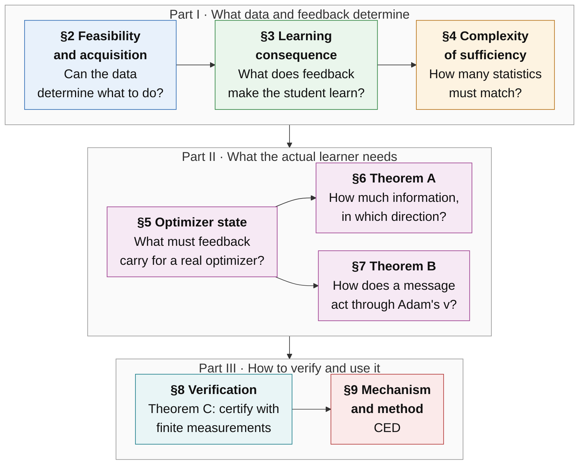
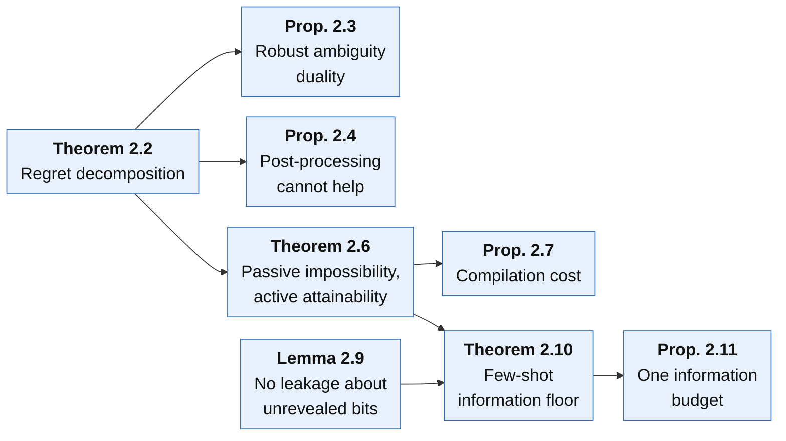
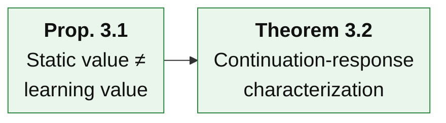
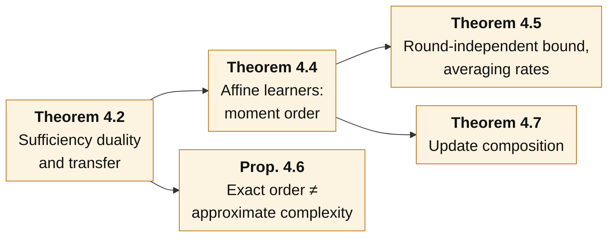
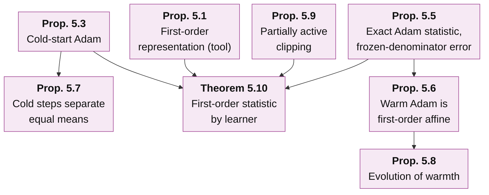
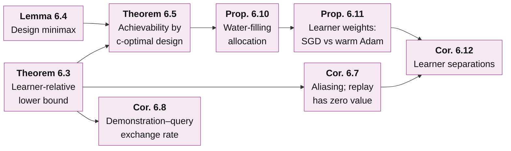
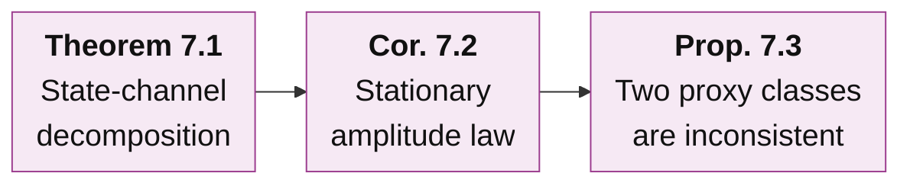
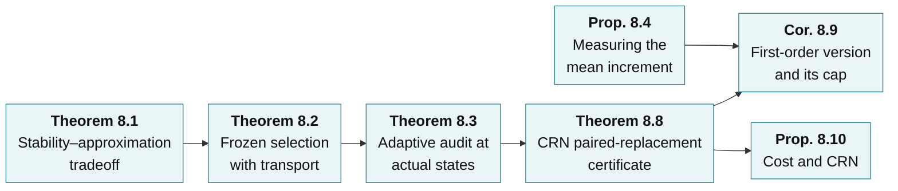
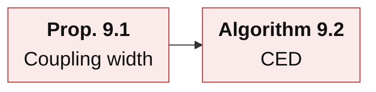

# Learner-Relative Experience Sufficiency for Agent Distillation — Theoretical Framework

[中文版](README_ZH.md)

**Question.** Relative to the declared deployment tasks, the permitted experiments and the actual learning procedure, which differences between feedback sources change the final task performance of a distilled student?

**Central results.**

- **Theorem A (§6, learner-relative information bound).** For any distiller (replay, rewriting and synthesis included), the smallest achievable first-order error is governed by the Fisher information that demonstrations and queries carry about one learner-dependent functional. Its gradient $`c=\sum_tJ_t^{*}g_t`$ combines the learner's Jacobian with the task's continuation gradients. Under identifiability and growth conditions, the bound is attained up to a constant factor by a regularized Elfving c-optimal query design. Hence the same demonstrations can be sufficient for one learner and insufficient for another.
- **Theorem B (§7, Adam's second-moment channel).** Under warm Adam, the first-order value of a message splits exactly into a parameter channel, a momentum channel and a second-moment channel. In a stationary regime the response to a message of relative magnitude $`\lambda`$ has an exact mean-field form. For small increments it is a concave quadratic that peaks at an explicit $`\lambda^*`$ and turns negative near $`2\lambda^*`$. Scores that look only at the parameter step, or only at directions, are therefore inconsistent rankers.
- **Theorem C (§8, auditable certificate).** A common-random-numbers (CRN) paired replacement of one training round measures the finite effect of a feedback law directly. The resulting certificate needs no continuation-value gradient and no curvature constant. Its radius has only a statistical term and a surrogate-calibration term.

These rest on foundations (§2–§5): an exact regret decomposition and the cost of acquiring missing information, the continuation response as the object of sufficiency, the complexity of sufficiency, and the statistic that each optimizer makes feedback carry. §9 derives the method, CED, from all of them.

**How to read this page.** The page goes from the whole to the parts, breadth first.

| Level | Content | After reading it you can answer |
|---|---|---|
| [Level 0](#level-0--one-paragraph) | One paragraph on the whole framework | What question the framework answers, and in which steps |
| [Level 1](#level-1--eight-sections) | The eight sections and how they connect | What each section asks, what it concludes, what it hands on |
| [Level 2](#level-2--the-main-results) | Plain-language account of each main result | What each result says, the intuition, its role in the chain |
| [Level 3](#level-3--statements-by-section) | Exact statements with derivation outlines | The precise assumptions and formulas, and how they are proved |

Notation is fixed in [§1](#1-setting-and-notation). Each of §2–§9 has a **proofs** page with complete derivations and an **experiments** page with the checks that test it: why each check is run, its setup, its result and why it supports the statement. All measured results are on the experiments pages; this page contains statements and illustrative examples only.

**Scope.** Every statement on this page is proved under the assumptions it states. A few are proved to leading order in an explicitly stated asymptotic regime, and the page says so where this happens. Proofs are finite-dimensional or carry explicit regularity assumptions. The checks on the experiments pages are exact finite computations or controlled small networks. Real-model tests of Theorems A–C are designed ([Remark 9.4](proofs/09_mechanism_and_method.md#s9-4)) but have not been run.

---

## Level 0 · One paragraph

To distill an agent we have a pretrained student, $`K`$ trusted teacher demonstrations per task family, a budget of further permitted experiments (teacher calls, environment branches, resets), and a fixed training recipe (optimizer, learning rate, number of steps). Many feedback sources can be fed to the student: the demonstrations themselves, replays, synthetic rewrites, new queries, different packagings of the same units. The framework asks which differences between these sources actually change the final task performance of the distilled student. It answers in eight steps.

1. **Can the data determine what to do? (§2)**
   - The student's regret splits exactly into a representation term, an information term and an algorithm term.
   - An information gap can be closed only by new experiments, never by replay or rewriting, and even an everywhere-optimal teacher can leave one.
   - Closing it costs on the order of $`\log(1/\delta)/\Delta^2`$ queries, and demonstrations and queries draw on one information budget.
2. **What does feedback do to the learner? (§3)**
   - Teacher quality, policy value and the mean gradient do not determine what the student learns.
   - The invariant is the *continuation response*: the expected final return after receiving one message, applying the actual update and finishing training.
3. **How much must two sources agree on? (§4)**
   - Exactly the span of the response class. For averaging learners this is a moment order set by the deployment length.
   - Approximate complexity can be much smaller than the exact order, and nonlinear updates multiply the order.
4. **What does the actual optimizer make feedback carry? (§5)**
   - To first order, what matters is the mean increment of the *complete learner state* (parameters and optimizer state). This first-order representation is a tool, not a claim of novelty.
   - The statistic is explicit for SGD, momentum, cold and warm Adam, clipping, Lion and LoRA. For warm Adam the exact statistic is the mean Adam increment, and the familiar (mean, second moment) description holds only under a frozen-denominator approximation with an explicit error.
   - An Adam coordinate's warmth falls like $`1/(\beta_2s)`$ only early in training; it levels off at $`(1-\beta_2)/\beta_2`$.
5. **How much information is needed, and in which direction? (Theorem A, §6)**
   - The learner decides the direction $`c`$ in which the data must be informative. The minimax error of any distiller is the learner-relative information norm, up to a constant.
   - Consequences: replay has zero value against aliasing, demonstrations and queries trade at a learner-relative exchange rate, queries are allocated by water-filling, and SGD and Adam can need very different data for the same task.
6. **How does a message act through Adam's second moment? (Theorem B, §7)**
   - A message also changes all later step sizes through $`v`$.
   - This gives an amplitude law with an optimal magnitude and, for small increments, a sign change near twice that magnitude. Parameter-only and cosine scores misrank in an explicit region.
7. **How can finite measurements certify a choice? (Theorem C and §8)**
   - Finite audits need a coverage (transport) term, and full-tail audits at the actual states are safe but expensive.
   - First-order scores need the continuation gradient, and they certify a pair only when its first-order term exceeds the second-order remainder; pairs whose mean increments agree along the gradient are never certified.
   - CRN paired replacement measures the finite effect directly. Two problems remain open: a provable range much smaller than the a-priori one, and a testable condition for transferring the surrogate calibration.
8. **The method (§9).**
   - A mechanism test with a strict null (coupling width).
   - Consequence-Calibrated Experience Distillation (CED): acquire by learner-relative design, select by certified measured consequence, match the learner's statistic, account for coverage, freeze and then test transfer.

---

## Level 1 · Eight sections



Arrows show the main flow of the argument. Further dependencies:

- §2 fixes the acquisition budget used by Theorem A (§6).
- §3 supplies the continuation decomposition used throughout §8.
- §4 supplies the approximation width and the coefficient stability used by §8.
- §5 supplies the statistic that §8 measures.

### §2 · Feasibility and acquisition

**Question.** Within the policies the student can execute, can the available data determine what to do, and what does it cost to acquire what is missing?

**Conclusion.**

- The student's regret against the best reference policy splits exactly into representation error, information error and algorithm error. All three are nonnegative, and none can substitute for another.
- The information error is zero if and only if all environments consistent with the data share an optimal policy. No environment-independent post-processing of the data (replay, rewriting, synthesis) can reduce it.
- Even a teacher that is optimal in every environment can leave an information gap. Active experiments such as reset queries close it, at a cost of order $`\log(1/\delta)/\Delta^2`$; this order is both sufficient and necessary. Compiling the acquired fact into the student is a separate, much smaller cost.
- In a hidden-fact model, the information left after $`K`$ demonstrations is explicit, the optimal hard-budget query rule is greedy by weight, and demonstrations and adaptive queries satisfy one linear information-budget inequality.

**Hand-off.** Missing facts must be acquired. What a learner makes of the information is the question of §3, and how much information a *specific* learner needs is answered by Theorem A in §6.

### §3 · Learning consequence

**Question.** Given a feedback source, what will the student actually learn, and what should be compared when two sources are compared?

**Conclusion.**

- Static measures are not enough. Two sources can have equally good teachers and give every student the same policy value, yet distill different students.
- Two label packets can have equal marginals and equal mean gradients, yet different learning values, with the sign of the difference reversing on another task.
- The right object is the continuation response: the expected final task return after receiving message $`y`$, applying the actual update and finishing training under the reference recipe.
- The gap over a whole run is exactly a sum over rounds of one-boundary replacement effects. Two message laws are interchangeable if and only if they have equal expectation under every response.
- When guarantees hold only on part of the state space, the probability of leaving that part is paid once, not once per round.

**Hand-off.** The object of sufficiency is the response class $`\mathcal G`$. §4 measures its complexity, §5–§7 compute it for real optimizers, and §8 checks it with finite data.

### §4 · Complexity of sufficiency

**Question.** How many statistics must two feedback sources agree on to be equivalent for learning?

**Conclusion.**

- When equivalence is judged by the means of a set of features, exact sufficiency holds if and only if every response lies in their span. The number of statistics needed is the dimension of the span of the response class.
- Approximately, the worst-case error is twice the best uniform approximation error of the responses by the features. An unrestricted learner needs the whole distribution.
- For learners that average independent experience blocks and for deployments with at most $`N`$ decisions, exactly the moments up to order $`N`$ are needed, and every order is necessary.
- The gap decays with the number of *independent* blocks at a rate set by the first unmatched cumulant, independently of the number of training rounds. Replay and deterministic synthesis do not make it decay.
- Approximate complexity can be far below the exact order (about $`\sqrt N`$ for smooth values), with parity-type values as the exception.
- Composing nonlinear updates multiplies the required order.

**Hand-off.** What must match is decided by the learner itself, so the actual optimizer must be modelled (§5). In approximations the stability of the coefficients matters (§8).

### §5 · Optimizer state and the first-order representation

**Question.** What must feedback carry for the learners actually in use: SGD, momentum, Adam/AdamW, clipping, Lion, LoRA?

**Conclusion.**

- Write any stateful first-order optimizer as a map from a consumed gradient to an increment of the complete learner state. To first order, the effect of a feedback law on the training outcome is the inner product between the continuation-value gradient and the mean complete-state increment.
- Higher orders correspond to higher moments of the increment. This expansion is a standard Taylor-plus-telescoping computation, in the same family as stochastic modified equations, TracIn and metagradients, and it is used here as a tool.
- What is specific to each optimizer is the increment:
  - Cold-start Adam looks only at gradient signs in its first step, while its state keeps the magnitudes.
  - For warm Adam, the exact first-order statistic is the mean Adam increment. Under a frozen-denominator approximation it reduces to the mean and second moment of the gradient, with an error controlled coordinatewise by the coordinate's warmth.
  - Warmth falls like $`1/(\beta_2s)`$ only while $`s(1-\beta_2)\ll1`$, and then levels off at $`(1-\beta_2)/\beta_2`$, so the frozen-denominator error has a per-step floor.
  - Clipping makes the statistic the clipped mean. When clipping is active with probability $`p_{\rm act}`$, only the mean direction matters, up to an error at most $`c(1-p_{\rm act})`$.

**Hand-off.** The increment map tells us *what* a feedback law must carry. Theorem A (§6) asks how much information the data must hold about it, Theorem B (§7) follows a message through Adam's second moment, and §8 measures it.

### §6 · Theorem A: the learner-relative information bound

**Question.** Given $`K`$ demonstrations and $`n`$ permitted queries, how well can *any* distiller reproduce the first-order effect of the oracle feedback, and how should the queries be spent?

**Conclusion.**

- Let $`c=\sum_tJ_t^*g_t`$, which combines the learner's Jacobian $`J_t`$ (how the mean increment moves with the unknown environment parameter) with the task's continuation gradients $`g_t`$.
- The minimax error of any distiller is, up to a factor between $`1/4`$ and $`1`$, the learner-relative information norm: the largest ratio of $`c^\top h`$ to the Fisher information that demonstrations and queries carry in direction $`h`$.
- Asymptotically optimal queries follow an Elfving c-optimal design with target $`c`$, regularized so that every direction is eventually identified.
- Consequences:
  - directions the demonstrations cannot see make every amount of replay worthless;
  - one demonstration is worth a learner-relative number of queries;
  - in a state-coverage model, queries go by water-filling to states with high learner-relative weight and low teacher coverage;
  - SGD weights a state by the square of its visitation, while warm Adam in the frequent-visit regime weights it by the visitation itself, so Adam amplifies the student's long tail;
  - clipping makes the learner blind to gradient scale.

**Hand-off.** Theorem A says in which direction information is needed. For Adam that direction has a component through the second moment, which §7 analyses.

### §7 · Theorem B: Adam's second-moment channel

**Question.** How does one message act on the final outcome under warm Adam, and when does a larger gradient hurt?

**Conclusion.**

- A message's first-order value splits exactly into parameter, momentum and second-moment channels, with costates given by an explicit backward recursion.
- In a stationary mean-field regime the response to a message of relative magnitude $`\lambda`$ has an exact closed form:
  - for small increments it is a concave quadratic up to a proved relative error of order $`(1-\beta_2)\max\lbrace1,\lambda^2\rbrace`$, with optimum $`\lambda^*=(1-\beta_1^{T+1})/(\rho\,\omega_T)`$ and a sign change near $`2\lambda^*`$;
  - for large $`\lambda`$ the direct effect saturates while the suppression of later steps keeps accumulating; the limit is explicit, and when it is negative the response has a positive zero.
- Parameter-only scores and cosine scores therefore misrank message pairs in an explicit region. Under SGD the value would simply be linear in $`\lambda`$.

**Hand-off.** Where the second-moment channel dominates, increments are large relative to $`v`$, and first-order rankings fail; there one must measure finite replacements (§8).

### §8 · Verification and Theorem C

**Question.** With finitely many measurements, how can we prove that one feedback source is better than another, or select a good one?

**Conclusion.**

- An error in measuring a feature is amplified by that feature's coefficient; a fit with small residual and huge coefficients is not a proof.
- Selecting by discrepancies measured on a fixed set of audit cells requires an explicit coverage (transport) term. If training reaches uncovered states, the audit can read zero while the learning gap is 1.
- Paired full-tail experiments at the actual states, with selection by a lower confidence bound, never lose more than $`\delta`$ against the reference, but they need many paired replicas per candidate.
- The mean increment itself is cheap to estimate. A first-order score, however, needs the continuation gradient and the remainder constants. It certifies a pair only when the pair's first-order term exceeds the second-order remainder, so pairs whose mean increments agree along the gradient are never certified, however large their true gap.
- Theorem C replaces the gradient by a CRN paired replacement of one round. This is exact in expectation, has a radius with only a statistical term and a calibration term, and costs $`(M+1)r`$ surrogate tails per audited state.
- Open: a provable range much smaller than the a-priori one, and a testable calibration-transfer condition. Without them the strict certificate is valid but rarely decisive.

**Hand-off.** §9 assembles acquisition, selection and certification into a method.

### §9 · Mechanism and method

**Question.** What method follows, and which mechanism deserves a test of its own?

**Conclusion.**

- *Coupling width:* fixing each unit's marginal law and regrouping units into joint training packets changes nothing if and only if a packet's return is additive across units. One SGD step is the strict null.
- *CED (Consequence-Calibrated Experience Distillation):* record the complete learner state; acquire missing information by learner-relative design before compiling; select candidate feedback laws by CRN paired-replacement scores, calibrated against full-tail audits and with coverage accounted for; match the learner's statistic and control message magnitude relative to the running second moment; freeze the selector and then test transfer.
- Each design rule is a corollary of a cited statement.

---

## Level 2 · The main results

For each main result, three lines give what it says, the intuition, and its role in the chain. Exact statements are in [Level 3](#level-3--statements-by-section). In each graph an arrow A → B means that B's statement or proof uses A.

### §2 · Feasibility and acquisition — main results



**[Theorem 2.2](proofs/02_feasibility_and_acquisition.md#s2-2) · Regret decomposition and decision ambiguity**
- *What it says.* The student's expected regret is exactly the sum of a representation error (the student class cannot reach the reference optimum), an information error (the data cannot tell the possible environments apart) and an algorithm error (the learner does not use the data well); all three are nonnegative. The information error is zero if and only if, for almost every transcript, all environments consistent with it share an optimal policy.
- *Intuition.* The information error is what is lost even with perfect learning, because the data leave the right decision ambiguous.
- *Role.* It separates "not enough information" from "learned badly"; every later information result starts from it.

**[Proposition 2.3](proofs/02_feasibility_and_acquisition.md#s2-3) · Robust ambiguity duality**
- *What it says.* The best worst-case regret over a set of indistinguishable environments, minimized over policy mixtures, equals the largest Bayes information regret over priors on that set. It is zero exactly when one policy is optimal in all of them.
- *Intuition.* Indistinguishable worlds force the learner to hedge; the price of hedging is the value of a zero-sum game against the least favourable prior.
- *Role.* It gives the information error a computable minimax form and a certificate (a prior) for its size.

**[Proposition 2.4](proofs/02_feasibility_and_acquisition.md#s2-4) · Post-processing cannot reduce information regret**
- *What it says.* Any randomized transformation of the transcript that does not depend on the environment, such as replay, rewriting, paraphrasing or synthesis, can only raise the information error or leave it unchanged; adding data independent of the environment leaves it unchanged.
- *Intuition.* Processing data can make existing information easier to learn, which lowers the algorithm error, but it cannot create a missing fact.
- *Role.* It rules out generated data as a substitute for new experiments; it is generalized to a learner-relative statement in §6.

**[Theorem 2.6](proofs/02_feasibility_and_acquisition.md#s2-6) · Passive impossibility, active attainability**
- *What it says.* In a two-world family the teacher is optimal in both worlds and its demonstrations have the same law in both, yet the student's optimal policies are opposite. Every learner that sees only demonstrations loses at least $`\Delta`$ in one world. With reset queries, order $`\log(1/\delta)/\Delta^2`$ queries are necessary and sufficient, up to a constant factor.
- *Intuition.* A perfect demonstration shows what the teacher did, not what a student with different abilities should do; the student has to try.
- *Role.* It shows why the method needs an active acquisition step, and why demonstration quality is not information sufficiency.

**[Proposition 2.7](proofs/02_feasibility_and_acquisition.md#s2-7) · Compilation cost**
- *What it says.* Once the missing fact is acquired, turning it into the student takes a further $`O(\log(1/\delta_L))`$ compiled labels, independently of the gap $`\Delta`$.
- *Intuition.* Finding out what to do and teaching the student to do it are different problems with different costs.
- *Role.* It separates the acquisition budget (authentic queries) from the compilation budget (synthetic labels) in the accounting of the method.

**[Lemma 2.9](proofs/02_feasibility_and_acquisition.md#s2-9) · Demonstrations leak nothing about unrevealed bits**
- *What it says.* In the hidden-bit model, given everything observed, the bits that no demonstration revealed are still independent fair coins.
- *Intuition.* Demonstrations that reveal some facts by a mechanism independent of the facts carry no evidence about the rest.
- *Role.* It is the key step behind the exact information floor and the optimality of greedy querying.

**[Theorem 2.10](proofs/02_feasibility_and_acquisition.md#s2-10) · Few-shot information floor and optimal hard-budget querying**
- *What it says.* After $`K`$ demonstrations the information floor is $`\tfrac12\sum_jw_j(1-q_j)^K`$, where $`w_j`$ is how often context $`j`$ matters at deployment and $`q_j`$ is how often one demonstration reveals it. With a hard budget of $`n`$ queries, querying the heaviest unseen facts is optimal, and adapting to the revealed values does not help.
- *Intuition.* Each demonstration reveals a fact with some probability; what it leaves unrevealed must be queried, and the most valuable gaps first.
- *Role.* It puts $`K`$ into the theory and is the model case for the query allocation of §6.

**[Proposition 2.11](proofs/02_feasibility_and_acquisition.md#s2-11) · Demonstrations and queries share one information budget**
- *What it says.* To tell two worlds apart with error at most $`\delta`$, the KL information of the $`K`$ demonstrations plus the KL information per query times the expected number of queries must reach $`\mathrm{kl}(1-\delta,\delta)`$, for every adaptive query-and-stop rule.
- *Intuition.* Demonstrations and queries pay into the same account; informative demonstrations reduce the number of queries needed, and replays pay nothing.
- *Role.* It is the exchange rate between $`K`$ and the query budget; §6 makes the rate depend on the learner.

### §3 · Learning consequence — main results



**[Proposition 3.1](proofs/03_learning_consequence.md#s3-1) · Static value is not learning value**
- *What it says.* Two data sources can give every student in the class the same policy value and give the teacher the same value, yet distill students with returns $`\tfrac{43}{80}`$ and $`\tfrac{41}{80}`$. Two label packets can have the same marginals and the same mean gradient, yet learning values that differ by $`\eta^2/8`$, with the sign reversed on another task.
- *Intuition.* What is learned depends on how the data act on the student *through the update*, and on what the deployment rewards; how good the data look by themselves does not decide it.
- *Role.* It rules out teacher quality, policy value and the mean gradient as sufficiency criteria, and motivates the continuation response.

**[Theorem 3.2](proofs/03_learning_consequence.md#s3-2) · Continuation-response characterization**
- *What it says.* The gap between two training processes is exactly the sum over rounds of the effect of replacing that round's reference step by the alternative step, measured by the continuation value at the states the alternative actually visits. Two message laws are interchangeable for every one-boundary replacement if and only if they have the same expectation under every response. When the guarantee holds only on a certified part of the state space, the probability of leaving it is paid once, not once per round.
- *Intuition.* The response $`g(y)`$ answers "if this round feeds the student $`y`$ and training then continues as declared, what is the final score"; it builds in the update rule, the rest of training and the deployment task.
- *Role.* It fixes the object of sufficiency, the response class $`\mathcal G`$; §4 measures its size, §5–§7 its dependence on the optimizer, and §8 how to check it with finite data.

### §4 · Complexity of sufficiency — main results



**[Theorem 4.2](proofs/04_complexity_of_sufficiency.md#s4-2) · Sufficiency duality and transfer**
- *What it says.* Judge two feedback laws by the means of a fixed set of features. Equal feature means imply equal response means exactly when every response lies in the span of the features, so the number of statistics needed is $`\dim\mathrm{span}(\lbrace\mathbf 1\rbrace\cup\mathcal G)-1`$. Approximately, the worst unresolved gap is twice the best uniform approximation error of the responses by the features; a response written as features plus a small residual transfers feature-mean errors with its coefficient size. An unrestricted learner needs the whole distribution.
- *Intuition.* Equal feature means rule out differences only in the directions the features span; whatever part of a response lies outside that span is risk the interface cannot see.
- *Role.* It turns "how much information must match" into computable quantities, a span dimension or an approximation width, used by every later count in §4, §5 and §8.

**[Theorem 4.4](proofs/04_complexity_of_sufficiency.md#s4-4) · Affine learners: moment order is necessary and sufficient**
- *What it says.* For a student with binary-action contexts, deployments with at most $`N`$ decisions and learners that take convex averages of independent experience blocks, two sources are equivalent for every such task and learner exactly when their joint moments agree up to order $`N`$. Every order is necessary, the exact count on a grid is $`\binom{k+N}N-1`$, and on binary blocks fewer than $`2^k-1`$ statistics can leave a gap of 1.
- *Intuition.* The deployment value is a polynomial of degree $`N`$ in the student's action probabilities, and averaging turns its expectation into a combination of block moments of order at most $`N`$.
- *Role.* A fully computable instance of Theorem 4.2, showing that the information order is set by the deployment length.

**[Theorem 4.5](proofs/04_complexity_of_sufficiency.md#s4-5) · A round-independent bound and averaging rates**
- *What it says.* For convex-affine learners the learning gap is at most a coefficient mass times the largest moment mismatch, whatever the number of training rounds. When $`n`$ independent blocks are averaged, the gap decays as $`n^{-(r-1)}`$, where $`r`$ is the order of the first unmatched cumulant. Replaying one block, or training on deterministic rewrites of it, gives a gap that does not decay at all.
- *Intuition.* Only independent evidence shrinks the gap. Repetition and deterministic synthesis add exposure, not information.
- *Role.* It separates the number of independent blocks from the number of epochs. This counting discipline is used in §2 and in the method of §9.

**[Proposition 4.6](proofs/04_complexity_of_sufficiency.md#s4-6) · Exact order is not approximate complexity**
- *What it says.* For the value $`p^N`$, matching moments up to order about $`\sqrt{N\log(1/\varepsilon)}`$ brings the gap below $`\varepsilon`$, although exact equality needs order $`N`$. For parity, no polynomial of degree below $`N`$ approximates better than $`1/2`$.
- *Intuition.* Smooth responses have good low-order approximations; combinatorial responses do not.
- *Role.* It shows that the operative complexity is the approximation width, not the degree, and leads to the coefficient-stability question answered in §8.

**[Theorem 4.7](proofs/04_complexity_of_sufficiency.md#s4-7) · Update composition amplifies the information requirement**
- *What it says.* Composed polynomial updates can multiply the degree of the response in an early block by the degrees of all later updates, and the bound is attained. A threshold learner breaks first-moment sufficiency with a single decision. For one smooth SGD step, the difference between two feedback laws is a mean-gradient term plus a gradient-second-moment term plus a third-order remainder, and per-step errors add up linearly only under a stability condition.
- *Intuition.* The same data fed to different learners needs different amounts of information; what must match is a property of the learner composed with the task.
- *Role.* It shows that the actual optimizer must be modelled, which is the subject of §5.

### §5 · Optimizer state and the first-order representation — main results



**[Proposition 5.1](proofs/05_optimizer_state.md#s5-1) · Optimizer-transformed expansion**
- *What it says.* Write any stateful first-order optimizer, clipping included, as a map from a consumed gradient to an increment of the complete state (parameters, momentum, second moments, counter). The effect of two feedback laws on the training outcome is, to first order, the sum over rounds of the inner product between the continuation-value gradient and the difference of mean state increments; the remainder is controlled by second moments of the increment. Matching the mean increment in the directions of the continuation-value gradients is sufficient to first order, necessary where the first-order term exceeds the remainder, and the number of statistics is the dimension of the linearized response class.
- *Intuition.* Feedback affects the student only through the change of state it causes. To first order only the mean of that change matters, and only in the directions the continuation value cares about.
- *Role.* A tool, of the same kind as stochastic modified equations, TracIn and metagradients (Remark 5.2). Every later statement about what a learner makes the feedback carry, and Theorems A–C, are computed from it.

**[Proposition 5.3](proofs/05_optimizer_state.md#s5-3) · Cold-start Adam: sign quotient and optimizer memory**
- *What it says.* From a zero optimizer state, Adam's first step depends only on $`g_i/(\lvert g_i\rvert+\epsilon)`$. With $`\epsilon=0`$ the joint sign law must match (sign marginals are not enough); with $`\epsilon>0`$ the whole gradient law must. Momentum keeps the first gradient's magnitude, so two histories with the same signs can take second steps in opposite directions.
- *Intuition.* Adam's first step is almost sign descent: the magnitude is divided out of the step but kept in the optimizer state.
- *Role.* Shows that moment sufficiency does not transfer to Adam, and that what must match depends on the optimizer state.

**[Proposition 5.5](proofs/05_optimizer_state.md#s5-5) · The exact first-order statistic of Adam and the frozen-denominator error**
- *What it says.* For Adam the first-order statistic is the exact mean Adam increment, which is not determined by the mean and second moment of the gradient. Freezing the denominator at its retained value turns the step into preconditioned momentum SGD, with a per-coordinate error at most $`\eta u_i\min\lbrace\kappa_i/2,1\rbrace`$, where $`\kappa_i`$ is the warmth.
- *Intuition.* Adam divides by a running root-mean-square that the new gradient itself perturbs. When that perturbation is small (small warmth) the step is nearly linear in the gradient.
- *Role.* Separates the two approximations hidden in "warm Adam only needs $`(\mathbb E G,\mathbb E G^{\odot2})`$": the first-order expansion and the frozen denominator.

**[Proposition 5.6](proofs/05_optimizer_state.md#s5-6) · Warm Adam is first-order affine in the consumed gradient**
- *What it says.* At a warm state, the one-boundary response is an affine function of the consumed gradient plus an explicit residual: a frozen-denominator term, a second-moment sensitivity term, and a curvature term. Laws with equal mean consumed gradient differ by at most the expected residuals.
- *Intuition.* Once the second moment has accumulated, one Adam step behaves like one preconditioned momentum-SGD step.
- *Role.* Says from which point of training the affine and first-order theory applies to Adam, with a computable error.

**[Proposition 5.7](proofs/05_optimizer_state.md#s5-7) · Cold steps separate equal-mean feedback at first order**
- *What it says.* At a cold state two gradient laws with the same mean, or even with all moments below any fixed order equal, give responses that differ at first order in the learning rate.
- *Intuition.* A cold step sees signs relative to zero, and the sign probabilities are not functions of low-order moments.
- *Role.* The witness that the cold window is a genuine first-order effect, not a higher-order correction.

**[Proposition 5.8](proofs/05_optimizer_state.md#s5-8) · Evolution of warmth**
- *What it says.* With stationary gradients the mean-field warmth is exactly $`(1-\beta_2)/(\beta_2(1-\beta_2^s))`$ after $`s`$ absorbed evaluations. It falls like $`1/(\beta_2s)`$ only while $`s(1-\beta_2)\ll1`$, then levels off at $`(1-\beta_2)/\beta_2`$. Accumulated over a run, the warmth-controlled error is at most $`c\log(1+R/W)+c(1-\beta_2)R`$; bias correction does not change warmth; learning-rate-zero warm-up advances the second moment exactly like real steps.
- *Intuition.* A fixed $`\beta_2`$ means a fixed averaging window, so every new gradient keeps perturbing the denominator by a fixed relative amount.
- *Role.* Fixes how far into training the warm description is accurate, and shows it never becomes exact under a fixed $`\beta_2`$.

**[Proposition 5.9](proofs/05_optimizer_state.md#s5-9) · Partially active clipping**
- *What it says.* The mean clipped gradient splits exactly into an unclipped part and a clipped-direction part; replacing it by $`c`$ times the mean direction errs by at most $`c(1-p_{\rm act})`$, where $`p_{\rm act}`$ is the probability that clipping is active.
- *Intuition.* Only gradients below the threshold keep their magnitude; the rest contribute only their direction.
- *Role.* Makes the clipping statistic exact for any activation rate and quantifies the "only the direction matters" simplification.

**[Theorem 5.10](proofs/05_optimizer_state.md#s5-10) · The first-order statistic by learner**
- *What it says.* The statistic of Proposition 5.1 for common learners: SGD and momentum — the mean gradient; warm Adam — the exact mean Adam increment, equal to $`(\mathbb EG,\mathbb EG^{\odot2})`$ only under the frozen-denominator approximation, with the second moment entering through $`v`$; a cold Adam step — the sign law in the parameters; clipping — the clipped mean; Lion — flip probabilities; LoRA at $`B=0`$ — a rank-$`r`$ sketch, with $`A`$ fixed at step one.
- *Intuition.* Two feedback sources with the same mean gradient can still differ at first order under cold Adam, clipping, or warm Adam through the second-moment channel.
- *Role.* Tells the method what to match and measure under each training recipe, and feeds the learner Jacobian of Theorem A and the state channels of Theorem B.

### §6 · Theorem A: the learner-relative information bound — main results



**[Theorem 6.3](proofs/06_learner_relative_information.md#s6-3) · Learner-relative lower bound**
- *What it says.* No distiller, replay, rewriting and synthesis included, can match the oracle feedback's first-order effect on the declared task better than a quarter of the learner-relative information norm $`\mathfrak n_{K,n}`$. The norm measures how much the $`K`$ demonstrations and $`n`$ queries reveal about the environment in the one direction $`c`$ that the learner and the task care about.
- *Intuition.* Two environments that the data cannot tell apart, but that this learner would treat differently, force an error on one of them; what counts is the learner's sensitivity $`c`$, not the size of the environment difference.
- *Role.* It is the lower half of Theorem A and the quantitative core of "acquire before compiling"; the aliasing and exchange-rate corollaries follow from it.

**[Lemma 6.4](proofs/06_learner_relative_information.md#s6-4) · Design minimax equality**
- *What it says.* The best variance any query design can achieve for estimating the learner-relative functional equals the square of the information norm, and an optimal design exists. It is the c-optimal (Elfving) design whose target vector is the learner Jacobian applied to the continuation-value gradients.
- *Intuition.* The best way to spend queries is the one that is most informative about the single direction the learner will use; this is a classical design problem with a learner-specific target.
- *Role.* It turns the lower bound into an acquisition rule and makes the upper bound computable.

**[Theorem 6.5](proofs/06_learner_relative_information.md#s6-5) · Achievability**
- *What it says.* Estimating the environment with a (slightly regularized) c-optimal query design and emitting the oracle law at the estimate reaches error $`\mathfrak n_{K,n}(1+o(1))`$. Together with the lower bound, the best achievable first-order error is pinned between $`\mathfrak n_{K,n}/4`$ and $`\mathfrak n_{K,n}`$.
- *Intuition.* Once the information is collected in the right direction, a plug-in distiller loses at most a constant factor.
- *Role.* It is the upper half of Theorem A: the information norm is the right measure of how sufficient a batch of experience is for a given learner.

**[Corollary 6.7](proofs/06_learner_relative_information.md#s6-7) · Aliasing and the zero value of replay**
- *What it says.* If two environments give identical demonstration laws and the learner-relative functional differs between them, every distiller errs by at least half the difference, for every $`K`$; replay and rewriting cannot help.
- *Intuition.* More copies of the same evidence never separate worlds that the evidence cannot separate.
- *Role.* It is the learner-relative form of passive impossibility: whether demonstrations suffice depends on the learner.

**[Corollary 6.8](proofs/06_learner_relative_information.md#s6-8) · Exchange rate between demonstrations and queries**
- *What it says.* Demonstrations and queries enter one linear information budget direction by direction; at the binding direction one demonstration is worth a definite number of queries, and that number depends on the learner.
- *Intuition.* A demonstration and a query are both evidence; their relative value is how much each reveals in the direction this learner cares about.
- *Role.* It gives the trade-off between collecting more demonstrations and spending queries.

**[Proposition 6.10](proofs/06_learner_relative_information.md#s6-10) · Explicit information bound and water-filling**
- *What it says.* When demonstrations cover teacher states and training happens at student states, the error is governed by $`\sum_sW_s/N_s`$, with $`W_s`$ the learner-relative weight of state $`s`$ and $`N_s`$ its sample count. The optimal query allocation is water-filling, $`n_s^\star=(\sqrt{W_s/\lambda}-k_s)_+`$; a state with positive weight and no coverage leaves an irreducible error.
- *Intuition.* Queries should go where the learner is sensitive and the teacher has not been.
- *Role.* It makes Theorem A operational for agent distillation and gives the acquisition step of the method its allocation rule.

**[Proposition 6.11](proofs/06_learner_relative_information.md#s6-11) · Learner weights of SGD and warm Adam**
- *What it says.* For SGD the weight of a state grows like the square of its visitation; for warm Adam in the frequent regime it grows only linearly and includes a second-moment term; for very rare states Adam returns to the squared scaling but sees only the sign of the feedback.
- *Intuition.* Adam normalizes by the running second moment, so rarely visited states take steps as large as common ones; their feedback therefore matters more than under SGD.
- *Role.* It shows that the optimizer changes where information must be collected, and it supplies the constant $`\kappa_{\rm iso}`$ used again in §7.

**[Corollary 6.12](proofs/06_learner_relative_information.md#s6-12) · Learner separations**
- *What it says.* Demonstrations that reveal a feedback direction but not its scale are sufficient for an always-clipped learner and insufficient, for every $`K`$, for SGD. Quantitatively, a long tail of rarely covered states costs warm Adam far more information than SGD.
- *Intuition.* What a learner ignores, it does not need to be told; what it amplifies, it needs to be told precisely.
- *Role.* It is the formal content of "the same demonstrations can be sufficient for one learner and not for another".

### §7 · Theorem B: Adam's second-moment channel — main results



**[Theorem 7.1](proofs/07_second_moment_channel.md#s7-1) · State-channel decomposition**
- *What it says.* For Adam/AdamW (bias correction, decoupled weight decay, $`\epsilon`$ and global-norm clipping included), the gradient of the continuation value with respect to $`(\theta,m,v)`$ is given by an explicit reverse costate recursion. The first-order value of a message then splits exactly into a parameter channel, a momentum channel and a second-moment channel. The last depends on the message only through $`g\odot g`$.
- *Intuition.* A message changes not only the current step but also the running second moment, and through it every later step size. The second-moment channel is the price or benefit of that change.
- *Role.* Makes the optimizer-state part of [Proposition 5.1](proofs/05_optimizer_state.md#s5-1) computable for Adam. It is the object behind the amplitude law (Corollary 7.2) and the failure of parameter-only influence scores (Proposition 7.3).

**[Corollary 7.2](proofs/07_second_moment_channel.md#s7-2) · Stationary amplitude law**
- *What it says.* At a warm stationary state, the mean-field response to a same-direction message of amplitude $`\lambda`$ (in units of the running RMS) is an explicit finite sum, valid for every $`\lambda`$.
  - For small increments it is a concave quadratic with optimum $`\lambda^\star=(1-\beta_1^{T+1})/(\rho\,\omega_T)`$ and sign change near $`2\lambda^\star`$, with an explicit error bound.
  - For very large amplitudes the direct effect saturates. A large message ends up worse than no message exactly when the signal-to-noise ratio $`\rho`$ exceeds $`\kappa_{\rm iso}(T)/\Lambda(T)`$.
- *Intuition.* A big gradient inflates $`v`$ and so shrinks the following steps; beyond some size the shrinkage costs more than the big step gains. Under SGD there is no such effect: bigger is always better.
- *Role.* The first quantitative statement that, under Adam, the value of a message is non-monotone in its magnitude. It tells the method to control message magnitude relative to the running second moment, and it predicts where linearized scores mislead.

**[Proposition 7.3](proofs/07_second_moment_channel.md#s7-3) · Inconsistency of two proxy classes**
- *What it says.* A statistic that ignores the deployment task cannot rank feedback laws correctly for every task. In the regime of Corollary 7.2, parameter-only first-order scores rank two same-direction messages in the wrong order. Examples are TracIn-style scores with Adam steps and fixed-state Adam data Shapley. Cosine scores (LESS-type) cannot separate the two messages at all.
- *Intuition.* The parameter-only score sees the bigger immediate step and misses the damage done through $`v`$; the cosine sees only direction, and the two messages point the same way.
- *Role.* A proof, not just an empirical observation, that two widely used families of influence scores are not consistent rankers under Adam. It is the reason the method selects by measured consequence.

### §8 · Verification and Theorem C — main results



**[Theorem 8.1](proofs/08_verification.md#s8-1) · Stability–approximation tradeoff**
- *What it says.* When each feature mean is known only up to a tolerance, the largest response difference that cannot be ruled out equals the best tradeoff between how well the features approximate the response and how large the coefficients of that approximation are, each coefficient weighted by its feature's tolerance.
- *Intuition.* The cost of measuring a feature imprecisely is its coefficient in the response model. A fit with a small residual and huge coefficients proves nothing.
- *Role.* It decides which features an audit should measure and which response models are acceptable as certificates; the frozen audit of Theorem 8.2 and the method's fitting rule use it.

**[Theorem 8.2](proofs/08_verification.md#s8-2) · Frozen finite-interface selection with transport**
- *What it says.* Fix audit cells and features in advance, measure each candidate's feature discrepancy from the reference, and select the smallest. The selected candidate's learning gap is bounded by the measured discrepancy plus statistical error plus an explicit transport term for the states training actually visits, plus the probability of leaving the certified states. The transport term cannot be dropped.
- *Intuition.* An audit sees only the states it covers. If training goes elsewhere, the audit can report zero discrepancy while the learning gap is maximal.
- *Role.* It gives the correct form of any finite, frozen audit and identifies its blind spot, which the actual-state audits of Theorems 8.3 and 8.8 avoid.

**[Theorem 8.3](proofs/08_verification.md#s8-3) · Actual-state adaptive audit; fidelity versus improvement**
- *What it says.* At the states training actually reaches, run paired full-tail experiments for each candidate against the reference and select by a lower confidence bound. The resulting training procedure is never worse than the reference by more than the confidence level, and it keeps the certified improvement. The required number of paired replicas is explicit and large.
- *Intuition.* It measures directly whether replacing this one round helps, with no extrapolation to unseen states; the price is many full training tails.
- *Role.* It is the reliable but expensive reference audit, used to calibrate cheaper measurements such as the surrogate of Theorem 8.8.

**[Proposition 8.4](proofs/08_verification.md#s8-4) · Measuring the mean increment at the actual states**
- *What it says.* The mean optimizer increment of a feedback law can be estimated from gradient evaluations alone, with an error that falls like one over the square root of the sample size in the Hilbert norm. Combined with the continuation's gradient norm and curvature, this bounds the one-round effect and, along sampled runs, the whole-run gap.
- *Intuition.* The data side of a first-order certificate is cheap; the continuation side (its gradient and curvature) is not measured by these samples at all.
- *Role.* It is the cheap half of first-order auditing and explains why first-order audits still need calibration constants.

**[Theorem 8.8](proofs/08_verification.md#s8-8) · CRN paired-replacement certificate (Theorem C)**
- *What it says.* At an audited state, give each candidate one round and then run the same surrogate tail with the same random numbers for every candidate. The mean paired score difference estimates the finite effect of the replacement without bias, and an empirical Bernstein radius plus a surrogate-calibration term turns it into a certificate that holds for all candidate pairs at once.
- *Intuition.* Instead of linearizing and then bounding the error of the linearization, measure the finite effect directly; sharing the random numbers cancels the tail noise that two independent runs would add.
- *Role.* It replaces the oracle continuation gradient by a measurement, and it is the selection step of the method. Its rigor rests on a known score range and a calibrated surrogate, which are the open problems of Remark 8.12.

**[Corollary 8.9](proofs/08_verification.md#s8-9) · The first-order version, its margin criterion, and its cap**
- *What it says.* A first-order score ranks two candidates correctly whenever their first-order difference exceeds the second-order remainder. Measured by finite differences, the first-order certificate pays a finite-difference term and the remainder on top of the statistical radius, and it can never certify a pair whose first-order term is below the remainder, whatever the true gap.
- *Intuition.* Candidates that differ mainly through second moments of their increments, as under Adam, are invisible to any first-order certificate.
- *Role.* It marks where gradient-based scores are trustworthy and why Theorem 8.8 measures finite replacement instead; it also separates oracle diagnostics from measurable certificates.

**[Proposition 8.10](proofs/08_verification.md#s8-10) · Cost, and what common random numbers buy**
- *What it says.* The certificate costs one surrogate tail per candidate and replica. Its range term needs on the order of a hundred replicas to be small, and common random numbers reduce the variance of each paired score to the size of the difference between the two candidates' increments.
- *Intuition.* Paired tails with shared randomness differ only because the candidates differ; independent tails also differ because training is noisy.
- *Role.* It sets the replica budget of the method and points to the pathwise Lipschitz bound as the route to a provable range.

### §9 · Mechanism and method — main results



**[Proposition 9.1](proofs/09_mechanism_and_method.md#s9-1) · Coupling width**
- *What it says.* Fix the marginal law of each feedback unit and change only how units are grouped into joint training packets. Every such regrouping leaves the learning outcome unchanged exactly when the joint-packet response is a sum of per-unit contributions; otherwise the change is at most twice the distance of the response from additive tables. One SGD step at a common parameter is exactly invariant to regrouping; sequential steps are not.
- *Intuition.* If the learner "sees" each unit on its own, grouping is irrelevant. Grouping matters only through interactions between units, and those appear once one update feeds into the next.
- *Role.* A mechanism test with a strict null, and the reason a candidate feedback law is specified by the packets it emits, not by a bag of units.

**[Algorithm 9.2](proofs/09_mechanism_and_method.md#s9-2) · Consequence-Calibrated Experience Distillation (CED)**
- *What it says.* Record the complete optimizer state; acquire missing information first, spending queries where the learner-relative weight is high and teacher coverage is low; compile candidate feedback laws; record each candidate's learner statistic and flag messages that are too large relative to the running second moment; measure each candidate's consequence at the actual state by CRN paired replacement, calibrated against a few full-tail audits; select by lower confidence bound, re-audit, freeze, then test transfer. Each output is labelled with the guarantee it carries, or as empirical.
- *Intuition.* Choose feedback by what happens after this learner, in its current state, consumes it, not by how good the feedback looks on its own.
- *Role.* Where the framework lands: every step is a consequence of a statement in §2–§8, and the planned real-model tests R0–R3 test those steps.

**[Remark 9.3](proofs/09_mechanism_and_method.md#s9-3) · The six design rules**
- *What it says.* Acquire before compiling; select by measured consequence; match the learner's statistic, not the raw gradient; fit response models with stable coefficients; account for coverage, certify by paired replacement and use first-order audits only where the margin dominates; freeze, then test transfer. Each rule is a necessary condition for the corresponding guarantee and is derived from cited statements.
- *Intuition.* Each rule closes one way a method can claim more than it knows: inventing information, trusting a proxy, ignoring the optimizer, over-fitting a response model, extrapolating an audit, or tuning on the evaluation.
- *Role.* It explains why Algorithm 9.2 has the steps it has, and it is what an ablation of the method should remove one rule at a time.

---

## 1. Setting and notation

The objects below are used by every section. Section-specific definitions are numbered within their section.

<a id="s1-1"></a>

**Definition 1.1 (Environment, student class, reference class).**

- An environment $`E`$ comprises a task distribution, transitions, feedback semantics, scoring and a fixed execution harness. All returns lie in $`[0,1]`$, and $`J_E(\pi)`$ is the expected return of policy $`\pi`$.
- The student's deployable policies form a class $`\Pi\subseteq\Pi_{\rm ref}`$, where $`\Pi_{\rm ref}`$ is a reference class (for example, the policies the teacher could execute). Write

```math
J_E^\Pi=\max_{\pi\in\Pi}J_E(\pi),\qquad J_E^{\rm ref}=\max_{\pi\in\Pi_{\rm ref}}J_E(\pi).
```

<a id="s1-2"></a>

**Definition 1.2 (Information and distillers).**

- $`I_0`$ is the common initial information: the pretrained student, the known rules, and the $`K`$ trusted demonstrations per task family. The teacher model's pretrained knowledge is part of $`I_0`$; it is the same in every environment of a family.
- $`D`$ is the transcript of all further information obtained from permitted experiments: teacher calls on new states, environment branches, resets. A new teacher call that observes a new state is an experiment, i.e. part of $`D`$.
- A *distiller* is any measurable map from $`(I_0,D)`$ and private randomness (independent of the environment) to a feedback protocol (Definition 1.3). Replay, rewriting and synthesis are distillers. They obtain nothing beyond $`(I_0,D)`$ that depends on the environment.

<a id="s1-3"></a>

**Definition 1.3 (Complete learner state, feedback law, update).**

- The *complete learner state* is $`z=(\theta,o)\in\mathcal Z`$. Here $`\theta`$ is the parameter vector and $`o`$ is the optimizer state (for Adam, the moments $`m,v`$ and the step counter), together with buffers, sampler state and the history that the update uses. $`\mathcal Z`$ is a real Hilbert space with inner product $`\langle\cdot,\cdot\rangle`$, Euclidean in finite dimension.
- At round $`t`$ a *feedback law* $`P_t(\cdot\mid z)`$ emits a message $`Y_t`$. The message yields a *consumed gradient* $`G_t(z,Y_t)`$, defined after accumulation, normalization and any clipping that the stated optimizer includes. The actual update is $`Z_{t+1}=U_t(z,Y_t,\xi_t)`$, with update randomness $`\xi_t`$.
- For a first-order optimizer, $`U_t(z,y,\xi)=z+\Delta_t\big(z,G_t(z,y,\xi)\big)`$. The *increment map* $`\Delta_t`$ contains the learning-rate schedule, momentum, second moments, weight decay and clipping. The *mean increment* of a law $`P`$ is

```math
\mu^P_t(z)=\mathbb E_{Y\sim P_t(\cdot\mid z)}\,\Delta_t\big(z,G_t(z,Y)\big).
```

- A *protocol* $`S`$ is a sequence of feedback laws $`(P^S_t)_{t<R}`$. Integrating $`\xi_t`$ gives its learning kernel $`K^S_t`$. The reference protocol is written $`K^0_t`$. All protocols start from the same initial state law.
- The final student is scored by $`F_E(z)=J_E(\pi_z)\in[0,1]`$, and $`L_E(S)=\mathbb E\,F_E(Z^S_R)`$. For a protocol that uses a single law $`P`$ in every round we write $`L(P)`$.

<a id="s1-4"></a>

**Definition 1.4 (Continuation value, response, declared class).**

- The *continuation value* under the reference tail is

```math
V^0_R=F_E,\qquad V^0_t=K^0_tV^0_{t+1}\quad(t<R).
```

- $`V^0_{t+1}(z)`$ is the expected final score when training continues from state $`z`$ after round $`t`$ under the reference protocol. When the tail starts from a different protocol $`P`$ we write $`V^P_{t+1}`$.
- The *one-boundary response* of message $`y`$ at round $`t`$ and state $`z`$ is

```math
g_{t,z}(y)=\mathbb E_{\xi_t}\,V^0_{t+1}\big(U_t(z,y,\xi_t)\big).
```

- It is the expected final real-task return after receiving $`y`$, applying the actual update, and completing the declared reference tail.
- The *declared class* $`\mathcal V`$ collects the continuation values of the declared deployment tasks and reference tails. The *response class* $`\mathcal G`$ collects the corresponding responses. Both are fixed before any feedback is selected.

<a id="s1-5"></a>

**Definition 1.5 (Counts).** The following counts are never conflated.

| Symbol | Meaning |
|---|---|
| $`K`$ | trusted demonstrations per task family |
| $`n_{\rm query}`$, or $`n`$ in §6 | further permitted experiments (queries) |
| $`n`$ in §4 | independent experience blocks |
| $`R`$ | training updates |
| $`N`$ | decisions in one deployment episode |
| $`d`$ | linear statistics (features) |
| $`r`$, $`M`$ in §8 | CRN replicas per audited state, number of candidate feedback laws |

Replaying one block $`n`$ times is not $`n`$ independent blocks.

**Conventions.**

- Statements are numbered by section with one shared counter (Definition 5.4 is followed by Proposition 5.5).
- *Theorem A* denotes Theorems 6.3 and 6.5, *Theorem B* Theorem 7.1 and Corollary 7.2, and *Theorem C* Theorem 8.8.
- Where a letter is reused locally, the section says so on first use; for example, $`s`$ counts absorbed gradient evaluations in §5 and denotes an agent state in §6.

---

## Level 3 · Statements by section

Each statement carries its number from the proofs page, its exact form, a derivation outline, its dependencies, and links to the proof and to the checks that test it.

### §2 · Feasibility and acquisition — exact statements

[Proofs](proofs/02_feasibility_and_acquisition.md) · [Experiments](experiments/02_feasibility_and_acquisition.md)

**What this section does.**

- It asks whether the available data can determine what the student should do, separately from whether the student learns well ([Theorem 2.2](proofs/02_feasibility_and_acquisition.md#s2-2)).
- It shows that no processing of existing data can supply a missing fact ([Proposition 2.4](proofs/02_feasibility_and_acquisition.md#s2-4)), and that even optimal teacher demonstrations can leave one ([Theorem 2.6](proofs/02_feasibility_and_acquisition.md#s2-6)).
- It prices the missing information: active queries at order $`\Delta^{-2}\log(1/\delta)`$, compilation separately ([Proposition 2.7](proofs/02_feasibility_and_acquisition.md#s2-7)).
- It makes the number $`K`$ of demonstrations explicit and shows that demonstrations and queries share one information budget ([Theorem 2.10](proofs/02_feasibility_and_acquisition.md#s2-10), [Proposition 2.11](proofs/02_feasibility_and_acquisition.md#s2-11)).

**Setting ([Definition 2.1](proofs/02_feasibility_and_acquisition.md#s2-1)).** A finite set $`\mathcal E`$ of environments carries a prior conditional on the common initial information $`I_0`$. The student class $`\Pi`$ sits inside a reference class $`\Pi_{\rm ref}`$, with values $`J_E(\pi)\in[0,1]`$. The transcript $`D`$ contains every experiment the learner may run, and the learner outputs $`\widehat\pi\sim\lambda(\cdot\mid D)`$. Write $`J_E^\Pi=\max_{\pi\in\Pi}J_E(\pi)`$, $`J_E^{\rm ref}=\max_{\pi\in\Pi_{\rm ref}}J_E(\pi)`$, and let $`B(D)=\max_{\pi\in\Pi}\mathbb E[J_E(\pi)\mid D]`$ be the Bayes value.

#### Theorem 2.2 · Regret decomposition and decision ambiguity

**(a)** For any learner,

```math
\mathbb E[J_E^{\rm ref}-J_E(\widehat\pi)]=\underbrace{\mathbb E[J_E^{\rm ref}-J_E^\Pi]}_{\mathcal R_{\rm rep}}+\underbrace{\mathbb E J_E^\Pi-\mathbb E_D B(D)}_{\mathcal R_{\rm info}}+\underbrace{\mathbb E_D\big[B(D)-\mathbb E[J_E(\widehat\pi)\mid D]\big]}_{\mathcal R_{\rm alg}},
```

and all three terms are nonnegative.

**(b)** $`\mathcal R_{\rm info}=0`$ if and only if, for every transcript $`D`$ of positive probability, the environments of positive posterior probability share an optimal policy: $`\bigcap_{E:\mu(E\mid D)>0}\arg\max_{\pi\in\Pi}J_E(\pi)\neq\varnothing`$.

*Derivation outline.*

- The identity follows by adding and subtracting $`\mathbb EJ_E^\Pi`$ and $`\mathbb E_DB(D)`$.
- The representation term is nonnegative because $`\Pi\subseteq\Pi_{\rm ref}`$. The information term is nonnegative because $`\mathbb E[J_E(\pi)\mid D]\le\mathbb E[J_E^\Pi\mid D]`$ for every policy. The algorithm term is nonnegative because, given $`D`$, the learner's output is a convex combination of policies and cannot beat the best of them.
- For (b), $`\mathcal R_{\rm info}`$ is a sum over transcripts of nonnegative brackets $`\sum_E\mu(E\mid D)(J_E^\Pi-J_E(\pi_D))`$; a bracket vanishes exactly when a posterior-optimal policy is optimal in every environment of positive posterior probability.

*Uses* [Definition 2.1](proofs/02_feasibility_and_acquisition.md#s2-1). *Used by* [Theorem 2.6](proofs/02_feasibility_and_acquisition.md#s2-6), [Theorem 2.10](proofs/02_feasibility_and_acquisition.md#s2-10), [Proposition 3.1](proofs/03_learning_consequence.md#s3-1), [Remark 9.3](proofs/09_mechanism_and_method.md#s9-3).

[Proof](proofs/02_feasibility_and_acquisition.md#s2-2) · [Experiments](experiments/02_feasibility_and_acquisition.md#c2-1) · proved

#### Proposition 2.3 · Robust ambiguity duality

For a finite class $`C`$ of environments,

```math
r(C)=\min_{\rho\in\Delta(\Pi)}\max_{E\in C}\big[J_E^\Pi-\mathbb E_{\pi\sim\rho}J_E(\pi)\big]=\max_{\mu\in\Delta(C)}\Big[\sum_E\mu_EJ_E^\Pi-\max_{\pi\in\Pi}\sum_E\mu_EJ_E(\pi)\Big].
```

If no allowed experiment distinguishes the members of $`C`$, every learner has worst-case expected regret at least $`r(C)`$ on $`C`$, and the minimax mixture attains it; $`r(C)=0`$ if and only if some policy is optimal in every $`E\in C`$.

*Derivation outline.*

- The regret matrix $`M_{E,\pi}=J_E^\Pi-J_E(\pi)`$ defines a finite zero-sum game: the learner picks a mixture of policies, the adversary a prior over $`C`$.
- Von Neumann's minimax theorem exchanges min and max; the inner minimum is attained at a pure policy, which gives the dual form.
- When the experiments cannot tell the members of $`C`$ apart, the learner's output law is the same in all of them, so its worst-case regret is at least the game value.

*Illustration.* Two environments prefer opposite policies, with regret matrix $`\begin{pmatrix}0&0.2\cr 0.2&0\end{pmatrix}`$. The minimax mixture is $`(\tfrac12,\tfrac12)`$ and the least favourable prior is $`(\tfrac12,\tfrac12)`$; both sides equal $`0.1`$. This is a mixture-averaged regret: a sampled policy has regret 0 or 0.2.

*Uses* [Definition 2.1](proofs/02_feasibility_and_acquisition.md#s2-1). *Used by* [Theorem 2.6](proofs/02_feasibility_and_acquisition.md#s2-6) (an instance with $`r(C)=\Delta`$).

[Proof](proofs/02_feasibility_and_acquisition.md#s2-3) · [Experiments](experiments/02_feasibility_and_acquisition.md#c2-2) · proved

#### Proposition 2.4 · Post-processing cannot reduce information regret

If $`D'\sim\kappa(\cdot\mid D)`$ with a kernel $`\kappa`$ that does not depend on $`E`$, then $`\mathbb E\max_\pi\mathbb E[J_E(\pi)\mid D']\le\mathbb E\max_\pi\mathbb E[J_E(\pi)\mid D]`$, that is, $`\mathcal R_{\rm info}(D')\ge\mathcal R_{\rm info}(D)`$. Adding to $`D`$ a variable $`Z`$ with $`Z\perp E\mid(D,I_0)`$ leaves $`B`$ and $`\mathcal R_{\rm info}`$ unchanged.

*Derivation outline.*

- Because $`E\to D\to D'`$ is a Markov chain, $`\mathbb E[J_E(\pi)\mid D']=\mathbb E\big[\mathbb E[J_E(\pi)\mid D]\,\big|\,D'\big]`$.
- A maximum of conditional expectations is at most the conditional expectation of the maximum, so the Bayes value under $`D'`$ is at most that under $`D`$.

*Illustration.* Replaying, paraphrasing or rewriting the $`K`$ demonstrations by an environment-independent procedure is such a $`\kappa`$. It can make the student fit the existing information better (lower $`\mathcal R_{\rm alg}`$) but cannot lower $`\mathcal R_{\rm info}`$.

*Uses* [Definition 2.1](proofs/02_feasibility_and_acquisition.md#s2-1). *Used by* [Theorem 2.6(a)](proofs/02_feasibility_and_acquisition.md#s2-6), [Theorem 2.10](proofs/02_feasibility_and_acquisition.md#s2-10) (replay adds zero), [Corollary 6.7](proofs/06_learner_relative_information.md#s6-7), [Remark 9.3](proofs/09_mechanism_and_method.md#s9-3).

[Proof](proofs/02_feasibility_and_acquisition.md#s2-4) · [Experiments](experiments/02_feasibility_and_acquisition.md#c2-1) · proved

#### Theorem 2.6 · Passive impossibility, active attainability

**Setting ([Definition 2.5](proofs/02_feasibility_and_acquisition.md#s2-5)).** An unknown sign $`v\in\lbrace -1,+1\rbrace`$ selects one of two worlds with known gap $`0<\Delta\le1/8`$. A uniform hidden state $`s\in\lbrace0,1\rbrace`$ is visible to the teacher but not to the aliased student, who plays action $`A`$ with probability $`p`$. The teacher plays the action that succeeds with probability 1 in each state, so it is optimal in both worlds; the student's value is $`J_v(p)=\tfrac34+v\Delta(2p-1)`$, so its optimal action depends on $`v`$. Under the query interface the learner may reset to $`s=1`$, execute $`A`$ and observe the outcome, adaptively, with a stopping time $`N`$.

- **(a)** Every learner that sees only demonstrations (and post-processing of them) has $`\max_v\mathbb E[J_v^\Pi-J_v(\widehat p)]\ge\Delta`$.
- **(b)** If, in each world, the learner outputs a student with regret at most $`\Delta/2`$ with probability at least $`1-\delta`$, then

```math
\mathbb E_vN\ge\frac{\mathrm{kl}(1-\delta,\delta)}{\mathrm{kl}(\tfrac12+2\Delta,\tfrac12-2\Delta)}\ge\frac{\mathrm{kl}(1-\delta,\delta)}{64\Delta^2}.
```

- **(c)** $`\lceil\log(1/\delta)/(8\Delta^2)\rceil`$ queries suffice.

*Derivation outline.*

- (a) In both worlds a demonstration is, with probability one half each, "choose $`A`$ at $`s=0`$ and succeed" or "choose $`B`$ at $`s=1`$ and succeed", so the law of the demonstrations and of the learner's output does not depend on $`v`$. The value is affine in $`p`$; the two regrets are $`2\Delta(1-m)`$ and $`2\Delta m`$ with $`m`$ the mean output, and their maximum is at least their average $`\Delta`$.
- (b) Reduce "$`\Delta/2`$-optimal in both worlds" to a binary test of the event $`\lbrace\widehat p>1/2\rbrace`$. With a stopping time, Wald's identity makes the KL divergence of the whole transcript equal to the expected number of queries times the KL of one query, and data processing makes it at least $`\mathrm{kl}(1-\delta,\delta)`$. The constant 64 comes from $`\mathrm{kl}(\tfrac12+u,\tfrac12-u)\le16u^2`$.
- (c) Average independent query outcomes and apply the one-sided Hoeffding inequality.

*Uses* [Theorem 2.2](proofs/02_feasibility_and_acquisition.md#s2-2), [Propositions 2.3–2.4](proofs/02_feasibility_and_acquisition.md#s2-3). *Used by* [Theorem 2.10](proofs/02_feasibility_and_acquisition.md#s2-10), [Proposition 2.11](proofs/02_feasibility_and_acquisition.md#s2-11) (the change-of-measure technique), [Corollary 6.7](proofs/06_learner_relative_information.md#s6-7), [Remark 9.3](proofs/09_mechanism_and_method.md#s9-3).

[Proof](proofs/02_feasibility_and_acquisition.md#s2-6) · [Experiments](experiments/02_feasibility_and_acquisition.md#c2-3) · proved

#### Proposition 2.7 · Compilation cost

After the sign is estimated, generating $`m\ge\lceil32\log(2/\delta_L)\rceil`$ labels from the target $`q\in\lbrace\tfrac18,\tfrac78\rbrace`$ and fitting their frequency gives $`\lvert\widehat p-q\rvert\le\tfrac18`$ with probability at least $`1-\delta_L`$. The compiled student then has regret at most $`\Delta/2`$ with probability at least $`1-\delta-\delta_L`$.

*Derivation outline.* The empirical frequency of the compiled labels is controlled by the two-sided Hoeffding inequality, and a union bound combines the identification and compilation failures. The number of labels does not depend on $`\Delta`$.

*Illustration.* Identification costs authentic environment queries, order $`\Delta^{-2}\log(1/\delta)`$; compilation costs synthetic labels, order $`\log(1/\delta_L)`$. At small $`\Delta`$ almost the whole budget is acquisition, and the two must be accounted for separately.

*Uses* [Theorem 2.6](proofs/02_feasibility_and_acquisition.md#s2-6). *Used by* [Algorithm 9.2](proofs/09_mechanism_and_method.md#s9-2).

[Proof](proofs/02_feasibility_and_acquisition.md#s2-7) · [Experiments](experiments/02_feasibility_and_acquisition.md#c2-3) · proved

#### Lemma 2.9 and Theorem 2.10 · Hidden bits, the information floor and optimal querying

**Setting ([Definition 2.8](proofs/02_feasibility_and_acquisition.md#s2-8)).** Bits $`\Theta_1,\dots,\Theta_d`$ are independent and fair; context $`j`$ has deployment weight $`w_j`$ and correct decision $`\Theta_j`$. Each of the $`K`$ demonstrations reveals a random subset of bits, drawn independently of the bits, and reveals bit $`j`$ with probability $`q_j`$. A hard budget allows $`n`$ queries, each revealing one chosen bit. $`U_K`$ is the set of bits no demonstration revealed and $`M_K=\lvert U_K\rvert`$.

**[Lemma 2.9](proofs/02_feasibility_and_acquisition.md#s2-9).** Given the complete transcript, the unrevealed bits remain independent, fair and independent of the transcript.

**[Theorem 2.10](proofs/02_feasibility_and_acquisition.md#s2-10).**

- **(a)** After $`K`$ demonstrations without queries the minimum achievable regret is

```math
R_{\rm info}(K)=\tfrac12\textstyle\sum_jw_j(1-q_j)^K .
```

- **(b)** With $`n`$ queries, $`R_{\rm info}(K,n)=\tfrac12\,\mathbb E\big[\sum_{r>n}w_{(r)}\big]`$ over the sorted unseen weights; querying the heaviest unseen bits is optimal and value-adaptive querying gains nothing. In general $`\mathbb E[(M_K-n)_+]\ne(\mathbb EM_K-n)_+`$.

*Derivation outline.*

- *Lemma 2.9.* The only factor of the joint law that depends on the unrevealed bits is the constant $`2^{-d}`$.
- *(a)* Any action guesses an unrevealed bit correctly with probability one half, and revealed bits can be copied, so the conditional regret is half the weight of the unseen bits. Bit $`j`$ stays unrevealed in all $`K`$ independent demonstrations with probability $`(1-q_j)^K`$.
- *(b)* Induct on the remaining budget. After a query, Lemma 2.9 makes the remaining problem independent of the value found, so branching on values gains nothing, and the greedy choice of the heaviest unseen bit is optimal at every step. Since $`x\mapsto(x-n)_+`$ is convex, Jensen's inequality orders the two expressions, strictly in small examples.

*Illustration.* With $`d=8`$ equally weighted contexts, each demonstration revealing one of them uniformly, the floor is $`\tfrac12(7/8)^K`$: a fact keeps escaping the demonstrations with probability $`(7/8)^K`$, and a targeted query removes one unseen fact for sure, whereas one more demonstration removes each unseen fact only with probability $`1/8`$.

*Uses* [Theorem 2.2](proofs/02_feasibility_and_acquisition.md#s2-2), [Proposition 2.4](proofs/02_feasibility_and_acquisition.md#s2-4). *Used by* [Proposition 6.10](proofs/06_learner_relative_information.md#s6-10) (the learner-relative coverage model), [Algorithm 9.2](proofs/09_mechanism_and_method.md#s9-2).

[Proof](proofs/02_feasibility_and_acquisition.md#s2-10) · [Experiments](experiments/02_feasibility_and_acquisition.md#c2-4) · proved

#### Proposition 2.11 · Demonstrations and queries share one information budget

In two-world adaptive acquisition with $`K`$ IID demonstrations of KL information at most $`\kappa_D`$ each, queries of KL information at most $`\kappa_X`$ each given any history, a world-independent query-and-stop rule with $`N\le N_{\max}`$, and final error at most $`\delta<\tfrac12`$ in each world,

```math
K\kappa_D+\kappa_X\,\mathbb E_vN\ge\mathrm{kl}(1-\delta,\delta).
```

If $`\kappa_X=0`$ and $`K\kappa_D<\mathrm{kl}(1-\delta,\delta)`$, no query budget suffices.

*Derivation outline.* The query-selection, stopping and randomization kernels are the same in both worlds and cancel in the likelihood ratio, leaving the demonstration terms and the query-outcome terms. In expectation the former are at most $`K\kappa_D`$ and the latter at most $`\kappa_X\,\mathbb EN`$; the data-processing inequality requires their sum to be at least $`\mathrm{kl}(1-\delta,\delta)`$.

*Uses* [Theorem 2.6](proofs/02_feasibility_and_acquisition.md#s2-6) (the technique). *Used by* [Corollary 6.8](proofs/06_learner_relative_information.md#s6-8).

[Proof](proofs/02_feasibility_and_acquisition.md#s2-11) · [Experiments](experiments/02_feasibility_and_acquisition.md#c2-5) · proved

#### Remark 2.12 · Learner-relative versions

[Corollary 6.7](proofs/06_learner_relative_information.md#s6-7) generalizes Theorem 2.6(a) and Proposition 2.4: if demonstrations cannot distinguish two environments that differ on the learner-relative functional $`\Psi`$, no distiller, including replay, rewriting and synthesis, can do better than half the difference, for any $`K`$. [Corollary 6.8](proofs/06_learner_relative_information.md#s6-8) generalizes Proposition 2.11 to a per-direction budget in which the directions are weighted by the learner. The object changes from the decision regret of a policy to the fidelity of a feedback law relative to the learner's update.

[Proof](proofs/02_feasibility_and_acquisition.md#s2-12)

### §3 · Learning consequence — exact statements

[Proofs](proofs/03_learning_consequence.md) · [Experiments](experiments/03_learning_consequence.md)

**What this section does.**

- It shows that static measures of feedback (teacher quality, policy value, label marginals, the mean gradient) do not determine what the student learns ([Proposition 3.1](proofs/03_learning_consequence.md#s3-1)).
- It identifies the right object: the continuation response, the expected final task return after one message, the actual update and the declared rest of training ([Theorem 3.2](proofs/03_learning_consequence.md#s3-2)).
- It shows that two message laws are interchangeable exactly when they agree on every response, and that coverage failures are paid once ([Theorem 3.2(b),(c)](proofs/03_learning_consequence.md#s3-2)).
- It fixes the response class $`\mathcal G`$ as the object that §4–§8 measure ([Remark 3.3](proofs/03_learning_consequence.md#s3-3)).

#### Proposition 3.1 · Static value is not learning value

- **(a)** There are two sources over four states, with an optimal teacher and an aliased student $`\pi_p`$, that give every student the same value $`J(\pi_p)=\tfrac12+p/20`$ and give the teacher the same value $`\tfrac35`$. Frequency distillation from $`m\ge1`$ demonstrations yields expected returns $`\tfrac{43}{80}`$ and $`\tfrac{41}{80}`$, a gap of $`\tfrac1{40}`$ for every $`m`$.
- **(b)** There are two label packets with the same marginals, the same mean gradient and the same mean update whose learning values under one SGD step differ by $`\eta^2/8`$ when $`J(p)=p^2`$; under $`J'(p)=1-p^2`$ the sign reverses.

*Derivation outline.*

- (a) Both state laws give the action $`A`$ the same average reward $`\tfrac{11}{20}`$, so every aliased student has the same value. The teacher, however, plays $`A`$ with frequency $`\tfrac34`$ under one law and $`\tfrac14`$ under the other, and frequency distillation copies that frequency in expectation.
- (b) The two packets have equal first moments but different variances of the mean label ($`\tfrac18`$ against $`0`$). The deployment value $`p^2`$ reads the variance of the updated student, so $`\mathbb E(p^+)^2`$ differs by $`\eta^2/8`$; for $`1-p^2`$ the sign flips.

*Illustration.* Static evaluation of the data (how good the teacher is, how good each student looks on the data's states, the mean gradient) can be identical while learning reads a different statistic: the action frequency in (a), the second moment in (b). Which statistic matters is decided by the composition of the update with the deployment objective.

*Uses* [Theorem 2.2](proofs/02_feasibility_and_acquisition.md#s2-2). *Used by* [Theorem 3.2](proofs/03_learning_consequence.md#s3-2), [Proposition 7.3(a)](proofs/07_second_moment_channel.md#s7-3), [Remark 9.3](proofs/09_mechanism_and_method.md#s9-3).

[Proof](proofs/03_learning_consequence.md#s3-1) · [Experiments](experiments/03_learning_consequence.md#c3-1) · proved

#### Theorem 3.2 · Continuation-response characterization

**Setting ([Definitions 1.3–1.4](#s1-3)).** The complete learner state $`z`$ evolves by $`Z_{t+1}=U_t(Z_t,Y_t,\xi_t)`$ with messages $`Y_t\sim P_t(\cdot\mid Z_t)`$; integrating gives a learning kernel $`K_t`$, with $`K_t^0`$ the reference and $`K_t^S`$ an alternative protocol from the same initial law. The reference continuation is $`V_R^0=F_E`$, $`V_t^0=K_t^0V_{t+1}^0`$, the one-boundary response is $`g_{t,z}(y)=\mathbb E_{\xi_t}V_{t+1}^0(U_t(z,y,\xi_t))`$, $`L_E(S)=\mathbb EF_E(Z_R^S)`$, and $`d_t^S`$ is the law of $`Z_t^S`$.

**(a)** The learning gap telescopes exactly:

```math
L_E(0)-L_E(S)=\sum_{t=0}^{R-1}\mathbb E_{d_t^S}\big[(K_t^0-K_t^S)V_{t+1}^0(Z_t)\big],
```

so $`\lvert L_E(0)-L_E(S)\rvert\le\sum_t\mathbb E_{d_t^S}\varepsilon_t(Z_t)`$ whenever the per-round discrepancy is at most $`\varepsilon_t`$.

**(b)** Two message laws give equal value for every one-boundary replacement in the declared family if and only if $`\mathbb E_Pg=\mathbb E_Qg`$ for every $`g\in\mathcal G`$.

**(c)** If the discrepancy bound holds only on certified sets and the alternative process leaves them before round $`R`$ with probability $`\rho`$, then $`\lvert L_E(0)-L_E(S)\rvert\le\mathbb E_S\sum_{t<\tau_{\rm exit}}\varepsilon_t+\rho`$: the penalty is $`\rho`$, not $`R\rho`$.

*Derivation outline.*

- (a) Write the gap as $`\sum_t(\mathbb EV_t^0(Z_t^S)-\mathbb EV_{t+1}^0(Z_{t+1}^S))`$. By the Markov property each term is the reference kernel minus the alternative kernel applied to $`V_{t+1}^0`$, at the states the alternative actually visits.
- (b) A one-boundary replacement draws one message, applies the actual update and then follows the reference tail, so its value is $`\mathbb E_Pg_{t,z}`$; values differ exactly by $`(P-Q)g`$, and the replacement that separates two laws is itself a member of the family.
- (c) Stop the telescoping at the first exit time. Before exit each term is controlled; after exit, the rest of training contributes one bounded difference of returns, at most 1, on an event of probability $`\rho`$.

*Illustration.* Per-round discrepancies can cancel: with two states, the reference kernel the identity, the alternative the swap, two rounds and $`F=(0,1)`$, the final gap is 0 while the total absolute drift is 2. This is why (b) quantifies over all one-boundary replacements: matching one final mean does not require pointwise matching, but interchangeability in every replacement does.

*Uses* [Definitions 1.3–1.4](#s1-3), [Proposition 3.1](proofs/03_learning_consequence.md#s3-1). *Used by* [Theorem 4.2](proofs/04_complexity_of_sufficiency.md#s4-2), [Proposition 5.1](proofs/05_optimizer_state.md#s5-1), [Theorem 8.2](proofs/08_verification.md#s8-2), [Theorem 8.3](proofs/08_verification.md#s8-3), [Proposition 9.1](proofs/09_mechanism_and_method.md#s9-1), [Remark 9.3](proofs/09_mechanism_and_method.md#s9-3).

[Proof](proofs/03_learning_consequence.md#s3-2) · [Experiments](experiments/03_learning_consequence.md#c3-3) · proved

#### Remark 3.3 · The response class is derived, not chosen

$`\mathcal G`$ is generated from the declared objects: start from $`F_E`$, apply the reference kernels backward, and pull back through the actual update. Enlarging the declared task, learner, suffix or snapshot family can only enlarge $`\mathcal G`$ and therefore only refine the equivalence of Theorem 3.2(b). The response class is fixed by the learner and the task, not chosen for convenience.

[Proof](proofs/03_learning_consequence.md#s3-3)

### §4 · Complexity of sufficiency — exact statements

[Proofs](proofs/04_complexity_of_sufficiency.md) · [Experiments](experiments/04_complexity_of_sufficiency.md)

**What this section does.**

- It measures how much information two feedback laws must share to be interchangeable for learning, given that interchangeability means agreement on the response class $`\mathcal G`$ ([Theorem 3.2](proofs/03_learning_consequence.md#s3-2)).
- In general the answer is a span dimension or an approximation width of $`\mathcal G`$ ([Theorem 4.2](proofs/04_complexity_of_sufficiency.md#s4-2)).
- For convex-affine learners it is computed completely: the joint moments up to the deployment length, with rates in the number of independent blocks ([Theorems 4.4](proofs/04_complexity_of_sufficiency.md#s4-4) and [4.5](proofs/04_complexity_of_sufficiency.md#s4-5)); approximate complexity can be much smaller than the exact order ([Proposition 4.6](proofs/04_complexity_of_sufficiency.md#s4-6)).
- Nonlinear or composed updates change the required order, so the learner itself must be modelled ([Theorem 4.7](proofs/04_complexity_of_sufficiency.md#s4-7)).

**Setting (Definitions [4.1](proofs/04_complexity_of_sufficiency.md#s4-1) and [4.3](proofs/04_complexity_of_sufficiency.md#s4-3)).**

- $`\mathcal Y`$ is a finite message alphabet with $`m`$ elements; $`\mathcal G\subseteq[0,1]^{\mathcal Y}`$ is a response class. A feature interface transmits the means of $`\phi_1,\dots,\phi_d`$; $`H_\phi=\mathrm{span}\lbrace\mathbf 1,\phi_1,\dots,\phi_d\rbrace`$.
- $`\mathcal M_\phi`$ is the set of feature-matched pairs of laws, and the unresolved discrepancy is $`\mathfrak D_\phi(\mathcal G)=\sup_{(P,Q)\in\mathcal M_\phi}\sup_{g\in\mathcal G}\lvert(P-Q)g\rvert`$. The exact dimension $`d_0`$ and the approximate dimension $`d_\varepsilon`$ are the least numbers of features giving discrepancy $`0`$ and at most $`\varepsilon`$.
- For §4's computable model: a student $`p\in[0,1]^k`$ takes action 1 in context $`j`$ with probability $`p_j`$; a deployment is a finite tree with at most $`N`$ decisions on every path and value $`J_E(p)`$; IID experience blocks $`Z_i\in[0,1]^k`$; a convex-affine learner $`p_R=w_0p_0+\sum_iw_iZ_i`$ with weights fixed in advance.

#### Theorem 4.2 · Sufficiency duality and transfer

**(a)** Equal feature means imply equal response means for all laws if and only if $`\mathrm{span}\,\mathcal G\subseteq H_\phi`$; hence $`d_0(\mathcal G)=\dim\mathrm{span}(\lbrace\mathbf 1\rbrace\cup\mathcal G)-1`$.

**(b)** The unresolved discrepancy is exactly twice the worst best-approximation error:

```math
\mathfrak D_\phi(\mathcal G)=2\sup_{g\in\mathcal G}\inf_{h\in H_\phi}\lVert g-h\rVert_\infty .
```

**(c)** If every target response is $`g=c+b^\top\phi+r`$ with $`\lVert b\rVert_1\le B`$ and $`\lVert r\rVert_\infty\le\tau`$, then $`\lvert(P-Q)g\rvert\le B\lVert\mathbb E_P\phi-\mathbb E_Q\phi\rVert_\infty+2\tau`$.

**(d)** If the learner family can deploy the better of two policies (values $`a`$ and $`a+\gamma`$) on any event $`A\subseteq\mathcal Y`$, the discrepancy is $`\gamma\,\mathrm{TV}(P,Q)`$ and $`d_0=m-1`$.

*Derivation outline.*

- (a) If $`g\in H_\phi`$, it is a constant plus a combination of features, and both parts have equal means. If $`g\notin H_\phi`$, its component $`v`$ orthogonal to $`H_\phi`$ is a direction along which the uniform law can be tilted without moving any feature mean, while $`(P-Q)g`$ moves by $`\propto\lVert v\rVert_2^2`$.
- (b) Hölder's inequality gives $`\lvert(P-Q)(g-h)\rvert\le2\lVert g-h\rVert_\infty`$ for every $`h\in H_\phi`$. For attainment, LP duality writes the sup-norm distance as a maximum of $`\sigma^\top g`$ over $`\sigma\perp H_\phi`$ with $`\lVert\sigma\rVert_1\le1`$, and every such $`2\sigma`$ is a difference of two laws.
- (c) The constant cancels, Hölder bounds the feature term by $`B`$ times the feature-mean gap, and the residual contributes at most $`2\tau`$.
- (d) The responses $`a+\gamma\mathbf 1_A`$ realize the event form of total variation, and the singletons span $`\mathbb R^m`$.

*Illustration.* With $`\mathcal Y=\lbrace1,2,3\rbrace`$ and the single feature $`\phi(y)=y`$, the laws $`P=(\tfrac12,0,\tfrac12)`$ and $`Q=(0,1,0)`$ have the same mean. The response $`g(y)=y^2`$ separates them by 1: $`\mathbb E_Pg=5`$ and $`\mathbb E_Qg=4`$. The feature $`\phi`$ is insufficient because $`y^2\notin\mathrm{span}\lbrace1,y\rbrace`$ on three points.

*Uses* [Definition 1.4](README.md#s1-4), [Theorem 3.2](proofs/03_learning_consequence.md#s3-2). *Used by* [Theorem 4.4](proofs/04_complexity_of_sufficiency.md#s4-4), [Proposition 4.6](proofs/04_complexity_of_sufficiency.md#s4-6), [Proposition 5.1](proofs/05_optimizer_state.md#s5-1), [Theorem 8.1](proofs/08_verification.md#s8-1).

[Proof](proofs/04_complexity_of_sufficiency.md#s4-2) · [Experiments](experiments/04_complexity_of_sufficiency.md#c4-1) · proved

#### Theorem 4.4 · Affine learners: moment order is necessary and sufficient

**(a)** $`J_E(p)=\sum_{\lvert\alpha\rvert\le N}c_\alpha p^\alpha`$ uniquely, with $`\sum_\alpha\lvert c_\alpha\rvert\le3^N`$.

**(b)** $`\mathbb E_PZ^\alpha=\mathbb E_QZ^\alpha`$ for all $`\lvert\alpha\rvert\le N`$ if and only if $`\mathbb E_{P^R}J_E(p_R)=\mathbb E_{Q^R}J_E(p_R)`$ for every deployment with at most $`N`$ decisions and every convex-affine learner.

**(c)** Every order is necessary. The scalar laws $`P_N,Q_N`$ on $`\lbrace0,\tfrac1N,\dots,1\rbrace`$ (binomial weights on even versus odd points) agree below order $`N`$ and differ at order $`N`$ by $`\Delta_N=(-1)^NN!/(2^{N-1}N^N)`$; the even- and odd-parity laws on $`\lbrace0,1\rbrace^N`$ agree below order $`N`$ and give the parity task values $`1`$ and $`0`$.

**(d)** On the grid $`\lbrace0,\tfrac1N,\dots,1\rbrace^k`$ exactly $`\binom{k+N}N-1`$ statistics are needed. On $`\lbrace0,1\rbrace^k`$ with $`N\ge k`$ and arbitrary rewards, fewer than $`2^k-1`$ statistics leave discrepancy $`1`$.

*Derivation outline.*

- (a) Backward induction on the deployment tree: a decision node multiplies by $`p_j`$ or $`1-p_j`$, raising the degree by one and the coefficient norm by at most a factor 3; chance nodes average.
- (b) Expanding $`p_R^\alpha`$ by distributivity gives a probability-weighted sum of products of block moments of order at most $`\lvert\alpha\rvert`$ (block independence factors the expectation). Conversely the task "visit context $`j`$ exactly $`\alpha_j`$ times, pay 1 if all actions are 1" has value $`p^\alpha`$, so the one-step learner $`p=Z`$ reads off every moment.
- (c) The $`N`$-th finite difference annihilates polynomials of degree below $`N`$ and gives $`N!`$ on $`x^N`$; parity laws are uniform on every proper coordinate subset.
- (d) Monomials of degree at most $`N`$ are linearly independent on the grid, so Theorem 4.2(a) gives the count; on binary blocks every reward table is a response, and any interface of dimension below $`2^k`$ has a nonzero annihilating direction that splits into two disjointly supported laws.

*Illustration.* Two coordinates, $`P=\tfrac12\delta_{(0,0)}+\tfrac12\delta_{(1,1)}`$ and $`Q=\tfrac12\delta_{(0,1)}+\tfrac12\delta_{(1,0)}`$: both have $`\mathrm{Bernoulli}(\tfrac12)`$ marginals, but the two-decision task "pay 1 if both actions are 1" separates the trained students by $`\tfrac12`$. Marginals are not the information; joint moments up to order $`N=2`$ are.

*Uses* [Theorem 4.2](proofs/04_complexity_of_sufficiency.md#s4-2). *Used by* [Theorem 4.5](proofs/04_complexity_of_sufficiency.md#s4-5), [Proposition 4.6](proofs/04_complexity_of_sufficiency.md#s4-6), [Theorem 4.7](proofs/04_complexity_of_sufficiency.md#s4-7).

[Proof](proofs/04_complexity_of_sufficiency.md#s4-4) · [Experiments](experiments/04_complexity_of_sufficiency.md#c4-2) · proved

#### Theorem 4.5 · A round-independent bound and averaging rates

**(a)** For every convex-affine learner, $`\lvert\mathbb E_{P^R}J(p_R)-\mathbb E_{Q^R}J(p_R)\rvert\le C_J\,\delta_N(P,Q)\le N3^N\delta_N(P,Q)`$, where $`\delta_N`$ is the largest moment mismatch up to order $`N`$ and $`C_J=\sum_\alpha\lvert c_\alpha\rvert\lvert\alpha\rvert`$. The bound does not depend on $`R`$.

**(b)** For the average of $`n`$ independent blocks, with equal means and joint cumulants matched below order $`r`$,

```math
\mathbb E_{P^n}J(\bar p_n)-\mathbb E_{Q^n}J(\bar p_n)=\frac{\langle D^rJ(\mu),\kappa_r(P)-\kappa_r(Q)\rangle}{r!\,n^{r-1}}+O(n^{-r}).
```

**(c)** For the scalar witnesses the expansion is exact: the gap is $`\Delta_N/n^{N-1}`$ for every $`n\ge1`$.

**(d)** With unequal means the gap tends to $`J(\mu_P)-J(\mu_Q)`$ at rate $`O(n^{-1})`$.

**(e)** Replaying one block $`n`$ times, or training on $`n`$ deterministic descendants $`T(Z_1)`$ of it, leaves the gap $`\mathbb E_PJ(T(Z))-\mathbb E_QJ(T(Z))`$ for every $`n`$.

*Derivation outline.*

- (a) In the block-moment expansion the coefficients form a probability vector for every $`R`$, and a product of at most $`\lvert\alpha\rvert`$ block moments in $`[0,1]`$ changes by at most the sum of their changes (product telescoping).
- (b) Taylor-expand the polynomial $`J`$ around the common mean and write the centred moments of $`\bar p_n`$ through cumulants. A partition with $`q`$ blocks of total size $`s`$ scales as $`n^{q-s}`$, and the only differing term of order $`n^{1-r}`$ is the single block of size $`r`$.
- (c) For $`J=p^N`$ no other differing partition exists. (d) Partitions into blocks of size at least 2 are $`O(n^{-1})`$. (e) The average of identical copies is the copy.

*Illustration.* Two sources with the same mean and variance but different skewness ($`r=3`$) produce, for a deployment value whose third derivative at the mean does not annihilate the skewness difference, a gap that shrinks as $`1/n^2`$ when $`n`$ independent blocks are averaged. Ten epochs over one block leave the one-block gap untouched.

*Uses* [Theorem 4.4](proofs/04_complexity_of_sufficiency.md#s4-4). *Used by* [Theorem 2.10](proofs/02_feasibility_and_acquisition.md#s2-10), [Algorithm 9.2](proofs/09_mechanism_and_method.md#s9-2).

[Proof](proofs/04_complexity_of_sufficiency.md#s4-5) · [Experiments](experiments/04_complexity_of_sufficiency.md#c4-6) · proved

#### Proposition 4.6 · Exact order is not approximate complexity

**(a)** Truncating the Chebyshev expansion of $`p^N`$ at order $`q<N`$ has sup-error exactly $`\Pr\lbrace\lvert B-N\rvert>q\rbrace\le2e^{-q^2/N}`$ with $`B\sim\mathrm{Bin}(2N,\tfrac12)`$. Laws (or convex-affine learning values) matched through order $`q\ge\min\lbrace N,\lceil\sqrt{N\log(4/\varepsilon)}\rceil\rbrace`$ therefore differ by at most $`\varepsilon`$ on $`p^N`$.

**(b)** For the parity value $`J_{\rm even}`$ on $`[0,1]^N`$, $`\min_{h\in\mathcal P_q}\lVert J_{\rm even}-h\rVert_\infty=\tfrac12`$ for every $`q<N`$.

*Derivation outline.*

- (a) With $`2p-1=\cos\theta`$, $`p^N=\cos^{2N}(\theta/2)`$ expands into Chebyshev polynomials with binomial coefficients. The tail of nonnegative coefficients is the sup-error (attained at $`p=1`$) and is a binomial tail, bounded by Hoeffding.
- (b) The even- and odd-parity laws agree on every polynomial of degree below $`N`$ but differ by 1 on $`J_{\rm even}`$, which by Theorem 4.2(b) forces approximation error at least $`\tfrac12`$.

*Illustration.* For $`N=100`$ and $`\varepsilon=0.01`$, about $`\sqrt{100\log400}\approx25`$ matched moments already resolve $`p^{100}`$, whereas parity over 100 contexts needs all 100 orders.

*Uses* [Theorem 4.2](proofs/04_complexity_of_sufficiency.md#s4-2), [Theorem 4.4](proofs/04_complexity_of_sufficiency.md#s4-4). *Used by* [Theorem 8.1](proofs/08_verification.md#s8-1).

[Proof](proofs/04_complexity_of_sufficiency.md#s4-6) · [Experiments](experiments/04_complexity_of_sufficiency.md#c4-9) · proved

#### Theorem 4.7 · Update composition amplifies the information requirement

**(a)** If the update $`p_i=U_i(p_{i-1},Z_i)`$ is polynomial of degree at most $`a_i`$ in $`p_{i-1}`$ and $`b_i`$ in $`Z_i`$, then $`J(p_R)`$ has degree at most $`D_i=Nb_i\prod_{t>i}a_t`$ in block $`Z_i`$, and matching each block's moments through $`D_i`$ suffices.

**(b)** The bound is attained: squaring updates turn $`Z_1`$ into $`Z_1^{2^{R-1}}`$.

**(c)** A threshold learner $`p=\mathbf 1\lbrace Z>\tfrac12\rbrace`$ separates two laws with equal means already for $`N=1`$.

**(d)** For one smooth SGD step $`\theta\mapsto\theta-\eta G`$,

```math
(K^P-K^Q)V=-\eta\nabla V^\top(\mu_P-\mu_Q)+\tfrac{\eta^2}{2}\langle\nabla^2V,M_P-M_Q\rangle+\mathcal E,\qquad\lvert\mathcal E\rvert\le\tfrac{M_3\eta^3}{6}\big(\mathbb E_P\lVert G\rVert^3+\mathbb E_Q\lVert G\rVert^3\big).
```

**(e)** Per-step errors obeying $`e_{t+1}\le(1+\eta L)e_t+C\eta^2`$ accumulate to $`C\eta^2\sum_{s<R}(1+\eta L)^s`$, which is linear in $`R`$ only when $`\eta LR=O(1)`$ or the error map contracts.

*Derivation outline.*

- (a) Pull $`J`$ backward through the updates: substituting a degree-$`(a_t,b_t)`$ map into a degree-$`d_t`$ polynomial multiplies the degree in $`p`$ by $`a_t`$ and creates degree $`b_td_t`$ in $`Z_t`$; independence then factors the expectation into per-block moments.
- (b) $`U_1(p,z)=z`$ followed by coordinatewise squaring, with the scalar witnesses of Theorem 4.4(c) at order $`2^{R-1}`$.
- (c) A direct computation with $`P(0)=\tfrac13`$, $`P(\tfrac34)=\tfrac23`$ against $`Q(\tfrac12)=1`$.
- (d) Third-order Taylor expansion of $`V(\theta-\eta g)`$ with integral remainder, then expectation.
- (e) Induction and a geometric sum; the recursion $`e_{t+1}=\tfrac32e_t+\tfrac14`$ shows that the linear simplification can fail.

*Illustration.* Feed the same two block laws to an averaging learner and to a learner that squares its parameter after each block. The first needs moments up to the deployment length; the second needs moments up to the deployment length times $`2^{R-1}`$. Information requirement is a property of the learner, not of the data alone.

*Uses* [Theorem 4.4](proofs/04_complexity_of_sufficiency.md#s4-4), [Definition 1.4](README.md#s1-4). *Used by* [Proposition 5.1](proofs/05_optimizer_state.md#s5-1), [Proposition 5.3](proofs/05_optimizer_state.md#s5-3).

[Proof](proofs/04_complexity_of_sufficiency.md#s4-7) · [Experiments](experiments/04_complexity_of_sufficiency.md#c4-11) · proved

### §5 · Optimizer state and the first-order representation — exact statements

[Proofs](proofs/05_optimizer_state.md) · [Experiments](experiments/05_optimizer_state.md)

**What this section does.**

- Writes every stateful first-order optimizer as an increment map on the complete learner state and expands a feedback law's effect in the moments of that increment (Proposition 5.1, a tool).
- Computes, for Adam, how the first-order statistic depends on the optimizer state: the sign law at a cold state, the exact mean Adam increment at a warm state, and the frozen-denominator approximation with its error (Propositions 5.3–5.7).
- Gives the exact evolution of warmth under a fixed $`\beta_2`$ (Proposition 5.8) and the exact clipping statistic at any activation rate (Proposition 5.9).
- Lists the first-order statistic of each common learner (Theorem 5.10).

**Setting.** The complete learner state is $`z=(\theta,o)`$, with $`o`$ the optimizer state. An optimizer is an increment map $`z^+=z+\Delta_t(z,g)`$ of the consumed gradient $`g`$, clipping included. For a feedback law $`P`$, $`\mu^P_t(z)=\mathbb E_P\Delta_t(z,G)`$ is the mean increment and $`m^P_{k,t}`$ the $`k`$-th absolute moment of the increment. $`V^P_{t+1}`$ is the continuation value, $`U=\mathrm{span}\lbrace\nabla V(z):V\in\mathcal V\rbrace`$ for a declared family $`\mathcal V`$, and condition $`(\mathrm S_k)`$ asks for a $`C^{k+1}`$ continuation on the reachable segment with $`\lvert\nabla^{k+1}V[h,\dots,h]\rvert\le M_{k+1}\lVert h\rVert^{k+1}`$. For Adam with counter $`t`$, the warmth of coordinate $`i`$ is $`\kappa_i=(1-\beta_2)G_i^2/(\beta_2v_i)`$, the retained denominator is $`a_i=\sqrt{\beta_2v_i/(1-\beta_2^t)}`$, $`u_i=\lvert n_i\rvert/(a_i+\epsilon)`$ with $`n`$ the bias-corrected momentum, and the frozen-denominator surrogate replaces the denominator by $`a_i+\epsilon`$, i.e. one momentum-SGD step with the fixed preconditioner $`\Phi=\mathrm{diag}(1/(a_i+\epsilon))`$ (Definition 5.4).

#### [Proposition 5.1](proofs/05_optimizer_state.md#s5-1) · Optimizer-transformed expansion

- **(a)** Under $`(\mathrm S_k)`$, $`(K_t^P-K_t^Q)V(z)=\sum_{j=1}^{k}\tfrac1{j!}\langle\nabla^jV(z),\mathbb E_P\Delta^{\otimes j}-\mathbb E_Q\Delta^{\otimes j}\rangle+r_k`$ with $`\lvert r_k\rvert\le\tfrac{M_{k+1}}{(k+1)!}(m^P_{k+1}+m^Q_{k+1})`$.
- **(b)** Over a whole run, with $`d_t^Q`$ the state law under $`Q`$, the gap is the display below; a dual-norm certificate and a stopped version with an added exit probability $`\rho`$ follow.

```math
L(P)-L(Q)=\sum_{t=0}^{R-1}\mathbb E_{d_t^Q}\big\langle\nabla V^P_{t+1}(Z_t),\mu_t^P(Z_t)-\mu_t^Q(Z_t)\big\rangle+\mathcal E,\qquad\lvert\mathcal E\rvert\le\sum_t\mathbb E_{d_t^Q}\tfrac{M_{2,t}}2\big(m^P_{2,t}+m^Q_{2,t}\big).
```

- **(c)** Matching $`\Pi_U\mu`$ is sufficient to first order; a mismatch is detected by some $`V\in\mathcal V`$ whenever its first-order term exceeds $`\tfrac{M_2}2(m_2^P+m_2^Q)`$; the minimal number of first-order statistics is $`\dim\mathrm{span}(\lbrace1\rbrace\cup\mathcal G^{(1)})-1\le\min\lbrace\dim U,m-1\rbrace`$.
- **(d)** Agreement of $`\mathbb E\Delta^{\otimes j}`$ for $`j\le k`$ leaves a per-round gap at most $`\tfrac{M_{k+1}}{(k+1)!}(m^P_{k+1}+m^Q_{k+1})`$, which is $`O(\eta^{k+1})`$ for SGD.

*Derivation outline.*

- Taylor-expand $`V(z+\Delta)`$ along the segment from $`z`$ to $`z+\Delta`$ with a Lagrange remainder, and integrate under each law; constants cancel and expectations pass through the multilinear terms.
- For the run, insert this expansion into each term of the telescoping identity of Theorem 3.2.
- Sufficiency and necessity follow from $`\nabla V(z)\in U`$; minimality is the sufficiency duality of Theorem 4.2 applied to the linearized response class.

*Uses:* [Theorem 3.2](proofs/03_learning_consequence.md#s3-2), [Theorem 4.2](proofs/04_complexity_of_sufficiency.md#s4-2). *Used by:* Theorem 5.10, [Definition 6.2](proofs/06_learner_relative_information.md#s6-2), [Theorem 7.1](proofs/07_second_moment_channel.md#s7-1), [Proposition 8.4](proofs/08_verification.md#s8-4), [Corollary 8.9](proofs/08_verification.md#s8-9).

[Proof](proofs/05_optimizer_state.md#s5-1) · [Experiments](experiments/05_optimizer_state.md) · proved

#### [Remark 5.2](proofs/05_optimizer_state.md#s5-2) · Relation to stochastic modified equations, TracIn, influence functions and metagradients

- Proposition 5.1 is the same kind of calculation as stochastic modified equations, TracIn, influence functions, metagradients and In-Run Data Shapley; no novelty is claimed for it.
- What it makes explicit is the complete-state object, including $`m`$ and $`v`$, and the block structure of its remainder: the parameter and momentum blocks contribute at second order in $`\eta`$, while Adam's second-moment block contributes at first order in $`\eta`$, with relative size of the order of the warmth.

[Proof](proofs/05_optimizer_state.md#s5-2) · remark

#### [Proposition 5.3](proofs/05_optimizer_state.md#s5-3) · Cold-start Adam: sign quotient and optimizer memory

From a cold state:

- **(a)** $`\theta_1=\bar\theta-\eta\,h_\epsilon(G)`$, with $`h_\epsilon(g)_i=g_i/(\lvert g_i\rvert+\epsilon)`$ and $`h_0=\mathrm{sign}`$.
- **(b)** At $`\epsilon=0`$, equality of all bounded immediate-parameter utilities is equivalent to equality of the joint sign law; $`s-1`$ statistics are necessary and sufficient for $`s`$ attainable sign patterns; coordinate sign marginals do not suffice.
- **(c)** At $`\epsilon>0`$, $`h_\epsilon`$ is a bijection onto $`(-1,1)`$, so the full gradient law is required ($`m-1`$ statistics on an $`m`$-point alphabet).
- **(d)** For Lipschitz utilities, replacing $`h_\epsilon`$ by the sign map costs at most $`\eta\sum_iL_i[\beta_{P,i}(a)+\beta_{Q,i}(a)+2\epsilon/(a+\epsilon)]`$, where $`\beta_{P,i}(a)`$ is the gradient mass in $`0<\lvert G_i\rvert<a`$.
- **(e)** The first state retains $`m_1=(1-\beta_1)G`$; the histories $`(1,-\tfrac34)`$ and $`(2,-\tfrac34)`$ have identical first steps and signs, yet their second steps go in opposite directions. With $`\beta_1=0`$ no such pair exists.

*Derivation outline.*

- At a cold state the bias-corrected moments are $`G`$ and $`G^{\odot2}`$, so the step is $`G/(\lvert G\rvert+\epsilon)`$.
- The first step is an injective function of the sign vector ($`\epsilon=0`$) or of $`G`$ ($`\epsilon>0`$); the statistic count is the dimension of the functions constant on the fibres, by Theorem 4.2.
- The margin bound uses $`\lvert h_\epsilon(g_i)-\mathrm{sign}(g_i)\rvert=\epsilon/(\lvert g_i\rvert+\epsilon)`$.
- The memory witness is an exact two-step computation; the momentum term $`\beta_1(1-\beta_1)G_1`$ flips the sign of $`m_2`$.

*Illustration.* Two coordinates whose gradients are $`(1,1)`$ or $`(-1,-1)`$ with equal probability, versus $`(1,-1)`$ or $`(-1,1)`$: each coordinate has the same sign marginal and the same mean step $`0`$, but in the first case the two parameters always move together and in the second they never do.

*Uses:* [Theorem 4.2](proofs/04_complexity_of_sufficiency.md#s4-2). *Used by:* Proposition 5.7, Theorem 5.10.

[Proof](proofs/05_optimizer_state.md#s5-3) · [Experiments](experiments/05_optimizer_state.md) · proved

#### [Proposition 5.5](proofs/05_optimizer_state.md#s5-5) · The exact first-order statistic of Adam and the frozen-denominator error

- **(a)** The first-order statistic of Adam is the exact mean increment $`\mu=\mathbb E\,\Delta_{\rm Adam}`$. Its parameter block is a nonlinear functional of the gradient law: two laws with equal $`\mathbb EG`$ and $`\mathbb E\,G^{\odot2}`$ can have different $`\mu_\theta`$.
- **(b)** $`\lvert\theta_i^+-\tilde\theta_i^+\rvert\le\eta\,u_i\min\lbrace\kappa_i/2,1\rbrace`$ for every coordinate.
- **(c)** The frozen-denominator mean increment is determined exactly by $`(\mathbb EG,\mathbb E\,G^{\odot2})`$. The claim that warm Adam needs only these two moments therefore rests on two separate approximations: the first-order expansion of Proposition 5.1, and the frozen denominator, whose error is (b).

*Derivation outline.*

- With $`v^+=\beta_2v(1+\kappa)`$ the true denominator is $`a\sqrt{1+\kappa}`$; comparing $`1/(a\sqrt{1+\kappa}+\epsilon)`$ with $`1/(a+\epsilon)`$ gives the factor $`1-(1+\kappa)^{-1/2}\le\min\lbrace\kappa/2,1\rbrace`$.
- The Adam step is a bounded, nonconstant function of each gradient coordinate, hence not a quadratic polynomial; a kernel vector of the moment map on four points gives two laws with equal first two moments and different mean step.

*Uses:* Proposition 5.1. *Used by:* Propositions 5.6, 5.8, Theorem 5.10, [Proposition 6.11](proofs/06_learner_relative_information.md#s6-11).

[Proof](proofs/05_optimizer_state.md#s5-5) · [Experiments](experiments/05_optimizer_state.md) · proved

#### [Proposition 5.6](proofs/05_optimizer_state.md#s5-6) · Warm Adam is first-order affine in the consumed gradient

At a warm state, under a Lipschitz condition (L) in the parameters, a second-moment sensitivity condition $`(\mathrm S_v)`$ and a curvature bound (H) on $`F(g)=V(\tilde z^+(g))`$,

```math
\big\lvert\psi(y)-\psi_0-b^\top G(y)\big\rvert\le\eta\sum_iL_iu_i\min\lbrace\tfrac{\kappa_i}2,1\rbrace+L_v\max_i\min\lbrace\kappa_i,\bar k\rbrace+\tfrac12H_G\lVert G\rVert_\infty^2=:r(y),
```

with $`b=(1-\beta_1)[-\eta\Phi\nabla_\theta V/(1-\beta_1^t)+\nabla_mV]`$. Laws with equal mean consumed gradient differ in response by at most $`\mathbb E_{P_0}r+\mathbb E_{P_1}r`$.

*Derivation outline.*

- Split the response into three differences: true versus frozen parameter step (bounded by Proposition 5.5(b)), true versus frozen second moment (bounded by $`(\mathrm S_v)`$), and the Taylor remainder of $`F`$ (bounded by (H)).

*Uses:* Proposition 5.5. *Used by:* Propositions 5.7, 5.8, Theorem 5.10.

[Proof](proofs/05_optimizer_state.md#s5-6) · [Experiments](experiments/05_optimizer_state.md) · proved

#### [Proposition 5.7](proofs/05_optimizer_state.md#s5-7) · Cold steps separate equal-mean feedback at first order

At a cold state with the sign map and an affine utility $`V(\theta)=\tfrac12+w\theta`$:

- **(a)** $`P_0(G=1)=\tfrac14`$, $`P_0(G=-\tfrac13)=\tfrac34`$ and $`P_1=\delta_0`$ have equal means and responses that differ by $`\lvert w\rvert\eta/2`$.
- **(b)** For every $`N`$, two gradient laws that agree on all moments below order $`N`$ give responses that differ by $`\lvert w\rvert\eta\,2^{2-N}`$.

*Derivation outline.* The cold step is $`-\eta\,\mathrm{sign}(G)`$, so the response is affine in $`\mathbb E\,\mathrm{sign}(G)`$; the binomial even/odd laws of Theorem 4.4 put different mass on the single point where $`G>0`$.

*Uses:* Proposition 5.3, [Theorem 4.4](proofs/04_complexity_of_sufficiency.md#s4-4). *Used by:* Proposition 5.8(c).

[Proof](proofs/05_optimizer_state.md#s5-7) · [Experiments](experiments/05_optimizer_state.md) · proved

#### [Proposition 5.8](proofs/05_optimizer_state.md#s5-8) · Evolution of warmth

- **(a)** If the gradient second moment is stationary, $`\mathbb E v_s=\sigma^2(1-\beta_2^s)`$ and the mean-field warmth is given below. It decreases to the plateau $`(1-\beta_2)/\beta_2>0`$; the approximation $`1/(\beta_2s)`$ has relative error at most $`s(1-\beta_2)`$.

```math
\bar\kappa(s)=\frac{1-\beta_2}{\beta_2(1-\beta_2^{\,s})},\qquad\frac{\max\lbrace1/s,\;1-\beta_2\rbrace}{\beta_2}\le\bar\kappa(s)\le\frac{1/s+(1-\beta_2)}{\beta_2}.
```

- **(b)** Bias correction does not change warmth.
- **(c)** If $`\max_i\kappa_i\le c\big(1/(W+s)+(1-\beta_2)\big)`$ at the warm updates of a run with $`W\ge1`$ warm-up evaluations, the warmth-controlled part of the gap between equal-mean sources is at most $`\bar A\,[c\log(1+R/W)+c(1-\beta_2)R]`$, plus one unit per cold update and the curvature terms.
- **(d)** A learning-rate-zero warm-up advances $`m`$, $`v`$ and the counter exactly as real steps do; under the mean-field approximation with $`G_i^2\le\bar\gamma\sigma_i^2`$, the hypothesis of (c) holds with $`c=2\bar\gamma/\beta_2`$.

*Derivation outline.*

- Unroll the exponential moving average and take expectations; the bounds follow from Bernoulli's inequality and from $`e^{-y}(1+y)\le1`$.
- For (c), bound each warm term of the telescoping identity by Proposition 5.6 and use $`\min\lbrace1,a+b\rbrace\le\min\lbrace1,a\rbrace+b`$ and $`\sum_s1/(W+s)\le\log(1+R/W)`$.

*Illustration.* With $`\beta_2=0.999`$, the warmth of a typical gradient is about $`1/s`$ for the first hundred evaluations, but it never falls much below $`0.001`$: after a few thousand steps every new gradient still perturbs the second moment by about a tenth of a percent, and that floor adds a term linear in the number of updates.

*Uses:* Propositions 5.6, 5.7, [Theorem 3.2](proofs/03_learning_consequence.md#s3-2). *Used by:* Theorem 5.10, Remark 5.11.

[Proof](proofs/05_optimizer_state.md#s5-8) · [Experiments](experiments/05_optimizer_state.md) · proved; the sufficient condition in (d) holds under the stated mean-field approximation

#### [Proposition 5.9](proofs/05_optimizer_state.md#s5-9) · Partially active clipping

With $`p_{\rm act}=\Pr(\lVert G\rVert>c)`$,

```math
\mathbb E\,\mathrm{clip}_c(G)=\mathbb E\big[G\,1\lbrace\lVert G\rVert\le c\rbrace\big]+c\,\mathbb E\Big[\frac{G}{\lVert G\rVert}1\lbrace\lVert G\rVert>c\rbrace\Big],\qquad\Big\lVert\mathbb E\,\mathrm{clip}_c(G)-c\,\mathbb E\frac{G}{\lVert G\rVert}\Big\rVert\le c(1-p_{\rm act}).
```

*Derivation outline.* Split on the event $`\lbrace\lVert G\rVert\le c\rbrace`$; on it, $`\lVert G-cG/\lVert G\rVert\rVert=c-\lVert G\rVert\le c`$.

*Used by:* Theorem 5.10(e).

[Proof](proofs/05_optimizer_state.md#s5-9) · [Experiments](experiments/05_optimizer_state.md) · proved

#### [Theorem 5.10](proofs/05_optimizer_state.md#s5-10) · The first-order statistic by learner

| Part | Learner | Statistic the feedback must match to first order |
|---|---|---|
| **(a)** | SGD | $`\mathbb EG`$ |
| **(b)** | heavy-ball, Nesterov | $`\mathbb EG`$, entering through $`\theta`$ and $`m`$ |
| **(c)** | Adam/AdamW, warm | exactly the mean Adam increment; $`(\mathbb EG,\ \mathbb E\,G^{\odot2})`$ under the frozen-denominator approximation, with error at most $`\eta(\mathbb E_P+\mathbb E_Q)[u_i\min\lbrace\kappa_i/2,1\rbrace]`$; the second moment enters through $`v`$ with weight $`(1-\beta_2)\nabla_vV`$ |
| **(d)** | Adam, cold step | the sign law $`\mathbb E\,h_\epsilon(G)`$ in $`\theta`$; $`\mathbb EG`$ and $`\mathbb E\,G^{\odot2}`$ retained in $`m,v`$ |
| **(e)** | clipping at norm $`c`$ | the clipped mean exactly; the mean unit direction up to $`c(1-p_{\rm act})`$ per law, exactly when clipping is always active |
| **(f)** | Lion / sign with momentum | flip probabilities; no dependence in $`\theta`$ when momentum dominates |
| **(g)** | LoRA at $`B=0`$ | step 1 leaves $`A`$ unchanged; the feedback enters only through the rank-$`r`$ sketch $`\Gamma A_0^\top`$, or its sign law under cold Adam |

*Derivation outline.* For each update rule, compute the increment, drop the terms that depend only on the state, and take the difference of expectations. Row (c) uses Proposition 5.5; row (e) uses Proposition 5.9; row (g) uses $`G_A=\alpha B^\top\Gamma=0`$ at $`B=0`$.

*Illustration.* Two label laws with the same mean gradient, one concentrated and one spread out, are interchangeable for SGD to first order. Under clipping the spread-out law loses its large gradients to the threshold; under warm Adam its larger second moment raises $`v`$ and shrinks every later step. Both effects are first order.

*Uses:* Propositions 5.1, 5.3, 5.5, 5.9. *Used by:* [Proposition 6.11](proofs/06_learner_relative_information.md#s6-11), [Corollary 6.12](proofs/06_learner_relative_information.md#s6-12), [Theorem 7.1](proofs/07_second_moment_channel.md#s7-1), [Algorithm 9.2](proofs/09_mechanism_and_method.md#s9-2).

[Proof](proofs/05_optimizer_state.md#s5-10) · [Experiments](experiments/05_optimizer_state.md) · proved

#### [Remark 5.11](proofs/05_optimizer_state.md#s5-11) · Checking the warm-state conditions on a real model

- The error of Proposition 5.6 is a sensitivity-weighted sum plus a maximum, so quantiles of the warmth do not verify it. Report the weighted sum $`\sum_i\hat L_iu_i\min\lbrace\kappa_i/2,1\rbrace`$, its largest terms and $`\max_i\kappa_i`$, and label any substitute $`\hat L_i`$ as a proxy.
- Non-additivity of the update map is a property of the optimizer, not of the task response; the response must be measured directly, for example by the paired-replacement scores of Definition 8.6.

[Proof](proofs/05_optimizer_state.md#s5-11) · remark

### §6 · Theorem A: the learner-relative information bound — exact statements

[Proofs](proofs/06_learner_relative_information.md) · [Experiments](experiments/06_learner_relative_information.md)

**What this section does.**

- It measures how much $`K`$ demonstrations and $`n`$ queries reveal about the oracle feedback in the one direction that matters for the actual learner and the declared task, and shows that this learner-relative information norm sets the best achievable first-order fidelity of any distiller, up to a factor between $`1/4`$ and $`1`$ (Theorem A: [Theorem 6.3](proofs/06_learner_relative_information.md#s6-3) and [Theorem 6.5](proofs/06_learner_relative_information.md#s6-5)).
- It identifies the optimal queries as a c-optimal design whose target vector is set by the optimizer ([Lemma 6.4](proofs/06_learner_relative_information.md#s6-4)).
- It derives aliasing, the zero value of replay and a demonstration–query exchange rate in learner-relative form ([Corollary 6.7](proofs/06_learner_relative_information.md#s6-7), [Corollary 6.8](proofs/06_learner_relative_information.md#s6-8)).
- For the state-coverage structure of agent distillation it gives explicit formulas, the water-filling query allocation and the learner weights of SGD and warm Adam, and shows that the same demonstrations can be sufficient for one learner and not for another ([Proposition 6.10](proofs/06_learner_relative_information.md#s6-10)–[Corollary 6.12](proofs/06_learner_relative_information.md#s6-12)).

**Setting ([Definition 6.1](proofs/06_learner_relative_information.md#s6-1), [Definition 6.2](proofs/06_learner_relative_information.md#s6-2)).** Environments $`E_\theta`$, $`\theta\in\Theta\subseteq\mathbb R^p`$, have oracle feedback laws $`P^*_\theta`$. The data are $`K`$ i.i.d. demonstrations from $`P^D_\theta`$ and $`n`$ possibly adaptive queries with outcomes from $`P^Q_\theta(\cdot\mid x)`$, $`x\in\mathcal X_Q`$. A distiller is any map from the transcript and $`\theta`$-free private randomness to a feedback law $`Q`$; replay, rewriting and synthesis are distillers. At fixed audited complete learner states $`z_1,\dots,z_T`$ the oracle mean increment is $`\mu^*_t(\theta)=\mu^{P^*_\theta}_t(z_t)`$, the learner Jacobian is $`J_t=D_\theta\mu^*_t`$, and the declared task fixes the continuation-value gradients $`g_t=\nabla V_{t+1}(z_t)`$. Then

```math
\Psi(\theta)=\sum_t\langle g_t,\mu^*_t(\theta)\rangle,\qquad c=\nabla\Psi=\sum_tJ_t^*g_t,\qquad \mathrm{Err}_\theta(Q)=\Big\lvert\Psi(\theta)-\sum_t\langle g_t,\mu^Q_t(z_t)\rangle\Big\rvert,
```

```math
\mathbb I_{K,n}(\theta;h)=K\,h^\top I_Dh+n\sup_xh^\top I_Q(x)h,\qquad \mathfrak n_{K,n}(\theta)=\sup_{h\neq0}\frac{\lvert c^\top h\rvert}{\sqrt{\mathbb I_{K,n}(\theta;h)}} .
```

$`\mathrm{Err}`$ is the first-order part of the outcome gap between $`Q`$ and the oracle feedback at the audited states ([Proposition 5.1](proofs/05_optimizer_state.md#s5-1)); $`\mathfrak n_{K,n}`$ is the learner-relative information norm. Some asymptotic statements assume the growth condition (G): $`aN\le\mathbb I_{K,n}(\theta_0;h)\le bN`$ for unit $`h`$, with $`N\to\infty`$.

#### Theorem 6.3 · Learner-relative lower bound

**(a)** For all $`\theta_0,\theta_1`$ and every distiller,

```math
\max_{i}\mathbb E_{\theta_i}\mathrm{Err}_{\theta_i}(Q)\ge\tfrac12\lvert\Psi(\theta_1)-\Psi(\theta_0)\rvert\Big(1-\sqrt{\tfrac12\big(K\,\mathrm{KL}_D+n\sup_x\mathrm{KL}_Q(x)\big)}\Big).
```

**(b)** Under local regularity (differentiability in quadratic mean, uniform KL expansions), for a unit direction $`h`$ with $`c^\top h\neq0`$ and $`\tau=\mathbb I_{K,n}(\theta_0;h)^{-1/2}\to0`$,

```math
\inf_Q\max_{\theta\in\lbrace\theta_0,\theta_0+\tau h\rbrace}\mathbb E_\theta\mathrm{Err}_\theta(Q)\ge\frac{\lvert c^\top h\rvert}{4\sqrt{\mathbb I_{K,n}(\theta_0;h)}}\,(1-o(1)).
```

**(c)** Under (G), the local minimax lower bound is $`\tfrac14\mathfrak n_{K,n}(\theta_0)(1-o(1))`$.

*Derivation outline.*

- The distiller's own contribution $`\sum_t\langle g_t,\mu^Q_t(z_t)\rangle`$ does not depend on $`\theta`$, so by the triangle inequality the errors in the two worlds sum to at least $`\lvert\Psi(\theta_1)-\Psi(\theta_0)\rvert`$.
- Le Cam's two-point argument: on the overlap of the two transcript laws no distiller can be right in both worlds, so the sum of expected errors is at least the gap times $`1-\mathrm{TV}`$.
- Pinsker's inequality and the chain rule for KL along the adaptive transcript: demonstrations contribute $`K\,\mathrm{KL}_D`$, each query at most $`\sup_x\mathrm{KL}_Q(x)`$, and the query choices contribute nothing because they follow the same rule in both worlds.
- Locally, KL is quadratic in the displacement with the Fisher informations, and the choice $`\tau=\mathbb I^{-1/2}`$ keeps the total variation at most $`1/2`$, which yields the constant $`1/4`$.

*Illustration.* With one parameter, $`\Psi(\theta)=c\theta`$, demonstrations of Fisher information $`i_D`$ each and queries of information $`i_Q`$ each, $`\mathfrak n_{K,n}=\lvert c\rvert/\sqrt{Ki_D+ni_Q}`$. A learner with a larger sensitivity $`\lvert c\rvert`$ needs proportionally more information for the same error.

*Uses* [Definition 6.2](proofs/06_learner_relative_information.md#s6-2), [Proposition 5.1](proofs/05_optimizer_state.md#s5-1). *Used by* [Theorem 6.5](proofs/06_learner_relative_information.md#s6-5), [Corollary 6.7](proofs/06_learner_relative_information.md#s6-7), [Corollary 6.8](proofs/06_learner_relative_information.md#s6-8), [Proposition 6.10](proofs/06_learner_relative_information.md#s6-10), [Algorithm 9.2](proofs/09_mechanism_and_method.md#s9-2).

[Proof](proofs/06_learner_relative_information.md#s6-3) · [Experiments](experiments/06_learner_relative_information.md#c6-2) · proved

#### Lemma 6.4 · Design minimax equality

For a compact query space with continuous $`I_Q(\cdot)`$, approximate designs $`\xi`$, $`M(\xi)=\int I_Q(x)\,\xi(\mathrm dx)`$ and $`A(\xi)=KI_D+nM(\xi)\succ0`$,

```math
\inf_\xi c^\top A(\xi)^{-1}c=\sup_{h\neq0}\frac{(c^\top h)^2}{K\,h^\top I_Dh+n\sup_xh^\top I_Q(x)h}=\mathfrak n_{K,n}^2 ,
```

and the infimum is attained by the c-optimal design $`\xi^*`$ for the target vector $`c=\sum_tJ_t^*g_t`$. With $`n=0`$ and singular $`I_D`$ both sides are $`c^\top(KI_D)^+c`$ if $`c\in\mathrm{range}(I_D)`$ and $`+\infty`$ otherwise.

*Derivation outline.*

- For a fixed design, Cauchy–Schwarz writes $`c^\top A^{-1}c`$ as a supremum over directions $`h`$ of $`(c^\top h)^2/h^\top Ah`$.
- For a fixed direction, the best design puts all its mass on the most informative query point, which produces the $`\sup_x`$ term.
- The function $`h^\top A(\xi)h`$ is linear in the design and convex in the direction, and the designs form a compact convex set, so Sion's minimax theorem exchanges the two optimizations.

*Uses* [Definition 6.2](proofs/06_learner_relative_information.md#s6-2). *Used by* [Theorem 6.5](proofs/06_learner_relative_information.md#s6-5), [Remark 6.6](proofs/06_learner_relative_information.md#s6-6).

[Proof](proofs/06_learner_relative_information.md#s6-4) · [Experiments](experiments/06_learner_relative_information.md#c6-1) · proved

#### Theorem 6.5 · Achievability; tight to constants in the scalar case

Assume (G), the regularity of [Theorem 6.3](proofs/06_learner_relative_information.md#s6-3)(b), realizability (R) of the oracle law at any $`\theta'`$, identifiability (I) by some design, smoothness (S) of $`\Psi`$, and efficient two-stage estimation (E). Query with the regularized c-optimal design $`\xi_n=(1-\varepsilon_n)\xi^*+\varepsilon_n\xi_0`$, $`\varepsilon_n\to0`$, $`\varepsilon_n\sqrt n\to\infty`$, and output $`Q=P^*_{\hat\theta}`$. Then

```math
\mathbb E_\theta\mathrm{Err}_\theta(Q)\le\mathfrak n_{K,n}(\theta)\,(1+o(1))+o(N^{-1/2}),
```

and the last term is $`o(\mathfrak n_{K,n})`$ when $`c\neq0`$. With [Theorem 6.3](proofs/06_learner_relative_information.md#s6-3)(c), the smallest achievable first-order error lies between $`\tfrac14\mathfrak n_{K,n}`$ and $`\mathfrak n_{K,n}`$ up to factors $`1\pm o(1)`$.

*Derivation outline.*

- The error of the plug-in output is $`\lvert\Psi(\hat\theta)-\Psi(\theta)\rvert`$, bounded by the linear term $`\lvert c^\top(\hat\theta-\theta)\rvert`$ plus a quadratic remainder.
- The regularized design loses only a factor $`1/(1-\varepsilon_n)`$ in $`c^\top A^{-1}c`$, so the linear term is $`\mathfrak n_{K,n}(1+o(1))`$ by Jensen's inequality and [Lemma 6.4](proofs/06_learner_relative_information.md#s6-4).
- The small nondegenerate component makes $`\hat\theta`$ consistent in every direction, so the remainder is $`o(N^{-1/2})`$; c-optimal designs alone are often singular and would not guarantee this.

*Illustration.* In a Gaussian linear experiment the plug-in error is exactly $`\sqrt{2/\pi}\,\mathfrak n_{K,n}\approx0.80\,\mathfrak n_{K,n}`$ at the optimal design, inside the band $`[1/4,1]`$.

*Uses* [Theorem 6.3](proofs/06_learner_relative_information.md#s6-3), [Lemma 6.4](proofs/06_learner_relative_information.md#s6-4). *Used by* [Corollary 6.12](proofs/06_learner_relative_information.md#s6-12), [Algorithm 9.2](proofs/09_mechanism_and_method.md#s9-2), [Remark 9.3](proofs/09_mechanism_and_method.md#s9-3).

[Proof](proofs/06_learner_relative_information.md#s6-5) · [Experiments](experiments/06_learner_relative_information.md#c6-2) · proved

#### Remark 6.6 · Class-uniform fidelity

When fidelity is required uniformly over a declared class $`\mathcal V`$ of continuation values, the lower bound becomes $`\tfrac14\sup_{V\in\mathcal V}\mathfrak n_{K,n}(c_V)`$, and a plug-in distiller with a mixture of c-optimal designs reaches $`d^{3/2}\sup_V\mathfrak n_{K,n}(c_V)(1+o(1))`$, where $`d=\dim\mathrm{span}\lbrace c_V\rbrace\le\dim\mathrm{span}\,\mathcal G`$. The two bounds differ by at most $`4d^{3/2}`$.

*Derivation outline.* The triangle inequality holds for the supremum over the class, which gives the lower bound. For the upper bound, John's theorem sandwiches the class seminorm between an ellipsoidal norm and $`\sqrt d`$ times it; a uniform mixture of the c-optimal designs for the ellipsoid's $`d`$ axes loses at most a factor $`d`$ in each variance.

[Proof](proofs/06_learner_relative_information.md#s6-6) · no separate check · proved (with the factor $`4d^{3/2}`$)

#### Corollary 6.7 · Aliasing and the zero value of replay

If $`P^D_{\theta_0}=P^D_{\theta_1}`$, $`\Psi(\theta_0)\neq\Psi(\theta_1)`$, and there are no queries (or the query laws also coincide), then for every $`K`$ every distiller has worst expected error at least $`\tfrac12\lvert\Psi(\theta_1)-\Psi(\theta_0)\rvert`$. Replay, rewriting and synthesis are distillers and cannot lower this bound. Whether demonstrations suffice depends on whether the directions they cannot see have a component along this learner's $`c`$.

*Derivation outline.* Identical transcript laws give total variation zero in [Theorem 6.3](proofs/06_learner_relative_information.md#s6-3)(a).

*Uses* [Theorem 6.3](proofs/06_learner_relative_information.md#s6-3). Learner-relative form of [Theorem 2.6](proofs/02_feasibility_and_acquisition.md#s2-6)(a) and [Proposition 2.4](proofs/02_feasibility_and_acquisition.md#s2-4). *Used by* [Proposition 6.10](proofs/06_learner_relative_information.md#s6-10), [Corollary 6.12](proofs/06_learner_relative_information.md#s6-12), [Remark 9.3](proofs/09_mechanism_and_method.md#s9-3).

[Proof](proofs/06_learner_relative_information.md#s6-7) · [Experiments](experiments/06_learner_relative_information.md#c6-3) · proved

#### Corollary 6.8 · Exchange rate between demonstrations and queries

With $`e_D(h)=h^\top I_Dh`$ and $`e_Q(h)=\sup_xh^\top I_Q(x)h`$, a distiller with local worst-case first-order error at most $`\varepsilon`$ must have, for every direction $`h`$,

```math
K\,e_D(h)+n\,e_Q(h)\ge\frac{(c^\top h)^2}{16\,\varepsilon^2}\,(1-o(1)).
```

At the binding direction $`h^\star`$ one demonstration is worth $`e_D(h^\star)/e_Q(h^\star)`$ queries; $`h^\star`$, and hence the exchange rate, depends on the learner.

*Derivation outline.* Rearrange [Theorem 6.3](proofs/06_learner_relative_information.md#s6-3)(b) direction by direction.

*Uses* [Theorem 6.3](proofs/06_learner_relative_information.md#s6-3). Learner-relative form of [Proposition 2.11](proofs/02_feasibility_and_acquisition.md#s2-11). *Used by* [Remark 9.3](proofs/09_mechanism_and_method.md#s9-3).

[Proof](proofs/06_learner_relative_information.md#s6-8) · no separate check (a rearrangement of Theorem 6.3) · proved

#### Assumption 6.9, Proposition 6.10 · State coverage and water-filling

**[Assumption 6.9](proofs/06_learner_relative_information.md#s6-9).** Finitely many agent states $`s`$; at state $`s`$ the oracle message has law $`P^*_s`$, the laws vary independently across states, and $`\Psi`$ is a differentiable functional of $`(P^*_s)_s`$ with influence function $`f_s`$. State $`s`$ receives $`N_s=k_s+n_s`$ oracle samples: $`k_s`$ from demonstrations (in expectation $`KH\,d_T(s)`$, with $`d_T`$ the teacher's state visitation) and $`n_s`$ from queries.

**[Proposition 6.10](proofs/06_learner_relative_information.md#s6-10).** Let $`W_s=\mathrm{Var}_{P^*_s}f_s(Y)`$, the learner-relative weight of state $`s`$.

- **(a)** Every distiller has local minimax first-order error at least $`\tfrac14\big(\sum_sW_s/N_s\big)^{1/2}(1-o(1))`$.
- **(b)** Replaying the acquired messages at each state (the per-state empirical law) achieves $`\big(\sum_sW_s/N_s\big)^{1/2}(1+o(1))`$.
- **(c)** The optimal allocation of $`n`$ queries is water-filling:

```math
n_s^\star=\Big(\sqrt{W_s/\lambda}-k_s\Big)_+,\qquad \textstyle\sum_sn_s^\star=n .
```

- **(d)** A state with $`W_s>0`$ and $`k_s=n_s=0`$ leaves an error floor that no $`K`$ removes.

*Derivation outline.*

- (a) A tilting submodel $`(1+\tau h_sf_s)P^*_s`$ has derivative $`\sum_sh_sW_s`$ and Fisher information $`\sum_sN_sh_s^2W_s`$; [Theorem 6.3](proofs/06_learner_relative_information.md#s6-3) and Cauchy–Schwarz, with the optimal tilt $`h_s=1/N_s`$, give the bound.
- (b) The plug-in error is a sum of independent per-state sample means of the influence function plus a remainder of order $`1/N`$.
- (c) The objective $`\sum_sW_s/(k_s+n_s)`$ is convex; the KKT conditions equalize the marginal gain $`W_s/(k_s+n_s)^2`$ across queried states.
- (d) Nothing observed depends on $`P^*_s`$, so [Corollary 6.7](proofs/06_learner_relative_information.md#s6-7) applies.

*Illustration.* Two states with equal teacher coverage, one with weight four times the other: water-filling gives the heavier state twice as many total samples ($`\sqrt4=2`$), not four times as many.

*Uses* [Theorem 6.3](proofs/06_learner_relative_information.md#s6-3), [Corollary 6.7](proofs/06_learner_relative_information.md#s6-7). *Used by* [Proposition 6.11](proofs/06_learner_relative_information.md#s6-11), [Corollary 6.12](proofs/06_learner_relative_information.md#s6-12), [Algorithm 9.2](proofs/09_mechanism_and_method.md#s9-2).

[Proof](proofs/06_learner_relative_information.md#s6-10) · [Experiments](experiments/06_learner_relative_information.md#c6-5) · proved

#### Proposition 6.11 · Learner weights of SGD and warm Adam

Assume state-owned parameter coordinates, one state $`s_k\sim d`$ visited per step, gradients $`g=G(s,Y)`$ that do not depend on the parameters (linear-response regime), outcome $`F=\langle\zeta,\theta_R\rangle`$, and $`m_1=\mathbb Eg`$, $`m_2=\mathbb Eg^2`$. To leading order:

- **(a) SGD.** $`W_s^{\rm SGD}=\eta^2R^2\zeta_s^2\,d(s)^2\,\mathrm{Var}(g)`$.
- **(b) Warm Adam, frequent regime** (many visits per second-moment window, $`d(s)\min\lbrace t,1/(1-\beta_2)\rbrace\gg1`$):

```math
W_s^{\rm Adam}=\eta^2R^2\zeta_s^2\,d(s)\,\mathrm{Var}\Big(\frac{g}{\sqrt{m_2}}-\frac{m_1g^2}{2m_2^{3/2}}\Big),
```

  where the second term is the second-moment channel.

- **(c) Warm Adam, isolated regime** ($`d(s)\ll\min\lbrace1-\beta_1,1-\beta_2\rbrace`$): each visit moves the coordinate by $`-\eta\kappa_{\rm iso}\mathrm{sign}(g)`$ with $`\kappa_{\rm iso}=(1-\beta_1)/\big(\sqrt{1-\beta_2}(1-\beta_1/\sqrt{\beta_2})\big)`$, so $`W_s\propto d(s)^2\mathrm{Var}(\mathrm{sign}\,g)`$. With bias correction a first visit at step $`t`$ carries the extra factor $`\sqrt{1-\beta_2^{\,t}}`$.
- **(d)** For two states in the frequent regime, warm Adam weights the rarer state, relative to the frequent one, $`d(s)/d(s')`$ times more heavily than SGD does.

*Derivation outline.*

- SGD's expected displacement is linear in the state's message law, so its influence function is proportional to $`d(s)(g-m_1)`$.
- In the frequent regime the second moment averages to $`d(s)m_2`$, so the expected displacement is $`-\eta R\sqrt{d(s)}\,m_1/\sqrt{m_2}`$; differentiating with respect to $`m_1`$ and $`m_2`$ (delta method) gives the influence function, the $`m_2`$-derivative being the second-moment channel.
- In the isolated regime both moments have decayed before each visit; the visit's own momentum and second moment then decay geometrically and their ratio sums to $`\kappa_{\rm iso}\,\mathrm{sign}(g)`$.
- Near $`d(s)\approx1-\beta_2`$ neither closed form applies.

*Illustration.* [Example 6.13](proofs/06_learner_relative_information.md#s6-13): one common state visited with probability $`1-q`$ and $`N`$ tail states each visited with probability $`q/N`$, all in the frequent regime. Relative to the common state, the tail's share of $`\sum_sW_s/N_s`$ is larger under warm Adam than under SGD by the factor $`N(1-q)/q`$, for instance $`80`$ when $`N=20`$ and $`q=0.2`$.

*Uses* [Proposition 6.10](proofs/06_learner_relative_information.md#s6-10), [Proposition 5.5](proofs/05_optimizer_state.md#s5-5), [Theorem 5.10](proofs/05_optimizer_state.md#s5-10). *Used by* [Corollary 6.12](proofs/06_learner_relative_information.md#s6-12), [Corollary 7.2](proofs/07_second_moment_channel.md#s7-2), [Algorithm 9.2](proofs/09_mechanism_and_method.md#s9-2).

[Proof](proofs/06_learner_relative_information.md#s6-11) · [Experiments](experiments/06_learner_relative_information.md#c6-4) · proved to leading order in the stated regime

#### Corollary 6.12 · Learner separations

- **(a)** Let the oracle consumed gradient be $`b\,G_\alpha(Y)`$ with an unknown scale $`b>0`$, and let the demonstrations depend on $`\alpha`$ only. For always-active clipped SGD (or normalized SGD) the oracle mean increment does not depend on $`b`$, so the error tends to zero as $`K\to\infty`$. For SGD the learner-relative functional depends on $`b`$, the demonstrations do not, and no $`K`$ suffices. The same demonstrations are sufficient for one learner and insufficient for the other.
- **(b)** When the student's state distribution has many low-frequency states, in the frequent regime of warm Adam, that the teacher rarely reaches, those states carry a larger share of the information requirement under warm Adam than under SGD.

*Derivation outline.* (a) Always-active clipping removes the scale, so $`c`$ has no component along $`b`$; for SGD the scale moves $`\Psi`$ while the demonstration law stays fixed, which is [Corollary 6.7](proofs/06_learner_relative_information.md#s6-7). With clipping active only with probability $`p_{\rm act}`$, [Proposition 5.9](proofs/05_optimizer_state.md#s5-9) bounds the remaining scale dependence by $`c_{\rm clip}(1-p_{\rm act})`$. (b) Combine [Proposition 6.10](proofs/06_learner_relative_information.md#s6-10) with the weights of [Proposition 6.11](proofs/06_learner_relative_information.md#s6-11).

*Uses* [Theorem 6.5](proofs/06_learner_relative_information.md#s6-5), [Corollary 6.7](proofs/06_learner_relative_information.md#s6-7), [Proposition 6.10](proofs/06_learner_relative_information.md#s6-10), [Proposition 6.11](proofs/06_learner_relative_information.md#s6-11), [Proposition 5.9](proofs/05_optimizer_state.md#s5-9). *Used by* [Remark 9.3](proofs/09_mechanism_and_method.md#s9-3).

[Proof](proofs/06_learner_relative_information.md#s6-12) · [Experiments](experiments/06_learner_relative_information.md#c6-6) · proved; (b) to leading order in the stated regime

### §7 · Theorem B: Adam's second-moment channel — exact statements

[Proofs](proofs/07_second_moment_channel.md) · [Experiments](experiments/07_second_moment_channel.md)

**What this section does.**

- Computes the continuation-value gradient of Adam/AdamW by a reverse costate recursion, and splits the first-order value of a message into parameter, momentum and second-moment channels (Theorem 7.1).
- Solves the warm, stationary, linear-response case exactly for every message amplitude: an optimal amplitude, a sign change, and a large-amplitude criterion (Corollary 7.2).
- Derives from it that parameter-only and cosine influence scores are not consistent rankers under Adam (Proposition 7.3), and states where every first-order ranker is unreliable (Remark 7.5).
- "Theorem B" denotes Theorem 7.1 together with Corollary 7.2.

**Setting.** The state is $`z_t=(\theta_t,m_t,v_t,s_t)`$ and AdamW is the increment map of [Proposition 5.5(a)](proofs/05_optimizer_state.md#s5-5), with bias-correction factors $`q_{1,s},q_{2,s}`$ (both 1 without correction), decoupled decay $`\lambda_{\rm wd}`$ and consumed gradients $`g_k(\theta)`$ (possibly global-norm clipped, Jacobian $`J_k`$). A message $`g`$ at round $`t`$ is followed by the reference tail $`k=t+1,\dots,R-1`$ and the score $`F(\theta_R)`$. Its first-order value is $`\mathrm{Val}(g)=\langle\nabla V_{t+1}(z_t),\Delta_t(z_t,g)\rangle`$, the first-order term of [Proposition 5.1](proofs/05_optimizer_state.md#s5-1).

#### [Theorem 7.1](proofs/07_second_moment_channel.md#s7-1) · State-channel decomposition

Assume $`F\in C^1`$, each $`g_k`$ is $`C^1`$ in $`\theta`$ near the tail trajectory (clipping away from its threshold), and $`v'_k>0`$ along the tail. Put $`D_1^{(k)}=\mathrm{diag}\big(q_{1,s_k}/(\sqrt{q_{2,s_k}v'_k}+\epsilon)\big)`$ and $`D_2^{(k)}=\mathrm{diag}\big(q_{1,s_k}q_{2,s_k}m'_k/(2\sqrt{q_{2,s_k}v'_k}(\sqrt{q_{2,s_k}v'_k}+\epsilon)^2)\big)`$. Run the costates backward from $`\chi_R=(\nabla F,0,0)`$:

```math
\begin{aligned}
\chi^m_k&=\beta_1\big(\chi^m_{k+1}-\eta D_1^{(k)}\chi^\theta_{k+1}\big),\qquad \chi^v_k=\beta_2\big(\chi^v_{k+1}+\eta D_2^{(k)}\chi^\theta_{k+1}\big),\\
\chi^\theta_k&=(1-\eta\lambda_{\rm wd})\chi^\theta_{k+1}+J_k^\top\Big[(1-\beta_1)\big(\chi^m_{k+1}-\eta D_1^{(k)}\chi^\theta_{k+1}\big)+2(1-\beta_2)\,\mathrm{diag}(g_k)\big(\chi^v_{k+1}+\eta D_2^{(k)}\chi^\theta_{k+1}\big)\Big].
\end{aligned}
```

- **(a)** $`\nabla V_{t+1}(z_t)=\chi_{t+1}`$.
- **(b)** $`\mathrm{Val}(g)=\langle\chi^\theta_{t+1},\Delta\theta(g)\rangle+\langle\chi^m_{t+1},(1-\beta_1)(g-m_t)\rangle+\langle\chi^v_{t+1},(1-\beta_2)(g\odot g-v_t)\rangle`$: parameter, momentum and second-moment channels.
- **(c)** The second-moment channel depends on $`g`$ only through $`g\odot g`$, and on a law only through $`\mathbb E\,G\odot G`$; it is the message's effect on all later step sizes.
- **(d)** If the tail gradients do not depend on $`\theta`$ and $`\lambda_{\rm wd}=0`$: $`\chi^\theta\equiv\nabla F`$, $`\chi^m_{t+1}=-\eta\sum_{k>t}\beta_1^{\,k-t}D_1^{(k)}\nabla F`$, $`\chi^v_{t+1}=\eta\sum_{k>t}\beta_2^{\,k-t}D_2^{(k)}\nabla F`$.
- **(e)** For random tails, the expected costate, when differentiation and expectation commute.

*Derivation outline.*

- One Adam update is a $`C^1`$ map of $`(\theta,m,v)`$. Its Jacobian has the blocks $`\partial m'/\partial m=\beta_1I`$, $`\partial v'/\partial v=\beta_2I`$, $`\partial\theta'/\partial m'=-\eta D_1`$ and $`\partial\theta'/\partial v'=\eta D_2`$, plus the $`J_k`$ terms through $`g_k(\theta)`$.
- The continuation value is $`F`$ composed with the tail maps. The chain rule, accumulated from the end (an adjoint pass), gives $`\chi_k=D\Phi_k^\top\chi_{k+1}`$; multiplying the transposed blocks gives the recursion.
- The clipping Jacobian is the derivative of $`c\,r/\lVert r\rVert`$.

*Uses:* [Proposition 5.1](proofs/05_optimizer_state.md#s5-1), [Proposition 5.5](proofs/05_optimizer_state.md#s5-5). *Used by:* Corollary 7.2, Proposition 7.3, Remark 7.5, [Algorithm 9.2](proofs/09_mechanism_and_method.md#s9-2), [Remark 9.3](proofs/09_mechanism_and_method.md#s9-3).

[Proof](proofs/07_second_moment_channel.md#s7-1) · [Experiments](experiments/07_second_moment_channel.md#c7-1) · proved

#### [Corollary 7.2](proofs/07_second_moment_channel.md#s7-2) · Stationary amplitude law

For one coordinate, take tail gradients that do not depend on $`\theta`$, stationary with mean $`\bar g\ne0`$ and mean square $`\bar v>0`$; $`F`$ affine in $`\theta_i`$; $`\epsilon=0`$, no bias correction, no decay; a warm state $`m_t=\bar g`$, $`v_t=\bar v`$; and $`T`$ tail updates after the message. Let

- $`\alpha=-(\nabla F)_i\,\mathrm{sign}(\bar g)`$ and $`\lambda=g\,\mathrm{sign}(\bar g)/\sqrt{\bar v}`$ (the message amplitude in units of the running RMS);
- $`\rho=\lvert\bar g\rvert/\sqrt{\bar v}`$ (the signal-to-noise ratio of the coordinate);
- $`b_j=(1-\beta_1)\beta_1^{\,j}`$, $`c_j=(1-\beta_2)\beta_2^{\,j}`$, $`\omega_T=1-\beta_2^{\,T+1}`$.

**(a)** The mean-field response of replacing a zero-gradient message by $`g`$ (the step $`m/\sqrt v`$ replaced by $`\mathbb Em/\sqrt{\mathbb Ev}`$) is, for every $`\lambda`$,

```math
\Delta F(\lambda)=\alpha\eta\sum_{j=0}^{T}\Big[\frac{\rho+b_j(\lambda-\rho)}{\sqrt{1+c_j(\lambda^2-1)}}-\frac{\rho(1-b_j)}{\sqrt{1-c_j}}\Big].
```

- **(b)** With $`Q(\lambda)=(1-\beta_1^{\,T+1})\lambda-\tfrac12\rho\,\omega_T\lambda^2`$ and $`S(\lambda)=\lvert\lambda\rvert(1-\beta_1^{\,T+1})+\tfrac12\rho\,\omega_T\lambda^2`$: if $`\beta_2\ge\tfrac12`$, then $`\lvert\Delta F-\alpha\eta Q\rvert\le11(1-\beta_2)\max\lbrace1,\lambda^2\rbrace\,\lvert\alpha\rvert\eta S`$, and the same holds for the first-order value. So $`Q`$ is concave with maximum at $`\lambda^\star=(1-\beta_1^{\,T+1})/(\rho\,\omega_T)`$. The sign change lies within relative distance $`4u`$ of $`2\lambda^\star`$ when $`u=11(1-\beta_2)\max\lbrace1,9\lambda^{\star2}\rbrace\le1/8`$; the threshold $`2\lambda^\star`$ is usable only when $`(1-\beta_2)(2\lambda^\star)^2\ll1`$.
- **(c)** As $`\lambda\to\infty`$, $`\Delta F\to\alpha\eta[\kappa_{\rm iso}(T)-\rho\Lambda(T)]`$ with $`\kappa_{\rm iso}(T)=\sum_jb_j/\sqrt{c_j}`$ and $`\Lambda(T)=\sum_j(1-b_j)/\sqrt{1-c_j}\approx T+1`$. For $`\alpha>0`$, all large same-direction messages are worse than a zero message if $`\rho>\kappa_{\rm iso}(T)/\Lambda(T)`$, and better if $`\rho<\kappa_{\rm iso}(T)/\Lambda(T)`$.
- **(d)** Under SGD the response is linear in $`\lambda`$.

*Derivation outline.*

- Under the mean-field substitution the message's deviation decays geometrically: $`\mathbb Em_{t+j}=\bar g+b_j(g-\bar g)`$ and $`\mathbb Ev_{t+j}=\bar v(1+c_j(g^2/\bar v-1))`$. Summing the $`T+1`$ steps $`\mathbb Em/\sqrt{\mathbb Ev}`$, with and without the message, gives (a).
- (b) expands $`(1+c_j(\lambda^2-1))^{-1/2}`$ with explicit mean-value bounds on the first- and second-order remainders. The cross terms $`\sum_jb_jc_j`$ are absorbed into the constant.
- (c) is the termwise limit: the first fraction tends to $`b_j/\sqrt{c_j}`$. A negative limit together with $`\Delta F'(0)>0`$ forces a positive zero.

*Illustration (analytic, from the formula).* Take $`\beta_1=0.9`$, $`\beta_2=0.99`$ and $`\rho=0.5`$.

- With $`T=1000`$ remaining updates, $`\lambda^\star=2`$. The exact formula peaks at $`\lambda\approx1.96`$ and changes sign at $`\lambda\approx3.98`$, next to $`2\lambda^\star=4`$. A message twice the running RMS is best; one four times larger than the RMS is worth less than no message.
- With $`T=20`$, $`2\lambda^\star\approx18.7`$ but the exact sign change is at $`\lambda\approx112`$, where the quadratic law no longer applies. The large-amplitude limit is negative, but only slightly ($`\rho\Lambda\approx10.1`$ against $`\kappa_{\rm iso}\approx9.2`$).

*Uses:* Theorem 7.1, [Proposition 6.11(c)](proofs/06_learner_relative_information.md#s6-11) (the constant $`\kappa_{\rm iso}`$). *Used by:* Proposition 7.3, Remarks 7.4–7.5, [Algorithm 9.2](proofs/09_mechanism_and_method.md#s9-2).

[Proof](proofs/07_second_moment_channel.md#s7-2) · [Experiments](experiments/07_second_moment_channel.md#c7-2) · proved (the mean-field substitution is part of the definition of $`\Delta F`$; its accuracy is a measured question)

#### [Proposition 7.3](proofs/07_second_moment_channel.md#s7-3) · Inconsistency of two proxy classes

- **(a)** Any statistic that depends only on the state and the feedback law, not on the task, ranks some pair of laws wrongly, or fails to separate them, on some task: the score $`F`$ and the score $`1-F`$ demand opposite orders.
- **(b)** In the setting of Corollary 7.2 with $`\alpha>0`$ and $`0<\lambda_1<\lambda_2`$:
  - the parameter-only score $`\langle\chi^\theta,\Delta\theta(g)\rangle=\alpha\eta\,(\beta_1\rho+(1-\beta_1)\lambda)/\sqrt{\beta_2+(1-\beta_2)\lambda^2}`$ increases for $`\lambda<(1-\beta_1)\beta_2/(\beta_1\rho(1-\beta_2))`$, so it prefers $`\lambda_2`$;
  - any cosine score ties the two messages;
  - the exact value prefers $`\lambda_1`$ whenever $`\Delta F(\lambda_2)<\Delta F(\lambda_1)`$, which holds for $`\lambda_1+\lambda_2>2\lambda^\star`$ up to the error of Corollary 7.2(b).

*Derivation outline.*

- (a): reversing the task reverses every true order but no task-blind statistic. A natural pair is the label packets of [Proposition 3.1(b)](proofs/03_learning_consequence.md#s3-1).
- (b): the parameter-only score is the message's own step, whose derivative in $`\lambda`$ has the sign of $`(1-\beta_1)\beta_2-\beta_1\rho(1-\beta_2)\lambda`$. The exact value follows the concave $`Q`$, which decreases past $`\lambda^\star`$.

*Uses:* Corollary 7.2, [Proposition 3.1](proofs/03_learning_consequence.md#s3-1). *Used by:* Remarks 7.4–7.5, [Remark 9.3](proofs/09_mechanism_and_method.md#s9-3).

[Proof](proofs/07_second_moment_channel.md#s7-3) · [Experiments](experiments/07_second_moment_channel.md#c7-4) · proved

#### [Remark 7.4](proofs/07_second_moment_channel.md#s7-4) · Relation to prior work; the role of clipping

- Liu and Li (2026) analyze short-horizon propagation through the AdamW states, without an amplitude law or threshold.
- In-Run Data Shapley for Adam (Ding et al., 2026) and TracIn-style scores with Adam steps are parameter-only; LESS (Xia et al., 2024) is a cosine score. Both classes are covered by Proposition 7.3(b).
- Global-norm clipping bounds $`\lambda`$ and hence the second-moment loss. This is a testable mechanism, not a claimed result.

[Proof](proofs/07_second_moment_channel.md#s7-4) · remark

#### [Remark 7.5](proofs/07_second_moment_channel.md#s7-5) · Where first-order rankers fail

- Where the second-moment share of a pair's increment contrast is high, the message is large relative to $`v`$. That is the nonlinear, saturating regime of Corollary 7.2(a),(c), where the linearization overstates the $`v`$-channel harm.
- Any first-order score is unreliable there, including the full-state score with the exact continuation gradient.
- Ranking there should use finite-replacement measurement ([Theorem 8.8](proofs/08_verification.md#s8-8)) or the nonlinear formula.

[Proof](proofs/07_second_moment_channel.md#s7-5) · [Experiments](experiments/07_second_moment_channel.md#c7-5) · remark

### §8 · Verification and Theorem C — exact statements

[Proofs](proofs/08_verification.md) · [Experiments](experiments/08_verification.md)

**What this section does.**

- It asks how finitely many measurements can certify that a feedback law is good enough, or rank candidate laws, and it compares four kinds of measurement: feature means on frozen cells, full-tail paired contrasts at the actual states, mean optimizer increments, and CRN paired-replacement scores on a surrogate tail.
- It shows that a frozen audit needs an explicit transport term, and that auditing at the actual states with full tails is reliable but expensive.
- Its main result, **Theorem C** ([Theorem 8.8](proofs/08_verification.md#s8-8)), measures the finite effect of a one-round replacement directly, so the certificate needs no continuation gradient and no second-order remainder.
- It states exactly where first-order scores can be trusted ([Corollary 8.9](proofs/08_verification.md#s8-9)) and what remains open ([Remark 8.12](proofs/08_verification.md#s8-12)).

**Setting.** Rounds $`t<R`$, complete learner states $`z`$, candidate kernels $`K^j_t`$ with reference $`K^0_t`$, reference continuation $`V^0_{t+1}`$ and response $`g_{t,z}`$ as in [Definitions 1.3–1.4](#s1-3). The *local advantage* of candidate $`j`$ is

```math
A_t(z,j)=(K^j_t-K^0_t)V^0_{t+1}(z)\in[-1,1],
```

the effect on the final score of replacing one reference round by one round of candidate $`j`$. By [Theorem 3.2](proofs/03_learning_consequence.md#s3-2), whole-run differences are sums of such terms over reached states.

#### [Theorem 8.1](proofs/08_verification.md#s8-1) · Stability–approximation tradeoff

For a response $`g`$ on a finite message alphabet, features $`\phi_1,\dots,\phi_d`$ (matrix $`\Phi`$) and tolerances $`\epsilon_j\ge0`$, let $`W_{\mathbf{\epsilon}}(g)`$ be the largest $`\lvert(P-Q)g\rvert`$ over pairs of laws with $`\lvert(P-Q)\phi_j\rvert\le\epsilon_j`$ for all $`j`$. Then

```math
W_{\mathbf{\epsilon}}(g)=\min_{b,c}\Big[2\big\lVert g-c\mathbf 1-\Phi b\big\rVert_\infty+\sum_j\epsilon_j\lvert b_j\rvert\Big]=\min_b\Big[\mathrm{osc}(g-\Phi b)+\sum_j\epsilon_j\lvert b_j\rvert\Big].
```

- With $`\mathbf{\epsilon}=0`$ this is twice the best uniform approximation error by $`\mathrm{span}\lbrace\mathbf 1,\phi\rbrace`$.
- If $`\phi_1=\alpha g`$ for a non-constant binary $`g`$, then $`W_\epsilon(g)=\min\lbrace1,\epsilon/\alpha\rbrace`$.
- On a simultaneous confidence event for measured feature means, the theorem applies with $`\epsilon_j`$ equal to the measured difference plus both confidence radii.

*Derivation outline.*

- Differences of probability laws are exactly the vectors with zero sum and $`\ell_1`$ norm at most $`2`$, and the support function of that set is the oscillation.
- The feature constraints make $`W_{\mathbf{\epsilon}}`$ a linear program; weak duality gives the upper bound for every coefficient vector $`b`$, and Sion's minimax theorem applied to the Lagrangian gives equality.
- The minimum is attained because the dual objective is convex polyhedral and bounded below.

*Illustration.* A feature that equals the response scaled by $`\alpha=0.01`$ represents it exactly, yet with tolerance $`\epsilon=0.005`$ it certifies only $`W=0.5`$: the coefficient $`1/\alpha`$ multiplies the measurement error.

*Uses* [Theorem 4.2(b)](proofs/04_complexity_of_sufficiency.md#s4-2), [Proposition 4.6](proofs/04_complexity_of_sufficiency.md#s4-6). *Used by* [Theorem 8.2](proofs/08_verification.md#s8-2), [Remark 9.3](proofs/09_mechanism_and_method.md#s9-3).

[Proof](proofs/08_verification.md#s8-1) · [Experiments](experiments/08_verification.md) · proved

#### [Theorem 8.2](proofs/08_verification.md#s8-2) · Frozen finite-interface selection with transport

Freeze $`M`$ candidates, a finite set of audit cells and $`d`$ features per cell in $`[0,1]`$. Let $`\widehat D_j`$ be candidate $`j`$'s largest measured feature-mean discrepancy from the reference, with radii $`e_0,e_S`$ from Hoeffding and a union bound, and select $`\widehat j`$ minimizing $`\widehat D_j`$. Suppose each certified state $`z\in\mathcal C_t`$ carries a cell, a transport bound $`a_{t,j}(z)`$ on how far the feature discrepancy at $`z`$ differs from that in its cell, and a response decomposition with coefficient bound $`B_t`$ and residual $`\tau_t`$. Let $`\sigma`$ be the first exit from the certified states and $`\rho`$ a bound on its probability. Then, with probability at least $`1-\delta`$,

```math
\lvert L_E(0)-L_E(\widehat j)\rvert\le\sum_{t=0}^{R-1}\mathbb E_{\widehat j}\Big[1\lbrace t<\sigma\rbrace\Big\lbrace B_t\big(\widehat D_{\widehat j}+e_0+e_S+a_{t,\widehat j}(Z_t)\big)+2\tau_t\Big\rbrace\Big]+\rho .
```

- The measured discrepancies concentrate uniformly, so selecting on them loses at most $`2(e_0+e_S)`$.
- With exact transport, or for IID blocks under convex-affine updates with moment features, the bound simplifies; in the latter case no transport is needed.
- The transport term is necessary: there are instances with zero audited discrepancy, an exact response decomposition and learning gap $`1`$.

*Derivation outline.*

- Hoeffding plus a union bound over all cells, features and candidates gives simultaneous concentration.
- At a certified state, the one-round effect is the law difference applied to the response; the decomposition splits it into a constant (which cancels), a linear part (bounded by the coefficient norm times the transported discrepancy) and a residual.
- A switched process that falls back to the reference after the first exit differs from the trained process by at most $`\rho`$, and its telescoped gap ([Theorem 3.2](proofs/03_learning_consequence.md#s3-2)) involves only pre-exit, certified states.

*Illustration.* Audit a state where both laws emit the same message, then train from a state where they emit different messages. The audit reports zero discrepancy and the gap is $`1`$; only a transport term of $`1`$, or counting the uncovered state as an exit, makes the bound correct.

*Uses* [Theorem 3.2](proofs/03_learning_consequence.md#s3-2), [Theorem 4.5](proofs/04_complexity_of_sufficiency.md#s4-5), [Theorem 8.1](proofs/08_verification.md#s8-1). *Used by* [Theorem 8.3](proofs/08_verification.md#s8-3), [Remark 8.11](proofs/08_verification.md#s8-11), [Algorithm 9.2](proofs/09_mechanism_and_method.md#s9-2).

[Proof](proofs/08_verification.md#s8-2) · [Experiments](experiments/08_verification.md) · proved

#### [Theorem 8.3](proofs/08_verification.md#s8-3) · Actual-state adaptive audit; fidelity versus improvement

At each audited round, conditional on the history, freeze the actual state $`Z_t`$, $`M_t`$ candidates, $`n_t`$ paired full-tail replicas and a confidence share $`\delta_t`$ with $`\sum_t\delta_t\le\delta`$. Select by the lower confidence bound $`\ell_t(j)=\widehat A_t(j)-e_t`$, $`e_t=\sqrt{2\log(2M_t/\delta_t)/n_t}`$, with $`\ell_t(0)=0`$, and let $`\Gamma_t`$ be the selected bound. Then:

- **Fidelity.** If reference training gains $`\gamma`$ over the initial student and the candidate protocol loses at most $`\varepsilon`$ against the reference, the candidate gains at least $`\gamma-\varepsilon`$.
- **Signed identity.** $`L_E(S)-L_E(0)=\sum_t\mathbb E_{d^S_t}A_t(Z_t,J_t)`$ for every history-dependent provider policy.
- **No degradation.** With probability $`1-\delta`$, $`\sum_tA_t(Z_t,J_t)\ge\sum_t\Gamma_t`$, and unconditionally

```math
L_E(\mathrm{adaptive})-L_E(0)\ge-\delta,\qquad L_E(\mathrm{adaptive})-L_E(0)\ge\mathbb E\sum_t\Gamma_t-2\delta .
```

- **Cost.** Radius $`e`$ needs $`\lceil2\log(2M_t/\delta_t)/e^2\rceil`$ paired replicas per candidate; for $`M=4`$, $`\delta=0.05`$, $`e=0.1`$ this is $`1016`$.

*Derivation outline.*

- Conditional on the pre-audit history, the paired contrasts are i.i.d. in $`[-1,1]`$ with mean $`A_t(Z_t,j)`$; Hoeffding and a union bound over candidates give a per-round event, and the failure probabilities add up to at most $`\delta`$ along the run.
- On each round's event the selected advantage is at least $`\Gamma_t\ge0`$.
- The fresh update makes $`A_t`$ the conditional drift of $`V^0`$, so the terminal score telescopes into drifts plus martingale differences; taking expectations gives the unconditional bounds.

*Illustration.* Selecting by the point estimate instead of the lower bound can lose in expectation even when every audit uses the exact full tail: a slightly worse candidate wins the noisy comparison often enough.

*Uses* [Theorem 3.2](proofs/03_learning_consequence.md#s3-2), [Theorem 8.2](proofs/08_verification.md#s8-2). *Used by* [Proposition 8.4](proofs/08_verification.md#s8-4), [Proposition 8.10](proofs/08_verification.md#s8-10), [Remark 8.11](proofs/08_verification.md#s8-11), [Algorithm 9.2](proofs/09_mechanism_and_method.md#s9-2).

[Proof](proofs/08_verification.md#s8-3) · [Experiments](experiments/08_verification.md) · proved

#### [Proposition 8.4](proofs/08_verification.md#s8-4) · Measuring the mean increment at the actual states

Let increments be bounded, $`\lVert\Delta\rVert\le b`$, in the Hilbert norm of the state space.

- For $`n`$ i.i.d. increments, with probability $`1-\delta`$,

```math
\lVert\bar X-\mu\rVert\le\frac b{\sqrt n}\Big(1+\sqrt{2\log(1/\delta)}\Big),
```

and the analogous bound holds for the difference of two independent samples.

- If the continuation $`V`$ has gradient norm $`\Lambda`$ at $`z`$ and curvature at most $`M_2`$ along the increments, then with probability $`1-\delta`$ the one-round effect $`\lvert(K^P_t-K^Q_t)V(z)\rvert`$ is at most $`\Lambda(\lVert\bar X_P-\bar X_Q\rVert+e_1)+\tfrac{M_2}2(\hat m^P_2+\hat m^Q_2+e_2)`$, with explicit radii $`e_1,e_2`$.
- Applying this at every visited state of $`J`$ sampled runs bounds the whole-run gap, up to a Monte Carlo term $`R\sqrt{\log(1/\delta_{\rm mc})/(2J)}`$.
- The samples measure only the increments; $`\Lambda`$ and $`M_2`$ belong to the continuation and must be bounded or calibrated separately.

*Derivation outline.*

- In a Hilbert space the cross terms of $`\lVert\bar X-\mu\rVert^2`$ vanish, so the mean deviation is at most $`b/\sqrt n`$; McDiarmid's inequality adds the deviation term.
- A second-order Taylor bound turns the one-round effect into the first-order term plus a remainder, and Cauchy–Schwarz bounds the first-order term by $`\Lambda`$ times the mean-increment difference.
- The run-level version combines the telescoping identity, a union bound over audits and Hoeffding over runs.

*Uses* [Proposition 5.1](proofs/05_optimizer_state.md#s5-1), [Theorem 5.10](proofs/05_optimizer_state.md#s5-10), [Theorem 3.2](proofs/03_learning_consequence.md#s3-2), [Theorem 8.3](proofs/08_verification.md#s8-3). *Used by* [Corollary 8.9](proofs/08_verification.md#s8-9).

[Proof](proofs/08_verification.md#s8-4) · [Experiments](experiments/08_verification.md) · proved

#### [Remark 8.5](proofs/08_verification.md#s8-5) · Norms and constants

- The concentration bound holds in the Hilbert norm; it does not carry over to arbitrary norms with the same constant (the sup norm on $`\mathbb R^p`$ adds a $`\sqrt{\log p}`$ factor).
- No dimension appears explicitly, but $`b`$ can grow with dimension: a cold-start Adam step moves every coordinate by about $`\eta`$, so $`\lVert\Delta\theta\rVert`$ can reach $`\eta\sqrt p`$.
- A ranking needs only the scalar projection $`\langle\nabla V,\Delta\rangle`$, and Theorem 8.8 needs no bound on $`\lVert\Delta\rVert`$ at all.

[Proof](proofs/08_verification.md#s8-5) · remark

#### [Theorem 8.8](proofs/08_verification.md#s8-8) · CRN paired-replacement certificate; Theorem C

*Setting* ([Definition 8.6](proofs/08_verification.md#s8-6), [Assumption 8.7](proofs/08_verification.md#s8-7)). At an audited state $`z`$, candidates $`j=0,\dots,M`$ ($`0`$ is the reference) emit messages with increments $`\Delta^j`$. A surrogate tail $`T_\omega`$ and objective $`\tilde F`$ give $`\varphi_\omega(u)=\tilde F(T_\omega(z+u))`$ and $`\tilde L(P^j)=\mathbb E\varphi_\omega(\Delta^j)`$. In each of $`r`$ independent replicas all candidates share one $`\omega_\ell`$ (common random numbers), and

```math
Z^{jk}_\ell=\varphi_{\omega_\ell}(\Delta^j_\ell)-\varphi_{\omega_\ell}(\Delta^k_\ell),\qquad\hat S^{jk}=\frac1r\sum_\ell Z^{jk}_\ell .
```

The scores lie in a known interval of length $`B`$, and the surrogate is aligned with the task up to $`(\alpha,\varepsilon_{\rm sur})`$: task differences $`L_F(P^j)-L_F(P^k)`$ equal $`\alpha`$ times surrogate differences up to $`\alpha\varepsilon_{\rm sur}`$. Here $`L_F(P^j)-L_F(P^0)=A_t(z,j)`$.

*Statement.* $`\mathbb EZ^{jk}_\ell=\tilde L(P^j)-\tilde L(P^k)`$ exactly. With $`\hat V^{jk}`$ the sample variance and

```math
e^{jk}_{\rm stat}=\sqrt{\frac{2\hat V^{jk}\log(4M^2/\delta)}{r}}+\frac{7B\log(4M^2/\delta)}{3(r-1)},
```

with probability at least $`1-\delta`$, simultaneously for all ordered pairs,

```math
L_F(P^j)-L_F(P^k)\ \ge\ \alpha\big(\hat S^{jk}-e^{jk}_{\rm stat}-\varepsilon_{\rm sur}\big).
```

- Declaring $`j`$ better than $`k`$ whenever $`\hat S^{jk}>e^{jk}_{\rm stat}+\varepsilon_{\rm sur}`$ makes no wrong declaration with probability $`1-\delta`$; with $`k=0`$ it certifies $`A_t(z,j)>0`$.
- No continuation gradient, no curvature constant and no second-order remainder enter; only $`(\alpha,\varepsilon_{\rm sur})`$ must be calibrated.

*Derivation outline.*

- Exactness is linearity of expectation: each term depends only on the marginal law of one candidate's increment and the independent tail randomness, so coupling the candidates changes nothing in the mean.
- Maurer and Pontil's empirical Bernstein bound for $`[0,1]`$ variables, rescaled to an interval of length $`B`$, gives each one-sided bound; there are at most $`2M^2`$ ordered pairs, which yields $`\log(4M^2/\delta)`$ after a union bound.
- The alignment assumption transfers the surrogate bound to the task.

*Illustration.* Two candidates whose mean increments coincide but whose second moments differ have zero first-order difference; Theorem 8.8 still sees their finite difference, because nothing is linearized.

*Uses* [Theorem 3.2](proofs/03_learning_consequence.md#s3-2), [Theorem 8.3](proofs/08_verification.md#s8-3) (calibration). *Used by* [Corollary 8.9](proofs/08_verification.md#s8-9), [Proposition 8.10](proofs/08_verification.md#s8-10), [Remark 8.11](proofs/08_verification.md#s8-11), [Remark 7.5](proofs/07_second_moment_channel.md#s7-5), [Algorithm 9.2](proofs/09_mechanism_and_method.md#s9-2).

[Proof](proofs/08_verification.md#s8-8) · [Experiments](experiments/08_verification.md) · proved (the rigor of a concrete use rests on a known range $`B`$ and calibrated $`(\alpha,\varepsilon_{\rm sur})`$; see Remark 8.12)

#### [Corollary 8.9](proofs/08_verification.md#s8-9) · The first-order version, its margin criterion, and its cap

Let $`\mu^j=\mathbb E\Delta^j`$ and $`m^j_2=\mathbb E\lVert\Delta^j\rVert^2`$.

- **Margin criterion.** If a continuation $`V`$ with curvature at most $`M_2`$ satisfies $`\lvert\langle\nabla V(z),\mu^j-\mu^k\rangle\rvert>\tfrac{M_2}2(m^j_2+m^k_2)`$, the one-round effect has the sign of the first-order term; the analogous statement holds for whole runs.
- **Measured first-order certificate.** Scaling the increments by a step $`h`$ and dividing the paired scores by $`h`$ estimates the first-order surrogate difference $`\tilde s^{jk}=\langle\nabla\tilde V(0),\mu^j-\mu^k\rangle`$. With surrogate curvature $`\tilde M`$, the certified bound is

```math
L_F(P^j)-L_F(P^k)\ \ge\ \alpha\Big(\hat S^{jk}(h)-e^{jk}_{\rm stat}(h)-\tfrac12h\tilde M(m^j_2+m^k_2)-\tfrac12\tilde M(m^j_2+m^k_2)-\varepsilon_{\rm sur}\Big).
```

- **Cap.** A pair can be certified this way only if $`\tilde s^{jk}>\tfrac12\tilde M(m^j_2+m^k_2)+\varepsilon_{\rm sur}`$. A pair whose first-order term is below the remainder bound, for example two candidates whose mean increments agree along $`\nabla\tilde V(0)`$, is never certified at first order, whatever its true gap.
- **Oracle scores.** A first-order score computed with the exact task continuation gradient obeys the margin criterion but is not a measurable certificate, because neither $`\nabla V`$ nor $`M_2`$ is available from feedback samples.

*Derivation outline.*

- The margin criterion is the second-order Taylor bound: the remainder is smaller than the first-order term, so it cannot flip the sign.
- For the measured version, Taylor's theorem along $`s\mapsto\tilde V(shu)`$ gives a finite-difference bias of order $`h`$ and, at $`h=1`$, the remainder; empirical Bernstein bounds the sampling error as in Theorem 8.8.
- The cap follows by chaining these inequalities on the confidence event.

*Illustration.* Under Adam the moment increments are of order one while the continuation depends on them only through steps of size $`\eta`$; the first-order term and the remainder are then of the same order, so a small learning rate does not make the margin hold.

*Uses* [Proposition 5.1](proofs/05_optimizer_state.md#s5-1), [Theorem 5.10](proofs/05_optimizer_state.md#s5-10), [Proposition 8.4](proofs/08_verification.md#s8-4), [Theorem 8.8](proofs/08_verification.md#s8-8). *Used by* [Remark 7.5](proofs/07_second_moment_channel.md#s7-5), [Remark 9.3](proofs/09_mechanism_and_method.md#s9-3).

[Proof](proofs/08_verification.md#s8-9) · [Experiments](experiments/08_verification.md) · proved

#### [Proposition 8.10](proofs/08_verification.md#s8-10) · Cost, and what common random numbers buy

- One audited state costs $`(M+1)r`$ surrogate tails plus the calibration tails.
- The range term of $`e_{\rm stat}`$ is at most $`\zeta B`$ if and only if $`r\ge1+7\log(4M^2/\delta)/(3\zeta)`$; for $`M=8`$, $`\delta=0.05`$, $`\zeta=0.2`$ this means $`r\ge101`$.
- If $`\varphi_\omega`$ is pathwise Lipschitz with constant $`\lambda_\omega`$, then $`\lvert Z^{jk}_\ell\rvert\le\lambda_{\omega_\ell}\lVert\Delta^j_\ell-\Delta^k_\ell\rVert`$ and $`\mathrm{Var}\,Z^{jk}_\ell\le\mathbb E[\lambda_\omega^2\lVert\Delta^j-\Delta^k\rVert^2]`$, whereas independent tails keep the tail noise in the variance. Uniform bounds $`\lambda_\omega\le\bar\lambda`$ and $`\lVert\Delta^j-\Delta^k\rVert\le b_{jk}`$ give the valid range $`B=2\bar\lambda b_{jk}`$.

*Derivation outline.* Counting; rearranging the range term; the Lipschitz condition at the paired increments and the law of total variance for independent arms.

*Uses* [Theorem 8.3](proofs/08_verification.md#s8-3), [Theorem 8.8](proofs/08_verification.md#s8-8). *Used by* [Remark 8.12](proofs/08_verification.md#s8-12), [Algorithm 9.2](proofs/09_mechanism_and_method.md#s9-2).

[Proof](proofs/08_verification.md#s8-10) · [Experiments](experiments/08_verification.md) · proved

#### [Remark 8.11](proofs/08_verification.md#s8-11) · Calibrating the surrogate; transfer along training

- $`(\alpha,\varepsilon_{\rm sur})`$ are fitted by regressing paired full-tail task contrasts on the surrogate scores of a set of calibration pairs. Using them on new pairs assumes the pairs come from the same family; this is an assumption, not a theorem.
- Inside the adaptive audit of Theorem 8.3, the certified lower bound of Theorem 8.8 can replace the full-tail lower bound, and Theorem 8.3(c) then holds unchanged.
- The certificate holds at the audited state; using the selection later needs the transport term of Theorem 8.2 or a re-audit at the next checkpoint.

[Proof](proofs/08_verification.md#s8-11) · remark (calibration transfer is an assumption)

#### [Remark 8.12](proofs/08_verification.md#s8-12) · Open problems

- **A provable range.** With the a-priori range ($`B\le2`$), the range term of order $`B\log(M^2/\delta)/r`$ can exceed the gaps between nearby candidates for any affordable $`r`$, and the observed range of the scores is not a valid substitute. A provable, much smaller range, for instance from a certified pathwise Lipschitz constant, is open.
- **Calibration transfer.** A testable condition under which calibrated $`(\alpha,\varepsilon_{\rm sur})`$ remain valid on new pairs and later states is open.
- Until both are settled, Theorem 8.8 is in practice an unbiased, low-variance ranking score, and a rigorous certificate only where $`B`$ and $`(\alpha,\varepsilon_{\rm sur})`$ are justified independently.

[Proof](proofs/08_verification.md#s8-12) · open

### §9 · Mechanism and method — exact statements

[Proofs](proofs/09_mechanism_and_method.md) · [Experiments](experiments/09_mechanism_and_method.md)

**What this section does.**

- It isolates one learning-consequence mechanism with an exact null: the joint organization of feedback units whose marginals are fixed ([Proposition 9.1](proofs/09_mechanism_and_method.md#s9-1)).
- It states the method that follows from §2–§8, Consequence-Calibrated Experience Distillation (CED), as a numbered procedure in which every step cites the statement that justifies it and every output carries a stated guarantee or is labelled empirical ([Algorithm 9.2](proofs/09_mechanism_and_method.md#s9-2)).
- It derives the six design rules behind the procedure ([Remark 9.3](proofs/09_mechanism_and_method.md#s9-3)) and separates the controlled evidence from the planned real-model tests ([Remark 9.4](proofs/09_mechanism_and_method.md#s9-4)).

**Setting.**

- Two slots of a training packet are filled from finite unit sets $`\mathcal Y_1,\mathcal Y_2`$ with strictly positive marginals $`\mu,\nu`$. The coupling polytope $`\mathcal C(\mu,\nu)`$ is the set of nonnegative tables with row sums $`\mu`$ and column sums $`\nu`$.
- $`H_z(i,j)`$ is the expected final return after the actual update on the joint packet $`(i,j)`$ at complete state $`z`$, followed by the reference tail: a one-boundary response with the packet as the message. The coupling width is $`w(H_z)=\max_\Gamma\langle\Gamma,H_z\rangle-\min_\Gamma\langle\Gamma,H_z\rangle`$ over $`\Gamma\in\mathcal C(\mu,\nu)`$.
- A candidate feedback law (provider) $`j\in\lbrace0,\dots,M\rbrace`$ emits messages $`Y\sim P^j_t(\cdot\mid z)`$; candidate $`0`$ is the reference. Its mean response is $`\bar g_t(z,j)=\mathbb E_{P^j_t}g_{t,z}(Y)`$ and its signed advantage is $`A_t(z,j)=\bar g_t(z,j)-\bar g_t(z,0)`$.

#### Proposition 9.1 · Coupling width

**(a)** $`w(H_z)=0`$ if and only if $`H_z(i,j)=a_i+b_j`$ for some vectors $`a,b`$.

**(b)** For all couplings $`\Gamma,\Gamma'\in\mathcal C(\mu,\nu)`$,

```math
\lvert\langle\Gamma-\Gamma',H_z\rangle\rvert\le2\inf_{a,b}\big\lVert H_z-a\mathbf 1^\top-\mathbf 1b^\top\big\rVert_\infty ,
```

and the inequality can be strict.

**(c)** With forbidden pairings, zero feasible width does not imply additivity.

**(d)** One SGD step at a common parameter, on the union of all packets with identical per-example weights, is invariant to regrouping. Sequential steps are not; for quadratic losses the difference is $`\eta^2H_{P_2}g_{P_1}(\theta_0)`$.

*Derivation outline.*

- (a) An additive table has the same inner product $`\mu^\top a+\nu^\top b`$ with every coupling. Conversely, the product coupling $`\mu\nu^\top`$ is interior, so every rectangle move $`e_{ij}+e_{i'j'}-e_{ij'}-e_{i'j}`$ is feasible in both directions; zero width forces every rectangle sum of $`H_z`$ to vanish, which is additivity.
- (b) The difference of two couplings has zero row and column sums, so it annihilates additive tables, and its $`\ell_1`$ norm is at most 2; Hölder's inequality gives the bound.
- (c) Forbidding one pair makes the indicator of that pair invisible to every feasible coupling, although it is not additive.
- (d) One step sums the per-example gradients at the same parameter, which does not depend on the partition. In two steps the second packet's gradient is evaluated after the first update, which produces the cross term $`\eta^2H_{P_2}g_{P_1}`$.

*Illustration.* With $`\mu=\nu=(0.9,0.1)`$ and $`H=e_{11}`$, every coupling has $`\Gamma_{11}=x\in[0.8,0.9]`$, so the width is $`0.1`$; the best additive approximation leaves a checkerboard residual of size $`1/4`$, so the bound (b) is $`0.5`$. The bound is valid but loose.

*Uses* [Definition 1.4](README.md#s1-4), [Theorem 3.2](proofs/03_learning_consequence.md#s3-2). *Used by* [Algorithm 9.2](proofs/09_mechanism_and_method.md#s9-2) (step 3), [Remark 9.3](proofs/09_mechanism_and_method.md#s9-3) (Rule 2).

[Proof](proofs/09_mechanism_and_method.md#s9-1) · [Experiments](experiments/09_mechanism_and_method.md#c9-1) · proved

#### Algorithm 9.2 · Consequence-Calibrated Experience Distillation (CED)

*Input:* an initial complete learner state, a declared recipe and deployment tasks, $`K`$ trusted demonstrations per task family, a budget of $`n`$ permitted experiments, candidate generators with a reference law $`P^0`$, and an audit budget (checkpoints, $`r`$ CRN replicas, a surrogate $`\tilde F`$, a few full-tail calibration audits, confidence $`\delta`$). *Output:* the distilled student, an evidence ledger, per-checkpoint scores with radii and the selected law (certified or not), a frozen selector, and separate method-transfer and policy-transfer reports.

1. **Record the complete learner state** at each checkpoint, with its warmth ([Remark 5.11](proofs/05_optimizer_state.md#s5-11)); the learner's statistic depends on the optimizer state ([Theorem 5.10](proofs/05_optimizer_state.md#s5-10)).
2. **Acquire before compiling.** Estimate learner-relative weights $`W_s`$ and teacher coverage $`k_s`$ in a pilot, allocate the remaining queries by water-filling $`n_s^\star=(\sqrt{W_s/\lambda}-k_s)_+`$ ([Proposition 6.10](proofs/06_learner_relative_information.md#s6-10)), the c-optimal design of [Theorem 6.5](proofs/06_learner_relative_information.md#s6-5), and keep a ledger in which only new evidence counts ([Proposition 2.4](proofs/02_feasibility_and_acquisition.md#s2-4)).
3. **Compile candidates** as packet laws, since grouping is part of the response ([Proposition 9.1](proofs/09_mechanism_and_method.md#s9-1)).
4. **Record each candidate's learner statistic and control its magnitude:** the mean optimizer increment, the clipping activation rate, and per-coordinate $`\lambda`$ and $`\rho`$; flag candidates beyond the value peak $`\lambda^\star`$ of [Corollary 7.2](proofs/07_second_moment_channel.md#s7-2), whose ranking then relies only on step 5 ([Proposition 7.3](proofs/07_second_moment_channel.md#s7-3), [Remark 7.5](proofs/07_second_moment_channel.md#s7-5)).
5. **Measure consequence at the actual states** by CRN paired-replacement scores with radii ([Theorem 8.8](proofs/08_verification.md#s8-8)), calibrated against full-tail paired audits ([Theorem 8.3](proofs/08_verification.md#s8-3), [Remark 8.11](proofs/08_verification.md#s8-11)); first-order scores serve only as a screen above the margin ([Corollary 8.9](proofs/08_verification.md#s8-9)).
6. **Select by lower confidence bound, train, re-audit, freeze, test transfer.** Keep the reference if no lower bound is positive; account for transport when using a selection at unaudited states ([Theorem 8.2](proofs/08_verification.md#s8-2)); evaluate method transfer and policy transfer separately.

*Guarantees.* (G1) a certified selection does not lower the task value of the one-round replacement at the audited state, with probability at least $`1-\delta`$ ([Theorem 8.8](proofs/08_verification.md#s8-8)); (G2) with full-tail audits at the actual states, $`L_E({\rm adaptive})-L_E(0)\ge-\delta`$ over the run ([Theorem 8.3](proofs/08_verification.md#s8-3)); (G3) acquisition attains the learner-relative information bound up to the constants of [Theorem 6.5](proofs/06_learner_relative_information.md#s6-5); (G4) everything else is empirical and labelled so. With the a-priori score range the certificate radius can exceed typical gaps; that is open ([Remark 8.12](proofs/08_verification.md#s8-12)).

*Illustration.* Suppose the reference replays the $`K`$ demonstrations and a second candidate adds teacher corrections at long-tail student states. For states visited often enough to be in the frequent regime of [Proposition 6.11](proofs/06_learner_relative_information.md#s6-11), the learner-relative weight under warm Adam scales like the visitation rate $`d(s)`$, not like $`d(s)^2`$ as under SGD, so relative to the common states the long-tail states weigh more, and step 2 spends more queries there than an SGD-style allocation would; step 5 then decides by measured consequence whether the corrections, compiled as packets, actually beat replay at the current state.

*Uses* §2–§8 as cited in each step. *Used by* the planned real-model tests ([Remark 9.4](proofs/09_mechanism_and_method.md#s9-4)).

[Proof](proofs/09_mechanism_and_method.md#s9-2) · [Experiments](experiments/09_mechanism_and_method.md#c9-4) · derived design rule

#### Remark 9.3 · The six design rules

1. **Acquire before compiling.** Post-processing cannot lower the information regret, passive data can leave a gap even with an optimal teacher, and the amount and placement of acquisition are set by the learner ([Proposition 2.4](proofs/02_feasibility_and_acquisition.md#s2-4), [Theorem 2.6](proofs/02_feasibility_and_acquisition.md#s2-6), [Theorems 6.3](proofs/06_learner_relative_information.md#s6-3) and [6.5](proofs/06_learner_relative_information.md#s6-5), [Proposition 6.10](proofs/06_learner_relative_information.md#s6-10)).
2. **Select by measured consequence.** The response is the invariant ([Theorem 3.2](proofs/03_learning_consequence.md#s3-2)); static value and mean gradients do not identify the ordering ([Proposition 3.1](proofs/03_learning_consequence.md#s3-1)); task-blind statistics and parameter-only or cosine scores are inconsistent ([Proposition 7.3](proofs/07_second_moment_channel.md#s7-3)); the other static proxies tested did not reliably select in the controlled learner.
3. **Match the learner's statistic, not the raw gradient.** The first-order statistic is the mean increment of the complete state ([Proposition 5.1](proofs/05_optimizer_state.md#s5-1), [Theorem 5.10](proofs/05_optimizer_state.md#s5-10)); under warm Adam the magnitude relative to the running RMS is part of it ([Theorem 7.1](proofs/07_second_moment_channel.md#s7-1), [Corollary 7.2](proofs/07_second_moment_channel.md#s7-2)).
4. **Fit stable response models.** Measurement error on a feature costs the size of its coefficient ([Theorem 8.1](proofs/08_verification.md#s8-1)).
5. **Account for coverage; certify by paired replacement; first-order audits only where the margin dominates** ([Theorems 8.2](proofs/08_verification.md#s8-2), [8.3](proofs/08_verification.md#s8-3), [8.8](proofs/08_verification.md#s8-8), [Corollary 8.9](proofs/08_verification.md#s8-9)).
6. **Freeze, then test transfer.** Audit events are simultaneous only over candidates fixed beforehand; transfer is guaranteed only through a verified decomposition of target responses ([Theorem 4.2](proofs/04_complexity_of_sufficiency.md#s4-2)(c)); method transfer and policy transfer are different functionals.

The rules are necessary conditions for the stated guarantees; they do not by themselves show that an instance of CED beats a given baseline.

[Proof](proofs/09_mechanism_and_method.md#s9-3) · [Experiments](experiments/09_mechanism_and_method.md#c9-4) · derived design rule

#### Remark 9.4 · Scope of the evidence

- The evidence for Proposition 9.1 and for the selection rules consists of exact finite computations and a controlled small network. No real-model claim is made.
- The planned real-model tests are R0 (re-analysis of the pilot: sensitivity-weighted warmth and response non-additivity), R1 (Theorem C: same-state, same-budget ranking of four candidate feedback laws by the CRN certificate, pre-registered and then trained out), R2 (Theorem A: query allocation by learner-relative water-filling against uniform and SGD-style allocations) and R3 (Theorem B: message batches with equal cosine scores but different magnitudes).

[Proof](proofs/09_mechanism_and_method.md#s9-4) · [Experiments](experiments/09_mechanism_and_method.md) · open

---

## Status of the results

| Section | Statements | Status |
|---|---|---|
| §2 | [Theorem 2.2](proofs/02_feasibility_and_acquisition.md#s2-2), [Propositions 2.3–2.4](proofs/02_feasibility_and_acquisition.md#s2-3), [Theorem 2.6](proofs/02_feasibility_and_acquisition.md#s2-6), [Proposition 2.7](proofs/02_feasibility_and_acquisition.md#s2-7), [Lemma 2.9](proofs/02_feasibility_and_acquisition.md#s2-9), [Theorem 2.10](proofs/02_feasibility_and_acquisition.md#s2-10), [Proposition 2.11](proofs/02_feasibility_and_acquisition.md#s2-11) | proved |
| §3 | [Proposition 3.1](proofs/03_learning_consequence.md#s3-1), [Theorem 3.2](proofs/03_learning_consequence.md#s3-2) | proved |
| §4 | [Theorems 4.2](proofs/04_complexity_of_sufficiency.md#s4-2), [4.4](proofs/04_complexity_of_sufficiency.md#s4-4), [4.5](proofs/04_complexity_of_sufficiency.md#s4-5), [Proposition 4.6](proofs/04_complexity_of_sufficiency.md#s4-6), [Theorem 4.7](proofs/04_complexity_of_sufficiency.md#s4-7) | proved |
| §5 | [Propositions 5.1](proofs/05_optimizer_state.md#s5-1), [5.3](proofs/05_optimizer_state.md#s5-3), [5.5–5.9](proofs/05_optimizer_state.md#s5-5), [Theorem 5.10](proofs/05_optimizer_state.md#s5-10) | proved (finite dimension, explicit assumptions); Proposition 5.1 is a standard tool |
| §6 (Theorem A) | [Theorem 6.3](proofs/06_learner_relative_information.md#s6-3), [Lemma 6.4](proofs/06_learner_relative_information.md#s6-4), [Theorem 6.5](proofs/06_learner_relative_information.md#s6-5), [Corollaries 6.7–6.8](proofs/06_learner_relative_information.md#s6-7), [Proposition 6.10](proofs/06_learner_relative_information.md#s6-10), [Corollary 6.12](proofs/06_learner_relative_information.md#s6-12) | proved (local asymptotic minimax for 6.3(b), 6.5) |
| §6 | [Proposition 6.11](proofs/06_learner_relative_information.md#s6-11) | proved to leading order in the stated visitation regimes |
| §7 (Theorem B) | [Theorem 7.1](proofs/07_second_moment_channel.md#s7-1), [Proposition 7.3](proofs/07_second_moment_channel.md#s7-3) | proved |
| §7 | [Corollary 7.2](proofs/07_second_moment_channel.md#s7-2) | proved in the stationary mean-field model: (a) exact formula, (b) quadratic law with an explicit error bound, (c) explicit limit |
| §8 (Theorem C) | [Theorems 8.1–8.3](proofs/08_verification.md#s8-1), [Proposition 8.4](proofs/08_verification.md#s8-4), [Theorem 8.8](proofs/08_verification.md#s8-8), [Corollary 8.9](proofs/08_verification.md#s8-9), [Proposition 8.10](proofs/08_verification.md#s8-10) | proved; the surrogate calibration of [Remark 8.11](proofs/08_verification.md#s8-11) is an assumption |
| §9 | [Proposition 9.1](proofs/09_mechanism_and_method.md#s9-1); [Algorithm 9.2](proofs/09_mechanism_and_method.md#s9-2) and its design rules | proved; design rules derived |

**Open problems.**

- **A tight provable range for Theorem C.** The certificate is valid with the a-priori range of the surrogate. To be decisive it needs a provable range much smaller than that, for example from a pathwise Lipschitz bound on the reference tail ([Remark 8.12](proofs/08_verification.md#s8-12)).
- **Transfer of the surrogate calibration.** Theorem C uses a calibration $`(\alpha,\varepsilon_{\rm sur})`$ fitted on some candidate pairs. Extending it to new pairs needs a testable exchangeability condition, which is not yet available ([Remarks 8.11–8.12](proofs/08_verification.md#s8-11)).
- **Real-model evidence.** The experiments pages contain exact finite computations and controlled small networks. Tests of Theorems A–C on a real agent-distillation recipe are designed in [Remark 9.4](proofs/09_mechanism_and_method.md#s9-4) and have not been run.

**Checks.** Every experiments page opens with a verdict table. One check fails its pre-set tolerance: a boundary setting of Corollary 7.2(a), recorded on the [§7 experiments page](experiments/07_second_moment_channel.md).

## Reproducing the checks

From the repository root, CPU only:

```bash
CUDA_VISIBLE_DEVICES='' theory/.venv/bin/python theory/independent_checks/check_v014_independent.py --output theory/independent_checks/results_independent_v014.json
CUDA_VISIBLE_DEVICES='' theory/.venv/bin/python theory/v015_checks/check_v015.py --output theory/v015_checks/results_v015_independent.json
CUDA_VISIBLE_DEVICES='' PYTHONDONTWRITEBYTECODE=1 theory/.venv/bin/python theory/v016_checks/check_v016.py
CUDA_VISIBLE_DEVICES='' theory/.venv/bin/python theoretical_framework/figures/make_figures.py
```

Check code IDs on the experiments pages name the suite and the check:

| Prefix | Suite | Location |
|---|---|---|
| `v014:` | independent checks `C1`–`C23` | `theory/independent_checks` |
| `v015:` | exact finite checks `V1`–`V9` and controlled-network experiments `E0`–`E12` | `theory/v015_checks` |
| `pkg:` | checks shipped with the revision package (`T01`–`T13` and named package checks) | `docs/direction/v014_handoff`, `docs/direction/v015_revision` |
| `v016:` | checks of §5–§8 additions (`C1`–`C6b`) | `theory/v016_checks` |

The page-rendering checker is described in [tools/README.md](tools/README.md); figure provenance is in [figures/README.md](figures/README.md).

## Appendix · Correspondence with earlier labels and sources

Statements were assembled from the documents below. The left column gives the labels used in earlier discussion; they do not appear elsewhere in the framework.

| Earlier label | This framework | Source |
|---|---|---|
| N01(a)–(d) | [Theorem 2.2](proofs/02_feasibility_and_acquisition.md#s2-2), [Propositions 2.3–2.4](proofs/02_feasibility_and_acquisition.md#s2-3) | [v0.14.1 §2](../docs/direction/v015_revision/Environment_Information_Theory_EN.md#2-first-principles-feasibility-identification-and-use), Props. 1–3 |
| N02(a)–(d) | [Theorem 2.6](proofs/02_feasibility_and_acquisition.md#s2-6), [Proposition 2.7](proofs/02_feasibility_and_acquisition.md#s2-7) | [v0.14.1 §3](../docs/direction/v015_revision/Environment_Information_Theory_EN.md#3-a-complete-acquisition-example-perfect-demonstrations-can-be-insufficient), Thm. 4 |
| N03(a)–(c) | [Lemma 2.9](proofs/02_feasibility_and_acquisition.md#s2-9), [Theorem 2.10](proofs/02_feasibility_and_acquisition.md#s2-10), [Proposition 2.11](proofs/02_feasibility_and_acquisition.md#s2-11) | [v0.15 §4](../docs/direction/v015_revision/Optimizer_State_and_Few_Shot_Theory_v015_EN.md#4-make-the-number-of-demonstrations-explicit), Props. A5–A7 |
| N04(a)–(b) | [Proposition 3.1](proofs/03_learning_consequence.md#s3-1) | [v0.14.1 §4](../docs/direction/v015_revision/Environment_Information_Theory_EN.md#4-why-static-evaluation-is-not-learning-sufficiency), Props. 5–6 |
| N05(a)–(c) | [Theorem 3.2](proofs/03_learning_consequence.md#s3-2), [Remark 3.3](proofs/03_learning_consequence.md#s3-3) | [v0.14.1 §5](../docs/direction/v015_revision/Environment_Information_Theory_EN.md#51-complete-learning-state-and-continuation-response), Thm. 7; [v0.15 §1](../docs/direction/v015_revision/Optimizer_State_and_Few_Shot_Theory_v015_EN.md#1-what-the-validation-changes) |
| N06(a)–(d) | [Theorem 4.2](proofs/04_complexity_of_sufficiency.md#s4-2) | [v0.14.1 §6](../docs/direction/v015_revision/Environment_Information_Theory_EN.md#6-exact-and-approximate-information-complexity), Thm. 8, Cor. 9 |
| N07(a)–(d) | [Theorem 4.4](proofs/04_complexity_of_sufficiency.md#s4-4) | [v0.14.1 §7](../docs/direction/v015_revision/Environment_Information_Theory_EN.md#7-an-explicit-closed-theory-deployment-dependence-composed-with-learning), Lemma 10, Thms. 11–13 |
| N08(a)–(c) | [Theorem 4.5](proofs/04_complexity_of_sufficiency.md#s4-5) | [v0.14.1 Thms. 14–15](../docs/direction/v015_revision/Environment_Information_Theory_EN.md#theorem-14-a-discrepancy-bound-independent-of-training-rounds) |
| N09(a)–(b) | [Proposition 4.6](proofs/04_complexity_of_sufficiency.md#s4-6) | [v0.14.1 §8](../docs/direction/v015_revision/Environment_Information_Theory_EN.md#8-exact-order-is-not-approximate-information-complexity), Prop. 16 |
| N10(a)–(d) | [Theorem 4.7](proofs/04_complexity_of_sufficiency.md#s4-7) | [v0.14.1 §9](../docs/direction/v015_revision/Environment_Information_Theory_EN.md#9-learning-dynamics-can-amplify-the-information-requirement), Thm. 17; [v0.15 §7](../docs/direction/v015_revision/Optimizer_State_and_Few_Shot_Theory_v015_EN.md#7-experiments-that-discriminate-the-theory) |
| N18(a)–(d) | [Proposition 5.1](proofs/05_optimizer_state.md#s5-1), [Remark 5.2](proofs/05_optimizer_state.md#s5-2) | [OTLR §2–§3, §6](../docs/direction/v015_extension/Optimizer_Transformed_Linear_Response_EN.md#2-the-expansion), Thms. `C1`–`C3`; v0.16 Prop. 2.3 |
| N11(a)–(e) | [Proposition 5.3](proofs/05_optimizer_state.md#s5-3) | [v0.15 §3](../docs/direction/v015_revision/Optimizer_State_and_Few_Shot_Theory_v015_EN.md#3-what-adam-requires-three-distinct-levels-of-sufficiency), Props. A2–A4 |
| N12 W0–W2 | [Definition 5.4](proofs/05_optimizer_state.md#s5-4), [Propositions 5.5–5.7](proofs/05_optimizer_state.md#s5-5) | [warm-Adam §2–§3](../docs/direction/v015_extension/Warm_Adam_Response_EN.md#2-warm-one-step-approximation); v0.16 Prop. 2.4 |
| N12 W3 | [Proposition 5.8](proofs/05_optimizer_state.md#s5-8) (replaced by the exact law) | [warm-Adam §4](../docs/direction/v015_extension/Warm_Adam_Response_EN.md#4-how-warmth-evolves-and-a-free-way-to-warm-the-state); v0.16 Prop. 2.5 |
| — | [Proposition 5.9](proofs/05_optimizer_state.md#s5-9), [Remark 5.11](proofs/05_optimizer_state.md#s5-11) | v0.16 Prop. 2.6, §8 |
| N19(a)–(g) | [Theorem 5.10](proofs/05_optimizer_state.md#s5-10) | [OTLR §4](../docs/direction/v015_extension/Optimizer_Transformed_Linear_Response_EN.md#4-what-each-optimizer-makes-the-feedback-carry), Thm. `C4`; v0.16 Props. 2.4, 2.6 |
| — | [§6](proofs/06_learner_relative_information.md), Definitions 6.1 – Example 6.13 | v0.16 §3 (Def. 3.1 – Ex. 3.13) |
| — | [§7](proofs/07_second_moment_channel.md), Theorem 7.1 – Remark 7.5 | v0.16 §4 (Thm. 4.1 – Rem. 4.5) |
| N13 | [Theorem 8.1](proofs/08_verification.md#s8-1) | [v0.14.1 Thm. 18](../docs/direction/v015_revision/Environment_Information_Theory_EN.md#theorem-18-an-exact-stabilityapproximation-tradeoff) |
| N14(a)–(d) | [Theorem 8.2](proofs/08_verification.md#s8-2) | [v0.14.1 Thm. 19](../docs/direction/v015_revision/Environment_Information_Theory_EN.md#theorem-19-frozen-finite-interface-selection); [v0.15 §2](../docs/direction/v015_revision/Optimizer_State_and_Few_Shot_Theory_v015_EN.md#2-the-corrected-finite-audit-bridge) |
| N15(a)–(d) | [Theorem 8.3](proofs/08_verification.md#s8-3) | [v0.14.1 §11](../docs/direction/v015_revision/Environment_Information_Theory_EN.md#11-fidelity-improvement-and-adaptive-verification), Thm. 20; [v0.15 §5](../docs/direction/v015_revision/Optimizer_State_and_Few_Shot_Theory_v015_EN.md#5-how-the-new-pieces-compose) |
| N20(a) | [Proposition 8.4](proofs/08_verification.md#s8-4), [Remark 8.5](proofs/08_verification.md#s8-5) | [OTLR §5](../docs/direction/v015_extension/Optimizer_Transformed_Linear_Response_EN.md#5-using-the-statistic-at-the-actual-states), Thm. `C5`; v0.16 Rem. 2.7 |
| N20(b) | [Corollary 8.9](proofs/08_verification.md#s8-9) | OTLR Thm. `C6`; v0.16 Cor. 5.4 |
| — | [Definition 8.6 – Remark 8.12](proofs/08_verification.md#s8-6) | v0.16 §5 (Def. 5.1 – Rem. 5.8) |
| N16(a)–(c) | [Proposition 9.1](proofs/09_mechanism_and_method.md#s9-1) | [v0.14.1 §12](../docs/direction/v015_revision/Environment_Information_Theory_EN.md#12-one-derived-mechanism-coupling-valid-experience-units), Prop. 21 |
| N17(a)–(f) | [Algorithm 9.2](proofs/09_mechanism_and_method.md#s9-2), [Remarks 9.3–9.4](proofs/09_mechanism_and_method.md#s9-3) | [v0.14.1 §13](../docs/direction/v015_revision/Environment_Information_Theory_EN.md#13-the-derived-few-shot-method-consequence-calibrated-experience-distillation); [v0.15 §6](../docs/direction/v015_revision/Optimizer_State_and_Few_Shot_Theory_v015_EN.md#6-method-consequence-an-optimizer-aware-instance-of-ced); v0.16 §7 |

The v0.16 draft is [docs/direction/2026-10-11_v016_revision_ZH.md](../docs/direction/2026-10-11_v016_revision_ZH.md). Its §2 corresponds to §5 here (its Remark 2.7 to Remark 8.5), its §3 to §6, its §4 to §7, and its §5 to §8 (Definition 5.1 – Remark 5.8 → Definition 8.6 – Remark 8.12, with Corollary 5.4 merged into Corollary 8.9).
