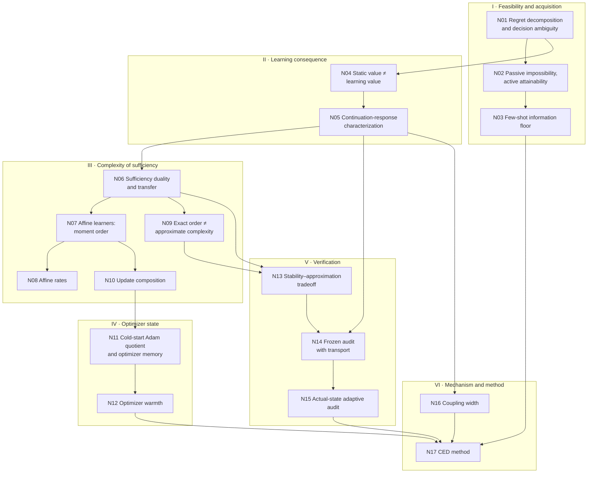

# Environment Information Theory for Agent Distillation — Framework Map

[中文版](README_ZH.md)

**Question.** Relative to declared deployment tasks, permitted experiments and an actual learning procedure, which distinctions between feedback laws can change the final task performance of the distilled student?

This page is the shortest complete path through the theory. Each node states one result precisely and says why the next node is needed. Every node links to two pages:

- **Proof** gives the full derivation.
- **Experiments** gives the finite or controlled checks that test the node. It records why each check is run, how it is set up, what it found, and why that supports the node.

**Sources.** v0.14.1 main framework (`docs/direction/v015_revision/Environment_Information_Theory_EN.md`), v0.15 optimizer and few-shot addendum (`.../Optimizer_State_and_Few_Shot_Theory_v015_EN.md`), and the warm-Adam extension (`docs/direction/v015_extension/Warm_Adam_Response_EN.md`). Equation numbers such as (14) or (A9) refer to those documents.

**Scope.** Every statement on this page is proved under the assumptions it states and has passed independent finite or controlled checks. Proofs are finite-dimensional or carry explicit regularity assumptions. The experiments are exact finite computations or controlled small networks; they are not real-model or benchmark results.

---

## 0. Setting and notation

**Environment and student.** An environment $E$ comprises a task distribution, transitions, feedback semantics, scoring and a fixed execution harness. All returns lie in $[0,1]$. The student's deployment class is $\Pi\subseteq\Pi_{\rm ref}$, with
$$J_E^\Pi=\max_{\pi\in\Pi}J_E(\pi),\qquad J_E^{\rm ref}=\max_{\pi\in\Pi_{\rm ref}}J_E(\pi).$$

**Information.** $I_0$ is the common initial information: the pretrained model, the known rules and the $K$ trusted demonstrations per task family. $D$ is the transcript of all further accessible information.

**Learning process.** A complete learner state $z$ contains the parameters, the optimizer moments, buffers, sampler state, randomness and history. At round $t$ a feedback law $P_t(\cdot\mid z)$ emits a message $Y_t$, and the actual update is $Z_{t+1}=U_t(z,Y_t,\xi_t)$. Integrating the update randomness $\xi_t$ gives a learning kernel $K_t$. We write $K_t^0$ for the reference protocol and $K_t^S$ for an alternative. Both start from the same initial state law. The final student is scored by $F_E(z)=J_E(\pi_z)\in[0,1]$.

**Continuation and response.** Define
$$V_R^0=F_E,\qquad V_t^0=K_t^0V_{t+1}^0,$$
$$g_{E,f,t,z}(y)=\mathbb E_{\xi_t}\,V_{t+1}^0\big(U_t(z,y,\xi_t)\big).\tag{13}$$
$g$ is the expected final real-task return after receiving message $y$, applying the actual update, and completing the declared reference learning tail. For an explicit optimizer/recipe $o$ we write $\psi_{E,o,t,z}$ (A1). Let $L_E(S)=\mathbb E\,F_E(Z_R^S)$, and let $\mathcal G$ collect all responses of the declared family.

**Counts that must not be conflated.** $K$ is the number of trusted demonstrations, $n_{\rm query}$ the number of extra experiments, $n$ the number of independent experience blocks, $R$ the number of updates, $N$ the number of deployment decisions, and $d$ the number of linear statistics. Replaying one block $n$ times is not $n$ independent blocks.

---

## 1. Dependency graph



The chain runs as follows. First, what the student can execute and what the data can identify (I). Then, what feedback does to the learner (II). Then, how much information sufficiency costs (III), and how the actual optimizer changes that cost (IV). Next, how sufficiency is checked with finite data (V). Last, the method that follows (VI).

---

## 2. Nodes

Each node ends with its proof link, its experiments link and the checks that support it.

### I · Feasibility and acquisition

#### N01 · Regret decomposition and decision ambiguity
*Source:* Props. 1–3, eqs. (1)–(5). *Uses:* none. *Used by:* N02, N03, N04.

**Proposition.** For a prior on a finite environment family, let $B(D)=\max_{\pi\in\Pi}\mathbb E[J_E(\pi)\mid D]$. For any learner output $\widehat\pi$,
$$\mathbb E[J_E^{\rm ref}-J_E(\widehat\pi)]=\underbrace{\mathbb E[J_E^{\rm ref}-J_E^\Pi]}_{\mathcal R_{\rm rep}}+\underbrace{\mathbb E J_E^\Pi-\mathbb E_D B(D)}_{\mathcal R_{\rm info}}+\underbrace{\mathbb E_D[B(D)-\mathbb E[J_E(\widehat\pi)\mid D]]}_{\mathcal R_{\rm alg}},$$
with all three terms nonnegative. Moreover:

- $\mathcal R_{\rm info}=0$ if and only if, for a.e. $D$, the set $\bigcap_{E:\Pr(E\mid D)>0}\arg\max_\pi J_E(\pi)$ is nonempty.
- The robust ambiguity $r(C)$ equals its minimax dual (3)=(4).
- A randomized post-processing $D'$ of $D$ cannot decrease $\mathcal R_{\rm info}$ (5).

**Next.** Representation, information and learning errors are separate. Generating data cannot create absent facts, so the next question is when demonstrations leave $\mathcal R_{\rm info}>0$.

[Proof](proofs/N01_decomposition_and_ambiguity.md) · [Experiments](experiments/N01_decomposition_and_ambiguity.md) · **proved**; C1 PASS

#### N02 · Passive impossibility, active attainability
*Source:* Thm. 4, eqs. (6)–(9), compilation paragraph. *Uses:* N01. *Used by:* N03.

**Theorem.** Consider the two-world aliased family with known gap $0<\Delta\le 1/8$, in which the teacher is optimal in both worlds.

- Every learner that sees only passive demonstrations has $\max_v\mathbb E[J_v^\Pi-J_v(\widehat p)]\ge\Delta$.
- With reset queries, a $\Delta/2$-optimal student in each world with probability $1-\delta$ requires
$$\mathbb E_v n_{\rm query}\ge\frac{\operatorname{kl}(1-\delta,\delta)}{\operatorname{kl}(\tfrac12+2\Delta,\tfrac12-2\Delta)}\ge\frac{\operatorname{kl}(1-\delta,\delta)}{64\Delta^2}.$$
- $\lceil\log(1/\delta)/(8\Delta^2)\rceil$ queries suffice.
- Compiling the acquired fact into a frequency learner needs $m\ge\lceil32\log(2/\delta_L)\rceil$ compiled labels.

**Next.** Perfect demonstrations can be information-insufficient, and acquisition cost is distinct from compilation cost. Node N03 makes $K$ explicit.

[Proof](proofs/N02_passive_vs_active_acquisition.md) · [Experiments](experiments/N02_passive_vs_active_acquisition.md) · **proved**; C2 PASS

#### N03 · Few-shot information floor
*Source:* Props. A5–A7, eqs. (A11)–(A16). *Uses:* N01, N02. *Used by:* N17.

**Proposition.** In the hidden-bit model, bits $\Theta_1,\dots,\Theta_d$ are independent and fair. A context $j$ has weight $w_j$. Each trajectory reveals bit $j$ with probability $q_j$, and reveals nothing about unrevealed bits.

- After $K$ trajectories,
$$R_{\rm info}(K)=\tfrac12\textstyle\sum_j w_j(1-q_j)^K.$$
- With a hard budget of $n$ queries, $R_{\rm info}(K,n)=\tfrac12\,\mathbb E\big[\sum_{r>n}w_{(r)}\big]$, and querying the heaviest unseen bits is optimal. In general $\mathbb E[(M_K-n)_+]\ne(\mathbb E M_K-n)_+$.
- In a two-world adaptive model, $K\kappa_D+\kappa_X\,\mathbb E N\ge\operatorname{kl}(1-\delta,\delta)$.

**Next.** $K$ and queries trade off within one information budget, and replay adds zero. Information alone does not determine what the learner extracts, which is the subject of Section II.

[Proof](proofs/N03_few_shot_information_floor.md) · [Experiments](experiments/N03_few_shot_information_floor.md) · **proved**; V5, V6, E5 PASS

### II · Learning consequence

#### N04 · Static value is not learning value
*Source:* Props. 5–6, eqs. (10)–(11). *Uses:* N01. *Used by:* N05.

**Proposition.**

- There are two sources that give every aliased student the same value $J(\pi_p)=\tfrac12+p/20$, and the same teacher value $3/5$. Yet frequency distillation from them yields expected returns $43/80$ and $41/80$, a gap of $1/40$ for every $m\ge1$.
- There are two label packets with equal marginals and equal mean gradient whose learning values differ by $\eta^2/8$ under $J(p)=p^2$. Replacing $J$ by $1-p^2$ reverses the sign.

**Next.** Neither teacher quality, nor policy value, nor mean gradient determines what a student learns. The invariant must include the update and the deployment, which is what N05 provides.

[Proof](proofs/N04_static_vs_learning_sufficiency.md) · [Experiments](experiments/N04_static_vs_learning_sufficiency.md) · **proved**; C3 PASS

#### N05 · Continuation-response characterization
*Source:* Thm. 7, eqs. (12)–(17), §5.2. *Uses:* N04. *Used by:* N06, N14, N15, N16.

**Theorem.** Let $d_t^S$ be the actual state occupancy of the alternative process. Then:

- $$L_E(0)-L_E(S)=\sum_{t=0}^{R-1}\mathbb E_{d_t^S}\big[(K_t^0-K_t^S)V_{t+1}^0(Z_t)\big],$$
  so $\lvert L_E(0)-L_E(S)\rvert\le\sum_t\mathbb E_{d_t^S}\varepsilon_t(Z_t)$.
- Two message laws are interchangeable for every one-boundary replacement followed by a declared suffix if and only if $\mathbb E_Pg=\mathbb E_Qg$ for all $g\in\mathcal G$.
- If guarantees hold only on a certified set with first-exit probability $\rho$, then $\lvert L_E(0)-L_E(S)\rvert\le\mathbb E_S\sum_{t<\tau_{\rm exit}}\varepsilon_t+\rho$; the penalty is $\rho$, not $R\rho$.

$\mathcal G$ is derived by pulling $F_E$ backward through the actual updates and the reference kernels.

**Next.** The object of sufficiency is now fixed as the response class $\mathcal G$. Sections III–V measure its size, its dependence on the optimizer, and how to check it.

[Proof](proofs/N05_continuation_response.md) · [Experiments](experiments/N05_continuation_response.md) · **proved**; C4, T12 PASS

### III · Complexity of sufficiency

#### N06 · Sufficiency duality and transfer
*Source:* Thm. 8, Cor. 9, eqs. (18)–(22). *Uses:* N05. *Used by:* N07, N09, N13.

**Theorem.** Take a finite message alphabet with $\lvert\mathcal Y\rvert=m$, features $\phi_1,\dots,\phi_d$, and $H_\phi=\operatorname{span}\lbrace 1,\phi_1,\dots,\phi_d\rbrace $.

- **(a) Exact.** Equal feature means imply equal response means for all laws if and only if $\operatorname{span}\mathcal G\subseteq H_\phi$. The minimal number of statistics is $d_0=\dim\operatorname{span}(\lbrace 1\rbrace \cup\mathcal G)-1$.
- **(b) Approximate.** The worst-pair unresolved discrepancy satisfies
$$\mathfrak D_\phi(\mathcal G)=2\sup_{g\in\mathcal G}\inf_{h\in H_\phi}\lVert g-h\rVert_\infty.$$
- **(c) Transfer.** If $g=c+b^\top\phi+r$ with $\lVert b\rVert_1\le B$ and $\lVert r\rVert_\infty\le\tau$, then $\lvert(P-Q)g\rvert\le B\lVert\mathbb E_P\phi-\mathbb E_Q\phi\rVert_\infty+2\tau$.
- **Corollary 9.** For unrestricted learners, $d_0=m-1$ and the discrepancy is $\gamma\,\mathrm{TV}(P,Q)$.

**Next.** "Sufficient information" becomes the span dimension or approximation width of $\mathcal G$. N07–N10 compute these for explicit learners.

[Proof](proofs/N06_sufficiency_duality.md) · [Experiments](experiments/N06_sufficiency_duality.md) · **proved**; C5 PASS

#### N07 · Affine learners: moment order is necessary and sufficient
*Source:* Lemma 10, Thms. 11–13, eqs. (23)–(28). *Uses:* N06. *Used by:* N08, N10.

**Theorem.** Consider a binary-context student $p\in[0,1]^k$, at most $N$ decisions, and a convex-affine learner $p_R=w_0p_0+\sum_iw_iZ_i$ on IID blocks $Z_i\in[0,1]^k$.

- $J_E(p)$ is a polynomial of degree at most $N$ with $\sum_\alpha\lvert c_\alpha\rvert\le3^N$.
- $\mathbb E_PZ^\alpha=\mathbb E_QZ^\alpha$ for all $\lvert\alpha\rvert\le N$ if and only if the learning values are equal for every task and every affine learner.
- Every order is necessary. The scalar witnesses have $\Delta_N=(-1)^NN!/(2^{N-1}N^N)$, and the even/odd parity laws give a constant gap of 1.
- The exact statistic count on the grid is $\binom{k+N}{N}-1$. On $\lbrace 0,1\rbrace ^k$ with $N\ge k$ and arbitrary terminal rewards, fewer than $2^k-1$ statistics leave discrepancy 1.

**Next.** This is an explicit instance of N06, with $\mathcal G$ equal to the polynomials and the dimension equal to a moment count. N08 makes it quantitative.

[Proof](proofs/N07_affine_moment_order.md) · [Experiments](experiments/N07_affine_moment_order.md) · **proved**; C6–C9, C19 PASS

#### N08 · Rates in the affine theory
*Source:* Thms. 14–15, eqs. (29)–(31). *Uses:* N07. *Used by:* none.

**Theorem.**

- For every affine learner, $\lvert\text{gap}\rvert\le C_J\delta_N(P,Q)\le N3^N\delta_N(P,Q)$, independent of $R$.
- For averaging $n$ independent blocks with equal means and joint cumulants matched below order $r$:
$$\mathbb E_{P^n}J(\bar p_n)-\mathbb E_{Q^n}J(\bar p_n)=\frac{\langle D^rJ(\mu),\kappa_r(P)-\kappa_r(Q)\rangle}{r!\,n^{r-1}}+O(n^{-r}).$$
- For the scalar witnesses the expansion is exact: $\Delta_N/n^{N-1}$.

**Next.** The independent block count $n$, not the number of epochs, controls how fast a discrepancy decays. Replaying one block, or deterministic synthetic descendants of it, does not decay.

[Proof](proofs/N08_affine_rates.md) · [Experiments](experiments/N08_affine_rates.md) · **proved**; C10, C11, C18 PASS

#### N09 · Exact order is not approximate complexity
*Source:* eq. (32), Prop. 16, parity paragraph. *Uses:* N06. *Used by:* N13.

**Proposition.**

- For $p^N$, truncating the Chebyshev expansion at order $q$ gives error $\Pr\lbrace \lvert B-N\rvert>q\rbrace \le2e^{-q^2/N}$ with $B\sim\mathrm{Bin}(2N,\tfrac12)$. Matching moments through order $q\ge\min\lbrace N,\lceil\sqrt{N\log(4/\varepsilon)}\rceil\rbrace $ therefore bounds the value gap by $\varepsilon$, even though exact equality needs order $N$.
- The parity value (27) has best degree-$(<N)$ uniform approximation error exactly $1/2$.

**Next.** The operative complexity is the approximation width $d_\varepsilon$, not the degree. Coefficient stability then matters, which is N13.

[Proof](proofs/N09_approximate_complexity.md) · [Experiments](experiments/N09_approximate_complexity.md) · **proved**; C12, C19 PASS

#### N10 · Update composition amplifies the information requirement
*Source:* Thm. 17, eqs. (34)–(35); recursion remark of the addendum §7. *Uses:* N07. *Used by:* N11.

**Theorem.**

- For polynomial updates of degree $a_i$ in the old parameter and $b_i$ in the new block, the final response has block-$i$ degree at most $D_i=Nb_i\prod_{t>i}a_t$. The bound is attained: $Z_1^{2^{R-1}}$.
- A threshold learner breaks first-moment sufficiency already at $N=1$.
- For smooth SGD,
$$(K^P-K^Q)V=-\eta\nabla V^\top(\mu_P-\mu_Q)+\tfrac{\eta^2}{2}\langle\nabla^2V,M_P-M_Q\rangle+\mathcal E,\qquad \lvert\mathcal E\rvert\le\tfrac{M_3\eta^3}{6}\big(\mathbb E_P\lVert G\rVert^3+\mathbb E_Q\lVert G\rVert^3\big).$$
- Per-step errors accumulate as $e_R\le C\eta^2\sum_s(1+\eta L)^s$. A linear-in-$R$ bound needs a stability condition.

**Next.** The learner, not the data alone, sets the order of information required. The actual optimizer must therefore be modeled, which is Section IV.

[Proof](proofs/N10_update_composition.md) · [Experiments](experiments/N10_update_composition.md) · **proved**; C13, V7 PASS; C23 shows the SGD regime boundary

### IV · Optimizer state

#### N11 · Cold-start Adam quotient and optimizer memory
*Source:* Props. A2–A4, eqs. (A6)–(A10). *Uses:* N06, N10. *Used by:* N12.

**Proposition.** Consider bias-corrected Adam with $\epsilon$ outside the square root, started from a cold state $m_0=v_0=0$.

- The first step is $\theta_1=c-\eta\,h_\epsilon(G)$, with $h_\epsilon(g)_i=g_i/(\lvert g_i\rvert+\epsilon)$.
- At $\epsilon=0$, equality of all bounded immediate-parameter utilities is equivalent to equality of the joint sign law. With $s$ reachable sign patterns, exactly $s-1$ statistics are necessary and sufficient. Coordinate sign marginals are not sufficient.
- For $\epsilon>0$, $h_\epsilon$ is injective, so the full gradient law is required ($m-1$ statistics).
- Margin bound (A9): for Lipschitz utilities the sign approximation costs $\eta\sum_iL_i[\beta_{P,i}(a)+\beta_{Q,i}(a)+2\epsilon/(a+\epsilon)]$.
- Retained state: $m_1=(1-\beta_1)G$. The histories $(1,-\tfrac34)$ and $(2,-\tfrac34)$ have identical sign sequences, yet their second steps go in opposite directions.

**Next.** Moment sufficiency (N07) does not transfer to Adam, and what must match depends on the optimizer state. N12 quantifies how that dependence decays.

[Proof](proofs/N11_adam_cold_start.md) · [Experiments](experiments/N11_adam_cold_start.md) · **proved**; V2–V4 PASS; E0–E3 confirm the C23 Adam gap is a cold-start optimizer effect

#### N12 · Optimizer warmth switches the first-order feedback statistic
*Source:* warm-Adam extension, Lemma W0, Props. W1–W2, Cor. W3. *Uses:* N05, N10, N11. *Used by:* N17.

**Definitions.** The warmth of coordinate $i$ is $\kappa_i(y)=(1-\beta_2)G_i(y)^2/(\beta_2v_i)$, with $\kappa_i=\infty$ when $v_i=0$. The frozen-denominator surrogate $\tilde z^+$ is one momentum-SGD step with the fixed diagonal preconditioner $P=\operatorname{diag}(1/(a+\epsilon))$.

**Theorem.**

- **(W0)** $\lvert\theta^+_i-\tilde\theta^+_i\rvert\le\eta\,u_i\min\lbrace \kappa_i/2,1\rbrace $.
- **(W1)** Assume a warm state, $v_i>0$ for all $i$ (W); Lipschitz continuation (L); second-moment sensitivity (S); and curvature $H_G$ of $F(g)=V(\tilde z^+(g))$ (H). Then
$$\big\lvert\psi(y)-c-b^\top G(y)\big\rvert\le\eta\sum_iL_iu_i\min\lbrace \tfrac{\kappa_i}{2},1\rbrace +L_v\max_i\min\lbrace \kappa_i,\bar k\rbrace +\tfrac12H_G\lVert G\rVert_\infty^2=:r(y).$$
  Laws with equal mean consumed gradient therefore differ in response by at most $\mathbb E_{P_0}r+\mathbb E_{P_1}r$.
- **(W2)** At a cold state, laws with equal means separate at first order: the gap is $\lvert w\rvert\eta/2$. Laws that agree on all moments below any fixed order $N$ still separate, by $\lvert w\rvert\eta\,2^{2-N}$.
- **(W3)** (a) If $v$ has absorbed $s$ evaluations of stationary second moment, the mean-field warmth satisfies $1/(\beta_2s)\le\bar\kappa(s)\le1/(\beta_2^{\,s}s)$. (b) If $\max_i\kappa_i\le c/(W+s)$ at the warm updates, the telescoped non-affine contribution is at most the number of cold updates plus $\bar A\sum_s\min\lbrace 1,c/(W+s)\rbrace \le\bar A\,c\log(1+R/W)$ for $W\ge1$, plus the curvature terms. With $W=0$ the first update is cold and is charged at most 1.

**Next.** The statistic that a feedback source must match switches with optimizer state. Cold Adam requires the joint sign law; warm Adam requires the mean preconditioned gradient. This predicts where the affine theory (N07–N10) applies to few-shot LoRA.

[Proof](proofs/N12_optimizer_warmth.md) · [Experiments](experiments/N12_optimizer_warmth.md) · **proved** (finite-dimensional, explicit assumptions); E8 PASS

### V · Verification

#### N13 · Stability–approximation tradeoff
*Source:* Thm. 18, eq. (36). *Uses:* N06, N09. *Used by:* N14.

**Theorem.** For tolerances $\epsilon_j$ on feature-mean differences,
$$W_{\boldsymbol\epsilon}(g)=\inf_{b,c}\Big[2\big\lVert g-c-\textstyle\sum_jb_j\phi_j\big\rVert_\infty+\sum_j\epsilon_j\lvert b_j\rvert\Big]=\inf_b\Big[\operatorname{osc}\big(g-\textstyle\sum_jb_j\phi_j\big)+\sum_j\epsilon_j\lvert b_j\rvert\Big].$$

**Next.** Measurement error on a feature costs the size of its coefficient. A small approximation residual with unstable coefficients is therefore not a certificate. This determines how finite audits must be designed.

[Proof](proofs/N13_stability_tradeoff.md) · [Experiments](experiments/N13_stability_tradeoff.md) · **proved**; C14, C22 PASS

#### N14 · Frozen finite-interface selection with transport
*Source:* Thm. 19 of v0.14.1, eqs. (37)–(40), (39a); Prop. A1, eqs. (A2)–(A5). *Uses:* N05, N13. *Used by:* N15, N17.

**Theorem.**

- With $e_0=\sqrt{\log(4Ld/\delta)/(2n_0)}$ and $e_S=\sqrt{\log(4MLd/\delta)/(2n_S)}$, with probability $1-\delta$ we have $\lvert D_j-\widehat D_j\rvert\le e_0+e_S$ simultaneously for all $j$, and $D_{\widehat j}\le\min_jD_j+2(e_0+e_S)+\eta_{\rm opt}$.
- Assume state-to-cell transport error $a_{t,j}(z)$ and response decomposition $(B_t,\tau_t)$ at certified states. Then
$$\lvert L_E(0)-L_E(S_{\widehat j})\rvert\le\sum_t\mathbb E_{d_t^{\widehat j}}\Big[1\lbrace t<\sigma\rbrace \big\lbrace B_t(\widehat D_{\widehat j}+e_0+e_S+a_{t,\widehat j}(Z_t))+2\tau_t\big\rbrace \Big]+\rho.\tag{39a}$$
- Exact transport gives (39). The IID affine setting gives (40).
- The transport term is necessary: if a trained state is not covered by an audited cell, the audited discrepancy can be zero while the learning gap is 1. The theorem charges such a state either $a=1$ or exit probability $\rho=1$.

**Next.** A finite audit certifies learning value only through an explicitly measured coverage/transport term. N15 removes that extrapolation by auditing at the actual states.

[Proof](proofs/N14_frozen_audit_transport.md) · [Experiments](experiments/N14_frozen_audit_transport.md) · **proved**; V1, C20, T01, T02 PASS; C15 and E4 measure the transport term

#### N15 · Actual-state adaptive auditing; fidelity versus improvement
*Source:* eqs. (41)–(45), Thm. 20, eq. (A17). *Uses:* N05, N14. *Used by:* N17.

**Theorem.**

- Fidelity: $L_E(S)-J_E(\pi_0)\ge\gamma-\varepsilon$.
- Signed identity: $L_E(S)-L_E(0)=\sum_t\mathbb E_{d_t^S}A_t(Z_t,J_t)$.
- Adaptive audit: at each audited actual state, run paired candidate-versus-reference full-tail experiments and select by the lower confidence bound $\ell_t(j)=\widehat A_t(j)-e_t$, with $e_t=\sqrt{2\log(2M_t/\delta_t)/n_t}$. Then $L({\rm adaptive})-L(0)\ge-\delta$ and $\ge\mathbb E\sum_tB_t-2\delta$.
- Cost: $M=4$, $\delta=.05$, $e=.1$ requires $1016$ paired replicas per candidate (sufficient, not necessary).

**Next.** Local certificates are valid but cost on the order of a thousand full training tails per candidate. The method (N17) therefore validates cheaper measurements against such audits and supports method-level claims with whole-run randomized comparisons.

[Proof](proofs/N15_adaptive_audit.md) · [Experiments](experiments/N15_adaptive_audit.md) · **proved**; C16, C21, T13 PASS; E7 forecasts 559 replicas (empirical Bernstein)

### VI · Mechanism and method

#### N16 · Coupling width
*Source:* Prop. 21, eq. (46). *Uses:* N05. *Used by:* N17.

**Proposition.** Fix the marginals of valid units, and let $H_z$ be the post-update full-tail return of a joint packet.

- The coupling width is zero if and only if $H_z(i,j)=a_i+b_j$ on the positive-support product.
- $\lvert(\Gamma-\Gamma')H_z\rvert\le2\inf_{a,b}\lVert H_z-a-b\rVert_\infty$.
- Strict null: one SGD step with identical examples and weights is invariant to regrouping.

**Next.** This gives one controlled mechanism test: does the joint organization of fixed-marginal feedback units change what is learned?

[Proof](proofs/N16_coupling_width.md) · [Experiments](experiments/N16_coupling_width.md) · **proved**; C17 PASS; C23(e) controlled neural

#### N17 · Consequence-Calibrated Experience Distillation (CED)
*Source:* §13 of v0.14.1, §6 of the addendum, §4 of the warm-Adam extension. *Uses:* N03, N12, N14, N15, N16.

**Derived design rules.** Each rule is a consequence of the cited nodes.

1. *Acquire before compiling.* Facts that the $K$ demonstrations leave ambiguous must come from new permitted experiments. Replay and rewriting cannot supply them (N01, N02, N03).
2. *Select by measured consequence.* A provider must be judged by its response under the actual update and a reference tail (N05). Teacher quality, policy value and mean gradient do not determine it (N04).
3. *Record the optimizer state.* The statistic a provider must match is the joint sign law at a cold Adam state and the mean preconditioned gradient at a warm one (N11, N12). Responses are therefore measured at states whose warmth is recorded.
4. *Fit stable response models.* Response models are fitted under the bounded-coefficient objective of Thm. 18 (N13).
5. *Account for coverage.* Selection uses audits with an explicit transport/exit term (N14), or lower confidence bounds at the actual states (N15).
6. *Freeze, then test transfer.* Method transfer and policy transfer are evaluated separately, with the selector frozen beforehand.

**Established in the controlled learner (experiments page).**

- Static update statistics (mean gradient, sign, $\Delta\theta$, $\Delta\theta$ with $m,v$) do not predict the full-tail response sign on held-out states (E6). Rule 2 therefore cannot be replaced by those statistics.
- Measured short-tail responses select correctly across held-out states, $\epsilon$, learning rates and optimizer warmth. On threshold-type tasks short tails fail, and only the full tail is exact on every split (E6).
- Moment warm-up reduces the differences between providers, but leaves static proxies non-predictive (E9).

[Derivation](proofs/N17_ced_method.md) · [Experiments](experiments/N17_ced_method.md) · design rules **derived**; E6, E9 controlled findings

---

## 3. What is established

| Statement | Established by |
|---|---|
| N01–N11, N13–N16 under their stated finite assumptions | Complete proofs; independent finite checks C1–C22 (C15 is the witness that the transport term is necessary), V1–V7, and package checks T01–T13 |
| N12, the warm-Adam response bound in finite dimensions | Complete proof; E8 checks W0–W3 on 1.44M instances |
| C23 Adam departures from the affine comparator are a cold-start optimizer effect | E1 and E2: the gap persists under a frozen Jacobian; five warm-moment steps reduce it from 0.077 to 0.003 |
| Selection by measured response (N17, rules 2–3) | E6 and E9 in the controlled learner |

## 4. Reproducing the checks

```bash
CUDA_VISIBLE_DEVICES='' theory/.venv/bin/python theory/independent_checks/check_v014_independent.py --output theory/independent_checks/results_independent_v014.json   # C1–C23
CUDA_VISIBLE_DEVICES='' theory/.venv/bin/python theory/v015_checks/check_v015.py --output theory/v015_checks/results_v015_independent.json                        # V1–V7, E0–E9
```

The package verifiers (`docs/direction/v014_handoff/verify_environment_information_v014.py`, `docs/direction/v015_revision/verify_v015_extensions.py`) reproduce the original T-checks. Figures in `figures/` are regenerated by `figures/make_figures.py` from those result files.
