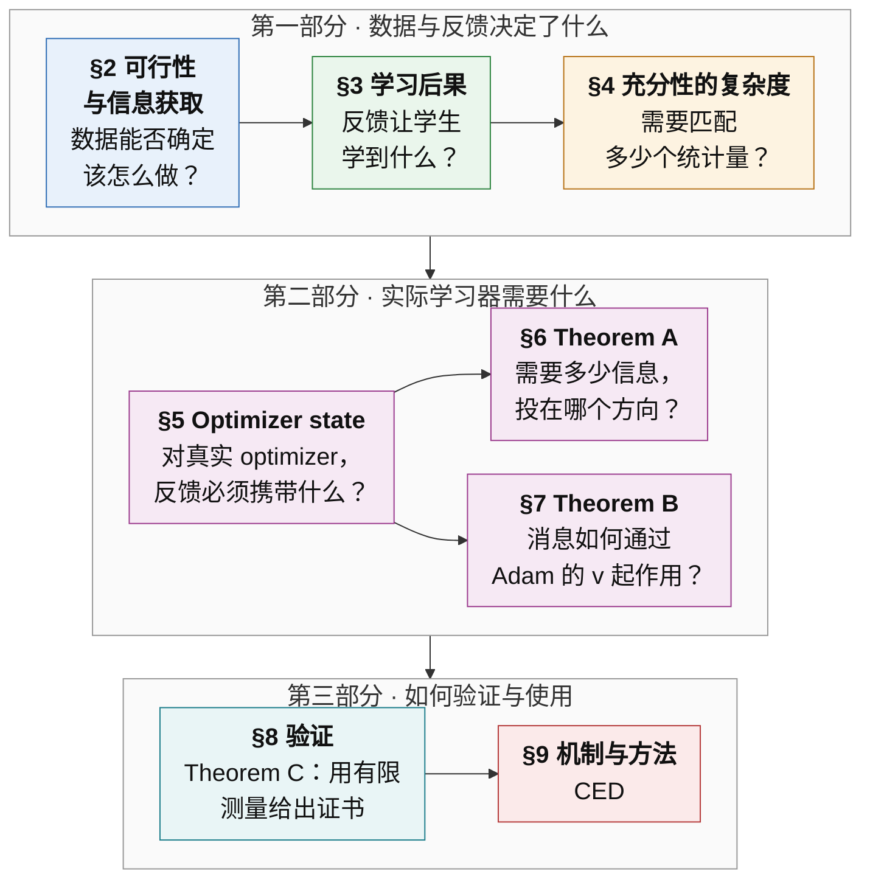
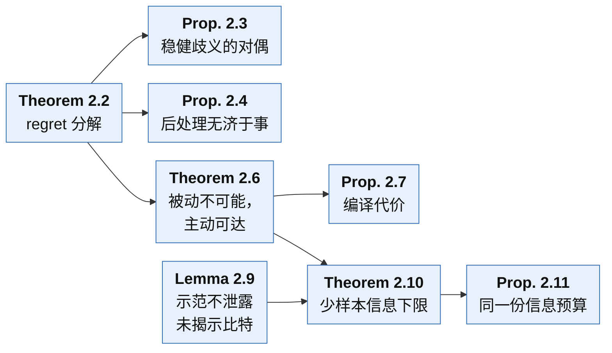
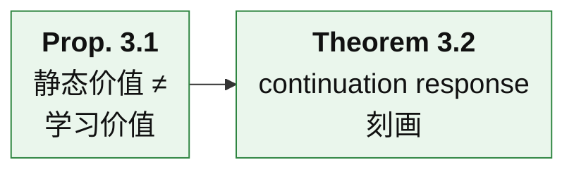
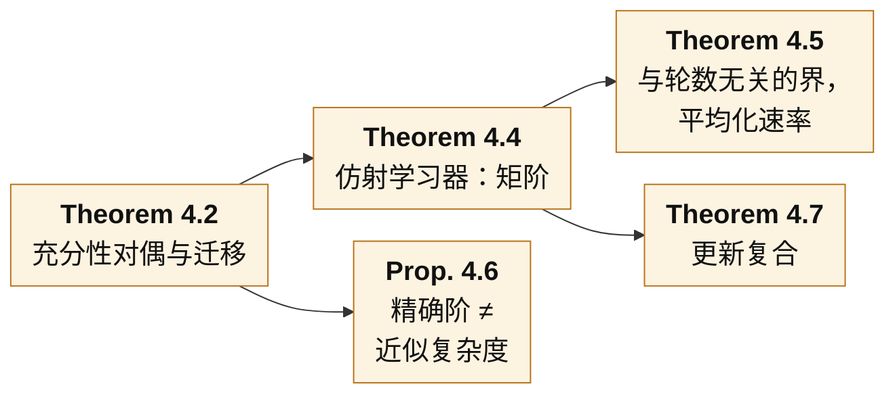
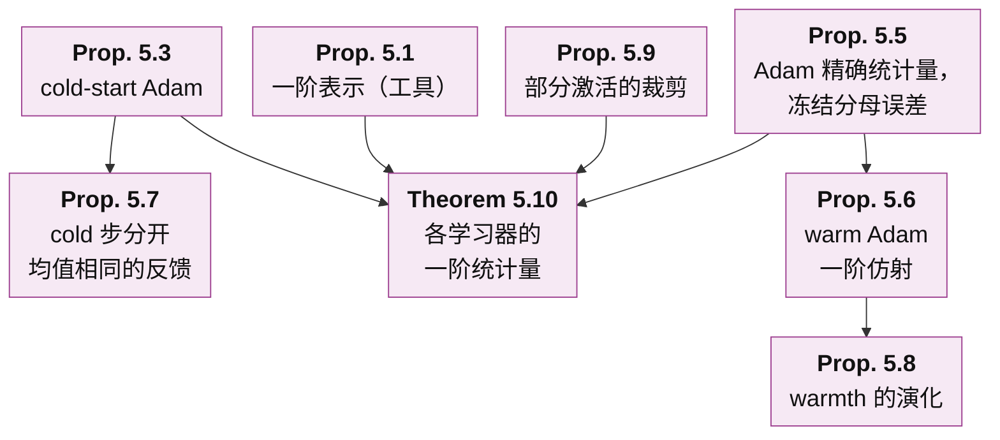
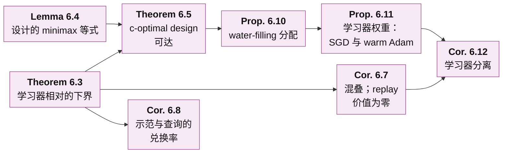
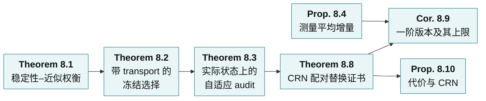
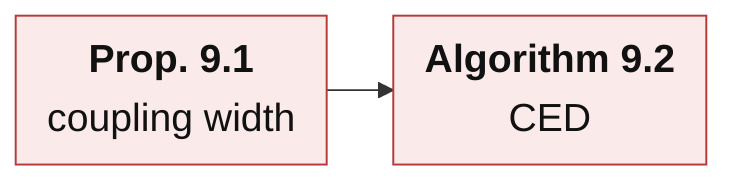

# 面向 Agent 蒸馏的学习器相对经验充分性：理论框架

[English](README.md)

**核心问题.** 给定声明的部署任务、允许的实验和实际使用的学习过程，反馈来源之间的哪些差别会改变蒸馏后学生的最终任务表现？

**中心结果.**

- **Theorem A（§6，learner-relative information bound）.** 对任何蒸馏器（包括 replay、改写、合成），最小可达的一阶误差由示范与查询关于一个学习器相关泛函的 Fisher information 决定。这个泛函的梯度 $`c=\sum_tJ_t^{*}g_t`$ 把学习器的 Jacobian 与任务的 continuation 梯度合在一起。在可辨识性与增长条件下，这个界在常数因子内可以由正则化的 Elfving c-optimal 查询设计达到。因此，同一批示范可以对一个学习器充分、对另一个不充分。
- **Theorem B（§7，Adam 的二阶矩通道）.** 在 warm Adam 下，一条消息的一阶价值精确分解为参数通道、动量通道与二阶矩通道。平稳情形下，相对幅度为 $`\lambda`$ 的消息的 response 有精确的 mean-field 形式：小增量时它是凹的二次函数，在显式的 $`\lambda^*`$ 处最大，在 $`2\lambda^*`$ 附近变负。只看参数步的分数和只看方向的分数因此都是不一致的排序器。
- **Theorem C（§8，可审计的证书）.** 对一轮训练做 common random numbers（CRN）配对替换，可以直接测得一个反馈律的有限效应。由此得到的证书既不需要 continuation value 的梯度，也不需要曲率常数，半径只含统计项与 surrogate 校准项。

这三条建立在 §2–§5 的基础上：
- regret 的精确分解，以及获取缺失信息的代价；
- 以 continuation response 作为充分性的对象；
- 充分性的复杂度；
- 每种 optimizer 让反馈必须携带的统计量。

§9 由以上全部结果推出方法 CED。

**怎么读这一页.** 本页按"先整体、后局部"的顺序展开，类似广度优先搜索。

| 层 | 内容 | 读完能回答 |
|---|---|---|
| [第 0 层](#第-0-层--一段话) | 一段话说清整个框架 | 框架要回答什么问题，分几步回答 |
| [第 1 层](#第-1-层--八个部分) | 八个部分及其衔接 | 每一部分回答什么问题、得到什么结论、交给下一部分什么 |
| [第 2 层](#第-2-层--全部结果) | 按顺序列出每个编号结果，并链接到它的陈述页、证明页、实验页 | 每个结果说了什么、直觉是什么、在链条里起什么作用，以及它的精确陈述、证明和检验在哪里 |

记号统一在 [§1](#1-设定与记号) 中给出。每个编号结果都有自己的**陈述**页（设定、精确陈述、推导要点）；有证明的另有**证明**页，有检验的另有**实验**页：
- 证明页给出完整推导；
- 实验页给出检验该结果的检查，写明做这个检查的原因、设置、结果，以及结果为什么支持该陈述。

每一页都可以单独阅读：页面开头会重述它用到的设定与陈述。

所有测量结果都在实验页上；本页只有陈述和说明性的例子。

**参考文献.** 全部引用的文献（逐条核对过作者、标题、出处与 arXiv/DOI）见 [references_ZH.md](references_ZH.md)。

**范围.**
- 本页每个陈述都在其所列假设下有证明。少数陈述只在明确给出的渐近区间内证明到首项，本页在相应位置注明。
- 证明都是有限维的，或者带有明确的正则性假设。
- 实验页上的检查是精确有限计算或受控小网络。
- Theorem A–C 在真实模型上的检验已经设计好（[Remark 9.4](statements/09-04_scope_of_evidence_ZH.md#s9-4)），尚未运行。

---

## 第 0 层 · 一段话

蒸馏一个 agent 时，手里有：
- 一个预训练学生；
- 每个任务族 $`K`$ 条可信的 teacher 示范；
- 一份允许做的额外实验预算（teacher 调用、环境分支、reset）；
- 一个固定的训练配方（optimizer、学习率、步数）。

可以喂给学生的反馈来源很多：示范本身、replay、合成改写、新的查询、同一批单元的不同打包方式。框架要回答的是：**这些反馈来源之间的哪些差别，会真正改变蒸馏后学生的最终任务表现？** 回答分八步。

1. **数据能不能确定该怎么做（§2）.**
   - 学生的 regret 精确拆成表示、信息、算法三项。
   - 信息缺口只能靠新的实验补上，replay 和改写补不了；即使 teacher 处处最优，也可能留下信息缺口。
   - 补上缺口大约需要 $`\log(1/\delta)/\Delta^2`$ 次查询；示范与查询共用一份信息预算。
2. **反馈对学习器做了什么（§3）.**
   - teacher 质量、策略价值、梯度均值都不能决定学生学到什么。
   - 不变量是 *continuation response*：收到一条消息、执行实际更新、再把训练走完之后的期望最终回报。
3. **两个来源需要在多少统计量上一致（§4）.**
   - 恰好是 response 类张成的空间。对平均化学习器，这是一个由部署长度决定的矩阶。
   - 近似复杂度可以远低于精确阶；非线性更新会把阶数相乘。
4. **实际的 optimizer 让反馈必须携带什么（§5）.**
   - 在一阶意义下，起作用的是*完整学习器状态*（参数加 optimizer state）的平均增量。这个一阶表示是工具，不作为新结论。
   - 对 SGD、momentum、cold 与 warm Adam、裁剪、Lion、LoRA，这个统计量都可以显式写出。warm Adam 的精确统计量是 Adam 增量的均值，常见的"均值加二阶矩"描述只在冻结分母近似下成立，误差显式。
   - Adam 坐标的 warmth 只在训练早期按 $`1/(\beta_2s)`$ 下降，之后停在 $`(1-\beta_2)/\beta_2`$。
5. **需要多少信息、投在哪个方向（Theorem A，§6）.**
   - 学习器决定数据必须在哪个方向 $`c`$ 上有信息。任何蒸馏器的 minimax 误差，在常数因子内等于 learner-relative information norm。
   - 推论：面对混叠时 replay 价值为零；示范与查询按一个学习器相对的兑换率互换；查询按 water-filling 分配；对同一任务，SGD 与 Adam 需要的数据可以差别很大。
6. **一条消息如何通过 Adam 的二阶矩起作用（Theorem B，§7）.**
   - 一条消息还会通过 $`v`$ 改变此后所有步长。
   - 由此得到幅度定律：存在最优幅度；小增量时，在约两倍最优幅度处变号。只看参数的分数与余弦分数在一个显式区域内排错。
7. **怎样用有限测量为选择出具证书（Theorem C 与 §8）.**
   - 有限 audit 需要覆盖（transport）项；在实际状态上做全尾段 audit 是安全的，但代价高。
   - 一阶分数需要 continuation 梯度；只有一阶项超过二阶余项时才能认证一个候选对，平均增量沿梯度方向相同的候选对永远认证不了。
   - CRN 配对替换直接测有限效应。还剩两个开放问题：一个远小于先验区间的可证明区间界，以及一个可检验的 surrogate 校准迁移条件。
8. **方法（§9）.**
   - 一个有严格零假设的机制检验（coupling width）。
   - Consequence-Calibrated Experience Distillation（CED）：按学习器相对的设计获取信息，按经过认证的实测后果选择反馈，匹配学习器的统计量，计入覆盖，冻结之后再检验迁移。

---

## 第 1 层 · 八个部分



箭头表示论证的主线。其他依赖：
- §2 给出 Theorem A（§6）所用的获取预算。
- §3 给出 §8 通篇使用的 continuation 分解。
- §4 给出 §8 使用的近似宽度与系数稳定性。
- §5 给出 §8 要测量的统计量。

### §2 · 可行性与信息获取

**问题.** 在学生能执行的策略里，现有数据能否确定该怎么做？补上缺失的信息要花多少代价？

**结论.**
- 学生相对最优参考策略的 regret 精确拆成表示误差、信息误差、算法误差三项，三项都非负，彼此不能替代。
- 信息误差为零，当且仅当与数据相容的所有环境有一个共同的最优策略。任何与环境无关的数据后处理（replay、改写、合成）都不能降低它。
- 即使 teacher 在每个环境里都最优，也可能留下信息缺口。reset 查询这类主动实验可以补上它，代价是 $`\log(1/\delta)/\Delta^2`$ 量级的查询次数，这个量级既充分又必要。把获得的事实编译进学生是另一项、小得多的代价。
- 在隐藏事实模型中，$`K`$ 条示范之后剩下的信息损失有显式公式；硬预算下的最优查询是按权重贪心；示范与自适应查询满足同一个线性的信息预算不等式。

**交给下一部分.** 缺失的事实必须去获取。学习器从信息里得到什么，是 §3 的问题；某个*具体*学习器需要多少信息，由 §6 的 Theorem A 回答。

### §3 · 学习后果

**问题.** 给定一个反馈来源，学生实际会学到什么？比较两个来源时，应该比较什么？

**结论.**
- 静态指标不够。两个来源可以有同样好的 teacher，给每个学生同样的策略价值，却蒸馏出不同的学生。
- 两个标签包可以有相同的边缘分布和相同的梯度均值，学习价值却不同，而且换一个任务，差的符号反过来。
- 正确的对象是 continuation response：收到消息 $`y`$、执行实际更新、再按参考配方把训练走完之后的期望最终任务回报。
- 整个训练过程的差距精确等于逐轮的单边界替换效应之和。两个消息律可以互换，当且仅当它们在每个 response 下的期望都相同。
- 当保证只在部分状态空间上成立时，离开这部分的概率只付一次，而不是每轮付一次。

**交给下一部分.** 充分性的对象是 response 类 $`\mathcal G`$。§4 度量它的复杂度，§5–§7 对真实 optimizer 计算它，§8 用有限数据检验它。

### §4 · 充分性的复杂度

**问题.** 两个反馈来源要在多少个统计量上一致，才能对学习等价？

**结论.**
- 若用一组特征的均值判断等价，精确充分当且仅当每个 response 都落在这组特征张成的空间里；所需统计量的个数是 response 类张成空间的维数。
- 近似地，最坏情形误差是 response 被这组特征一致逼近的最佳误差的两倍。不受限的学习器需要整个分布。
- 对平均独立经验块的学习器、部署至多 $`N`$ 个决策的任务，恰好需要直到 $`N`$ 阶的全部矩，而且每一阶都必要。
- 差距随*独立*块的个数衰减，速率由第一个不匹配的累积量决定，与训练轮数无关；replay 与确定性合成不会让它衰减。
- 近似复杂度可以远低于精确阶（光滑的值约为 $`\sqrt N`$），奇偶性类型的值是例外。
- 非线性更新的复合会把所需的阶相乘。

**交给下一部分.** 需要匹配什么由学习器本身决定，所以必须对实际 optimizer 建模（§5）；在近似中，系数的稳定性很关键（§8）。

### §5 · Optimizer state 与一阶表示

**问题.** 对实际使用的学习器（SGD、momentum、Adam/AdamW、裁剪、Lion、LoRA），反馈必须携带什么？

**结论.**
- 把任何带状态的一阶 optimizer 写成从 consumed gradient 到完整学习器状态增量的映射。在一阶意义下，一个反馈律对训练结果的影响，等于 continuation value 的梯度与平均完整状态增量的内积。
- 更高阶对应增量的更高阶矩。这个展开是标准的 Taylor 展开加 telescoping，与 stochastic modified equations、TracIn、metagradient 属于同一类计算，这里只当作工具。
- 各 optimizer 的不同之处在于增量：
  - cold-start Adam 第一步只看梯度符号，而它的状态保留了幅度。
  - warm Adam 的精确一阶统计量是 Adam 增量的均值。在冻结分母近似下，它化为梯度的均值与二阶矩，误差逐坐标由该坐标的 warmth 控制。
  - warmth 只在 $`s(1-\beta_2)\ll1`$ 时按 $`1/(\beta_2s)`$ 下降，之后停在 $`(1-\beta_2)/\beta_2`$，所以冻结分母误差每步有一个下限。
  - 裁剪使统计量变成裁剪后的均值。裁剪以概率 $`p_{\rm act}`$ 激活时，只有平均方向起作用，误差不超过 $`c(1-p_{\rm act})`$。

**交给下一部分.** 增量映射告诉我们反馈律必须携带*什么*。Theorem A（§6）问数据关于它必须有多少信息，Theorem B（§7）追踪一条消息如何经过 Adam 的二阶矩，§8 测量它。

### §6 · Theorem A：学习器相对的信息界

**问题.** 给定 $`K`$ 条示范和 $`n`$ 次允许的查询，*任何*蒸馏器能把 oracle 反馈的一阶效应复现到什么程度？查询应该怎么花？

**结论.**
- 令 $`c=\sum_tJ_t^*g_t`$。它把学习器的 Jacobian $`J_t`$（平均增量随未知环境参数怎样变化）与任务的 continuation 梯度 $`g_t`$ 合在一起。
- 任何蒸馏器的 minimax 误差，在 $`1/4`$ 到 $`1`$ 的常数因子内，等于 learner-relative information norm：$`c^\top h`$ 与示范、查询在方向 $`h`$ 上的 Fisher information 之比的最大值。
- 渐近最优的查询服从以 $`c`$ 为目标的 Elfving c-optimal design，并加以正则化，使每个方向最终都可辨识。
- 推论：
  - 示范看不见的方向，使任何数量的 replay 都没有价值；
  - 一条示范值多少次查询，由学习器决定；
  - 在状态覆盖模型中，查询按 water-filling 流向学习器相对权重高、teacher 覆盖低的状态；
  - SGD 按访问频率的平方给状态加权，频繁访问区间的 warm Adam 按访问频率本身加权，所以 Adam 放大学生的长尾；
  - 裁剪使学习器对梯度尺度不敏感。

**交给下一部分.** Theorem A 说明信息需要投在哪个方向。对 Adam，这个方向有一部分经过二阶矩，§7 分析它。

### §7 · Theorem B：Adam 的二阶矩通道

**问题.** 在 warm Adam 下，一条消息怎样作用于最终结果？梯度什么时候越大反而越糟？

**结论.**
- 一条消息的一阶价值精确分解为参数、动量、二阶矩三个通道，各通道的 costate 由一个显式的反向递推给出。
- 在平稳的 mean-field 情形下，对相对幅度为 $`\lambda`$ 的消息，response 有精确闭式：
  - 小增量时是凹的二次函数，相对误差有一个已证明的 $`(1-\beta_2)\max\lbrace1,\lambda^2\rbrace`$ 量级的界；最优幅度 $`\lambda^*=(1-\beta_1^{T+1})/(\rho\,\omega_T)`$，在 $`2\lambda^*`$ 附近变号；
  - $`\lambda`$ 很大时直接效应饱和，而对后续步长的压低持续累积；极限有显式表达式，极限为负时 response 有一个正的零点。
- 因此，只看参数的分数和余弦分数会在一个显式区域内把消息对排错。在 SGD 下，价值只是 $`\lambda`$ 的线性函数。

**交给下一部分.** 二阶矩通道占主导的地方，增量相对 $`v`$ 很大，一阶排序会失效；那里必须测量有限替换（§8）。

### §8 · 验证与 Theorem C

**问题.** 只有有限次测量时，怎样证明一个反馈来源优于另一个，或者从若干候选中选出好的？

**结论.**
- 测量一个特征的误差会被该特征的系数放大；残差小而系数巨大的拟合不是证明。
- 按固定 audit 单元上测得的差距做选择，需要一个显式的覆盖（transport）项。训练到达未覆盖的状态时，audit 可以读出 0，而学习差距是 1。
- 在实际状态上做配对全尾段实验、按置信下界选择，相对参考的损失不会超过 $`\delta`$，但每个候选需要很多配对副本。
- 平均增量本身很容易估计。但一阶分数需要 continuation 梯度和余项常数；只有当候选对的一阶项超过二阶余项时才能认证它。所以平均增量沿梯度方向相同的候选对，无论真实差距多大，一阶分数都认证不了。
- Theorem C 用一轮的 CRN 配对替换代替梯度：期望意义下精确，半径只含统计项与校准项，每个被审计状态需要 $`(M+1)r`$ 个 surrogate 尾段。
- 开放问题：一个远小于先验区间的可证明区间界，以及一个可检验的校准迁移条件。没有它们，严格证书是成立的，但很少能下结论。

**交给下一部分.** §9 把获取、选择与认证组装成一个方法。

### §9 · 机制与方法

**问题.** 由此推出什么方法？哪个机制值得单独检验？

**结论.**
- *Coupling width*：固定每个单元的边缘分布，只改变单元如何组成联合训练包；结果不变当且仅当包的回报在单元之间可加。一步 SGD 是严格的零假设。
- *CED（Consequence-Calibrated Experience Distillation）*：记录完整学习器状态；在编译之前按学习器相对的设计获取缺失信息；用 CRN 配对替换分数选择候选反馈律，并用全尾段 audit 校准、计入覆盖；匹配学习器的统计量，并把消息幅度控制在相对 running 二阶矩合适的范围；冻结选择器，再检验迁移。
- 每条设计规则都是某个已证明陈述的推论。

---

## 第 2 层 · 全部结果

每节的图给出该节各结果之间的依赖（箭头 A → B 表示 B 的陈述或证明用到了 A）。图下按顺序列出该节的每个编号结果：说了什么、直觉、作用，以及指向它自己的陈述页、证明页、实验页的链接。

### §2 · 可行性与信息获取：全部结果



**[Definition 2.1](statements/02-01_bayes_value_three_regret_terms_ZH.md#s2-1) · Bayes 值与三项 regret** — [陈述](statements/02-01_bayes_value_three_regret_terms_ZH.md)
- *是什么.* $`B(D)`$ 是一个 Bayes 决策者用这条 transcript、只用学生能执行的策略所能做出的最好决策的值。$`\mathcal R_{\rm rep}`$ 把学生类与参照类比较，$`\mathcal R_{\rm info}`$ 把 transcript 与完全知道环境相比较，$`\mathcal R_{\rm alg}`$ 把学习器与 Bayes 值比较。

**[Theorem 2.2](statements/02-02_regret_decomposition_decision_ambiguity_ZH.md#s2-2) · regret 分解与决策歧义** — [陈述](statements/02-02_regret_decomposition_decision_ambiguity_ZH.md) · [证明](proofs/02-02_regret_decomposition_decision_ambiguity_ZH.md) · [实验](experiments/02-02_regret_decomposition_decision_ambiguity_ZH.md)
- *说了什么.* 相对最好参照策略的期望 regret 是三个非负项之和：表示误差（学生类达不到参照最优）、信息误差（数据分不清环境）、算法误差（学习器没有用好数据）。信息误差为零，当且仅当对每条概率为正的 transcript，所有后验概率为正的环境有共同的最优策略。
- *直觉.* 信息误差是即使学习器完美也会损失的部分，因为数据让正确的决策悬而未决。更多数据只能降低它；更好的学习器只能降低算法误差。
- *作用.* 它把"信息不够"与"学得不好"分开。框架中每个信息论结果都在界定这些项中的某一项；[Theorem 2.6](statements/02-06_passive_impossibility_active_attainability_ZH.md#s2-6) 与 [Theorem 2.10](statements/02-10_few_shot_information_floor_ZH.md#s2-10) 在显式的族中算出信息项。

**[Proposition 2.3](statements/02-03_robust_ambiguity_duality_ZH.md#s2-3) · 稳健歧义的对偶** — [陈述](statements/02-03_robust_ambiguity_duality_ZH.md) · [证明](proofs/02-03_robust_ambiguity_duality_ZH.md) · [实验](experiments/02-03_robust_ambiguity_duality_ZH.md)
- *说了什么.* 在一个歧义类上对冲的 minimax regret，等于在该类的先验上取最大的 Bayes 信息 regret。若实验分不清该类的成员，任何学习器在最坏情况下都做不得更好，而 minimax 混合策略能达到这个值。这个值为零，恰好当有一个策略在所有成员中都最优。
- *直觉.* 无法区分的世界迫使学习器对冲。对冲的代价是对抗最不利先验的零和博弈的值。
- *作用.* 它给信息误差一个可计算的 minimax 形式，并给出衡量其大小的证书（一个最不利先验）。[Theorem 2.6](statements/02-06_passive_impossibility_active_attainability_ZH.md#s2-6) 的两世界族就是一个值为 $`\Delta`$ 的实例。

**[Proposition 2.4](statements/02-04_post_processing_cannot_reduce_information_ZH.md#s2-4) · 后处理不能降低信息 regret** — [陈述](statements/02-04_post_processing_cannot_reduce_information_ZH.md) · [证明](proofs/02-04_post_processing_cannot_reduce_information_ZH.md) · [实验](experiments/02-04_post_processing_cannot_reduce_information_ZH.md)
- *说了什么.* 任何不依赖于环境的 transcript 随机变换，都只会提高信息项或使它不变。加入给定 transcript 时与环境独立的数据，不改变 Bayes 值，也不改变信息项。
- *直觉.* 加工数据可以让已有信息更容易学到，从而降低算法误差，但造不出缺失的事实。
- *作用.* 它排除了用生成数据代替新实验的可能。[Corollary 6.7](statements/06-07_aliasing_zero_value_replay_ZH.md#s6-7) 对学习器相对的一阶效应、对每个蒸馏器给出同样的结论。

**[Definition 2.5](statements/02-05_two_world_aliased_family_ZH.md#s2-5) · 两世界混叠族** — [陈述](statements/02-05_two_world_aliased_family_ZH.md)
- *是什么.* 两个世界只在"teacher 不用某个动作的那个状态里，这个动作有多好"上不同。teacher 从不暴露这个差别，因为它总是选必定成功的动作。

**[Theorem 2.6](statements/02-06_passive_impossibility_active_attainability_ZH.md#s2-6) · 被动不可能，主动可达** — [陈述](statements/02-06_passive_impossibility_active_attainability_ZH.md) · [证明](proofs/02-06_passive_impossibility_active_attainability_ZH.md) · [实验](experiments/02-06_passive_impossibility_active_attainability_ZH.md)
- *说了什么.* 被动学习器无论怎样处理示范，都会在某一个世界里至少损失 $`\Delta`$。有 reset 查询时，要在两个世界中都以概率 $`1-\delta`$ 输出近似最优的学生，大约 $`\log(1/\delta)/\Delta^2`$ 次查询既必要又充分（差一个常数因子）。
- *直觉.* 完美的示范展示的是 teacher 做了什么，而不是能力不同的学生应该怎么做；学生得自己去试。
- *作用.* 它说明方法为什么需要主动获取这一步，以及示范质量为什么不等于信息充分。它的 change of measure 论证在 [Proposition 2.11](statements/02-11_shared_information_budget_ZH.md#s2-11) 中再次使用，被动部分由 [Corollary 6.7](statements/06-07_aliasing_zero_value_replay_ZH.md#s6-7) 推广。

**[Proposition 2.7](statements/02-07_compilation_cost_ZH.md#s2-7) · 编译代价** — [陈述](statements/02-07_compilation_cost_ZH.md) · [证明](proofs/02-07_compilation_cost_ZH.md) · [实验](experiments/02-07_compilation_cost_ZH.md)
- *说了什么.* 估计出符号之后，朝估计的最优方向抽取 $`O(\log(1/\delta_L))`$ 个合成标签，就能以至少 $`1-\delta_L`$ 的概率把频率学习器训练到离目标 $`\tfrac18`$ 以内，与 $`\Delta`$ 无关。加上正确的符号，就以至少 $`1-\delta-\delta_L`$ 的概率得到 regret 不超过 $`\Delta/2`$ 的学生。
- *直觉.* 获取事实要花真实的环境查询，随 $`\Delta^{-2}`$ 增长；编译它只花便宜的合成标签，不随 $`1/\Delta`$ 增长。
- *作用.* 在方法的记账中（[Algorithm 9.2](statements/09-02_ced_algorithm_ZH.md#s9-2)），它把获取预算（真实查询）与编译预算（合成标签）分开。

**[Definition 2.8](statements/02-08_hidden_bit_model_ZH.md#s2-8) · 隐藏比特模型** — [陈述](statements/02-08_hidden_bit_model_ZH.md)
- *是什么.* 事实是独立的均匀比特，每个上下文一个；示范揭示它们的随机子集；查询在硬预算 $`n`$ 内每次揭示一个选定的比特。

**[Lemma 2.9](statements/02-09_no_leakage_about_unrevealed_bits_ZH.md#s2-9) · 示范不泄露未揭示比特** — [陈述](statements/02-09_no_leakage_about_unrevealed_bits_ZH.md) · [证明](proofs/02-09_no_leakage_about_unrevealed_bits_ZH.md) · [实验](experiments/02-09_no_leakage_about_unrevealed_bits_ZH.md)
- *说了什么.* 给定完整 transcript，没有被任何示范揭示的比特相互独立、均匀，且与 transcript 和学习器的随机性独立。
- *直觉.* 揭示机制与事实本身无关时，示范揭示了一部分事实，却不提供关于其余事实的证据。
- *作用.* 它使每个未揭示比特对任何学习器都是掷硬币，这给出 [Theorem 2.10(a)](statements/02-10_few_shot_information_floor_ZH.md#s2-10) 的信息下限；它也使 [Theorem 2.10(b)](statements/02-10_few_shot_information_floor_ZH.md#s2-10) 中按值自适应的查询没有用处。

**[Theorem 2.10](statements/02-10_few_shot_information_floor_ZH.md#s2-10) · 少样本信息下限与硬预算下的最优查询** — [陈述](statements/02-10_few_shot_information_floor_ZH.md) · [证明](proofs/02-10_few_shot_information_floor_ZH.md) · [实验](experiments/02-10_few_shot_information_floor_ZH.md)
- *说了什么.* $`K`$ 条示范之后，信息下限为 $`\tfrac12\sum_jw_j(1-q_j)^K`$：没有被任何示范揭示的事实的期望权重的一半。硬预算为 $`n`$ 次查询时，先查权重最大的未见事实是最优的，按揭示出的值调整查询没有帮助。期望必须留在正部外面。
- *直觉.* 每条示范以一定概率揭示一个事实；没揭示的只能去查，而且先查最值钱的缺口。
- *作用.* 它把 $`K`$ 写进理论，是 [Proposition 6.10](statements/06-10_water_filling_allocation_ZH.md#s6-10) 中查询分配与 [Algorithm 9.2](statements/09-02_ced_algorithm_ZH.md#s9-2) 中获取步骤的模型情形。

**[Proposition 2.11](statements/02-11_shared_information_budget_ZH.md#s2-11) · 示范与查询共用一份信息预算** — [陈述](statements/02-11_shared_information_budget_ZH.md) · [证明](proofs/02-11_shared_information_budget_ZH.md) · [实验](experiments/02-11_shared_information_budget_ZH.md)
- *说了什么.* 要以至多 $`\delta`$ 的误差区分两个世界，$`K`$ 条示范的 KL 信息加上每次查询的 KL 信息乘以期望查询次数，必须达到 $`\mathrm{kl}(1-\delta,\delta)`$。若查询不携带信息、示范又不够，那么任何查询预算都没有用。
- *直觉.* 示范与查询往同一个账户里存钱：有信息的示范减少所需的查询，replay 什么也不存。
- *作用.* 它给出 $`K`$ 与查询预算之间的兑换率。[Corollary 6.8](statements/06-08_exchange_rate_between_demonstrations_queries_ZH.md#s6-8) 让这个兑换率依赖于学习器。

**[Remark 2.12](statements/02-12_learner_relative_versions_ZH.md#s2-12) · 学习器相对的版本** — [陈述](statements/02-12_learner_relative_versions_ZH.md)
- *说了什么.* [Theorem 2.6(a)](statements/02-06_passive_impossibility_active_attainability_ZH.md#s2-6) 的被动不可能与 [Proposition 2.4](statements/02-04_post_processing_cannot_reduce_information_ZH.md#s2-4) 的 data processing 结论，变成 [Corollary 6.7](statements/06-07_aliasing_zero_value_replay_ZH.md#s6-7)：若示范分不清两个在 $`\Psi`$ 上不同的环境，则任何蒸馏器（包括 replay、改写与合成）都不能做得比差值的一半更好，对任何 $`K`$ 都如此。[Proposition 2.11](statements/02-11_shared_information_budget_ZH.md#s2-11) 的预算变成 [Corollary 6.8](statements/06-08_exchange_rate_between_demonstrations_queries_ZH.md#s6-8) 中逐方向的预算，方向由学习器加权。
- *作用.* 它把 §2 的决策论结果与 §6 的学习器相对信息界（Theorem A）连接起来。

### §3 · 学习后果：全部结果



**[Proposition 3.1](statements/03-01_static_value_not_learning_value_ZH.md#s3-1) · 静态价值不等于学习价值** — [陈述](statements/03-01_static_value_not_learning_value_ZH.md) · [证明](proofs/03-01_static_value_not_learning_value_ZH.md) · [实验](experiments/03-01_static_value_not_learning_value_ZH.md)
- *说了什么.* 两个数据来源可以让类中每个学生的策略值相同、teacher 的值也相同，蒸馏出的学生回报却分别是 $`\tfrac{43}{80}`$ 与 $`\tfrac{41}{80}`$。两个标签包可以边缘分布相同、平均梯度相同，学习价值却相差 $`\eta^2/8`$，换一个任务，符号反过来。
- *直觉.* 学到什么，取决于数据*经由更新*如何作用在学生身上，以及部署奖励什么；数据本身看起来有多好并不决定这一点。
- *作用.* 它排除了把 teacher 质量、策略值和平均梯度当作充分性判据，并引出 [Theorem 3.2](statements/03-02_continuation_response_characterization_ZH.md#s3-2) 的 continuation response。

**[Theorem 3.2](statements/03-02_continuation_response_characterization_ZH.md#s3-2) · continuation response 刻画** — [陈述](statements/03-02_continuation_response_characterization_ZH.md) · [证明](proofs/03-02_continuation_response_characterization_ZH.md) · [实验](experiments/03-02_continuation_response_characterization_ZH.md)
- *说了什么.* 参照训练过程与备选训练过程之间的差，精确等于逐轮"把这一轮的参照步换成备选步"的效应之和，效应用备选过程实际访问的状态上的参照 continuation value 度量。两个消息分布在每个单边界替换上可互换，当且仅当它们在每个 response 上的期望相同。当逐轮保证只在认证集合上成立时，离开这些集合的概率只付一次，而不是每轮付一次。
- *直觉.* response $`g(y)`$ 回答的是："如果这一轮喂给学生 $`y`$，之后按声明的方式继续训练，最终得分是多少"；它把更新规则、其余训练和部署任务都包含在内。
- *作用.* 它确定了充分性的对象，即 response 类 $`\mathcal G`$。[Theorem 4.2](statements/04-02_sufficiency_duality_transfer_ZH.md#s4-2) 度量它的大小，[Proposition 5.1](statements/05-01_optimizer_transformed_expansion_ZH.md#s5-1) 把它展开到一阶，[Theorem 8.2](statements/08-02_frozen_finite_interface_selection_transport_ZH.md#s8-2) 与 [Theorem 8.3](statements/08-03_actual_state_adaptive_audit_fidelity_ZH.md#s8-3) 用有限数据检验它。

**[Remark 3.3](statements/03-03_response_class_derived_not_chosen_ZH.md#s3-3) · response 类是推导出来的，不是挑出来的** — [陈述](statements/03-03_response_class_derived_not_chosen_ZH.md) · [证明](proofs/03-03_response_class_derived_not_chosen_ZH.md)
- *说了什么.* $`\mathcal G`$ 的生成方式：从任务得分 $`F_E`$ 出发，反向作用参照 kernel，再经实际更新拉回。扩大声明的任务、学习器、后缀或快照族，只会扩大 $`\mathcal G`$，从而只会让 [Theorem 3.2(b)](statements/03-02_continuation_response_characterization_ZH.md#s3-2) 的等价关系更细。
- *作用.* 它把 response 类确定为学习器与任务的性质，而不是建模上的方便；后面每个充分性陈述都相对于声明的族。

### §4 · 充分性的复杂度：全部结果



**[Definition 4.1](statements/04-01_feature_sufficiency_unresolved_discrepancy_ZH.md#s4-1) · 特征充分性与未分辨差距** — [陈述](statements/04-01_feature_sufficiency_unresolved_discrepancy_ZH.md)
- *是什么.* 特征接口用消息的固定特征 $`\phi_1,\dots,\phi_d`$ 的均值来汇总一个 feedback law。特征均值相等的两个分布构成特征匹配的分布对；未分辨差距 $`\mathfrak D_\phi(\mathcal G)`$ 是这样的分布对仍能造成的最大 response 差，精确维数 $`d_0`$ 与近似维数 $`d_\varepsilon`$ 计的是使它为 $`0`$ 或不超过 $`\varepsilon`$ 所需的特征个数。这些计的是线性期望统计量，不是比特、样本或查询。

**[Theorem 4.2](statements/04-02_sufficiency_duality_transfer_ZH.md#s4-2) · 充分性对偶与迁移** — [陈述](statements/04-02_sufficiency_duality_transfer_ZH.md) · [证明](proofs/04-02_sufficiency_duality_transfer_ZH.md) · [实验](experiments/04-02_sufficiency_duality_transfer_ZH.md)
- *说了什么.* 用一组固定特征的均值来判断两个 feedback law。特征均值相等能推出 response 均值相等，当且仅当每个 response 都落在特征张成的空间里，所以所需统计量个数为 $`\dim\mathrm{span}(\lbrace\mathbf 1\rbrace\cup\mathcal G)-1`$。近似地，最坏的未分辨差距恰为用特征一致逼近 response 的最佳误差的两倍；若 response 写成"特征的线性组合加小残差"，特征均值的误差按系数大小传递过来。不受限的 learner 需要整个分布。
- *直觉.* 特征均值相等只排除了特征所张方向上的差别；response 落在这个空间之外的部分，是接口看不见的风险。
- *作用.* 它把"需要匹配多少信息"变成可计算的量（span 维数或逼近宽度），§4、§5、§8 后面的计数都用到它。

**[Definition 4.3](statements/04-03_binary_context_student_affine_learner_ZH.md#s4-3) · 二元 context 学生与凸仿射 learner** — [陈述](statements/04-03_binary_context_student_affine_learner_ZH.md)
- *是什么.* §4 的可计算模型：学生有 $`k`$ 个二元动作 context，动作概率为 $`p\in[0,1]^k`$；部署是每条路径至多 $`N`$ 个决策的有限树，期望奖励为 $`J_E(p)`$；经验以 IID 块 $`Z_i\in[0,1]^k`$ 到达；learner 为 $`p_R=w_0p_0+\sum_iw_iZ_i`$，凸权重事先固定。一个来源的学习价值为 $`\mathbb EJ_E(p_R)`$。

**[Theorem 4.4](statements/04-04_affine_learners_moment_order_ZH.md#s4-4) · 仿射 learner：矩阶充分且必要** — [陈述](statements/04-04_affine_learners_moment_order_ZH.md) · [证明](proofs/04-04_affine_learners_moment_order_ZH.md) · [实验](experiments/04-04_affine_learners_moment_order_ZH.md)
- *说了什么.* 学生有若干二元动作 context，部署至多 $`N`$ 次决策，learner 对独立的经验块取凸平均。此时两个数据源对所有这样的任务与 learner 等价，当且仅当它们直到 $`N`$ 阶的联合矩都相等。每一阶都必要；在网格上精确个数为 $`\binom{k+N}N-1`$；在二元块上，少于 $`2^k-1`$ 个统计量可能留下大小为 1 的差距。
- *直觉.* 部署价值是学生动作概率的 $`N`$ 次多项式，平均化把它的期望变成不超过 $`N`$ 阶块矩的组合。
- *作用.* 这是 Theorem 4.2 一个可以完全算出来的实例，说明信息阶数由部署长度决定。

**[Theorem 4.5](statements/04-05_round_independent_bound_averaging_rates_ZH.md#s4-5) · 与轮数无关的界与平均化速率** — [陈述](statements/04-05_round_independent_bound_averaging_rates_ZH.md) · [证明](proofs/04-05_round_independent_bound_averaging_rates_ZH.md) · [实验](experiments/04-05_round_independent_bound_averaging_rates_ZH.md)
- *说了什么.* 对凸仿射 learner，学习差距不超过"系数质量 × 最大矩差"，与训练轮数无关。对 $`n`$ 个独立块取平均时，差距按 $`n^{-(r-1)}`$ 衰减，$`r`$ 是第一个不匹配的 cumulant 的阶数。重放同一个块，或用它的确定性改写来训练，差距完全不衰减。
- *直觉.* 只有独立的证据才能缩小差距；重复和确定性合成增加的是暴露量，不是信息。
- *作用.* 它把独立块数与 epoch 数分开。§2（[Theorem 2.10](statements/02-10_few_shot_information_floor_ZH.md#s2-10)）与 §9 的方法（[Algorithm 9.2](statements/09-02_ced_algorithm_ZH.md#s9-2)）都用这条计数规则。

**[Proposition 4.6](statements/04-06_exact_order_not_approximate_complexity_ZH.md#s4-6) · 精确阶不等于近似复杂度** — [陈述](statements/04-06_exact_order_not_approximate_complexity_ZH.md) · [证明](proofs/04-06_exact_order_not_approximate_complexity_ZH.md) · [实验](experiments/04-06_exact_order_not_approximate_complexity_ZH.md)
- *说了什么.* 对价值 $`p^N`$，匹配到大约 $`\sqrt{N\log(1/\varepsilon)}`$ 阶的矩，差距就小于 $`\varepsilon`$，尽管精确相等需要 $`N`$ 阶。对 parity，任何次数低于 $`N`$ 的多项式的逼近误差都不小于 $`1/2`$。
- *直觉.* 光滑的 response 有很好的低阶近似；组合型的 response 没有。
- *作用.* 它说明真正起作用的复杂度是逼近宽度而不是次数，并引出 §8 回答的系数稳定性问题（[Theorem 8.1](statements/08-01_stability_approximation_tradeoff_ZH.md#s8-1)）。

**[Theorem 4.7](statements/04-07_update_composition_amplifies_information_requirement_ZH.md#s4-7) · 更新复合放大信息需求** — [陈述](statements/04-07_update_composition_amplifies_information_requirement_ZH.md) · [证明](proofs/04-07_update_composition_amplifies_information_requirement_ZH.md) · [实验](experiments/04-07_update_composition_amplifies_information_requirement_ZH.md)
- *说了什么.* 复合的多项式更新会把 response 关于早期块的次数，乘上所有后续更新的次数，且这个界可以达到。阈值 learner 只用一次决策就破坏了一阶矩充分性。对光滑 SGD 的一步，两个 feedback law 之差等于梯度均值项加梯度二阶矩项再加三阶余项；逐步误差只有在稳定性条件下才线性累加。
- *直觉.* 同样的数据喂给不同的 learner，需要的信息量不同；需要匹配什么，是"learner 与任务复合"的性质。
- *作用.* 它说明必须对实际的 optimizer 建模，这正是 §5 的内容（[Proposition 5.1](statements/05-01_optimizer_transformed_expansion_ZH.md#s5-1)）。

### §5 · Optimizer state 与一阶表示：全部结果



**[Proposition 5.1](statements/05-01_optimizer_transformed_expansion_ZH.md#s5-1) · optimizer 变换后的展开** — [陈述](statements/05-01_optimizer_transformed_expansion_ZH.md) · [证明](proofs/05-01_optimizer_transformed_expansion_ZH.md) · [实验](experiments/05-01_optimizer_transformed_expansion_ZH.md)
- *说了什么.* 任何带状态的一阶 optimizer（包括裁剪）都可以写成一个映射：把 consumed gradient 映成完整状态（参数、momentum、二阶矩、计数器）的增量。两个 feedback law 造成的训练结果之差，在一阶意义下等于各轮 continuation value 梯度与平均状态增量之差的内积之和，余项由增量的二阶矩控制。在 continuation value 梯度方向上匹配平均增量，一阶充分；在一阶项超过余项处也必要；统计量的个数是线性化 response 类的维数。
- *直觉.* 反馈只通过它造成的状态变化影响学生。一阶意义下只有这个变化的均值起作用，而且只在 continuation value 关心的方向上起作用。
- *作用.* 一个工具，与 stochastic modified equations、TracIn、metagradient 是同类计算（Remark 5.2）。后面所有"学习器要求反馈携带什么"的结论，以及 Theorem A–C，都从它算出。

**[Remark 5.2](statements/05-02_relation_to_prior_work_ZH.md#s5-2) · 与 stochastic modified equations、TracIn、influence function 和 metagradient 的关系** — [陈述](statements/05-02_relation_to_prior_work_ZH.md)
- *说了什么.* Proposition 5.1 是代入 telescoping 求和的 Taylor 展开，与 stochastic modified equations、TracIn、influence functions、metagradient、In-Run Data Shapley 属于同一类计算。它在记账上多出来的是完整状态：Adam 的二阶矩块使余项在学习率上是一阶的。
- *作用.* 确定新颖性的边界（Proposition 5.1 不主张新颖），并说明一阶检测什么时候需要 margin 条件。

**[Proposition 5.3](statements/05-03_cold_start_adam_sign_quotient_ZH.md#s5-3) · Cold-start Adam：符号商与 optimizer 记忆** — [陈述](statements/05-03_cold_start_adam_sign_quotient_ZH.md) · [证明](proofs/05-03_cold_start_adam_sign_quotient_ZH.md) · [实验](experiments/05-03_cold_start_adam_sign_quotient_ZH.md)
- *说了什么.* 从零 optimizer state 出发，Adam 的第一步只依赖 $`g_i/(\lvert g_i\rvert+\epsilon)`$。$`\epsilon=0`$ 时必须匹配联合符号分布（只匹配符号边缘分布不够）；$`\epsilon>0`$ 时必须匹配整个梯度分布。momentum 保留了第一个梯度的幅度，所以符号相同的两段历史，第二步可以方向相反。
- *直觉.* Adam 的第一步几乎就是 sign descent：幅度从步长里被除掉了，却保留在 optimizer state 中。
- *作用.* 说明矩充分性不能搬到 Adam 上，要匹配什么取决于 optimizer state。

**[Definition 5.4](statements/05-04_warmth_frozen_denominator_surrogate_ZH.md#s5-4) · warmth 与 frozen-denominator surrogate** — [陈述](statements/05-04_warmth_frozen_denominator_surrogate_ZH.md)
- *是什么.* 每个坐标的 warmth $`\kappa_i=(1-\beta_2)G_i^2/(\beta_2v_i)`$ 与冻结分母的 surrogate 步；两者合起来衡量一步 warm Adam 关于梯度有多非线性。

**[Proposition 5.5](statements/05-05_exact_first_order_statistic_adam_ZH.md#s5-5) · Adam 的精确一阶统计量与冻结分母误差** — [陈述](statements/05-05_exact_first_order_statistic_adam_ZH.md) · [证明](proofs/05-05_exact_first_order_statistic_adam_ZH.md) · [实验](experiments/05-05_exact_first_order_statistic_adam_ZH.md)
- *说了什么.* 对 Adam，一阶统计量是 Adam 增量的精确均值，它不由梯度的均值与二阶矩决定。把分母冻结在保留值上，一步 Adam 就变成带 preconditioner 的 momentum SGD，每个坐标的误差至多 $`\eta u_i\min\lbrace\kappa_i/2,1\rbrace`$，$`\kappa_i`$ 是 warmth。
- *直觉.* Adam 除以一个 running RMS，而新梯度本身会扰动这个 RMS。扰动小（warmth 小）时，这一步对梯度近似线性。
- *作用.* 把"warm Adam 只需要 $`(\mathbb E G,\mathbb E G^{\odot2})`$"里藏着的两个近似分开：一阶展开与冻结分母。

**[Proposition 5.6](statements/05-06_warm_adam_first_order_affine_ZH.md#s5-6) · warm Adam 关于 consumed gradient 一阶仿射** — [陈述](statements/05-06_warm_adam_first_order_affine_ZH.md) · [证明](proofs/05-06_warm_adam_first_order_affine_ZH.md) · [实验](experiments/05-06_warm_adam_first_order_affine_ZH.md)
- *说了什么.* warm 状态下，单边界 response 等于 consumed gradient 的一个仿射函数加显式残差：冻结分母项、二阶矩敏感度项与曲率项。平均 consumed gradient 相同的分布，response 之差至多为残差的期望。
- *直觉.* 二阶矩积累起来以后，一步 Adam 就像一步带 preconditioner 的 momentum SGD。
- *作用.* 说明从训练的哪个阶段起，仿射与一阶理论适用于 Adam，并给出可计算的误差。

**[Proposition 5.7](statements/05-07_cold_steps_separate_equal_mean_ZH.md#s5-7) · cold 步在一阶就分开均值相同的反馈** — [陈述](statements/05-07_cold_steps_separate_equal_mean_ZH.md) · [证明](proofs/05-07_cold_steps_separate_equal_mean_ZH.md) · [实验](experiments/05-07_cold_steps_separate_equal_mean_ZH.md)
- *说了什么.* cold 状态下，两个均值相同的梯度分布——甚至低于任意固定阶的矩全都相同——给出的 response 在学习率的一阶上就不同。
- *直觉.* cold 步看的是相对于零的符号，而符号概率不是低阶矩的函数。
- *作用.* 证明 cold 窗口是真正的一阶效应，不是高阶修正。

**[Proposition 5.8](statements/05-08_evolution_warmth_ZH.md#s5-8) · warmth 的演化** — [陈述](statements/05-08_evolution_warmth_ZH.md) · [证明](proofs/05-08_evolution_warmth_ZH.md) · [实验](experiments/05-08_evolution_warmth_ZH.md)
- *说了什么.* 梯度平稳时，吸收 $`s`$ 次计算后的 mean-field warmth 恰为 $`(1-\beta_2)/(\beta_2(1-\beta_2^s))`$。只有在 $`s(1-\beta_2)\ll1`$ 时它才按 $`1/(\beta_2s)`$ 下降，之后停在 $`(1-\beta_2)/\beta_2`$。沿整个训练累积，由 warmth 控制的误差至多 $`c\log(1+R/W)+c(1-\beta_2)R`$；bias correction 不改变 warmth；学习率为零的 warm-up 推进二阶矩的方式与真实步完全相同。
- *直觉.* $`\beta_2`$ 固定就意味着平均窗口固定，所以每个新梯度都会按固定的相对幅度扰动分母。
- *作用.* 确定 warm 描述在训练中准确到什么程度，并说明 $`\beta_2`$ 固定时它永远不会变成精确的。

**[Proposition 5.9](statements/05-09_partially_active_clipping_ZH.md#s5-9) · 部分激活的梯度裁剪** — [陈述](statements/05-09_partially_active_clipping_ZH.md) · [证明](proofs/05-09_partially_active_clipping_ZH.md) · [实验](experiments/05-09_partially_active_clipping_ZH.md)
- *说了什么.* 裁剪后梯度的均值可以精确拆成未裁剪部分与裁剪方向部分；用 $`c`$ 乘平均方向代替它，误差至多 $`c(1-p_{\rm act})`$，$`p_{\rm act}`$ 是裁剪激活的概率。
- *直觉.* 只有低于阈值的梯度保留幅度，其余只贡献方向。
- *作用.* 对任意激活率给出精确的裁剪统计量，并量化"只有方向起作用"这一简化。

**[Theorem 5.10](statements/05-10_first_order_statistic_by_learner_ZH.md#s5-10) · 各学习器的一阶统计量** — [陈述](statements/05-10_first_order_statistic_by_learner_ZH.md) · [证明](proofs/05-10_first_order_statistic_by_learner_ZH.md) · [实验](experiments/05-10_first_order_statistic_by_learner_ZH.md)
- *说了什么.* Proposition 5.1 的统计量在常见学习器下的具体形式：SGD 与 momentum 是平均梯度；warm Adam 是 Adam 增量的精确均值，只在冻结分母近似下等于 $`(\mathbb EG,\mathbb EG^{\odot2})`$，二阶矩经由 $`v`$ 进入；cold Adam 的一步在参数上是符号分布；裁剪是裁剪后均值；Lion 是翻转概率；$`B=0`$ 的 LoRA 是 rank-$`r`$ sketch，第一步 $`A`$ 不动。
- *直觉.* 平均梯度相同的两个反馈来源，在 cold Adam、裁剪，或经由二阶矩通道的 warm Adam 下，仍然可以在一阶上不同。
- *作用.* 告诉方法在每种训练配方下要匹配、要测量什么，并为 Theorem A 的 learner Jacobian 和 Theorem B 的状态通道提供输入。

**[Remark 5.11](statements/05-11_checking_warm_state_conditions_ZH.md#s5-11) · 在真实模型上检验 warm 状态的条件** — [陈述](statements/05-11_checking_warm_state_conditions_ZH.md) · [实验](experiments/05-11_checking_warm_state_conditions_ZH.md)
- *说了什么.* 在真实模型上核对 warm 状态条件，应报告加权和 $`\sum_i\hat L_iu_i\min\lbrace\kappa_i/2,1\rbrace`$、其中最大的几项以及 $`\max_i\kappa_i`$，而不是 $`\kappa`$ 的分位数。敏感度 $`\hat L_i`$ 只是 proxy；update map 的非可加性不等于 response 的非可加性；训练后期 warmth 的参照值是平台 $`(1-\beta_2)/\beta_2`$。
- *作用.* 把 warm 状态的结论变成真实模型上的测量方案。

### §6 · Theorem A：学习器相对的信息界：全部结果



**[Definition 6.1](statements/06-01_environment_family_and_distiller_ZH.md#s6-1) · 环境族、数据实验、蒸馏器、被审计状态** — [陈述](statements/06-01_environment_family_and_distiller_ZH.md)
- *是什么.* 由未知 $`\theta`$ 刻画的环境、数据（示范与查询）、蒸馏器（transcript 的任何映射，包括 replay 与改写）以及被审计的学习器状态。
- *作用.* 它固定了 Theorem A 所量化的对象。

**[Definition 6.2](statements/06-02_learner_relative_functional_information_norm_ZH.md#s6-2) · 学习器相对泛函与信息范数** — [陈述](statements/06-02_learner_relative_functional_information_norm_ZH.md)
- *是什么.* 学习器相对泛函 $`\Psi`$（oracle 反馈对任务的一阶效应）、它的梯度 $`c=\sum_tJ_t^*g_t`$、fidelity 误差，以及 learner-relative information norm $`\mathfrak n_{K,n}`$。
- *作用.* §6 的每个界都用 $`\mathfrak n_{K,n}`$ 表达。

**[Theorem 6.3](statements/06-03_learner_relative_lower_bound_ZH.md#s6-3) · 学习器相对的下界** — [陈述](statements/06-03_learner_relative_lower_bound_ZH.md) · [证明](proofs/06-03_learner_relative_lower_bound_ZH.md) · [实验](experiments/06-03_learner_relative_lower_bound_ZH.md)
- *说了什么.* 任何蒸馏器（包括 replay、改写、合成）在声明任务上复现 oracle 反馈的一阶效应时，误差都不低于 learner-relative information norm $`\mathfrak n_{K,n}`$ 的四分之一。这个范数度量的是：$`K`$ 条示范与 $`n`$ 次查询，在学习器与任务真正在意的那个方向 $`c`$ 上，揭示了多少关于环境的信息。
- *直觉.* 数据分不开、而这个学习器会区别对待的两个环境，必然让蒸馏器在其中一个上出错；要紧的是学习器的敏感方向 $`c`$，而不是环境之间差得有多大。
- *作用.* 它是 Theorem A 的下半部分，也是"先获取、再编译"的定量核心；混叠与兑换率两个推论都由它得到。

**[Lemma 6.4](statements/06-04_design_minimax_equality_ZH.md#s6-4) · 设计的 minimax 等式** — [陈述](statements/06-04_design_minimax_equality_ZH.md) · [证明](proofs/06-04_design_minimax_equality_ZH.md) · [实验](experiments/06-04_design_minimax_equality_ZH.md)
- *说了什么.* 在所有查询 design 中，估计学习器相对泛函所能达到的最小方差，恰好等于信息范数的平方，并且最优 design 存在。它就是以"学习器 Jacobian 作用在 continuation value 梯度上"为目标向量的 c-optimal（Elfving）design。
- *直觉.* 查询最好花在对学习器唯一用到的那个方向最有信息量的地方；这是一个经典的设计问题，只是目标由学习器决定。
- *作用.* 它把下界变成一条获取规则，并让上界可以计算。

**[Theorem 6.5](statements/06-05_achievability_ZH.md#s6-5) · 可达性；标量情形紧到常数** — [陈述](statements/06-05_achievability_ZH.md) · [证明](proofs/06-05_achievability_ZH.md) · [实验](experiments/06-05_achievability_ZH.md)
- *说了什么.* 用（略加正则化的）c-optimal 查询 design 估计环境，再在估计值处发出 oracle 律，误差可以达到 $`\mathfrak n_{K,n}(1+o(1))`$。与下界合起来，最优一阶误差被夹在 $`\mathfrak n_{K,n}/4`$ 与 $`\mathfrak n_{K,n}`$ 之间。
- *直觉.* 信息一旦按正确的方向收集到，plug-in 蒸馏器最多只损失一个常数因子。
- *作用.* 它是 Theorem A 的上半部分：信息范数就是衡量"一批经验对给定学习器是否充分"的正确尺度。

**[Remark 6.6](statements/06-06_class_uniform_fidelity_ZH.md#s6-6) · 对声明类一致的 fidelity** — [陈述](statements/06-06_class_uniform_fidelity_ZH.md) · [证明](proofs/06-06_class_uniform_fidelity_ZH.md)
- *说了什么.* 要求对整个声明任务类保真时，Theorem A 的上下界都能推广，两者至多相差 $`4d^{3/2}`$，$`d`$ 是该类的维数。
- *作用.* 它覆盖声明的 continuation value 类；不主张更紧的常数。

**[Corollary 6.7](statements/06-07_aliasing_zero_value_replay_ZH.md#s6-7) · 混叠与 replay 的零价值** — [陈述](statements/06-07_aliasing_zero_value_replay_ZH.md) · [证明](proofs/06-07_aliasing_zero_value_replay_ZH.md) · [实验](experiments/06-07_aliasing_zero_value_replay_ZH.md)
- *说了什么.* 若两个环境给出相同的示范分布，而学习器相对泛函在两者之间不同，那么对每个 $`K`$，任何蒸馏器的误差都至少是差值的一半；replay 与改写都帮不上忙。
- *直觉.* 同一份证据复制再多次，也分不开这份证据本来就分不开的两个世界。
- *作用.* 它是被动不可能性的学习器相对形式：示范够不够，取决于学习器。

**[Corollary 6.8](statements/06-08_exchange_rate_between_demonstrations_queries_ZH.md#s6-8) · 示范与查询的兑换率** — [陈述](statements/06-08_exchange_rate_between_demonstrations_queries_ZH.md) · [证明](proofs/06-08_exchange_rate_between_demonstrations_queries_ZH.md)
- *说了什么.* 示范与查询逐方向地进入同一个线性信息预算；在起约束作用的方向上，一条示范值确定数量的查询，而这个数量取决于学习器。
- *直觉.* 示范与查询都是证据，它们的相对价值在于各自在这个学习器关心的方向上揭示了多少。
- *作用.* 它给出"多收集示范"与"花查询"之间的取舍。

**[Assumption 6.9](statements/06-09_state_coverage_model_ZH.md#s6-9) · 状态覆盖模型** — [陈述](statements/06-09_state_coverage_model_ZH.md)
- *是什么.* 有限个 agent 状态，各自的 oracle 消息分布互不相关；示范按 teacher 的访问频率提供样本，查询落在蒸馏器选择的地方。
- *作用.* 它让 Theorem A 在 agent 蒸馏中有显式形式。

**[Proposition 6.10](statements/06-10_water_filling_allocation_ZH.md#s6-10) · 显式信息界与 water-filling 最优查询分配** — [陈述](statements/06-10_water_filling_allocation_ZH.md) · [证明](proofs/06-10_water_filling_allocation_ZH.md) · [实验](experiments/06-10_water_filling_allocation_ZH.md)
- *说了什么.* 当示范覆盖 teacher 的状态、训练发生在学生的状态上时，误差由 $`\sum_sW_s/N_s`$ 决定，其中 $`W_s`$ 是状态 $`s`$ 的学习器相对权重，$`N_s`$ 是它的样本数。最优查询分配是 water-filling，$`n_s^\star=(\sqrt{W_s/\lambda}-k_s)_+`$；权重为正而完全未被覆盖的状态留下不可约的误差。
- *直觉.* 查询应当流向学习器敏感、而 teacher 没去过的状态。
- *作用.* 它让 Theorem A 在 agent 蒸馏中可以直接使用，并给方法的获取步骤提供分配规则。

**[Proposition 6.11](statements/06-11_learner_weights_sgd_warm_adam_ZH.md#s6-11) · SGD 与 warm Adam 的学习器权重** — [陈述](statements/06-11_learner_weights_sgd_warm_adam_ZH.md) · [证明](proofs/06-11_learner_weights_sgd_warm_adam_ZH.md) · [实验](experiments/06-11_learner_weights_sgd_warm_adam_ZH.md)
- *说了什么.* SGD 下一个状态的权重随访问频率的平方增长；warm Adam 在频繁访问区间只随访问频率线性增长，并带有一个二阶矩项；对极少访问的状态，Adam 又回到平方标度，但只看反馈的符号。
- *直觉.* Adam 按 running second moment 归一化，少见状态的步长和常见状态一样大，所以这些状态上的反馈比在 SGD 下更重要。
- *作用.* 它说明 optimizer 改变了信息该在哪里收集，并给出 §7 还会用到的常数 $`\kappa_{\rm iso}`$。

**[Corollary 6.12](statements/06-12_learner_separations_ZH.md#s6-12) · 学习器之间的分离** — [陈述](statements/06-12_learner_separations_ZH.md) · [证明](proofs/06-12_learner_separations_ZH.md) · [实验](experiments/06-12_learner_separations_ZH.md)
- *说了什么.* 揭示了反馈方向、却不揭示其尺度的示范，对始终裁剪的学习器充分，对 SGD 则对每个 $`K`$ 都不充分。定量地看，一条很少被覆盖的长尾状态，让 warm Adam 付出的信息代价远高于 SGD。
- *直觉.* 学习器忽略的东西不必告诉它；学习器放大的东西必须告诉得很准。
- *作用.* 它把"同一批示范可以对一个学习器充分、对另一个不充分"变成了形式化的结论。

**[Example 6.13](statements/06-13_long_tail_example_ZH.md#s6-13) · 一个常见状态加 N 个长尾状态** — [陈述](statements/06-13_long_tail_example_ZH.md)
- *说了什么.* 一个常见状态与 $`N`$ 个长尾状态：相对于常见状态，长尾在信息需求中的份额在 warm Adam 下比在 SGD 下大 $`N(1-q)/q`$ 倍（例如 $`N=20`$、$`q=0.2`$ 时为 $`80`$）。
- *作用.* 它说明学习器相对放大的量级，以及为什么在 Adam 下 water-filling 会把更多查询送到长尾。

### §7 · Theorem B：Adam 的二阶矩通道：全部结果


**[Theorem 7.1](statements/07-01_state_channel_decomposition_ZH.md#s7-1) · 状态通道分解** — [陈述](statements/07-01_state_channel_decomposition_ZH.md) · [证明](proofs/07-01_state_channel_decomposition_ZH.md) · [实验](experiments/07-01_state_channel_decomposition_ZH.md)
- *说了什么.* 对 Adam/AdamW（含 bias correction、decoupled weight decay、$`\epsilon`$ 与全局范数裁剪），continuation value 关于 $`(\theta,m,v)`$ 的梯度由一个显式的反向 costate 递推给出。由此，一条消息的一阶价值精确分解为参数通道、动量通道和二阶矩通道三项，最后一项只通过 $`g\odot g`$ 依赖于消息。
- *直觉.* 一条消息不只改变当前这一步，还改变 running second moment，进而改变此后每一步的步长。二阶矩通道就是这种改变带来的代价或收益。
- *作用.* 让 [Proposition 5.1](statements/05-01_optimizer_transformed_expansion_ZH.md#s5-1) 中 optimizer state 那一部分在 Adam 下可以算出来。幅度定律（[Corollary 7.2](statements/07-02_stationary_amplitude_law_ZH.md#s7-2)）和只看参数的影响分数为何失效（[Proposition 7.3](statements/07-03_inconsistency_two_proxy_classes_ZH.md#s7-3)），都建立在它上面；它与 Corollary 7.2 合称 Theorem B。

**[Corollary 7.2](statements/07-02_stationary_amplitude_law_ZH.md#s7-2) · 平稳情形的幅度定律** — [陈述](statements/07-02_stationary_amplitude_law_ZH.md) · [证明](proofs/07-02_stationary_amplitude_law_ZH.md) · [实验](experiments/07-02_stationary_amplitude_law_ZH.md)
- *说了什么.* 在 warm 的平稳状态上，对幅度为 $`\lambda`$（以 running RMS 为单位）的同向消息，mean-field response 是一个对任意 $`\lambda`$ 都成立的显式有限和。
  - 增量小时，它是凹二次函数，最优幅度为 $`\lambda^\star=(1-\beta_1^{T+1})/(\rho\,\omega_T)`$，在 $`2\lambda^\star`$ 附近变号，并有显式误差界。
  - 幅度很大时，直接效应饱和。大消息最终劣于不发消息，当且仅当信噪比 $`\rho`$ 超过 $`\kappa_{\rm iso}(T)/\Lambda(T)`$。
- *直觉.* 大梯度会把 $`v`$ 抬高，从而把此后许多步的步长都压小；超过一定幅度，压小步长的损失就超过大步带来的收益。SGD 没有这种效应，越大越好。
- *作用.* 第一个定量说明 Adam 下消息价值关于幅度非单调的结果。它要求方法控制消息幅度相对于 running second moment 的大小（[Algorithm 9.2](statements/09-02_ced_algorithm_ZH.md#s9-2) 第 4 步），并预言了线性化分数会在哪里误导。

**[Proposition 7.3](statements/07-03_inconsistency_two_proxy_classes_ZH.md#s7-3) · 两类 proxy 的不一致性** — [陈述](statements/07-03_inconsistency_two_proxy_classes_ZH.md) · [证明](proofs/07-03_inconsistency_two_proxy_classes_ZH.md) · [实验](experiments/07-03_inconsistency_two_proxy_classes_ZH.md)
- *说了什么.* 不看部署任务的统计量，不可能对所有任务都把反馈律排对。在 Corollary 7.2 的区间里，只看参数的一阶分数会把两条同向消息排反，例如用 Adam 步长的 TracIn 式分数和 fixed-state 的 Adam data Shapley。余弦分数（LESS 式）则根本分不开这两条消息。
- *直觉.* 只看参数的分数看到的是更大的当前步，漏掉了经由 $`v`$ 造成的损失；余弦只看方向，而两条消息方向相同。
- *作用.* 用证明而不只是经验观察说明：两类常用的影响分数在 Adam 下都不是一致的排序器。这是方法按实测后果做选择的理由之一（[Remark 9.3](statements/09-03_derivation_design_rules_ZH.md#s9-3)，Rule 2）。

**[Remark 7.4](statements/07-04_relation_prior_work_role_clipping_ZH.md#s7-4) · 与已有工作的关系，以及裁剪的作用** — [陈述](statements/07-04_relation_prior_work_role_clipping_ZH.md)
- *说了什么.* 关于 AdamW 状态动力学的最接近的分析（Liu 与 Li，2026）没有给出幅度定律、最优幅度或阈值；Adam 版 In-Run Data Shapley 与用 Adam 步长的 TracIn 式分数属于只看参数的一类，LESS 属于余弦一类，三者都落在 Proposition 7.3(b) 之内。全局范数裁剪限制了每条消息的幅度 $`\lambda`$，也就限制了二阶矩通道的伤害；这作为可检验的机制提出，不作为结论。
- *作用.* 划定 §7 中哪些是新结论；促使方法记录裁剪激活率，也促成了真实模型检验 R3 中的裁剪对照（[Remark 9.4](statements/09-04_scope_of_evidence_ZH.md#s9-4)）。

**[Remark 7.5](statements/07-05_where_first_order_rankers_fail_ZH.md#s7-5) · 一阶排序器在哪里失效** — [陈述](statements/07-05_where_first_order_rankers_fail_ZH.md) · [实验](experiments/07-05_where_first_order_rankers_fail_ZH.md)
- *说了什么.* 当二阶矩通道在两个候选的一阶差中占比很大时，增量相对于 $`v`$ 很大、response 已经饱和，线性化高估了 $`v`$ 通道的伤害。那里任何一阶分数都不可靠，包括用精确 continuation 梯度的完整状态分数；候选应当用有限配对替换测量（[Theorem 8.8](statements/08-08_crn_paired_replacement_certificate_ZH.md#s8-8)）或非线性的幅度公式来排序。
- *作用.* 它把方法中的一阶筛选限制在占比低、margin 占优的候选对上（[Algorithm 9.2](statements/09-02_ced_algorithm_ZH.md#s9-2) 第 4–5 步），并解释了在 SGD 下有效的一阶 attribution 为什么到 Adam 下会失效。

### §8 · 验证与 Theorem C：全部结果



**[Theorem 8.1](statements/08-01_stability_approximation_tradeoff_ZH.md#s8-1) · 稳定性–近似的权衡** — [陈述](statements/08-01_stability_approximation_tradeoff_ZH.md) · [证明](proofs/08-01_stability_approximation_tradeoff_ZH.md) · [实验](experiments/08-01_stability_approximation_tradeoff_ZH.md)
- *说了什么.* 每个特征均值只知道到某个容差时，无法排除的最大 response 差距，恰好等于两件事的最优权衡：特征对 response 的近似误差，以及近似系数的大小（每个系数按其特征的容差加权）。
- *直觉.* 测不准一个特征的代价，就是它在 response 模型里的系数。残差小但系数巨大的拟合什么也证明不了。
- *作用.* 它决定 audit 应该测哪些特征、哪些 response 模型可以充当证书。Theorem 8.2 的冻结 audit 用到它的线性项，方法中的拟合规则最小化它的右端。

**[Theorem 8.2](statements/08-02_frozen_finite_interface_selection_transport_ZH.md#s8-2) · 带 transport 的冻结有限接口选择** — [陈述](statements/08-02_frozen_finite_interface_selection_transport_ZH.md) · [证明](proofs/08-02_frozen_finite_interface_selection_transport_ZH.md) · [实验](experiments/08-02_frozen_finite_interface_selection_transport_ZH.md)
- *说了什么.* 事先固定 audit cell 与特征，测量每个候选相对参照的特征差距，选差距最小的。被选候选的学习差距，不超过测得的差距、统计误差、训练实际访问状态上的显式 transport 项，再加上离开认证状态集的概率。transport 项去不掉。
- *直觉.* audit 只看得见它覆盖的状态。训练一旦走到别处，audit 可以报告零差距，而学习差距却是最大的。
- *作用.* 它给出任何有限、冻结的 audit 的正确形式，并指出它的盲区；Theorem 8.3 与 8.8 在实际状态上做 audit，避开了这个盲区。

**[Theorem 8.3](statements/08-03_actual_state_adaptive_audit_fidelity_ZH.md#s8-3) · 实际状态上的自适应 audit；保真与改进** — [陈述](statements/08-03_actual_state_adaptive_audit_fidelity_ZH.md) · [证明](proofs/08-03_actual_state_adaptive_audit_fidelity_ZH.md) · [实验](experiments/08-03_actual_state_adaptive_audit_fidelity_ZH.md)
- *说了什么.* 在训练实际到达的状态上，对每个候选与参照做配对的完整尾段实验，按置信下界选择。这样得到的训练流程相对参照的损失不超过置信水平，并保留被认证的改进。所需的配对副本数是显式的，而且很大。
- *直觉.* 它直接测量“替换这一轮是否有帮助”，不需要外推到没见过的状态；代价是大量完整的训练尾段。
- *作用.* 它是可靠但昂贵的参照 audit，用来校准更便宜的测量，例如 Theorem 8.8 的 surrogate。

**[Proposition 8.4](statements/08-04_measuring_mean_increment_actual_states_ZH.md#s8-4) · 在实际状态上测量平均增量** — [陈述](statements/08-04_measuring_mean_increment_actual_states_ZH.md) · [证明](proofs/08-04_measuring_mean_increment_actual_states_ZH.md) · [实验](experiments/08-04_measuring_mean_increment_actual_states_ZH.md)
- *说了什么.* 一个 feedback law 的平均 optimizer 增量只用梯度计算就能估计，误差在 Hilbert 范数下按样本数平方根的倒数下降。结合 continuation 的梯度范数与曲率，就得到一轮效应的界，沿抽样的训练过程还得到整次训练差距的界。
- *直觉.* 一阶证书的数据一侧很便宜；continuation 一侧（梯度与曲率）这些样本根本测不到。
- *作用.* 它是一阶 audit 中便宜的那一半，并说明一阶 audit 为什么仍然需要校准常数。

**[Remark 8.5](statements/08-05_norms_constants_ZH.md#s8-5) · 范数与常数** — [陈述](statements/08-05_norms_constants_ZH.md) · [实验](experiments/08-05_norms_constants_ZH.md)
- *说了什么.* Proposition 8.4 的界在状态空间的 Hilbert 范数下成立，换成任意范数常数就不同；增量界可以随维数增长（cold-start Adam 会让每个坐标都动）；排序只需要一个标量投影；而 Theorem 8.8 根本不需要增量界。
- *作用.* 它让一阶测量对自己的常数保持诚实，并引向 Theorem 8.8 的有限测量。

**[Definition 8.6](statements/08-06_crn_paired_replacement_score_ZH.md#s8-6) · CRN 配对替换分数** — [陈述](statements/08-06_crn_paired_replacement_score_ZH.md)
- *是什么.* 在被 audit 状态上一对有序候选的 CRN 配对替换分数：每个候选走一轮，然后走共享的 surrogate 尾段，用 surrogate 目标打分，再对独立副本取平均。
- *作用.* 它是 Theorem 8.8 及其一阶变体 Corollary 8.9 所用的测量，也是方法中的选择统计量。

**[Assumption 8.7](statements/08-07_certificate_assumptions_ZH.md#s8-7) · 副本独立、分数有界、surrogate 对齐** — [陈述](statements/08-07_certificate_assumptions_ZH.md)
- *是什么.* 给定历史时副本独立；每个配对分数有事先已知的取值范围；surrogate 差与任务差在一个倍数和一个误差内对齐。
- *作用.* 这是 Theorem 8.8 仅有的假设；其中的取值范围与对齐，正是 Remark 8.12 的两个未解决问题。

**[Theorem 8.8](statements/08-08_crn_paired_replacement_certificate_ZH.md#s8-8) · CRN 配对替换证书；Theorem C** — [陈述](statements/08-08_crn_paired_replacement_certificate_ZH.md) · [证明](proofs/08-08_crn_paired_replacement_certificate_ZH.md) · [实验](experiments/08-08_crn_paired_replacement_certificate_ZH.md)
- *说了什么.* 在被 audit 的状态上，让每个候选走一轮，然后所有候选用同一组随机数走同一个 surrogate 尾段。配对得分差的均值无偏地估计替换的有限效应；再加上 empirical Bernstein 半径与 surrogate 校准项，就得到对所有候选对同时成立的证书。
- *直觉.* 与其先线性化再给线性化误差找界，不如直接测有限效应；共享随机数抵消了两次独立运行会引入的尾段噪声。
- *作用.* 它用一个测量代替 oracle continuation 梯度，也是方法中的选择步骤。它的严格性依赖已知的分数范围与校准过的 surrogate，这正是 Remark 8.12 的未解决问题。

**[Corollary 8.9](statements/08-09_first_order_version_margin_criterion_ZH.md#s8-9) · 一阶版本、它的 margin 判据与上限** — [陈述](statements/08-09_first_order_version_margin_criterion_ZH.md) · [证明](proofs/08-09_first_order_version_margin_criterion_ZH.md) · [实验](experiments/08-09_first_order_version_margin_criterion_ZH.md)
- *说了什么.* 只要两个候选的一阶差超过二阶余项，一阶分数就能把它们排对。用有限差分测量时，一阶证书在统计半径之外还要付出有限差分项与余项；对一阶项低于余项的候选对，无论真实差距多大，它都永远认证不了。
- *直觉.* 主要靠增量二阶矩不同的候选（Adam 下正是如此），对任何一阶证书都是不可见的。
- *作用.* 它标出基于梯度的分数在哪里可信，以及为什么 Theorem 8.8 改为测量有限替换；它也把 oracle 诊断与可测量的证书区分开。

**[Proposition 8.10](statements/08-10_cost_and_crn_ZH.md#s8-10) · 代价，以及 common random numbers 带来的好处** — [陈述](statements/08-10_cost_and_crn_ZH.md) · [证明](proofs/08-10_cost_and_crn_ZH.md) · [实验](experiments/08-10_cost_and_crn_ZH.md)
- *说了什么.* 证书的代价是每个候选、每个副本一个 surrogate 尾段。要让范围项变小，副本数需要在一百左右；common random numbers 把每个配对分数的方差降到两个候选增量之差的量级。
- *直觉.* 共享随机性的配对尾段只因候选不同而不同；独立尾段还会因训练本身的噪声而不同。
- *作用.* 它确定方法的副本预算，并指出 pathwise Lipschitz 界是得到可证明范围的途径。

**[Remark 8.11](statements/08-11_surrogate_calibration_and_transfer_ZH.md#s8-11) · surrogate 的校准；沿训练的迁移** — [陈述](statements/08-11_surrogate_calibration_and_transfer_ZH.md) · [实验](experiments/08-11_surrogate_calibration_and_transfer_ZH.md)
- *说了什么.* 对齐常数通过把配对完整尾段的任务对比对 surrogate 分数做回归来拟合；把它们迁移到新的候选对是可交换性假设，不是定理；在自适应 audit 中，Theorem 8.8 的认证下界可以代替完整尾段的下界，Theorem 8.3(c) 不变；在后续状态上使用选择结果需要 transport 或重新 audit。
- *作用.* 它把 Theorem C 接到安全的自适应 audit 上，并写出 Remark 8.12 留作未解决的校准迁移条件。

**[Remark 8.12](statements/08-12_open_problems_ZH.md#s8-12) · 未解决的问题** — [陈述](statements/08-12_open_problems_ZH.md) · [实验](experiments/08-12_open_problems_ZH.md)
- *说了什么.* 两个未解决问题：一个远小于先验区间的可证明分数范围（例如来自经过认证的 pathwise Lipschitz 常数）；一个可检验的校准迁移条件。两者都解决之前，Theorem 8.8 在实践中是一个无偏、低方差的排序分数；只有在范围与校准都独立得到论证时，它才是严格的证书。
- *作用.* 它精确说明还缺什么，才能让可测量的证书既严格又有用。

### §9 · 机制与方法：全部结果



**[Proposition 9.1](statements/09-01_coupling_width_ZH.md#s9-1) · 耦合宽度** — [陈述](statements/09-01_coupling_width_ZH.md) · [证明](proofs/09-01_coupling_width_ZH.md) · [实验](experiments/09-01_coupling_width_ZH.md)
- *说了什么.* 固定每个反馈单元的边缘分布，只改变单元怎样组合成联合训练 packet。所有这样的重组都不改变学习结果，当且仅当联合 packet 的 response 是各单元贡献之和；否则变化不超过 response 到可加表距离的两倍。同一参数处的一步 SGD 对重组严格不变，连续多步则不然。
- *直觉.* 如果学习器只是逐个"看"单元，分组就无关紧要。分组只通过单元之间的交互起作用，而交互在一次更新影响下一次更新时才出现。
- *作用.* 一个带严格零假设的机制检验；也说明了为什么候选 feedback law 要由它发出的 packet 来确定，而不是一袋单元（[Algorithm 9.2](statements/09-02_ced_algorithm_ZH.md#s9-2) 第 3 步）。

**[Algorithm 9.2](statements/09-02_ced_algorithm_ZH.md#s9-2) · Consequence-Calibrated Experience Distillation，CED** — [陈述](statements/09-02_ced_algorithm_ZH.md) · [证明](proofs/09-02_ced_algorithm_ZH.md) · [实验](experiments/09-02_ced_algorithm_ZH.md)
- *说了什么.* 记录完整的 optimizer state；先获取缺失的信息，把查询花在学习器相对权重高、teacher 覆盖低的状态上；把候选 feedback law 编译成 packet 律；记录每个候选的学习器统计量，标记相对 running 二阶矩过大的消息；在实际状态上用 CRN 配对替换测量每个候选的后果，并用少量全尾段 audit 校准；按下置信界选择，重新 audit，冻结，再分开检验方法迁移与策略迁移。每项输出要么带有明确的保证（G1–G3），要么标为经验结论（G4）。
- *直觉.* 按"这个学习器在当前状态下吃下这条反馈之后会发生什么"来选反馈，而不是按反馈本身看起来好不好。
- *作用.* 框架的落脚点：每一步都由 §2–§8 的某个陈述所要求，计划中的真实模型检验 R0–R3（[Remark 9.4](statements/09-04_scope_of_evidence_ZH.md#s9-4)）检验的就是这些步骤。

**[Remark 9.3](statements/09-03_derivation_design_rules_ZH.md#s9-3) · 设计规则的推导** — [陈述](statements/09-03_derivation_design_rules_ZH.md) · [证明](proofs/09-03_derivation_design_rules_ZH.md) · [实验](experiments/09-03_derivation_design_rules_ZH.md)
- *说了什么.* CED 背后的六条规则，每条都是相应保证的必要条件，并由所引陈述推出：先获取，再编译；按实测后果选择；匹配学习器的统计量，而不是原始梯度；拟合系数稳定的 response 模型；计入覆盖，用配对替换做认证，一阶 audit 只用在 margin 占优处；先冻结，再检验迁移。在受控学习器中，测试过的静态 proxy 未能可靠地选对，实测 response 则能选对。
- *作用.* 它解释了 Algorithm 9.2 为什么有这些步骤；每条规则堵住方法"声称多于所知"的一种途径，方法的消融实验也应当一次去掉一条规则。

**[Remark 9.4](statements/09-04_scope_of_evidence_ZH.md#s9-4) · 受控证据覆盖了什么，以及计划中的真实模型检验** — [陈述](statements/09-04_scope_of_evidence_ZH.md)
- *说了什么.* 框架中的全部证据都是精确有限计算或受控小网络；没有任何陈述得到真实模型或 benchmark 结果的支持。在 ALFWorld 上预先注册的真实模型检验为 R0（warm 状态条件与 response 的不可加性）、R1（Theorem C：用 CRN 分数在同一状态上给四个 feedback law 排序）、R2（Theorem A：学习器相对的查询分配，对比均匀分配与按 SGD 权重分配）与 R3（Theorem B：同一个 batch 的多个幅度，裁剪关与开）。
- *作用.* 它标出结论的边界，并把每项计划中的检验与它所检验的陈述联系起来，使真实模型的结果可以与事先写下的预测对照。

---

## 1. 设定与记号

下面的对象在每一节都会用到；各节自己的定义在该节内编号。

<a id="s1-1"></a>

**Definition 1.1（环境、学生策略类、参考策略类）.**

- 环境 $`E`$ 包括任务分布、状态转移、反馈语义、评分方式和固定的执行 harness。所有回报都在 $`[0,1]`$ 内，$`J_E(\pi)`$ 是策略 $`\pi`$ 的期望回报。
- 学生可部署的策略构成类 $`\Pi\subseteq\Pi_{\rm ref}`$，其中 $`\Pi_{\rm ref}`$ 是参考类（例如 teacher 能执行的策略）。记

```math
J_E^\Pi=\max_{\pi\in\Pi}J_E(\pi),\qquad J_E^{\rm ref}=\max_{\pi\in\Pi_{\rm ref}}J_E(\pi).
```

<a id="s1-2"></a>

**Definition 1.2（信息与蒸馏器）.**

- $`I_0`$ 是公共初始信息：预训练学生、已知规则，以及每个任务族 $`K`$ 条可信示范。teacher 模型的预训练知识属于 $`I_0`$，在同一族的每个环境中都相同。
- $`D`$ 是从允许的实验中得到的全部后续信息的 transcript：在新状态上调用 teacher、环境分支、reset。观察新状态的 teacher 调用算作一次实验，即属于 $`D`$。
- *蒸馏器*是从 $`(I_0,D)`$ 与私有随机性（与环境无关）到反馈协议（Definition 1.3）的任意可测映射。replay、改写、合成都是蒸馏器；除 $`(I_0,D)`$ 外，它们不获取任何依赖于环境的信息。

<a id="s1-3"></a>

**Definition 1.3（完整学习器状态、反馈律、更新）.**

- *完整学习器状态*（complete learner state）为 $`z=(\theta,o)\in\mathcal Z`$。其中 $`\theta`$ 是参数，$`o`$ 是 optimizer state（对 Adam 是矩 $`m,v`$ 与步数），连同更新所用的缓冲区、采样器状态和历史。$`\mathcal Z`$ 是实 Hilbert 空间，内积为 $`\langle\cdot,\cdot\rangle`$，有限维时即 Euclid 空间。
- 第 $`t`$ 轮，*反馈律*（feedback law）$`P_t(\cdot\mid z)`$ 发出消息 $`Y_t`$。消息给出 *consumed gradient* $`G_t(z,Y_t)`$，它在梯度累积、归一化以及所述 optimizer 包含的裁剪之后定义。实际更新为 $`Z_{t+1}=U_t(z,Y_t,\xi_t)`$，$`\xi_t`$ 是更新的随机性。
- 对一阶 optimizer，$`U_t(z,y,\xi)=z+\Delta_t\big(z,G_t(z,y,\xi)\big)`$。*增量映射* $`\Delta_t`$ 包含学习率调度、动量、二阶矩、weight decay 与裁剪。反馈律 $`P`$ 的*平均增量*为

```math
\mu^P_t(z)=\mathbb E_{Y\sim P_t(\cdot\mid z)}\,\Delta_t\big(z,G_t(z,Y)\big).
```

- *协议* $`S`$ 是反馈律的序列 $`(P^S_t)_{t<R}`$。对 $`\xi_t`$ 积分得到它的 learning kernel $`K^S_t`$；参考协议记为 $`K^0_t`$。所有协议从同一个初始状态分布出发。
- 最终学生的得分为 $`F_E(z)=J_E(\pi_z)\in[0,1]`$，$`L_E(S)=\mathbb E\,F_E(Z^S_R)`$。每一轮都用同一个反馈律 $`P`$ 的协议记作 $`L(P)`$。

<a id="s1-4"></a>

**Definition 1.4（continuation value、response、声明类）.**

- 参考尾段下的 *continuation value* 为

```math
V^0_R=F_E,\qquad V^0_t=K^0_tV^0_{t+1}\quad(t<R).
```

- $`V^0_{t+1}(z)`$ 是在第 $`t`$ 轮之后从状态 $`z`$ 出发、按参考协议继续训练所得的期望最终得分。尾段从另一个协议 $`P`$ 开始时记作 $`V^P_{t+1}`$。
- 消息 $`y`$ 在第 $`t`$ 轮、状态 $`z`$ 上的*单边界 response* 为

```math
g_{t,z}(y)=\mathbb E_{\xi_t}\,V^0_{t+1}\big(U_t(z,y,\xi_t)\big).
```

- 它是收到 $`y`$、执行实际更新、再走完声明的参考尾段之后，最终真实任务回报的期望。
- *声明类*（declared class）$`\mathcal V`$ 收集所声明的部署任务与参考尾段对应的 continuation value；*response 类* $`\mathcal G`$ 收集相应的 response。两者都在选择任何反馈之前固定。

<a id="s1-5"></a>

**Definition 1.5（计数）.** 下列计数始终分开，不混用。

| 记号 | 含义 |
|---|---|
| $`K`$ | 每个任务族的可信示范条数 |
| $`n_{\rm query}`$，§6 中记为 $`n`$ | 额外允许的实验（查询）次数 |
| §4 中的 $`n`$ | 独立经验块的个数 |
| $`R`$ | 训练更新次数 |
| $`N`$ | 一次部署中的决策个数 |
| $`d`$ | 线性统计量（特征）的个数 |
| §8 中的 $`r`$、$`M`$ | 每个被审计状态的 CRN 副本数、候选反馈律的个数 |

把一个块 replay $`n`$ 次，不等于 $`n`$ 个独立块。

**约定.**

- 陈述按节编号，每节共用一个计数器（Definition 5.4 之后是 Proposition 5.5）。
- *Theorem A* 指 Theorem 6.3 与 6.5，*Theorem B* 指 Theorem 7.1 与 Corollary 7.2，*Theorem C* 指 Theorem 8.8。
- 某个字母在局部被重用时，所在的节会在第一次使用时说明；例如 $`s`$ 在 §5 中是已吸收的梯度评估次数，在 §6 中是 agent 的状态。

---

## 结果的状态

| 节 | 陈述 | 状态 |
|---|---|---|
| §2 | [Theorem 2.2](statements/02-02_regret_decomposition_decision_ambiguity_ZH.md#s2-2), [Propositions 2.3–2.4](statements/02-03_robust_ambiguity_duality_ZH.md#s2-3), [Theorem 2.6](statements/02-06_passive_impossibility_active_attainability_ZH.md#s2-6), [Proposition 2.7](statements/02-07_compilation_cost_ZH.md#s2-7), [Lemma 2.9](statements/02-09_no_leakage_about_unrevealed_bits_ZH.md#s2-9), [Theorem 2.10](statements/02-10_few_shot_information_floor_ZH.md#s2-10), [Proposition 2.11](statements/02-11_shared_information_budget_ZH.md#s2-11) | 已证明 |
| §3 | [Proposition 3.1](statements/03-01_static_value_not_learning_value_ZH.md#s3-1), [Theorem 3.2](statements/03-02_continuation_response_characterization_ZH.md#s3-2) | 已证明 |
| §4 | [Theorem 4.2](statements/04-02_sufficiency_duality_transfer_ZH.md#s4-2), [4.4](statements/04-04_affine_learners_moment_order_ZH.md#s4-4), [4.5](statements/04-05_round_independent_bound_averaging_rates_ZH.md#s4-5), [Proposition 4.6](statements/04-06_exact_order_not_approximate_complexity_ZH.md#s4-6), [Theorem 4.7](statements/04-07_update_composition_amplifies_information_requirement_ZH.md#s4-7) | 已证明 |
| §5 | [Proposition 5.1](statements/05-01_optimizer_transformed_expansion_ZH.md#s5-1), [5.3](statements/05-03_cold_start_adam_sign_quotient_ZH.md#s5-3), [5.5–5.9](statements/05-05_exact_first_order_statistic_adam_ZH.md#s5-5), [Theorem 5.10](statements/05-10_first_order_statistic_by_learner_ZH.md#s5-10) | 已证明（有限维，假设明确）；Proposition 5.1 是标准工具 |
| §6（Theorem A） | [Theorem 6.3](statements/06-03_learner_relative_lower_bound_ZH.md#s6-3), [Lemma 6.4](statements/06-04_design_minimax_equality_ZH.md#s6-4), [Theorem 6.5](statements/06-05_achievability_ZH.md#s6-5), [Corollaries 6.7–6.8](statements/06-07_aliasing_zero_value_replay_ZH.md#s6-7), [Proposition 6.10](statements/06-10_water_filling_allocation_ZH.md#s6-10), [Corollary 6.12](statements/06-12_learner_separations_ZH.md#s6-12) | 已证明（6.3(b) 与 6.5 为局部渐近 minimax 意义） |
| §6 | [Proposition 6.11](statements/06-11_learner_weights_sgd_warm_adam_ZH.md#s6-11) | 在所述访问区间内证明到首项 |
| §7（Theorem B） | [Theorem 7.1](statements/07-01_state_channel_decomposition_ZH.md#s7-1), [Proposition 7.3](statements/07-03_inconsistency_two_proxy_classes_ZH.md#s7-3) | 已证明 |
| §7 | [Corollary 7.2](statements/07-02_stationary_amplitude_law_ZH.md#s7-2) | 在平稳 mean-field 模型中已证明：(a) 精确公式，(b) 带显式误差界的二次律，(c) 显式极限 |
| §8（Theorem C） | [Theorems 8.1–8.3](statements/08-01_stability_approximation_tradeoff_ZH.md#s8-1), [Proposition 8.4](statements/08-04_measuring_mean_increment_actual_states_ZH.md#s8-4), [Theorem 8.8](statements/08-08_crn_paired_replacement_certificate_ZH.md#s8-8), [Corollary 8.9](statements/08-09_first_order_version_margin_criterion_ZH.md#s8-9), [Proposition 8.10](statements/08-10_cost_and_crn_ZH.md#s8-10) | 已证明；[Remark 8.11](statements/08-11_surrogate_calibration_and_transfer_ZH.md#s8-11) 中 surrogate 的校准是一个假设 |
| §9 | [Proposition 9.1](statements/09-01_coupling_width_ZH.md#s9-1); [Algorithm 9.2](statements/09-02_ced_algorithm_ZH.md#s9-2) 及其设计规则 | 已证明；设计规则为推导所得 |

**开放问题.**

- **Theorem C 的紧的可证明区间界.** 用 surrogate 的先验区间，证书是成立的；要让它能下结论，需要一个远小于先验区间的可证明区间界，例如来自参考尾段的 pathwise Lipschitz 界（[Remark 8.12](statements/08-12_open_problems_ZH.md#s8-12)）。
- **surrogate 校准的迁移.** Theorem C 用在部分候选对上拟合的校准 $`(\alpha,\varepsilon_{\rm sur})`$。把它推广到新的候选对，需要一个可检验的可交换性条件，目前还没有（[Remarks 8.11–8.12](statements/08-11_surrogate_calibration_and_transfer_ZH.md#s8-11)）。
- **真实模型上的证据.** 实验页上是精确有限计算与受控小网络。Theorem A–C 在真实 agent 蒸馏配方上的检验已在 [Remark 9.4](statements/09-04_scope_of_evidence_ZH.md#s9-4) 中设计，尚未运行。

**检验.** 每个实验页开头都有结论表。有一项检验没有达到预设容差：Corollary 7.2(a) 的一组边界设定，记录在 [Corollary 7.2 的实验页](experiments/07-02_stationary_amplitude_law_ZH.md)。

## 复现检验

在仓库根目录运行，只用 CPU：

```bash
CUDA_VISIBLE_DEVICES='' theory/.venv/bin/python theory/independent_checks/check_v014_independent.py --output theory/independent_checks/results_independent_v014.json
CUDA_VISIBLE_DEVICES='' theory/.venv/bin/python theory/v015_checks/check_v015.py --output theory/v015_checks/results_v015_independent.json
CUDA_VISIBLE_DEVICES='' PYTHONDONTWRITEBYTECODE=1 theory/.venv/bin/python theory/v016_checks/check_v016.py
CUDA_VISIBLE_DEVICES='' theory/.venv/bin/python theoretical_framework/figures/make_figures.py
```

实验页上的检查代码编号由套件前缀和检查名组成：

| 前缀 | 套件 | 位置 |
|---|---|---|
| `v014:` | 独立检验 `C1`–`C23` | `theory/independent_checks` |
| `v015:` | 精确有限检验 `V1`–`V9` 与受控网络实验 `E0`–`E12` | `theory/v015_checks` |
| `pkg:` | 修订包自带的检验（`T01`–`T13` 及具名的包内检验） | `docs/direction/v014_handoff`, `docs/direction/v015_revision` |
| `v016:` | §5–§8 新增内容的检验（`C1`–`C6b`） | `theory/v016_checks` |

页面渲染检查工具见 [tools/README.md](tools/README.md)；图的数据来源见 [figures/README.md](figures/README.md)。

## 附录 · 出处

各陈述整理自下列原始文档，链接指向对应的章节。

| 本框架 | 出处 |
|---|---|
| [Theorem 2.2](statements/02-02_regret_decomposition_decision_ambiguity_ZH.md#s2-2), [Propositions 2.3–2.4](statements/02-03_robust_ambiguity_duality_ZH.md#s2-3) | [v0.14.1 §2](../docs/direction/v015_revision/Environment_Information_Theory_EN.md#2-first-principles-feasibility-identification-and-use) |
| [Theorem 2.6](statements/02-06_passive_impossibility_active_attainability_ZH.md#s2-6), [Proposition 2.7](statements/02-07_compilation_cost_ZH.md#s2-7) | [v0.14.1 §3](../docs/direction/v015_revision/Environment_Information_Theory_EN.md#3-a-complete-acquisition-example-perfect-demonstrations-can-be-insufficient) |
| [Lemma 2.9](statements/02-09_no_leakage_about_unrevealed_bits_ZH.md#s2-9), [Theorem 2.10](statements/02-10_few_shot_information_floor_ZH.md#s2-10), [Proposition 2.11](statements/02-11_shared_information_budget_ZH.md#s2-11) | [v0.15 §4](../docs/direction/v015_revision/Optimizer_State_and_Few_Shot_Theory_v015_EN.md#4-make-the-number-of-demonstrations-explicit) |
| [Proposition 3.1](statements/03-01_static_value_not_learning_value_ZH.md#s3-1) | [v0.14.1 §4](../docs/direction/v015_revision/Environment_Information_Theory_EN.md#4-why-static-evaluation-is-not-learning-sufficiency) |
| [Theorem 3.2](statements/03-02_continuation_response_characterization_ZH.md#s3-2), [Remark 3.3](statements/03-03_response_class_derived_not_chosen_ZH.md#s3-3) | [v0.14.1 §5](../docs/direction/v015_revision/Environment_Information_Theory_EN.md#51-complete-learning-state-and-continuation-response); [v0.15 §1](../docs/direction/v015_revision/Optimizer_State_and_Few_Shot_Theory_v015_EN.md#1-what-the-validation-changes) |
| [Theorem 4.2](statements/04-02_sufficiency_duality_transfer_ZH.md#s4-2) | [v0.14.1 §6](../docs/direction/v015_revision/Environment_Information_Theory_EN.md#6-exact-and-approximate-information-complexity) |
| [Theorem 4.4](statements/04-04_affine_learners_moment_order_ZH.md#s4-4) | [v0.14.1 §7](../docs/direction/v015_revision/Environment_Information_Theory_EN.md#7-an-explicit-closed-theory-deployment-dependence-composed-with-learning) |
| [Theorem 4.5](statements/04-05_round_independent_bound_averaging_rates_ZH.md#s4-5) | [v0.14.1](../docs/direction/v015_revision/Environment_Information_Theory_EN.md#theorem-14-a-discrepancy-bound-independent-of-training-rounds) |
| [Proposition 4.6](statements/04-06_exact_order_not_approximate_complexity_ZH.md#s4-6) | [v0.14.1 §8](../docs/direction/v015_revision/Environment_Information_Theory_EN.md#8-exact-order-is-not-approximate-information-complexity) |
| [Theorem 4.7](statements/04-07_update_composition_amplifies_information_requirement_ZH.md#s4-7) | [v0.14.1 §9](../docs/direction/v015_revision/Environment_Information_Theory_EN.md#9-learning-dynamics-can-amplify-the-information-requirement); [v0.15 §7](../docs/direction/v015_revision/Optimizer_State_and_Few_Shot_Theory_v015_EN.md#7-experiments-that-discriminate-the-theory) |
| [Proposition 5.1](statements/05-01_optimizer_transformed_expansion_ZH.md#s5-1), [Remark 5.2](statements/05-02_relation_to_prior_work_ZH.md#s5-2) | [OTLR §2–§3, §6](../docs/direction/v015_extension/Optimizer_Transformed_Linear_Response_EN.md#2-the-expansion); [v0.16 修正稿](../docs/direction/2026-10-11_v016_revision_ZH.md) |
| [Proposition 5.3](statements/05-03_cold_start_adam_sign_quotient_ZH.md#s5-3) | [v0.15 §3](../docs/direction/v015_revision/Optimizer_State_and_Few_Shot_Theory_v015_EN.md#3-what-adam-requires-three-distinct-levels-of-sufficiency) |
| [Definition 5.4](statements/05-04_warmth_frozen_denominator_surrogate_ZH.md#s5-4), [Propositions 5.5–5.7](statements/05-05_exact_first_order_statistic_adam_ZH.md#s5-5) | [warm-Adam §2–§3](../docs/direction/v015_extension/Warm_Adam_Response_EN.md#2-warm-one-step-approximation); [v0.16 修正稿](../docs/direction/2026-10-11_v016_revision_ZH.md) |
| [Proposition 5.8](statements/05-08_evolution_warmth_ZH.md#s5-8) | [warm-Adam §4](../docs/direction/v015_extension/Warm_Adam_Response_EN.md#4-how-warmth-evolves-and-a-free-way-to-warm-the-state); [v0.16 修正稿](../docs/direction/2026-10-11_v016_revision_ZH.md) |
| [Proposition 5.9](statements/05-09_partially_active_clipping_ZH.md#s5-9), [Remark 5.11](statements/05-11_checking_warm_state_conditions_ZH.md#s5-11) | [v0.16 修正稿](../docs/direction/2026-10-11_v016_revision_ZH.md) |
| [Theorem 5.10](statements/05-10_first_order_statistic_by_learner_ZH.md#s5-10) | [OTLR §4](../docs/direction/v015_extension/Optimizer_Transformed_Linear_Response_EN.md#4-what-each-optimizer-makes-the-feedback-carry); [v0.16 修正稿](../docs/direction/2026-10-11_v016_revision_ZH.md) |
| [§6](statements/06-01_environment_family_and_distiller_ZH.md), Definitions 6.1 – Example 6.13 | [v0.16 修正稿](../docs/direction/2026-10-11_v016_revision_ZH.md) |
| [§7](statements/07-01_state_channel_decomposition_ZH.md), Theorem 7.1 – Remark 7.5 | [v0.16 修正稿](../docs/direction/2026-10-11_v016_revision_ZH.md) |
| [Theorem 8.1](statements/08-01_stability_approximation_tradeoff_ZH.md#s8-1) | [v0.14.1](../docs/direction/v015_revision/Environment_Information_Theory_EN.md#theorem-18-an-exact-stabilityapproximation-tradeoff) |
| [Theorem 8.2](statements/08-02_frozen_finite_interface_selection_transport_ZH.md#s8-2) | [v0.14.1](../docs/direction/v015_revision/Environment_Information_Theory_EN.md#theorem-19-frozen-finite-interface-selection); [v0.15 §2](../docs/direction/v015_revision/Optimizer_State_and_Few_Shot_Theory_v015_EN.md#2-the-corrected-finite-audit-bridge) |
| [Theorem 8.3](statements/08-03_actual_state_adaptive_audit_fidelity_ZH.md#s8-3) | [v0.14.1 §11](../docs/direction/v015_revision/Environment_Information_Theory_EN.md#11-fidelity-improvement-and-adaptive-verification); [v0.15 §5](../docs/direction/v015_revision/Optimizer_State_and_Few_Shot_Theory_v015_EN.md#5-how-the-new-pieces-compose) |
| [Proposition 8.4](statements/08-04_measuring_mean_increment_actual_states_ZH.md#s8-4), [Remark 8.5](statements/08-05_norms_constants_ZH.md#s8-5) | [OTLR §5](../docs/direction/v015_extension/Optimizer_Transformed_Linear_Response_EN.md#5-using-the-statistic-at-the-actual-states); [v0.16 修正稿](../docs/direction/2026-10-11_v016_revision_ZH.md) |
| [Corollary 8.9](statements/08-09_first_order_version_margin_criterion_ZH.md#s8-9) | [v0.16 修正稿](../docs/direction/2026-10-11_v016_revision_ZH.md) |
| [Definition 8.6 – Remark 8.12](statements/08-06_crn_paired_replacement_score_ZH.md#s8-6) | [v0.16 修正稿](../docs/direction/2026-10-11_v016_revision_ZH.md) |
| [Proposition 9.1](statements/09-01_coupling_width_ZH.md#s9-1) | [v0.14.1 §12](../docs/direction/v015_revision/Environment_Information_Theory_EN.md#12-one-derived-mechanism-coupling-valid-experience-units) |
| [Algorithm 9.2](statements/09-02_ced_algorithm_ZH.md#s9-2), [Remarks 9.3–9.4](statements/09-03_derivation_design_rules_ZH.md#s9-3) | [v0.14.1 §13](../docs/direction/v015_revision/Environment_Information_Theory_EN.md#13-the-derived-few-shot-method-consequence-calibrated-experience-distillation); [v0.15 §6](../docs/direction/v015_revision/Optimizer_State_and_Few_Shot_Theory_v015_EN.md#6-method-consequence-an-optimizer-aware-instance-of-ced); [v0.16 修正稿](../docs/direction/2026-10-11_v016_revision_ZH.md) |
