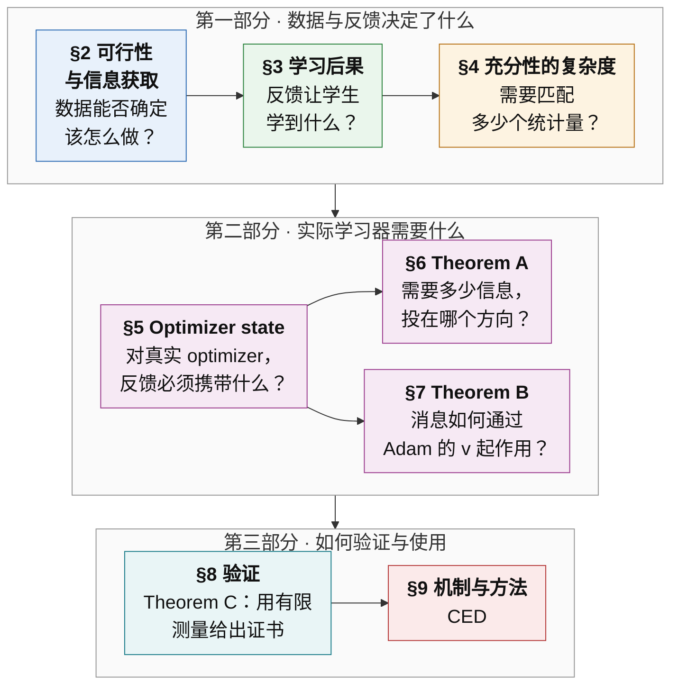
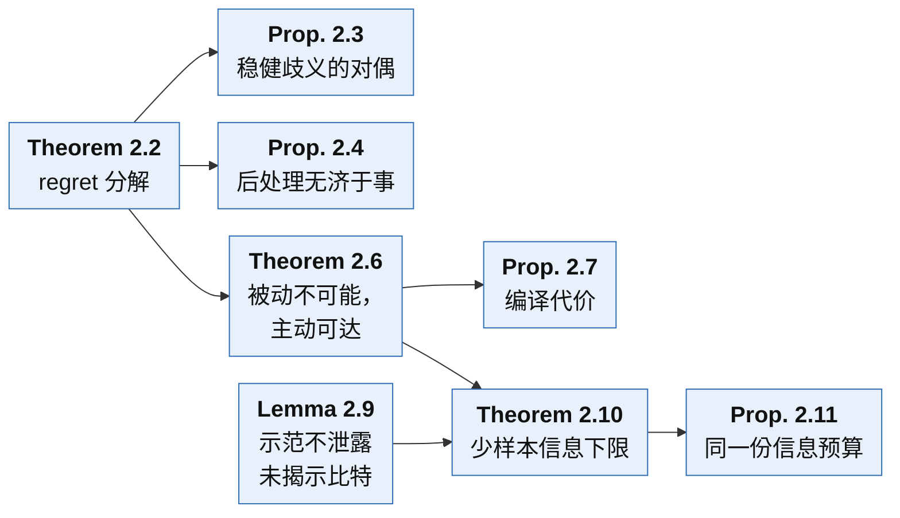
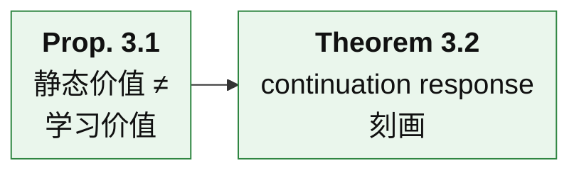
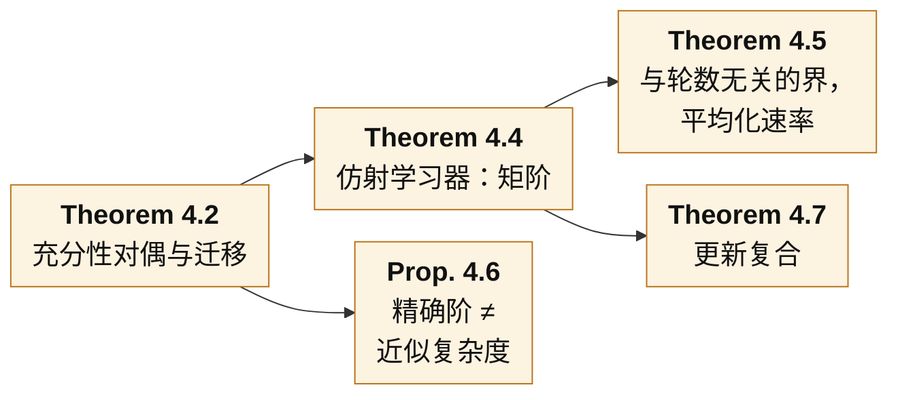
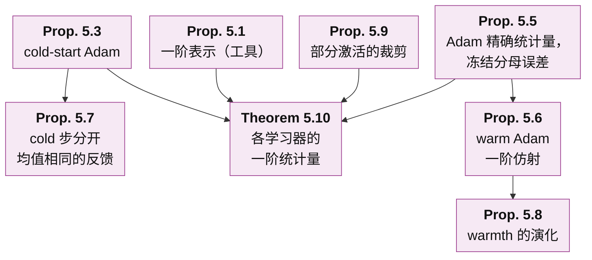
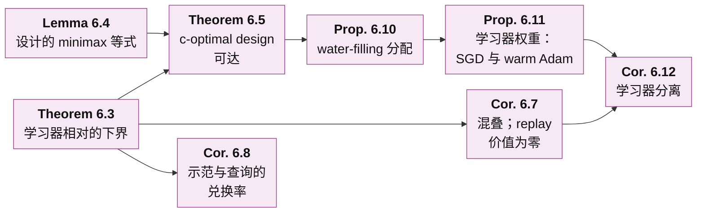
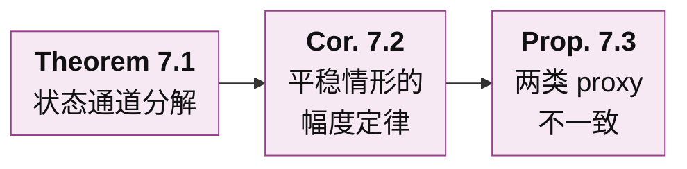
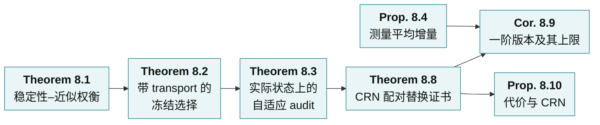
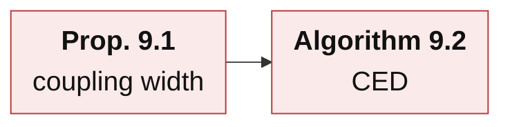

# 面向 Agent 蒸馏的学习器相对经验充分性：理论框架

[English](README.md)

**核心问题.** 给定声明的部署任务、允许的实验和实际使用的学习过程，反馈来源之间的哪些差别会改变蒸馏后学生的最终任务表现？

**中心结果.**

- **Theorem A（§6，learner-relative information bound）.** 对任何蒸馏器（包括 replay、改写、合成），最小可达的一阶误差由示范与查询关于一个学习器相关泛函的 Fisher information 决定。这个泛函的梯度 $`c=\sum_tJ_t^{*}g_t`$ 把学习器的 Jacobian 与任务的 continuation 梯度合在一起。在可辨识性与增长条件下，这个界在常数因子内可以由正则化的 Elfving c-optimal 查询设计达到。因此，同一批示范可以对一个学习器充分、对另一个不充分。
- **Theorem B（§7，Adam 的二阶矩通道）.** 在 warm Adam 下，一条消息的一阶价值精确分解为参数通道、动量通道与二阶矩通道。平稳情形下，相对幅度为 $`\lambda`$ 的消息的 response 有精确的 mean-field 形式：小增量时它是凹的二次函数，在显式的 $`\lambda^*`$ 处最大，在 $`2\lambda^*`$ 附近变负。只看参数步的分数和只看方向的分数因此都是不一致的排序器。
- **Theorem C（§8，可审计的证书）.** 对一轮训练做 common random numbers（CRN）配对替换，可以直接测得一个反馈律的有限效应。由此得到的证书既不需要 continuation value 的梯度，也不需要曲率常数，半径只含统计项与 surrogate 校准项。

这三条建立在 §2–§5 的基础上：
- regret 的精确分解，以及获取缺失信息的代价；
- 以 continuation response 作为充分性的对象；
- 充分性的复杂度；
- 每种 optimizer 让反馈必须携带的统计量。

§9 由以上全部结果推出方法 CED。

**怎么读这一页.** 本页按"先整体、后局部"的顺序展开，类似广度优先搜索。

| 层 | 内容 | 读完能回答 |
|---|---|---|
| [第 0 层](#第-0-层--一段话) | 一段话说清整个框架 | 框架要回答什么问题，分几步回答 |
| [第 1 层](#第-1-层--八个部分) | 八个部分及其衔接 | 每一部分回答什么问题、得到什么结论、交给下一部分什么 |
| [第 2 层](#第-2-层--主要结果) | 每个主要结果的白话解释 | 每个结果说了什么、直觉是什么、在链条里起什么作用 |
| [第 3 层](#第-3-层--各节的精确陈述) | 精确陈述与推导要点 | 确切的假设与公式，以及它们是怎样证明的 |

记号统一在 [§1](#1-设定与记号) 中给出。§2–§9 各有一个**证明**页和一个**实验**页：
- 证明页给出完整推导；
- 实验页给出检验各陈述的检查，写明做这个检查的原因、设置、结果，以及结果为什么支持该陈述。

所有测量结果都在实验页上；本页只有陈述和说明性的例子。

**范围.**
- 本页每个陈述都在其所列假设下有证明。少数陈述只在明确给出的渐近区间内证明到首项，本页在相应位置注明。
- 证明都是有限维的，或者带有明确的正则性假设。
- 实验页上的检查是精确有限计算或受控小网络。
- Theorem A–C 在真实模型上的检验已经设计好（[Remark 9.4](proofs/09_mechanism_and_method_ZH.md#s9-4)），尚未运行。

---

## 第 0 层 · 一段话

蒸馏一个 agent 时，手里有：
- 一个预训练学生；
- 每个任务族 $`K`$ 条可信的 teacher 示范；
- 一份允许做的额外实验预算（teacher 调用、环境分支、reset）；
- 一个固定的训练配方（optimizer、学习率、步数）。

可以喂给学生的反馈来源很多：示范本身、replay、合成改写、新的查询、同一批单元的不同打包方式。框架要回答的是：**这些反馈来源之间的哪些差别，会真正改变蒸馏后学生的最终任务表现？** 回答分八步。

1. **数据能不能确定该怎么做（§2）.**
   - 学生的 regret 精确拆成表示、信息、算法三项。
   - 信息缺口只能靠新的实验补上，replay 和改写补不了；即使 teacher 处处最优，也可能留下信息缺口。
   - 补上缺口大约需要 $`\log(1/\delta)/\Delta^2`$ 次查询；示范与查询共用一份信息预算。
2. **反馈对学习器做了什么（§3）.**
   - teacher 质量、策略价值、梯度均值都不能决定学生学到什么。
   - 不变量是 *continuation response*：收到一条消息、执行实际更新、再把训练走完之后的期望最终回报。
3. **两个来源需要在多少统计量上一致（§4）.**
   - 恰好是 response 类张成的空间。对平均化学习器，这是一个由部署长度决定的矩阶。
   - 近似复杂度可以远低于精确阶；非线性更新会把阶数相乘。
4. **实际的 optimizer 让反馈必须携带什么（§5）.**
   - 在一阶意义下，起作用的是*完整学习器状态*（参数加 optimizer state）的平均增量。这个一阶表示是工具，不作为新结论。
   - 对 SGD、momentum、cold 与 warm Adam、裁剪、Lion、LoRA，这个统计量都可以显式写出。warm Adam 的精确统计量是 Adam 增量的均值，常见的"均值加二阶矩"描述只在冻结分母近似下成立，误差显式。
   - Adam 坐标的 warmth 只在训练早期按 $`1/(\beta_2s)`$ 下降，之后停在 $`(1-\beta_2)/\beta_2`$。
5. **需要多少信息、投在哪个方向（Theorem A，§6）.**
   - 学习器决定数据必须在哪个方向 $`c`$ 上有信息。任何蒸馏器的 minimax 误差，在常数因子内等于 learner-relative information norm。
   - 推论：面对混叠时 replay 价值为零；示范与查询按一个学习器相对的兑换率互换；查询按 water-filling 分配；对同一任务，SGD 与 Adam 需要的数据可以差别很大。
6. **一条消息如何通过 Adam 的二阶矩起作用（Theorem B，§7）.**
   - 一条消息还会通过 $`v`$ 改变此后所有步长。
   - 由此得到幅度定律：存在最优幅度；小增量时，在约两倍最优幅度处变号。只看参数的分数与余弦分数在一个显式区域内排错。
7. **怎样用有限测量为选择出具证书（Theorem C 与 §8）.**
   - 有限 audit 需要覆盖（transport）项；在实际状态上做全尾段 audit 是安全的，但代价高。
   - 一阶分数需要 continuation 梯度；只有一阶项超过二阶余项时才能认证一个候选对，平均增量沿梯度方向相同的候选对永远认证不了。
   - CRN 配对替换直接测有限效应。还剩两个开放问题：一个远小于先验区间的可证明区间界，以及一个可检验的 surrogate 校准迁移条件。
8. **方法（§9）.**
   - 一个有严格零假设的机制检验（coupling width）。
   - Consequence-Calibrated Experience Distillation（CED）：按学习器相对的设计获取信息，按经过认证的实测后果选择反馈，匹配学习器的统计量，计入覆盖，冻结之后再检验迁移。

---

## 第 1 层 · 八个部分



箭头表示论证的主线。其他依赖：
- §2 给出 Theorem A（§6）所用的获取预算。
- §3 给出 §8 通篇使用的 continuation 分解。
- §4 给出 §8 使用的近似宽度与系数稳定性。
- §5 给出 §8 要测量的统计量。

### §2 · 可行性与信息获取

**问题.** 在学生能执行的策略里，现有数据能否确定该怎么做？补上缺失的信息要花多少代价？

**结论.**
- 学生相对最优参考策略的 regret 精确拆成表示误差、信息误差、算法误差三项，三项都非负，彼此不能替代。
- 信息误差为零，当且仅当与数据相容的所有环境有一个共同的最优策略。任何与环境无关的数据后处理（replay、改写、合成）都不能降低它。
- 即使 teacher 在每个环境里都最优，也可能留下信息缺口。reset 查询这类主动实验可以补上它，代价是 $`\log(1/\delta)/\Delta^2`$ 量级的查询次数，这个量级既充分又必要。把获得的事实编译进学生是另一项、小得多的代价。
- 在隐藏事实模型中，$`K`$ 条示范之后剩下的信息损失有显式公式；硬预算下的最优查询是按权重贪心；示范与自适应查询满足同一个线性的信息预算不等式。

**交给下一部分.** 缺失的事实必须去获取。学习器从信息里得到什么，是 §3 的问题；某个*具体*学习器需要多少信息，由 §6 的 Theorem A 回答。

### §3 · 学习后果

**问题.** 给定一个反馈来源，学生实际会学到什么？比较两个来源时，应该比较什么？

**结论.**
- 静态指标不够。两个来源可以有同样好的 teacher，给每个学生同样的策略价值，却蒸馏出不同的学生。
- 两个标签包可以有相同的边缘分布和相同的梯度均值，学习价值却不同，而且换一个任务，差的符号反过来。
- 正确的对象是 continuation response：收到消息 $`y`$、执行实际更新、再按参考配方把训练走完之后的期望最终任务回报。
- 整个训练过程的差距精确等于逐轮的单边界替换效应之和。两个消息律可以互换，当且仅当它们在每个 response 下的期望都相同。
- 当保证只在部分状态空间上成立时，离开这部分的概率只付一次，而不是每轮付一次。

**交给下一部分.** 充分性的对象是 response 类 $`\mathcal G`$。§4 度量它的复杂度，§5–§7 对真实 optimizer 计算它，§8 用有限数据检验它。

### §4 · 充分性的复杂度

**问题.** 两个反馈来源要在多少个统计量上一致，才能对学习等价？

**结论.**
- 若用一组特征的均值判断等价，精确充分当且仅当每个 response 都落在这组特征张成的空间里；所需统计量的个数是 response 类张成空间的维数。
- 近似地，最坏情形误差是 response 被这组特征一致逼近的最佳误差的两倍。不受限的学习器需要整个分布。
- 对平均独立经验块的学习器、部署至多 $`N`$ 个决策的任务，恰好需要直到 $`N`$ 阶的全部矩，而且每一阶都必要。
- 差距随*独立*块的个数衰减，速率由第一个不匹配的累积量决定，与训练轮数无关；replay 与确定性合成不会让它衰减。
- 近似复杂度可以远低于精确阶（光滑的值约为 $`\sqrt N`$），奇偶性类型的值是例外。
- 非线性更新的复合会把所需的阶相乘。

**交给下一部分.** 需要匹配什么由学习器本身决定，所以必须对实际 optimizer 建模（§5）；在近似中，系数的稳定性很关键（§8）。

### §5 · Optimizer state 与一阶表示

**问题.** 对实际使用的学习器（SGD、momentum、Adam/AdamW、裁剪、Lion、LoRA），反馈必须携带什么？

**结论.**
- 把任何带状态的一阶 optimizer 写成从 consumed gradient 到完整学习器状态增量的映射。在一阶意义下，一个反馈律对训练结果的影响，等于 continuation value 的梯度与平均完整状态增量的内积。
- 更高阶对应增量的更高阶矩。这个展开是标准的 Taylor 展开加 telescoping，与 stochastic modified equations、TracIn、metagradient 属于同一类计算，这里只当作工具。
- 各 optimizer 的不同之处在于增量：
  - cold-start Adam 第一步只看梯度符号，而它的状态保留了幅度。
  - warm Adam 的精确一阶统计量是 Adam 增量的均值。在冻结分母近似下，它化为梯度的均值与二阶矩，误差逐坐标由该坐标的 warmth 控制。
  - warmth 只在 $`s(1-\beta_2)\ll1`$ 时按 $`1/(\beta_2s)`$ 下降，之后停在 $`(1-\beta_2)/\beta_2`$，所以冻结分母误差每步有一个下限。
  - 裁剪使统计量变成裁剪后的均值。裁剪以概率 $`p_{\rm act}`$ 激活时，只有平均方向起作用，误差不超过 $`c(1-p_{\rm act})`$。

**交给下一部分.** 增量映射告诉我们反馈律必须携带*什么*。Theorem A（§6）问数据关于它必须有多少信息，Theorem B（§7）追踪一条消息如何经过 Adam 的二阶矩，§8 测量它。

### §6 · Theorem A：学习器相对的信息界

**问题.** 给定 $`K`$ 条示范和 $`n`$ 次允许的查询，*任何*蒸馏器能把 oracle 反馈的一阶效应复现到什么程度？查询应该怎么花？

**结论.**
- 令 $`c=\sum_tJ_t^*g_t`$。它把学习器的 Jacobian $`J_t`$（平均增量随未知环境参数怎样变化）与任务的 continuation 梯度 $`g_t`$ 合在一起。
- 任何蒸馏器的 minimax 误差，在 $`1/4`$ 到 $`1`$ 的常数因子内，等于 learner-relative information norm：$`c^\top h`$ 与示范、查询在方向 $`h`$ 上的 Fisher information 之比的最大值。
- 渐近最优的查询服从以 $`c`$ 为目标的 Elfving c-optimal design，并加以正则化，使每个方向最终都可辨识。
- 推论：
  - 示范看不见的方向，使任何数量的 replay 都没有价值；
  - 一条示范值多少次查询，由学习器决定；
  - 在状态覆盖模型中，查询按 water-filling 流向学习器相对权重高、teacher 覆盖低的状态；
  - SGD 按访问频率的平方给状态加权，频繁访问区间的 warm Adam 按访问频率本身加权，所以 Adam 放大学生的长尾；
  - 裁剪使学习器对梯度尺度不敏感。

**交给下一部分.** Theorem A 说明信息需要投在哪个方向。对 Adam，这个方向有一部分经过二阶矩，§7 分析它。

### §7 · Theorem B：Adam 的二阶矩通道

**问题.** 在 warm Adam 下，一条消息怎样作用于最终结果？梯度什么时候越大反而越糟？

**结论.**
- 一条消息的一阶价值精确分解为参数、动量、二阶矩三个通道，各通道的 costate 由一个显式的反向递推给出。
- 在平稳的 mean-field 情形下，对相对幅度为 $`\lambda`$ 的消息，response 有精确闭式：
  - 小增量时是凹的二次函数，相对误差有一个已证明的 $`(1-\beta_2)\max\lbrace1,\lambda^2\rbrace`$ 量级的界；最优幅度 $`\lambda^*=(1-\beta_1^{T+1})/(\rho\,\omega_T)`$，在 $`2\lambda^*`$ 附近变号；
  - $`\lambda`$ 很大时直接效应饱和，而对后续步长的压低持续累积；极限有显式表达式，极限为负时 response 有一个正的零点。
- 因此，只看参数的分数和余弦分数会在一个显式区域内把消息对排错。在 SGD 下，价值只是 $`\lambda`$ 的线性函数。

**交给下一部分.** 二阶矩通道占主导的地方，增量相对 $`v`$ 很大，一阶排序会失效；那里必须测量有限替换（§8）。

### §8 · 验证与 Theorem C

**问题.** 只有有限次测量时，怎样证明一个反馈来源优于另一个，或者从若干候选中选出好的？

**结论.**
- 测量一个特征的误差会被该特征的系数放大；残差小而系数巨大的拟合不是证明。
- 按固定 audit 单元上测得的差距做选择，需要一个显式的覆盖（transport）项。训练到达未覆盖的状态时，audit 可以读出 0，而学习差距是 1。
- 在实际状态上做配对全尾段实验、按置信下界选择，相对参考的损失不会超过 $`\delta`$，但每个候选需要很多配对副本。
- 平均增量本身很容易估计。但一阶分数需要 continuation 梯度和余项常数；只有当候选对的一阶项超过二阶余项时才能认证它。所以平均增量沿梯度方向相同的候选对，无论真实差距多大，一阶分数都认证不了。
- Theorem C 用一轮的 CRN 配对替换代替梯度：期望意义下精确，半径只含统计项与校准项，每个被审计状态需要 $`(M+1)r`$ 个 surrogate 尾段。
- 开放问题：一个远小于先验区间的可证明区间界，以及一个可检验的校准迁移条件。没有它们，严格证书是成立的，但很少能下结论。

**交给下一部分.** §9 把获取、选择与认证组装成一个方法。

### §9 · 机制与方法

**问题.** 由此推出什么方法？哪个机制值得单独检验？

**结论.**
- *Coupling width*：固定每个单元的边缘分布，只改变单元如何组成联合训练包；结果不变当且仅当包的回报在单元之间可加。一步 SGD 是严格的零假设。
- *CED（Consequence-Calibrated Experience Distillation）*：记录完整学习器状态；在编译之前按学习器相对的设计获取缺失信息；用 CRN 配对替换分数选择候选反馈律，并用全尾段 audit 校准、计入覆盖；匹配学习器的统计量，并把消息幅度控制在相对 running 二阶矩合适的范围；冻结选择器，再检验迁移。
- 每条设计规则都是某个已证明陈述的推论。

---

## 第 2 层 · 主要结果

每个主要结果用三行说明：说了什么、直觉、在链条中的作用。精确陈述见[第 3 层](#第-3-层--各节的精确陈述)。图中箭头 A → B 表示 B 的陈述或证明用到了 A。

### §2 · 可行性与信息获取：主要结果



**[Theorem 2.2](proofs/02_feasibility_and_acquisition_ZH.md#s2-2) · regret 分解与决策歧义**
- *说了什么.* 学生的期望 regret 精确等于三项之和：表示误差（学生类达不到参照最优）、信息误差（数据分不清可能的环境）、算法误差（学习器没有用好数据），三项都非负。信息误差为零，当且仅当对几乎每条 transcript，与它相容的所有环境有共同的最优策略。
- *直觉.* 信息误差是即使学得完美也会损失的部分，因为数据让正确的决策悬而未决。
- *作用.* 它把"信息不够"与"学得不好"分开；后面每个信息论结果都从这里出发。

**[Proposition 2.3](proofs/02_feasibility_and_acquisition_ZH.md#s2-3) · 稳健歧义的对偶**
- *说了什么.* 在一组无法区分的环境上，对混合策略最小化的最坏 regret，等于在这组环境的先验上最大化的 Bayes 信息 regret。它为零，当且仅当有一个策略在所有这些环境中都最优。
- *直觉.* 无法区分的世界迫使学习器对冲；对冲的代价是对抗最不利先验的零和博弈的值。
- *作用.* 它给信息误差一个可计算的 minimax 形式，并给出衡量其大小的证书（一个先验）。

**[Proposition 2.4](proofs/02_feasibility_and_acquisition_ZH.md#s2-4) · 后处理不能降低信息 regret**
- *说了什么.* 任何不依赖于环境的 transcript 随机变换，例如 replay、改写、转述或合成，都只会提高信息误差或使它不变；加入与环境无关的数据不改变它。
- *直觉.* 加工数据可以让已有信息更容易学到，从而降低算法误差，但造不出缺失的事实。
- *作用.* 它排除了用生成数据代替新实验的可能；§6 把它推广成学习器相对的陈述。

**[Theorem 2.6](proofs/02_feasibility_and_acquisition_ZH.md#s2-6) · 被动不可能，主动可达**
- *说了什么.* 在一个两世界族中，teacher 在两个世界里都最优，它的示范在两个世界里分布相同，但学生的最优策略相反。只看示范的学习器总会在某一个世界里至少损失 $`\Delta`$。允许 reset 查询时，$`\log(1/\delta)/\Delta^2`$ 量级的查询既必要又充分（差一个常数因子）。
- *直觉.* 完美的示范展示的是 teacher 做了什么，而不是能力不同的学生应该怎么做；学生得自己去试。
- *作用.* 它说明方法为什么需要主动获取这一步，也说明示范质量不等于信息充分。

**[Proposition 2.7](proofs/02_feasibility_and_acquisition_ZH.md#s2-7) · 编译代价**
- *说了什么.* 获取到缺失的事实之后，把它教给学生还需要 $`O(\log(1/\delta_L))`$ 个编译标签，与差距 $`\Delta`$ 无关。
- *直觉.* 弄清该做什么，与教会学生去做，是两个代价不同的问题。
- *作用.* 在方法的记账中，它把获取预算（真实查询）与编译预算（合成标签）分开。

**[Lemma 2.9](proofs/02_feasibility_and_acquisition_ZH.md#s2-9) · 示范不泄露未揭示比特**
- *说了什么.* 在隐藏比特模型中，给定观察到的一切，任何示范都没揭示的比特仍是独立的均匀硬币。
- *直觉.* 揭示机制与事实本身无关时，示范揭示了一部分事实，却不提供关于其余事实的证据。
- *作用.* 它是精确信息下限与贪心查询最优性的关键一步。

**[Theorem 2.10](proofs/02_feasibility_and_acquisition_ZH.md#s2-10) · 少样本信息下限与硬预算下的最优查询**
- *说了什么.* $`K`$ 条示范之后，信息下限为 $`\tfrac12\sum_jw_j(1-q_j)^K`$，其中 $`w_j`$ 是上下文 $`j`$ 在部署中的权重，$`q_j`$ 是一条示范揭示它的概率。硬预算为 $`n`$ 次查询时，先查权重最大的未见事实是最优的，按揭示出的值调整查询没有帮助。
- *直觉.* 每条示范以一定概率揭示一个事实；没揭示的只能去查，而且先查最值钱的缺口。
- *作用.* 它把 $`K`$ 写进理论，也是 §6 中查询分配的模型情形。

**[Proposition 2.11](proofs/02_feasibility_and_acquisition_ZH.md#s2-11) · 示范与查询共用一份信息预算**
- *说了什么.* 要以至多 $`\delta`$ 的误差区分两个世界，$`K`$ 条示范的 KL 信息加上每次查询的 KL 信息乘以期望查询次数，必须达到 $`\mathrm{kl}(1-\delta,\delta)`$；这对每个自适应的查询–停止规则都成立。
- *直觉.* 示范与查询往同一个账户里存钱：有信息的示范减少所需的查询，replay 什么也不存。
- *作用.* 它给出 $`K`$ 与查询预算之间的兑换率；§6 让这个兑换率依赖于学习器。

### §3 · 学习后果：主要结果



**[Proposition 3.1](proofs/03_learning_consequence_ZH.md#s3-1) · 静态价值不等于学习价值**
- *说了什么.* 两个数据来源可以让类中每个学生的策略值相同、teacher 的值也相同，蒸馏出的学生回报却分别是 $`\tfrac{43}{80}`$ 与 $`\tfrac{41}{80}`$。两个标签包可以边缘分布相同、平均梯度相同，学习价值却相差 $`\eta^2/8`$，换一个任务，符号反过来。
- *直觉.* 学到什么，取决于数据*经由更新*如何作用在学生身上，以及部署奖励什么；数据本身看起来有多好并不决定这一点。
- *作用.* 它排除了把 teacher 质量、策略值和平均梯度当作充分性判据，并引出 continuation response。

**[Theorem 3.2](proofs/03_learning_consequence_ZH.md#s3-2) · continuation response 刻画**
- *说了什么.* 两个训练过程之间的差，精确等于逐轮"把这一轮的参照步换成备选步"的效应之和，效应用备选过程实际访问的状态上的 continuation value 度量。两个消息分布在每个单边界替换上可互换，当且仅当它们在每个 response 上的期望相同。当保证只在部分状态空间上成立时，离开它的概率只付一次，而不是每轮付一次。
- *直觉.* response $`g(y)`$ 回答的是："如果这一轮喂给学生 $`y`$，之后按声明的方式继续训练，最终得分是多少"；它把更新规则、其余训练和部署任务都包含在内。
- *作用.* 它确定了充分性的对象，即 response 类 $`\mathcal G`$；§4 度量它的大小，§5–§7 研究它对 optimizer 的依赖，§8 研究如何用有限数据检验它。

### §4 · 充分性的复杂度：主要结果



**[Theorem 4.2](proofs/04_complexity_of_sufficiency_ZH.md#s4-2) · 充分性对偶与迁移**
- *说了什么.* 用一组固定特征的均值来判断两个 feedback law。特征均值相等能推出 response 均值相等，当且仅当每个 response 都落在特征张成的空间里，所以所需统计量个数为 $`\dim\mathrm{span}(\lbrace\mathbf 1\rbrace\cup\mathcal G)-1`$。近似地，最坏的未分辨差距等于用特征一致逼近 response 的最佳误差的两倍；若 response 写成"特征的线性组合加小残差"，特征均值的误差按系数大小传递过来。不受限的 learner 需要整个分布。
- *直觉.* 特征均值相等只排除了特征所张方向上的差别；response 落在这个空间之外的部分，是接口看不见的风险。
- *作用.* 它把"需要匹配多少信息"变成可计算的量（span 维数或逼近宽度），§4、§5、§8 后面的计数都用到它。

**[Theorem 4.4](proofs/04_complexity_of_sufficiency_ZH.md#s4-4) · 仿射 learner：矩阶充分且必要**
- *说了什么.* 学生有若干二元动作 context，部署至多 $`N`$ 次决策，learner 对独立的经验块取凸平均。此时两个数据源对所有这样的任务与 learner 等价，当且仅当它们直到 $`N`$ 阶的联合矩都相等。每一阶都必要；在网格上精确个数为 $`\binom{k+N}N-1`$；在二元块上，少于 $`2^k-1`$ 个统计量可能留下大小为 1 的差距。
- *直觉.* 部署价值是学生动作概率的 $`N`$ 次多项式，平均化把它的期望变成不超过 $`N`$ 阶块矩的组合。
- *作用.* 这是 Theorem 4.2 一个可以完全算出来的实例，说明信息阶数由部署长度决定。

**[Theorem 4.5](proofs/04_complexity_of_sufficiency_ZH.md#s4-5) · 与轮数无关的界与平均化速率**
- *说了什么.* 对凸仿射 learner，学习差距不超过"系数质量 × 最大矩差"，与训练轮数无关。对 $`n`$ 个独立块取平均时，差距按 $`n^{-(r-1)}`$ 衰减，$`r`$ 是第一个不匹配的 cumulant 的阶数。重放同一个块，或用它的确定性改写来训练，差距完全不衰减。
- *直觉.* 只有独立的证据才能缩小差距；重复和确定性合成增加的是暴露量，不是信息。
- *作用.* 它把独立块数与 epoch 数分开。§2 与 §9 的方法都用这条计数规则。

**[Proposition 4.6](proofs/04_complexity_of_sufficiency_ZH.md#s4-6) · 精确阶不等于近似复杂度**
- *说了什么.* 对价值 $`p^N`$，匹配到大约 $`\sqrt{N\log(1/\varepsilon)}`$ 阶的矩，差距就小于 $`\varepsilon`$，尽管精确相等需要 $`N`$ 阶。对 parity，任何次数低于 $`N`$ 的多项式的逼近误差都不小于 $`1/2`$。
- *直觉.* 光滑的 response 有很好的低阶近似；组合型的 response 没有。
- *作用.* 它说明真正起作用的复杂度是逼近宽度而不是次数，并引出 §8 回答的系数稳定性问题。

**[Theorem 4.7](proofs/04_complexity_of_sufficiency_ZH.md#s4-7) · 更新复合放大信息需求**
- *说了什么.* 复合的多项式更新会把 response 关于早期块的次数，乘上所有后续更新的次数，且这个界可以达到。阈值 learner 只用一次决策就破坏了一阶矩充分性。对光滑 SGD 的一步，两个 feedback law 之差等于梯度均值项加梯度二阶矩项再加三阶余项；逐步误差只有在稳定性条件下才线性累加。
- *直觉.* 同样的数据喂给不同的 learner，需要的信息量不同；需要匹配什么，是"learner 与任务复合"的性质。
- *作用.* 它说明必须对实际的 optimizer 建模，这正是 §5 的内容。

### §5 · Optimizer state 与一阶表示：主要结果



**[Proposition 5.1](proofs/05_optimizer_state_ZH.md#s5-1) · optimizer 变换后的展开**
- *说了什么.* 任何带状态的一阶 optimizer（包括裁剪）都可以写成一个映射：把 consumed gradient 映成完整状态（参数、momentum、二阶矩、计数器）的增量。两个 feedback law 造成的训练结果之差，在一阶意义下等于各轮 continuation value 梯度与平均状态增量之差的内积之和，余项由增量的二阶矩控制。在 continuation value 梯度方向上匹配平均增量，一阶充分；在一阶项超过余项处也必要；统计量的个数是线性化 response 类的维数。
- *直觉.* 反馈只通过它造成的状态变化影响学生。一阶意义下只有这个变化的均值起作用，而且只在 continuation value 关心的方向上起作用。
- *作用.* 一个工具，与 stochastic modified equations、TracIn、metagradient 是同类计算（Remark 5.2）。后面所有"学习器要求反馈携带什么"的结论，以及 Theorem A–C，都从它算出。

**[Proposition 5.3](proofs/05_optimizer_state_ZH.md#s5-3) · Cold-start Adam：符号商与 optimizer 记忆**
- *说了什么.* 从零 optimizer state 出发，Adam 的第一步只依赖 $`g_i/(\lvert g_i\rvert+\epsilon)`$。$`\epsilon=0`$ 时必须匹配联合符号分布（只匹配符号边缘分布不够）；$`\epsilon>0`$ 时必须匹配整个梯度分布。momentum 保留了第一个梯度的幅度，所以符号相同的两段历史，第二步可以方向相反。
- *直觉.* Adam 的第一步几乎就是 sign descent：幅度从步长里被除掉了，却保留在 optimizer state 中。
- *作用.* 说明矩充分性不能搬到 Adam 上，要匹配什么取决于 optimizer state。

**[Proposition 5.5](proofs/05_optimizer_state_ZH.md#s5-5) · Adam 的精确一阶统计量与冻结分母误差**
- *说了什么.* 对 Adam，一阶统计量是 Adam 增量的精确均值，它不由梯度的均值与二阶矩决定。把分母冻结在保留值上，一步 Adam 就变成带 preconditioner 的 momentum SGD，每个坐标的误差至多 $`\eta u_i\min\lbrace\kappa_i/2,1\rbrace`$，$`\kappa_i`$ 是 warmth。
- *直觉.* Adam 除以一个 running RMS，而新梯度本身会扰动这个 RMS。扰动小（warmth 小）时，这一步对梯度近似线性。
- *作用.* 把"warm Adam 只需要 $`(\mathbb E G,\mathbb E G^{\odot2})`$"里藏着的两个近似分开：一阶展开与冻结分母。

**[Proposition 5.6](proofs/05_optimizer_state_ZH.md#s5-6) · warm Adam 关于 consumed gradient 一阶仿射**
- *说了什么.* warm 状态下，单边界 response 等于 consumed gradient 的一个仿射函数加显式残差：冻结分母项、二阶矩敏感度项与曲率项。平均 consumed gradient 相同的分布，response 之差至多为残差的期望。
- *直觉.* 二阶矩积累起来以后，一步 Adam 就像一步带 preconditioner 的 momentum SGD。
- *作用.* 说明从训练的哪个阶段起，仿射与一阶理论适用于 Adam，并给出可计算的误差。

**[Proposition 5.7](proofs/05_optimizer_state_ZH.md#s5-7) · cold 步在一阶就分开均值相同的反馈**
- *说了什么.* cold 状态下，两个均值相同的梯度分布——甚至低于任意固定阶的矩全都相同——给出的 response 在学习率的一阶上就不同。
- *直觉.* cold 步看的是相对于零的符号，而符号概率不是低阶矩的函数。
- *作用.* 证明 cold 窗口是真正的一阶效应，不是高阶修正。

**[Proposition 5.8](proofs/05_optimizer_state_ZH.md#s5-8) · warmth 的演化**
- *说了什么.* 梯度平稳时，吸收 $`s`$ 次计算后的 mean-field warmth 恰为 $`(1-\beta_2)/(\beta_2(1-\beta_2^s))`$。只有在 $`s(1-\beta_2)\ll1`$ 时它才按 $`1/(\beta_2s)`$ 下降，之后停在 $`(1-\beta_2)/\beta_2`$。沿整个训练累积，由 warmth 控制的误差至多 $`c\log(1+R/W)+c(1-\beta_2)R`$；bias correction 不改变 warmth；学习率为零的 warm-up 推进二阶矩的方式与真实步完全相同。
- *直觉.* $`\beta_2`$ 固定就意味着平均窗口固定，所以每个新梯度都会按固定的相对幅度扰动分母。
- *作用.* 确定 warm 描述在训练中准确到什么程度，并说明 $`\beta_2`$ 固定时它永远不会变成精确的。

**[Proposition 5.9](proofs/05_optimizer_state_ZH.md#s5-9) · 部分激活的梯度裁剪**
- *说了什么.* 裁剪后梯度的均值可以精确拆成未裁剪部分与裁剪方向部分；用 $`c`$ 乘平均方向代替它，误差至多 $`c(1-p_{\rm act})`$，$`p_{\rm act}`$ 是裁剪激活的概率。
- *直觉.* 只有低于阈值的梯度保留幅度，其余只贡献方向。
- *作用.* 对任意激活率给出精确的裁剪统计量，并量化"只有方向起作用"这一简化。

**[Theorem 5.10](proofs/05_optimizer_state_ZH.md#s5-10) · 各学习器的一阶统计量**
- *说了什么.* Proposition 5.1 的统计量在常见学习器下的具体形式：SGD 与 momentum 是平均梯度；warm Adam 是 Adam 增量的精确均值，只在冻结分母近似下等于 $`(\mathbb EG,\mathbb EG^{\odot2})`$，二阶矩经由 $`v`$ 进入；cold Adam 的一步在参数上是符号分布；裁剪是裁剪后均值；Lion 是翻转概率；$`B=0`$ 的 LoRA 是 rank-$`r`$ sketch，第一步 $`A`$ 不动。
- *直觉.* 平均梯度相同的两个反馈来源，在 cold Adam、裁剪，或经由二阶矩通道的 warm Adam 下，仍然可以在一阶上不同。
- *作用.* 告诉方法在每种训练配方下要匹配、要测量什么，并为 Theorem A 的 learner Jacobian 和 Theorem B 的状态通道提供输入。

### §6 · Theorem A：学习器相对的信息界：主要结果



**[Theorem 6.3](proofs/06_learner_relative_information_ZH.md#s6-3) · 学习器相对的下界**
- *说了什么.* 任何蒸馏器（包括 replay、改写、合成）在声明任务上复现 oracle 反馈的一阶效应时，误差都不低于 learner-relative information norm $`\mathfrak n_{K,n}`$ 的四分之一。这个范数度量的是：$`K`$ 条示范与 $`n`$ 次查询，在学习器与任务真正在意的那个方向 $`c`$ 上，揭示了多少关于环境的信息。
- *直觉.* 数据分不开、而这个学习器会区别对待的两个环境，必然让蒸馏器在其中一个上出错；要紧的是学习器的敏感方向 $`c`$，而不是环境之间差得有多大。
- *作用.* 它是 Theorem A 的下半部分，也是"先获取、再编译"的定量核心；混叠与兑换率两个推论都由它得到。

**[Lemma 6.4](proofs/06_learner_relative_information_ZH.md#s6-4) · 设计的 minimax 等式**
- *说了什么.* 在所有查询 design 中，估计学习器相对泛函所能达到的最小方差，恰好等于信息范数的平方，并且最优 design 存在。它就是以"学习器 Jacobian 作用在 continuation value 梯度上"为目标向量的 c-optimal（Elfving）design。
- *直觉.* 查询最好花在对学习器唯一用到的那个方向最有信息量的地方；这是一个经典的设计问题，只是目标由学习器决定。
- *作用.* 它把下界变成一条获取规则，并让上界可以计算。

**[Theorem 6.5](proofs/06_learner_relative_information_ZH.md#s6-5) · 可达性**
- *说了什么.* 用（略加正则化的）c-optimal 查询 design 估计环境，再在估计值处发出 oracle 律，误差可以达到 $`\mathfrak n_{K,n}(1+o(1))`$。与下界合起来，最优一阶误差被夹在 $`\mathfrak n_{K,n}/4`$ 与 $`\mathfrak n_{K,n}`$ 之间。
- *直觉.* 信息一旦按正确的方向收集到，plug-in 蒸馏器最多只损失一个常数因子。
- *作用.* 它是 Theorem A 的上半部分：信息范数就是衡量"一批经验对给定学习器是否充分"的正确尺度。

**[Corollary 6.7](proofs/06_learner_relative_information_ZH.md#s6-7) · 混叠与 replay 的零价值**
- *说了什么.* 若两个环境给出相同的示范分布，而学习器相对泛函在两者之间不同，那么对每个 $`K`$，任何蒸馏器的误差都至少是差值的一半；replay 与改写都帮不上忙。
- *直觉.* 同一份证据复制再多次，也分不开这份证据本来就分不开的两个世界。
- *作用.* 它是被动不可能性的学习器相对形式：示范够不够，取决于学习器。

**[Corollary 6.8](proofs/06_learner_relative_information_ZH.md#s6-8) · 示范与查询的兑换率**
- *说了什么.* 示范与查询逐方向地进入同一个线性信息预算；在起约束作用的方向上，一条示范值确定数量的查询，而这个数量取决于学习器。
- *直觉.* 示范与查询都是证据，它们的相对价值在于各自在这个学习器关心的方向上揭示了多少。
- *作用.* 它给出"多收集示范"与"花查询"之间的取舍。

**[Proposition 6.10](proofs/06_learner_relative_information_ZH.md#s6-10) · 显式信息界与 water-filling**
- *说了什么.* 当示范覆盖 teacher 的状态、训练发生在学生的状态上时，误差由 $`\sum_sW_s/N_s`$ 决定，其中 $`W_s`$ 是状态 $`s`$ 的学习器相对权重，$`N_s`$ 是它的样本数。最优查询分配是 water-filling，$`n_s^\star=(\sqrt{W_s/\lambda}-k_s)_+`$；权重为正而完全未被覆盖的状态留下不可约的误差。
- *直觉.* 查询应当流向学习器敏感、而 teacher 没去过的状态。
- *作用.* 它让 Theorem A 在 agent 蒸馏中可以直接使用，并给方法的获取步骤提供分配规则。

**[Proposition 6.11](proofs/06_learner_relative_information_ZH.md#s6-11) · SGD 与 warm Adam 的学习器权重**
- *说了什么.* SGD 下一个状态的权重随访问频率的平方增长；warm Adam 在频繁访问区间只随访问频率线性增长，并带有一个二阶矩项；对极少访问的状态，Adam 又回到平方标度，但只看反馈的符号。
- *直觉.* Adam 按 running second moment 归一化，少见状态的步长和常见状态一样大，所以这些状态上的反馈比在 SGD 下更重要。
- *作用.* 它说明 optimizer 改变了信息该在哪里收集，并给出 §7 还会用到的常数 $`\kappa_{\rm iso}`$。

**[Corollary 6.12](proofs/06_learner_relative_information_ZH.md#s6-12) · 学习器之间的分离**
- *说了什么.* 揭示了反馈方向、却不揭示其尺度的示范，对始终裁剪的学习器充分，对 SGD 则对每个 $`K`$ 都不充分。定量地看，一条很少被覆盖的长尾状态，让 warm Adam 付出的信息代价远高于 SGD。
- *直觉.* 学习器忽略的东西不必告诉它；学习器放大的东西必须告诉得很准。
- *作用.* 它把"同一批示范可以对一个学习器充分、对另一个不充分"变成了形式化的结论。

### §7 · Theorem B：Adam 的二阶矩通道：主要结果



**[Theorem 7.1](proofs/07_second_moment_channel_ZH.md#s7-1) · 状态通道分解**
- *说了什么.* 对 Adam/AdamW（含 bias correction、decoupled weight decay、$`\epsilon`$ 与全局范数裁剪），continuation value 关于 $`(\theta,m,v)`$ 的梯度由一个显式的反向 costate 递推给出。由此，一条消息的一阶价值精确分解为参数通道、动量通道和二阶矩通道三项，最后一项只通过 $`g\odot g`$ 依赖于消息。
- *直觉.* 一条消息不只改变当前这一步，还改变 running second moment，进而改变此后每一步的步长。二阶矩通道就是这种改变带来的代价或收益。
- *作用.* 让 [Proposition 5.1](proofs/05_optimizer_state_ZH.md#s5-1) 中 optimizer state 那一部分在 Adam 下可以算出来。幅度定律（Corollary 7.2）和只看参数的影响分数为何失效（Proposition 7.3），都建立在它上面。

**[Corollary 7.2](proofs/07_second_moment_channel_ZH.md#s7-2) · 平稳情形的幅度定律**
- *说了什么.* 在 warm 的平稳状态上，对幅度为 $`\lambda`$（以 running RMS 为单位）的同向消息，mean-field response 是一个对任意 $`\lambda`$ 都成立的显式有限和。
  - 增量小时，它是凹二次函数，最优幅度为 $`\lambda^\star=(1-\beta_1^{T+1})/(\rho\,\omega_T)`$，在 $`2\lambda^\star`$ 附近变号，并有显式误差界。
  - 幅度很大时，直接效应饱和。大消息最终劣于不发消息，当且仅当信噪比 $`\rho`$ 超过 $`\kappa_{\rm iso}(T)/\Lambda(T)`$。
- *直觉.* 大梯度会把 $`v`$ 抬高，从而把此后许多步的步长都压小；超过一定幅度，压小步长的损失就超过大步带来的收益。SGD 没有这种效应，越大越好。
- *作用.* 第一个定量说明 Adam 下消息价值关于幅度非单调的结果。它要求方法控制消息幅度相对于 running second moment 的大小，并预言了线性化分数会在哪里误导。

**[Proposition 7.3](proofs/07_second_moment_channel_ZH.md#s7-3) · 两类 proxy 的不一致性**
- *说了什么.* 不看部署任务的统计量，不可能对所有任务都把反馈律排对。在 Corollary 7.2 的区间里，只看参数的一阶分数会把两条同向消息排反，例如用 Adam 步长的 TracIn 式分数和 fixed-state 的 Adam data Shapley。余弦分数（LESS 式）则根本分不开这两条消息。
- *直觉.* 只看参数的分数看到的是更大的当前步，漏掉了经由 $`v`$ 造成的损失；余弦只看方向，而两条消息方向相同。
- *作用.* 用证明而不只是经验观察说明：两类常用的影响分数在 Adam 下都不是一致的排序器。这是方法按实测后果做选择的理由之一。

### §8 · 验证与 Theorem C：主要结果



**[Theorem 8.1](proofs/08_verification_ZH.md#s8-1) · 稳定性–近似的权衡**
- *说了什么.* 每个特征均值只知道到某个容差时，无法排除的最大 response 差距，恰好等于两件事的最优权衡：特征对 response 近似得多好，以及这个近似的系数有多大（每个系数按其特征的容差加权）。
- *直觉.* 测不准一个特征的代价，就是它在 response 模型里的系数。残差小但系数巨大的拟合什么也证明不了。
- *作用.* 它决定 audit 应该测哪些特征、哪些 response 模型可以充当证书；Theorem 8.2 的冻结 audit 与方法中的拟合规则都用到它。

**[Theorem 8.2](proofs/08_verification_ZH.md#s8-2) · 带 transport 的冻结有限接口选择**
- *说了什么.* 事先固定 audit cell 与特征，测量每个候选相对参照的特征差距，选差距最小的。被选候选的学习差距，不超过测得的差距、统计误差、训练实际访问状态上的显式 transport 项，再加上离开认证状态集的概率。transport 项去不掉。
- *直觉.* audit 只看得见它覆盖的状态。训练一旦走到别处，audit 可以报告零差距，而学习差距却是最大的。
- *作用.* 它给出任何有限、冻结的 audit 的正确形式，并指出它的盲区；Theorem 8.3 与 8.8 在实际状态上做 audit，避开了这个盲区。

**[Theorem 8.3](proofs/08_verification_ZH.md#s8-3) · 实际状态上的自适应 audit；保真与改进**
- *说了什么.* 在训练实际到达的状态上，对每个候选与参照做配对的完整尾段实验，按置信下界选择。这样得到的训练流程相对参照的损失不超过置信水平，并保留被认证的改进。所需的配对副本数是显式的，而且很大。
- *直觉.* 直接测"替换这一轮有没有帮助"，不外推到没见过的状态；代价是大量完整的训练尾段。
- *作用.* 它是可靠但昂贵的参照 audit，用来校准更便宜的测量，例如 Theorem 8.8 的 surrogate。

**[Proposition 8.4](proofs/08_verification_ZH.md#s8-4) · 在实际状态上测量平均增量**
- *说了什么.* 一个 feedback law 的 optimizer 平均增量只需梯度计算就能估计，在 Hilbert 范数下误差按样本量的平方根倒数下降。配上 continuation 的梯度范数与曲率，就能界定一轮的效应，沿抽样的训练运行还能界定整次训练的差距。
- *直觉.* 一阶证书中数据那一侧很便宜；continuation 那一侧（梯度与曲率）这些样本根本不测。
- *作用.* 它是一阶 audit 中便宜的那一半，也说明了一阶 audit 为什么仍需要校准常数。

**[Theorem 8.8](proofs/08_verification_ZH.md#s8-8) · CRN 配对替换证书（Theorem C）**
- *说了什么.* 在被 audit 的状态上，让每个候选各走一轮，然后用同一组随机数为每个候选跑同一个 surrogate 尾段。配对分数差的均值无偏地估计这次替换的有限效应；empirical Bernstein 半径加上 surrogate 校准项，就把它变成对所有候选对同时成立的证书。
- *直觉.* 不先线性化再去界线性化的误差，而是直接测有限效应；共用随机数抵消了两条独立尾段会额外带来的噪声。
- *作用.* 它用测量代替了 oracle continuation 梯度，是方法中的选择步骤。它的严格性依赖于已知的分数范围与校准过的 surrogate，这正是 Remark 8.12 中的未解决问题。

**[Corollary 8.9](proofs/08_verification_ZH.md#s8-9) · 一阶版本、它的 margin 判据与上限**
- *说了什么.* 只要两个候选的一阶差超过二阶余项，一阶分数就能把它们排对。用有限差分测量时，一阶证书在统计半径之外还要付有限差分项和余项；一阶项低于余项的候选对，无论真实差距多大，它都无法认证。
- *直觉.* 主要靠增量的二阶矩来区分的候选（Adam 下正是如此），任何一阶证书都看不见。
- *作用.* 它划出基于梯度的分数可信的范围，说明 Theorem 8.8 为什么改测有限替换；也把 oracle 诊断与可测量的证书区分开。

**[Proposition 8.10](proofs/08_verification_ZH.md#s8-10) · 代价，以及 common random numbers 带来的好处**
- *说了什么.* 证书对每个候选、每个副本需要一条 surrogate 尾段。要让范围项变小，大约需要一百个副本；common random numbers 把每个配对分数的方差压到两个候选增量之差的量级。
- *直觉.* 共用随机数的配对尾段之所以不同，只是因为候选不同；独立的尾段还会因为训练本身的噪声而不同。
- *作用.* 它确定方法的副本预算，并指出 pathwise Lipschitz 界是得到可证明范围的途径。

### §9 · 机制与方法：主要结果



**[Proposition 9.1](proofs/09_mechanism_and_method_ZH.md#s9-1) · 耦合宽度**
- *说了什么.* 固定每个反馈单元的边缘分布，只改变单元怎样组合成联合训练 packet。所有这样的重组都不改变学习结果，当且仅当联合 packet 的 response 是各单元贡献之和；否则变化不超过 response 到可加表距离的两倍。同一参数处的一步 SGD 对重组严格不变，连续多步则不然。
- *直觉.* 如果学习器只是逐个"看"单元，分组就无关紧要。分组只通过单元之间的交互起作用，而交互在一次更新影响下一次更新时才出现。
- *作用.* 一个带严格零假设的机制检验；也说明了为什么候选 feedback law 要由它发出的 packet 来确定，而不是一袋单元。

**[Algorithm 9.2](proofs/09_mechanism_and_method_ZH.md#s9-2) · Consequence-Calibrated Experience Distillation（CED）**
- *说了什么.* 记录完整的 optimizer state；先获取缺失的信息，把查询花在学习器相对权重高、teacher 覆盖低的状态上；编译候选 feedback law；记录每个候选的学习器统计量，标记相对 running 二阶矩过大的消息；在实际状态上用 CRN 配对替换测量每个候选的后果，并用少量全尾段 audit 校准；按下置信界选择，重新 audit，冻结，再检验迁移。每项输出都标明它带有的保证，或标为经验结论。
- *直觉.* 按"这个学习器在当前状态下吃下这条反馈之后会发生什么"来选反馈，而不是按反馈本身看起来好不好。
- *作用.* 框架的落脚点：每一步都是 §2–§8 某个结论的推论，计划中的真实模型检验 R0–R3 检验的就是这些步骤。

**[Remark 9.3](proofs/09_mechanism_and_method_ZH.md#s9-3) · 六条设计规则**
- *说了什么.* 先获取，再编译；按实测后果选择；匹配学习器的统计量，而不是原始梯度；拟合系数稳定的 response 模型；计入覆盖，用配对替换做认证，一阶 audit 只用在 margin 占优处；先冻结，再检验迁移。每条规则都是相应保证的必要条件，并由所引结论推出。
- *直觉.* 每条规则堵住方法"声称多于所知"的一种途径：凭空造信息、相信 proxy、忽略 optimizer、过拟合 response 模型、外推 audit、在评测数据上调参。
- *作用.* 它解释了 Algorithm 9.2 为什么有这些步骤；方法的消融实验也应当一次去掉一条规则。

---

## 1. 设定与记号

下面的对象在每一节都会用到；各节自己的定义在该节内编号。

<a id="s1-1"></a>

**Definition 1.1（环境、学生策略类、参考策略类）.**

- 环境 $`E`$ 包括任务分布、状态转移、反馈语义、评分方式和固定的执行 harness。所有回报都在 $`[0,1]`$ 内，$`J_E(\pi)`$ 是策略 $`\pi`$ 的期望回报。
- 学生可部署的策略构成类 $`\Pi\subseteq\Pi_{\rm ref}`$，其中 $`\Pi_{\rm ref}`$ 是参考类（例如 teacher 能执行的策略）。记

```math
J_E^\Pi=\max_{\pi\in\Pi}J_E(\pi),\qquad J_E^{\rm ref}=\max_{\pi\in\Pi_{\rm ref}}J_E(\pi).
```

<a id="s1-2"></a>

**Definition 1.2（信息与蒸馏器）.**

- $`I_0`$ 是公共初始信息：预训练学生、已知规则，以及每个任务族 $`K`$ 条可信示范。teacher 模型的预训练知识属于 $`I_0`$，在同一族的每个环境中都相同。
- $`D`$ 是从允许的实验中得到的全部后续信息的 transcript：在新状态上调用 teacher、环境分支、reset。观察新状态的 teacher 调用算作一次实验，即属于 $`D`$。
- *蒸馏器*是从 $`(I_0,D)`$ 与私有随机性（与环境无关）到反馈协议（Definition 1.3）的任意可测映射。replay、改写、合成都是蒸馏器；除 $`(I_0,D)`$ 外，它们不获取任何依赖于环境的信息。

<a id="s1-3"></a>

**Definition 1.3（完整学习器状态、反馈律、更新）.**

- *完整学习器状态*（complete learner state）为 $`z=(\theta,o)\in\mathcal Z`$。其中 $`\theta`$ 是参数，$`o`$ 是 optimizer state（对 Adam 是矩 $`m,v`$ 与步数），连同更新所用的缓冲区、采样器状态和历史。$`\mathcal Z`$ 是实 Hilbert 空间，内积为 $`\langle\cdot,\cdot\rangle`$，有限维时即 Euclid 空间。
- 第 $`t`$ 轮，*反馈律*（feedback law）$`P_t(\cdot\mid z)`$ 发出消息 $`Y_t`$。消息给出 *consumed gradient* $`G_t(z,Y_t)`$，它在梯度累积、归一化以及所述 optimizer 包含的裁剪之后定义。实际更新为 $`Z_{t+1}=U_t(z,Y_t,\xi_t)`$，$`\xi_t`$ 是更新的随机性。
- 对一阶 optimizer，$`U_t(z,y,\xi)=z+\Delta_t\big(z,G_t(z,y,\xi)\big)`$。*增量映射* $`\Delta_t`$ 包含学习率调度、动量、二阶矩、weight decay 与裁剪。反馈律 $`P`$ 的*平均增量*为

```math
\mu^P_t(z)=\mathbb E_{Y\sim P_t(\cdot\mid z)}\,\Delta_t\big(z,G_t(z,Y)\big).
```

- *协议* $`S`$ 是反馈律的序列 $`(P^S_t)_{t<R}`$。对 $`\xi_t`$ 积分得到它的 learning kernel $`K^S_t`$；参考协议记为 $`K^0_t`$。所有协议从同一个初始状态分布出发。
- 最终学生的得分为 $`F_E(z)=J_E(\pi_z)\in[0,1]`$，$`L_E(S)=\mathbb E\,F_E(Z^S_R)`$。每一轮都用同一个反馈律 $`P`$ 的协议记作 $`L(P)`$。

<a id="s1-4"></a>

**Definition 1.4（continuation value、response、声明类）.**

- 参考尾段下的 *continuation value* 为

```math
V^0_R=F_E,\qquad V^0_t=K^0_tV^0_{t+1}\quad(t<R).
```

- $`V^0_{t+1}(z)`$ 是在第 $`t`$ 轮之后从状态 $`z`$ 出发、按参考协议继续训练所得的期望最终得分。尾段从另一个协议 $`P`$ 开始时记作 $`V^P_{t+1}`$。
- 消息 $`y`$ 在第 $`t`$ 轮、状态 $`z`$ 上的*单边界 response* 为

```math
g_{t,z}(y)=\mathbb E_{\xi_t}\,V^0_{t+1}\big(U_t(z,y,\xi_t)\big).
```

- 它是收到 $`y`$、执行实际更新、再走完声明的参考尾段之后，最终真实任务回报的期望。
- *声明类*（declared class）$`\mathcal V`$ 收集所声明的部署任务与参考尾段对应的 continuation value；*response 类* $`\mathcal G`$ 收集相应的 response。两者都在选择任何反馈之前固定。

<a id="s1-5"></a>

**Definition 1.5（计数）.** 下列计数始终分开，不混用。

| 记号 | 含义 |
|---|---|
| $`K`$ | 每个任务族的可信示范条数 |
| $`n_{\rm query}`$，§6 中记为 $`n`$ | 额外允许的实验（查询）次数 |
| §4 中的 $`n`$ | 独立经验块的个数 |
| $`R`$ | 训练更新次数 |
| $`N`$ | 一次部署中的决策个数 |
| $`d`$ | 线性统计量（特征）的个数 |
| §8 中的 $`r`$、$`M`$ | 每个被审计状态的 CRN 副本数、候选反馈律的个数 |

把一个块 replay $`n`$ 次，不等于 $`n`$ 个独立块。

**约定.**

- 陈述按节编号，每节共用一个计数器（Definition 5.4 之后是 Proposition 5.5）。
- *Theorem A* 指 Theorem 6.3 与 6.5，*Theorem B* 指 Theorem 7.1 与 Corollary 7.2，*Theorem C* 指 Theorem 8.8。
- 某个字母在局部被重用时，所在的节会在第一次使用时说明；例如 $`s`$ 在 §5 中是已吸收的梯度评估次数，在 §6 中是 agent 的状态。

---

## 第 3 层 · 各节的精确陈述

每个陈述带有证明页上的编号、精确形式、推导要点、依赖关系，以及指向证明和检验它的实验的链接。

### §2 · 可行性与信息获取：精确陈述

[证明](proofs/02_feasibility_and_acquisition_ZH.md) · [实验](experiments/02_feasibility_and_acquisition_ZH.md)

**本节做什么.**

- 它问的是：现有数据能否确定学生该怎么做，并把这个问题与学生学得好不好分开（[Theorem 2.2](proofs/02_feasibility_and_acquisition_ZH.md#s2-2)）。
- 它说明任何对现有数据的加工都补不上缺失的事实（[Proposition 2.4](proofs/02_feasibility_and_acquisition_ZH.md#s2-4)），而即使是最优 teacher 的示范也可能留下这样的缺口（[Theorem 2.6](proofs/02_feasibility_and_acquisition_ZH.md#s2-6)）。
- 它给缺失信息定价：主动查询需要 $`\Delta^{-2}\log(1/\delta)`$ 量级，编译另算（[Proposition 2.7](proofs/02_feasibility_and_acquisition_ZH.md#s2-7)）。
- 它把示范数 $`K`$ 显式写进结论，并说明示范与查询共用一份信息预算（[Theorem 2.10](proofs/02_feasibility_and_acquisition_ZH.md#s2-10)、[Proposition 2.11](proofs/02_feasibility_and_acquisition_ZH.md#s2-11)）。

**设定（[Definition 2.1](proofs/02_feasibility_and_acquisition_ZH.md#s2-1)）.** 有限的环境集合 $`\mathcal E`$ 带有以公共初始信息 $`I_0`$ 为条件的先验。学生类 $`\Pi`$ 包含在参照类 $`\Pi_{\rm ref}`$ 中，取值 $`J_E(\pi)\in[0,1]`$。transcript $`D`$ 包含学习器可以做的所有实验，学习器输出 $`\widehat\pi\sim\lambda(\cdot\mid D)`$。记 $`J_E^\Pi=\max_{\pi\in\Pi}J_E(\pi)`$，$`J_E^{\rm ref}=\max_{\pi\in\Pi_{\rm ref}}J_E(\pi)`$，并令 $`B(D)=\max_{\pi\in\Pi}\mathbb E[J_E(\pi)\mid D]`$ 为 Bayes 值。

#### Theorem 2.2 · regret 分解与决策歧义

**(a)** 对任何学习器，

```math
\mathbb E[J_E^{\rm ref}-J_E(\widehat\pi)]=\underbrace{\mathbb E[J_E^{\rm ref}-J_E^\Pi]}_{\mathcal R_{\rm rep}}+\underbrace{\mathbb E J_E^\Pi-\mathbb E_D B(D)}_{\mathcal R_{\rm info}}+\underbrace{\mathbb E_D\big[B(D)-\mathbb E[J_E(\widehat\pi)\mid D]\big]}_{\mathcal R_{\rm alg}},
```

且三项都非负。

**(b)** $`\mathcal R_{\rm info}=0`$，当且仅当对每条概率为正的 transcript $`D`$，后验概率为正的环境有共同的最优策略：$`\bigcap_{E:\mu(E\mid D)>0}\arg\max_{\pi\in\Pi}J_E(\pi)\neq\varnothing`$。

*推导要点.*

- 加减 $`\mathbb EJ_E^\Pi`$ 与 $`\mathbb E_DB(D)`$ 即得恒等式。
- 表示项非负，因为 $`\Pi\subseteq\Pi_{\rm ref}`$。信息项非负，因为对每个策略都有 $`\mathbb E[J_E(\pi)\mid D]\le\mathbb E[J_E^\Pi\mid D]`$。算法项非负，因为给定 $`D`$ 时学习器的输出是策略的凸组合，不会超过其中最好的那个。
- 对 (b)，$`\mathcal R_{\rm info}`$ 是对 transcript 求和的一组非负括号 $`\sum_E\mu(E\mid D)(J_E^\Pi-J_E(\pi_D))`$；一个括号为零，恰好当后验最优策略在每个后验概率为正的环境中都最优。

*用到* [Definition 2.1](proofs/02_feasibility_and_acquisition_ZH.md#s2-1)。*被用于* [Theorem 2.6](proofs/02_feasibility_and_acquisition_ZH.md#s2-6)、[Theorem 2.10](proofs/02_feasibility_and_acquisition_ZH.md#s2-10)、[Proposition 3.1](proofs/03_learning_consequence_ZH.md#s3-1)、[Remark 9.3](proofs/09_mechanism_and_method_ZH.md#s9-3)。

[证明](proofs/02_feasibility_and_acquisition_ZH.md#s2-2) · [实验](experiments/02_feasibility_and_acquisition_ZH.md#c2-1) · 已证明

#### Proposition 2.3 · 稳健歧义的对偶

对有限的环境类 $`C`$，

```math
r(C)=\min_{\rho\in\Delta(\Pi)}\max_{E\in C}\big[J_E^\Pi-\mathbb E_{\pi\sim\rho}J_E(\pi)\big]=\max_{\mu\in\Delta(C)}\Big[\sum_E\mu_EJ_E^\Pi-\max_{\pi\in\Pi}\sum_E\mu_EJ_E(\pi)\Big].
```

若没有允许的实验能区分 $`C`$ 中的成员，则每个学习器在 $`C`$ 上的最坏期望 regret 至少为 $`r(C)`$，且 minimax 混合策略能达到它；$`r(C)=0`$ 当且仅当有某个策略在每个 $`E\in C`$ 中都最优。

*推导要点.*

- regret 矩阵 $`M_{E,\pi}=J_E^\Pi-J_E(\pi)`$ 定义了一个有限零和博弈：学习器选策略的混合，对手选 $`C`$ 上的先验。
- 由 von Neumann minimax 定理交换 min 与 max；内层最小值在纯策略处取到，即得对偶形式。
- 当实验分不清 $`C`$ 中的成员时，学习器的输出分布在它们中都相同，所以其最坏 regret 至少等于博弈的值。

*例示.* 两个环境偏好相反的策略，regret 矩阵为 $`\begin{pmatrix}0&0.2\cr 0.2&0\end{pmatrix}`$。minimax 混合是 $`(\tfrac12,\tfrac12)`$，最不利先验也是 $`(\tfrac12,\tfrac12)`$，两边都等于 $`0.1`$。这是混合平均的 regret：单个抽样策略的 regret 是 0 或 0.2。

*用到* [Definition 2.1](proofs/02_feasibility_and_acquisition_ZH.md#s2-1)。*被用于* [Theorem 2.6](proofs/02_feasibility_and_acquisition_ZH.md#s2-6)（一个 $`r(C)=\Delta`$ 的实例）。

[证明](proofs/02_feasibility_and_acquisition_ZH.md#s2-3) · [实验](experiments/02_feasibility_and_acquisition_ZH.md#c2-2) · 已证明

#### Proposition 2.4 · 后处理不能降低信息 regret

若 $`D'\sim\kappa(\cdot\mid D)`$，且 kernel $`\kappa`$ 不依赖于 $`E`$，则 $`\mathbb E\max_\pi\mathbb E[J_E(\pi)\mid D']\le\mathbb E\max_\pi\mathbb E[J_E(\pi)\mid D]`$，即 $`\mathcal R_{\rm info}(D')\ge\mathcal R_{\rm info}(D)`$。往 $`D`$ 中加入满足 $`Z\perp E\mid(D,I_0)`$ 的变量 $`Z`$，不改变 $`B`$ 与 $`\mathcal R_{\rm info}`$。

*推导要点.*

- $`E\to D\to D'`$ 是 Markov 链，所以 $`\mathbb E[J_E(\pi)\mid D']=\mathbb E\big[\mathbb E[J_E(\pi)\mid D]\,\big|\,D'\big]`$。
- 条件期望的最大值不超过最大值的条件期望，所以 $`D'`$ 下的 Bayes 值不超过 $`D`$ 下的。

*例示.* 用与环境无关的流程对 $`K`$ 条示范做 replay、转述或改写，就是这样的 $`\kappa`$。它可以让学生更好地拟合已有信息（降低 $`\mathcal R_{\rm alg}`$），但不能降低 $`\mathcal R_{\rm info}`$。

*用到* [Definition 2.1](proofs/02_feasibility_and_acquisition_ZH.md#s2-1)。*被用于* [Theorem 2.6(a)](proofs/02_feasibility_and_acquisition_ZH.md#s2-6)、[Theorem 2.10](proofs/02_feasibility_and_acquisition_ZH.md#s2-10)（replay 的价值为零）、[Corollary 6.7](proofs/06_learner_relative_information_ZH.md#s6-7)、[Remark 9.3](proofs/09_mechanism_and_method_ZH.md#s9-3)。

[证明](proofs/02_feasibility_and_acquisition_ZH.md#s2-4) · [实验](experiments/02_feasibility_and_acquisition_ZH.md#c2-1) · 已证明

#### Theorem 2.6 · 被动不可能，主动可达

**设定（[Definition 2.5](proofs/02_feasibility_and_acquisition_ZH.md#s2-5)）.** 未知符号 $`v\in\lbrace -1,+1\rbrace`$ 选定两个世界之一，差距 $`0<\Delta\le1/8`$ 已知。均匀的隐藏状态 $`s\in\lbrace0,1\rbrace`$ 对 teacher 可见、对混叠的学生不可见，学生以概率 $`p`$ 选动作 $`A`$。teacher 在每个状态都选成功概率为 1 的动作，所以在两个世界中都最优；学生的值为 $`J_v(p)=\tfrac34+v\Delta(2p-1)`$，最优动作取决于 $`v`$。在查询接口下，学习器可以自适应地 reset 到 $`s=1`$、执行 $`A`$ 并观察结果，查询次数是停时 $`N`$。

- **(a)** 只看示范（及其后处理）的学习器都满足 $`\max_v\mathbb E[J_v^\Pi-J_v(\widehat p)]\ge\Delta`$。
- **(b)** 若在每个世界中，学习器以至少 $`1-\delta`$ 的概率输出 regret 不超过 $`\Delta/2`$ 的学生，则

```math
\mathbb E_vN\ge\frac{\mathrm{kl}(1-\delta,\delta)}{\mathrm{kl}(\tfrac12+2\Delta,\tfrac12-2\Delta)}\ge\frac{\mathrm{kl}(1-\delta,\delta)}{64\Delta^2}.
```

- **(c)** $`\lceil\log(1/\delta)/(8\Delta^2)\rceil`$ 次查询就够了。

*推导要点.*

- (a) 在两个世界中，一条示范都以各一半的概率是"在 $`s=0`$ 选 $`A`$ 并成功"或"在 $`s=1`$ 选 $`B`$ 并成功"，所以示范的分布、进而学习器输出的分布都与 $`v`$ 无关。值关于 $`p`$ 是仿射的；两个 regret 分别为 $`2\Delta(1-m)`$ 与 $`2\Delta m`$（$`m`$ 是平均输出），最大值不小于平均值 $`\Delta`$。
- (b) 把"在两个世界中都 $`\Delta/2`$ 最优"化为对事件 $`\lbrace\widehat p>1/2\rbrace`$ 的二元检验。对停时用 Wald 恒等式，整条 transcript 的 KL 散度等于期望查询次数乘以单次查询的 KL；data processing 使它至少为 $`\mathrm{kl}(1-\delta,\delta)`$。常数 64 来自 $`\mathrm{kl}(\tfrac12+u,\tfrac12-u)\le16u^2`$。
- (c) 对独立的查询结果取平均，用单侧 Hoeffding 不等式。

*用到* [Theorem 2.2](proofs/02_feasibility_and_acquisition_ZH.md#s2-2)、[Propositions 2.3–2.4](proofs/02_feasibility_and_acquisition_ZH.md#s2-3)。*被用于* [Theorem 2.10](proofs/02_feasibility_and_acquisition_ZH.md#s2-10)、[Proposition 2.11](proofs/02_feasibility_and_acquisition_ZH.md#s2-11)（change of measure 技术）、[Corollary 6.7](proofs/06_learner_relative_information_ZH.md#s6-7)、[Remark 9.3](proofs/09_mechanism_and_method_ZH.md#s9-3)。

[证明](proofs/02_feasibility_and_acquisition_ZH.md#s2-6) · [实验](experiments/02_feasibility_and_acquisition_ZH.md#c2-3) · 已证明

#### Proposition 2.7 · 编译代价

估计出符号之后，从目标 $`q\in\lbrace\tfrac18,\tfrac78\rbrace`$ 生成 $`m\ge\lceil32\log(2/\delta_L)\rceil`$ 个标签并拟合其频率，则以至少 $`1-\delta_L`$ 的概率有 $`\lvert\widehat p-q\rvert\le\tfrac18`$。编译出的学生以至少 $`1-\delta-\delta_L`$ 的概率 regret 不超过 $`\Delta/2`$。

*推导要点.* 编译标签的经验频率由双侧 Hoeffding 不等式控制，再对识别失败与编译失败取 union bound。标签数与 $`\Delta`$ 无关。

*例示.* 识别消耗的是真实的环境查询，量级 $`\Delta^{-2}\log(1/\delta)`$；编译消耗的是合成标签，量级 $`\log(1/\delta_L)`$。$`\Delta`$ 小时，预算几乎全部花在获取上，两者必须分开记账。

*用到* [Theorem 2.6](proofs/02_feasibility_and_acquisition_ZH.md#s2-6)。*被用于* [Algorithm 9.2](proofs/09_mechanism_and_method_ZH.md#s9-2)。

[证明](proofs/02_feasibility_and_acquisition_ZH.md#s2-7) · [实验](experiments/02_feasibility_and_acquisition_ZH.md#c2-3) · 已证明

#### Lemma 2.9 与 Theorem 2.10 · 隐藏比特、信息下限与最优查询

**设定（[Definition 2.8](proofs/02_feasibility_and_acquisition_ZH.md#s2-8)）.** 比特 $`\Theta_1,\dots,\Theta_d`$ 独立且均匀；上下文 $`j`$ 的部署权重为 $`w_j`$，正确决策为 $`\Theta_j`$。$`K`$ 条示范中的每一条揭示一个随机的比特子集，子集的抽取与比特独立，比特 $`j`$ 被揭示的概率为 $`q_j`$。硬预算允许 $`n`$ 次查询，每次揭示一个选定的比特。$`U_K`$ 是没有被任何示范揭示的比特集合，$`M_K=\lvert U_K\rvert`$。

**[Lemma 2.9](proofs/02_feasibility_and_acquisition_ZH.md#s2-9).** 给定完整 transcript，未揭示的比特仍然独立、均匀，并且与 transcript 独立。

**[Theorem 2.10](proofs/02_feasibility_and_acquisition_ZH.md#s2-10).**

- **(a)** 不查询时，$`K`$ 条示范之后可达到的最小 regret 为

```math
R_{\rm info}(K)=\tfrac12\textstyle\sum_jw_j(1-q_j)^K .
```

- **(b)** 有 $`n`$ 次查询时，$`R_{\rm info}(K,n)=\tfrac12\,\mathbb E\big[\sum_{r>n}w_{(r)}\big]`$，对未见比特的排序权重求和；先查权重最大的未见比特是最优的，按值自适应地查询没有收益。一般而言 $`\mathbb E[(M_K-n)_+]\ne(\mathbb EM_K-n)_+`$。

*推导要点.*

- *Lemma 2.9.* 联合分布中唯一依赖于未揭示比特的因子是常数 $`2^{-d}`$。
- *(a)* 任何动作猜对一个未揭示比特的概率都是一半，已揭示的比特可以照抄，所以条件 regret 是未见比特权重的一半。比特 $`j`$ 在 $`K`$ 条独立示范中都没被揭示的概率是 $`(1-q_j)^K`$。
- *(b)* 对剩余预算归纳。一次查询之后，由 Lemma 2.9，剩下的问题与查到的值无关，所以按值分支没有收益，每一步贪心地查权重最大的未见比特就是最优的。$`x\mapsto(x-n)_+`$ 是凸函数，由 Jensen 不等式，两个表达式有大小关系，在小例子中是严格的。

*例示.* $`d=8`$ 个等权上下文、每条示范均匀地揭示其中一个时，下限为 $`\tfrac12(7/8)^K`$：一个事实以 $`(7/8)^K`$ 的概率一直躲过示范；一次定向查询必定消除一个未见事实，而多一条示范只以 $`1/8`$ 的概率消除每个未见事实。

*用到* [Theorem 2.2](proofs/02_feasibility_and_acquisition_ZH.md#s2-2)、[Proposition 2.4](proofs/02_feasibility_and_acquisition_ZH.md#s2-4)。*被用于* [Proposition 6.10](proofs/06_learner_relative_information_ZH.md#s6-10)（学习器相对的 coverage 模型）、[Algorithm 9.2](proofs/09_mechanism_and_method_ZH.md#s9-2)。

[证明](proofs/02_feasibility_and_acquisition_ZH.md#s2-10) · [实验](experiments/02_feasibility_and_acquisition_ZH.md#c2-4) · 已证明

#### Proposition 2.11 · 示范与查询共用一份信息预算

在两世界的自适应获取中，设 $`K`$ 条独立同分布的示范每条 KL 信息至多 $`\kappa_D`$，给定任何历史时每次查询的 KL 信息至多 $`\kappa_X`$，查询–停止规则与世界无关且 $`N\le N_{\max}`$，最终决策在每个世界中出错的概率至多 $`\delta<\tfrac12`$。则

```math
K\kappa_D+\kappa_X\,\mathbb E_vN\ge\mathrm{kl}(1-\delta,\delta).
```

若 $`\kappa_X=0`$ 且 $`K\kappa_D<\mathrm{kl}(1-\delta,\delta)`$，则任何查询预算都不够。

*推导要点.* 查询选择、停止与随机化 kernel 在两个世界中相同，在似然比中相消，只剩示范项与查询结果项。前者的期望至多为 $`K\kappa_D`$，后者至多为 $`\kappa_X\,\mathbb EN`$；data processing 不等式要求两者之和至少为 $`\mathrm{kl}(1-\delta,\delta)`$。

*用到* [Theorem 2.6](proofs/02_feasibility_and_acquisition_ZH.md#s2-6)（技术）。*被用于* [Corollary 6.8](proofs/06_learner_relative_information_ZH.md#s6-8)。

[证明](proofs/02_feasibility_and_acquisition_ZH.md#s2-11) · [实验](experiments/02_feasibility_and_acquisition_ZH.md#c2-5) · 已证明

#### Remark 2.12 · 学习器相对的版本

[Corollary 6.7](proofs/06_learner_relative_information_ZH.md#s6-7) 推广了 Theorem 2.6(a) 与 Proposition 2.4：若示范分不清两个在学习器相关泛函 $`\Psi`$ 上不同的环境，则任何蒸馏器（包括 replay、改写与合成）都不能做得比差值的一半更好，对任何 $`K`$ 都如此。[Corollary 6.8](proofs/06_learner_relative_information_ZH.md#s6-8) 把 Proposition 2.11 推广成逐方向的预算，其中方向由学习器加权。对象从策略的决策 regret 变成了反馈律相对于学习器更新的 fidelity。

[证明](proofs/02_feasibility_and_acquisition_ZH.md#s2-12)

### §3 · 学习后果：精确陈述

[证明](proofs/03_learning_consequence_ZH.md) · [实验](experiments/03_learning_consequence_ZH.md)

**本节做什么.**

- 它说明反馈的静态度量（teacher 质量、策略值、标签边缘分布、平均梯度）决定不了学生学到什么（[Proposition 3.1](proofs/03_learning_consequence_ZH.md#s3-1)）。
- 它找出正确的对象：continuation response，即一条消息、实际更新、再加上声明的其余训练之后，最终任务回报的期望（[Theorem 3.2](proofs/03_learning_consequence_ZH.md#s3-2)）。
- 它说明两个消息分布可互换，恰好当它们在每个 response 上一致；coverage 的失败只付一次代价（[Theorem 3.2(b),(c)](proofs/03_learning_consequence_ZH.md#s3-2)）。
- 它把 response 类 $`\mathcal G`$ 确定为 §4–§8 要度量的对象（[Remark 3.3](proofs/03_learning_consequence_ZH.md#s3-3)）。

#### Proposition 3.1 · 静态价值不等于学习价值

- **(a)** 存在四状态上的两个来源（teacher 最优，学生 $`\pi_p`$ 混叠），它们让每个学生得到相同的值 $`J(\pi_p)=\tfrac12+p/20`$，也让 teacher 得到相同的值 $`\tfrac35`$。由 $`m\ge1`$ 条示范做频率蒸馏，期望回报分别为 $`\tfrac{43}{80}`$ 与 $`\tfrac{41}{80}`$，对每个 $`m`$ 差距都是 $`\tfrac1{40}`$。
- **(b)** 存在两个标签包，边缘分布、平均梯度与平均更新都相同，但在 $`J(p)=p^2`$ 下一步 SGD 之后的学习价值相差 $`\eta^2/8`$；在 $`J'(p)=1-p^2`$ 下符号相反。

*推导要点.*

- (a) 两个状态分布给动作 $`A`$ 的平均奖励都是 $`\tfrac{11}{20}`$，所以每个混叠学生的值都相同。但 teacher 在一个分布下以 $`\tfrac34`$ 的频率选 $`A`$，在另一个分布下以 $`\tfrac14`$，而频率蒸馏在期望上照抄这个频率。
- (b) 两个包的一阶矩相同，但平均标签的方差不同（$`\tfrac18`$ 对 $`0`$）。部署值 $`p^2`$ 读取更新后学生的方差，所以 $`\mathbb E(p^+)^2`$ 相差 $`\eta^2/8`$；换成 $`1-p^2`$ 符号翻转。

*例示.* 对数据的静态评估（teacher 有多好、每个学生在数据的状态上看起来有多好、平均梯度）可以完全相同，而学习读取的是另一个统计量：(a) 中是动作频率，(b) 中是二阶矩。哪个统计量重要，由更新与部署目标的复合决定。

*用到* [Theorem 2.2](proofs/02_feasibility_and_acquisition_ZH.md#s2-2)。*被用于* [Theorem 3.2](proofs/03_learning_consequence_ZH.md#s3-2)、[Proposition 7.3(a)](proofs/07_second_moment_channel_ZH.md#s7-3)、[Remark 9.3](proofs/09_mechanism_and_method_ZH.md#s9-3)。

[证明](proofs/03_learning_consequence_ZH.md#s3-1) · [实验](experiments/03_learning_consequence_ZH.md#c3-1) · 已证明

#### Theorem 3.2 · continuation response 刻画

**设定（[Definitions 1.3–1.4](#s1-3)）.** complete learner state $`z`$ 按 $`Z_{t+1}=U_t(Z_t,Y_t,\xi_t)`$ 演化，消息 $`Y_t\sim P_t(\cdot\mid Z_t)`$；积分后得到学习 kernel $`K_t`$，其中 $`K_t^0`$ 是参照，$`K_t^S`$ 是从同一初始分布出发的备选协议。参照 continuation 为 $`V_R^0=F_E`$、$`V_t^0=K_t^0V_{t+1}^0`$，单边界 response 为 $`g_{t,z}(y)=\mathbb E_{\xi_t}V_{t+1}^0(U_t(z,y,\xi_t))`$，$`L_E(S)=\mathbb EF_E(Z_R^S)`$，$`d_t^S`$ 是 $`Z_t^S`$ 的分布。

**(a)** 学习差距精确地 telescoping：

```math
L_E(0)-L_E(S)=\sum_{t=0}^{R-1}\mathbb E_{d_t^S}\big[(K_t^0-K_t^S)V_{t+1}^0(Z_t)\big],
```

所以只要每轮差距不超过 $`\varepsilon_t`$，就有 $`\lvert L_E(0)-L_E(S)\rvert\le\sum_t\mathbb E_{d_t^S}\varepsilon_t(Z_t)`$。

**(b)** 两个消息分布在声明族的每个单边界替换上价值都相等，当且仅当对每个 $`g\in\mathcal G`$ 有 $`\mathbb E_Pg=\mathbb E_Qg`$。

**(c)** 若差距的界只在认证集合上成立，而备选过程在第 $`R`$ 轮之前离开它们的概率为 $`\rho`$，则 $`\lvert L_E(0)-L_E(S)\rvert\le\mathbb E_S\sum_{t<\tau_{\rm exit}}\varepsilon_t+\rho`$：代价是 $`\rho`$，不是 $`R\rho`$。

*推导要点.*

- (a) 把差写成 $`\sum_t(\mathbb EV_t^0(Z_t^S)-\mathbb EV_{t+1}^0(Z_{t+1}^S))`$。由 Markov 性质，每一项是参照 kernel 减备选 kernel 作用在 $`V_{t+1}^0`$ 上，取在备选过程实际访问的状态上。
- (b) 单边界替换抽一条消息、执行实际更新、再走参照尾段，所以它的值是 $`\mathbb E_Pg_{t,z}`$；值之差恰为 $`(P-Q)g`$，而能分开两个分布的那个替换本身就在族中。
- (c) 在首次离开时停止 telescoping。离开之前每一项都受控；离开之后，其余训练只贡献一个有界的回报差，至多为 1，发生在概率为 $`\rho`$ 的事件上。

*例示.* 各轮差距可以抵消：两个状态，参照 kernel 为恒等，备选为交换，两轮，$`F=(0,1)`$，最终差距为 0，而绝对漂移之和为 2。这就是 (b) 要对所有单边界替换取全称量词的原因：匹配单个最终均值不要求逐点匹配，但在每个替换上都可互换就要求了。

*用到* [Definitions 1.3–1.4](#s1-3)、[Proposition 3.1](proofs/03_learning_consequence_ZH.md#s3-1)。*被用于* [Theorem 4.2](proofs/04_complexity_of_sufficiency_ZH.md#s4-2)、[Proposition 5.1](proofs/05_optimizer_state_ZH.md#s5-1)、[Theorem 8.2](proofs/08_verification_ZH.md#s8-2)、[Theorem 8.3](proofs/08_verification_ZH.md#s8-3)、[Proposition 9.1](proofs/09_mechanism_and_method_ZH.md#s9-1)、[Remark 9.3](proofs/09_mechanism_and_method_ZH.md#s9-3)。

[证明](proofs/03_learning_consequence_ZH.md#s3-2) · [实验](experiments/03_learning_consequence_ZH.md#c3-3) · 已证明

#### Remark 3.3 · response 类是推导出来的，不是挑出来的

$`\mathcal G`$ 由声明的对象生成：从 $`F_E`$ 出发，反向作用参照 kernel，再经实际更新拉回。扩大声明的任务、学习器、后缀或快照族，只会扩大 $`\mathcal G`$，从而只会让 Theorem 3.2(b) 的等价关系更细。response 类由学习器与任务确定，不是为了方便而挑选的。

[证明](proofs/03_learning_consequence_ZH.md#s3-3)

### §4 · 充分性的复杂度：精确陈述

[证明](proofs/04_complexity_of_sufficiency_ZH.md) · [实验](experiments/04_complexity_of_sufficiency_ZH.md)

**本节做什么.**

- 两个 feedback law 可以在学习上互换，意思是它们在 response 类 $`\mathcal G`$ 上一致（[Theorem 3.2](proofs/03_learning_consequence_ZH.md#s3-2)）。本节度量这种一致需要它们共享多少信息。
- 一般的回答是 $`\mathcal G`$ 的 span 维数或逼近宽度（[Theorem 4.2](proofs/04_complexity_of_sufficiency_ZH.md#s4-2)）。
- 对凸仿射 learner 可以完全算出来：直到部署长度的联合矩，以及随独立块数变化的速率（[Theorem 4.4](proofs/04_complexity_of_sufficiency_ZH.md#s4-4) 与 [4.5](proofs/04_complexity_of_sufficiency_ZH.md#s4-5)）；近似复杂度可以远低于精确阶数（[Proposition 4.6](proofs/04_complexity_of_sufficiency_ZH.md#s4-6)）。
- 非线性或复合的更新会改变所需的阶数，所以必须对 learner 本身建模（[Theorem 4.7](proofs/04_complexity_of_sufficiency_ZH.md#s4-7)）。

**设定（Definitions [4.1](proofs/04_complexity_of_sufficiency_ZH.md#s4-1) 与 [4.3](proofs/04_complexity_of_sufficiency_ZH.md#s4-3)）.**

- $`\mathcal Y`$ 是含 $`m`$ 个元素的有限消息字母表；$`\mathcal G\subseteq[0,1]^{\mathcal Y}`$ 是一个 response 类。特征接口传递 $`\phi_1,\dots,\phi_d`$ 的均值；$`H_\phi=\mathrm{span}\lbrace\mathbf 1,\phi_1,\dots,\phi_d\rbrace`$。
- $`\mathcal M_\phi`$ 是特征匹配的分布对集合，未分辨差距为 $`\mathfrak D_\phi(\mathcal G)=\sup_{(P,Q)\in\mathcal M_\phi}\sup_{g\in\mathcal G}\lvert(P-Q)g\rvert`$。精确维数 $`d_0`$ 与近似维数 $`d_\varepsilon`$ 分别是使差距为 $`0`$、不超过 $`\varepsilon`$ 所需的最少特征个数。
- §4 中可计算的模型：学生 $`p\in[0,1]^k`$ 在 context $`j`$ 以概率 $`p_j`$ 选动作 1；部署是一棵有限树，每条路径至多 $`N`$ 个决策，价值为 $`J_E(p)`$；经验块 $`Z_i\in[0,1]^k`$ 独立同分布；凸仿射 learner 为 $`p_R=w_0p_0+\sum_iw_iZ_i`$，权重事先固定。

#### Theorem 4.2 · 充分性对偶与迁移

**(a)** 特征均值相等能对所有分布推出 response 均值相等，当且仅当 $`\mathrm{span}\,\mathcal G\subseteq H_\phi`$；因此 $`d_0(\mathcal G)=\dim\mathrm{span}(\lbrace\mathbf 1\rbrace\cup\mathcal G)-1`$。

**(b)** 未分辨差距恰为最坏的最佳逼近误差的两倍：

```math
\mathfrak D_\phi(\mathcal G)=2\sup_{g\in\mathcal G}\inf_{h\in H_\phi}\lVert g-h\rVert_\infty .
```

**(c)** 若每个目标 response 都可写成 $`g=c+b^\top\phi+r`$，$`\lVert b\rVert_1\le B`$、$`\lVert r\rVert_\infty\le\tau`$，则 $`\lvert(P-Q)g\rvert\le B\lVert\mathbb E_P\phi-\mathbb E_Q\phi\rVert_\infty+2\tau`$。

**(d)** 若 learner 族能在任意事件 $`A\subseteq\mathcal Y`$ 上部署两个 policy（价值 $`a`$ 与 $`a+\gamma`$）中较好的一个，则差距为 $`\gamma\,\mathrm{TV}(P,Q)`$，且 $`d_0=m-1`$。

*推导要点.*

- (a) 若 $`g\in H_\phi`$，它是常数加特征的组合，两部分的均值都相等。若 $`g\notin H_\phi`$，它与 $`H_\phi`$ 正交的分量 $`v`$ 给出一个方向：沿它倾斜均匀分布，所有特征均值都不动，而 $`(P-Q)g`$ 按 $`\lVert v\rVert_2^2`$ 的比例变化。
- (b) Hölder 不等式对每个 $`h\in H_\phi`$ 给出 $`\lvert(P-Q)(g-h)\rvert\le2\lVert g-h\rVert_\infty`$。可达性：LP 对偶把上确界范数距离写成 $`\sigma^\top g`$ 在 $`\sigma\perp H_\phi`$、$`\lVert\sigma\rVert_1\le1`$ 上的最大值，而每个这样的 $`2\sigma`$ 都是两个分布之差。
- (c) 常数项抵消，Hölder 把特征项界为 $`B`$ 乘以特征均值之差，残差至多贡献 $`2\tau`$。
- (d) response $`a+\gamma\mathbf 1_A`$ 实现了全变差的事件形式，单点事件张成 $`\mathbb R^m`$。

*例.* 取 $`\mathcal Y=\lbrace1,2,3\rbrace`$、单个特征 $`\phi(y)=y`$。分布 $`P=(\tfrac12,0,\tfrac12)`$ 与 $`Q=(0,1,0)`$ 均值相同。response $`g(y)=y^2`$ 把它们分开 1：$`\mathbb E_Pg=5`$、$`\mathbb E_Qg=4`$。特征 $`\phi`$ 不充分，因为在三个点上 $`y^2\notin\mathrm{span}\lbrace1,y\rbrace`$。

*用到* [Definition 1.4](README_ZH.md#s1-4)、[Theorem 3.2](proofs/03_learning_consequence_ZH.md#s3-2)。*被用于* [Theorem 4.4](proofs/04_complexity_of_sufficiency_ZH.md#s4-4)、[Proposition 4.6](proofs/04_complexity_of_sufficiency_ZH.md#s4-6)、[Proposition 5.1](proofs/05_optimizer_state_ZH.md#s5-1)、[Theorem 8.1](proofs/08_verification_ZH.md#s8-1)。

[证明](proofs/04_complexity_of_sufficiency_ZH.md#s4-2) · [实验](experiments/04_complexity_of_sufficiency_ZH.md#c4-1) · 已证明

#### Theorem 4.4 · 仿射 learner：矩阶充分且必要

**(a)** $`J_E(p)=\sum_{\lvert\alpha\rvert\le N}c_\alpha p^\alpha`$ 的表示唯一，且 $`\sum_\alpha\lvert c_\alpha\rvert\le3^N`$。

**(b)** 对所有 $`\lvert\alpha\rvert\le N`$ 有 $`\mathbb E_PZ^\alpha=\mathbb E_QZ^\alpha`$，当且仅当对每个至多 $`N`$ 次决策的部署与每个凸仿射 learner 都有 $`\mathbb E_{P^R}J_E(p_R)=\mathbb E_{Q^R}J_E(p_R)`$。

**(c)** 每一阶都必要。$`\lbrace0,\tfrac1N,\dots,1\rbrace`$ 上的标量分布 $`P_N,Q_N`$（二项式权重分别放在偶数点与奇数点上）在低于 $`N`$ 阶时一致，在 $`N`$ 阶相差 $`\Delta_N=(-1)^NN!/(2^{N-1}N^N)`$；$`\lbrace0,1\rbrace^N`$ 上的偶、奇 parity 分布在低于 $`N`$ 阶时一致，在 parity 任务上的价值分别为 $`1`$ 与 $`0`$。

**(d)** 在网格 $`\lbrace0,\tfrac1N,\dots,1\rbrace^k`$ 上恰好需要 $`\binom{k+N}N-1`$ 个统计量。在 $`\lbrace0,1\rbrace^k`$ 上，若 $`N\ge k`$ 且奖励任意，少于 $`2^k-1`$ 个统计量会留下大小为 $`1`$ 的差距。

*推导要点.*

- (a) 在部署树上反向归纳：决策节点乘以 $`p_j`$ 或 $`1-p_j`$，次数加一，系数范数至多乘 3；机会节点取平均。
- (b) 用分配律展开 $`p_R^\alpha`$，得到不超过 $`\lvert\alpha\rvert`$ 阶块矩之积的概率加权和（块独立使期望可以分解）。反过来，任务"访问 context $`j`$ 恰好 $`\alpha_j`$ 次，全部动作为 1 时回报 1"的价值为 $`p^\alpha`$，所以一步 learner $`p=Z`$ 能读出每一个矩。
- (c) $`N`$ 阶有限差分把低于 $`N`$ 次的多项式化为零，作用在 $`x^N`$ 上给出 $`N!`$；parity 分布在每个真坐标子集上都是均匀的。
- (d) 次数不超过 $`N`$ 的单项式在网格上线性无关，由 Theorem 4.2(a) 得到计数；在二元块上每张奖励表都是 response，任何维数低于 $`2^k`$ 的接口都有一个非零的零化方向，它分成两个支撑不相交的分布。

*例.* 两个坐标，$`P=\tfrac12\delta_{(0,0)}+\tfrac12\delta_{(1,1)}`$、$`Q=\tfrac12\delta_{(0,1)}+\tfrac12\delta_{(1,0)}`$：两者的边缘分布都是 $`\mathrm{Bernoulli}(\tfrac12)`$，但两次决策的任务"两个动作都为 1 时回报 1"让训练出的学生相差 $`\tfrac12`$。所需的信息不是边缘分布，而是直到 $`N=2`$ 阶的联合矩。

*用到* [Theorem 4.2](proofs/04_complexity_of_sufficiency_ZH.md#s4-2)。*被用于* [Theorem 4.5](proofs/04_complexity_of_sufficiency_ZH.md#s4-5)、[Proposition 4.6](proofs/04_complexity_of_sufficiency_ZH.md#s4-6)、[Theorem 4.7](proofs/04_complexity_of_sufficiency_ZH.md#s4-7)。

[证明](proofs/04_complexity_of_sufficiency_ZH.md#s4-4) · [实验](experiments/04_complexity_of_sufficiency_ZH.md#c4-2) · 已证明

#### Theorem 4.5 · 与轮数无关的界与平均化速率

**(a)** 对每个凸仿射 learner，$`\lvert\mathbb E_{P^R}J(p_R)-\mathbb E_{Q^R}J(p_R)\rvert\le C_J\,\delta_N(P,Q)\le N3^N\delta_N(P,Q)`$，其中 $`\delta_N`$ 是直到 $`N`$ 阶的最大矩差，$`C_J=\sum_\alpha\lvert c_\alpha\rvert\lvert\alpha\rvert`$。这个界与 $`R`$ 无关。

**(b)** 对 $`n`$ 个独立块的平均，若均值相等、低于 $`r`$ 阶的联合 cumulant 都匹配，

```math
\mathbb E_{P^n}J(\bar p_n)-\mathbb E_{Q^n}J(\bar p_n)=\frac{\langle D^rJ(\mu),\kappa_r(P)-\kappa_r(Q)\rangle}{r!\,n^{r-1}}+O(n^{-r}).
```

**(c)** 对标量见证，这个展开是精确的：对每个 $`n\ge1`$，差距为 $`\Delta_N/n^{N-1}`$。

**(d)** 均值不同时，差距以 $`O(n^{-1})`$ 的速率趋于 $`J(\mu_P)-J(\mu_Q)`$。

**(e)** 把一个块重放 $`n`$ 次，或者用它的 $`n`$ 个确定性派生 $`T(Z_1)`$ 训练，对每个 $`n`$ 差距都是 $`\mathbb E_PJ(T(Z))-\mathbb E_QJ(T(Z))`$。

*推导要点.*

- (a) 在块矩展开中，对每个 $`R`$ 系数都构成一个概率向量；至多 $`\lvert\alpha\rvert`$ 个 $`[0,1]`$ 中块矩之积的变化，不超过各块矩变化之和（乘积的 telescoping）。
- (b) 在公共均值处对多项式 $`J`$ 作 Taylor 展开，并用 cumulant 写出 $`\bar p_n`$ 的中心矩。一个有 $`q`$ 个块、总大小为 $`s`$ 的划分按 $`n^{q-s}`$ 缩放，阶数为 $`n^{1-r}`$ 的不同项只有大小为 $`r`$ 的单块。
- (c) 对 $`J=p^N`$ 不存在其他不同的划分。(d) 块大小都至少为 2 的划分是 $`O(n^{-1})`$。(e) 相同副本的平均就是副本本身。

*例.* 两个数据源均值与方差相同、偏度不同（$`r=3`$）。只要部署价值在均值处的三阶导数与偏度之差的缩并不为零，对 $`n`$ 个独立块取平均时，差距就按 $`1/n^2`$ 缩小；而在同一个块上训练十个 epoch，单块时的差距原封不动。

*用到* [Theorem 4.4](proofs/04_complexity_of_sufficiency_ZH.md#s4-4)。*被用于* [Theorem 2.10](proofs/02_feasibility_and_acquisition_ZH.md#s2-10)、[Algorithm 9.2](proofs/09_mechanism_and_method_ZH.md#s9-2)。

[证明](proofs/04_complexity_of_sufficiency_ZH.md#s4-5) · [实验](experiments/04_complexity_of_sufficiency_ZH.md#c4-6) · 已证明

#### Proposition 4.6 · 精确阶不等于近似复杂度

**(a)** 把 $`p^N`$ 的 Chebyshev 展开截断到 $`q<N`$ 阶，上确界误差恰为 $`\Pr\lbrace\lvert B-N\rvert>q\rbrace\le2e^{-q^2/N}`$，$`B\sim\mathrm{Bin}(2N,\tfrac12)`$。所以矩匹配到 $`q\ge\min\lbrace N,\lceil\sqrt{N\log(4/\varepsilon)}\rceil\rbrace`$ 阶的分布（或凸仿射 learner 的学习价值）在 $`p^N`$ 上至多相差 $`\varepsilon`$。

**(b)** 对 $`[0,1]^N`$ 上的 parity 价值 $`J_{\rm even}`$，每个 $`q<N`$ 都有 $`\min_{h\in\mathcal P_q}\lVert J_{\rm even}-h\rVert_\infty=\tfrac12`$。

*推导要点.*

- (a) 令 $`2p-1=\cos\theta`$，$`p^N=\cos^{2N}(\theta/2)`$ 展开成以二项式系数为系数的 Chebyshev 多项式。非负系数的尾部就是上确界误差（在 $`p=1`$ 处取到），它是一个二项分布的尾概率，用 Hoeffding 界住。
- (b) 偶、奇 parity 分布在每个次数低于 $`N`$ 的多项式上都一致，在 $`J_{\rm even}`$ 上却相差 1；由 Theorem 4.2(b)，逼近误差至少为 $`\tfrac12`$。

*例.* $`N=100`$、$`\varepsilon=0.01`$ 时，大约 $`\sqrt{100\log400}\approx25`$ 个匹配的矩就已经能分辨 $`p^{100}`$；而 100 个 context 上的 parity 需要全部 100 阶。

*用到* [Theorem 4.2](proofs/04_complexity_of_sufficiency_ZH.md#s4-2)、[Theorem 4.4](proofs/04_complexity_of_sufficiency_ZH.md#s4-4)。*被用于* [Theorem 8.1](proofs/08_verification_ZH.md#s8-1)。

[证明](proofs/04_complexity_of_sufficiency_ZH.md#s4-6) · [实验](experiments/04_complexity_of_sufficiency_ZH.md#c4-9) · 已证明

#### Theorem 4.7 · 更新复合放大信息需求

**(a)** 若更新 $`p_i=U_i(p_{i-1},Z_i)`$ 关于 $`p_{i-1}`$ 是至多 $`a_i`$ 次、关于 $`Z_i`$ 是至多 $`b_i`$ 次的多项式，则 $`J(p_R)`$ 关于块 $`Z_i`$ 的次数至多为 $`D_i=Nb_i\prod_{t>i}a_t`$，把每个块的矩匹配到 $`D_i`$ 阶就够了。

**(b)** 这个界可以达到：逐坐标平方的更新把 $`Z_1`$ 变成 $`Z_1^{2^{R-1}}`$。

**(c)** 阈值 learner $`p=\mathbf 1\lbrace Z>\tfrac12\rbrace`$ 在 $`N=1`$ 时就能分开两个均值相同的分布。

**(d)** 对光滑 SGD 的一步 $`\theta\mapsto\theta-\eta G`$，

```math
(K^P-K^Q)V=-\eta\nabla V^\top(\mu_P-\mu_Q)+\tfrac{\eta^2}{2}\langle\nabla^2V,M_P-M_Q\rangle+\mathcal E,\qquad\lvert\mathcal E\rvert\le\tfrac{M_3\eta^3}{6}\big(\mathbb E_P\lVert G\rVert^3+\mathbb E_Q\lVert G\rVert^3\big).
```

**(e)** 满足 $`e_{t+1}\le(1+\eta L)e_t+C\eta^2`$ 的逐步误差累积为 $`C\eta^2\sum_{s<R}(1+\eta L)^s`$；只有当 $`\eta LR=O(1)`$ 或误差映射是压缩的，它才关于 $`R`$ 线性。

*推导要点.*

- (a) 把 $`J`$ 沿更新反向拉回：把一个 $`(a_t,b_t)`$ 次映射代入 $`d_t`$ 次多项式，关于 $`p`$ 的次数乘以 $`a_t`$，并产生关于 $`Z_t`$ 的 $`b_td_t`$ 次项；再由独立性把期望分解成各块的矩。
- (b) 先取 $`U_1(p,z)=z`$，之后逐坐标平方，配合 Theorem 4.4(c) 中 $`2^{R-1}`$ 阶的标量见证。
- (c) 直接计算：$`P(0)=\tfrac13`$、$`P(\tfrac34)=\tfrac23`$ 对比 $`Q(\tfrac12)=1`$。
- (d) 对 $`V(\theta-\eta g)`$ 作带积分余项的三阶 Taylor 展开，再取期望。
- (e) 归纳加几何级数；递推 $`e_{t+1}=\tfrac32e_t+\tfrac14`$ 说明线性化的简化可以失效。

*例.* 把同样两个块分布分别喂给平均化 learner，和每读一个块就把参数平方一次的 learner。前者需要直到部署长度的矩；后者需要直到"部署长度乘 $`2^{R-1}`$"的矩。信息需求是 learner 的性质，而不只是数据的性质。

*用到* [Theorem 4.4](proofs/04_complexity_of_sufficiency_ZH.md#s4-4)、[Definition 1.4](README_ZH.md#s1-4)。*被用于* [Proposition 5.1](proofs/05_optimizer_state_ZH.md#s5-1)、[Proposition 5.3](proofs/05_optimizer_state_ZH.md#s5-3)。

[证明](proofs/04_complexity_of_sufficiency_ZH.md#s4-7) · [实验](experiments/04_complexity_of_sufficiency_ZH.md#c4-11) · 已证明

### §5 · Optimizer state 与一阶表示：精确陈述

[证明](proofs/05_optimizer_state_ZH.md) · [实验](experiments/05_optimizer_state_ZH.md)

**本节做什么.**

- 把每个带状态的一阶 optimizer 写成完整 learner state 上的增量映射，并按增量的各阶矩展开一个 feedback law 的效应（Proposition 5.1，工具）。
- 对 Adam 算出一阶统计量如何依赖 optimizer state：cold 状态下是符号分布，warm 状态下是 Adam 增量的精确均值，以及冻结分母近似和它的误差（Proposition 5.3–5.7）。
- 给出 $`\beta_2`$ 固定时 warmth 的精确演化（Proposition 5.8），以及任意激活率下裁剪的精确统计量（Proposition 5.9）。
- 列出各种常见学习器的一阶统计量（Theorem 5.10）。

**设定.** 完整 learner state 为 $`z=(\theta,o)`$，$`o`$ 是 optimizer state。optimizer 是 consumed gradient $`g`$ 的增量映射 $`z^+=z+\Delta_t(z,g)`$，包括裁剪。对 feedback law $`P`$，$`\mu^P_t(z)=\mathbb E_P\Delta_t(z,G)`$ 是平均增量，$`m^P_{k,t}`$ 是增量的 $`k`$ 阶绝对矩。$`V^P_{t+1}`$ 是 continuation value；对声明族 $`\mathcal V`$ 记 $`U=\mathrm{span}\lbrace\nabla V(z):V\in\mathcal V\rbrace`$；条件 $`(\mathrm S_k)`$ 要求 continuation value 在可达线段上属于 $`C^{k+1}`$，且 $`\lvert\nabla^{k+1}V[h,\dots,h]\rvert\le M_{k+1}\lVert h\rVert^{k+1}`$。对计数器为 $`t`$ 的 Adam，坐标 $`i`$ 的 warmth 为 $`\kappa_i=(1-\beta_2)G_i^2/(\beta_2v_i)`$，保留的分母为 $`a_i=\sqrt{\beta_2v_i/(1-\beta_2^t)}`$，$`u_i=\lvert n_i\rvert/(a_i+\epsilon)`$（$`n`$ 是 bias-corrected momentum）；frozen-denominator surrogate 把分母换成 $`a_i+\epsilon`$，即带固定 preconditioner $`\Phi=\mathrm{diag}(1/(a_i+\epsilon))`$ 的一步 momentum SGD（Definition 5.4）。

#### [Proposition 5.1](proofs/05_optimizer_state_ZH.md#s5-1) · optimizer 变换后的展开

- **(a)** 在 $`(\mathrm S_k)`$ 下，$`(K_t^P-K_t^Q)V(z)=\sum_{j=1}^{k}\tfrac1{j!}\langle\nabla^jV(z),\mathbb E_P\Delta^{\otimes j}-\mathbb E_Q\Delta^{\otimes j}\rangle+r_k`$，$`\lvert r_k\rvert\le\tfrac{M_{k+1}}{(k+1)!}(m^P_{k+1}+m^Q_{k+1})`$。
- **(b)** 在整个训练过程上，记 $`d_t^Q`$ 为 $`Q`$ 下的状态分布，差距如下式；由此得到对偶范数形式的证书，以及多出一个离开概率 $`\rho`$ 的停止版本。

```math
L(P)-L(Q)=\sum_{t=0}^{R-1}\mathbb E_{d_t^Q}\big\langle\nabla V^P_{t+1}(Z_t),\mu_t^P(Z_t)-\mu_t^Q(Z_t)\big\rangle+\mathcal E,\qquad\lvert\mathcal E\rvert\le\sum_t\mathbb E_{d_t^Q}\tfrac{M_{2,t}}2\big(m^P_{2,t}+m^Q_{2,t}\big).
```

- **(c)** 匹配 $`\Pi_U\mu`$ 一阶充分；只要某个 $`V\in\mathcal V`$ 的一阶项超过 $`\tfrac{M_2}2(m_2^P+m_2^Q)`$，它就能察觉失配；一阶统计量的最少个数为 $`\dim\mathrm{span}(\lbrace1\rbrace\cup\mathcal G^{(1)})-1\le\min\lbrace\dim U,m-1\rbrace`$。
- **(d)** 若 $`j\le k`$ 的 $`\mathbb E\Delta^{\otimes j}`$ 都相同，每轮差距至多 $`\tfrac{M_{k+1}}{(k+1)!}(m^P_{k+1}+m^Q_{k+1})`$，对 SGD 为 $`O(\eta^{k+1})`$。

*推导要点.*

- 沿 $`z`$ 到 $`z+\Delta`$ 的线段对 $`V(z+\Delta)`$ 做带 Lagrange 余项的 Taylor 展开，在每个分布下积分；常数抵消，期望可以穿过多重线性项。
- 对整个训练过程，把这个展开代入 Theorem 3.2 telescoping 恒等式的每一项。
- 充分性与必要性来自 $`\nabla V(z)\in U`$；最小性是 Theorem 4.2 的充分性对偶用于线性化的 response 类。

*用到:* [Theorem 3.2](proofs/03_learning_consequence_ZH.md#s3-2)、[Theorem 4.2](proofs/04_complexity_of_sufficiency_ZH.md#s4-2)。*被用于:* Theorem 5.10、[Definition 6.2](proofs/06_learner_relative_information_ZH.md#s6-2)、[Theorem 7.1](proofs/07_second_moment_channel_ZH.md#s7-1)、[Proposition 8.4](proofs/08_verification_ZH.md#s8-4)、[Corollary 8.9](proofs/08_verification_ZH.md#s8-9)。

[证明](proofs/05_optimizer_state_ZH.md#s5-1) · [实验](experiments/05_optimizer_state_ZH.md) · 已证明

#### [Remark 5.2](proofs/05_optimizer_state_ZH.md#s5-2) · 与 stochastic modified equations、TracIn、influence function 和 metagradient 的关系

- Proposition 5.1 与 stochastic modified equations、TracIn、influence function、metagradient 以及 In-Run Data Shapley 属于同一类计算；我们不主张它的新颖性。
- 它显式写出的是完整状态这个对象（包括 $`m`$ 与 $`v`$），以及余项的分块结构：参数块与 momentum 块在 $`\eta`$ 的二阶上起作用，而 Adam 的二阶矩块在 $`\eta`$ 的一阶上起作用，相对大小与 warmth 同阶。

[证明](proofs/05_optimizer_state_ZH.md#s5-2) · remark

#### [Proposition 5.3](proofs/05_optimizer_state_ZH.md#s5-3) · Cold-start Adam：符号商与 optimizer 记忆

从 cold 状态出发：

- **(a)** $`\theta_1=\bar\theta-\eta\,h_\epsilon(G)`$，其中 $`h_\epsilon(g)_i=g_i/(\lvert g_i\rvert+\epsilon)`$，$`h_0=\mathrm{sign}`$。
- **(b)** $`\epsilon=0`$ 时，对所有有界即时参数效用相等，等价于联合符号分布相等；有 $`s`$ 个可达符号模式时，$`s-1`$ 个统计量既必要又充分；逐坐标的符号边缘分布不够。
- **(c)** $`\epsilon>0`$ 时，$`h_\epsilon`$ 是到 $`(-1,1)`$ 的双射，所以需要完整的梯度分布（$`m`$ 点字母表上 $`m-1`$ 个统计量）。
- **(d)** 对 Lipschitz 效用，把 $`h_\epsilon`$ 换成符号映射的代价至多为 $`\eta\sum_iL_i[\beta_{P,i}(a)+\beta_{Q,i}(a)+2\epsilon/(a+\epsilon)]`$，$`\beta_{P,i}(a)`$ 是梯度落在 $`0<\lvert G_i\rvert<a`$ 的质量。
- **(e)** 第一个状态保留 $`m_1=(1-\beta_1)G`$；历史 $`(1,-\tfrac34)`$ 与 $`(2,-\tfrac34)`$ 的第一步和符号都相同，第二步却方向相反。$`\beta_1=0`$ 时不存在这样的一对。

*推导要点.*

- cold 状态下 bias-corrected 矩为 $`G`$ 与 $`G^{\odot2}`$，所以这一步是 $`G/(\lvert G\rvert+\epsilon)`$。
- 第一步是符号向量（$`\epsilon=0`$）或 $`G`$（$`\epsilon>0`$）的单射函数；统计量个数是在纤维上取常值的函数空间的维数，由 Theorem 4.2 得到。
- margin 界用到 $`\lvert h_\epsilon(g_i)-\mathrm{sign}(g_i)\rvert=\epsilon/(\lvert g_i\rvert+\epsilon)`$。
- 记忆的反例是精确的两步计算；momentum 项 $`\beta_1(1-\beta_1)G_1`$ 翻转了 $`m_2`$ 的符号。

*例示.* 两个坐标的梯度以相同概率取 $`(1,1)`$ 或 $`(-1,-1)`$，对比以相同概率取 $`(1,-1)`$ 或 $`(-1,1)`$：每个坐标的符号边缘分布相同，平均步长都是 $`0`$；但前者两个参数总是一起动，后者从不一起动。

*用到:* [Theorem 4.2](proofs/04_complexity_of_sufficiency_ZH.md#s4-2)。*被用于:* Proposition 5.7、Theorem 5.10。

[证明](proofs/05_optimizer_state_ZH.md#s5-3) · [实验](experiments/05_optimizer_state_ZH.md) · 已证明

#### [Proposition 5.5](proofs/05_optimizer_state_ZH.md#s5-5) · Adam 的精确一阶统计量与冻结分母误差

- **(a)** Adam 的一阶统计量是精确的平均增量 $`\mu=\mathbb E\,\Delta_{\rm Adam}`$。它的参数块是梯度分布的非线性泛函：$`\mathbb EG`$ 与 $`\mathbb E\,G^{\odot2}`$ 都相同的两个分布，$`\mu_\theta`$ 可以不同。
- **(b)** 对每个坐标，$`\lvert\theta_i^+-\tilde\theta_i^+\rvert\le\eta\,u_i\min\lbrace\kappa_i/2,1\rbrace`$。
- **(c)** 冻结分母下的平均增量由 $`(\mathbb EG,\mathbb E\,G^{\odot2})`$ 精确决定。所以"warm Adam 只需要这两个矩"依赖两个不同的近似：Proposition 5.1 的一阶展开，以及冻结分母，后者的误差就是 (b)。

*推导要点.*

- 由 $`v^+=\beta_2v(1+\kappa)`$，真实分母为 $`a\sqrt{1+\kappa}`$；比较 $`1/(a\sqrt{1+\kappa}+\epsilon)`$ 与 $`1/(a+\epsilon)`$ 得到因子 $`1-(1+\kappa)^{-1/2}\le\min\lbrace\kappa/2,1\rbrace`$。
- Adam 的一步是每个梯度坐标的有界非常数函数，因此不是二次多项式；矩映射在四个点上的核向量给出前两阶矩相同、平均步长不同的两个分布。

*用到:* Proposition 5.1。*被用于:* Proposition 5.6、5.8，Theorem 5.10，[Proposition 6.11](proofs/06_learner_relative_information_ZH.md#s6-11)。

[证明](proofs/05_optimizer_state_ZH.md#s5-5) · [实验](experiments/05_optimizer_state_ZH.md) · 已证明

#### [Proposition 5.6](proofs/05_optimizer_state_ZH.md#s5-6) · warm Adam 关于 consumed gradient 一阶仿射

warm 状态下，在参数上的 Lipschitz 条件 (L)、二阶矩敏感度条件 $`(\mathrm S_v)`$，以及 $`F(g)=V(\tilde z^+(g))`$ 的曲率界 (H) 之下，

```math
\big\lvert\psi(y)-\psi_0-b^\top G(y)\big\rvert\le\eta\sum_iL_iu_i\min\lbrace\tfrac{\kappa_i}2,1\rbrace+L_v\max_i\min\lbrace\kappa_i,\bar k\rbrace+\tfrac12H_G\lVert G\rVert_\infty^2=:r(y),
```

其中 $`b=(1-\beta_1)[-\eta\Phi\nabla_\theta V/(1-\beta_1^t)+\nabla_mV]`$。平均 consumed gradient 相同的分布，response 之差至多为 $`\mathbb E_{P_0}r+\mathbb E_{P_1}r`$。

*推导要点.*

- 把 response 拆成三个差：真实与冻结的参数步（由 Proposition 5.5(b) 控制），真实与冻结的二阶矩（由 $`(\mathrm S_v)`$ 控制），以及 $`F`$ 的 Taylor 余项（由 (H) 控制）。

*用到:* Proposition 5.5。*被用于:* Proposition 5.7、5.8，Theorem 5.10。

[证明](proofs/05_optimizer_state_ZH.md#s5-6) · [实验](experiments/05_optimizer_state_ZH.md) · 已证明

#### [Proposition 5.7](proofs/05_optimizer_state_ZH.md#s5-7) · cold 步在一阶就分开均值相同的反馈

在 cold 状态、符号映射与仿射效用 $`V(\theta)=\tfrac12+w\theta`$ 下：

- **(a)** $`P_0(G=1)=\tfrac14`$、$`P_0(G=-\tfrac13)=\tfrac34`$ 与 $`P_1=\delta_0`$ 均值相同，response 相差 $`\lvert w\rvert\eta/2`$。
- **(b)** 对每个 $`N`$，所有低于 $`N`$ 阶的矩都相同的两个梯度分布，response 相差 $`\lvert w\rvert\eta\,2^{2-N}`$。

*推导要点.* cold 步是 $`-\eta\,\mathrm{sign}(G)`$，所以 response 关于 $`\mathbb E\,\mathrm{sign}(G)`$ 仿射；Theorem 4.4 的二项奇偶分布在 $`G>0`$ 的唯一那个点上放的质量不同。

*用到:* Proposition 5.3、[Theorem 4.4](proofs/04_complexity_of_sufficiency_ZH.md#s4-4)。*被用于:* Proposition 5.8(c)。

[证明](proofs/05_optimizer_state_ZH.md#s5-7) · [实验](experiments/05_optimizer_state_ZH.md) · 已证明

#### [Proposition 5.8](proofs/05_optimizer_state_ZH.md#s5-8) · warmth 的演化

- **(a)** 若梯度二阶矩平稳，则 $`\mathbb E v_s=\sigma^2(1-\beta_2^s)`$，mean-field warmth 如下式。它递减到平台 $`(1-\beta_2)/\beta_2>0`$；近似 $`1/(\beta_2s)`$ 的相对误差至多为 $`s(1-\beta_2)`$。

```math
\bar\kappa(s)=\frac{1-\beta_2}{\beta_2(1-\beta_2^{\,s})},\qquad\frac{\max\lbrace1/s,\;1-\beta_2\rbrace}{\beta_2}\le\bar\kappa(s)\le\frac{1/s+(1-\beta_2)}{\beta_2}.
```

- **(b)** bias correction 不改变 warmth。
- **(c)** 若一段带 $`W\ge1`$ 次 warm-up 计算的训练中，warm 更新上 $`\max_i\kappa_i\le c\big(1/(W+s)+(1-\beta_2)\big)`$，则均值相同的两个来源之间差距中由 warmth 控制的部分至多为 $`\bar A\,[c\log(1+R/W)+c(1-\beta_2)R]`$，再加上每个 cold 更新一个单位，以及曲率项。
- **(d)** 学习率为零的 warm-up 推进 $`m`$、$`v`$ 与计数器的方式与真实步完全相同；在 mean-field 近似且 $`G_i^2\le\bar\gamma\sigma_i^2`$ 时，(c) 的假设以 $`c=2\bar\gamma/\beta_2`$ 成立。

*推导要点.*

- 展开指数滑动平均并取期望；两侧界由 Bernoulli 不等式与 $`e^{-y}(1+y)\le1`$ 得到。
- 对 (c)，telescoping 恒等式中每个 warm 项用 Proposition 5.6 控制，再用 $`\min\lbrace1,a+b\rbrace\le\min\lbrace1,a\rbrace+b`$ 与 $`\sum_s1/(W+s)\le\log(1+R/W)`$。

*例示.* $`\beta_2=0.999`$ 时，前一百次计算里典型梯度的 warmth 约为 $`1/s`$，但它从不会降到 $`0.001`$ 以下太多：几千步之后，每个新梯度仍然把二阶矩扰动约千分之一，这个下限给累积误差加上一个关于更新次数线性的项。

*用到:* Proposition 5.6、5.7，[Theorem 3.2](proofs/03_learning_consequence_ZH.md#s3-2)。*被用于:* Theorem 5.10、Remark 5.11。

[证明](proofs/05_optimizer_state_ZH.md#s5-8) · [实验](experiments/05_optimizer_state_ZH.md) · 已证明；(d) 中的充分条件在所述 mean-field 近似下成立

#### [Proposition 5.9](proofs/05_optimizer_state_ZH.md#s5-9) · 部分激活的梯度裁剪

记 $`p_{\rm act}=\Pr(\lVert G\rVert>c)`$，

```math
\mathbb E\,\mathrm{clip}_c(G)=\mathbb E\big[G\,1\lbrace\lVert G\rVert\le c\rbrace\big]+c\,\mathbb E\Big[\frac{G}{\lVert G\rVert}1\lbrace\lVert G\rVert>c\rbrace\Big],\qquad\Big\lVert\mathbb E\,\mathrm{clip}_c(G)-c\,\mathbb E\frac{G}{\lVert G\rVert}\Big\rVert\le c(1-p_{\rm act}).
```

*推导要点.* 按事件 $`\lbrace\lVert G\rVert\le c\rbrace`$ 拆分；在该事件上 $`\lVert G-cG/\lVert G\rVert\rVert=c-\lVert G\rVert\le c`$。

*被用于:* Theorem 5.10(e)。

[证明](proofs/05_optimizer_state_ZH.md#s5-9) · [实验](experiments/05_optimizer_state_ZH.md) · 已证明

#### [Theorem 5.10](proofs/05_optimizer_state_ZH.md#s5-10) · 各学习器的一阶统计量

| 部分 | 学习器 | 反馈在一阶上必须匹配的统计量 |
|---|---|---|
| **(a)** | SGD | $`\mathbb EG`$ |
| **(b)** | heavy-ball、Nesterov | $`\mathbb EG`$，经由 $`\theta`$ 与 $`m`$ 进入 |
| **(c)** | Adam/AdamW，warm | 精确地是 Adam 增量的均值；冻结分母近似下为 $`(\mathbb EG,\ \mathbb E\,G^{\odot2})`$，误差至多 $`\eta(\mathbb E_P+\mathbb E_Q)[u_i\min\lbrace\kappa_i/2,1\rbrace]`$；二阶矩经由 $`v`$ 以权重 $`(1-\beta_2)\nabla_vV`$ 进入 |
| **(d)** | Adam，cold 步 | $`\theta`$ 中为符号分布 $`\mathbb E\,h_\epsilon(G)`$；$`m,v`$ 中保留 $`\mathbb EG`$ 与 $`\mathbb E\,G^{\odot2}`$ |
| **(e)** | 范数 $`c`$ 的裁剪 | 精确地是裁剪后均值；平均单位方向在每个分布下准确到 $`c(1-p_{\rm act})`$，始终激活时精确 |
| **(f)** | Lion / 带 momentum 的 sign | 翻转概率；momentum 主导时 $`\theta`$ 中无依赖 |
| **(g)** | $`B=0`$ 的 LoRA | 第 1 步不改变 $`A`$；反馈只通过 rank-$`r`$ sketch $`\Gamma A_0^\top`$ 进入，cold Adam 下只通过它的符号分布 |

*推导要点.* 对每条更新规则算出增量，去掉只依赖状态的项，取期望之差。(c) 行用到 Proposition 5.5；(e) 行用到 Proposition 5.9；(g) 行用到 $`B=0`$ 时 $`G_A=\alpha B^\top\Gamma=0`$。

*例示.* 两个平均梯度相同的标签分布，一个集中、一个分散，对 SGD 在一阶上可以互换。在裁剪下，分散的那个会被阈值削掉大梯度；在 warm Adam 下，它更大的二阶矩抬高 $`v`$，使之后每一步都变小。两种效应都是一阶的。

*用到:* Proposition 5.1、5.3、5.5、5.9。*被用于:* [Proposition 6.11](proofs/06_learner_relative_information_ZH.md#s6-11)、[Corollary 6.12](proofs/06_learner_relative_information_ZH.md#s6-12)、[Theorem 7.1](proofs/07_second_moment_channel_ZH.md#s7-1)、[Algorithm 9.2](proofs/09_mechanism_and_method_ZH.md#s9-2)。

[证明](proofs/05_optimizer_state_ZH.md#s5-10) · [实验](experiments/05_optimizer_state_ZH.md) · 已证明

#### [Remark 5.11](proofs/05_optimizer_state_ZH.md#s5-11) · 在真实模型上检验 warm 状态的条件

- Proposition 5.6 的误差是按敏感度加权的和再加一个最大值，所以 warmth 的分位数验证不了它。应报告加权和 $`\sum_i\hat L_iu_i\min\lbrace\kappa_i/2,1\rbrace`$、其中最大的几项以及 $`\max_i\kappa_i`$，任何替代量 $`\hat L_i`$ 都要标明是 proxy。
- 更新映射的非可加性是 optimizer 的性质，不是任务 response 的性质；response 必须直接测量，例如用 Definition 8.6 的配对替换分数。

[证明](proofs/05_optimizer_state_ZH.md#s5-11) · remark

### §6 · Theorem A：学习器相对的信息界：精确陈述

[证明](proofs/06_learner_relative_information_ZH.md) · [实验](experiments/06_learner_relative_information_ZH.md)

**本节做什么.**

- 度量 $`K`$ 条示范与 $`n`$ 次查询在"实际学习器与声明任务所在意的那个方向"上揭示了多少关于 oracle 反馈的信息，并证明这个 learner-relative information norm 决定了任何蒸馏器所能达到的最优一阶 fidelity，相差一个介于 $`1/4`$ 与 $`1`$ 之间的因子（Theorem A：[Theorem 6.3](proofs/06_learner_relative_information_ZH.md#s6-3) 与 [Theorem 6.5](proofs/06_learner_relative_information_ZH.md#s6-5)）。
- 指出最优查询是一个 c-optimal design，其目标向量由 optimizer 决定（[Lemma 6.4](proofs/06_learner_relative_information_ZH.md#s6-4)）。
- 以学习器相对的形式推出混叠、replay 的零价值，以及示范与查询的兑换率（[Corollary 6.7](proofs/06_learner_relative_information_ZH.md#s6-7)、[Corollary 6.8](proofs/06_learner_relative_information_ZH.md#s6-8)）。
- 针对 agent 蒸馏的状态覆盖结构，给出显式公式、water-filling 查询分配与 SGD、warm Adam 的学习器权重，并说明同一批示范可以对一个学习器充分、对另一个不充分（[Proposition 6.10](proofs/06_learner_relative_information_ZH.md#s6-10)–[Corollary 6.12](proofs/06_learner_relative_information_ZH.md#s6-12)）。

**设定（[Definition 6.1](proofs/06_learner_relative_information_ZH.md#s6-1)、[Definition 6.2](proofs/06_learner_relative_information_ZH.md#s6-2)）.** 环境 $`E_\theta`$，$`\theta\in\Theta\subseteq\mathbb R^p`$，其 oracle feedback law 为 $`P^*_\theta`$。数据是来自 $`P^D_\theta`$ 的 $`K`$ 条独立同分布示范，以及 $`n`$ 次可以自适应的查询，结果服从 $`P^Q_\theta(\cdot\mid x)`$，$`x\in\mathcal X_Q`$。蒸馏器是从 transcript 与不依赖于 $`\theta`$ 的私有随机性到 feedback law $`Q`$ 的任何映射；replay、改写、合成都是蒸馏器。在固定的被审计 complete learner state $`z_1,\dots,z_T`$ 上，oracle 平均增量为 $`\mu^*_t(\theta)=\mu^{P^*_\theta}_t(z_t)`$，学习器 Jacobian 为 $`J_t=D_\theta\mu^*_t`$，声明的任务给出 continuation value 梯度 $`g_t=\nabla V_{t+1}(z_t)`$。于是

```math
\Psi(\theta)=\sum_t\langle g_t,\mu^*_t(\theta)\rangle,\qquad c=\nabla\Psi=\sum_tJ_t^*g_t,\qquad \mathrm{Err}_\theta(Q)=\Big\lvert\Psi(\theta)-\sum_t\langle g_t,\mu^Q_t(z_t)\rangle\Big\rvert,
```

```math
\mathbb I_{K,n}(\theta;h)=K\,h^\top I_Dh+n\sup_xh^\top I_Q(x)h,\qquad \mathfrak n_{K,n}(\theta)=\sup_{h\neq0}\frac{\lvert c^\top h\rvert}{\sqrt{\mathbb I_{K,n}(\theta;h)}} .
```

$`\mathrm{Err}`$ 是被审计状态上 $`Q`$ 与 oracle 反馈之间结果差距的一阶部分（[Proposition 5.1](proofs/05_optimizer_state_ZH.md#s5-1)）；$`\mathfrak n_{K,n}`$ 就是 learner-relative information norm。部分渐近结论假设增长条件 (G)：对单位向量 $`h`$ 有 $`aN\le\mathbb I_{K,n}(\theta_0;h)\le bN`$，$`N\to\infty`$。

#### Theorem 6.3 · 学习器相对的下界

**(a)** 对任意 $`\theta_0,\theta_1`$ 与任意蒸馏器，

```math
\max_{i}\mathbb E_{\theta_i}\mathrm{Err}_{\theta_i}(Q)\ge\tfrac12\lvert\Psi(\theta_1)-\Psi(\theta_0)\rvert\Big(1-\sqrt{\tfrac12\big(K\,\mathrm{KL}_D+n\sup_x\mathrm{KL}_Q(x)\big)}\Big).
```

**(b)** 在局部正则性（differentiability in quadratic mean、一致的 KL 展开）下，对满足 $`c^\top h\neq0`$ 的单位方向 $`h`$，取 $`\tau=\mathbb I_{K,n}(\theta_0;h)^{-1/2}\to0`$，

```math
\inf_Q\max_{\theta\in\lbrace\theta_0,\theta_0+\tau h\rbrace}\mathbb E_\theta\mathrm{Err}_\theta(Q)\ge\frac{\lvert c^\top h\rvert}{4\sqrt{\mathbb I_{K,n}(\theta_0;h)}}\,(1-o(1)).
```

**(c)** 在 (G) 下，局部 minimax 下界为 $`\tfrac14\mathfrak n_{K,n}(\theta_0)(1-o(1))`$。

*推导要点.*

- 蒸馏器自身的贡献 $`\sum_t\langle g_t,\mu^Q_t(z_t)\rangle`$ 与 $`\theta`$ 无关，所以由三角不等式，两个世界中的误差之和至少是 $`\lvert\Psi(\theta_1)-\Psi(\theta_0)\rvert`$。
- Le Cam 两点论证：在两条 transcript 分布重叠的部分，没有蒸馏器能在两个世界里都对，所以期望误差之和至少是差距乘以 $`1-\mathrm{TV}`$。
- Pinsker 不等式加上沿自适应 transcript 的 KL 链式法则：示范贡献 $`K\,\mathrm{KL}_D`$，每次查询至多贡献 $`\sup_x\mathrm{KL}_Q(x)`$，查询的选择在两个世界中遵循同一规则，贡献为零。
- 局部地，KL 是位移的二次型，系数是 Fisher information；取 $`\tau=\mathbb I^{-1/2}`$ 使总变差不超过 $`1/2`$，由此得到常数 $`1/4`$。

*示例.* 一维参数、$`\Psi(\theta)=c\theta`$，每条示范的 Fisher information 为 $`i_D`$，每次查询为 $`i_Q`$，则 $`\mathfrak n_{K,n}=\lvert c\rvert/\sqrt{Ki_D+ni_Q}`$。敏感度 $`\lvert c\rvert`$ 越大的学习器，要达到同样的误差就需要成比例更多的信息。

*用到* [Definition 6.2](proofs/06_learner_relative_information_ZH.md#s6-2)、[Proposition 5.1](proofs/05_optimizer_state_ZH.md#s5-1)。*被用于* [Theorem 6.5](proofs/06_learner_relative_information_ZH.md#s6-5)、[Corollary 6.7](proofs/06_learner_relative_information_ZH.md#s6-7)、[Corollary 6.8](proofs/06_learner_relative_information_ZH.md#s6-8)、[Proposition 6.10](proofs/06_learner_relative_information_ZH.md#s6-10)、[Algorithm 9.2](proofs/09_mechanism_and_method_ZH.md#s9-2)。

[证明](proofs/06_learner_relative_information_ZH.md#s6-3) · [实验](experiments/06_learner_relative_information_ZH.md#c6-2) · 已证明

#### Lemma 6.4 · 设计的 minimax 等式

查询空间紧、$`I_Q(\cdot)`$ 连续，approximate design $`\xi`$，$`M(\xi)=\int I_Q(x)\,\xi(\mathrm dx)`$，$`A(\xi)=KI_D+nM(\xi)\succ0`$，则

```math
\inf_\xi c^\top A(\xi)^{-1}c=\sup_{h\neq0}\frac{(c^\top h)^2}{K\,h^\top I_Dh+n\sup_xh^\top I_Q(x)h}=\mathfrak n_{K,n}^2 ,
```

并且下确界由目标向量为 $`c=\sum_tJ_t^*g_t`$ 的 c-optimal design $`\xi^*`$ 取到。当 $`n=0`$ 且 $`I_D`$ 奇异时：若 $`c\in\mathrm{range}(I_D)`$，两边都是 $`c^\top(KI_D)^+c`$；否则都是 $`+\infty`$。

*推导要点.*

- 固定 design 时，Cauchy–Schwarz 把 $`c^\top A^{-1}c`$ 写成对方向 $`h`$ 取 $`(c^\top h)^2/h^\top Ah`$ 的上确界。
- 固定方向时，最好的 design 把全部质量放在信息量最大的查询点上，这就是 $`\sup_x`$ 项的来源。
- $`h^\top A(\xi)h`$ 关于 design 线性、关于方向凸，design 构成紧凸集，所以 Sion minimax 定理可以交换两个优化。

*用到* [Definition 6.2](proofs/06_learner_relative_information_ZH.md#s6-2)。*被用于* [Theorem 6.5](proofs/06_learner_relative_information_ZH.md#s6-5)、[Remark 6.6](proofs/06_learner_relative_information_ZH.md#s6-6)。

[证明](proofs/06_learner_relative_information_ZH.md#s6-4) · [实验](experiments/06_learner_relative_information_ZH.md#c6-1) · 已证明

#### Theorem 6.5 · 可达性；标量情形紧到常数

设 (G)、[Theorem 6.3](proofs/06_learner_relative_information_ZH.md#s6-3)(b) 的正则性、在任意 $`\theta'`$ 处 oracle 律的可实现性 (R)、某个 design 下的可辨识性 (I)、$`\Psi`$ 的光滑性 (S)，以及有效的两阶段估计 (E) 成立。用正则化的 c-optimal design $`\xi_n=(1-\varepsilon_n)\xi^*+\varepsilon_n\xi_0`$（$`\varepsilon_n\to0`$，$`\varepsilon_n\sqrt n\to\infty`$）查询，输出 $`Q=P^*_{\hat\theta}`$。则

```math
\mathbb E_\theta\mathrm{Err}_\theta(Q)\le\mathfrak n_{K,n}(\theta)\,(1+o(1))+o(N^{-1/2}),
```

当 $`c\neq0`$ 时最后一项是 $`o(\mathfrak n_{K,n})`$。结合 [Theorem 6.3](proofs/06_learner_relative_information_ZH.md#s6-3)(c)，最小可达一阶误差介于 $`\tfrac14\mathfrak n_{K,n}`$ 与 $`\mathfrak n_{K,n}`$ 之间（相差 $`1\pm o(1)`$ 的因子）。

*推导要点.*

- plug-in 输出的误差是 $`\lvert\Psi(\hat\theta)-\Psi(\theta)\rvert`$，它不超过线性项 $`\lvert c^\top(\hat\theta-\theta)\rvert`$ 加一个二次余项。
- 正则化 design 只让 $`c^\top A^{-1}c`$ 损失一个因子 $`1/(1-\varepsilon_n)`$，所以由 Jensen 不等式与 [Lemma 6.4](proofs/06_learner_relative_information_ZH.md#s6-4)，线性项为 $`\mathfrak n_{K,n}(1+o(1))`$。
- 那一小部分非退化的 design 让 $`\hat\theta`$ 在每个方向上都相合，所以余项是 $`o(N^{-1/2})`$；单独的 c-optimal design 往往是奇异的，保证不了这一点。

*示例.* 在高斯线性实验中，最优 design 下 plug-in 误差恰为 $`\sqrt{2/\pi}\,\mathfrak n_{K,n}\approx0.80\,\mathfrak n_{K,n}`$，落在 $`[1/4,1]`$ 之内。

*用到* [Theorem 6.3](proofs/06_learner_relative_information_ZH.md#s6-3)、[Lemma 6.4](proofs/06_learner_relative_information_ZH.md#s6-4)。*被用于* [Corollary 6.12](proofs/06_learner_relative_information_ZH.md#s6-12)、[Algorithm 9.2](proofs/09_mechanism_and_method_ZH.md#s9-2)、[Remark 9.3](proofs/09_mechanism_and_method_ZH.md#s9-3)。

[证明](proofs/06_learner_relative_information_ZH.md#s6-5) · [实验](experiments/06_learner_relative_information_ZH.md#c6-2) · 已证明

#### Remark 6.6 · 对声明类一致的 fidelity

若要求 fidelity 对一个声明的 continuation value 类 $`\mathcal V`$ 一致成立，下界变为 $`\tfrac14\sup_{V\in\mathcal V}\mathfrak n_{K,n}(c_V)`$；用若干 c-optimal design 的混合，plug-in 蒸馏器可以达到 $`d^{3/2}\sup_V\mathfrak n_{K,n}(c_V)(1+o(1))`$，其中 $`d=\dim\mathrm{span}\lbrace c_V\rbrace\le\dim\mathrm{span}\,\mathcal G`$。上下界至多差 $`4d^{3/2}`$ 倍。

*推导要点.* 三角不等式对类上的上确界成立，由此得到下界。上界方面，John 定理把类的半范数夹在一个椭球范数与它的 $`\sqrt d`$ 倍之间；对椭球 $`d`$ 个轴的 c-optimal design 取均匀混合，每个方差至多损失 $`d`$ 倍。

[证明](proofs/06_learner_relative_information_ZH.md#s6-6) · 没有单独的检验 · 已证明（因子为 $`4d^{3/2}`$）

#### Corollary 6.7 · 混叠与 replay 的零价值

若 $`P^D_{\theta_0}=P^D_{\theta_1}`$、$`\Psi(\theta_0)\neq\Psi(\theta_1)`$，且没有查询（或查询的分布也相同），则对每个 $`K`$，任何蒸馏器的最坏期望误差至少为 $`\tfrac12\lvert\Psi(\theta_1)-\Psi(\theta_0)\rvert`$。replay、改写、合成都是蒸馏器，不能降低这个下界。示范是否充分，取决于示范看不见的方向在这个学习器的 $`c`$ 上有没有分量。

*推导要点.* transcript 分布相同，[Theorem 6.3](proofs/06_learner_relative_information_ZH.md#s6-3)(a) 中的总变差为零。

*用到* [Theorem 6.3](proofs/06_learner_relative_information_ZH.md#s6-3)。是 [Theorem 2.6](proofs/02_feasibility_and_acquisition_ZH.md#s2-6)(a) 与 [Proposition 2.4](proofs/02_feasibility_and_acquisition_ZH.md#s2-4) 的学习器相对形式。*被用于* [Proposition 6.10](proofs/06_learner_relative_information_ZH.md#s6-10)、[Corollary 6.12](proofs/06_learner_relative_information_ZH.md#s6-12)、[Remark 9.3](proofs/09_mechanism_and_method_ZH.md#s9-3)。

[证明](proofs/06_learner_relative_information_ZH.md#s6-7) · [实验](experiments/06_learner_relative_information_ZH.md#c6-3) · 已证明

#### Corollary 6.8 · 示范与查询的兑换率

记 $`e_D(h)=h^\top I_Dh`$，$`e_Q(h)=\sup_xh^\top I_Q(x)h`$。一个局部最坏一阶误差不超过 $`\varepsilon`$ 的蒸馏器，对每个方向 $`h`$ 必须满足

```math
K\,e_D(h)+n\,e_Q(h)\ge\frac{(c^\top h)^2}{16\,\varepsilon^2}\,(1-o(1)).
```

在起约束作用的方向 $`h^\star`$ 上，一条示范值 $`e_D(h^\star)/e_Q(h^\star)`$ 次查询；$`h^\star`$ 以及兑换率都取决于学习器。

*推导要点.* 对 [Theorem 6.3](proofs/06_learner_relative_information_ZH.md#s6-3)(b) 逐方向移项。

*用到* [Theorem 6.3](proofs/06_learner_relative_information_ZH.md#s6-3)。是 [Proposition 2.11](proofs/02_feasibility_and_acquisition_ZH.md#s2-11) 的学习器相对形式。*被用于* [Remark 9.3](proofs/09_mechanism_and_method_ZH.md#s9-3)。

[证明](proofs/06_learner_relative_information_ZH.md#s6-8) · 没有单独的检验（由 Theorem 6.3 移项得到） · 已证明

#### Assumption 6.9、Proposition 6.10 · 状态覆盖与 water-filling

**[Assumption 6.9](proofs/06_learner_relative_information_ZH.md#s6-9).** 有限个 agent 状态 $`s`$；在状态 $`s`$ 上 oracle 消息的分布为 $`P^*_s`$，各状态的分布独立地变化，$`\Psi`$ 是 $`(P^*_s)_s`$ 的可微泛函，influence function 为 $`f_s`$。状态 $`s`$ 得到 $`N_s=k_s+n_s`$ 个 oracle 样本：$`k_s`$ 个来自示范（期望为 $`KH\,d_T(s)`$，$`d_T`$ 是 teacher 的状态访问分布），$`n_s`$ 个来自查询。

**[Proposition 6.10](proofs/06_learner_relative_information_ZH.md#s6-10).** 记 $`W_s=\mathrm{Var}_{P^*_s}f_s(Y)`$，即状态 $`s`$ 的学习器相对权重。

- **(a)** 任何蒸馏器的局部 minimax 一阶误差至少为 $`\tfrac14\big(\sum_sW_s/N_s\big)^{1/2}(1-o(1))`$。
- **(b)** 在每个状态上 replay 获取到的消息（逐状态的经验分布），可以达到 $`\big(\sum_sW_s/N_s\big)^{1/2}(1+o(1))`$。
- **(c)** $`n`$ 次查询的最优分配是 water-filling：

```math
n_s^\star=\Big(\sqrt{W_s/\lambda}-k_s\Big)_+,\qquad \textstyle\sum_sn_s^\star=n .
```

- **(d)** $`W_s>0`$ 而 $`k_s=n_s=0`$ 的状态留下任何 $`K`$ 都去不掉的误差下限。

*推导要点.*

- (a) tilting 子模型 $`(1+\tau h_sf_s)P^*_s`$ 的导数为 $`\sum_sh_sW_s`$，Fisher information 为 $`\sum_sN_sh_s^2W_s`$；由 [Theorem 6.3](proofs/06_learner_relative_information_ZH.md#s6-3) 与 Cauchy–Schwarz，取最优的 tilt $`h_s=1/N_s`$ 即得下界。
- (b) plug-in 误差是 influence function 的各状态独立样本均值之和，加上 $`1/N`$ 阶的余项。
- (c) 目标 $`\sum_sW_s/(k_s+n_s)`$ 是凸的；KKT 条件让所有被查询状态上的边际收益 $`W_s/(k_s+n_s)^2`$ 相等。
- (d) 没有任何观测依赖于 $`P^*_s`$，所以 [Corollary 6.7](proofs/06_learner_relative_information_ZH.md#s6-7) 适用。

*示例.* 两个状态的 teacher 覆盖相同，其中一个的权重是另一个的四倍：water-filling 给权重大的状态两倍（$`\sqrt4=2`$）而不是四倍的总样本数。

*用到* [Theorem 6.3](proofs/06_learner_relative_information_ZH.md#s6-3)、[Corollary 6.7](proofs/06_learner_relative_information_ZH.md#s6-7)。*被用于* [Proposition 6.11](proofs/06_learner_relative_information_ZH.md#s6-11)、[Corollary 6.12](proofs/06_learner_relative_information_ZH.md#s6-12)、[Algorithm 9.2](proofs/09_mechanism_and_method_ZH.md#s9-2)。

[证明](proofs/06_learner_relative_information_ZH.md#s6-10) · [实验](experiments/06_learner_relative_information_ZH.md#c6-5) · 已证明

#### Proposition 6.11 · SGD 与 warm Adam 的学习器权重

设参数坐标为 state-owned，每步访问一个状态 $`s_k\sim d`$，梯度 $`g=G(s,Y)`$ 与参数无关（线性 response 区间），结果 $`F=\langle\zeta,\theta_R\rangle`$，$`m_1=\mathbb Eg`$，$`m_2=\mathbb Eg^2`$。在首项意义下：

- **(a) SGD.** $`W_s^{\rm SGD}=\eta^2R^2\zeta_s^2\,d(s)^2\,\mathrm{Var}(g)`$。
- **(b) warm Adam，频繁访问区间**（每个二阶矩窗口内访问很多，$`d(s)\min\lbrace t,1/(1-\beta_2)\rbrace\gg1`$）：

```math
W_s^{\rm Adam}=\eta^2R^2\zeta_s^2\,d(s)\,\mathrm{Var}\Big(\frac{g}{\sqrt{m_2}}-\frac{m_1g^2}{2m_2^{3/2}}\Big),
```

  其中第二项是二阶矩通道。

- **(c) warm Adam，孤立访问区间**（$`d(s)\ll\min\lbrace1-\beta_1,1-\beta_2\rbrace`$）：每次访问让坐标移动 $`-\eta\kappa_{\rm iso}\mathrm{sign}(g)`$，$`\kappa_{\rm iso}=(1-\beta_1)/\big(\sqrt{1-\beta_2}(1-\beta_1/\sqrt{\beta_2})\big)`$，所以 $`W_s\propto d(s)^2\mathrm{Var}(\mathrm{sign}\,g)`$。有 bias correction 时，第 $`t`$ 步的第一次访问多带一个因子 $`\sqrt{1-\beta_2^{\,t}}`$。
- **(d)** 对处在频繁访问区间的两个状态，相对于高频状态，warm Adam 对稀有状态的权重是 SGD 的 $`d(s)/d(s')`$ 倍。

*推导要点.*

- SGD 的期望位移关于该状态的消息分布线性，所以 influence function 正比于 $`d(s)(g-m_1)`$。
- 频繁访问区间中二阶矩平均为 $`d(s)m_2`$，期望位移为 $`-\eta R\sqrt{d(s)}\,m_1/\sqrt{m_2}`$；对 $`m_1`$、$`m_2`$ 求导（delta method）得到 influence function，其中对 $`m_2`$ 的导数就是二阶矩通道。
- 孤立访问区间中，两个矩在每次访问之前都已衰减殆尽；访问本身带来的动量与二阶矩随后按几何速度衰减，它们的比值求和得到 $`\kappa_{\rm iso}\,\mathrm{sign}(g)`$。
- 在 $`d(s)\approx1-\beta_2`$ 附近，两个闭式都不适用。

*示例.* [Example 6.13](proofs/06_learner_relative_information_ZH.md#s6-13)：一个常见状态以概率 $`1-q`$ 被访问，$`N`$ 个长尾状态各以概率 $`q/N`$ 被访问，都处在频繁访问区间。相对于常见状态，长尾在 $`\sum_sW_s/N_s`$ 中的份额在 warm Adam 下比在 SGD 下大 $`N(1-q)/q`$ 倍；例如 $`N=20`$、$`q=0.2`$ 时为 $`80`$ 倍。

*用到* [Proposition 6.10](proofs/06_learner_relative_information_ZH.md#s6-10)、[Proposition 5.5](proofs/05_optimizer_state_ZH.md#s5-5)、[Theorem 5.10](proofs/05_optimizer_state_ZH.md#s5-10)。*被用于* [Corollary 6.12](proofs/06_learner_relative_information_ZH.md#s6-12)、[Corollary 7.2](proofs/07_second_moment_channel_ZH.md#s7-2)、[Algorithm 9.2](proofs/09_mechanism_and_method_ZH.md#s9-2)。

[证明](proofs/06_learner_relative_information_ZH.md#s6-11) · [实验](experiments/06_learner_relative_information_ZH.md#c6-4) · 在所述区间内首项意义下已证明

#### Corollary 6.12 · 学习器之间的分离

- **(a)** 设 oracle 的 consumed gradient 为 $`b\,G_\alpha(Y)`$，尺度 $`b>0`$ 未知，示范只依赖于 $`\alpha`$。对始终激活的裁剪 SGD（或 normalized SGD），oracle 平均增量与 $`b`$ 无关，误差随 $`K\to\infty`$ 趋于零。对 SGD，学习器相对泛函依赖于 $`b`$，示范却不依赖，任何 $`K`$ 都不够。同一批示范对一个学习器充分，对另一个不充分。
- **(b)** 当学生的状态分布有大量低频状态（处在 warm Adam 的频繁访问区间）、而 teacher 很少到达它们时，这些状态在 warm Adam 下承担的信息需求份额比在 SGD 下更大。

*推导要点.* (a) 始终激活的裁剪去掉了尺度，所以 $`c`$ 在 $`b`$ 方向上没有分量；对 SGD，尺度改变 $`\Psi`$ 而示范分布不变，这正是 [Corollary 6.7](proofs/06_learner_relative_information_ZH.md#s6-7)。若裁剪只以概率 $`p_{\rm act}`$ 激活，[Proposition 5.9](proofs/05_optimizer_state_ZH.md#s5-9) 把剩下的尺度依赖控制在 $`c_{\rm clip}(1-p_{\rm act})`$ 以内。(b) 把 [Proposition 6.10](proofs/06_learner_relative_information_ZH.md#s6-10) 与 [Proposition 6.11](proofs/06_learner_relative_information_ZH.md#s6-11) 的权重结合。

*用到* [Theorem 6.5](proofs/06_learner_relative_information_ZH.md#s6-5)、[Corollary 6.7](proofs/06_learner_relative_information_ZH.md#s6-7)、[Proposition 6.10](proofs/06_learner_relative_information_ZH.md#s6-10)、[Proposition 6.11](proofs/06_learner_relative_information_ZH.md#s6-11)、[Proposition 5.9](proofs/05_optimizer_state_ZH.md#s5-9)。*被用于* [Remark 9.3](proofs/09_mechanism_and_method_ZH.md#s9-3)。

[证明](proofs/06_learner_relative_information_ZH.md#s6-12) · [实验](experiments/06_learner_relative_information_ZH.md#c6-6) · 已证明；(b) 在所述区间内首项意义下成立

### §7 · Theorem B：Adam 的二阶矩通道：精确陈述

[证明](proofs/07_second_moment_channel_ZH.md) · [实验](experiments/07_second_moment_channel_ZH.md)

**这一节做什么.**

- 用反向 costate 递推计算 Adam/AdamW 的 continuation value 梯度，并把一条消息的一阶价值拆成参数、动量、二阶矩三个通道（Theorem 7.1）。
- 在 warm、平稳、线性 response 的情形下，对任意消息幅度精确求解：最优幅度、变号点，以及大幅度判据（Corollary 7.2）。
- 由此推出，只看参数的影响分数和余弦分数在 Adam 下都不是一致的排序器（Proposition 7.3），并说明任何一阶排序器在哪里不可靠（Remark 7.5）。
- "Theorem B"指 Theorem 7.1 与 Corollary 7.2 的合称。

**设定.** 状态为 $`z_t=(\theta_t,m_t,v_t,s_t)`$。AdamW 是 [Proposition 5.5(a)](proofs/05_optimizer_state_ZH.md#s5-5) 的增量映射，bias correction 因子为 $`q_{1,s},q_{2,s}`$（不做 correction 时都为 1），decoupled decay 系数为 $`\lambda_{\rm wd}`$，consumed gradient 为 $`g_k(\theta)`$（可以经过全局范数裁剪，Jacobian 记为 $`J_k`$）。第 $`t`$ 轮的消息 $`g`$ 之后是参考尾段 $`k=t+1,\dots,R-1`$ 与得分 $`F(\theta_R)`$。消息的一阶价值为 $`\mathrm{Val}(g)=\langle\nabla V_{t+1}(z_t),\Delta_t(z_t,g)\rangle`$，即 [Proposition 5.1](proofs/05_optimizer_state_ZH.md#s5-1) 的一阶项。

#### [Theorem 7.1](proofs/07_second_moment_channel_ZH.md#s7-1) · 状态通道分解

设 $`F\in C^1`$，每个 $`g_k`$ 在尾段轨迹附近关于 $`\theta`$ 属于 $`C^1`$（裁剪不落在阈值上），并且尾段上 $`v'_k>0`$。令 $`D_1^{(k)}=\mathrm{diag}\big(q_{1,s_k}/(\sqrt{q_{2,s_k}v'_k}+\epsilon)\big)`$，$`D_2^{(k)}=\mathrm{diag}\big(q_{1,s_k}q_{2,s_k}m'_k/(2\sqrt{q_{2,s_k}v'_k}(\sqrt{q_{2,s_k}v'_k}+\epsilon)^2)\big)`$。从 $`\chi_R=(\nabla F,0,0)`$ 出发反向计算 costate：

```math
\begin{aligned}
\chi^m_k&=\beta_1\big(\chi^m_{k+1}-\eta D_1^{(k)}\chi^\theta_{k+1}\big),\qquad \chi^v_k=\beta_2\big(\chi^v_{k+1}+\eta D_2^{(k)}\chi^\theta_{k+1}\big),\\
\chi^\theta_k&=(1-\eta\lambda_{\rm wd})\chi^\theta_{k+1}+J_k^\top\Big[(1-\beta_1)\big(\chi^m_{k+1}-\eta D_1^{(k)}\chi^\theta_{k+1}\big)+2(1-\beta_2)\,\mathrm{diag}(g_k)\big(\chi^v_{k+1}+\eta D_2^{(k)}\chi^\theta_{k+1}\big)\Big].
\end{aligned}
```

- **(a)** $`\nabla V_{t+1}(z_t)=\chi_{t+1}`$。
- **(b)** $`\mathrm{Val}(g)=\langle\chi^\theta_{t+1},\Delta\theta(g)\rangle+\langle\chi^m_{t+1},(1-\beta_1)(g-m_t)\rangle+\langle\chi^v_{t+1},(1-\beta_2)(g\odot g-v_t)\rangle`$，三项依次为参数、动量、二阶矩通道。
- **(c)** 二阶矩通道只通过 $`g\odot g`$ 依赖于 $`g`$；对消息律，只通过 $`\mathbb E\,G\odot G`$。它就是消息对此后所有步长的影响。
- **(d)** 若尾段梯度与 $`\theta`$ 无关且 $`\lambda_{\rm wd}=0`$：$`\chi^\theta\equiv\nabla F`$，$`\chi^m_{t+1}=-\eta\sum_{k>t}\beta_1^{\,k-t}D_1^{(k)}\nabla F`$，$`\chi^v_{t+1}=\eta\sum_{k>t}\beta_2^{\,k-t}D_2^{(k)}\nabla F`$。
- **(e)** 随机尾段：在求导与期望可交换时，取 costate 的期望。

*推导要点.*

- 一次 Adam 更新是 $`(\theta,m,v)`$ 的 $`C^1`$ 映射。它的 Jacobian 有 $`\partial m'/\partial m=\beta_1I`$、$`\partial v'/\partial v=\beta_2I`$、$`\partial\theta'/\partial m'=-\eta D_1`$、$`\partial\theta'/\partial v'=\eta D_2`$ 这些块，再加上经由 $`g_k(\theta)`$ 的 $`J_k`$ 项。
- continuation value 是 $`F`$ 与各尾段映射的复合。从末端开始累积链式法则（adjoint 过程），得 $`\chi_k=D\Phi_k^\top\chi_{k+1}`$；把转置后的各块相乘就得到递推。
- 裁剪的 Jacobian 是 $`c\,r/\lVert r\rVert`$ 的导数。

*用到：* [Proposition 5.1](proofs/05_optimizer_state_ZH.md#s5-1)、[Proposition 5.5](proofs/05_optimizer_state_ZH.md#s5-5)。*被用于：* Corollary 7.2、Proposition 7.3、Remark 7.5、[Algorithm 9.2](proofs/09_mechanism_and_method_ZH.md#s9-2)、[Remark 9.3](proofs/09_mechanism_and_method_ZH.md#s9-3)。

[证明](proofs/07_second_moment_channel_ZH.md#s7-1) · [实验](experiments/07_second_moment_channel_ZH.md#c7-1) · 已证明

#### [Corollary 7.2](proofs/07_second_moment_channel_ZH.md#s7-2) · 平稳情形的幅度定律

考虑单个坐标，假设：尾段梯度与 $`\theta`$ 无关，平稳，均值 $`\bar g\ne0`$、平方的均值 $`\bar v>0`$；$`F`$ 关于 $`\theta_i`$ 仿射；$`\epsilon=0`$，不做 bias correction，没有 decay；状态 warm，$`m_t=\bar g`$、$`v_t=\bar v`$；消息之后还有 $`T`$ 次尾段更新。记

- $`\alpha=-(\nabla F)_i\,\mathrm{sign}(\bar g)`$，$`\lambda=g\,\mathrm{sign}(\bar g)/\sqrt{\bar v}`$（以 running RMS 为单位的消息幅度）；
- $`\rho=\lvert\bar g\rvert/\sqrt{\bar v}`$（该坐标的信噪比）；
- $`b_j=(1-\beta_1)\beta_1^{\,j}`$，$`c_j=(1-\beta_2)\beta_2^{\,j}`$，$`\omega_T=1-\beta_2^{\,T+1}`$。

**(a)** 用 $`g`$ 替换一条零梯度消息时的 mean-field response（把步长 $`m/\sqrt v`$ 换成 $`\mathbb Em/\sqrt{\mathbb Ev}`$）对任意 $`\lambda`$ 为

```math
\Delta F(\lambda)=\alpha\eta\sum_{j=0}^{T}\Big[\frac{\rho+b_j(\lambda-\rho)}{\sqrt{1+c_j(\lambda^2-1)}}-\frac{\rho(1-b_j)}{\sqrt{1-c_j}}\Big].
```

- **(b)** 记 $`Q(\lambda)=(1-\beta_1^{\,T+1})\lambda-\tfrac12\rho\,\omega_T\lambda^2`$，$`S(\lambda)=\lvert\lambda\rvert(1-\beta_1^{\,T+1})+\tfrac12\rho\,\omega_T\lambda^2`$。若 $`\beta_2\ge\tfrac12`$，则 $`\lvert\Delta F-\alpha\eta Q\rvert\le11(1-\beta_2)\max\lbrace1,\lambda^2\rbrace\,\lvert\alpha\rvert\eta S`$，一阶价值也满足同样的界。所以 $`Q`$ 是凹的，在 $`\lambda^\star=(1-\beta_1^{\,T+1})/(\rho\,\omega_T)`$ 处最大。当 $`u=11(1-\beta_2)\max\lbrace1,9\lambda^{\star2}\rbrace\le1/8`$ 时，变号点离 $`2\lambda^\star`$ 的相对距离不超过 $`4u`$；阈值 $`2\lambda^\star`$ 只在 $`(1-\beta_2)(2\lambda^\star)^2\ll1`$ 时可用。
- **(c)** 当 $`\lambda\to\infty`$ 时 $`\Delta F\to\alpha\eta[\kappa_{\rm iso}(T)-\rho\Lambda(T)]`$，其中 $`\kappa_{\rm iso}(T)=\sum_jb_j/\sqrt{c_j}`$，$`\Lambda(T)=\sum_j(1-b_j)/\sqrt{1-c_j}\approx T+1`$。设 $`\alpha>0`$：若 $`\rho>\kappa_{\rm iso}(T)/\Lambda(T)`$，所有足够大的同向消息都劣于零梯度消息；若 $`\rho<\kappa_{\rm iso}(T)/\Lambda(T)`$，则都更好。
- **(d)** SGD 下 response 关于 $`\lambda`$ 是线性的。

*推导要点.*

- 在 mean-field 替换下，消息造成的偏差按几何速度衰减：$`\mathbb Em_{t+j}=\bar g+b_j(g-\bar g)`$，$`\mathbb Ev_{t+j}=\bar v(1+c_j(g^2/\bar v-1))`$。对有消息、无消息两种情形，把 $`T+1`$ 步的 $`\mathbb Em/\sqrt{\mathbb Ev}`$ 相加再相减，就得到 (a)。
- (b) 展开 $`(1+c_j(\lambda^2-1))^{-1/2}`$，对一阶、二阶余项用中值定理给出显式界；交叉项 $`\sum_jb_jc_j`$ 并入常数。
- (c) 逐项取极限，第一个分式趋于 $`b_j/\sqrt{c_j}`$。极限为负、又有 $`\Delta F'(0)>0`$，就必然存在正零点。

*例子（由公式解析算出）.* 取 $`\beta_1=0.9`$、$`\beta_2=0.99`$、$`\rho=0.5`$。

- 剩余 $`T=1000`$ 次更新时，$`\lambda^\star=2`$。精确公式在 $`\lambda\approx1.96`$ 处最大，在 $`\lambda\approx3.98`$ 处变号，紧挨着 $`2\lambda^\star=4`$。幅度为 running RMS 两倍的消息最好；幅度为 RMS 四倍以上的消息还不如不发。
- 剩余 $`T=20`$ 次更新时，$`2\lambda^\star\approx18.7`$，但精确的变号点在 $`\lambda\approx112`$，那里二次律早已不适用。大幅度极限为负，但只是略负（$`\rho\Lambda\approx10.1`$，$`\kappa_{\rm iso}\approx9.2`$）。

*用到：* Theorem 7.1、[Proposition 6.11(c)](proofs/06_learner_relative_information_ZH.md#s6-11)（常数 $`\kappa_{\rm iso}`$）。*被用于：* Proposition 7.3、Remark 7.4–7.5、[Algorithm 9.2](proofs/09_mechanism_and_method_ZH.md#s9-2)。

[证明](proofs/07_second_moment_channel_ZH.md#s7-2) · [实验](experiments/07_second_moment_channel_ZH.md#c7-2) · 已证明（mean-field 替换是 $`\Delta F`$ 定义的一部分；它有多准，是一个要测量的问题）

#### [Proposition 7.3](proofs/07_second_moment_channel_ZH.md#s7-3) · 两类 proxy 的不一致性

- **(a)** 只依赖于状态与反馈律、不依赖于任务的统计量，总会在某个任务上把某对反馈律排错，或者分不开它们：得分 $`F`$ 与得分 $`1-F`$ 要求相反的顺序。
- **(b)** 在 Corollary 7.2 的设定下，取 $`\alpha>0`$、$`0<\lambda_1<\lambda_2`$：
  - 只看参数的分数 $`\langle\chi^\theta,\Delta\theta(g)\rangle=\alpha\eta\,(\beta_1\rho+(1-\beta_1)\lambda)/\sqrt{\beta_2+(1-\beta_2)\lambda^2}`$ 在 $`\lambda<(1-\beta_1)\beta_2/(\beta_1\rho(1-\beta_2))`$ 时递增，所以偏好 $`\lambda_2`$；
  - 任何余弦分数都给两条消息打平；
  - 只要 $`\Delta F(\lambda_2)<\Delta F(\lambda_1)`$，真实价值就偏好 $`\lambda_1`$；在 Corollary 7.2(b) 的误差范围内，$`\lambda_1+\lambda_2>2\lambda^\star`$ 时这一点成立。

*推导要点.*

- (a)：把任务反过来，所有真实顺序都反过来，而 task-blind 统计量一个也不变。[Proposition 3.1(b)](proofs/03_learning_consequence_ZH.md#s3-1) 的标签包给出一对更自然的例子。
- (b)：只看参数的分数就是消息自己这一步，它对 $`\lambda`$ 的导数与 $`(1-\beta_1)\beta_2-\beta_1\rho(1-\beta_2)\lambda`$ 同号；真实价值沿着凹函数 $`Q`$ 走，过了 $`\lambda^\star`$ 就下降。

*用到：* Corollary 7.2、[Proposition 3.1](proofs/03_learning_consequence_ZH.md#s3-1)。*被用于：* Remark 7.4–7.5、[Remark 9.3](proofs/09_mechanism_and_method_ZH.md#s9-3)。

[证明](proofs/07_second_moment_channel_ZH.md#s7-3) · [实验](experiments/07_second_moment_channel_ZH.md#c7-4) · 已证明

#### [Remark 7.4](proofs/07_second_moment_channel_ZH.md#s7-4) · 与已有工作的关系，以及裁剪的作用

- Liu 与 Li（2026）分析了扰动在 AdamW 各状态中的短 horizon 传播，没有给出幅度定律或阈值。
- Adam 版 In-Run Data Shapley（Ding et al., 2026）和用 Adam 步长的 TracIn 式分数属于只看参数的一类；LESS（Xia et al., 2024）属于余弦分数。两类都在 Proposition 7.3(b) 的覆盖范围内。
- 全局范数裁剪限制了 $`\lambda`$，从而限制了二阶矩通道的损失。这是一个可检验的机制，不作为结论。

[证明](proofs/07_second_moment_channel_ZH.md#s7-4) · remark

#### [Remark 7.5](proofs/07_second_moment_channel_ZH.md#s7-5) · 一阶排序器在哪里失效

- 一对候选增量之差的二阶矩占比高时，消息相对于 $`v`$ 很大。这正是 Corollary 7.2(a)、(c) 所描述的非线性、会饱和的区域，线性化在那里高估了 $`v`$ 通道的伤害。
- 在那里任何一阶分数都不可靠，包括用精确 continuation gradient 的完整状态分数。
- 在那里排序应当用有限替换的测量（[Theorem 8.8](proofs/08_verification_ZH.md#s8-8)）或非线性公式。

[证明](proofs/07_second_moment_channel_ZH.md#s7-5) · [实验](experiments/07_second_moment_channel_ZH.md#c7-5) · remark

### §8 · 验证与 Theorem C：精确陈述

[证明](proofs/08_verification_ZH.md) · [实验](experiments/08_verification_ZH.md)

**本节做什么.**

- 本节问：只用有限次测量，怎样认证一个 feedback law 足够好，或者给候选 law 排序。它比较四类测量：冻结 cell 上的特征均值、实际状态上完整尾段的配对对比、optimizer 平均增量，以及 surrogate 尾段上的 CRN 配对替换分数。
- 它说明冻结的 audit 需要显式的 transport 项，而在实际状态上用完整尾段做 audit 虽然可靠，代价却很高。
- 主要结果 **Theorem C**（[Theorem 8.8](proofs/08_verification_ZH.md#s8-8)）直接测量一轮替换的有限效应，所以证书不需要 continuation 梯度，也没有二阶余项。
- 它精确地说明一阶分数在哪里可信（[Corollary 8.9](proofs/08_verification_ZH.md#s8-9)），以及还有哪些问题没有解决（[Remark 8.12](proofs/08_verification_ZH.md#s8-12)）。

**设定.** 轮次 $`t<R`$，complete learner state $`z`$，候选 kernel $`K^j_t`$ 与参照 $`K^0_t`$，参照 continuation $`V^0_{t+1}`$ 与 response $`g_{t,z}`$，均同 [Definitions 1.3–1.4](#s1-3)。候选 $`j`$ 的**局部优势**为

```math
A_t(z,j)=(K^j_t-K^0_t)V^0_{t+1}(z)\in[-1,1],
```

即把一轮参照替换成一轮候选 $`j`$ 对最终得分的影响。由 [Theorem 3.2](proofs/03_learning_consequence_ZH.md#s3-2)，整次训练的差距是这些项在到达状态上的和。

#### [Theorem 8.1](proofs/08_verification_ZH.md#s8-1) · 稳定性–近似的权衡

对有限消息字母表上的 response $`g`$、特征 $`\phi_1,\dots,\phi_d`$（矩阵 $`\Phi`$）与容差 $`\epsilon_j\ge0`$，令 $`W_{\mathbf{\epsilon}}(g)`$ 为所有满足 $`\lvert(P-Q)\phi_j\rvert\le\epsilon_j`$（对所有 $`j`$）的律对上 $`\lvert(P-Q)g\rvert`$ 的最大值。则

```math
W_{\mathbf{\epsilon}}(g)=\min_{b,c}\Big[2\big\lVert g-c\mathbf 1-\Phi b\big\rVert_\infty+\sum_j\epsilon_j\lvert b_j\rvert\Big]=\min_b\Big[\mathrm{osc}(g-\Phi b)+\sum_j\epsilon_j\lvert b_j\rvert\Big].
```

- $`\mathbf{\epsilon}=0`$ 时，它是用 $`\mathrm{span}\lbrace\mathbf 1,\phi\rbrace`$ 做最佳一致逼近的误差的两倍。
- 若对非常数的二值 $`g`$ 取 $`\phi_1=\alpha g`$，则 $`W_\epsilon(g)=\min\lbrace1,\epsilon/\alpha\rbrace`$。
- 在特征均值测量的同时置信事件上，取 $`\epsilon_j`$ 为测得的差加上两侧的置信半径，定理即可使用。

*推导要点.*

- 概率律之差恰好是和为零、$`\ell_1`$ 范数不超过 $`2`$ 的向量，而这个集合的支撑函数就是振幅（oscillation）。
- 特征约束把 $`W_{\mathbf{\epsilon}}`$ 变成线性规划；弱对偶对每个系数向量 $`b`$ 给出上界，对 Lagrangian 用 Sion minimax 定理得到等号。
- 对偶目标是凸多面体函数且有下界，所以最小值能取到。

*示例.* 一个等于 response 乘以 $`\alpha=0.01`$ 的特征能精确表示 response，但在容差 $`\epsilon=0.005`$ 下只能认证 $`W=0.5`$：系数 $`1/\alpha`$ 放大了测量误差。

*用到* [Theorem 4.2(b)](proofs/04_complexity_of_sufficiency_ZH.md#s4-2)、[Proposition 4.6](proofs/04_complexity_of_sufficiency_ZH.md#s4-6)。*被用于* [Theorem 8.2](proofs/08_verification_ZH.md#s8-2)、[Remark 9.3](proofs/09_mechanism_and_method_ZH.md#s9-3)。

[证明](proofs/08_verification_ZH.md#s8-1) · [实验](experiments/08_verification_ZH.md) · 已证明

#### [Theorem 8.2](proofs/08_verification_ZH.md#s8-2) · 带 transport 的冻结有限接口选择

冻结 $`M`$ 个候选、一个有限的 audit cell 集合，以及每个 cell 上 $`d`$ 个取值于 $`[0,1]`$ 的特征。令 $`\widehat D_j`$ 为候选 $`j`$ 相对参照测得的最大特征均值差距，由 Hoeffding 与 union bound 得到半径 $`e_0,e_S`$，选择使 $`\widehat D_j`$ 最小的 $`\widehat j`$。设每个被认证的状态 $`z\in\mathcal C_t`$ 附带一个 cell、一个 transport 界 $`a_{t,j}(z)`$（$`z`$ 处的特征差距与其 cell 中的特征差距相差多少），以及系数界为 $`B_t`$、残差为 $`\tau_t`$ 的 response 分解。令 $`\sigma`$ 为首次离开认证状态集的时刻，$`\rho`$ 为其概率的上界。则以至少 $`1-\delta`$ 的概率，

```math
\lvert L_E(0)-L_E(\widehat j)\rvert\le\sum_{t=0}^{R-1}\mathbb E_{\widehat j}\Big[1\lbrace t<\sigma\rbrace\Big\lbrace B_t\big(\widehat D_{\widehat j}+e_0+e_S+a_{t,\widehat j}(Z_t)\big)+2\tau_t\Big\rbrace\Big]+\rho .
```

- 测得的差距一致地集中，所以按它选择至多损失 $`2(e_0+e_S)`$。
- transport 精确时，或者在凸仿射更新、IID block、以矩为特征的情形下，界会简化；后一种情形不需要 transport。
- transport 项是必要的：存在 audit 差距为零、response 分解精确、学习差距却为 $`1`$ 的实例。

*推导要点.*

- 对所有 cell、特征与候选做 Hoeffding 加 union bound，得到同时成立的集中性。
- 在被认证的状态上，一轮的效应是律之差作用在 response 上；response 分解把它拆成常数（抵消）、线性部分（由系数范数乘以经 transport 后的差距控制）与残差。
- 构造一个首次退出后改用参照的切换过程，它与实际训练过程至多差 $`\rho`$，而它的 telescoping 差距（[Theorem 3.2](proofs/03_learning_consequence_ZH.md#s3-2)）只涉及退出前、被认证的状态。

*示例.* 在一个两律发出相同消息的状态上做 audit，然后从一个两律发出不同消息的状态开始训练。audit 报告零差距，而学习差距为 $`1`$；只有加上值为 $`1`$ 的 transport 项，或者把未被覆盖的状态计为退出，界才是对的。

*用到* [Theorem 3.2](proofs/03_learning_consequence_ZH.md#s3-2)、[Theorem 4.5](proofs/04_complexity_of_sufficiency_ZH.md#s4-5)、[Theorem 8.1](proofs/08_verification_ZH.md#s8-1)。*被用于* [Theorem 8.3](proofs/08_verification_ZH.md#s8-3)、[Remark 8.11](proofs/08_verification_ZH.md#s8-11)、[Algorithm 9.2](proofs/09_mechanism_and_method_ZH.md#s9-2)。

[证明](proofs/08_verification_ZH.md#s8-2) · [实验](experiments/08_verification_ZH.md) · 已证明

#### [Theorem 8.3](proofs/08_verification_ZH.md#s8-3) · 实际状态上的自适应 audit；保真与改进

在每个被 audit 的轮次，以历史为条件，冻结实际状态 $`Z_t`$、$`M_t`$ 个候选、$`n_t`$ 个完整尾段的配对副本，以及置信份额 $`\delta_t`$（$`\sum_t\delta_t\le\delta`$）。按置信下界 $`\ell_t(j)=\widehat A_t(j)-e_t`$ 选择，其中 $`e_t=\sqrt{2\log(2M_t/\delta_t)/n_t}`$，$`\ell_t(0)=0`$；记被选中的下界为 $`\Gamma_t`$。则：

- **保真.** 若参照训练相对初始学生提升 $`\gamma`$，而候选协议相对参照的损失不超过 $`\varepsilon`$，则候选的提升至少为 $`\gamma-\varepsilon`$。
- **带符号的恒等式.** 对每个依赖历史的 provider 策略，$`L_E(S)-L_E(0)=\sum_t\mathbb E_{d^S_t}A_t(Z_t,J_t)`$。
- **不退化.** 以 $`1-\delta`$ 的概率 $`\sum_tA_t(Z_t,J_t)\ge\sum_t\Gamma_t`$，并且无条件地

```math
L_E(\mathrm{adaptive})-L_E(0)\ge-\delta,\qquad L_E(\mathrm{adaptive})-L_E(0)\ge\mathbb E\sum_t\Gamma_t-2\delta .
```

- **代价.** 半径 $`e`$ 需要每个候选 $`\lceil2\log(2M_t/\delta_t)/e^2\rceil`$ 个配对副本；$`M=4`$、$`\delta=0.05`$、$`e=0.1`$ 时为 $`1016`$。

*推导要点.*

- 以 audit 前的历史为条件，配对对比独立同分布、取值于 $`[-1,1]`$、均值为 $`A_t(Z_t,j)`$；Hoeffding 与对候选的 union bound 给出每轮的事件，沿训练失败概率之和不超过 $`\delta`$。
- 在每轮的事件上，被选候选的优势至少为 $`\Gamma_t\ge0`$。
- 新鲜更新使 $`A_t`$ 成为 $`V^0`$ 的条件漂移，于是终值可以 telescoping 成漂移加鞅差；取期望即得无条件的界。

*示例.* 即使每次 audit 都用精确的完整尾段，按点估计而不是按下界选择，期望上也可能亏：略差的候选在带噪声的比较中赢的次数足够多。

*用到* [Theorem 3.2](proofs/03_learning_consequence_ZH.md#s3-2)、[Theorem 8.2](proofs/08_verification_ZH.md#s8-2)。*被用于* [Proposition 8.4](proofs/08_verification_ZH.md#s8-4)、[Proposition 8.10](proofs/08_verification_ZH.md#s8-10)、[Remark 8.11](proofs/08_verification_ZH.md#s8-11)、[Algorithm 9.2](proofs/09_mechanism_and_method_ZH.md#s9-2)。

[证明](proofs/08_verification_ZH.md#s8-3) · [实验](experiments/08_verification_ZH.md) · 已证明

#### [Proposition 8.4](proofs/08_verification_ZH.md#s8-4) · 在实际状态上测量平均增量

设增量在状态空间的 Hilbert 范数下有界，$`\lVert\Delta\rVert\le b`$。

- 对 $`n`$ 个独立同分布的增量，以 $`1-\delta`$ 的概率

```math
\lVert\bar X-\mu\rVert\le\frac b{\sqrt n}\Big(1+\sqrt{2\log(1/\delta)}\Big),
```

两个独立样本之差也有类似的界。

- 若 continuation $`V`$ 在 $`z`$ 处梯度范数为 $`\Lambda`$，沿增量的曲率不超过 $`M_2`$，则以 $`1-\delta`$ 的概率，一轮的效应 $`\lvert(K^P_t-K^Q_t)V(z)\rvert`$ 不超过 $`\Lambda(\lVert\bar X_P-\bar X_Q\rVert+e_1)+\tfrac{M_2}2(\hat m^P_2+\hat m^Q_2+e_2)`$，半径 $`e_1,e_2`$ 显式给出。
- 在 $`J`$ 次抽样运行的每个访问状态上应用它，就能界定整次训练的差距，另加 Monte Carlo 项 $`R\sqrt{\log(1/\delta_{\rm mc})/(2J)}`$。
- 样本只测增量；$`\Lambda`$ 与 $`M_2`$ 属于 continuation，必须另行给界或校准。

*推导要点.*

- 在 Hilbert 空间中 $`\lVert\bar X-\mu\rVert^2`$ 的交叉项为零，所以平均偏差不超过 $`b/\sqrt n`$；McDiarmid 不等式再补上偏离项。
- 二阶 Taylor 界把一轮的效应写成一阶项加余项，Cauchy–Schwarz 用 $`\Lambda`$ 乘以平均增量之差控制一阶项。
- 整次训练的版本结合了 telescoping 恒等式、对各次 audit 的 union bound，以及对运行次数的 Hoeffding。

*用到* [Proposition 5.1](proofs/05_optimizer_state_ZH.md#s5-1)、[Theorem 5.10](proofs/05_optimizer_state_ZH.md#s5-10)、[Theorem 3.2](proofs/03_learning_consequence_ZH.md#s3-2)、[Theorem 8.3](proofs/08_verification_ZH.md#s8-3)。*被用于* [Corollary 8.9](proofs/08_verification_ZH.md#s8-9)。

[证明](proofs/08_verification_ZH.md#s8-4) · [实验](experiments/08_verification_ZH.md) · 已证明

#### [Remark 8.5](proofs/08_verification_ZH.md#s8-5) · 范数与常数

- 集中界在 Hilbert 范数下成立，不能以同样的常数推广到任意范数（$`\mathbb R^p`$ 的 sup 范数下多一个 $`\sqrt{\log p}`$ 因子）。
- 界中不显含维数，但 $`b`$ 可以随维数增长：cold-start Adam 的一步让每个坐标移动约 $`\eta`$，所以 $`\lVert\Delta\theta\rVert`$ 可以达到 $`\eta\sqrt p`$。
- 排序只需要标量投影 $`\langle\nabla V,\Delta\rangle`$；Theorem 8.8 则完全不需要 $`\lVert\Delta\rVert`$ 的界。

[证明](proofs/08_verification_ZH.md#s8-5) · remark

#### [Theorem 8.8](proofs/08_verification_ZH.md#s8-8) · CRN 配对替换证书；Theorem C

*设定*（[Definition 8.6](proofs/08_verification_ZH.md#s8-6)、[Assumption 8.7](proofs/08_verification_ZH.md#s8-7)）. 在被 audit 的状态 $`z`$ 上，候选 $`j=0,\dots,M`$（$`0`$ 为参照）发出消息，增量为 $`\Delta^j`$。surrogate 尾段 $`T_\omega`$ 与目标 $`\tilde F`$ 给出 $`\varphi_\omega(u)=\tilde F(T_\omega(z+u))`$ 与 $`\tilde L(P^j)=\mathbb E\varphi_\omega(\Delta^j)`$。在 $`r`$ 个相互独立的副本中，每个副本内所有候选共用一个 $`\omega_\ell`$（common random numbers），并令

```math
Z^{jk}_\ell=\varphi_{\omega_\ell}(\Delta^j_\ell)-\varphi_{\omega_\ell}(\Delta^k_\ell),\qquad\hat S^{jk}=\frac1r\sum_\ell Z^{jk}_\ell .
```

分数落在已知的、长度为 $`B`$ 的区间里；surrogate 与任务在 $`(\alpha,\varepsilon_{\rm sur})`$ 意义下对齐：任务差 $`L_F(P^j)-L_F(P^k)`$ 等于 $`\alpha`$ 乘以 surrogate 差，误差不超过 $`\alpha\varepsilon_{\rm sur}`$。这里 $`L_F(P^j)-L_F(P^0)=A_t(z,j)`$。

*陈述.* $`\mathbb EZ^{jk}_\ell=\tilde L(P^j)-\tilde L(P^k)`$ 精确成立。记 $`\hat V^{jk}`$ 为样本方差，

```math
e^{jk}_{\rm stat}=\sqrt{\frac{2\hat V^{jk}\log(4M^2/\delta)}{r}}+\frac{7B\log(4M^2/\delta)}{3(r-1)},
```

则以至少 $`1-\delta`$ 的概率，对所有有序对同时有

```math
L_F(P^j)-L_F(P^k)\ \ge\ \alpha\big(\hat S^{jk}-e^{jk}_{\rm stat}-\varepsilon_{\rm sur}\big).
```

- 只要 $`\hat S^{jk}>e^{jk}_{\rm stat}+\varepsilon_{\rm sur}`$ 就判定 $`j`$ 优于 $`k`$，则以 $`1-\delta`$ 的概率不会做出错误判定；取 $`k=0`$ 即认证 $`A_t(z,j)>0`$。
- 不涉及 continuation 梯度、曲率常数或二阶余项；只需校准 $`(\alpha,\varepsilon_{\rm sur})`$。

*推导要点.*

- 精确性来自期望的线性：每一项只依赖于一个候选增量的边缘分布与独立的尾段随机性，所以候选之间怎么耦合都不改变均值。
- 把 Maurer 与 Pontil 对 $`[0,1]`$ 变量的 empirical Bernstein 界缩放到长度为 $`B`$ 的区间，得到每个单侧界；有序对至多 $`2M^2`$ 个，union bound 后得到 $`\log(4M^2/\delta)`$。
- 对齐假设把 surrogate 上的界转到任务上。

*示例.* 两个候选的平均增量相同、二阶矩不同，它们的一阶差为零；Theorem 8.8 仍然看得见它们的有限差，因为没有做任何线性化。

*用到* [Theorem 3.2](proofs/03_learning_consequence_ZH.md#s3-2)、[Theorem 8.3](proofs/08_verification_ZH.md#s8-3)（校准）。*被用于* [Corollary 8.9](proofs/08_verification_ZH.md#s8-9)、[Proposition 8.10](proofs/08_verification_ZH.md#s8-10)、[Remark 8.11](proofs/08_verification_ZH.md#s8-11)、[Remark 7.5](proofs/07_second_moment_channel_ZH.md#s7-5)、[Algorithm 9.2](proofs/09_mechanism_and_method_ZH.md#s9-2)。

[证明](proofs/08_verification_ZH.md#s8-8) · [实验](experiments/08_verification_ZH.md) · 已证明（具体使用时的严格性依赖于已知的范围 $`B`$ 与校准过的 $`(\alpha,\varepsilon_{\rm sur})`$，见 Remark 8.12）

#### [Corollary 8.9](proofs/08_verification_ZH.md#s8-9) · 一阶版本、它的 margin 判据与上限

令 $`\mu^j=\mathbb E\Delta^j`$，$`m^j_2=\mathbb E\lVert\Delta^j\rVert^2`$。

- **margin 判据.** 若曲率不超过 $`M_2`$ 的 continuation $`V`$ 满足 $`\lvert\langle\nabla V(z),\mu^j-\mu^k\rangle\rvert>\tfrac{M_2}2(m^j_2+m^k_2)`$，则一轮的效应与一阶项同号；整次训练有类似的结论。
- **测得的一阶证书.** 把增量按步长 $`h`$ 缩放、配对分数除以 $`h`$，估计的是一阶 surrogate 差 $`\tilde s^{jk}=\langle\nabla\tilde V(0),\mu^j-\mu^k\rangle`$。surrogate 曲率为 $`\tilde M`$ 时，被认证的界为

```math
L_F(P^j)-L_F(P^k)\ \ge\ \alpha\Big(\hat S^{jk}(h)-e^{jk}_{\rm stat}(h)-\tfrac12h\tilde M(m^j_2+m^k_2)-\tfrac12\tilde M(m^j_2+m^k_2)-\varepsilon_{\rm sur}\Big).
```

- **上限.** 这样认证一个候选对，必须 $`\tilde s^{jk}>\tfrac12\tilde M(m^j_2+m^k_2)+\varepsilon_{\rm sur}`$。一阶项低于余项界的候选对（例如平均增量沿 $`\nabla\tilde V(0)`$ 一致的两个候选），无论真实差距多大，在一阶意义下都不会被认证。
- **oracle 分数.** 用任务的精确 continuation 梯度算出的一阶分数满足 margin 判据，但不是可测量的证书，因为 $`\nabla V`$ 与 $`M_2`$ 都不能从反馈样本中得到。

*推导要点.*

- margin 判据就是二阶 Taylor 界：余项小于一阶项，翻不了符号。
- 测得的版本沿 $`s\mapsto\tilde V(shu)`$ 用 Taylor 定理，得到 $`h`$ 阶的有限差分偏差，以及 $`h=1`$ 时的余项；抽样误差如 Theorem 8.8 一样由 empirical Bernstein 控制。
- 在置信事件上把这些不等式串起来，就得到上限。

*示例.* 在 Adam 下，moment 增量是 $`O(1)`$ 的，而 continuation 对它们的依赖只通过大小为 $`\eta`$ 的步长体现；于是一阶项与余项同阶，学习率小并不能让 margin 成立。

*用到* [Proposition 5.1](proofs/05_optimizer_state_ZH.md#s5-1)、[Theorem 5.10](proofs/05_optimizer_state_ZH.md#s5-10)、[Proposition 8.4](proofs/08_verification_ZH.md#s8-4)、[Theorem 8.8](proofs/08_verification_ZH.md#s8-8)。*被用于* [Remark 7.5](proofs/07_second_moment_channel_ZH.md#s7-5)、[Remark 9.3](proofs/09_mechanism_and_method_ZH.md#s9-3)。

[证明](proofs/08_verification_ZH.md#s8-9) · [实验](experiments/08_verification_ZH.md) · 已证明

#### [Proposition 8.10](proofs/08_verification_ZH.md#s8-10) · 代价，以及 common random numbers 带来的好处

- 一个被 audit 的状态需要 $`(M+1)r`$ 条 surrogate 尾段，外加校准尾段。
- $`e_{\rm stat}`$ 的范围项不超过 $`\zeta B`$，当且仅当 $`r\ge1+7\log(4M^2/\delta)/(3\zeta)`$；$`M=8`$、$`\delta=0.05`$、$`\zeta=0.2`$ 时即 $`r\ge101`$。
- 若 $`\varphi_\omega`$ 是常数为 $`\lambda_\omega`$ 的 pathwise Lipschitz 函数，则 $`\lvert Z^{jk}_\ell\rvert\le\lambda_{\omega_\ell}\lVert\Delta^j_\ell-\Delta^k_\ell\rVert`$，$`\mathrm{Var}\,Z^{jk}_\ell\le\mathbb E[\lambda_\omega^2\lVert\Delta^j-\Delta^k\rVert^2]`$；而独立尾段的方差中始终含有尾段噪声。一致界 $`\lambda_\omega\le\bar\lambda`$ 与 $`\lVert\Delta^j-\Delta^k\rVert\le b_{jk}`$ 给出合法的范围 $`B=2\bar\lambda b_{jk}`$。

*推导要点.* 计数；整理范围项；在配对增量处用 Lipschitz 条件，对独立的两臂用全方差公式。

*用到* [Theorem 8.3](proofs/08_verification_ZH.md#s8-3)、[Theorem 8.8](proofs/08_verification_ZH.md#s8-8)。*被用于* [Remark 8.12](proofs/08_verification_ZH.md#s8-12)、[Algorithm 9.2](proofs/09_mechanism_and_method_ZH.md#s9-2)。

[证明](proofs/08_verification_ZH.md#s8-10) · [实验](experiments/08_verification_ZH.md) · 已证明

#### [Remark 8.11](proofs/08_verification_ZH.md#s8-11) · surrogate 的校准；沿训练的迁移

- $`(\alpha,\varepsilon_{\rm sur})`$ 的拟合方法：在一组校准对上，把完整尾段的任务配对对比对 surrogate 分数做回归。把它们用到新的候选对上，假设了这些候选对来自同一族；这是假设，不是定理。
- 在 Theorem 8.3 的自适应 audit 中，可以用 Theorem 8.8 的被认证下界代替完整尾段的下界，Theorem 8.3(c) 原样成立。
- 证书在被 audit 的状态上成立；之后继续使用这个选择，需要 Theorem 8.2 的 transport 项，或者在下一个检查点重新 audit。

[证明](proofs/08_verification_ZH.md#s8-11) · remark（校准的迁移是一个假设）

#### [Remark 8.12](proofs/08_verification_ZH.md#s8-12) · 未解决的问题

- **可证明的取值范围.** 用先验范围（$`B\le2`$）时，量级为 $`B\log(M^2/\delta)/r`$ 的范围项对任何负担得起的 $`r`$ 都可能超过相邻候选之间的差距，而分数的观测范围不能代替先验范围。一个可证明的、小得多的范围（例如来自被证明的 pathwise Lipschitz 常数）还没有得到。
- **校准的迁移.** 使校准过的 $`(\alpha,\varepsilon_{\rm sur})`$ 在新的候选对与之后的状态上仍然有效的可检验条件，还没有得到。
- 在这两点解决之前，Theorem 8.8 在实践中是无偏、低方差的排序分数；只有在 $`B`$ 与 $`(\alpha,\varepsilon_{\rm sur})`$ 被独立论证的地方，它才是严格的证书。

[证明](proofs/08_verification_ZH.md#s8-12) · 未解决

### §9 · 机制与方法：精确陈述

[证明](proofs/09_mechanism_and_method_ZH.md) · [实验](experiments/09_mechanism_and_method_ZH.md)

**本节做什么.**

- 分离出一个带精确零假设的学习后果机制：边缘分布固定的反馈单元怎样联合组织（[Proposition 9.1](proofs/09_mechanism_and_method_ZH.md#s9-1)）。
- 把 §2–§8 推出的方法 Consequence-Calibrated Experience Distillation（CED）写成编号的步骤：每一步都引用支撑它的结论，每项输出都带有明确的保证，或标为经验结论（[Algorithm 9.2](proofs/09_mechanism_and_method_ZH.md#s9-2)）。
- 推导这一流程背后的六条设计规则（[Remark 9.3](proofs/09_mechanism_and_method_ZH.md#s9-3)），并把受控证据与计划中的真实模型检验分开（[Remark 9.4](proofs/09_mechanism_and_method_ZH.md#s9-4)）。

**设定.**

- 训练 packet 的两个槽位分别从有限单元集 $`\mathcal Y_1,\mathcal Y_2`$ 中填充，边缘分布 $`\mu,\nu`$ 严格为正。耦合多面体（coupling polytope）$`\mathcal C(\mu,\nu)`$ 是行和为 $`\mu`$、列和为 $`\nu`$ 的非负表的集合。
- $`H_z(i,j)`$ 是在完整状态 $`z`$ 上对联合 packet $`(i,j)`$ 做实际更新、再走参考尾段之后的期望最终回报，即以 packet 为消息的一轮边界 response。耦合宽度为 $`w(H_z)=\max_\Gamma\langle\Gamma,H_z\rangle-\min_\Gamma\langle\Gamma,H_z\rangle`$，$`\Gamma`$ 取遍 $`\mathcal C(\mu,\nu)`$。
- 候选 feedback law（provider）$`j\in\lbrace0,\dots,M\rbrace`$ 发出消息 $`Y\sim P^j_t(\cdot\mid z)`$，候选 $`0`$ 是参考。它的平均 response 为 $`\bar g_t(z,j)=\mathbb E_{P^j_t}g_{t,z}(Y)`$，带号优势为 $`A_t(z,j)=\bar g_t(z,j)-\bar g_t(z,0)`$。

#### Proposition 9.1 · 耦合宽度

**(a)** $`w(H_z)=0`$ 当且仅当存在向量 $`a,b`$ 使 $`H_z(i,j)=a_i+b_j`$。

**(b)** 对所有耦合 $`\Gamma,\Gamma'\in\mathcal C(\mu,\nu)`$，

```math
\lvert\langle\Gamma-\Gamma',H_z\rangle\rvert\le2\inf_{a,b}\big\lVert H_z-a\mathbf 1^\top-\mathbf 1b^\top\big\rVert_\infty ,
```

且不等式可以严格成立。

**(c)** 存在禁止配对时，可行宽度为零并不推出可加。

**(d)** 在同一参数处、对所有 packet 的并集、以相同逐样本权重做一步 SGD，对重组不变。连续多步则不然；对二次损失，差别为 $`\eta^2H_{P_2}g_{P_1}(\theta_0)`$。

*推导要点.*

- (a) 可加表与每个耦合的内积都是 $`\mu^\top a+\nu^\top b`$。反过来，乘积耦合 $`\mu\nu^\top`$ 在内部，所以每个矩形移动 $`e_{ij}+e_{i'j'}-e_{ij'}-e_{i'j}`$ 在两个方向上都可行；宽度为零迫使 $`H_z`$ 的每个矩形和都为零，这就是可加性。
- (b) 两个耦合之差的行和与列和为零，所以它消去所有可加表，且 $`\ell_1`$ 范数不超过 2；由 Hölder 不等式得到上界。
- (c) 禁止一个配对后，该配对的指示表对每个可行耦合都不可见，但它不可加。
- (d) 一步更新是在同一参数处把逐样本梯度相加，与划分无关。两步时，第二个 packet 的梯度在第一次更新之后才计算，于是出现交叉项 $`\eta^2H_{P_2}g_{P_1}`$。

*示例.* 取 $`\mu=\nu=(0.9,0.1)`$，$`H=e_{11}`$。每个耦合都有 $`\Gamma_{11}=x\in[0.8,0.9]`$，宽度为 $`0.1`$；最佳可加逼近留下大小为 $`1/4`$ 的棋盘形残差，所以界 (b) 为 $`0.5`$。界成立但不紧。

*用到* [Definition 1.4](README_ZH.md#s1-4)、[Theorem 3.2](proofs/03_learning_consequence_ZH.md#s3-2)。*被用于* [Algorithm 9.2](proofs/09_mechanism_and_method_ZH.md#s9-2)（第 3 步）、[Remark 9.3](proofs/09_mechanism_and_method_ZH.md#s9-3)（Rule 2）。

[证明](proofs/09_mechanism_and_method_ZH.md#s9-1) · [实验](experiments/09_mechanism_and_method_ZH.md#c9-1) · 已证明

#### Algorithm 9.2 · Consequence-Calibrated Experience Distillation（CED）

*输入：* 初始完整学习器状态、声明的训练配方与部署任务、每个任务族 $`K`$ 条可信示范、$`n`$ 次允许实验的预算、候选生成器与参考律 $`P^0`$，以及 audit 预算（检查点、$`r`$ 个 CRN 副本、surrogate $`\tilde F`$、少量全尾段校准 audit、置信水平 $`\delta`$）。*输出：* 蒸馏后的学生、证据台账、每个检查点的分数与半径以及被选中的 feedback law（是否被认证）、冻结的选择器，以及分开报告的方法迁移与策略迁移结果。

1. **记录完整学习器状态**：每个检查点都保存，并记录 warmth（[Remark 5.11](proofs/05_optimizer_state_ZH.md#s5-11)）；学习器的统计量取决于 optimizer state（[Theorem 5.10](proofs/05_optimizer_state_ZH.md#s5-10)）。
2. **先获取，再编译**：在 pilot 中估计学习器相对权重 $`W_s`$ 与 teacher 覆盖 $`k_s`$，剩余查询按 water-filling $`n_s^\star=(\sqrt{W_s/\lambda}-k_s)_+`$ 分配（[Proposition 6.10](proofs/06_learner_relative_information_ZH.md#s6-10)），即 [Theorem 6.5](proofs/06_learner_relative_information_ZH.md#s6-5) 的 c-optimal design；维护证据台账，只有新证据计数（[Proposition 2.4](proofs/02_feasibility_and_acquisition_ZH.md#s2-4)）。
3. **编译候选**：以 packet 律的形式给出，因为分组是 response 的一部分（[Proposition 9.1](proofs/09_mechanism_and_method_ZH.md#s9-1)）。
4. **记录每个候选的学习器统计量并控制幅度**：平均 optimizer 增量、裁剪激活率，以及逐坐标的 $`\lambda`$ 与 $`\rho`$；越过 [Corollary 7.2](proofs/07_second_moment_channel_ZH.md#s7-2) 价值峰值 $`\lambda^\star`$ 的候选被标记，它们的排序只依赖第 5 步（[Proposition 7.3](proofs/07_second_moment_channel_ZH.md#s7-3)、[Remark 7.5](proofs/07_second_moment_channel_ZH.md#s7-5)）。
5. **在实际状态上测量后果**：用带半径的 CRN 配对替换分数（[Theorem 8.8](proofs/08_verification_ZH.md#s8-8)），并用全尾段配对 audit 校准（[Theorem 8.3](proofs/08_verification_ZH.md#s8-3)、[Remark 8.11](proofs/08_verification_ZH.md#s8-11)）；一阶分数只在 margin 以上充当筛选（[Corollary 8.9](proofs/08_verification_ZH.md#s8-9)）。
6. **按下置信界选择、训练、重新 audit、冻结、检验迁移**：若没有正的下界就保留参考；在未 audit 的状态上使用选择时计入 transport（[Theorem 8.2](proofs/08_verification_ZH.md#s8-2)）；方法迁移与策略迁移分开评测。

*保证.* (G1) 被认证的选择以至少 $`1-\delta`$ 的概率不降低被 audit 状态上一轮替换的任务价值（[Theorem 8.8](proofs/08_verification_ZH.md#s8-8)）；(G2) 若在实际状态上用全尾段 audit，整次训练满足 $`L_E({\rm adaptive})-L_E(0)\ge-\delta`$（[Theorem 8.3](proofs/08_verification_ZH.md#s8-3)）；(G3) 获取在 [Theorem 6.5](proofs/06_learner_relative_information_ZH.md#s6-5) 的常数因子内达到学习器相对的信息界；(G4) 其余都是经验结论，并如此标注。使用先验分数区间时，证书半径可能超过典型差距，这一点尚未解决（[Remark 8.12](proofs/08_verification_ZH.md#s8-12)）。

*示例.* 设参考是 $`K`$ 条示范的 replay，第二个候选在学生的长尾状态上加入 teacher 修正。对访问足够频繁、处于 [Proposition 6.11](proofs/06_learner_relative_information_ZH.md#s6-11) 频繁访问区间的状态，warm Adam 下学习器相对权重按访问率 $`d(s)`$ 缩放，而不像 SGD 那样按 $`d(s)^2`$ 缩放。所以相对常见状态，长尾状态的权重更大，第 2 步分给它们的查询比 SGD 式分配更多；随后第 5 步按实测后果判断：编译成 packet 的修正，在当前状态上是否真的优于 replay。

*用到* 各步所引的 §2–§8 结论。*被用于* 计划中的真实模型检验（[Remark 9.4](proofs/09_mechanism_and_method_ZH.md#s9-4)）。

[证明](proofs/09_mechanism_and_method_ZH.md#s9-2) · [实验](experiments/09_mechanism_and_method_ZH.md#c9-4) · 推导出的设计规则

#### Remark 9.3 · 六条设计规则

1. **先获取，再编译.** 后处理不能降低信息 regret；即使 teacher 最优，被动数据也可能留下缺口；获取多少、在哪里获取由学习器决定（[Proposition 2.4](proofs/02_feasibility_and_acquisition_ZH.md#s2-4)、[Theorem 2.6](proofs/02_feasibility_and_acquisition_ZH.md#s2-6)、[Theorem 6.3](proofs/06_learner_relative_information_ZH.md#s6-3) 与 [6.5](proofs/06_learner_relative_information_ZH.md#s6-5)、[Proposition 6.10](proofs/06_learner_relative_information_ZH.md#s6-10)）。
2. **按实测后果选择.** response 是不变量（[Theorem 3.2](proofs/03_learning_consequence_ZH.md#s3-2)）；静态价值与平均梯度确定不了排序（[Proposition 3.1](proofs/03_learning_consequence_ZH.md#s3-1)）；task-blind 统计量、只看参数的分数与余弦分数不一致（[Proposition 7.3](proofs/07_second_moment_channel_ZH.md#s7-3)）；在受控学习器上测试过的其他静态 proxy 未能可靠地选对。
3. **匹配学习器的统计量，而不是原始梯度.** 一阶统计量是完整状态的平均增量（[Proposition 5.1](proofs/05_optimizer_state_ZH.md#s5-1)、[Theorem 5.10](proofs/05_optimizer_state_ZH.md#s5-10)）；warm Adam 下，相对 running RMS 的幅度也是它的一部分（[Theorem 7.1](proofs/07_second_moment_channel_ZH.md#s7-1)、[Corollary 7.2](proofs/07_second_moment_channel_ZH.md#s7-2)）。
4. **拟合系数稳定的 response 模型.** 一个特征上的测量误差，代价是它的系数大小（[Theorem 8.1](proofs/08_verification_ZH.md#s8-1)）。
5. **计入覆盖；用配对替换认证；一阶 audit 只用在 margin 占优处**（[Theorem 8.2](proofs/08_verification_ZH.md#s8-2)、[8.3](proofs/08_verification_ZH.md#s8-3)、[8.8](proofs/08_verification_ZH.md#s8-8)，[Corollary 8.9](proofs/08_verification_ZH.md#s8-9)）。
6. **先冻结，再检验迁移.** audit 事件只对事先固定的候选同时成立；迁移只能通过目标 response 的已核实分解来保证（[Theorem 4.2](proofs/04_complexity_of_sufficiency_ZH.md#s4-2)(c)）；方法迁移与策略迁移是不同的泛函。

这些规则是所述保证的必要条件；它们本身并不说明某个 CED 实例优于某个给定的 baseline。

[证明](proofs/09_mechanism_and_method_ZH.md#s9-3) · [实验](experiments/09_mechanism_and_method_ZH.md#c9-4) · 推导出的设计规则

#### Remark 9.4 · 证据的范围

- Proposition 9.1 与选择规则的证据，是精确有限计算和一个受控小网络。不作任何真实模型的结论。
- 计划中的真实模型检验：R0（pilot 的再分析：敏感度加权的 warmth 与 response 的不可加性）；R1（Theorem C：同状态、同预算下，用 CRN 证书给四个候选 feedback law 排序，预先注册后再训练到底）；R2（Theorem A：按学习器相对 water-filling 分配查询，对照均匀分配与 SGD 式分配）；R3（Theorem B：余弦分数相同、幅度不同的消息批）。

[证明](proofs/09_mechanism_and_method_ZH.md#s9-4) · [实验](experiments/09_mechanism_and_method_ZH.md) · 未解决

---

## 结果的状态

| 节 | 陈述 | 状态 |
|---|---|---|
| §2 | [Theorem 2.2](proofs/02_feasibility_and_acquisition_ZH.md#s2-2), [Propositions 2.3–2.4](proofs/02_feasibility_and_acquisition_ZH.md#s2-3), [Theorem 2.6](proofs/02_feasibility_and_acquisition_ZH.md#s2-6), [Proposition 2.7](proofs/02_feasibility_and_acquisition_ZH.md#s2-7), [Lemma 2.9](proofs/02_feasibility_and_acquisition_ZH.md#s2-9), [Theorem 2.10](proofs/02_feasibility_and_acquisition_ZH.md#s2-10), [Proposition 2.11](proofs/02_feasibility_and_acquisition_ZH.md#s2-11) | 已证明 |
| §3 | [Proposition 3.1](proofs/03_learning_consequence_ZH.md#s3-1), [Theorem 3.2](proofs/03_learning_consequence_ZH.md#s3-2) | 已证明 |
| §4 | [Theorem 4.2](proofs/04_complexity_of_sufficiency_ZH.md#s4-2), [4.4](proofs/04_complexity_of_sufficiency_ZH.md#s4-4), [4.5](proofs/04_complexity_of_sufficiency_ZH.md#s4-5), [Proposition 4.6](proofs/04_complexity_of_sufficiency_ZH.md#s4-6), [Theorem 4.7](proofs/04_complexity_of_sufficiency_ZH.md#s4-7) | 已证明 |
| §5 | [Proposition 5.1](proofs/05_optimizer_state_ZH.md#s5-1), [5.3](proofs/05_optimizer_state_ZH.md#s5-3), [5.5–5.9](proofs/05_optimizer_state_ZH.md#s5-5), [Theorem 5.10](proofs/05_optimizer_state_ZH.md#s5-10) | 已证明（有限维，假设明确）；Proposition 5.1 是标准工具 |
| §6（Theorem A） | [Theorem 6.3](proofs/06_learner_relative_information_ZH.md#s6-3), [Lemma 6.4](proofs/06_learner_relative_information_ZH.md#s6-4), [Theorem 6.5](proofs/06_learner_relative_information_ZH.md#s6-5), [Corollaries 6.7–6.8](proofs/06_learner_relative_information_ZH.md#s6-7), [Proposition 6.10](proofs/06_learner_relative_information_ZH.md#s6-10), [Corollary 6.12](proofs/06_learner_relative_information_ZH.md#s6-12) | 已证明（6.3(b) 与 6.5 为局部渐近 minimax 意义） |
| §6 | [Proposition 6.11](proofs/06_learner_relative_information_ZH.md#s6-11) | 在所述访问区间内证明到首项 |
| §7（Theorem B） | [Theorem 7.1](proofs/07_second_moment_channel_ZH.md#s7-1), [Proposition 7.3](proofs/07_second_moment_channel_ZH.md#s7-3) | 已证明 |
| §7 | [Corollary 7.2](proofs/07_second_moment_channel_ZH.md#s7-2) | 在平稳 mean-field 模型中已证明：(a) 精确公式，(b) 带显式误差界的二次律，(c) 显式极限 |
| §8（Theorem C） | [Theorems 8.1–8.3](proofs/08_verification_ZH.md#s8-1), [Proposition 8.4](proofs/08_verification_ZH.md#s8-4), [Theorem 8.8](proofs/08_verification_ZH.md#s8-8), [Corollary 8.9](proofs/08_verification_ZH.md#s8-9), [Proposition 8.10](proofs/08_verification_ZH.md#s8-10) | 已证明；[Remark 8.11](proofs/08_verification_ZH.md#s8-11) 中 surrogate 的校准是一个假设 |
| §9 | [Proposition 9.1](proofs/09_mechanism_and_method_ZH.md#s9-1); [Algorithm 9.2](proofs/09_mechanism_and_method_ZH.md#s9-2) 及其设计规则 | 已证明；设计规则为推导所得 |

**开放问题.**

- **Theorem C 的紧的可证明区间界.** 用 surrogate 的先验区间，证书是成立的；要让它能下结论，需要一个远小于先验区间的可证明区间界，例如来自参考尾段的 pathwise Lipschitz 界（[Remark 8.12](proofs/08_verification_ZH.md#s8-12)）。
- **surrogate 校准的迁移.** Theorem C 用在部分候选对上拟合的校准 $`(\alpha,\varepsilon_{\rm sur})`$。把它推广到新的候选对，需要一个可检验的可交换性条件，目前还没有（[Remarks 8.11–8.12](proofs/08_verification_ZH.md#s8-11)）。
- **真实模型上的证据.** 实验页上是精确有限计算与受控小网络。Theorem A–C 在真实 agent 蒸馏配方上的检验已在 [Remark 9.4](proofs/09_mechanism_and_method_ZH.md#s9-4) 中设计，尚未运行。

**检验.** 每个实验页开头都有结论表。有一项检验没有达到预设容差：Corollary 7.2(a) 的一组边界设定，记录在 [§7 实验页](experiments/07_second_moment_channel_ZH.md)。

## 复现检验

在仓库根目录运行，只用 CPU：

```bash
CUDA_VISIBLE_DEVICES='' theory/.venv/bin/python theory/independent_checks/check_v014_independent.py --output theory/independent_checks/results_independent_v014.json
CUDA_VISIBLE_DEVICES='' theory/.venv/bin/python theory/v015_checks/check_v015.py --output theory/v015_checks/results_v015_independent.json
CUDA_VISIBLE_DEVICES='' PYTHONDONTWRITEBYTECODE=1 theory/.venv/bin/python theory/v016_checks/check_v016.py
CUDA_VISIBLE_DEVICES='' theory/.venv/bin/python theoretical_framework/figures/make_figures.py
```

实验页上的检查代码编号由套件前缀和检查名组成：

| 前缀 | 套件 | 位置 |
|---|---|---|
| `v014:` | 独立检验 `C1`–`C23` | `theory/independent_checks` |
| `v015:` | 精确有限检验 `V1`–`V9` 与受控网络实验 `E0`–`E12` | `theory/v015_checks` |
| `pkg:` | 修订包自带的检验（`T01`–`T13` 及具名的包内检验） | `docs/direction/v014_handoff`, `docs/direction/v015_revision` |
| `v016:` | §5–§8 新增内容的检验（`C1`–`C6b`） | `theory/v016_checks` |

页面渲染检查工具见 [tools/README.md](tools/README.md)；图的数据来源见 [figures/README.md](figures/README.md)。

## 附录 · 与早期编号及出处的对照

各陈述整理自下列文档。左列是此前讨论中使用的编号，它们不在框架的其他地方出现。

| 早期编号 | 本框架 | 出处 |
|---|---|---|
| N01(a)–(d) | [Theorem 2.2](proofs/02_feasibility_and_acquisition_ZH.md#s2-2), [Propositions 2.3–2.4](proofs/02_feasibility_and_acquisition_ZH.md#s2-3) | [v0.14.1 §2](../docs/direction/v015_revision/Environment_Information_Theory_EN.md#2-first-principles-feasibility-identification-and-use), Props. 1–3 |
| N02(a)–(d) | [Theorem 2.6](proofs/02_feasibility_and_acquisition_ZH.md#s2-6), [Proposition 2.7](proofs/02_feasibility_and_acquisition_ZH.md#s2-7) | [v0.14.1 §3](../docs/direction/v015_revision/Environment_Information_Theory_EN.md#3-a-complete-acquisition-example-perfect-demonstrations-can-be-insufficient), Thm. 4 |
| N03(a)–(c) | [Lemma 2.9](proofs/02_feasibility_and_acquisition_ZH.md#s2-9), [Theorem 2.10](proofs/02_feasibility_and_acquisition_ZH.md#s2-10), [Proposition 2.11](proofs/02_feasibility_and_acquisition_ZH.md#s2-11) | [v0.15 §4](../docs/direction/v015_revision/Optimizer_State_and_Few_Shot_Theory_v015_EN.md#4-make-the-number-of-demonstrations-explicit), Props. A5–A7 |
| N04(a)–(b) | [Proposition 3.1](proofs/03_learning_consequence_ZH.md#s3-1) | [v0.14.1 §4](../docs/direction/v015_revision/Environment_Information_Theory_EN.md#4-why-static-evaluation-is-not-learning-sufficiency), Props. 5–6 |
| N05(a)–(c) | [Theorem 3.2](proofs/03_learning_consequence_ZH.md#s3-2), [Remark 3.3](proofs/03_learning_consequence_ZH.md#s3-3) | [v0.14.1 §5](../docs/direction/v015_revision/Environment_Information_Theory_EN.md#51-complete-learning-state-and-continuation-response), Thm. 7; [v0.15 §1](../docs/direction/v015_revision/Optimizer_State_and_Few_Shot_Theory_v015_EN.md#1-what-the-validation-changes) |
| N06(a)–(d) | [Theorem 4.2](proofs/04_complexity_of_sufficiency_ZH.md#s4-2) | [v0.14.1 §6](../docs/direction/v015_revision/Environment_Information_Theory_EN.md#6-exact-and-approximate-information-complexity), Thm. 8, Cor. 9 |
| N07(a)–(d) | [Theorem 4.4](proofs/04_complexity_of_sufficiency_ZH.md#s4-4) | [v0.14.1 §7](../docs/direction/v015_revision/Environment_Information_Theory_EN.md#7-an-explicit-closed-theory-deployment-dependence-composed-with-learning), Lemma 10, Thms. 11–13 |
| N08(a)–(c) | [Theorem 4.5](proofs/04_complexity_of_sufficiency_ZH.md#s4-5) | [v0.14.1 Thms. 14–15](../docs/direction/v015_revision/Environment_Information_Theory_EN.md#theorem-14-a-discrepancy-bound-independent-of-training-rounds) |
| N09(a)–(b) | [Proposition 4.6](proofs/04_complexity_of_sufficiency_ZH.md#s4-6) | [v0.14.1 §8](../docs/direction/v015_revision/Environment_Information_Theory_EN.md#8-exact-order-is-not-approximate-information-complexity), Prop. 16 |
| N10(a)–(d) | [Theorem 4.7](proofs/04_complexity_of_sufficiency_ZH.md#s4-7) | [v0.14.1 §9](../docs/direction/v015_revision/Environment_Information_Theory_EN.md#9-learning-dynamics-can-amplify-the-information-requirement), Thm. 17; [v0.15 §7](../docs/direction/v015_revision/Optimizer_State_and_Few_Shot_Theory_v015_EN.md#7-experiments-that-discriminate-the-theory) |
| N18(a)–(d) | [Proposition 5.1](proofs/05_optimizer_state_ZH.md#s5-1), [Remark 5.2](proofs/05_optimizer_state_ZH.md#s5-2) | [OTLR §2–§3, §6](../docs/direction/v015_extension/Optimizer_Transformed_Linear_Response_EN.md#2-the-expansion), Thms. `C1`–`C3`; v0.16 Prop. 2.3 |
| N11(a)–(e) | [Proposition 5.3](proofs/05_optimizer_state_ZH.md#s5-3) | [v0.15 §3](../docs/direction/v015_revision/Optimizer_State_and_Few_Shot_Theory_v015_EN.md#3-what-adam-requires-three-distinct-levels-of-sufficiency), Props. A2–A4 |
| N12 W0–W2 | [Definition 5.4](proofs/05_optimizer_state_ZH.md#s5-4), [Propositions 5.5–5.7](proofs/05_optimizer_state_ZH.md#s5-5) | [warm-Adam §2–§3](../docs/direction/v015_extension/Warm_Adam_Response_EN.md#2-warm-one-step-approximation); v0.16 Prop. 2.4 |
| N12 W3 | [Proposition 5.8](proofs/05_optimizer_state_ZH.md#s5-8) （由精确的演化规律取代） | [warm-Adam §4](../docs/direction/v015_extension/Warm_Adam_Response_EN.md#4-how-warmth-evolves-and-a-free-way-to-warm-the-state); v0.16 Prop. 2.5 |
| — | [Proposition 5.9](proofs/05_optimizer_state_ZH.md#s5-9), [Remark 5.11](proofs/05_optimizer_state_ZH.md#s5-11) | v0.16 Prop. 2.6, §8 |
| N19(a)–(g) | [Theorem 5.10](proofs/05_optimizer_state_ZH.md#s5-10) | [OTLR §4](../docs/direction/v015_extension/Optimizer_Transformed_Linear_Response_EN.md#4-what-each-optimizer-makes-the-feedback-carry), Thm. `C4`; v0.16 Props. 2.4, 2.6 |
| — | [§6](proofs/06_learner_relative_information_ZH.md), Definitions 6.1 – Example 6.13 | v0.16 §3 (Def. 3.1 – Ex. 3.13) |
| — | [§7](proofs/07_second_moment_channel_ZH.md), Theorem 7.1 – Remark 7.5 | v0.16 §4 (Thm. 4.1 – Rem. 4.5) |
| N13 | [Theorem 8.1](proofs/08_verification_ZH.md#s8-1) | [v0.14.1 Thm. 18](../docs/direction/v015_revision/Environment_Information_Theory_EN.md#theorem-18-an-exact-stabilityapproximation-tradeoff) |
| N14(a)–(d) | [Theorem 8.2](proofs/08_verification_ZH.md#s8-2) | [v0.14.1 Thm. 19](../docs/direction/v015_revision/Environment_Information_Theory_EN.md#theorem-19-frozen-finite-interface-selection); [v0.15 §2](../docs/direction/v015_revision/Optimizer_State_and_Few_Shot_Theory_v015_EN.md#2-the-corrected-finite-audit-bridge) |
| N15(a)–(d) | [Theorem 8.3](proofs/08_verification_ZH.md#s8-3) | [v0.14.1 §11](../docs/direction/v015_revision/Environment_Information_Theory_EN.md#11-fidelity-improvement-and-adaptive-verification), Thm. 20; [v0.15 §5](../docs/direction/v015_revision/Optimizer_State_and_Few_Shot_Theory_v015_EN.md#5-how-the-new-pieces-compose) |
| N20(a) | [Proposition 8.4](proofs/08_verification_ZH.md#s8-4), [Remark 8.5](proofs/08_verification_ZH.md#s8-5) | [OTLR §5](../docs/direction/v015_extension/Optimizer_Transformed_Linear_Response_EN.md#5-using-the-statistic-at-the-actual-states), Thm. `C5`; v0.16 Rem. 2.7 |
| N20(b) | [Corollary 8.9](proofs/08_verification_ZH.md#s8-9) | OTLR Thm. `C6`; v0.16 Cor. 5.4 |
| — | [Definition 8.6 – Remark 8.12](proofs/08_verification_ZH.md#s8-6) | v0.16 §5 (Def. 5.1 – Rem. 5.8) |
| N16(a)–(c) | [Proposition 9.1](proofs/09_mechanism_and_method_ZH.md#s9-1) | [v0.14.1 §12](../docs/direction/v015_revision/Environment_Information_Theory_EN.md#12-one-derived-mechanism-coupling-valid-experience-units), Prop. 21 |
| N17(a)–(f) | [Algorithm 9.2](proofs/09_mechanism_and_method_ZH.md#s9-2), [Remarks 9.3–9.4](proofs/09_mechanism_and_method_ZH.md#s9-3) | [v0.14.1 §13](../docs/direction/v015_revision/Environment_Information_Theory_EN.md#13-the-derived-few-shot-method-consequence-calibrated-experience-distillation); [v0.15 §6](../docs/direction/v015_revision/Optimizer_State_and_Few_Shot_Theory_v015_EN.md#6-method-consequence-an-optimizer-aware-instance-of-ced); v0.16 §7 |

v0.16 草稿见 [docs/direction/2026-10-11_v016_revision_ZH.md](../docs/direction/2026-10-11_v016_revision_ZH.md)。草稿的 §2 对应本框架的 §5（其中 Remark 2.7 对应 Remark 8.5），§3 对应 §6，§4 对应 §7，§5 对应 §8（Definition 5.1 – Remark 5.8 对应 Definition 8.6 – Remark 8.12，Corollary 5.4 并入 Corollary 8.9）。
