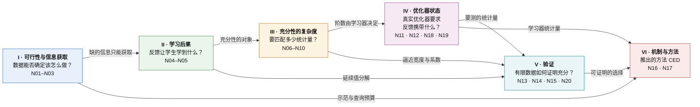
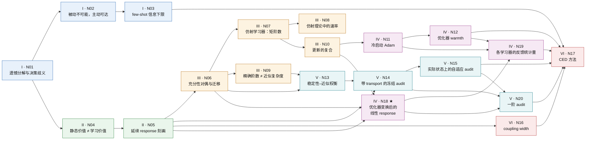

# 面向 Agent 蒸馏的环境信息理论：框架总图

[English](README.md)

**核心问题.** 给定部署任务、允许的实验和实际使用的学习过程，反馈分布之间的哪些差别会改变蒸馏后学生的最终任务表现？

**中心结果.** N18–N20 是整个框架面向真实学习器的中心定理。在一阶意义下，反馈分布必须携带的信息是*优化器完整状态增量*的均值，而不是梯度均值。这个统计量在一阶意义下是充分的，并且在一阶效应占主导的地方也是必要的。对 SGD、momentum、Adam/AdamW（cold 与 warm）、梯度裁剪、sign/Lion 和 LoRA，都可以把它显式算出来，并且能在训练实际到达的状态上测量。

**出处.** [出处对照](#出处对照)逐节点链接到原始文档的对应章节与原始编号。

**怎么读这一页.** 本页按"先整体、后局部"的顺序展开，类似广度优先搜索：

| 层 | 内容 | 读完能回答 |
|---|---|---|
| [第 0 层](#0-第-0-层一段话) | 一段话说清整个框架 | 框架要回答什么问题，分几步回答 |
| [第 1 层](#1-第-1-层六个大块) | 六个大块及其衔接 | 每一块回答什么问题、得到什么结论、交给下一块什么 |
| [第 2 层](#2-第-2-层二十个节点) | 20 个节点的白话解释 | 每个结果说了什么、直觉是什么、在链条里起什么作用 |
| [第 3 层](#4-第-3-层逐块详述) | 每个节点的精确陈述，加上推导要点和实验结果 | 结果的确切假设与公式，以及它是怎样被检验的 |

第 3 层用到的记号集中在[第 3 节](#3-设定与记号)。每个节点另有两页：**证明**页给出完整推导，**实验**页给出检验该节点的有限计算或受控实验，写明做这个实验的原因、设置和做法、得到的结果，以及结果如何支持该节点。

**范围.** 本页每个陈述都在其所列假设下有完整证明，并通过了独立的有限计算或受控检验。证明都是有限维的，或者带有明确的正则性假设。实验是精确有限计算或受控小网络，不是真实模型或 benchmark 上的结果。

---

## 0. 第 0 层：一段话

蒸馏一个 agent 时，手里有一个预训练学生、每个任务族 $`K`$ 条可信的 teacher 示范、一份允许做的额外实验预算（teacher 调用、环境分支、reset），以及一个固定的训练配方（优化器、学习率、步数）。可以喂给学生的"反馈来源"很多：示范本身、重放、合成改写、新的查询、不同的打包方式。框架要回答的是：**这些反馈来源之间的哪些差别，会真正改变蒸馏后学生的最终任务表现？** 回答分六步：

1. **数据能不能确定该怎么做（I）。** 学生的遗憾可以精确拆成表示、信息、算法三项。信息缺口只能靠新的实验补上，重放和改写补不了；即使 teacher 处处最优，它的示范也可能不够。
2. **反馈对学习器做了什么（II）。** teacher 质量、策略价值、平均梯度都决定不了学生学到什么。真正的不变量是*延续 response*：收到一条消息、做一次实际更新、再把训练走完之后的最终回报。
3. **要匹配多少信息（III）。** 两个反馈来源对学习等价，当且仅当它们对所有 response 的期望都相同；需要匹配的统计量个数，就是 response 类张成空间的维数。对简单的平均型学习器，它是部署长度决定的矩阶数；非线性更新会把它成倍放大。
4. **实际的优化器改变了答案（IV，中心定理 N18–N19）。** 在一阶意义下，反馈必须携带的是*优化器完整状态增量*的均值，而不是梯度均值。SGD、momentum、Adam（冷启动与热状态）、梯度裁剪、Lion、LoRA 各自对应一个可以显式写出的统计量；其中 warm Adam 的统计量是带显式误差项的近似。
5. **怎么用有限数据检验（V）。** 有限 audit 只有算上覆盖（transport）项才可靠；在训练实际到达的状态上做配对实验，可以保证不比参考差，但很贵；一阶统计量的均值只需梯度计算就能测，一阶差足够大时排序一定正确；但这个判据还要用到延续值梯度和余项常数，它们目前只能用完整尾段实验校准。
6. **由此推出的方法（VI）。** CED（Consequence-Calibrated Experience Distillation）：先获取缺的信息，再按实测后果选择反馈来源，匹配学习器真正使用的统计量，并把覆盖和验证的代价算进去。

---

## 1. 第 1 层：六个大块



### I · 可行性与信息获取（N01–N03）

**回答的问题.** 在学生能执行的策略范围内，现有数据能否确定"该怎么做"？缺的信息要花多少代价补上？

**结论.** 学生相对最优参考策略的遗憾，可以精确拆成三项：表示误差（学生的策略类本身够不够好）、信息误差（数据能否把可能的环境区分开）、算法误差（学习器有没有用好数据）。三项都非负，互不替代。信息误差为零，当且仅当所有与数据相容的环境有一个共同的最优策略；对数据做任何不依赖环境的后处理（重放、改写、合成）都不会让它变小。即使 teacher 在每个环境里都最优，它的示范也可能不够：两个环境中 teacher 的行为完全一样，学生的最优策略却不同。这时只有主动实验（例如 reset 查询）才能补上，所需查询次数约为 $`\log(1/\delta)/\Delta^2`$，其中 $`\Delta`$ 是两个环境的价值差；这个量级既充分也必要。$`K`$ 条示范和查询共用同一份信息预算，可以互相替代。

**交给下一块.** 缺的信息必须获取。但信息本身不决定学习器拿到它以后会学成什么样，这是 II 的问题。

### II · 学习后果（N04–N05）

**回答的问题.** 给定一个反馈来源，学生实际会学成什么样？比较两个反馈来源时该看什么？

**结论.** 常用的静态指标都不够。两个数据源可以 teacher 一样好、对每个学生给出相同的策略价值，蒸馏出的学生却不同；两个标签包可以边缘分布和平均梯度都相同，学习价值却不同，换一个任务，好坏还会反过来。正确的比较对象是延续 response：收到消息 $`y`$、做一次实际更新、再按参考配方把训练走完，最终任务回报的期望。整次训练的差距可以精确写成各轮之和，每一轮的项是"把参考的这一步换成备选的这一步"造成的差，由 response 决定。因此两个消息分布可以互换，当且仅当它们对所有 response 的期望都相同。若保证只在一部分状态上成立，离开这部分状态的概率只需付一次，而不是每轮付一次。

**交给下一块.** 充分性的对象固定为 response 类 $`\mathcal G`$。后面三块分别问：$`\mathcal G`$ 有多复杂（III）、实际优化器如何改变它（IV）、如何用有限数据检验（V）。

### III · 充分性的复杂度（N06–N10）

**回答的问题.** 要保证两个反馈来源对学习等价，需要让它们在多少个统计量上一致？

**结论.** 通用答案（N06）：用一组特征的均值判断等价时，精确充分当且仅当所有 response 都落在特征张成的空间里，所需统计量个数是 response 类张成空间的维数；近似时，最坏误差是用这些特征一致逼近 response 的最佳误差的两倍；不受限制的学习器则需要整个分布。在一个可以完全算出来的模型里（N07–N08）：对"把独立经验块加权平均"的学习器、最多 $`N`$ 次决策的部署，需要的恰好是所有不超过 $`N`$ 阶的矩，每一阶都不可省；差距随独立块数 $`n`$ 衰减，速度由第一个不匹配的 cumulant 决定，与训练轮数无关，重放和确定性合成都不能让它衰减。近似复杂度可以远低于精确阶数，大约 $`\sqrt N`$ 阶就够，但奇偶校验型的价值是例外（N09）。非线性更新会把所需阶数成倍放大：阈值型学习器在只有一次决策时就打破了一阶矩充分；光滑 SGD 的一阶统计量是平均梯度，二阶修正来自梯度的二阶矩（N10）。

**交给下一块.** 决定需要匹配什么的是学习器本身，因此必须对实际优化器建模（IV）；近似时还要关心系数是否稳定（V 中的 N13）。

### IV · 优化器状态（N11、N12、N18、N19）：中心块

**回答的问题.** Adam、梯度裁剪、LoRA 这些实际在用的学习器，要求反馈携带什么？

**结论.** 冷启动的 Adam 第一步近似只看每个坐标梯度的符号，所以要匹配的是联合符号分布（$`\epsilon=0`$）或整个梯度分布（$`\epsilon>0`$），不是矩；动量还会把第一步梯度的大小带到后面（N11）。二阶矩累积到一定程度后（warmth 小），Adam 的一步可以用一步固定预条件的 momentum SGD 近似，近似误差有显式界，一阶上要匹配的回到平均的预条件梯度。warmth 只在训练早期（$`s(1-\beta_2)\ll1`$）近似按 $`1/(\beta_2s)`$ 下降；$`\beta_2`$ 固定时，即使梯度平稳，它也会停在 $`(1-\beta_2)/\beta_2`$ 附近，不会降到零（N12）。中心定理 N18 把这些统一起来：任何带状态的一阶优化器都可以看成"梯度 → 完整状态（参数、动量、二阶矩……）的增量"的映射；两个反馈分布导致的整次训练差，在一阶上等于每一轮"延续值梯度"与"平均状态增量之差"的内积之和，余项由增量的二阶量控制。所以一阶上需要匹配的是平均状态增量在延续值梯度方向上的部分：它是充分的，在一阶项占主导时也是必要的，所需个数等于线性化 response 类的维数；更高阶对应增量的高阶矩。N19 对常用学习器把这个统计量逐一算出来。

**交给下一块.** 现在知道该测什么了：平均状态增量。下一个问题是怎样用有限数据去测，并据此做出可证明的选择（V）。

### V · 验证（N13、N14、N15、N20）

**回答的问题.** 只能做有限次测量时，怎样证明一个反馈来源足够好，或者从几个候选里选出好的？

**结论.** 某个特征测不准的代价，会被它在 response 模型里的系数放大；残差小但系数巨大的拟合不构成证明（N13）。事先固定一组 audit 单元、按测得的差异挑候选，这样的保证必须带一个显式的覆盖（transport）项：训练若跑到了 audit 没覆盖的状态，audit 可以测出 0 差异，而实际学习差距是 1（N14）。改为在训练实际到达的状态上，对候选与参考做配对的完整尾段实验并按下置信界选择，选出的结果不会比参考差超过 $`\delta`$，但每个候选要上千条配对副本（N15）。一阶部分的均值可以便宜地测：平均状态增量只需在实际状态上算 $`n`$ 次梯度；在欧氏范数下、增量范数不超过 $`b`$ 时，误差界是 $`b/\sqrt n`$ 的量级，不显含维数，但 $`b`$ 本身可能随维数增长。当一阶差超过二阶余项时，一阶分数给出的排序一定正确；不过这个判据要用到延续值梯度和余项常数，它们目前只能用完整尾段实验校准（N20）。

**交给下一块.** 三种可证明的选择方式及其代价：冻结 audit 加覆盖项、实际状态上的全尾 audit、一阶 audit。

### VI · 机制与方法（N16、N17）

**回答的问题.** 由前五块能推出什么样的方法？有哪些机制值得单独检验？

**结论.** N16 给出一个带严格零假设的机制检验：固定每个经验单元的边缘分布，只改变它们组合成联合训练包的方式，这对学习结果没有影响，当且仅当包的回报能写成各单元贡献之和；单步 SGD 下重新分组严格不改变结果。N17 把前面的结论变成方法 CED 的六条设计规则：先获取再编译（I）；按实测后果选择（II）；匹配学习器的统计量而不是原始梯度（IV）；拟合系数稳定的 response 模型（N13）；把覆盖算进去，并在一阶差占优的地方用一阶 audit（V）；先冻结选择器，再测迁移。受控实验中：测试过的几种静态 proxy 都没能可靠预测 response 的符号；实测的短尾 response 大多能选对，完整尾段在所有划分上都准确；在一阶差足够大的地方，用 oracle 延续值梯度算出的一阶分数零判错。

---

## 2. 第 2 层：二十个节点

颜色对应上图的六个大块；★ 是中心定理。



箭头 A → B 表示 B 的陈述或证明用到 A。每个节点下面三行依次是：它说了什么、直觉、在链条里的作用。精确陈述见[第 3 层](#4-第-3-层逐块详述)。

### I 块的节点

**[N01](#n01--遗憾分解与决策歧义) · 遗憾分解与决策歧义**
- *说了什么.* 学生的期望遗憾 = 表示误差 + 信息误差 + 算法误差，三项都非负。信息误差为零，当且仅当数据相容的所有环境有共同的最优策略；它的鲁棒版本有一个 minimax 对偶；对数据做随机后处理不会降低它。
- *直觉.* 信息误差是"即使学得完美，也因为数据分不清环境而注定损失"的部分。重放、改写、生成只能让已有信息更好学（降低算法误差），造不出缺失的事实。
- *作用.* 把"数据不够"和"学得不好"严格分开，是后面所有信息论结论的起点。

**[N02](#n02--被动不可能主动可达) · 被动不可能，主动可达**
- *说了什么.* 构造两个"混叠"世界：teacher 在两个世界中都最优、行为也一样，学生的最优策略却相反。只看示范的学习器至少损失 $`\Delta`$；用 reset 查询，约 $`\log(1/\delta)/(8\Delta^2)`$ 次就够，而且这个量级也是必需的。把查到的事实编译进学生，另需 $`O(\log(1/\delta_L))`$ 个标签。
- *直觉.* 完美示范只说明 teacher 做了什么，不说明能力不同的学生该做什么，这需要学生自己去试。
- *作用.* 说明方法里为什么必须有"主动获取"这一步，并把获取与编译的代价分开。

**[N03](#n03--few-shot-信息下限) · few-shot 信息下限**
- *说了什么.* 在隐藏比特模型中，$`K`$ 条示范之后剩余的信息损失是 $`\tfrac12\sum_jw_j(1-q_j)^K`$；有 $`n`$ 次查询预算时，最优策略是优先查权重最大的未见比特；自适应情形下，示范与查询满足一条线性的信息预算不等式。
- *直觉.* 每条示范以一定概率揭示一个事实，没揭示的只能查；示范和查询在同一份预算里互相替代，重放已有示范的贡献为零。
- *作用.* 把 $`K`$ 显式写进理论，为"花多少查询、查什么"提供定量依据（[N17(a)](#n17--consequence-calibrated-experience-distillationced)）。

### II 块的节点

**[N04](#n04--静态价值不等于学习价值) · 静态价值不等于学习价值**
- *说了什么.* 存在两个数据源，teacher 一样好、对每个学生给出相同的策略价值，蒸馏结果却相差 $`1/40`$；也存在两个标签包，边缘分布和平均梯度都相同，学习价值却不同，换个任务差的符号还会反过来。
- *直觉.* 学到什么取决于数据"经过更新以后"在部署中的效果，而不是数据本身在部署中看起来有多好。
- *作用.* 排除 teacher 质量、策略价值、平均梯度这些常用指标作为充分性判据。

**[N05](#n05--延续-response-刻画) · 延续 response 刻画**
- *说了什么.* 整次训练的结果差，等于每一轮"把参考的一步换成备选的一步"的差之和，每一项由延续 response 决定；两个消息分布可互换，当且仅当它们对所有 response 的期望相同；保证只在部分状态上成立时，离开的概率只付一次。
- *直觉.* response $`g(y)`$ 回答的是"如果这一轮喂给学生的是 $`y`$，最后会得多少分"，它把更新规则、后续训练和部署任务都包含进去了。
- *作用.* 固定了充分性的对象 $`\mathcal G`$；III、IV、V 都围绕它展开。

### III 块的节点

**[N06](#n06--充分性对偶与迁移) · 充分性对偶与迁移**
- *说了什么.* 用一组特征的均值判断两个分布是否等价：精确充分当且仅当所有 response 落在特征张成的空间里；近似时最坏误差是最佳一致逼近误差的两倍；若 response 是"线性部分 + 小残差"，response 差不超过"系数 × 特征均值差 + 两倍残差"；不受限的学习器需要整个分布。
- *直觉.* 特征均值相同，只能保证特征张成的那些方向上没有差别；response 落在这个空间之外的部分，就是看不见的风险。
- *作用.* 把"需要多少信息"变成可计算的量（张成维数、逼近宽度），III、IV、V 都用它。

**[N07](#n07--仿射学习器矩阶数既必要又充分) · 仿射学习器：矩阶数既必要又充分**
- *说了什么.* 对把独立经验块加权平均的学习器、最多 $`N`$ 次决策的部署，两个反馈来源对所有任务和所有这类学习器等价，当且仅当所有不超过 $`N`$ 阶的矩都相同；每一阶都有反例说明不可省。
- *直觉.* 部署价值是学生参数的 $`N`$ 次多项式，平均型更新把它变成数据 $`N`$ 阶矩的函数。
- *作用.* N06 的一个完全可算的实例，说明信息阶数由部署长度决定。

**[N08](#n08--仿射理论中的速率) · 仿射理论中的速率**
- *说了什么.* 差距的上界与训练轮数无关；对 $`n`$ 个独立块取平均时，差距按 $`n^{-(r-1)}`$ 衰减，$`r`$ 是第一个不匹配的 cumulant 的阶数。
- *直觉.* 只有独立的证据能让差距变小；重放同一块、或由它确定性生成的合成样本都不是新证据。
- *作用.* 区分"独立经验块数"与"epoch 数"，对应方法里的计数纪律。

**[N09](#n09--精确阶数不等于近似复杂度) · 精确阶数不等于近似复杂度**
- *说了什么.* 对 $`p^N`$ 型价值，匹配约 $`\sqrt{N\log(1/\varepsilon)}`$ 阶矩就能把误差压到 $`\varepsilon`$，尽管精确相等需要 $`N`$ 阶；奇偶校验型价值则不行，低于 $`N`$ 阶时最好也只能逼近到 $`1/2`$。
- *直觉.* 光滑的 response 可以用低阶近似，组合型的 response 不行。
- *作用.* 说明起作用的是逼近宽度，进而引出系数稳定性（N13）。

**[N10](#n10--更新的复合会放大信息需求) · 更新的复合会放大信息需求**
- *说了什么.* 多项式更新复合之后，response 对早期数据块的次数可以按各轮次数的乘积增长；阈值学习器在一次决策时就打破了一阶矩充分；光滑 SGD 的一步差 = 一阶项（平均梯度之差）+ 二阶项（梯度二阶矩之差）+ 三阶余项，逐步误差的累积需要稳定性条件才是线性的。
- *直觉.* 同样的数据喂给不同的学习器，需要匹配的信息阶数不同。
- *作用.* 说明必须对实际优化器建模，引出 IV。

### IV 块的节点

**[N11](#n11--冷启动-adam-的商与优化器记忆) · 冷启动 Adam 的商与优化器记忆**
- *说了什么.* 从零状态出发的 Adam，第一步只依赖 $`g_i/(\lvert g_i\rvert+\epsilon)`$：$`\epsilon=0`$ 时要匹配的是联合符号分布（逐坐标的符号分布不够），$`\epsilon>0`$ 时要匹配整个梯度分布；动量会把第一步梯度的大小带到第二步，符号序列相同的两段历史，第二步方向可以相反。
- *直觉.* Adam 第一步几乎是 sign-SGD，梯度大小被"除掉"了，但藏进了优化器状态。
- *作用.* 说明矩充分性不能直接搬到 Adam 上，需要匹配什么取决于优化器状态。

**[N12](#n12--优化器-warmth-切换一阶反馈统计量) · 优化器 warmth 切换一阶反馈统计量**
- *说了什么.* 定义坐标的 warmth：新梯度平方相对已累积二阶矩的大小。warmth 小时，Adam 一步与"固定预条件的 momentum SGD"一步的差有显式上界，一阶统计量是平均预条件梯度；冷步骤上均值相同的反馈在一阶上就会分开；warmth 只在训练早期近似按 $`1/(\beta_2s)`$ 下降，$`\beta_2`$ 固定时会停在 $`(1-\beta_2)/\beta_2`$ 附近。
- *直觉.* Adam 前几步像 sign 优化器，热起来以后像预条件 SGD。
- *作用.* 判断仿射/一阶理论从训练的哪一步开始适用；方法据此要求记录优化器状态及其 warmth。

**[N18](#n18--优化器变换后的线性-response中心定理) · 优化器变换后的线性 response（中心定理）**
- *说了什么.* 把任何带状态的一阶优化器（含裁剪）写成"梯度 → 完整状态增量"的映射。两个反馈分布导致的整次训练差，一阶上等于每一轮延续值梯度与平均状态增量之差的内积之和，余项由增量的二阶矩控制。匹配平均状态增量在延续值梯度张成子空间上的投影，一阶充分；一阶项超过余项时也必要；所需个数是线性化 response 类的维数；更高阶对应增量的高阶矩。
- *直觉.* 反馈影响学生的唯一途径是它引起的状态变化；在一阶上，只有这个变化的均值、而且只有延续值"在意"的那些方向才重要。
- *作用.* 统一 N07–N12，是框架面向真实学习器的中心结果；N19 和 N20 都由它推出。

**[N19](#n19--各学习器要求反馈携带什么) · 各学习器要求反馈携带什么**
- *说了什么.* 把 N18 的统计量对常用学习器算出来：SGD 是平均梯度；momentum 也是平均梯度，但经参数和动量两路起作用；warm Adam 在冻结分母近似下是平均梯度加梯度二阶矩（近似误差由 N12 控制）；cold Adam 的那一步是符号分布；裁剪是裁剪后的均值，总在裁剪时只剩平均方向；Lion 是翻转概率；LoRA 在 $`B=0`$ 初始化时第一步 $`A`$ 不动，反馈只经一个秩 $`r`$ 的 sketch 进入。
- *直觉.* 平均梯度相同的两个反馈来源，在 cold Adam、裁剪或 warm Adam 下仍可能在一阶上不同。
- *作用.* 告诉方法在每种训练配方下该匹配、该测量什么。

### V 块的节点

**[N13](#n13--稳定性近似权衡) · 稳定性–近似权衡**
- *说了什么.* 允许每个特征均值有容差时，能保证的 response 差等于在所有系数上取最小的"两倍逼近残差 + 容差 × 系数大小"。
- *直觉.* 一个特征测不准的代价是它在 response 模型里的系数；残差小而系数巨大，不算证明。
- *作用.* 决定 audit 用哪些特征、拟合什么样的 response 模型。

**[N14](#n14--带-transport-的冻结有限接口选择) · 带 transport 的冻结有限接口选择**
- *说了什么.* 事先固定 audit 单元，从有限候选里按测得的差异挑选；选中者的学习差距不超过"测得差异 + 统计误差 + 显式的 transport 项"再加离开概率。transport 项不能去掉。
- *直觉.* audit 只看得到它覆盖的状态；训练跑到没覆盖的地方时，audit 说 0，实际可以差 1。
- *作用.* 给出有限 audit 的正确形式，并指出它的盲点。

**[N15](#n15--实际状态上的自适应-audit保真与改进) · 实际状态上的自适应 audit；保真与改进**
- *说了什么.* 在训练实际到达的状态上，对候选与参考做配对的完整尾段实验，按下置信界选择；这样选出的结果不比参考差超过 $`\delta`$，并能保住测到的改进。代价：$`M=4`$、$`\delta=0.05`$、精度 $`0.1`$ 时，每个候选需要 1016 条配对副本（充分条件）。
- *直觉.* 直接测"把这一步换成候选会不会更好"，不必外推到没见过的状态。
- *作用.* 可靠但昂贵；方法用它校准更便宜的测量。

**[N20](#n20--在实际状态上测量一阶统计量) · 在实际状态上测量一阶统计量**
- *说了什么.* 在欧氏范数下，平均状态增量的估计误差按 $`b/\sqrt n`$ 下降，不显含维数（$`b`$ 是增量范数的上界，可能随维数增长），只需 $`n`$ 次梯度计算，不需要训练尾段；一阶差超过二阶余项时，一阶分数对两个候选的排序一定正确。
- *直觉.* 增量的均值便宜，但排序还要用到延续值梯度与余项常数，它们目前要用全尾 audit 校准；一阶分数也只能在一阶差占优的地方单独使用。
- *作用.* 把 N18 变成可执行的便宜测量，是方法里"先用一阶分数粗筛、再用实测尾段精选"的依据。

### VI 块的节点

**[N16](#n16--coupling-width) · coupling width**
- *说了什么.* 固定各经验单元的边缘分布，只改变它们组合成联合训练包的方式；这种改变不影响结果，当且仅当包的回报能写成各单元贡献之和；单步 SGD 下重新分组严格不改变结果。
- *直觉.* 学习器若只"看"每个单元本身，怎么组合都一样；单元之间有交互时才有区别。
- *作用.* 一个带严格零假设的机制检验。

**[N17](#n17--consequence-calibrated-experience-distillationced) · CED 方法**
- *说了什么.* 六条设计规则：先获取再编译；按实测后果选择；匹配学习器的统计量；拟合稳定的 response 模型；把覆盖算进去，并在一阶差占优处用一阶 audit；先冻结选择器，再测迁移。每条都是前面节点的推论。
- *直觉.* 用"喂给这个学习器以后会怎样"来挑反馈，而不是用"反馈本身看起来多好"。
- *作用.* 框架的落点；受控实验已确认其中按实测后果选择、一阶 audit 两条规则的有效范围。

---

## 3. 设定与记号

**环境与学生.** 环境 $`E`$ 包括任务分布、状态转移、反馈语义、评分规则和固定的执行 harness。所有回报都在 $`[0,1]`$ 内。学生的部署策略类为 $`\Pi\subseteq\Pi_{\rm ref}`$，记

```math
J_E^\Pi=\max_{\pi\in\Pi}J_E(\pi),\qquad J_E^{\rm ref}=\max_{\pi\in\Pi_{\rm ref}}J_E(\pi).
```

**信息.** $`I_0`$ 是共同的初始信息，包括预训练模型、已知规则和每个任务族的 $`K`$ 条可信示范。$`D`$ 是此后所有可获取信息的 transcript。

**学习过程.** 完整学习器状态 $`z`$ 包括参数、优化器矩、缓冲区、采样器状态、随机性和历史。第 $`t`$ 轮，反馈分布 $`P_t(\cdot\mid z)`$ 给出消息 $`Y_t`$，实际更新为 $`Z_{t+1}=U_t(z,Y_t,\xi_t)`$。把更新随机性 $`\xi_t`$ 积分掉，得到学习 kernel $`K_t`$。参考协议记为 $`K_t^0`$，备选协议记为 $`K_t^S`$，两者从同一个初始状态分布出发。最终学生的得分为 $`F_E(z)=J_E(\pi_z)\in[0,1]`$。

**延续值与 response.** 定义

```math
V_R^0=F_E,\qquad V_t^0=K_t^0V_{t+1}^0,
```

```math
g_{E,f,t,z}(y)=\mathbb E_{\xi_t}\,V_{t+1}^0\big(U_t(z,y,\xi_t)\big).
```

$`g`$ 的含义是：收到消息 $`y`$、执行实际更新、再走完声明的参考学习尾段之后，最终真实任务回报的期望。若要显式写出优化器和训练配方 $`o`$，记为 $`\psi_{E,o,t,z}`$（[N05](proofs/N05_continuation_response_ZH.md)）。令 $`L_E(S)=\mathbb E\,F_E(Z_R^S)`$，并用 $`\mathcal G`$ 表示所声明族中的全部 response。

**不能混用的计数.** $`K`$ 是可信示范数，$`n_{\rm query}`$ 是额外实验次数，$`n`$ 是独立经验块数，$`R`$ 是更新次数，$`N`$ 是部署决策数，$`d`$ 是线性统计量个数。同一个经验块重放 $`n`$ 次，并不等于 $`n`$ 个独立经验块。

**检验编号.** 各节点末尾和实验页里出现的检验编号含义如下，点开节点的实验页可以看到每个检验的动机、设置和结果。

| 编号 | 含义 |
|---|---|
| [C1](experiments/N01_decomposition_and_ambiguity_ZH.md)–[C23](experiments/N11_adam_cold_start_ZH.md#c23adam-部分-仿射描述失效的区域) | v0.14 的独立检验（`theory/independent_checks`）。其中 [C23](experiments/N11_adam_cold_start_ZH.md#c23adam-部分-仿射描述失效的区域) 是一个受控小网络实验，Adam 在其中偏离了仿射对照 |
| [V1](experiments/N14_frozen_audit_transport_ZH.md)–[V9](experiments/N20_first_order_audit_ZH.md) | v0.15 之后的精确有限检验（`theory/v015_checks`） |
| [E0](experiments/N11_adam_cold_start_ZH.md)–[E12](experiments/N20_first_order_audit_ZH.md) | 受控小网络实验（`theory/v015_checks`） |
| [T01](experiments/N14_frozen_audit_transport_ZH.md)–[T13](experiments/N15_adaptive_audit_ZH.md) | 修订包自带的检验 |

---

## 4. 第 3 层：逐块详述

每个节点给出依赖关系、精确陈述和"下一步"，末尾是证明页、实验页的链接以及支持它的检验。I 块的节点还给出推导要点和实验结果（含图）。

### I · 可行性与信息获取

#### N01 · 遗憾分解与决策歧义
*依赖：* 无。*被用于：* [N02](proofs/N02_passive_vs_active_acquisition_ZH.md)、[N03](proofs/N03_few_shot_information_floor_ZH.md)、[N04](proofs/N04_static_vs_learning_sufficiency_ZH.md)。

**命题.** **(a)** 在有限环境族上给定先验，令 $`B(D)=\max_{\pi\in\Pi}\mathbb E[J_E(\pi)\mid D]`$。对任意学习器输出 $`\widehat\pi`$，

```math
\mathbb E[J_E^{\rm ref}-J_E(\widehat\pi)]=\underbrace{\mathbb E[J_E^{\rm ref}-J_E^\Pi]}_{\mathcal R_{\rm rep}}+\underbrace{\mathbb E J_E^\Pi-\mathbb E_D B(D)}_{\mathcal R_{\rm info}}+\underbrace{\mathbb E_D[B(D)-\mathbb E[J_E(\widehat\pi)\mid D]]}_{\mathcal R_{\rm alg}},
```

三项均非负。此外：

- **(b)** $`\mathcal R_{\rm info}=0`$ 当且仅当对几乎所有 $`D`$，集合 $`\bigcap_{E:\Pr(E\mid D)>0}\arg\max_\pi J_E(\pi)`$ 非空。
- **(c)** 鲁棒歧义等于它的 minimax 对偶：$`r(C)=\min_{\rho\in\Delta(\Pi)}\max_{E\in C}\big[J_E^\Pi-\mathbb E_{\pi\sim\rho}J_E(\pi)\big]=\max_{\mu\in\Delta(C)}\big[\sum_E\mu_EJ_E^\Pi-\max_{\pi\in\Pi}\sum_E\mu_EJ_E(\pi)\big]`$。
- **(d)** 对 $`D`$ 做随机后处理得到的 $`D'`$ 不会降低 $`\mathcal R_{\rm info}`$。

**推导要点.**

- **(a)** 在总遗憾里加减 $`\mathbb EJ_E^\Pi`$ 与 $`\mathbb E_DB(D)`$ 就得到恒等式，难点只在三项的非负性。表示项非负，因为 $`\Pi\subseteq\Pi_{\rm ref}`$。信息项非负，因为对每个策略都有 $`\mathbb E[J_E(\pi)\mid D]\le\mathbb E[J_E^\Pi\mid D]`$，取最大得 $`B(D)\le\mathbb E[J_E^\Pi\mid D]`$。算法项非负，因为给定 $`D`$ 时学习器的输出是策略的凸组合，不会超过其中最好的一个。
- **(b)** 信息项可以写成 $`\sum_D\Pr(D)\big(\mathbb E[J_E^\Pi\mid D]-B(D)\big)`$，每个括号都非负；括号为零，当且仅当后验最优策略在每个后验概率为正的环境里都最优，也就是那个交集非空。
- **(c)** 把遗憾矩阵 $`M_{E,\pi}=J_E^\Pi-J_E(\pi)`$ 看成一个有限两人零和博弈：学习器选策略的混合，对手选环境的分布。von Neumann minimax 定理允许交换 min 与 max，内层的最小值在纯策略处取到，就得到对偶式。
- **(d)** 由于 $`E\to D\to D'`$ 是 Markov 链，$`\mathbb E[J_E(\pi)\mid D']=\mathbb E\big[\mathbb E[J_E(\pi)\mid D]\,\big|\,D'\big]`$。条件期望的最大值不超过最大值的条件期望，所以 $`D'`$ 下的后验最优值不超过 $`D`$ 下的。

**实验结果.** 独立检验 [C1](experiments/N01_decomposition_and_ambiguity_ZH.md#c1--n01ad) 在 500 个随机有限决策问题上用精确有理数算术检验 (a)–(d)，共 5,810 条断言，无一违例。分解恒等式的残差恰为 0；在 220 个实例上分别求解原问题 LP 与对偶 LP，两者相等；对确定性与随机 garbling 做对抗搜索，后验最优值的最大增量恰为 0。下图左边是一个实例中三项误差的分解：同一组数据下，换学习器只改变算法项（黄色）。中间是对 transcript 加噪后信息遗憾单调上升，从原始数据的 0.1217 升到无数据时的 0.1833。右边是两世界实例中原问题与对偶同为 $`0.1`$。


**下一步.** 表示误差、信息误差和学习误差是三件分开的事。生成数据造不出本来缺失的事实，所以下一个问题是：示范在什么情况下会留下 $`\mathcal R_{\rm info}>0`$。

[证明](proofs/N01_decomposition_and_ambiguity_ZH.md) · [实验](experiments/N01_decomposition_and_ambiguity_ZH.md) · **已证明**；[C1](experiments/N01_decomposition_and_ambiguity_ZH.md#c1--n01ad) 通过

#### N02 · 被动不可能，主动可达
*依赖：* [N01](proofs/N01_decomposition_and_ambiguity_ZH.md)。*被用于：* [N03](proofs/N03_few_shot_information_floor_ZH.md)。

**定理.** 考虑已知间隔 $`0<\Delta\le 1/8`$ 的两世界混叠族，teacher 在两个世界中都最优。

**(a)** 只看被动示范的学习器都满足 $`\max_v\mathbb E[J_v^\Pi-J_v(\widehat p)]\ge\Delta`$。

**(b)** 允许 reset 查询时，若要在每个世界中以概率 $`1-\delta`$ 得到 $`\Delta/2`$-最优的学生，必须有

```math
\mathbb E_v n_{\rm query}\ge\frac{\mathrm{kl}(1-\delta,\delta)}{\mathrm{kl}(\tfrac12+2\Delta,\tfrac12-2\Delta)}\ge\frac{\mathrm{kl}(1-\delta,\delta)}{64\Delta^2}.
```

**(c)** $`\lceil\log(1/\delta)/(8\Delta^2)\rceil`$ 次查询就足够。

**(d)** 把获得的事实编译进频率学习器，需要 $`m\ge\lceil32\log(2/\delta_L)\rceil`$ 个编译标签。

**推导要点.**

- **(a)** 在两个世界中，一条示范都以各一半的概率是"$`s=0`$ 时选 $`A`$ 成功"或"$`s=1`$ 时选 $`B`$ 成功"，所以示范的分布与世界无关，学习器输出的分布也与世界无关。价值关于 $`p`$ 是仿射的，两个世界的遗憾分别是 $`2\Delta(1-m)`$ 和 $`2\Delta m`$（$`m`$ 是输出均值），二者的最大值不小于平均值 $`\Delta`$。
- **(b)** 先把"两个世界都 $`\Delta/2`$-最优"化成一个二元检验：事件 $`\lbrace\widehat p>1/2\rbrace`$ 在世界 $`+1`$ 下概率至少 $`1-\delta`$，在世界 $`-1`$ 下至多 $`\delta`$。停时下整条 transcript 的 KL 由 Wald 恒等式等于"期望查询次数 × 单次查询的 KL"；数据处理不等式又给出它至少是 $`\mathrm{kl}(1-\delta,\delta)`$。两者合起来就是下界；常数 64 来自 $`\mathrm{kl}(\tfrac12+u,\tfrac12-u)\le16u^2`$。
- **(c)** 对独立查询结果取平均，用单边 Hoeffding 不等式。
- **(d)** 编译标签的经验频率同样用 Hoeffding 不等式控制，所需标签数与 $`\Delta`$ 无关。

**实验结果.** 独立检验 [C2](experiments/N02_passive_vs_active_acquisition_ZH.md#c2--n02ad-与编译段落) 在 25 组 $`(\Delta,\delta)`$ 上用精确二项式求和与精确随机游走递推检验 (a)–(d)，540 条断言无一违例。没有任何精确计算的策略低于下界；SPRT 在 $`(\Delta,\delta)=(\tfrac18,0.1)`$ 和 $`(\tfrac18,0.25)`$ 处恰好落在下界上（比值 1.000），在 $`\Delta=\tfrac1{64}`$ 时与下界相差不到 5%，所以下界的阶和常数都不能再改进。固定样本检验需要下界的 1.6–2.4 倍查询。编译所需标签数只依赖 $`\delta_L`$（$`\delta_L=0.05`$ 时 119 个），精确误差比 $`\delta_L`$ 低两到四个数量级。下图左边是查询次数随 $`1/\Delta^2`$ 线性增长，中间是各策略与下界的比值，右边是被动学习器的遗憾在两个世界中此消彼长、最坏情况至少为 $`\Delta`$。


**下一步.** 完美示范在信息上也可能不充分，而且信息获取的代价和编译的代价是两回事。N03 把 $`K`$ 显式写进来。

[证明](proofs/N02_passive_vs_active_acquisition_ZH.md) · [实验](experiments/N02_passive_vs_active_acquisition_ZH.md) · **已证明**；[C2](experiments/N02_passive_vs_active_acquisition_ZH.md#c2--n02ad-与编译段落) 通过

#### N03 · few-shot 信息下限
*依赖：* [N01](proofs/N01_decomposition_and_ambiguity_ZH.md)、[N02](proofs/N02_passive_vs_active_acquisition_ZH.md)。*被用于：* [N17](proofs/N17_ced_method_ZH.md)。

**命题.** 在隐藏比特模型中，比特 $`\Theta_1,\dots,\Theta_d`$ 相互独立且均匀。上下文 $`j`$ 的权重为 $`w_j`$。每条轨迹以概率 $`q_j`$ 揭示比特 $`j`$，对未揭示的比特不泄露任何信息。

**(a)** 看过 $`K`$ 条轨迹后，

```math
R_{\rm info}(K)=\tfrac12\textstyle\sum_j w_j(1-q_j)^K.
```

**(b)** 若有 $`n`$ 次查询的硬预算，则 $`R_{\rm info}(K,n)=\tfrac12\,\mathbb E\big[\sum_{r>n}w_{(r)}\big]`$，且优先查询权重最大的未见比特是最优策略。一般地，$`\mathbb E[(M_K-n)_+]\ne(\mathbb E M_K-n)_+`$。

**(c)** 在两世界自适应模型中，$`K\kappa_D+\kappa_X\,\mathbb E N\ge\mathrm{kl}(1-\delta,\delta)`$。

**推导要点.**

- **关键引理.** 给定完整的 transcript，没被揭示的比特仍然独立、公平，并且与 transcript 独立。原因是联合分布中唯一依赖这些比特的因子是常数 $`2^{-d}`$：示范不泄露未揭示的比特。
- **(a)** 对未揭示的比特，任何动作都只有一半的概率猜对；对已揭示的比特照抄即可。所以条件遗憾是未见比特权重之和的一半。比特 $`j`$ 在 $`K`$ 条独立轨迹中都没被揭示的概率是 $`(1-q_j)^K`$，取期望即得公式。
- **(b)** 对剩余预算归纳。查询某个未见比特之后，由关键引理，剩下的问题与查到的值无关，所以按值分支没有好处，每一步查权重最大的未见比特最优。$`x\mapsto(x-n)_+`$ 是凸函数，Jensen 不等式给出 $`\mathbb E[(M_K-n)_+]\ge(\mathbb EM_K-n)_+`$；$`d=K=3`$、$`n=1`$ 时严格大于（$`1/54`$ 对 $`0`$）。
- **(c)** 两个世界中，查询的选择、停止规则和私有随机性都相同，在似然比中抵消，只剩示范项与查询结果项。取期望后，示范项不超过 $`K\kappa_D`$，查询项不超过 $`\kappa_X\,\mathbb EN`$；数据处理不等式要求它们之和至少为 $`\mathrm{kl}(1-\delta,\delta)`$。

**实验结果.**

- **[V5](experiments/N03_few_shot_information_floor_ZH.md#v5--n03an03b隐比特覆盖硬查询预算与自适应性).** 348 个实例、26,214 条断言，最大残差 0。在穷举的 100 个情形（$`d\le5`$、$`K\le4`$、$`n\le3`$）中，Bayes 最优风险都等于 (a) 的公式，最优的自适应查询决策树都等于按权重贪心；其中 80 个情形里一条轨迹同时揭示多个比特。把正部移到期望外面，在超过三分之一的情形中是错的。
- **[V6](experiments/N03_few_shot_information_floor_ZH.md#v6--n03c示范信息抵扣自适应查询预算).** 297 个实例，(c) 在每个自适应查询与停止过程上都成立，比值恰好能取到 1，所以常数不能再改进。
- **[E5](experiments/N03_few_shot_information_floor_ZH.md#e5--隐比特的示范数曲线replay-与实际学习器).** 944 个精确格点上 replay 的收益都是 0。8 个均匀 context、$`K=4`$ 时，信息风险在不加查询时是 0.2931；同样的预算用于 4 条额外的被动示范，降到 0.1718；用于 4 次定向查询，降到 0.0431。用 Adam 或 SGD 训练的表格学习器从未低于信息下限，超出部分是 N01 中的算法误差。

下图左边是信息风险随 $`K`$ 的变化：定向查询比额外示范下降得快得多，replay 的曲线与"只有 $`K`$ 条示范"重合。中间是实际学习器的风险都在信息下限之上。右边是示范加查询的 KL 预算。


**下一步.** $`K`$ 和查询在同一份信息预算里互相替代，重放的贡献为零。但信息本身并不决定学习器能从中学到什么，这是第 II 部分的内容。

[证明](proofs/N03_few_shot_information_floor_ZH.md) · [实验](experiments/N03_few_shot_information_floor_ZH.md) · **已证明**；[V5](experiments/N03_few_shot_information_floor_ZH.md#v5--n03an03b隐比特覆盖硬查询预算与自适应性)、[V6](experiments/N03_few_shot_information_floor_ZH.md#v6--n03c示范信息抵扣自适应查询预算)、[E5](experiments/N03_few_shot_information_floor_ZH.md#e5--隐比特的示范数曲线replay-与实际学习器) 通过

### II · 学习后果

#### N04 · 静态价值不等于学习价值
*依赖：* [N01](proofs/N01_decomposition_and_ambiguity_ZH.md)。*被用于：* [N05](proofs/N05_continuation_response_ZH.md)。

**命题.**

- **(a)** 存在两个数据源，对每个混叠学生给出相同的价值 $`J(\pi_p)=\tfrac12+p/20`$，teacher 价值也同为 $`3/5`$。但用它们做频率蒸馏，期望回报分别是 $`43/80`$ 和 $`41/80`$，对每个 $`m\ge1`$ 都相差 $`1/40`$。
- **(b)** 存在两个标签包，边缘分布和平均梯度都相同，在 $`J(p)=p^2`$ 下的学习价值却相差 $`\eta^2/8`$。把 $`J`$ 换成 $`1-p^2`$，差的符号就反过来。

**下一步.** teacher 质量、策略价值和平均梯度都不能决定学生学到什么。不变量必须把更新和部署都包含进去，N05 给出的正是这样的对象。

[证明](proofs/N04_static_vs_learning_sufficiency_ZH.md) · [实验](experiments/N04_static_vs_learning_sufficiency_ZH.md) · **已证明**；[C3](experiments/N04_static_vs_learning_sufficiency_ZH.md#c3--n04an04b) 通过

#### N05 · 延续 response 刻画
*依赖：* [N04](proofs/N04_static_vs_learning_sufficiency_ZH.md)。*被用于：* [N06](proofs/N06_sufficiency_duality_ZH.md)、[N14](proofs/N14_frozen_audit_transport_ZH.md)、[N15](proofs/N15_adaptive_audit_ZH.md)、[N16](proofs/N16_coupling_width_ZH.md)。

**定理.** 令 $`d_t^S`$ 为备选过程实际的状态占据分布。则：

**(a)**

```math
L_E(0)-L_E(S)=\sum_{t=0}^{R-1}\mathbb E_{d_t^S}\big[(K_t^0-K_t^S)V_{t+1}^0(Z_t)\big],
```

因此 $`\lvert L_E(0)-L_E(S)\rvert\le\sum_t\mathbb E_{d_t^S}\varepsilon_t(Z_t)`$。

**(b)** 两个消息分布对"任意单边界替换，后接声明的尾段"都可互换，当且仅当对所有 $`g\in\mathcal G`$ 有 $`\mathbb E_Pg=\mathbb E_Qg`$。

**(c)** 若保证只在一个 certified 状态集上成立，首次离开该集合的概率为 $`\rho`$，则 $`\lvert L_E(0)-L_E(S)\rvert\le\mathbb E_S\sum_{t<\tau_{\rm exit}}\varepsilon_t+\rho`$。代价是 $`\rho`$，而不是 $`R\rho`$。

其中 $`\mathcal G`$ 由 $`F_E`$ 沿实际更新和参考 kernel 反向拉回得到。

**下一步.** 充分性的对象至此固定为 response 类 $`\mathcal G`$。第 III–V 部分分别研究它有多大、如何依赖于优化器，以及如何检验。

[证明](proofs/N05_continuation_response_ZH.md) · [实验](experiments/N05_continuation_response_ZH.md) · **已证明**；[C4](experiments/N05_continuation_response_ZH.md#c4--n05ac)、[T12](experiments/N05_continuation_response_ZH.md#t12包内-带审计-transport-的停止复合) 通过

### III · 充分性的复杂度

#### N06 · 充分性对偶与迁移
*依赖：* [N05](proofs/N05_continuation_response_ZH.md)。*被用于：* [N07](proofs/N07_affine_moment_order_ZH.md)、[N09](proofs/N09_approximate_complexity_ZH.md)、[N13](proofs/N13_stability_tradeoff_ZH.md)。

**定理.** 取有限消息字母表，$`\lvert\mathcal Y\rvert=m`$，特征为 $`\phi_1,\dots,\phi_d`$，并令 $`H_\phi=\mathrm{span}\lbrace 1,\phi_1,\dots,\phi_d\rbrace`$。

**(a)** **精确充分.** 对所有分布，特征均值相等能推出 response 均值相等，当且仅当 $`\mathrm{span}\mathcal G\subseteq H_\phi`$。所需统计量的最小个数为 $`d_0=\dim\mathrm{span}(\lbrace 1\rbrace \cup\mathcal G)-1`$。

**(b)** **近似充分.** 最坏分布对上未分辨的差异满足

```math
\mathfrak D_\phi(\mathcal G)=2\sup_{g\in\mathcal G}\inf_{h\in H_\phi}\lVert g-h\rVert_\infty.
```

**(c)** **迁移.** 若 $`g=c+b^\top\phi+r`$，且 $`\lVert b\rVert_1\le B`$、$`\lVert r\rVert_\infty\le\tau`$，则 $`\lvert(P-Q)g\rvert\le B\lVert\mathbb E_P\phi-\mathbb E_Q\phi\rVert_\infty+2\tau`$。

**(d)** **无限制学习器.** 对不受限制的学习器，$`d_0=m-1`$，差异为 $`\gamma\,\mathrm{TV}(P,Q)`$。

**下一步.** "充分信息"由此变成 $`\mathcal G`$ 的张成维数或近似宽度。N07–N10 对具体的学习器把这些量算出来。

[证明](proofs/N06_sufficiency_duality_ZH.md) · [实验](experiments/N06_sufficiency_duality_ZH.md) · **已证明**；[C5](experiments/N06_sufficiency_duality_ZH.md#c5--n06ac-与-n06d) 通过

#### N07 · 仿射学习器：矩阶数既必要又充分
*依赖：* [N06](proofs/N06_sufficiency_duality_ZH.md)。*被用于：* [N08](proofs/N08_affine_rates_ZH.md)、[N10](proofs/N10_update_composition_ZH.md)。

**定理.** 考虑二元动作、多上下文的学生 $`p\in[0,1]^k`$，最多 $`N`$ 次决策，以及作用于 IID 块 $`Z_i\in[0,1]^k`$ 的凸仿射学习器 $`p_R=w_0p_0+\sum_iw_iZ_i`$。

- **(a)** $`J_E(p)`$ 是次数不超过 $`N`$ 的多项式，且 $`\sum_\alpha\lvert c_\alpha\rvert\le3^N`$。
- **(b)** 对所有 $`\lvert\alpha\rvert\le N`$ 有 $`\mathbb E_PZ^\alpha=\mathbb E_QZ^\alpha`$，当且仅当对每个任务和每个仿射学习器，学习价值都相等。
- **(c)** 每一阶都是必要的。标量见证分布满足 $`\Delta_N=(-1)^NN!/(2^{N-1}N^N)`$；奇偶校验分布给出常数间隔 1。
- **(d)** 在网格上，统计量的精确个数是 $`\binom{k+N}{N}-1`$。在 $`\lbrace 0,1\rbrace ^k`$ 上，若 $`N\ge k`$ 且终端奖励任意，少于 $`2^k-1`$ 个统计量时差异仍为 1。

**下一步.** 这是 N06 的显式实例：$`\mathcal G`$ 就是多项式，维数就是矩的个数。N08 把它做成定量结论。

[证明](proofs/N07_affine_moment_order_ZH.md) · [实验](experiments/N07_affine_moment_order_ZH.md) · **已证明**；[C6–C9](experiments/N07_affine_moment_order_ZH.md)、[C19](experiments/N07_affine_moment_order_ZH.md#c19--三个同次数-response-族的-span-维数) 通过

#### N08 · 仿射理论中的速率
*依赖：* [N07](proofs/N07_affine_moment_order_ZH.md)。*被用于：* 无。

**定理.**

**(a)** 对每个仿射学习器，$`\lvert\text{gap}\rvert\le C_J\delta_N(P,Q)\le N3^N\delta_N(P,Q)`$，与 $`R`$ 无关。

**(b)** 对 $`n`$ 个独立块取平均时，若均值相同、低于 $`r`$ 阶的联合 cumulant 也都相同，则

```math
\mathbb E_{P^n}J(\bar p_n)-\mathbb E_{Q^n}J(\bar p_n)=\frac{\langle D^rJ(\mu),\kappa_r(P)-\kappa_r(Q)\rangle}{r!\,n^{r-1}}+O(n^{-r}).
```

**(c)** 对标量见证分布，这个展开是精确的：$`\Delta_N/n^{N-1}`$。

**下一步.** 差异衰减的快慢由独立块数 $`n`$ 决定，而不是 epoch 数。重放同一个块，或由它确定性生成的合成衍生数据，都不会让差异衰减。

[证明](proofs/N08_affine_rates_ZH.md) · [实验](experiments/N08_affine_rates_ZH.md) · **已证明**；[C10](experiments/N08_affine_rates_ZH.md#c10--n08a不随-r-增长的差异界)、[C11](experiments/N08_affine_rates_ZH.md#c11--n08b-与-n08c第一个不匹配的-cumulant-决定速率)、[C18](experiments/N08_affine_rates_ZH.md#c18--独立证据replay-与合成后代样本) 通过

#### N09 · 精确阶数不等于近似复杂度
*依赖：* [N06](proofs/N06_sufficiency_duality_ZH.md)。*被用于：* [N13](proofs/N13_stability_tradeoff_ZH.md)。

**命题.**

- **(a)** 对 $`p^N`$，把 Chebyshev 展开截断到 $`q`$ 阶，误差为 $`\Pr\lbrace \lvert B-N\rvert>q\rbrace \le2e^{-q^2/N}`$，其中 $`B\sim\mathrm{Bin}(2N,\tfrac12)`$。因此只要矩匹配到 $`q\ge\min\lbrace N,\lceil\sqrt{N\log(4/\varepsilon)}\rceil\rbrace`$ 阶，价值差就不超过 $`\varepsilon`$，尽管精确相等需要 $`N`$ 阶。
- **(b)** 奇偶校验价值 [N07(c)](proofs/N07_affine_moment_order_ZH.md) 用次数低于 $`N`$ 的多项式做一致逼近，最优误差恰为 $`1/2`$。

**下一步.** 起作用的复杂度是近似宽度 $`d_\varepsilon`$，而不是次数。这样一来系数的稳定性就变得重要，见 N13。

[证明](proofs/N09_approximate_complexity_ZH.md) · [实验](experiments/N09_approximate_complexity_ZH.md) · **已证明**；[C12](experiments/N09_approximate_complexity_ZH.md#c12--chebyshev-恒等式精确尾概率与-parity-minimax)、[C19](experiments/N07_affine_moment_order_ZH.md#c19--三个同次数-response-族的-span-维数) 通过

#### N10 · 更新的复合会放大信息需求
*依赖：* [N07](proofs/N07_affine_moment_order_ZH.md)。*被用于：* [N11](proofs/N11_adam_cold_start_ZH.md)。

**定理.**

**(a)** 若多项式更新对旧参数的次数为 $`a_i`$、对新块的次数为 $`b_i`$，则最终 response 对第 $`i`$ 块的次数至多为 $`D_i=Nb_i\prod_{t>i}a_t`$。这个界可以取到，例如 $`Z_1^{2^{R-1}}`$。

**(b)** 阈值学习器在 $`N=1`$ 时就已经破坏一阶矩充分性。

**(c)** 对光滑 SGD，

```math
(K^P-K^Q)V=-\eta\nabla V^\top(\mu_P-\mu_Q)+\tfrac{\eta^2}{2}\langle\nabla^2V,M_P-M_Q\rangle+\mathcal E,\qquad \lvert\mathcal E\rvert\le\tfrac{M_3\eta^3}{6}\big(\mathbb E_P\lVert G\rVert^3+\mathbb E_Q\lVert G\rVert^3\big).
```

**(d)** 逐步误差的累积满足 $`e_R\le C\eta^2\sum_s(1+\eta L)^s`$；要得到关于 $`R`$ 线性的界，需要稳定性条件。

**下一步.** 决定所需信息阶数的是学习器，而不只是数据。因此必须对实际优化器建模，这是第 IV 部分。

[证明](proofs/N10_update_composition_ZH.md) · [实验](experiments/N10_update_composition_ZH.md) · **已证明**；[C13](experiments/N10_update_composition_ZH.md#c13--次数复合上界可达阈值学习器展开-n10c)、[V7](experiments/N10_update_composition_ZH.md#v7--逐步误差的累积) 通过；[C23](experiments/N11_adam_cold_start_ZH.md#c23adam-部分-仿射描述失效的区域) 给出 SGD 适用区间的边界

### IV · 优化器状态

#### N11 · 冷启动 Adam 的商与优化器记忆
*依赖：* [N06](proofs/N06_sufficiency_duality_ZH.md)、[N10](proofs/N10_update_composition_ZH.md)。*被用于：* [N12](proofs/N12_optimizer_warmth_ZH.md)、[N19](proofs/N19_learner_statistics_ZH.md)。

**命题.** 考虑带 bias correction、$`\epsilon`$ 在根号外的 Adam，从冷状态 $`m_0=v_0=0`$ 出发。

- **(a)** 第一步为 $`\theta_1=c-\eta\,h_\epsilon(G)`$，其中 $`h_\epsilon(g)_i=g_i/(\lvert g_i\rvert+\epsilon)`$。
- **(b)** 当 $`\epsilon=0`$ 时，"所有有界的即时参数效用都相等"等价于"联合符号分布相等"。若可达符号模式有 $`s`$ 种，恰好需要 $`s-1`$ 个统计量，而且这也足够。各坐标的符号边缘分布不够。
- **(c)** 当 $`\epsilon>0`$ 时，$`h_\epsilon`$ 是单射，因此需要完整的梯度分布（$`m-1`$ 个统计量）。
- **(d)** 间隔界：对 Lipschitz 效用，用符号近似的代价是 $`\eta\sum_iL_i[\beta_{P,i}(a)+\beta_{Q,i}(a)+2\epsilon/(a+\epsilon)]`$。
- **(e)** 保留的状态：$`m_1=(1-\beta_1)G`$。历史 $`(1,-\tfrac34)`$ 和 $`(2,-\tfrac34)`$ 的符号序列完全相同，第二步的方向却相反。

**下一步.** 矩充分性（N07）不能搬到 Adam 上，需要匹配什么取决于优化器状态。N12 定量刻画这种依赖如何衰减。

[证明](proofs/N11_adam_cold_start_ZH.md) · [实验](experiments/N11_adam_cold_start_ZH.md) · **已证明**；[V2–V4](experiments/N11_adam_cold_start_ZH.md) 通过；[E0–E3](experiments/N11_adam_cold_start_ZH.md) 确认 [C23](experiments/N11_adam_cold_start_ZH.md#c23adam-部分-仿射描述失效的区域) 中的 Adam gap 是冷启动优化器效应

#### N12 · 优化器 warmth 切换一阶反馈统计量
*依赖：* [N05](proofs/N05_continuation_response_ZH.md)、[N10](proofs/N10_update_composition_ZH.md)、[N11](proofs/N11_adam_cold_start_ZH.md)。*被用于：* [N17](proofs/N17_ced_method_ZH.md)、[N19](proofs/N19_learner_statistics_ZH.md)。

**定义.** 坐标 $`i`$ 的 warmth 为 $`\kappa_i(y)=(1-\beta_2)G_i(y)^2/(\beta_2v_i)`$，$`v_i=0`$ 时记 $`\kappa_i=\infty`$。冻结分母的替代更新 $`\tilde z^+`$ 是一步带固定对角预条件子 $`P=\mathrm{diag}(1/(a+\epsilon))`$ 的 momentum SGD。

**定理.**

**(W0)** $`\lvert\theta^+_i-\tilde\theta^+_i\rvert\le\eta\,u_i\min\lbrace \kappa_i/2,1\rbrace`$。

**(W1)** 假设状态是 warm 的，即对所有 $`i`$ 有 $`v_i>0`$（W）；延续值 Lipschitz（L）；对二阶矩的敏感度有界（S）；且 $`F(g)=V(\tilde z^+(g))`$ 的曲率为 $`H_G`$（H）。则

```math
\big\lvert\psi(y)-c-b^\top G(y)\big\rvert\le\eta\sum_iL_iu_i\min\lbrace \tfrac{\kappa_i}{2},1\rbrace +L_v\max_i\min\lbrace \kappa_i,\bar k\rbrace +\tfrac12H_G\lVert G\rVert_\infty^2=:r(y).
```

因此，平均 consumed gradient 相同的两个分布，其 response 之差不超过 $`\mathbb E_{P_0}r+\mathbb E_{P_1}r`$。

**(W2)** 在冷状态下，均值相同的分布在一阶上就会分开，差为 $`\lvert w\rvert\eta/2`$。即使两个分布在任意固定阶 $`N`$ 以下的矩都相同，仍然相差 $`\lvert w\rvert\eta\,2^{2-N}`$。

**(W3)** (a) 若 $`v`$ 吸收了 $`s`$ 次二阶矩平稳的梯度，平均场 warmth 满足 $`1/(\beta_2s)\le\bar\kappa(s)\le1/(\beta_2^{\,s}s)`$。(b) 若在 warm 的更新上 $`\max_i\kappa_i\le c/(W+s)`$，则 telescoping 后的非仿射贡献不超过冷更新的个数，加上 $`\bar A\sum_s\min\lbrace 1,c/(W+s)\rbrace \le\bar A\,c\log(1+R/W)`$（$`W\ge1`$），再加曲率项。$`W=0`$ 时第一步是冷更新，至多记 1。

**下一步.** 反馈源需要匹配的统计量随优化器状态切换：冷 Adam 要匹配联合符号分布，warm Adam 要匹配平均预条件梯度。由此可以判断仿射理论（N07–N10）在 few-shot LoRA 上从哪里开始适用。

[证明](proofs/N12_optimizer_warmth_ZH.md) · [实验](experiments/N12_optimizer_warmth_ZH.md) · **已证明**（有限维，假设明确）；[E8](experiments/N12_optimizer_warmth_ZH.md) 通过

#### N18 · 优化器变换后的线性 response（中心定理）
*依赖：* [N05](proofs/N05_continuation_response_ZH.md)、[N06](proofs/N06_sufficiency_duality_ZH.md)、[N10](proofs/N10_update_composition_ZH.md)。*被用于：* [N19](proofs/N19_learner_statistics_ZH.md)、[N20](proofs/N20_first_order_audit_ZH.md)。

**设定.** 完整状态为 $`x=(\theta,s)`$，其中 $`s`$ 是优化器状态（如 $`m,v`$）。任何带状态的一阶优化器都可以写成 consumed gradient $`G`$ 的增量映射 $`x^+=x+\Delta_t(x,G)`$，裁剪也包含在内。分布 $`P`$ 的平均增量记为 $`\mu^P_t(x)=\mathbb E_P\,\Delta_t(x,G)`$。

**定理.** 设延续值在可达线段上 $`C^{k+1}`$（$`S_k`$）。

**(a)** 单边界：

```math
(K^P-K^Q)V(x)=\sum_{j=1}^{k}\tfrac1{j!}\big\langle\nabla^jV(x),\mathbb E_P\Delta^{\otimes j}-\mathbb E_Q\Delta^{\otimes j}\big\rangle+r_k,\qquad\lvert r_k\rvert\le\tfrac{M_{k+1}}{(k+1)!}\big(m^P_{k+1}+m^Q_{k+1}\big).
```

**(b)** 整次训练：

```math
L(P)-L(Q)=\sum_t\mathbb E_{d_t^Q}\big\langle\nabla V^P_{t+1},\mu^P_t-\mu^Q_t\big\rangle+\mathcal E,\qquad\lvert\mathcal E\rvert\le\sum_t\mathbb E_{d_t^Q}\tfrac{M_{2,t}}2\big(m^P_{2,t}+m^Q_{2,t}\big).
```

由此得到以 $`\lVert\mu^P_t-\mu^Q_t\rVert`$ 表示的 certificate，以及带 $`+\rho`$ 的停时版本。

**(c)** 令 $`U=\mathrm{span}\lbrace\nabla V(x):V\in\mathcal V\rbrace`$。在一阶意义下，匹配 $`\Pi_U\mu`$ 就足够。若不匹配，只要某个 $`V\in\mathcal V`$ 的一阶项超过余项界，它就会检测到差异。一阶统计量的最小个数为 $`d_0^{(1)}=\dim\mathrm{span}(\lbrace1\rbrace\cup\mathcal G^{(1)})-1\le\min\lbrace\dim U,m-1\rbrace`$，即把 [N06(a)–(c)](proofs/N06_sufficiency_duality_ZH.md) 用于线性化后的 response 类。

**(d)** 若两个分布在 $`j\le k`$ 时 $`\mathbb E\Delta^{\otimes j}`$ 都相等，则每轮差距至多为 $`\tfrac{M_{k+1}}{(k+1)!}(m^P_{k+1}+m^Q_{k+1})`$；对 SGD 来说就是 $`O(\eta^{k+1})`$。信息阶数由经优化器变换后的增量分布决定，而不是由原始数据决定。

**下一步.** 反馈分布必须携带什么，完全由优化器映射 $`\Delta`$ 决定。N19 对实际常用的学习器把它算出来。

[证明](proofs/N18_optimizer_transformed_response_ZH.md) · [实验](experiments/N18_optimizer_transformed_response_ZH.md) · **已证明**；[V8](experiments/N18_optimizer_transformed_response_ZH.md#v8--n18a-与-n18c-的精确有限检验) 通过；[E10](experiments/N18_optimizer_transformed_response_ZH.md#e10--受控网络中的整次训练表示跨优化器) 在 11 种优化器配置上确认了这一表示（[C23](experiments/N11_adam_cold_start_ZH.md#c23adam-部分-仿射描述失效的区域) 的 Adam gap $`0.0769`$ 被预测为 $`0.0757`$）

#### N19 · 各学习器要求反馈携带什么
*依赖：* [N11](proofs/N11_adam_cold_start_ZH.md)、[N12](proofs/N12_optimizer_warmth_ZH.md)、[N18](proofs/N18_optimizer_transformed_response_ZH.md)。*被用于：* [N17](proofs/N17_ced_method_ZH.md)。

**定理（各学习器的一阶统计量）.**

| 部分 | 学习器 | 反馈在一阶上必须匹配的统计量 |
|---|---|---|
| **(a)** | SGD | consumed gradient 的均值 $`\mathbb EG`$ |
| **(b)** | Heavy-ball、Nesterov | $`\mathbb EG`$，同时经 $`\theta`$ 和 $`m`$ 起作用 |
| **(c)** | Adam/AdamW（warm） | $`(\mathbb EG,\ \mathbb E\,G^{\odot2})`$：预条件均值经 $`\theta`$ 和 $`m`$ 起作用，二阶矩经 $`v`$ 起作用 |
| **(d)** | Adam（cold 步） | $`\theta`$ 上是符号分布 $`\mathbb E\,h_\epsilon(G)`$；$`m,v`$ 中保留了 $`\mathbb EG`$ 与 $`\mathbb E\,G^{\odot2}`$ |
| **(e)** | 梯度裁剪（范数 $`c`$） | 裁剪后的均值 $`\mathbb E\mathrm{clip}_c(G)`$；裁剪始终 active 时，只有平均单位方向起作用 |
| **(f)** | Lion / 带动量的 sign 优化器 | 翻转概率；动量占优时，$`\theta`$ 上与反馈无关 |
| **(g)** | LoRA（$`B=0`$ 时） | 第 1 步 $`A`$ 不动；反馈只经由秩 $`r`$ 的 sketch $`\Gamma A_0^\top`$ 进入（cold Adam 下是它的符号分布） |

**下一步.** 由此可见，梯度均值相同的两个反馈源仍可能在一阶上不同：在 cold Adam 下，在裁剪下（范数尾部不同），以及在 warm Adam 下（二阶矩不同）都会发生。N20 讨论如何测量这个统计量。

[证明](proofs/N19_learner_statistics_ZH.md) · [实验](experiments/N19_learner_statistics_ZH.md) · **已证明**；[E11](experiments/N19_learner_statistics_ZH.md) 通过（五个见证）

### V · 验证

#### N13 · 稳定性–近似权衡
*依赖：* [N06](proofs/N06_sufficiency_duality_ZH.md)、[N09](proofs/N09_approximate_complexity_ZH.md)。*被用于：* [N14](proofs/N14_frozen_audit_transport_ZH.md)。

**定理.** 对特征均值之差的容差 $`\epsilon_j`$，

```math
W_{\mathbf{\epsilon}}(g)=\inf_{b,c}\Big[2\big\lVert g-c-\textstyle\sum_jb_j\phi_j\big\rVert_\infty+\sum_j\epsilon_j\lvert b_j\rvert\Big]=\inf_b\Big[\mathrm{osc}\big(g-\textstyle\sum_jb_j\phi_j\big)+\sum_j\epsilon_j\lvert b_j\rvert\Big].
```

**下一步.** 某个特征上的测量误差，代价是它的系数大小。所以近似残差小、但系数不稳定，并不构成 certificate。这决定了有限 audit 该如何设计。

[证明](proofs/N13_stability_tradeoff_ZH.md) · [实验](experiments/N13_stability_tradeoff_ZH.md) · **已证明**；[C14](experiments/N13_stability_tradeoff_ZH.md#c14--随机实例上的原始对偶相等)、[C22](experiments/N13_stability_tradeoff_ZH.md#c22--稳定性对照缩放特征) 通过

#### N14 · 带 transport 的冻结有限接口选择
*依赖：* [N05](proofs/N05_continuation_response_ZH.md)、[N13](proofs/N13_stability_tradeoff_ZH.md)。*被用于：* [N15](proofs/N15_adaptive_audit_ZH.md)、[N17](proofs/N17_ced_method_ZH.md)。

**定理.**

**(a)** 令 $`e_0=\sqrt{\log(4Ld/\delta)/(2n_0)}`$，$`e_S=\sqrt{\log(4MLd/\delta)/(2n_S)}`$。以概率 $`1-\delta`$，对所有 $`j`$ 同时有 $`\lvert D_j-\widehat D_j\rvert\le e_0+e_S`$，并且 $`D_{\widehat j}\le\min_jD_j+2(e_0+e_S)+\eta_{\rm opt}`$。

**(b)** 设在 certified 状态上，状态到 cell 的 transport 误差为 $`a_{t,j}(z)`$，response 分解参数为 $`(B_t,\tau_t)`$。则

```math
\lvert L_E(0)-L_E(S_{\widehat j})\rvert\le\sum_t\mathbb E_{d_t^{\widehat j}}\Big[1\lbrace t<\sigma\rbrace \big\lbrace B_t(\widehat D_{\widehat j}+e_0+e_S+a_{t,\widehat j}(Z_t))+2\tau_t\big\rbrace \Big]+\rho.
```

**(c)** transport 精确成立（$`a\equiv0`$）时，$`\lvert L_E(0)-L_E(\widehat j)\rvert\le\sum_tB_t(\widehat D_{\widehat j}+e_0+e_S)+2\sum_t\tau_t+\rho`$。在 [N08](proofs/N08_affine_rates_ZH.md) 的 IID 块与凸仿射更新设定下，若被 audit 的特征就是矩 $`Z^\alpha`$（$`1\le\lvert\alpha\rvert\le N`$），则 $`\lvert L_E(0)-L_E(\widehat j)\rvert\le C_J(\widehat D_{\widehat j}+e_0+e_S)`$。

**(d)** transport 项不能去掉：若某个训练中到达的状态没有被任何 audit cell 覆盖，audit 测得的差异可以是 0，而学习 gap 却是 1。定理对这样的状态要么记 $`a=1`$，要么记离开概率 $`\rho=1`$。

**下一步.** 有限 audit 只有通过一个显式测量的覆盖/transport 项，才能证明学习价值。N15 改为在实际到达的状态上做 audit，从而去掉这一步外推。

[证明](proofs/N14_frozen_audit_transport_ZH.md) · [实验](experiments/N14_frozen_audit_transport_ZH.md) · **已证明**；[V1](experiments/N14_frozen_audit_transport_ZH.md#v1--精确的有限训练过程)、[C20](experiments/N14_frozen_audit_transport_ZH.md#c20--正确特征遗漏特征以及带退出惩罚的覆盖)、[T01](experiments/N14_frozen_audit_transport_ZH.md#包内检验-t01-与-t02)、[T02](experiments/N14_frozen_audit_transport_ZH.md#包内检验-t01-与-t02) 通过；[C15](experiments/N14_frozen_audit_transport_ZH.md#c15--audit-集中性与覆盖见证) 与 [E4](experiments/N14_frozen_audit_transport_ZH.md#e4--受控网络到达状态上的-transport) 测量了 transport 项

#### N15 · 实际状态上的自适应 audit；保真与改进
*依赖：* [N05](proofs/N05_continuation_response_ZH.md)、[N14](proofs/N14_frozen_audit_transport_ZH.md)。*被用于：* [N17](proofs/N17_ced_method_ZH.md)。

**定理.**

- **(a)** 保真：$`L_E(S)-J_E(\pi_0)\ge\gamma-\varepsilon`$。
- **(b)** 带符号恒等式：$`L_E(S)-L_E(0)=\sum_t\mathbb E_{d_t^S}A_t(Z_t,J_t)`$。
- **(c)** 自适应 audit：在每个被 audit 的实际状态上，做候选与参考的配对全尾实验，按下置信界 $`\ell_t(j)=\widehat A_t(j)-e_t`$ 选择，其中 $`e_t=\sqrt{2\log(2M_t/\delta_t)/n_t}`$。则 $`L({\rm adaptive})-L(0)\ge-\delta`$，并且 $`\ge\mathbb E\sum_tB_t-2\delta`$。
- **(d)** 代价：$`M=4`$、$`\delta=.05`$、$`e=.1`$ 时，每个候选需要 $`1016`$ 个配对副本（这是充分条件，不是必要条件）。

**下一步.** 局部 certificate 有效，但每个候选要上千条完整训练尾段。因此方法（N17）用这类 audit 去校验更便宜的测量，方法层面的结论则靠整次训练的随机对照来支持。

[证明](proofs/N15_adaptive_audit_ZH.md) · [实验](experiments/N15_adaptive_audit_ZH.md) · **已证明**；[C16](experiments/N15_adaptive_audit_ZH.md#c16--有限学习过程上的自适应-audit)、[C21](experiments/N15_adaptive_audit_ZH.md#c21--带号恒等式以及保真与改进)、[T13](experiments/N15_adaptive_audit_ZH.md#t13-与-e7--audit-的代价) 通过；[E7](experiments/N15_adaptive_audit_ZH.md#t13-与-e7--audit-的代价) 的 empirical-Bernstein 预测为 559 个副本

#### N20 · 在实际状态上测量一阶统计量
*依赖：* [N14](proofs/N14_frozen_audit_transport_ZH.md)、[N15](proofs/N15_adaptive_audit_ZH.md)、[N18](proofs/N18_optimizer_transformed_response_ZH.md)。*被用于：* [N17](proofs/N17_ced_method_ZH.md)。

**定理.**

- **(a)** 设增量有界，$`\lVert X\rVert\le b`$，维数任意。则以概率 $`1-\delta`$ 有 $`\lVert\bar X-\mu\rVert\le\tfrac b{\sqrt n}(1+\sqrt{2\log(1/\delta)})`$，两样本之差满足类似的界。因此在实际状态上，certificate 的一阶部分每个分布只需要 $`n`$ 次梯度计算，不需要训练尾段。延续值常数 $`\Lambda_t`$ 与 $`M_{2,t}`$ 要另外用全尾 audit 校准（N15）。
- **(b)** 若 $`\lvert\langle\nabla V(x),\mu^j-\mu^k\rangle\rvert>\tfrac{M_2}2(m_2^j+m_2^k)`$，一阶分数对候选 $`j`$、$`k`$ 的排序一定正确。整次训练层面也有同样的结论。

**下一步.** 便宜的统计量要能给 provider 排对序，必须同时满足三个条件：它是经优化器变换后的均值；它要与实际状态上的延续值梯度配对；而且只在 margin 占优的地方使用。否则就需要实测的训练尾段（N17）。

[证明](proofs/N20_first_order_audit_ZH.md) · [实验](experiments/N20_first_order_audit_ZH.md) · **已证明**；[V9](experiments/N20_first_order_audit_ZH.md#v9--平均增量的维数无关集中性) 通过；[E12](experiments/N20_first_order_audit_ZH.md#e12--冻结-e6-面板上的一阶-margin)：margin 以上零判错

### VI · 机制与方法

#### N16 · coupling width
*依赖：* [N05](proofs/N05_continuation_response_ZH.md)。*被用于：* [N17](proofs/N17_ced_method_ZH.md)。

**命题.** 固定有效单元的边缘分布，令 $`H_z`$ 为一个联合包在更新并走完全尾之后的回报。

- **(a)** coupling width 为零，当且仅当在正支撑的乘积集上 $`H_z(i,j)=a_i+b_j`$。
- **(b)** $`\lvert(\Gamma-\Gamma')H_z\rvert\le2\inf_{a,b}\lVert H_z-a-b\rVert_\infty`$。
- **(c)** 严格零假设：单步 SGD 在示例和权重都相同时，对重新分组不变。

**下一步.** 这给出一个受控的机制检验：在边缘分布固定的前提下，反馈单元的联合组织方式会不会改变学到的东西？

[证明](proofs/N16_coupling_width_ZH.md) · [实验](experiments/N16_coupling_width_ZH.md) · **已证明**；[C17](experiments/N16_coupling_width_ZH.md#c17--coupling-多面体可加性刻画与严格零效应) 通过；[C23(e)](experiments/N16_coupling_width_ZH.md#c23e--受控网络中的重新分组) 为受控神经网络实验

#### N17 · Consequence-Calibrated Experience Distillation（CED）
*依赖：* [N03](proofs/N03_few_shot_information_floor_ZH.md)、[N12](proofs/N12_optimizer_warmth_ZH.md)、[N14](proofs/N14_frozen_audit_transport_ZH.md)、[N15](proofs/N15_adaptive_audit_ZH.md)、[N16](proofs/N16_coupling_width_ZH.md)、[N19](proofs/N19_learner_statistics_ZH.md)、[N20](proofs/N20_first_order_audit_ZH.md)。

**推出的设计规则.** 每条规则都是所引节点的推论。

1. **(a)** *先获取，再编译.* $`K`$ 条示范没能确定的事实，必须来自新的、允许的实验，重放和改写都提供不了（N01、N02、N03）。
2. **(b)** *按实测后果选择.* 评判一个 provider，要看它在实际更新加参考尾段下的 response（N05）。teacher 质量、策略价值和平均梯度都决定不了这个 response（N04）。
3. **(c)** *匹配学习器的统计量，而不是原始梯度.* provider 必须匹配实际学习器的、经优化器变换后的平均增量（N18、N19），例如裁剪后的均值、cold Adam 状态下的符号分布、warm 状态下的预条件均值与二阶矩（N11、N12）。因此测量 response 时要记录优化器状态及其 warmth。
4. **(d)** *拟合稳定的 response 模型.* 在 [N13](proofs/N13_stability_tradeoff_ZH.md) 的有界系数目标下拟合 response 模型（N13）。
5. **(e)** *把覆盖算进去，并在适用处使用一阶 audit.* 选择时要么用带显式 transport/离开项的 audit（N14），要么在实际状态上用下置信界（N15）。在一阶 margin 占优的地方（N20），经优化器变换的分数配上延续值梯度就能排对序，代价只是梯度计算。
6. **(f)** *先冻结，再测迁移.* 选择器事先冻结，方法迁移和策略迁移分开评估。

**在受控学习器中确立的事实（见实验页）.**

- 在 held-out 状态上，静态更新统计量（平均梯度、符号、$`\Delta\theta`$、$`\Delta\theta`$ 加 $`m,v`$）预测不了全尾 response 的符号（[E6](experiments/N17_ced_method_ZH.md#e6--用冻结-proxy-做留出的-provider-选择)）。因此规则 2 不能用这些统计量代替。
- 实测的短尾 response 在 held-out 状态、$`\epsilon`$、学习率和优化器 warmth 变化下都能选对。在 threshold 型任务上短尾会选错，只有完整尾段在每个 split 上都准确（[E6](experiments/N17_ced_method_ZH.md#e6--用冻结-proxy-做留出的-provider-选择)）。
- moment warm-up 会缩小各 provider 之间的差别，但静态 proxy 仍然没有预测力（[E9](experiments/N17_ced_method_ZH.md#e9--lr--0-moment-warm-up-下的-proxy-迁移)）。
- 在一阶 margin 成立的行上，oracle 优化器变换分数零判错，而静态 proxy 在同样这些行上约有 36% 判错。margin 之外则需要实测的训练尾段（[E12](experiments/N20_first_order_audit_ZH.md#e12--冻结-e6-面板上的一阶-margin)，节点 N20）。

[推导](proofs/N17_ced_method_ZH.md) · [实验](experiments/N17_ced_method_ZH.md) · 设计规则**已推出**；[E6](experiments/N17_ced_method_ZH.md#e6--用冻结-proxy-做留出的-provider-选择)、[E9](experiments/N17_ced_method_ZH.md#e9--lr--0-moment-warm-up-下的-proxy-迁移) 为受控实验结论

---

## 5. 已确立的结论

| 陈述 | 依据 |
|---|---|
| N01–N11、N13–N16 在各自所列有限假设下成立 | 完整证明；独立有限检验 [C1](experiments/N01_decomposition_and_ambiguity_ZH.md#c1--n01ad)、[C2](experiments/N02_passive_vs_active_acquisition_ZH.md#c2--n02ad-与编译段落)、[C3](experiments/N04_static_vs_learning_sufficiency_ZH.md#c3--n04an04b)、[C4](experiments/N05_continuation_response_ZH.md#c4--n05ac)、[C5](experiments/N06_sufficiency_duality_ZH.md#c5--n06ac-与-n06d)、[C6–C9](experiments/N07_affine_moment_order_ZH.md)、[C10–C11](experiments/N08_affine_rates_ZH.md)、[C12](experiments/N09_approximate_complexity_ZH.md#c12--chebyshev-恒等式精确尾概率与-parity-minimax)、[C13](experiments/N10_update_composition_ZH.md#c13--次数复合上界可达阈值学习器展开-n10c)、[C14](experiments/N13_stability_tradeoff_ZH.md#c14--随机实例上的原始对偶相等)、[C15](experiments/N14_frozen_audit_transport_ZH.md#c15--audit-集中性与覆盖见证)、[C16](experiments/N15_adaptive_audit_ZH.md#c16--有限学习过程上的自适应-audit)、[C17](experiments/N16_coupling_width_ZH.md#c17--coupling-多面体可加性刻画与严格零效应)、[C18](experiments/N08_affine_rates_ZH.md#c18--独立证据replay-与合成后代样本)、[C19](experiments/N07_affine_moment_order_ZH.md#c19--三个同次数-response-族的-span-维数)、[C20](experiments/N14_frozen_audit_transport_ZH.md#c20--正确特征遗漏特征以及带退出惩罚的覆盖)、[C21](experiments/N15_adaptive_audit_ZH.md#c21--带号恒等式以及保真与改进)、[C22](experiments/N13_stability_tradeoff_ZH.md#c22--稳定性对照缩放特征)（其中 [C15](experiments/N14_frozen_audit_transport_ZH.md#c15--audit-集中性与覆盖见证) 是 transport 项必要性的见证）、[V1](experiments/N14_frozen_audit_transport_ZH.md#v1--精确的有限训练过程)、[V2–V4](experiments/N11_adam_cold_start_ZH.md)、[V5–V6](experiments/N03_few_shot_information_floor_ZH.md)、[V7](experiments/N10_update_composition_ZH.md#v7--逐步误差的累积)，以及包内检验 [T01–T02](experiments/N14_frozen_audit_transport_ZH.md)、[T03–T08](experiments/N11_adam_cold_start_ZH.md)、[T09–T11](experiments/N03_few_shot_information_floor_ZH.md)、[T12](experiments/N05_continuation_response_ZH.md#t12包内-带审计-transport-的停止复合)、[T13](experiments/N15_adaptive_audit_ZH.md#t13-与-e7--audit-的代价) |
| N12：有限维下的 warm-Adam response 界 | 完整证明；[E8](experiments/N12_optimizer_warmth_ZH.md) 在 1.44M 个实例上检验了 [N12(W0)](proofs/N12_optimizer_warmth_ZH.md)–[N12(W3)](proofs/N12_optimizer_warmth_ZH.md) |
| [C23](experiments/N11_adam_cold_start_ZH.md#c23adam-部分-仿射描述失效的区域) 中 Adam 相对仿射对照的偏离是冷启动优化器效应 | [E1](experiments/N11_adam_cold_start_ZH.md#e0-与-e1--c23-中的-adam-差距就是冷启动商) 与 [E2](experiments/N11_adam_cold_start_ZH.md#e2--优化器匹配的冻结-jacobian-对照)：冻结 Jacobian 后 gap 仍在；用 5 步把矩热起来，gap 从 0.077 降到 0.003 |
| N18–N20：优化器变换后的线性 response、各学习器统计量与一阶 audit | 完整证明；[V8](experiments/N18_optimizer_transformed_response_ZH.md#v8--n18a-与-n18c-的精确有限检验)、[V9](experiments/N20_first_order_audit_ZH.md#v9--平均增量的维数无关集中性)、[E11](experiments/N19_learner_statistics_ZH.md) 通过。[E10](experiments/N18_optimizer_transformed_response_ZH.md#e10--受控网络中的整次训练表示跨优化器)：所有光滑优化器的精确单元格都在界内，[C23](experiments/N11_adam_cold_start_ZH.md#c23adam-部分-仿射描述失效的区域) 的 cold-Adam gap 预测误差 1.6%。[E12](experiments/N20_first_order_audit_ZH.md#e12--冻结-e6-面板上的一阶-margin)：margin 以上零判错 |
| 按实测 response 选择（N17 规则 2–3） | 受控学习器中的 [E6](experiments/N17_ced_method_ZH.md#e6--用冻结-proxy-做留出的-provider-选择)、[E9](experiments/N17_ced_method_ZH.md#e9--lr--0-moment-warm-up-下的-proxy-迁移) 与 [E12](experiments/N20_first_order_audit_ZH.md#e12--冻结-e6-面板上的一阶-margin) |

## 6. 复现检验

```bash
CUDA_VISIBLE_DEVICES='' theory/.venv/bin/python theory/independent_checks/check_v014_independent.py --output theory/independent_checks/results_independent_v014.json
CUDA_VISIBLE_DEVICES='' theory/.venv/bin/python theory/v015_checks/check_v015.py --output theory/v015_checks/results_v015_independent.json
```

两条命令分别覆盖：[C1](experiments/N01_decomposition_and_ambiguity_ZH.md#c1--n01ad)–[C23](experiments/N11_adam_cold_start_ZH.md#c23adam-部分-仿射描述失效的区域); [V1](experiments/N14_frozen_audit_transport_ZH.md#v1--精确的有限训练过程)–[V7](experiments/N10_update_composition_ZH.md#v7--逐步误差的累积), [E0](experiments/N11_adam_cold_start_ZH.md#e0-与-e1--c23-中的-adam-差距就是冷启动商)–[E9](experiments/N17_ced_method_ZH.md#e9--lr--0-moment-warm-up-下的-proxy-迁移)。

包内的验证脚本（`docs/direction/v014_handoff/verify_environment_information_v014.py`、`docs/direction/v015_revision/verify_v015_extensions.py`）复现原始的 T 组检验。`figures/` 里的图由 `figures/make_figures.py` 从上述结果文件重新生成。

## 出处对照

| 节点 | 原始文档与章节 | 原始编号 |
|---|---|---|
| [N01](proofs/N01_decomposition_and_ambiguity_ZH.md) | [v0.14.1 §2](../docs/direction/v015_revision/Environment_Information_Theory_EN.md#2-first-principles-feasibility-identification-and-use) | Props. 1–3; eqs. (1)–(5) |
| [N02](proofs/N02_passive_vs_active_acquisition_ZH.md) | [v0.14.1 §3](../docs/direction/v015_revision/Environment_Information_Theory_EN.md#3-a-complete-acquisition-example-perfect-demonstrations-can-be-insufficient) | Thm. 4; eqs. (6)–(9); compilation paragraph |
| [N03](proofs/N03_few_shot_information_floor_ZH.md) | [v0.15 §4](../docs/direction/v015_revision/Optimizer_State_and_Few_Shot_Theory_v015_EN.md#4-make-the-number-of-demonstrations-explicit) | Props. A5–A7; eqs. (A11)–(A16) |
| [N04](proofs/N04_static_vs_learning_sufficiency_ZH.md) | [v0.14.1 §4](../docs/direction/v015_revision/Environment_Information_Theory_EN.md#4-why-static-evaluation-is-not-learning-sufficiency) | Props. 5–6; eqs. (10)–(11) |
| [N05](proofs/N05_continuation_response_ZH.md) | [v0.14.1 §5.1](../docs/direction/v015_revision/Environment_Information_Theory_EN.md#51-complete-learning-state-and-continuation-response); [v0.14.1 Theorem 7](../docs/direction/v015_revision/Environment_Information_Theory_EN.md#theorem-7-exact-composition-and-operational-necessity); [v0.14.1 §5.2](../docs/direction/v015_revision/Environment_Information_Theory_EN.md#52-the-response-class-is-derived-not-chosen-for-convenience); [v0.15 §1](../docs/direction/v015_revision/Optimizer_State_and_Few_Shot_Theory_v015_EN.md#1-what-the-validation-changes) | Thm. 7; eqs. (12)–(17); §5.2; (A1) |
| [N06](proofs/N06_sufficiency_duality_ZH.md) | [v0.14.1 §6](../docs/direction/v015_revision/Environment_Information_Theory_EN.md#6-exact-and-approximate-information-complexity) | Thm. 8; Cor. 9; eqs. (18)–(22) |
| [N07](proofs/N07_affine_moment_order_ZH.md) | [v0.14.1 §7](../docs/direction/v015_revision/Environment_Information_Theory_EN.md#7-an-explicit-closed-theory-deployment-dependence-composed-with-learning) | Lemma 10; Thms. 11–13; eqs. (23)–(28) |
| [N08](proofs/N08_affine_rates_ZH.md) | [v0.14.1 Theorem 14](../docs/direction/v015_revision/Environment_Information_Theory_EN.md#theorem-14-a-discrepancy-bound-independent-of-training-rounds); [v0.14.1 Theorem 15](../docs/direction/v015_revision/Environment_Information_Theory_EN.md#theorem-15-the-first-unmatched-interaction-controls-averaging-decay) | Thms. 14–15; eqs. (29)–(31) |
| [N09](proofs/N09_approximate_complexity_ZH.md) | [v0.14.1 §8](../docs/direction/v015_revision/Environment_Information_Theory_EN.md#8-exact-order-is-not-approximate-information-complexity) | eqs. (32)–(33); Prop. 16; parity paragraph |
| [N10](proofs/N10_update_composition_ZH.md) | [v0.14.1 §9](../docs/direction/v015_revision/Environment_Information_Theory_EN.md#9-learning-dynamics-can-amplify-the-information-requirement); [v0.15 §7](../docs/direction/v015_revision/Optimizer_State_and_Few_Shot_Theory_v015_EN.md#7-experiments-that-discriminate-the-theory) | Thm. 17; eqs. (34)–(35); addendum §7 recursion remark |
| [N11](proofs/N11_adam_cold_start_ZH.md) | [v0.15 §3](../docs/direction/v015_revision/Optimizer_State_and_Few_Shot_Theory_v015_EN.md#3-what-adam-requires-three-distinct-levels-of-sufficiency) | Props. A2–A4; eqs. (A6)–(A10) |
| [N12](proofs/N12_optimizer_warmth_ZH.md) | [warm-Adam §2](../docs/direction/v015_extension/Warm_Adam_Response_EN.md#2-warm-one-step-approximation); [warm-Adam §3](../docs/direction/v015_extension/Warm_Adam_Response_EN.md#3-cold-start-separates-equal-mean-feedback-at-first-order); [warm-Adam §4](../docs/direction/v015_extension/Warm_Adam_Response_EN.md#4-how-warmth-evolves-and-a-free-way-to-warm-the-state) | Lemma W0; Props. W1–W2; Cor. W3 |
| [N13](proofs/N13_stability_tradeoff_ZH.md) | [v0.14.1 Theorem 18](../docs/direction/v015_revision/Environment_Information_Theory_EN.md#theorem-18-an-exact-stabilityapproximation-tradeoff) | Thm. 18; eq. (36) |
| [N14](proofs/N14_frozen_audit_transport_ZH.md) | [v0.14.1 Theorem 19](../docs/direction/v015_revision/Environment_Information_Theory_EN.md#theorem-19-frozen-finite-interface-selection); [v0.15 §2](../docs/direction/v015_revision/Optimizer_State_and_Few_Shot_Theory_v015_EN.md#2-the-corrected-finite-audit-bridge) | Thm. 19; eqs. (37)–(40), (39a); Prop. A1; eqs. (A2)–(A5) |
| [N15](proofs/N15_adaptive_audit_ZH.md) | [v0.14.1 §11](../docs/direction/v015_revision/Environment_Information_Theory_EN.md#11-fidelity-improvement-and-adaptive-verification); [v0.15 §5](../docs/direction/v015_revision/Optimizer_State_and_Few_Shot_Theory_v015_EN.md#5-how-the-new-pieces-compose) | eqs. (41)–(45); Thm. 20; (A17) |
| [N16](proofs/N16_coupling_width_ZH.md) | [v0.14.1 §12](../docs/direction/v015_revision/Environment_Information_Theory_EN.md#12-one-derived-mechanism-coupling-valid-experience-units) | Prop. 21; eq. (46) |
| [N17](proofs/N17_ced_method_ZH.md) | [v0.14.1 §13](../docs/direction/v015_revision/Environment_Information_Theory_EN.md#13-the-derived-few-shot-method-consequence-calibrated-experience-distillation); [v0.15 §6](../docs/direction/v015_revision/Optimizer_State_and_Few_Shot_Theory_v015_EN.md#6-method-consequence-an-optimizer-aware-instance-of-ced); [warm-Adam §4](../docs/direction/v015_extension/Warm_Adam_Response_EN.md#4-how-warmth-evolves-and-a-free-way-to-warm-the-state); [OTLR §5](../docs/direction/v015_extension/Optimizer_Transformed_Linear_Response_EN.md#5-using-the-statistic-at-the-actual-states) | v0.14.1 §13; addendum §6; warm-Adam §4; OTLR §5 |
| [N18](proofs/N18_optimizer_transformed_response_ZH.md) | [OTLR §2](../docs/direction/v015_extension/Optimizer_Transformed_Linear_Response_EN.md#2-the-expansion); [OTLR §3](../docs/direction/v015_extension/Optimizer_Transformed_Linear_Response_EN.md#3-necessity-and-minimality-of-the-first-order-statistic); [OTLR §6](../docs/direction/v015_extension/Optimizer_Transformed_Linear_Response_EN.md#6-higher-order-the-optimizer-transformed-moment-hierarchy) | Theorems C1–C3; Corollary C1′; §6 |
| [N19](proofs/N19_learner_statistics_ZH.md) | [OTLR §4](../docs/direction/v015_extension/Optimizer_Transformed_Linear_Response_EN.md#4-what-each-optimizer-makes-the-feedback-carry) | Theorem C4(a)–(g) |
| [N20](proofs/N20_first_order_audit_ZH.md) | [OTLR §5](../docs/direction/v015_extension/Optimizer_Transformed_Linear_Response_EN.md#5-using-the-statistic-at-the-actual-states) | Theorems C5–C6; Corollaries C5′, C5″, C6′ |
