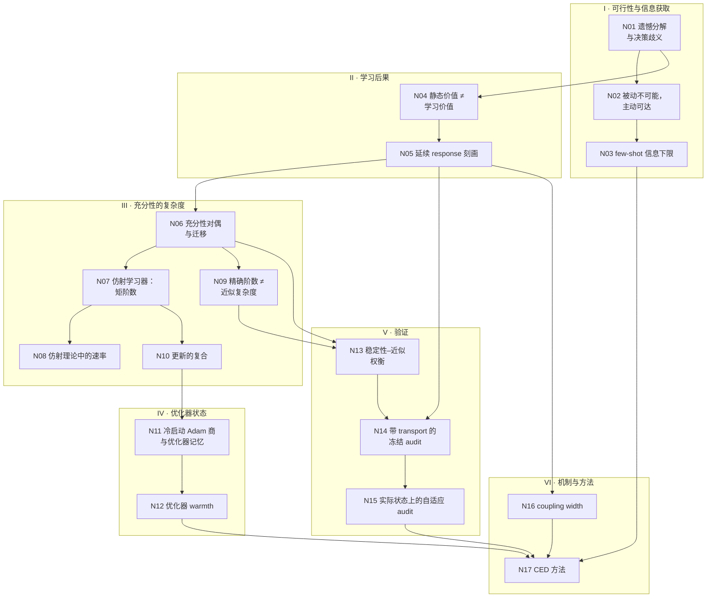

# 面向 Agent 蒸馏的环境信息理论：框架总图

[English](README.md)

**核心问题.** 给定部署任务、允许的实验和实际使用的学习过程，反馈分布之间的哪些差别会改变蒸馏后学生的最终任务表现？

本页是走完整套理论的最短完整路径。每个节点精确陈述一个结果，并说明为什么需要下一个节点。每个节点都链接两页：

- **证明**：完整推导。
- **实验**：检验该节点的有限计算或受控实验，写明做这个实验的原因、设置和做法、得到的结果，以及结果如何支持该节点。

**来源.** v0.14.1 主框架（`docs/direction/v015_revision/Environment_Information_Theory_EN.md`）、v0.15 优化器与 few-shot 附录（`.../Optimizer_State_and_Few_Shot_Theory_v015_EN.md`）和 warm-Adam 扩展（`docs/direction/v015_extension/Warm_Adam_Response_EN.md`）。文中 (14)、(A9) 这类式号均指这些文档里的编号。

**范围.** 本页每个陈述都在其所列假设下有完整证明，并通过了独立的有限计算或受控检验。证明都是有限维的，或者带有明确的正则性假设。实验是精确有限计算或受控小网络，不是真实模型或 benchmark 上的结果。

---

## 0. 设定与记号

**环境与学生.** 环境 $E$ 包括任务分布、状态转移、反馈语义、评分规则和固定的执行 harness。所有回报都在 $[0,1]$ 内。学生的部署策略类为 $\Pi\subseteq\Pi_{\rm ref}$，记
$$J_E^\Pi=\max_{\pi\in\Pi}J_E(\pi),\qquad J_E^{\rm ref}=\max_{\pi\in\Pi_{\rm ref}}J_E(\pi).$$

**信息.** $I_0$ 是共同的初始信息，包括预训练模型、已知规则和每个任务族的 $K$ 条可信示范。$D$ 是此后所有可获取信息的 transcript。

**学习过程.** 完整学习器状态 $z$ 包括参数、优化器矩、缓冲区、采样器状态、随机性和历史。第 $t$ 轮，反馈分布 $P_t(\cdot\mid z)$ 给出消息 $Y_t$，实际更新为 $Z_{t+1}=U_t(z,Y_t,\xi_t)$。把更新随机性 $\xi_t$ 积分掉，得到学习 kernel $K_t$。参考协议记为 $K_t^0$，备选协议记为 $K_t^S$，两者从同一个初始状态分布出发。最终学生的得分为 $F_E(z)=J_E(\pi_z)\in[0,1]$。

**延续值与 response.** 定义
$$V_R^0=F_E,\qquad V_t^0=K_t^0V_{t+1}^0,$$
$$g_{E,f,t,z}(y)=\mathbb E_{\xi_t}\,V_{t+1}^0\big(U_t(z,y,\xi_t)\big).\tag{13}$$
$g$ 的含义是：收到消息 $y$、执行实际更新、再走完声明的参考学习尾段之后，最终真实任务回报的期望。若要显式写出优化器和训练配方 $o$，记为 $\psi_{E,o,t,z}$（A1）。令 $L_E(S)=\mathbb E\,F_E(Z_R^S)$，并用 $\mathcal G$ 表示所声明族中的全部 response。

**不能混用的计数.** $K$ 是可信示范数，$n_{\rm query}$ 是额外实验次数，$n$ 是独立经验块数，$R$ 是更新次数，$N$ 是部署决策数，$d$ 是线性统计量个数。同一个经验块重放 $n$ 次，并不等于 $n$ 个独立经验块。

---

## 1. 依赖图



整条链的顺序是：先看学生能执行什么、数据能识别什么（I）；再看反馈对学习器做了什么（II）；然后看信息充分性要付出多少代价（III），以及实际优化器如何改变这个代价（IV）；接着看如何用有限数据检验充分性（V）；最后是由此推出的方法（VI）。

---

## 2. 节点

每个节点末尾给出证明页链接、实验页链接，以及支持它的检验。

### I · 可行性与信息获取

#### N01 · 遗憾分解与决策歧义
*来源：* Prop. 1–3，式 (1)–(5)。*依赖：* 无。*被用于：* N02、N03、N04。

**命题.** 在有限环境族上给定先验，令 $B(D)=\max_{\pi\in\Pi}\mathbb E[J_E(\pi)\mid D]$。对任意学习器输出 $\widehat\pi$，
$$\mathbb E[J_E^{\rm ref}-J_E(\widehat\pi)]=\underbrace{\mathbb E[J_E^{\rm ref}-J_E^\Pi]}_{\mathcal R_{\rm rep}}+\underbrace{\mathbb E J_E^\Pi-\mathbb E_D B(D)}_{\mathcal R_{\rm info}}+\underbrace{\mathbb E_D[B(D)-\mathbb E[J_E(\widehat\pi)\mid D]]}_{\mathcal R_{\rm alg}},$$
三项均非负。此外：

- $\mathcal R_{\rm info}=0$ 当且仅当对几乎所有 $D$，集合 $\bigcap_{E:\Pr(E\mid D)>0}\arg\max_\pi J_E(\pi)$ 非空。
- 鲁棒歧义 $r(C)$ 等于它的 minimax 对偶，即 (3)=(4)。
- 对 $D$ 做随机后处理得到的 $D'$ 不会降低 $\mathcal R_{\rm info}$（式 (5)）。

**下一步.** 表示误差、信息误差和学习误差是三件分开的事。生成数据造不出本来缺失的事实，所以下一个问题是：示范在什么情况下会留下 $\mathcal R_{\rm info}>0$。

[证明](proofs/N01_decomposition_and_ambiguity_ZH.md) · [实验](experiments/N01_decomposition_and_ambiguity_ZH.md) · **已证明**；C1 通过

#### N02 · 被动不可能，主动可达
*来源：* Thm. 4，式 (6)–(9)，以及 compilation 一段。*依赖：* N01。*被用于：* N03。

**定理.** 考虑已知间隔 $0<\Delta\le 1/8$ 的两世界混叠族，teacher 在两个世界中都最优。

- 只看被动示范的学习器都满足 $\max_v\mathbb E[J_v^\Pi-J_v(\widehat p)]\ge\Delta$。
- 允许 reset 查询时，若要在每个世界中以概率 $1-\delta$ 得到 $\Delta/2$-最优的学生，必须有
$$\mathbb E_v n_{\rm query}\ge\frac{\operatorname{kl}(1-\delta,\delta)}{\operatorname{kl}(\tfrac12+2\Delta,\tfrac12-2\Delta)}\ge\frac{\operatorname{kl}(1-\delta,\delta)}{64\Delta^2}.$$
- $\lceil\log(1/\delta)/(8\Delta^2)\rceil$ 次查询就足够。
- 把获得的事实编译进频率学习器，需要 $m\ge\lceil32\log(2/\delta_L)\rceil$ 个编译标签。

**下一步.** 完美示范在信息上也可能不充分，而且信息获取的代价和编译的代价是两回事。N03 把 $K$ 显式写进来。

[证明](proofs/N02_passive_vs_active_acquisition_ZH.md) · [实验](experiments/N02_passive_vs_active_acquisition_ZH.md) · **已证明**；C2 通过

#### N03 · few-shot 信息下限
*来源：* Prop. A5–A7，式 (A11)–(A16)。*依赖：* N01、N02。*被用于：* N17。

**命题.** 在隐藏比特模型中，比特 $\Theta_1,\dots,\Theta_d$ 相互独立且均匀。上下文 $j$ 的权重为 $w_j$。每条轨迹以概率 $q_j$ 揭示比特 $j$，对未揭示的比特不泄露任何信息。

- 看过 $K$ 条轨迹后，
$$R_{\rm info}(K)=\tfrac12\textstyle\sum_j w_j(1-q_j)^K.$$
- 若有 $n$ 次查询的硬预算，则 $R_{\rm info}(K,n)=\tfrac12\,\mathbb E\big[\sum_{r>n}w_{(r)}\big]$，且优先查询权重最大的未见比特是最优策略。一般地，$\mathbb E[(M_K-n)_+]\ne(\mathbb E M_K-n)_+$。
- 在两世界自适应模型中，$K\kappa_D+\kappa_X\,\mathbb E N\ge\operatorname{kl}(1-\delta,\delta)$。

**下一步.** $K$ 和查询在同一份信息预算里互相替代，重放的贡献为零。但信息本身并不决定学习器能从中学到什么，这是第 II 部分的内容。

[证明](proofs/N03_few_shot_information_floor_ZH.md) · [实验](experiments/N03_few_shot_information_floor_ZH.md) · **已证明**；V5、V6、E5 通过

### II · 学习后果

#### N04 · 静态价值不等于学习价值
*来源：* Prop. 5–6，式 (10)–(11)。*依赖：* N01。*被用于：* N05。

**命题.**

- 存在两个数据源，对每个混叠学生给出相同的价值 $J(\pi_p)=\tfrac12+p/20$，teacher 价值也同为 $3/5$。但用它们做频率蒸馏，期望回报分别是 $43/80$ 和 $41/80$，对每个 $m\ge1$ 都相差 $1/40$。
- 存在两个标签包，边缘分布和平均梯度都相同，在 $J(p)=p^2$ 下的学习价值却相差 $\eta^2/8$。把 $J$ 换成 $1-p^2$，差的符号就反过来。

**下一步.** teacher 质量、策略价值和平均梯度都不能决定学生学到什么。不变量必须把更新和部署都包含进去，N05 给出的正是这样的对象。

[证明](proofs/N04_static_vs_learning_sufficiency_ZH.md) · [实验](experiments/N04_static_vs_learning_sufficiency_ZH.md) · **已证明**；C3 通过

#### N05 · 延续 response 刻画
*来源：* Thm. 7，式 (12)–(17)，§5.2。*依赖：* N04。*被用于：* N06、N14、N15、N16。

**定理.** 令 $d_t^S$ 为备选过程实际的状态占据分布。则：

- $$L_E(0)-L_E(S)=\sum_{t=0}^{R-1}\mathbb E_{d_t^S}\big[(K_t^0-K_t^S)V_{t+1}^0(Z_t)\big],$$
  因此 $\lvert L_E(0)-L_E(S)\rvert\le\sum_t\mathbb E_{d_t^S}\varepsilon_t(Z_t)$。
- 两个消息分布对"任意单边界替换，后接声明的尾段"都可互换，当且仅当对所有 $g\in\mathcal G$ 有 $\mathbb E_Pg=\mathbb E_Qg$。
- 若保证只在一个 certified 状态集上成立，首次离开该集合的概率为 $\rho$，则 $\lvert L_E(0)-L_E(S)\rvert\le\mathbb E_S\sum_{t<\tau_{\rm exit}}\varepsilon_t+\rho$。代价是 $\rho$，而不是 $R\rho$。

$\mathcal G$ 由 $F_E$ 沿实际更新和参考 kernel 反向拉回得到。

**下一步.** 充分性的对象至此固定为 response 类 $\mathcal G$。第 III–V 部分分别研究它有多大、如何依赖于优化器，以及如何检验。

[证明](proofs/N05_continuation_response_ZH.md) · [实验](experiments/N05_continuation_response_ZH.md) · **已证明**；C4、T12 通过

### III · 充分性的复杂度

#### N06 · 充分性对偶与迁移
*来源：* Thm. 8，Cor. 9，式 (18)–(22)。*依赖：* N05。*被用于：* N07、N09、N13。

**定理.** 取有限消息字母表，$\lvert\mathcal Y\rvert=m$，特征为 $\phi_1,\dots,\phi_d$，并令 $H_\phi=\operatorname{span}\lbrace 1,\phi_1,\dots,\phi_d\rbrace $。

- **(a) 精确充分.** 对所有分布，特征均值相等能推出 response 均值相等，当且仅当 $\operatorname{span}\mathcal G\subseteq H_\phi$。所需统计量的最小个数为 $d_0=\dim\operatorname{span}(\lbrace 1\rbrace \cup\mathcal G)-1$。
- **(b) 近似充分.** 最坏分布对上未分辨的差异满足
$$\mathfrak D_\phi(\mathcal G)=2\sup_{g\in\mathcal G}\inf_{h\in H_\phi}\lVert g-h\rVert_\infty.$$
- **(c) 迁移.** 若 $g=c+b^\top\phi+r$，且 $\lVert b\rVert_1\le B$、$\lVert r\rVert_\infty\le\tau$，则 $\lvert(P-Q)g\rvert\le B\lVert\mathbb E_P\phi-\mathbb E_Q\phi\rVert_\infty+2\tau$。
- **推论 9.** 对不受限制的学习器，$d_0=m-1$，差异为 $\gamma\,\mathrm{TV}(P,Q)$。

**下一步.** "充分信息"由此变成 $\mathcal G$ 的张成维数或近似宽度。N07–N10 对具体的学习器把这些量算出来。

[证明](proofs/N06_sufficiency_duality_ZH.md) · [实验](experiments/N06_sufficiency_duality_ZH.md) · **已证明**；C5 通过

#### N07 · 仿射学习器：矩阶数既必要又充分
*来源：* Lemma 10，Thm. 11–13，式 (23)–(28)。*依赖：* N06。*被用于：* N08、N10。

**定理.** 考虑二元动作、多上下文的学生 $p\in[0,1]^k$，最多 $N$ 次决策，以及作用于 IID 块 $Z_i\in[0,1]^k$ 的凸仿射学习器 $p_R=w_0p_0+\sum_iw_iZ_i$。

- $J_E(p)$ 是次数不超过 $N$ 的多项式，且 $\sum_\alpha\lvert c_\alpha\rvert\le3^N$。
- 对所有 $\lvert\alpha\rvert\le N$ 有 $\mathbb E_PZ^\alpha=\mathbb E_QZ^\alpha$，当且仅当对每个任务和每个仿射学习器，学习价值都相等。
- 每一阶都是必要的。标量见证分布满足 $\Delta_N=(-1)^NN!/(2^{N-1}N^N)$；奇偶校验分布给出常数间隔 1。
- 在网格上，统计量的精确个数是 $\binom{k+N}{N}-1$。在 $\lbrace 0,1\rbrace ^k$ 上，若 $N\ge k$ 且终端奖励任意，少于 $2^k-1$ 个统计量时差异仍为 1。

**下一步.** 这是 N06 的显式实例：$\mathcal G$ 就是多项式，维数就是矩的个数。N08 把它做成定量结论。

[证明](proofs/N07_affine_moment_order_ZH.md) · [实验](experiments/N07_affine_moment_order_ZH.md) · **已证明**；C6–C9、C19 通过

#### N08 · 仿射理论中的速率
*来源：* Thm. 14–15，式 (29)–(31)。*依赖：* N07。*被用于：* 无。

**定理.**

- 对每个仿射学习器，$\lvert\text{gap}\rvert\le C_J\delta_N(P,Q)\le N3^N\delta_N(P,Q)$，与 $R$ 无关。
- 对 $n$ 个独立块取平均时，若均值相同、低于 $r$ 阶的联合 cumulant 也都相同，则
$$\mathbb E_{P^n}J(\bar p_n)-\mathbb E_{Q^n}J(\bar p_n)=\frac{\langle D^rJ(\mu),\kappa_r(P)-\kappa_r(Q)\rangle}{r!\,n^{r-1}}+O(n^{-r}).$$
- 对标量见证分布，这个展开是精确的：$\Delta_N/n^{N-1}$。

**下一步.** 差异衰减的快慢由独立块数 $n$ 决定，而不是 epoch 数。重放同一个块，或由它确定性生成的合成衍生数据，都不会让差异衰减。

[证明](proofs/N08_affine_rates_ZH.md) · [实验](experiments/N08_affine_rates_ZH.md) · **已证明**；C10、C11、C18 通过

#### N09 · 精确阶数不等于近似复杂度
*来源：* 式 (32)，Prop. 16，以及奇偶校验一段。*依赖：* N06。*被用于：* N13。

**命题.**

- 对 $p^N$，把 Chebyshev 展开截断到 $q$ 阶，误差为 $\Pr\lbrace \lvert B-N\rvert>q\rbrace \le2e^{-q^2/N}$，其中 $B\sim\mathrm{Bin}(2N,\tfrac12)$。因此只要矩匹配到 $q\ge\min\lbrace N,\lceil\sqrt{N\log(4/\varepsilon)}\rceil\rbrace $ 阶，价值差就不超过 $\varepsilon$，尽管精确相等需要 $N$ 阶。
- 奇偶校验价值 (27) 用次数低于 $N$ 的多项式做一致逼近，最优误差恰为 $1/2$。

**下一步.** 起作用的复杂度是近似宽度 $d_\varepsilon$，而不是次数。这样一来系数的稳定性就变得重要，见 N13。

[证明](proofs/N09_approximate_complexity_ZH.md) · [实验](experiments/N09_approximate_complexity_ZH.md) · **已证明**；C12、C19 通过

#### N10 · 更新的复合会放大信息需求
*来源：* Thm. 17，式 (34)–(35)；附录 §7 的递推说明。*依赖：* N07。*被用于：* N11。

**定理.**

- 若多项式更新对旧参数的次数为 $a_i$、对新块的次数为 $b_i$，则最终 response 对第 $i$ 块的次数至多为 $D_i=Nb_i\prod_{t>i}a_t$。这个界可以取到，例如 $Z_1^{2^{R-1}}$。
- 阈值学习器在 $N=1$ 时就已经破坏一阶矩充分性。
- 对光滑 SGD，
$$(K^P-K^Q)V=-\eta\nabla V^\top(\mu_P-\mu_Q)+\tfrac{\eta^2}{2}\langle\nabla^2V,M_P-M_Q\rangle+\mathcal E,\qquad \lvert\mathcal E\rvert\le\tfrac{M_3\eta^3}{6}\big(\mathbb E_P\lVert G\rVert^3+\mathbb E_Q\lVert G\rVert^3\big).$$
- 逐步误差的累积满足 $e_R\le C\eta^2\sum_s(1+\eta L)^s$；要得到关于 $R$ 线性的界，需要稳定性条件。

**下一步.** 决定所需信息阶数的是学习器，而不只是数据。因此必须对实际优化器建模，这是第 IV 部分。

[证明](proofs/N10_update_composition_ZH.md) · [实验](experiments/N10_update_composition_ZH.md) · **已证明**；C13、V7 通过；C23 给出 SGD 适用区间的边界

### IV · 优化器状态

#### N11 · 冷启动 Adam 的商与优化器记忆
*来源：* Prop. A2–A4，式 (A6)–(A10)。*依赖：* N06、N10。*被用于：* N12。

**命题.** 考虑带 bias correction、$\epsilon$ 在根号外的 Adam，从冷状态 $m_0=v_0=0$ 出发。

- 第一步为 $\theta_1=c-\eta\,h_\epsilon(G)$，其中 $h_\epsilon(g)_i=g_i/(\lvert g_i\rvert+\epsilon)$。
- 当 $\epsilon=0$ 时，"所有有界的即时参数效用都相等"等价于"联合符号分布相等"。若可达符号模式有 $s$ 种，恰好需要 $s-1$ 个统计量，而且这也足够。各坐标的符号边缘分布不够。
- 当 $\epsilon>0$ 时，$h_\epsilon$ 是单射，因此需要完整的梯度分布（$m-1$ 个统计量）。
- 间隔界 (A9)：对 Lipschitz 效用，用符号近似的代价是 $\eta\sum_iL_i[\beta_{P,i}(a)+\beta_{Q,i}(a)+2\epsilon/(a+\epsilon)]$。
- 保留的状态：$m_1=(1-\beta_1)G$。历史 $(1,-\tfrac34)$ 和 $(2,-\tfrac34)$ 的符号序列完全相同，第二步的方向却相反。

**下一步.** 矩充分性（N07）不能搬到 Adam 上，需要匹配什么取决于优化器状态。N12 定量刻画这种依赖如何衰减。

[证明](proofs/N11_adam_cold_start_ZH.md) · [实验](experiments/N11_adam_cold_start_ZH.md) · **已证明**；V2–V4 通过；E0–E3 确认 C23 中的 Adam gap 是冷启动优化器效应

#### N12 · 优化器 warmth 切换一阶反馈统计量
*来源：* warm-Adam 扩展，Lemma W0，Prop. W1–W2，Cor. W3。*依赖：* N05、N10、N11。*被用于：* N17。

**定义.** 坐标 $i$ 的 warmth 为 $\kappa_i(y)=(1-\beta_2)G_i(y)^2/(\beta_2v_i)$，$v_i=0$ 时记 $\kappa_i=\infty$。冻结分母的替代更新 $\tilde z^+$ 是一步带固定对角预条件子 $P=\operatorname{diag}(1/(a+\epsilon))$ 的 momentum SGD。

**定理.**

- **(W0)** $\lvert\theta^+_i-\tilde\theta^+_i\rvert\le\eta\,u_i\min\lbrace \kappa_i/2,1\rbrace $。
- **(W1)** 假设状态是 warm 的，即对所有 $i$ 有 $v_i>0$（W）；延续值 Lipschitz（L）；对二阶矩的敏感度有界（S）；且 $F(g)=V(\tilde z^+(g))$ 的曲率为 $H_G$（H）。则
$$\big\lvert\psi(y)-c-b^\top G(y)\big\rvert\le\eta\sum_iL_iu_i\min\lbrace \tfrac{\kappa_i}{2},1\rbrace +L_v\max_i\min\lbrace \kappa_i,\bar k\rbrace +\tfrac12H_G\lVert G\rVert_\infty^2=:r(y).$$
  因此，平均 consumed gradient 相同的两个分布，其 response 之差不超过 $\mathbb E_{P_0}r+\mathbb E_{P_1}r$。
- **(W2)** 在冷状态下，均值相同的分布在一阶上就会分开，差为 $\lvert w\rvert\eta/2$。即使两个分布在任意固定阶 $N$ 以下的矩都相同，仍然相差 $\lvert w\rvert\eta\,2^{2-N}$。
- **(W3)** (a) 若 $v$ 吸收了 $s$ 次二阶矩平稳的梯度，平均场 warmth 满足 $1/(\beta_2s)\le\bar\kappa(s)\le1/(\beta_2^{\,s}s)$。(b) 若在 warm 的更新上 $\max_i\kappa_i\le c/(W+s)$，则 telescoping 后的非仿射贡献不超过冷更新的个数，加上 $\bar A\sum_s\min\lbrace 1,c/(W+s)\rbrace \le\bar A\,c\log(1+R/W)$（$W\ge1$），再加曲率项。$W=0$ 时第一步是冷更新，至多记 1。

**下一步.** 反馈源需要匹配的统计量随优化器状态切换：冷 Adam 要匹配联合符号分布，warm Adam 要匹配平均预条件梯度。由此可以判断仿射理论（N07–N10）在 few-shot LoRA 上从哪里开始适用。

[证明](proofs/N12_optimizer_warmth_ZH.md) · [实验](experiments/N12_optimizer_warmth_ZH.md) · **已证明**（有限维，假设明确）；E8 通过

### V · 验证

#### N13 · 稳定性–近似权衡
*来源：* Thm. 18，式 (36)。*依赖：* N06、N09。*被用于：* N14。

**定理.** 对特征均值之差的容差 $\epsilon_j$，
$$W_{\boldsymbol\epsilon}(g)=\inf_{b,c}\Big[2\big\lVert g-c-\textstyle\sum_jb_j\phi_j\big\rVert_\infty+\sum_j\epsilon_j\lvert b_j\rvert\Big]=\inf_b\Big[\operatorname{osc}\big(g-\textstyle\sum_jb_j\phi_j\big)+\sum_j\epsilon_j\lvert b_j\rvert\Big].$$

**下一步.** 某个特征上的测量误差，代价是它的系数大小。所以近似残差小、但系数不稳定，并不构成 certificate。这决定了有限 audit 该如何设计。

[证明](proofs/N13_stability_tradeoff_ZH.md) · [实验](experiments/N13_stability_tradeoff_ZH.md) · **已证明**；C14、C22 通过

#### N14 · 带 transport 的冻结有限接口选择
*来源：* v0.14.1 的 Thm. 19，式 (37)–(40)、(39a)；Prop. A1，式 (A2)–(A5)。*依赖：* N05、N13。*被用于：* N15、N17。

**定理.**

- 令 $e_0=\sqrt{\log(4Ld/\delta)/(2n_0)}$，$e_S=\sqrt{\log(4MLd/\delta)/(2n_S)}$。以概率 $1-\delta$，对所有 $j$ 同时有 $\lvert D_j-\widehat D_j\rvert\le e_0+e_S$，并且 $D_{\widehat j}\le\min_jD_j+2(e_0+e_S)+\eta_{\rm opt}$。
- 设在 certified 状态上，状态到 cell 的 transport 误差为 $a_{t,j}(z)$，response 分解参数为 $(B_t,\tau_t)$。则
$$\lvert L_E(0)-L_E(S_{\widehat j})\rvert\le\sum_t\mathbb E_{d_t^{\widehat j}}\Big[1\lbrace t<\sigma\rbrace \big\lbrace B_t(\widehat D_{\widehat j}+e_0+e_S+a_{t,\widehat j}(Z_t))+2\tau_t\big\rbrace \Big]+\rho.\tag{39a}$$
- transport 精确成立时得到 (39)；IID 仿射设定下得到 (40)。
- transport 项不能去掉：若某个训练中到达的状态没有被任何 audit cell 覆盖，audit 测得的差异可以是 0，而学习 gap 却是 1。定理对这样的状态要么记 $a=1$，要么记离开概率 $\rho=1$。

**下一步.** 有限 audit 只有通过一个显式测量的覆盖/transport 项，才能证明学习价值。N15 改为在实际到达的状态上做 audit，从而去掉这一步外推。

[证明](proofs/N14_frozen_audit_transport_ZH.md) · [实验](experiments/N14_frozen_audit_transport_ZH.md) · **已证明**；V1、C20、T01、T02 通过；C15 与 E4 测量了 transport 项

#### N15 · 实际状态上的自适应 audit；保真与改进
*来源：* 式 (41)–(45)，Thm. 20，式 (A17)。*依赖：* N05、N14。*被用于：* N17。

**定理.**

- 保真：$L_E(S)-J_E(\pi_0)\ge\gamma-\varepsilon$。
- 带符号恒等式：$L_E(S)-L_E(0)=\sum_t\mathbb E_{d_t^S}A_t(Z_t,J_t)$。
- 自适应 audit：在每个被 audit 的实际状态上，做候选与参考的配对全尾实验，按下置信界 $\ell_t(j)=\widehat A_t(j)-e_t$ 选择，其中 $e_t=\sqrt{2\log(2M_t/\delta_t)/n_t}$。则 $L({\rm adaptive})-L(0)\ge-\delta$，并且 $\ge\mathbb E\sum_tB_t-2\delta$。
- 代价：$M=4$、$\delta=.05$、$e=.1$ 时，每个候选需要 $1016$ 个配对副本（这是充分条件，不是必要条件）。

**下一步.** 局部 certificate 有效，但每个候选要上千条完整训练尾段。因此方法（N17）用这类 audit 去校验更便宜的测量，方法层面的结论则靠整次训练的随机对照来支持。

[证明](proofs/N15_adaptive_audit_ZH.md) · [实验](experiments/N15_adaptive_audit_ZH.md) · **已证明**；C16、C21、T13 通过；E7 的 empirical-Bernstein 预测为 559 个副本

### VI · 机制与方法

#### N16 · coupling width
*来源：* Prop. 21，式 (46)。*依赖：* N05。*被用于：* N17。

**命题.** 固定有效单元的边缘分布，令 $H_z$ 为一个联合包在更新并走完全尾之后的回报。

- coupling width 为零，当且仅当在正支撑的乘积集上 $H_z(i,j)=a_i+b_j$。
- $\lvert(\Gamma-\Gamma')H_z\rvert\le2\inf_{a,b}\lVert H_z-a-b\rVert_\infty$。
- 严格零假设：单步 SGD 在示例和权重都相同时，对重新分组不变。

**下一步.** 这给出一个受控的机制检验：在边缘分布固定的前提下，反馈单元的联合组织方式会不会改变学到的东西？

[证明](proofs/N16_coupling_width_ZH.md) · [实验](experiments/N16_coupling_width_ZH.md) · **已证明**；C17 通过；C23(e) 为受控神经网络实验

#### N17 · Consequence-Calibrated Experience Distillation（CED）
*来源：* v0.14.1 §13，附录 §6，warm-Adam 扩展 §4。*依赖：* N03、N12、N14、N15、N16。

**推出的设计规则.** 每条规则都是所引节点的推论。

1. *先获取，再编译.* $K$ 条示范没能确定的事实，必须来自新的、允许的实验，重放和改写都提供不了（N01、N02、N03）。
2. *按实测后果选择.* 评判一个 provider，要看它在实际更新加参考尾段下的 response（N05）。teacher 质量、策略价值和平均梯度都决定不了这个 response（N04）。
3. *记录优化器状态.* provider 需要匹配的统计量，在冷 Adam 状态下是联合符号分布，在 warm 状态下是平均预条件梯度（N11、N12）。因此测量 response 时要记录状态的 warmth。
4. *拟合稳定的 response 模型.* 在 Thm. 18 的有界系数目标下拟合 response 模型（N13）。
5. *把覆盖算进去.* 选择时要么用带显式 transport/离开项的 audit（N14），要么在实际状态上用下置信界（N15）。
6. *先冻结，再测迁移.* 选择器事先冻结，方法迁移和策略迁移分开评估。

**在受控学习器中确立的事实（见实验页）.**

- 在 held-out 状态上，静态更新统计量（平均梯度、符号、$\Delta\theta$、$\Delta\theta$ 加 $m,v$）预测不了全尾 response 的符号（E6）。因此规则 2 不能用这些统计量代替。
- 实测的短尾 response 在 held-out 状态、$\epsilon$、学习率和优化器 warmth 变化下都能选对。在 threshold 型任务上短尾会选错，只有完整尾段在每个 split 上都准确（E6）。
- moment warm-up 会缩小各 provider 之间的差别，但静态 proxy 仍然没有预测力（E9）。

[推导](proofs/N17_ced_method_ZH.md) · [实验](experiments/N17_ced_method_ZH.md) · 设计规则**已推出**；E6、E9 为受控实验结论

---

## 3. 已确立的结论

| 陈述 | 依据 |
|---|---|
| N01–N11、N13–N16 在各自所列有限假设下成立 | 完整证明；独立有限检验 C1–C22（其中 C15 是 transport 项必要性的见证）、V1–V7，以及包内检验 T01–T13 |
| N12：有限维下的 warm-Adam response 界 | 完整证明；E8 在 1.44M 个实例上检验了 W0–W3 |
| C23 中 Adam 相对仿射对照的偏离是冷启动优化器效应 | E1 与 E2：冻结 Jacobian 后 gap 仍在；用 5 步把矩热起来，gap 从 0.077 降到 0.003 |
| 按实测 response 选择（N17 规则 2–3） | 受控学习器中的 E6 与 E9 |

## 4. 复现检验

```bash
CUDA_VISIBLE_DEVICES='' theory/.venv/bin/python theory/independent_checks/check_v014_independent.py --output theory/independent_checks/results_independent_v014.json   # C1–C23
CUDA_VISIBLE_DEVICES='' theory/.venv/bin/python theory/v015_checks/check_v015.py --output theory/v015_checks/results_v015_independent.json                        # V1–V7, E0–E9
```

包内的验证脚本（`docs/direction/v014_handoff/verify_environment_information_v014.py`、`docs/direction/v015_revision/verify_v015_extensions.py`）复现原始的 T 组检验。`figures/` 里的图由 `figures/make_figures.py` 从上述结果文件重新生成。
