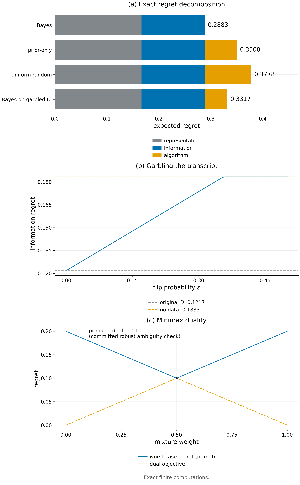

# Theorem 2.2 · regret 分解与决策歧义

*实验*

[← 框架总览](../README_ZH.md) · [陈述](../statements/02-02_regret_decomposition_decision_ambiguity_ZH.md) · [证明](../proofs/02-02_regret_decomposition_decision_ambiguity_ZH.md) · [实验](02-02_regret_decomposition_decision_ambiguity_ZH.md) · [English](02-02_regret_decomposition_decision_ambiguity.md)

**本页检验什么.** [Check 2.1](../experiments/02-02_regret_decomposition_decision_ambiguity_ZH.md#c2-1) 在 500 个随机有限决策问题上用精确有理数运算检验定理的两部分：分解残差恰为 0，每一项都非负，零信息判据在两个方向上都与直接计算一致（通过，5,810 条断言）。[Check 2.6](../experiments/02-10_few_shot_information_floor_ZH.md#c2-6) 展示算法项的作用：实际的 Adam 与 SGD 学习器从未低于信息下限，超出的部分就是它们的算法误差（通过）。

**本页用到的设定.**

- 有限的环境集合 $`\mathcal E`$，先验为 $`\mu`$，以公共初始信息 $`I_0`$（预训练模型、已知规则、$`K`$ 条可信示范）为条件。
- 有限策略类 $`\Pi\subseteq\Pi_{\rm ref}`$，取值 $`J_E(\pi)\in[0,1]`$：$`\Pi`$ 是学生能部署的策略，$`\Pi_{\rm ref}`$ 是参照类（例如 teacher 能执行的策略）。
- transcript $`D`$：学习器在 $`I_0`$ 之外观察到的一切，包括它可以做的每个实验；给定 $`E`$ 时其分布为 $`P(D\mid E)`$，$`\mu(E\mid D)`$ 是后验。
- 学习器：一个 kernel $`\lambda(\cdot\mid D)`$，输出策略 $`\widehat\pi\in\Pi`$；给定 $`D`$ 时，它的私有随机性与 $`E`$ 独立。
- $`J_E^\Pi=\max_{\pi\in\Pi}J_E(\pi)`$ 与 $`J_E^{\rm ref}=\max_{\pi\in\Pi_{\rm ref}}J_E(\pi)`$ 是环境 $`E`$ 中的最好值；$`B(D)=\max_{\pi\in\Pi}\mathbb E[J_E(\pi)\mid D]`$ 是 Bayes 值，即给定 $`D`$ 时 $`\Pi`$ 中的学生能达到的最好期望回报。
- 三项 regret $`\mathcal R_{\rm rep}`$、$`\mathcal R_{\rm info}`$、$`\mathcal R_{\rm alg}`$ 的定义见 [Definition 2.1](../statements/02-01_bayes_value_three_regret_terms_ZH.md#s2-1)。

**被检验的陈述（[Theorem 2.2](../statements/02-02_regret_decomposition_decision_ambiguity_ZH.md#s2-2)）.** 在 [Definition 2.1](../statements/02-01_bayes_value_three_regret_terms_ZH.md#s2-1) 下：

**(a) 精确分解.** 相对参照最优的期望 regret 为

```math
\mathbb E[J_E^{\rm ref}-J_E(\widehat\pi)]=\mathcal R_{\rm rep}+\mathcal R_{\rm info}+\mathcal R_{\rm alg},\qquad \mathcal R_{\rm rep},\ \mathcal R_{\rm info},\ \mathcal R_{\rm alg}\ge0. \qquad(2.1)
```

**(b) 决策歧义.** $`\mathcal R_{\rm info}=0`$，当且仅当对每个满足 $`\Pr(D)>0`$ 的 $`D`$，

```math
\bigcap_{E:\,\mu(E\mid D)>0}\arg\max_{\pi\in\Pi}J_E(\pi)\neq\varnothing. \qquad(2.2)
```

**本页还检验的陈述.**

- [Proposition 2.3](../statements/02-03_robust_ambiguity_duality_ZH.md#s2-3)：稳健歧义值 (2.3)，即在类 $`C`$ 上对混合策略取最小的最坏 regret，等于它的对偶 (2.4)，即在 $`C`$ 的先验上取最大。
- [Proposition 2.4](../statements/02-04_post_processing_cannot_reduce_information_ZH.md#s2-4)：transcript 的与环境无关的后处理 $`D'`$ 不能提高 Bayes 值 (2.5)；加入独立数据不改变它。

<a id="c2-1"></a>

## Check 2.1 · regret 分解、歧义判据、对偶与 data processing（Theorem 2.2，Propositions 2.3–2.4）

**结论.** 通过：500 个随机有限决策问题，5,810 条断言，没有违反。每个有理数恒等式的残差都恰为 0；最大的浮点残差（来自 LP 求解）为 $`1.33\times10^{-15}`$。

**为什么做.**

- 分解 (2.1) 是恒等式。$`B(D)`$、后验或学习器 kernel 的定义若有任何错误，都会表现为非零残差。
- 歧义判据 (2.2) 是"当且仅当"，任一方向的反例都能否定它。
- 对偶 (2.4) 与 data processing 不等式 (2.5) 若缺了某个假设，随机或对抗构造的实例就可能违反它们。

**设置.**

- 500 个随机实例：3–6 个环境，随机有理先验；$`\Pi`$ 中 2–5 个策略，$`\Pi_{\rm ref}`$ 再多两个策略。
- 值 $`J_E(\pi)\in[0,1]`$ 是分母为 12 的随机有理数。transcript 字母表大小 $`\lvert\mathcal D\rvert=4`$，信道 $`P(D\mid E)`$ 与学习器 kernel $`\lambda(\cdot\mid D)`$ 随机。
- 四分之一的实例强制带平局的共同最优（对所有 $`E`$ 有 $`J_E(\pi_1)=J_E(\pi_2)=1`$）；四分之一强制各环境最优策略不同。
- 精确运算（`fractions.Fraction`）。LP 用 HiGHS ([Huangfu & Hall, 2018](#ref-huangfu2018parallelizing)) 求解，容差 $`10^{-8}`$。种子 `SeedSequence([20261010, 1])`。

**做法.** 对每个实例：

1. 计算 $`\mathcal R_{\rm rep},\mathcal R_{\rm info},\mathcal R_{\rm alg}`$；断言三者之和恰为总 regret，且各自 $`\ge0`$。
2. 判断是否对每个 $`D`$ 都存在共同的后验最优策略；断言这恰好在 $`\mathcal R_{\rm info}=0`$ 时成立。
3. 让 $`D`$ 经过 3 符号信道 garbling（即 Blackwell 实验比较中的后处理，[Blackwell, 1953](#ref-blackwell1953equivalent)）：一个随机的随机化信道；在前 30 个实例上还用全部 $`3^4=81`$ 个确定性信道（凸目标的极点）。断言 $`B(D')\le B(D)`$。
4. 用独立的 $`Z`$ 扩充 $`D`$，断言 $`B(D,Z)=B(D)`$ 精确成立。
5. 在 220 个实例上分别求解原始的"对混合策略取最小" LP (2.3) 与对偶的"对先验取最大" LP (2.4)；断言两者相等，且值为 $`0`$ 恰好在存在共同最优时成立。

**结果.**

| 量 | 值 | JSON 键（该检验的条目） |
|---|---|---|
| 实例数 / 断言数 | 500 / 5,810 | `n_instances`、`.n_assertions` |
| 最大残差（恒等式、LP 相等） | $`1.33\times10^{-15}`$ | `worst_residual` |
| 最大 LP 可行性残差 | $`1.33\times10^{-15}`$ | `worst_lp_feasibility_residual` |
| 分别求解原始/对偶 LP 的实例数 | 220 | `details.minimax_instances` |
| 所有 garbling 中最大的 $`B(D')-B(D)`$ | $`0.0`$ | `details.adversarial_garbling_best_lhs_minus_rhs` |
| 状态 | 通过 | `status` |



*Figure 2.1.* (a) 一个三环境有限问题上四个学习器的精确 regret 分解：数据相同时，换学习器只改变算法项。(b) 让 transcript 经过二元对称信道 garbling，信息 regret 单调上升，从原始数据的 0.1217 升到无数据时的 0.1833。(c) [Check 2.2](../experiments/02-03_robust_ambiguity_duality_ZH.md#c2-2) 的两世界实例的稳健歧义值：对混合策略取最小与对先验取最大都等于 0.1。[PDF](../figures/fig2_1_decomposition.pdf)

**为什么支持这些陈述.**

- 在每个实例上分解都精确成立、每一项都非负，与 Theorem 2.2(a) 一致。
- 零信息判据在两个方向上都与直接计算一致，包括平局情形（Theorem 2.2(b)）。
- 没有任何 garbling，包括对抗选出的极点信道，提高了 Bayes 值（[Proposition 2.4](../statements/02-04_post_processing_cannot_reduce_information_ZH.md#s2-4)）；对偶 LP 总是达到原始值（[Proposition 2.3](../statements/02-03_robust_ambiguity_duality_ZH.md#s2-3)）。
- 残差处于浮点 LP 求解的水平；每个有理数恒等式的残差都恰为零。

### [Check 2.6](../experiments/02-10_few_shot_information_floor_ZH.md#c2-6) · 示范数曲线、replay 与实际学习器

- *对本定理检验什么.* (2.1) 中的算法项 $`\mathcal R_{\rm alg}`$：信息项精确已知时，实际学习器多出的风险就是算法误差。
- *设置.* 隐藏比特模型，$`m\in\lbrace4,8,16\rbrace`$ 个上下文；表格学习器（每个上下文一个 logit）在已揭示的比特上用 Adam ([Kingma & Ba, 2015](#ref-kingma2015adam)) 或 SGD 训练 12 次更新；共 5,664 行学习器结果。
- *结果.* 学习器风险减去精确信息下限从不为负（最小值 0.0）。12 次更新后在已揭示比特上的平均错误率为 0.239（Adam）与 0.372（SGD）：这部分超出就是 $`\mathcal R_{\rm alg}`$，与 $`\mathcal R_{\rm info}`$ 分开可见。
- *结论.* 通过。

## 复现

脚本用到 NumPy ([Harris et al., 2020](#ref-harris2020array)) 与 SciPy ([Virtanen et al., 2020](#ref-virtanen2020scipy))。

```bash
CUDA_VISIBLE_DEVICES='' PYTHONDONTWRITEBYTECODE=1 theory/.venv/bin/python theory/independent_checks/check_v014_independent.py --only C1 --output theory/independent_checks/subset.json
CUDA_VISIBLE_DEVICES='' theory/.venv/bin/python theory/v015_checks/check_v015.py --only E5 --output theory/v015_checks/quick/sec2.json
```

## 产物

- `theory/independent_checks/results_independent_v014.json`：`v014:C1` 的条目；代码 `theory/independent_checks/check_v014_independent.py`（`check_C1`）。
- `theory/v015_checks/results_v015_independent.json`：`v015:E5` 的条目；代码 `theory/v015_checks/experiments.py`（`check_E5`）。
- 图：`figures/fig2_1_decomposition.{png,pdf}`；规格见 `figures/specs/fig2_1.md`。
