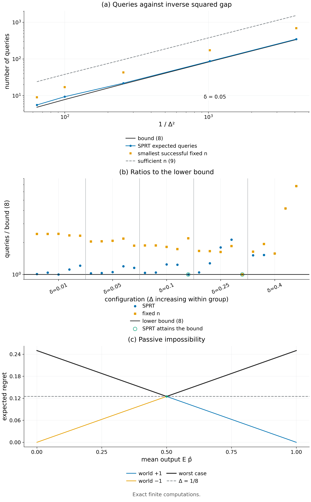

# Theorem 2.6 · 被动不可能，主动可达

*实验*

[← 框架总览](../README_ZH.md) · [陈述](../statements/02-06_passive_impossibility_active_attainability_ZH.md) · [证明](../proofs/02-06_passive_impossibility_active_attainability_ZH.md) · [实验](02-06_passive_impossibility_active_attainability_ZH.md) · [English](02-06_passive_impossibility_active_attainability.md)

**本页检验什么.** [Check 2.3](../experiments/02-06_passive_impossibility_active_attainability_ZH.md#c2-3) 在 25 组 $`(\Delta,\delta)`$ 上精确计算定理中的每个量（540 条断言，最大残差 0）。没有精确计算的策略低于下界 (2.6)；调好参数的 SPRT 在两组设定上恰好达到它（比值 1.000），所以一般而言常数不能改进；(c) 的充分查询次数总使误差远低于 $`\delta`$；两个被动 regret 恰好在 $`\Delta`$ 处相交（通过）。

**本页用到的设定.**

- 未知符号 $`v\in\lbrace -1,+1\rbrace`$ 选定两个世界之一；差距 $`0<\Delta\le1/8`$ 已知。
- 隐藏状态 $`s\in\lbrace 0,1\rbrace`$ 均匀分布。teacher 能看到 $`s`$：在 $`s=0`$ 选 $`A`$，在 $`s=1`$ 选 $`B`$，两者都以概率 1 成功，所以 teacher 在两个世界中都最优。
- 学生是混叠的（看不到 $`s`$），以概率 $`p`$ 选 $`A`$。另外两个状态–动作对的成功概率为 $`\tfrac12\mp2v\Delta`$，所以学生的值为 $`J_v(p)=\tfrac34+v\Delta(2p-1)`$，最好值为 $`J_v^\Pi=\tfrac34+\Delta`$：$`v=+1`$ 时在 $`p=1`$ 取到，$`v=-1`$ 时在 $`p=0`$ 取到。
- *被动接口：* 学习器看到 teacher 示范（可能附带 $`s`$）及对它们的后处理。*查询接口：* 它还可以自适应地 reset 到 $`s=1`$、执行 $`A`$，观察 Bernoulli $`(\tfrac12+2v\Delta)`$ 结果，查询次数是停时 $`N`$。
- $`\mathrm{kl}(a,b)=a\log\frac ab+(1-a)\log\frac{1-a}{1-b}`$ 是二元 KL 散度。
- 完整定义：[Definition 2.5](../statements/02-05_two_world_aliased_family_ZH.md#s2-5)。

**被检验的陈述（[Theorem 2.6](../statements/02-06_passive_impossibility_active_attainability_ZH.md#s2-6)）.** 在 [Definition 2.5](../statements/02-05_two_world_aliased_family_ZH.md#s2-5) 的族中：

- **(a) 被动不可能.** 在被动接口下，每个学习器都满足 $`\max_{v}\mathbb E\big[J_v^\Pi-J_v(\widehat p)\big]\ge\Delta`$。
- **(b) 主动下界.** 在查询接口下，设 $`0<\delta<1/2`$，并设在每个世界中，学习器以至少 $`1-\delta`$ 的概率输出 regret 不超过 $`\Delta/2`$ 的学生。则对每个 $`v`$，

```math
\mathbb E_vN\ge\frac{\mathrm{kl}(1-\delta,\delta)}{\mathrm{kl}(\tfrac12+2\Delta,\tfrac12-2\Delta)}\ge\frac{\mathrm{kl}(1-\delta,\delta)}{64\Delta^2}. \qquad(2.6)
```

- **(c) 主动上界.** $`n_{\rm query}=\lceil\log(1/\delta)/(8\Delta^2)\rceil`$ 次独立查询足以在每个世界中以至少 $`1-\delta`$ 的概率输出最优端点 $`p\in\lbrace 0,1\rbrace`$。

**本页还检验的陈述.**

- [Proposition 2.7](../statements/02-07_compilation_cost_ZH.md#s2-7)：符号估计出来之后，朝 $`q\in\lbrace\tfrac18,\tfrac78\rbrace`$ 编译 $`m\ge\lceil32\log(2/\delta_L)\rceil`$ 个标签，就以至少 $`1-\delta_L`$ 的概率把频率学习器放到离 $`q`$ 不超过 $`\tfrac18`$ 处。

<a id="c2-3"></a>

## Check 2.3 · 两世界族中的查询复杂度与编译（Theorem 2.6，Proposition 2.7）

**结论.** 通过：25 组设定 $`\Delta\in\lbrace \tfrac18,\tfrac1{10},\tfrac1{16},\tfrac1{32},\tfrac1{64}\rbrace \times\delta\in\lbrace 0.01,0.05,0.1,0.25,0.4\rbrace`$，540 条断言，最大残差 0。没有任何精确计算的策略低于 (2.6)；SPRT 在 $`(\Delta,\delta)=(\tfrac18,\tfrac1{10})`$ 与 $`(\tfrac18,\tfrac14)`$ 上恰好落在界上。

**为什么做.**

- Theorem 2.6(b) 是对*所有*自适应策略的下界。一个在两个世界中误差都 $`\le\delta`$、期望查询数更少的策略就能否定它。
- Theorem 2.6(c) 与 [Proposition 2.7](../statements/02-07_compilation_cost_ZH.md#s2-7) 是充分性陈述。在所述样本量下精确误差超过 $`\delta`$（或 $`\delta_L`$）就能否定它们。
- 常数 64 依赖于 $`\mathrm{kl}(\tfrac12+u,\tfrac12-u)\le16u^2`$，这一点做了解析与数值核对。

**设置.**

- 精确的有理二项尾概率，用整数分子求和，不用正态近似。
- SPRT 的期望样本量与误差，通过对边界为 $`\pm h`$ 的吸收随机游走做精确三对角消元得到，$`h=\lceil\log\frac{1-\delta}{\delta}/\log\frac{1/2+2\Delta}{1/2-2\Delta}\rceil`$。
- 回报 $`J_v(p)`$ 与被动 minimax 用 SymPy 计算。
- KL 不等式在 $`(0,\tfrac14]`$ 上 20,001 个点的稠密网格上核对，另用有界标量优化器对抗地最大化比值。
- 种子 `SeedSequence([20261010, 2])`；检验是确定性的。

**做法.**

1. 找到最小的奇数 $`n`$，使阈值检验在两个世界中成功概率都 $`\ge1-\delta`$（平局算失败）；核对 $`n-1`$ 与 $`n-2`$ 失败。
2. 计算 SPRT 的精确期望停时与精确误差。
3. 断言两种停时都 $`\ge`$ 界 (2.6)，并且 (2.6) 的第一种形式 $`\ge`$ 其放松形式 $`\mathrm{kl}(1-\delta,\delta)/(64\Delta^2)`$。
4. 断言在 $`n_{\rm query}=\lceil\log(1/\delta)/(8\Delta^2)\rceil`$ 处精确误差 $`\le\delta`$。
5. 编译：对 $`q\in\lbrace \tfrac18,\tfrac78\rbrace`$，计算 $`m=\lceil32\log(2/\delta_L)\rceil`$ 时 $`\lvert\widehat p-q\rvert>\tfrac18`$ 的精确概率；断言它 $`\le\delta_L`$，且每个落在容差内的结果 regret $`\le\Delta/2`$。

**结果（部分行；全部 25 行在 JSON 中）.**

| $`\Delta`$ | $`\delta`$ | 界 (2.6) | 最优固定 $`n`$ | SPRT $`\mathbb E N`$ | SPRT / 界 | $`n_{\rm query}`$ | $`n_{\rm query}`$ 处的精确误差 |
|---|---|---:|---:|---:|---:|---:|---:|
| 1/8 | 0.01 | 8.198 | 19 | 9.918 | 1.210 | 37 | 5.1e-4 |
| 1/8 | 0.1 | 3.200 | 7 | 3.200 | **1.000** | 19 | 8.9e-3 |
| 1/8 | 0.25 | 1.000 | 1 | 1.000 | **1.000** | 12 | 5.4e-2 |
| 1/16 | 0.01 | 35.262 | 85 | 35.282 | 1.0005 | 148 | 1.3e-3 |
| 1/32 | 0.05 | 84.356 | 173 | 87.030 | 1.032 | 384 | 8.0e-3 |
| 1/64 | 0.01 | 575.661 | 1383 | 580.574 | 1.0085 | 2358 | 1.3e-3 |
| 1/64 | 0.1 | 224.703 | 421 | 233.224 | 1.038 | 1179 | 1.6e-2 |

| 汇总量 | 值 | JSON 键（该检验的条目） |
|---|---|---|
| 设定数 / 断言数 | 25 / 540 | `n_instances`、`.n_assertions` |
| SPRT / 界 的最小比值 | 1.0 | `details.minimum_sprt_ratio` |
| 固定 $`n`$ / 界 的最小比值 | 1.0（在 $`\Delta=\tfrac18,\delta=0.25`$） | `details.configurations[*].fixed_ratio` |
| $`(0,\tfrac14]`$ 上 $`\sup_u\mathrm{kl}(\tfrac12+u,\tfrac12-u)/u^2`$ 的解析值 | $`8\log3=8.789`$ | `details.analytic_kl_sup` |
| 优化器找到的最大比值 | 8.789（小于 16） | `details.optimizer_kl_ratio` |
| 编译所需 $`m`$（$`\delta_L=0.01,0.05,0.1,0.25,0.4`$） | 170、119、96、67、52 | `details.compilation[*].m` |
| 这些 $`m`$ 下的精确编译误差 | 4.2e-6、1.2e-4、2.4e-4、3.0e-3、3.9e-3 | `details.compilation[*].error` |
| 最大残差 | 0 | `worst_residual` |



*Figure 2.2.* (a) $`\delta=0.05`$ 时精确查询次数随 $`1/\Delta^2`$ 的变化：SPRT 贴着 KL 下界 (2.6)，最小的成功固定样本检验与 Theorem 2.6(c) 的充分 $`n_{\rm query}`$ 在它上方，没有策略落到它下方。(b) 全部 25 组设定上各策略与界的比值；SPRT 在其中两组达到比值 1。(c) $`\Delta=1/8`$ 时，两个被动 regret $`2\Delta(1-m)`$ 与 $`2\Delta m`$ 随平均输出 $`m`$ 此消彼长，所以任何被动学习器的最坏情况至少为 $`\Delta`$。[PDF](../figures/fig2_2_queries.pdf)

**为什么支持这些陈述.**

- *被动不可能（Theorem 2.6(a)）.* 符号计算得到的回报恰为 $`\tfrac34+v\Delta(2p-1)`$，两个被动 regret 恰好在值 $`\Delta`$ 处相交。
- *下界（Theorem 2.6(b)）.* 没有精确计算的策略能打破这个界。SPRT 对这个问题接近最优，在两组设定上落在界上；在 $`\Delta=\tfrac1{64}`$、$`\delta\le0.25`$ 时与界相差不到 5%（比值 1.009–1.047）。所以这个界的常数也是对的，不只是阶对。$`\delta\le0.25`$ 时，除平凡的 $`n=1`$ 外，固定样本检验需要界的 1.6–2.4 倍，这对非序贯设计是预期之中的。
- *上界（Theorem 2.6(c)）.* 在 $`n_{\rm query}`$ 处，每组设定的精确误差都远低于 $`\delta`$：Hoeffding 是保守的。
- *编译（[Proposition 2.7](../statements/02-07_compilation_cost_ZH.md#s2-7)）.* 编译标签数为 $`O(\log(1/\delta_L))`$，与 $`\Delta`$ 无关；精确尾概率比 $`\delta_L`$ 低两到四个数量级。
- 两项代价，即 $`\Theta(\Delta^{-2}\log(1/\delta))`$ 次真实查询与 $`O(\log(1/\delta_L))`$ 个编译标签，因此分别得到了确认。

## 复现

```bash
CUDA_VISIBLE_DEVICES='' PYTHONDONTWRITEBYTECODE=1 theory/.venv/bin/python theory/independent_checks/check_v014_independent.py --only C2 --output theory/independent_checks/subset.json
```

## 产物

- `theory/independent_checks/results_independent_v014.json`：`v014:C2` 的条目；代码 `theory/independent_checks/check_v014_independent.py`（`check_C2`、`binomial_tail`、`walk_recursion`）。
- `theory/independent_checks/SPEC.md`（`v014:C2` 一节）。
- 图：`figures/fig2_2_queries.{png,pdf}`；规格见 `figures/specs/fig2_2.md`。
