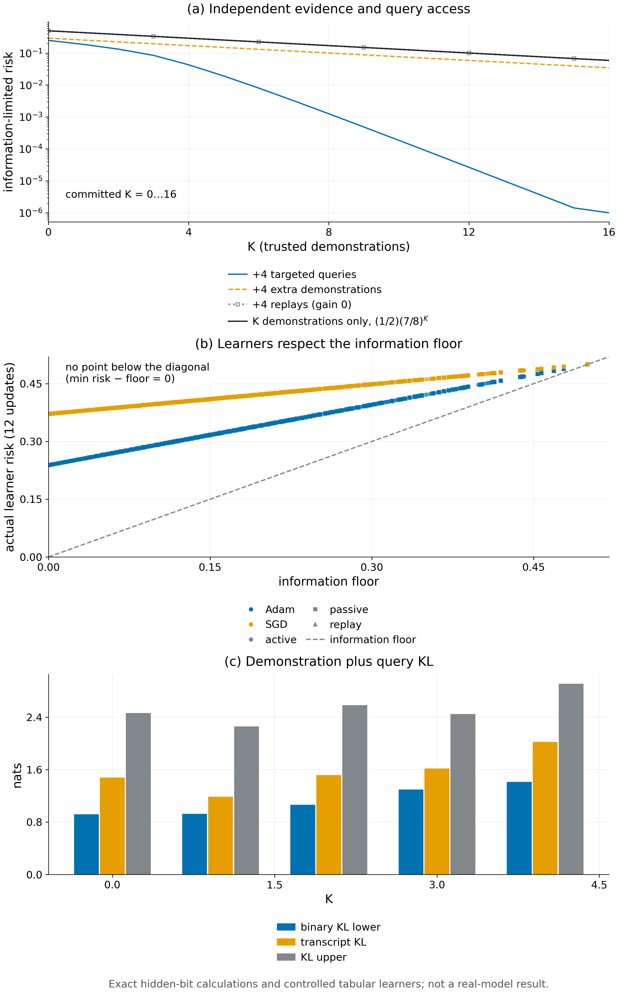

# Theorem 2.10 · 少样本信息下限与硬预算下的最优查询

*实验*

[← 框架总览](../README_ZH.md) · [陈述](../statements/02-10_few_shot_information_floor_ZH.md) · [证明](../proofs/02-10_few_shot_information_floor_ZH.md) · [实验](02-10_few_shot_information_floor_ZH.md) · [English](02-10_few_shot_information_floor.md)

**本页检验什么.** 三个检查检验这个定理。[Check 2.4](../experiments/02-10_few_shot_information_floor_ZH.md#c2-4) 穷举 100 个小情形：Bayes 最优风险等于 (2.7)/(2.9)，最优的按值自适应查询树等于贪心，把正部移到期望外面在 100 个情形中有 36 个是错的（通过）。[Check 2.6](../experiments/02-10_few_shot_information_floor_ZH.md#c2-6) 计算 944 条精确风险曲线并训练实际学习器：预算相同时定向查询胜过额外示范，replay 收益为 0，没有学习器低于下限（通过）。[Check 2.7](../experiments/02-10_few_shot_information_floor_ZH.md#c2-7) 在三个独立的包构造上复现闭式（通过）。

**本页用到的设定.**

- 未知比特 $`\Theta_1,\dots,\Theta_d`$ 独立且均匀。上下文 $`j`$ 在部署时以权重 $`w_j`$ 出现（$`\sum_jw_j=1`$），其正确决策为 $`\Theta_j`$；学生能学任何"上下文到动作"的表，所以没有表示误差。
- $`K`$ 条示范中的每一条揭示一个随机的比特集合 $`S_k`$ 及其值；这些集合独立同分布，与比特独立，$`q_j=\Pr(j\in S)`$ 是一条示范揭示比特 $`j`$ 的概率。
- 示范之后，硬预算允许 $`n`$ 次查询，每次揭示一个选定的比特；选择可以依赖于此前看到的一切。
- $`U_K`$ 是没有被任何示范揭示的比特集合，$`M_K=\lvert U_K\rvert`$。$`R_{\rm info}`$ 表示可达到的最小期望 regret（[Theorem 2.2](../statements/02-02_regret_decomposition_decision_ambiguity_ZH.md#s2-2) 中的信息项）。
- 完整定义：[Definition 2.8](../statements/02-08_hidden_bit_model_ZH.md#s2-8)。

**被检验的陈述（[Theorem 2.10](../statements/02-10_few_shot_information_floor_ZH.md#s2-10)）.** 在 [Definition 2.8](../statements/02-08_hidden_bit_model_ZH.md#s2-8) 的模型中：

**(a) 信息下限.** 不查询时，$`K`$ 条轨迹之后可达到的最小期望 regret 为

```math
R_{\rm info}(K)=\frac12\sum_{j=1}^dw_j(1-q_j)^K, \qquad(2.7)
```

约定 $`(1-q)^0=1`$。再多一条轨迹的边际价值为

```math
R_{\rm info}(K)-R_{\rm info}(K+1)=\frac12\sum_jw_jq_j(1-q_j)^K. \qquad(2.8)
```

**(b) 最优查询.** 把未揭示比特的权重排序为 $`w_{(1)}\ge\dots\ge w_{(M_K)}`$，则

```math
R_{\rm info}(K,n)=\frac12\,\mathbb E\Big[\sum_{r=n+1}^{M_K}w_{(r)}\Big], \qquad(2.9)
```

并且查询权重最大的 $`n`$ 个未揭示比特是最优的；根据揭示出的值调整查询没有帮助。在均匀情形（$`w_j=1/d`$，每条轨迹揭示一个均匀抽取的上下文）下，

```math
R_{\rm info}(K,n)=\frac{\mathbb E[(M_K-n)_+]}{2d},\qquad R_{\rm info}(K,0)=\frac12(1-1/d)^K. \qquad(2.10)
```

一般有 $`\mathbb E[(M_K-n)_+]\ge(\mathbb EM_K-n)_+`$，且不等号可以严格。

**本页还检验的陈述.**

- [Lemma 2.9](../statements/02-09_no_leakage_about_unrevealed_bits_ZH.md#s2-9)：给定 transcript，未揭示的比特仍是独立的均匀硬币（[Check 2.4](../experiments/02-10_few_shot_information_floor_ZH.md#c2-4) 通过其推论检验）。
- [Proposition 2.4](../statements/02-04_post_processing_cannot_reduce_information_ZH.md#s2-4)：replay 作为与环境无关的后处理，不能降低信息项（[Check 2.6](../experiments/02-10_few_shot_information_floor_ZH.md#c2-6)）。
- [Theorem 2.2](../statements/02-02_regret_decomposition_decision_ambiguity_ZH.md#s2-2) 的算法项 $`\mathcal R_{\rm alg}`$：实际学习器高出下限的风险就是它的算法误差（[Check 2.6](../experiments/02-10_few_shot_information_floor_ZH.md#c2-6)）。
- [Proposition 2.11](../statements/02-11_shared_information_budget_ZH.md#s2-11)：示范 KL 加查询 KL 必须达到 $`\mathrm{kl}(1-\delta,\delta)`$（[Check 2.7](../experiments/02-10_few_shot_information_floor_ZH.md#c2-7) 中的包构造 `pkg:T11`）。

<a id="c2-4"></a>

## Check 2.4 · 隐藏比特的 coverage、硬查询预算与自适应性（Lemma 2.9，Theorem 2.10）

**结论.** 通过：348 个实例，26,214 条断言，最大残差 0。在全部 100 个穷举情形（$`d\le5`$、$`K\le4`$、$`n\le3`$）中，Bayes 最优风险等于 (2.7)/(2.9)，最优的按标签自适应查询决策树等于按权重的贪心规则。

**为什么做.**

- Theorem 2.10(a) 断言：无论同一条轨迹内的揭示事件如何相关，Bayes 风险都是 $`\tfrac12\sum_jw_j(1-q_j)^K`$。
- Theorem 2.10(b) 断言：没有按标签自适应的查询策略能胜过按权重贪心；并且正部必须留在期望里面。
- 若穷举得到的 Bayes 值或决策树值与公式不同，或出现 $`\mathbb E[(M-n)_+]<(\mathbb EM-n)_+`$ 的实例，就能否定这些陈述。

**设置.**

- 100 个情形：$`d=1,\dots,5`$（各 20 个）、$`K=0,\dots,4`$、$`n=0,\dots,3`$，随机有理权重 $`w`$，随机的位掩码揭示集合分布。
- 穷举全部 $`2^d`$ 个比特世界与每一种有序揭示历史；最大的情形有 2,321 条 transcript。按后验取 Bayes 动作。按标签的查询决策树精确最小化；最大的有 271 个查询节点。
- 均匀占据下 $`M_K`$ 的分布用两种独立方法计算（子集递推与容斥），$`d=2,\dots,5`$、$`K\le4`$。
- 对抗爬山搜索（8 次重启 × 20 步）寻找违反 Jensen 不等式或贪心最优性的实例。
- 种子 `SeedSequence([150150, 5])`；全程 `fractions.Fraction`。

**结果.**

| 量 | 值 | JSON 键（条目 `v015:V5`） |
|---|---|---|
| 实例数 / 断言数 / 最大残差 | 348 / 26,214 / 0 | `n_instances`、`n_assertions`、`worst_residual` |
| Bayes 风险等于 (2.7) 的情形 | 100 / 100 | `data.cases[*].Bayes` 对 `.A11` |
| 自适应最优等于贪心的情形 | 100 / 100 | `data.cases[*].adaptive` 对 `.greedy` |
| 揭示集合含多个坐标的情形 | 80 / 100 | `data.cases[*].reveal`（位掩码键） |
| $`\mathbb E[(M-n)_+]>(\mathbb EM-n)_+`$ 严格成立的情形 | 36 / 100 | `data.cases[*].E_positive` 对 `.positive_E` |
| 严格性的见证 | $`d=2,K=1,n=1`$：$`\mathbb E[(M-1)_+]=\tfrac12`$，而 $`(\mathbb EM-1)_+=0`$；风险 $`\tfrac5{56}`$ | `data.strict_Jensen` |
| 两种占据计算一致；均匀曲线 (2.10) 精确 | 所有 $`d\le5`$、$`K\le4`$、$`n\le3`$ | `data.uniform` |
| 对抗搜索找到的最大违反 | $`0`$ | `data.adversarial.best.score` |

**为什么支持这些陈述.**

- 信息下限与最优查询值恰好是 Theorem 2.10 的闭式，包括同一条轨迹内揭示事件相关的情形（[Lemma 2.9](../statements/02-09_no_leakage_about_unrevealed_bits_ZH.md#s2-9) 允许这种相关）。
- 按值自适应的查询从未带来收益，与 [Lemma 2.9](../statements/02-09_no_leakage_about_unrevealed_bits_ZH.md#s2-9) 的独立性论证一致。
- 把正部移到期望外面在超过三分之一的情形中是错的，所以 (2.9) 中的期望不能省。

<a id="c2-6"></a>

## Check 2.6 · 示范数曲线、replay 与实际学习器（Theorem 2.10，Proposition 2.4，Theorem 2.2）

**结论.** 通过：944 个精确的 $`(K,\text{查询})`$ 格点与 5,664 行实际学习器结果，7,450 条断言，最大残差 $`5.6\times10^{-17}`$。每个格点上 replay 收益都为 0；预算相同时，定向查询胜过额外的被动示范；没有实际学习器低于信息下限。

**为什么做.** 这个检验把理论中分开的三件事分开看：

- 独立的新证据（更多轨迹，或定向查询）；
- 对已见证据的 replay，由 [Proposition 2.4](../statements/02-04_post_processing_cannot_reduce_information_ZH.md#s2-4)，它的信息价值为零；
- 信息是否可得与学习器实际用了多少之间的差，即 [Theorem 2.2](../statements/02-02_regret_decomposition_decision_ambiguity_ZH.md#s2-2) 的算法项。

**设置.**

- $`R_{\rm info}(K,\cdot)`$ 的精确曲线：$`m\in\lbrace 4,8,16\rbrace`$ 个上下文，均匀与非均匀的 $`q`$ 和 $`w`$，$`K=0,\dots,32`$，查询预算 $`0,1,2,4`$；用整数子集 Möbius 反演计算，风险为有理数。
- 预算相同的三种访问方式：*主动*（查询指向未见上下文）、*被动*（同样的预算用于额外的随机示范）、*replay*（重新展示已见标签）。
- 一个实际的表格学习器（每个上下文一个 logit），在已揭示的比特上用可分的求和交叉熵、Adam 或 SGD 训练 12 次更新；未见上下文的 logit 保持为 0，部署时按 Bernoulli 采样动作。
- 种子 `SeedSequence([150150, 105])`。

**结果.**

| 量 | 值 | JSON 键（条目 `v015:E5`） |
|---|---|---|
| 精确格点数 / 断言数 / 最大残差 | 944 / 7,450 / 5.6e-17 | `data.curves`、`n_assertions`、`worst_residual` |
| replay 收益 | 944 个格点上全为 $`0`$ | `data.curves[*].replay_gain` |
| $`m=8`$ 均匀，$`K=4`$：不查询 / 4 条被动示范 / 4 次主动查询 | $`0.2931`$ / $`0.1718`$ / $`0.0431`$（$`\tfrac{2401}{8192}`$、$`\tfrac{5764801}{33554432}`$、$`\tfrac{353}{8192}`$） | `data.curves[m=8,uniform,K=4]` |
| $`m=8`$ 均匀，$`K=8`$：不查询 / 4 次主动查询 | $`0.1718`$ / $`0.0013`$ | 同上 |
| 实际学习器行数 | 5,664（Adam、SGD × 主动、被动、replay） | `data.actual_learners` |
| $`\min(\text{学习器风险}-\text{信息下限})`$ | $`0.0`$（从未低于下限） | `data.actual_learners[*].risk`、`.information_floor` |
| 12 次更新后在*已揭示*比特上的平均错误率 | Adam 0.239，SGD 0.372 | `data.actual_learners[*].observed_bit_error` |



*Figure 2.3.* (a) 隐藏比特的精确信息风险随 $`K`$ 的变化（$`m=8`$，均匀）：4 次定向查询使风险下降得远快于 4 条额外示范；4 次 replay 与"只有 $`K`$ 条示范"即 $`\tfrac12(7/8)^K`$ 重合。(b) 每个实际的 Adam 或 SGD 表格学习器都在信息下限之上或恰在下限上；超出的部分是它的算法误差。(c) [Check 2.7](../experiments/02-10_few_shot_information_floor_ZH.md#c2-7) 的包构造中，示范 KL 加查询 KL 总能覆盖 $`\mathrm{kl}(1-\delta,\delta)`$，与 (2.11) 一致：二元 KL 下界 ≤ 精确 transcript KL ≤ $`K\kappa_D+\kappa_X\mathbb EN`$。[PDF](../figures/fig2_3_floor.pdf)

**为什么支持这些陈述.**

- 每条精确曲线都等于 (2.7) 与 (2.9)。
- replay 在每个格点上都不改变下限（[Proposition 2.4](../statements/02-04_post_processing_cannot_reduce_information_ZH.md#s2-4)）。
- 预算相同时，定向查询消除的风险远多于额外的被动示范：$`K=4`$、$`m=8`$ 时，4 次主动查询降到 $`0.043`$，被动示范只到 $`0.172`$。这正是 Theorem 2.10 中的 coverage 效应。
- 实际学习器始终在下限之上。超出的部分来自对已揭示比特拟合得不完美，即 [Theorem 2.2](../statements/02-02_regret_decomposition_decision_ambiguity_ZH.md#s2-2) 的算法项 $`\mathcal R_{\rm alg}`$；所以信息是否可得与信息是否被用上，可以分别看到。

<a id="c2-7"></a>

## Check 2.7 · 独立的包构造（Theorem 2.10，Proposition 2.11）

**结论.** 通过：理论包中三个独立构造都与 (2.7)、(2.9)、(2.10) 和 (2.11) 一致。

**为什么做.** 这些实现独立于 [Check 2.4](../experiments/02-10_few_shot_information_floor_ZH.md#c2-4)、[Check 2.5](../experiments/02-11_shared_information_budget_ZH.md#c2-5) 与 [Check 2.6](../experiments/02-10_few_shot_information_floor_ZH.md#c2-6)，构造也不同。

**设置与结果.**

| 检验 | 构造 | 结果 | JSON 键（`docs/direction/v015_revision/results_v015.json`） |
|---|---|---|---|
| `pkg:T09` | $`d=3`$，$`w=(\tfrac12,\tfrac13,\tfrac16)`$，揭示集合 $`\varnothing,\lbrace 0,1\rbrace ,\lbrace 1,2\rbrace ,\lbrace 0,2\rbrace`$，概率 $`\tfrac1{10},\tfrac2{10},\tfrac3{10},\tfrac4{10}`$（$`q=(\tfrac35,\tfrac12,\tfrac7{10})`$）；完整后验枚举与决策树最小化，$`K\le4`$，$`n\le3`$ | 20/20 个情形等于公式。例如 $`K=0`$：$`\tfrac12,\tfrac14,\tfrac1{12},0`$；$`K=4`$：$`\tfrac{2099}{120000},\tfrac1{40000},\tfrac1{120000},0`$ | `checks.T09_exact_posterior_and_adaptive_query_optimum.exact_curves` |
| `pkg:T10` | 均匀 $`d=4`$，$`K\le6`$，$`n\le4`$ | 35/35 精确。$`K=3,n=2`$ 时正确风险为 $`\tfrac1{128}`$；把正部移到期望外面的公式给出 0 | `checks.T10_uniform_coverage_and_positive_part` |
| `pkg:T11` | 两世界，示范分布 $`(\tfrac3{10},\tfrac7{10})`$，两个查询信道，基于得分的停止，$`N_{\max}=4`$，$`K\le4`$ | 10/10 个方向行满足：二元 KL 下界 ≤ 精确 transcript KL ≤ $`K\kappa_D+\kappa_X\mathbb EN`$，且 $`\mathbb EN`$ ≥ 界 (2.12)。下界/上界之比 0.37–0.56 | `checks.T11_adaptive_query_KL_enumeration.rows` |

**为什么支持这些陈述.** 又有三个构造（非均匀权重、多比特揭示集合、基于得分的停止）与 Theorem 2.10 和 [Proposition 2.11](../statements/02-11_shared_information_budget_ZH.md#s2-11) 一致。

## 复现

```bash
CUDA_VISIBLE_DEVICES='' theory/.venv/bin/python theory/v015_checks/check_v015.py --only V5,E5 --output theory/v015_checks/quick/sec2.json
theory/.venv/bin/python docs/direction/v015_revision/verify_v015_extensions.py --out theory/v015_checks/quick/results_v015_package_rerun.json
```

## 产物

- `theory/v015_checks/results_v015_independent.json`：`v015:V5`、`v015:E5` 的条目；代码 `theory/v015_checks/mathematics.py`（`check_V5`；`experiments.py` 中的 `check_E5`）。
- `docs/direction/v015_revision/results_v015.json`：`checks.T09_*`、`checks.T10_*`、`checks.T11_*`；代码 `docs/direction/v015_revision/verify_v015_extensions.py`。
- 图：`figures/fig2_3_floor.{png,pdf}`；规格见 `figures/specs/fig2_3.md`。
