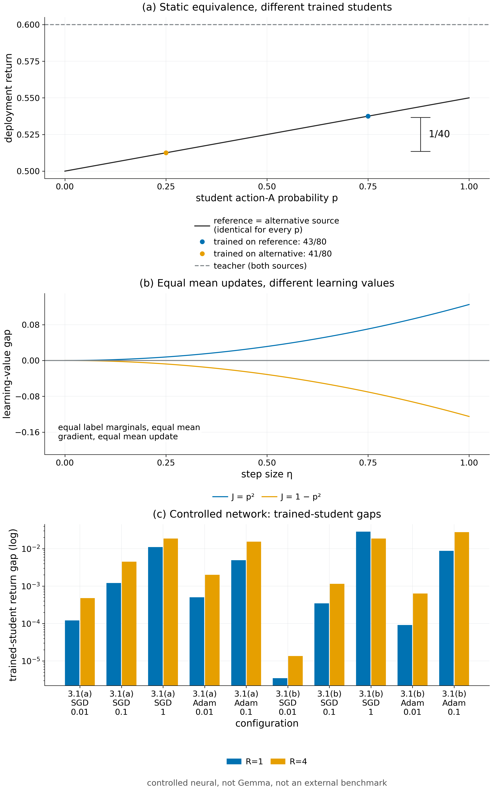

# Proposition 3.1 · 静态价值不等于学习价值

*实验*

[← 框架总览](../README_ZH.md) · [陈述](../statements/03-01_static_value_not_learning_value_ZH.md) · [证明](../proofs/03-01_static_value_not_learning_value_ZH.md) · [实验](03-01_static_value_not_learning_value_ZH.md) · [English](03-01_static_value_not_learning_value.md)

**本页检验什么.** [Check 3.1](../experiments/03-01_static_value_not_learning_value_ZH.md#c3-1) 把两个分离作为精确恒等式验证（60 个实例，75 条断言，残差 0）：静态值同为 $`\tfrac12+p/20`$，而对每个 $`m=1,\dots,30`$，频率学习器的回报恰为 $`\tfrac{43}{80}`$ 与 $`\tfrac{41}{80}`$；包的均值相同，差距恰为 $`\eta^2/8`$，在 $`1-p^2`$ 下反号（通过）。[Check 3.2](../experiments/03-01_static_value_not_learning_value_ZH.md#c3-2) 在训练过的受控网络中发现同样的分离：在全部 24 个精确枚举的设定中，两个静态等价的来源都训练出不同的学生，符号与预测一致（受控发现）。

**本页用到的设定.**

- *混叠学生* $`\pi_p`$：一个上下文，以概率 $`p`$ 选 $`A`$。*频率蒸馏：* $`\widehat p`$ = $`m`$ 条 teacher 示范中 $`A`$ 的比例。在平方损失上做一步步长为 $`\eta`$ 的 *SGD*。

**被检验的陈述（[Proposition 3.1](../statements/03-01_static_value_not_learning_value_ZH.md#s3-1)）.** *构造 (a)：四状态来源.*

- 状态 $`u,v,w,x`$ 共用下面的奖励规则；动作 $`B`$ 的成功概率总是 $`\tfrac12`$。
- 参照来源按 $`\rho_0=(\tfrac34,\tfrac14,0,0)`$ 抽取状态，备选来源按 $`\rho_1=(0,0,\tfrac14,\tfrac34)`$ 抽取。
- 最优 teacher 能看到状态，选其中较好的动作。
- 学生是混叠的：只有一个上下文，以概率 $`p`$ 选 $`A`$，记策略为 $`\pi_p`$。
- 学习器是频率蒸馏：由 $`m\ge1`$ 条独立的 teacher 示范，令 $`\widehat p`$ 为其中 $`A`$ 动作的比例（这也是经验交叉熵的最大化者）。

| 状态 | $`\rho_0`$ | $`\rho_1`$ | $`r(A)`$ | $`r(B)`$ |
|---|---:|---:|---:|---:|
| $`u`$ | $`3/4`$ | $`0`$ | $`19/30`$ | $`1/2`$ |
| $`v`$ | $`1/4`$ | $`0`$ | $`3/10`$ | $`1/2`$ |
| $`w`$ | $`0`$ | $`1/4`$ | $`9/10`$ | $`1/2`$ |
| $`x`$ | $`0`$ | $`3/4`$ | $`13/30`$ | $`1/2`$ |

*构造 (b)：两个标签包.* 一个包是一对二元标签 $`(Y_1,Y_2)`$。

- *独立*来源下，$`Y_1,Y_2`$ 独立同分布于 Bernoulli $`(\tfrac12)`$；*配对*来源下，$`(Y_1,Y_2)`$ 在 $`\lbrace (0,1),(1,0)\rbrace`$ 上均匀。
- 学习器从 $`p_0=\tfrac12`$ 出发，在平方损失 $`\tfrac14\sum_{i=1}^2(p-Y_i)^2`$ 上走一步步长为 $`0<\eta\le1`$ 的梯度：

```math
p^+=p_0-\eta\big(p_0-\tfrac{Y_1+Y_2}2\big)=\frac{1-\eta}2+\eta\,\frac{Y_1+Y_2}2 .
```

- 部署是两次独立决策，两次都必须选动作 1，所以 $`J(p)=p^2`$。备选任务为 $`J'(p)=1-p^2`$。

则：

- **(a) 静态值相同，学生不同.** 在构造 (a) 中，两个来源让每个混叠学生得到相同的值 $`J(\pi_p)=\tfrac12+p/20`$，也让 teacher 得到相同的值 $`\tfrac35`$。teacher 的 $`A`$ 频率分别为 $`\tfrac34`$ 与 $`\tfrac14`$，对 $`m\ge1`$ 条示范做频率蒸馏，期望回报分别为 $`\tfrac{43}{80}`$（参照）与 $`\tfrac{41}{80}`$（备选）：对每个 $`m`$，差距都是 $`\tfrac1{40}`$。
- **(b) 平均更新相同，学习价值不同.** 在构造 (b) 中，两个来源的标签边缘分布、平均梯度和平均更新 $`\mathbb Ep^+=\tfrac12`$ 都相同，但

```math
\mathbb E_{\rm indep}J(p^+)-\mathbb E_{\rm paired}J(p^+)=\frac{\eta^2}8, \qquad(3.1)
```

而在 $`J'=1-p^2`$ 下，这个差为 $`-\eta^2/8`$。

<a id="c3-1"></a>

## Check 3.1 · 静态值相同、平均更新相同，学习价值不同（Proposition 3.1）

**结论.** 通过：60 个实例，75 条断言，最大残差 0。Proposition 3.1(a) 的差距对每个 $`m=1,\dots,30`$ 都恰为 $`1/40`$；Proposition 3.1(b) 的差距恰为 $`\eta^2/8`$（在 $`1-p^2`$ 下为 $`-\eta^2/8`$）。

**为什么做.**

- Proposition 3.1(a) 断言对所有 $`p`$ 静态值*精确*相等，同时对所有 $`m`$ 学习价值的差距精确成立。表中的算术错误、非最优的 teacher 或依赖 $`m`$ 的差距都能否定它。
- Proposition 3.1(b) 断言均值相同，但存在依赖曲率、符号随任务而变的差距。

**设置.**

- 关于 $`p`$ 与 $`\eta`$ 的 SymPy 符号计算。
- 频率学习器的精确二项期望，用 `fractions.Fraction`，$`m=1,\dots,30`$，两个来源都算。
- 在全部四个状态上逐个核对 teacher 的最优性。
- 种子 `SeedSequence([20261010, 3])`；检验是确定性的。

**做法.**

1. 对两个状态分布展开 $`J_\rho(\pi_p)`$，断言都等于 $`\tfrac12+p/20`$。
2. 断言 teacher 在两个分布下的值都是 $`\tfrac35`$，且它在每个状态上的动作都最优。
3. 对每个 $`m`$，把 $`\mathbb E\,J(\pi_{\widehat p})`$ 精确算成二项和，断言为 $`\tfrac{43}{80}`$ 与 $`\tfrac{41}{80}`$。
4. 枚举四个等概率的标签对；断言 $`\mathbb Ep^+=\tfrac12`$，$`p^2`$ 下差距为 $`\eta^2/8`$，$`1-p^2`$ 下为 $`-\eta^2/8`$。

**结果.**

| 量 | 值 | JSON 键（条目 `v014:C3`） |
|---|---|---|
| 实例数 / 断言数 / 最大残差 | 60 / 75 / 0 | `n_instances`、`n_assertions`、`worst_residual` |
| Proposition 3.1(a) 的差距（每个 $`m=1,\dots,30`$） | $`1/40`$ | `details.prop5_gap` |
| Proposition 3.1(b) 的差距 | $`\eta^2/8`$（$`1-p^2`$ 下为 $`-\eta^2/8`$） | `details.prop6_gap` |
| 状态 | 通过 | `status` |

**为什么支持这个陈述.** 两个分离都是精确恒等式，不是近似。两个来源可以在选择器可能检查的每个静态量上都一致（每个混叠学生的值、teacher 的值、标签边缘分布、平均梯度），却仍然训练出不同的学生。

<a id="c3-2"></a>

## Check 3.2 · 训练网络中的同一分离（Proposition 3.1，受控网络）

**结论.** 受控发现：在全部 24 个精确枚举的设定（$`R\le4`$）中，每个构造的两个静态等价来源都训练出不同的学生，符号与 Proposition 3.1 的预测一致。范围：受控小网络，不是真实模型，也不是 benchmark。

**为什么做.** Proposition 3.1 用的是理想化的学习器（频率蒸馏、一步 SGD）。问题是：用梯度方法训练的非线性网络是否也能区分这两个静态等价的来源。若差距为零，说明这个分离只是理想化学习器的产物。

**设置.**

- 网络：one-hot 上下文 → 4 个 tanh 单元 → sigmoid 动作概率，固定初始化，在标签块上用交叉熵。
- 优化器：SGD，$`\eta\in\lbrace 0.01,0.1,1,3\rbrace`$；Adam（$`\beta=(0.9,0.999)`$，$`\epsilon=10^{-8}`$，bias correction），$`\eta\in\lbrace 0.01,0.1\rbrace`$。
- $`R\in\lbrace 1,4,40\rbrace`$ 次更新，来源分布取自构造 (a) 与 (b)。
- $`R\le4`$ 时精确枚举所有训练历史。$`R=40`$ 时每个来源跑 2,400 次独立训练；SE 按训练次数计。
- 种子 `SeedSequence([20261010, 23])`。

**结果（差距 = (a) 中参照 − 备选，(b) 中独立 − 配对；未给 SE 的为精确枚举）.**

| 构造 | 优化器，$`\eta`$ | $`R=1`$ | $`R=4`$ | $`R=40`$（SE） |
|---|---|---:|---:|---:|
| (a) | SGD 0.01 | 1.21e-4 | 4.81e-4 | 4.38e-3（1.7e-5） |
| (a) | SGD 0.1 | 1.21e-3 | 4.48e-3 | 2.10e-2（9.2e-5） |
| (a) | SGD 1.0 | 1.10e-2 | 1.88e-2 | 2.44e-2（2.0e-4） |
| (a) | Adam 0.01 | 5.04e-4 | 2.00e-3 | 1.54e-2（6.9e-5） |
| (a) | Adam 0.1 | 4.91e-3 | 1.54e-2 | 2.40e-2（1.9e-4） |
| (b) | SGD 0.01 | 3.47e-6 | 1.36e-5 | 3.7e-5（2.0e-4） |
| (b) | SGD 0.1 | 3.46e-4 | 1.15e-3 | 2.0e-3（1.1e-3） |
| (b) | SGD 1.0 | 2.86e-2 | 1.86e-2 | 1.61e-2（2.7e-3） |
| (b) | Adam 0.01 | 9.19e-5 | 6.33e-4 | 1.23e-3（9.1e-4） |
| (b) | Adam 0.1 | 8.75e-3 | 2.76e-2 | 1.23e-2（2.4e-3） |

数值取自 `controlled_neural.details.configurations[task∈{Prop5,Prop6}].neural_gap` 与 `.SE`；$`\eta=3`$ 的行在 JSON 中。SGD 步长较小时，实测差距与网络的局部切线预测一致：(a) 中 SGD $`\eta=0.01`$、$`R=1`$ 时，实测 1.21170e-4，预测 1.21171e-4（`.local_affine_SGD_prediction`）。



*Figure 3.1.* (a) 构造 (a)：两个来源下每个混叠学生的值都是 $`\tfrac12+p/20`$，teacher 的值都是 $`\tfrac35`$，但频率蒸馏分别得到 $`\tfrac{43}{80}`$ 与 $`\tfrac{41}{80}`$。(b) 构造 (b)：标签边缘分布、平均梯度与平均更新都相同，但学习价值差在 $`J=p^2`$ 下为 $`+\eta^2/8`$，在 $`J=1-p^2`$ 下为 $`-\eta^2/8`$。(c) 在受控 tanh 网络中，静态等价的来源仍训练出不同的学生（精确枚举，$`R\le4`$；对数坐标）。[PDF](../figures/fig3_1_static_vs_learning.pdf)

**为什么支持这个陈述.**

- 与命题一样，在训练网络中，静态等价的反馈来源也得到不同的学生。每个精确枚举的差距都为正，方向与预测一致：(a) 中参照来源更好，(b) 中在 $`p^2`$ 下独立包更好。
- 差距随步长增大，这符合"学习后果"效应的预期；(a) 中当 $`\eta\le1`$ 时差距还随更新次数增大。
- $`R=40`$（Monte Carlo）时，构造 (b) 有三个差距与零的距离在两个标准误以内（SGD $`\eta=0.01`$ 与 $`0.1`$，Adam $`\eta=0.01`$）；证据主要来自精确枚举的行。
- 差距的大小依赖于 optimizer：$`\eta`$ 相同时，Adam 的差距大于 SGD。§5 解释这种依赖（[Proposition 5.3](../statements/05-03_cold_start_adam_sign_quotient_ZH.md#s5-3)，cold-start Adam）。

## 复现

```bash
CUDA_VISIBLE_DEVICES='' PYTHONDONTWRITEBYTECODE=1 theory/.venv/bin/python theory/independent_checks/check_v014_independent.py --only C3,C23 --output theory/independent_checks/subset.json
```

## 产物

- `theory/independent_checks/results_independent_v014.json`：`v014:C3` 的条目；代码 `theory/independent_checks/check_v014_independent.py`（`check_C3`、`check_C23`）。受控网络：`controlled_neural.details.configurations`（按 `task` = `Prop5` 或 `Prop6` 筛选）。
- 图：`figures/fig3_1_static_vs_learning.{png,pdf}`；规格见 `figures/specs/fig3_1.md`。
