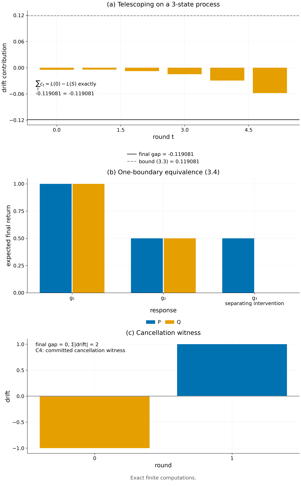

# Theorem 3.2 · continuation response 刻画

*实验*

[← 框架总览](../README_ZH.md) · [陈述](../statements/03-02_continuation_response_characterization_ZH.md) · [证明](../proofs/03-02_continuation_response_characterization_ZH.md) · [实验](03-02_continuation_response_characterization_ZH.md) · [English](03-02_continuation_response_characterization.md)

**本页检验什么.** [Check 3.3](../experiments/03-02_continuation_response_characterization_ZH.md#c3-3) 在 45 个带实际更新映射与更新随机性的随机有限学习过程上检验全部三部分（1,867 条断言，残差 0）：telescoping 恒等式 (3.2) 精确成立，单边界值之差恰为 $`(P-Q)g`$，对认证集合的对抗搜索从未打破带停止的界 (3.5)（通过）。[Check 3.4](../experiments/03-02_continuation_response_characterization_ZH.md#c3-4) 确认：差距在一个被审计的状态上认证、再 transport 到访问到的状态时，带停止的复合依然成立：400/400 个实例有效且不空，最紧的达到界的 47%（通过）。

**本页用到的设定.**

- complete learner state $`z\in\mathcal Z`$：参数、optimizer state、缓冲区、采样器状态、随机性与历史（[Definition 1.3](../README_ZH.md#s1-3)）。
- 第 $`t<R`$ 轮，feedback law $`P_t(\cdot\mid z)`$ 发出消息 $`Y_t`$，实际更新给出 $`Z_{t+1}=U_t(Z_t,Y_t,\xi_t)`$，$`\xi_t`$ 是更新的随机性。对 $`Y_t`$ 与 $`\xi_t`$ 积分得到学习 kernel $`K_t`$，它作用在有界函数上：$`(K_tf)(z)=\mathbb E\,f(U_t(z,Y,\xi))`$。
- $`K_t^0`$ 是参照协议，$`K_t^S`$ 是备选协议 $`S`$，两者从同一初始分布 $`\nu`$ 出发。$`Z_t^S`$ 是由 $`K^S`$ 驱动的链，其分布 $`d_t^S`$ 是第 $`t`$ 轮的占据分布。
- $`F_E(z)\in[0,1]`$ 是从状态 $`z`$ 部署的学生在真实任务上的回报；$`L_E(S)=\mathbb E\,F_E(Z_R^S)`$ 是协议 $`S`$ 的学习价值，$`L_E(0)`$ 是参照的学习价值。
- 参照 continuation value 为 $`V_R^0=F_E`$，$`V_t^0=K_t^0V_{t+1}^0`$：从某个状态出发、按参照协议继续训练时的期望最终得分（[Definition 1.4](../README_ZH.md#s1-4)）。
- 快照 $`(t,z)`$ 处的单边界 response 为 $`g_{t,z}(y)=\mathbb E_{\xi_t}V_{t+1}^0(U_t(z,y,\xi_t))`$：收到消息 $`y`$、执行实际更新、再走完声明的参照尾段之后的期望最终回报。response 类 $`\mathcal G`$ 收集声明的快照族 $`\mathcal I`$ 上所有的 $`g_{t,z}`$。
- 单边界替换 $`I(t,z,P)`$：在第 $`t`$ 轮从状态 $`z`$ 出发，抽 $`Y\sim P`$，执行实际更新，走声明的参照尾段，用 $`F_E`$ 打分。
- 认证集合 $`C_t\subseteq\mathcal Z`$、首次离开时刻 $`\tau`$ 与离开概率 $`\rho=\Pr(\tau<R)`$ 在 (c) 中定义。

**被检验的陈述（[Theorem 3.2](../statements/03-02_continuation_response_characterization_ZH.md#s3-2)）.** 在上述设定下：

**(a) 精确复合.**

```math
L_E(0)-L_E(S)=\sum_{t=0}^{R-1}\mathbb E_{d_t^S}\big[(K_t^0-K_t^S)V_{t+1}^0(Z_t)\big]. \qquad(3.2)
```

因此，若对 $`d_t^S`$-几乎所有 $`z`$ 有 $`\lvert(K_t^0-K_t^S)V_{t+1}^0(z)\rvert\le\varepsilon_t(z)`$，则

```math
\lvert L_E(0)-L_E(S)\rvert\le\sum_t\mathbb E_{d_t^S}\varepsilon_t(Z_t). \qquad(3.3)
```

**(b) 操作性刻画.** 两个消息分布 $`P,Q`$ 在声明族中的每个单边界替换上价值都相等，当且仅当

```math
\mathbb E_Pg=\mathbb E_Qg\quad\text{对每个 }g\in\mathcal G. \qquad(3.4)
```

**(c) 带停止的复合.** 设 $`C_t\subseteq\mathcal Z`$ 为认证集合，$`\tau=\min\lbrace t<R:Z_t^S\notin C_t\rbrace`$（若不存在这样的 $`t`$ 则 $`\tau=R`$），$`\rho=\Pr(\tau<R)`$。若对所有 $`z\in C_t`$ 有 $`\lvert(K_t^0-K_t^S)V_{t+1}^0(z)\rvert\le\varepsilon_t(z)`$，则

```math
\lvert L_E(0)-L_E(S)\rvert\le\mathbb E_S\sum_{t<\tau}\varepsilon_t(Z_t)+\rho. \qquad(3.5)
```

<a id="c3-3"></a>

## Check 3.3 · 精确复合、带停止的复合与单边界刻画（Theorem 3.2）

**结论.** 通过：45 个随机有限学习过程，1,867 条断言，最大残差 0。对认证集合的对抗搜索从未使 $`\lvert\text{差距}\rvert-(\text{离开前的漂移}+\rho)`$ 为正。

**为什么做.**

- (3.2) 是恒等式。方向上的错误（例如用参照过程的占据分布代替 $`d_t^S`$）或 continuation 递推的错误，都会在随机过程上产生非零残差。
- (3.5) 断言离开的代价是 $`\rho`$ 而不是 $`R\rho`$。若某种认证集合的选法使 $`\lvert\text{差距}\rvert`$ 超过界，就否定了它。
- (3.4) 依赖于单边界值之差恰为 $`(P-Q)g`$。

**设置.**

- 45 个随机过程，状态数 $`\lvert\mathcal Z\rvert\in[4,20]`$，轮数 $`R\in[1,8]`$。
- 消息字母表大小 2–4；更新随机性 $`\xi`$ 取两个值，概率为 $`\tfrac13,\tfrac23`$。
- 随机的确定性更新表 $`U_t(z,y,\xi)\in\mathcal Z`$，每个 $`(t,z)`$ 处随机的参照与备选消息分布；kernel $`K_t^0,K_t^S`$ 按定理中的方式由它们构造。
- 有理的终端得分 $`F\in[0,1]`$，有理的初始分布，精确的 `fractions.Fraction` 运算。种子 `SeedSequence([20261010, 4])`。

**做法.**

1. 反向计算 $`V_t^0`$，正向计算 $`d_t^S`$。断言 $`L(0)-L(S)=\sum_t d_t^S(K_t^0-K_t^S)V_{t+1}^0`$ 精确成立，以及 $`\lvert L(0)-L(S)\rvert\le\sum_td_t^S\lvert(K_t^0-K_t^S)V_{t+1}^0\rvert`$。
2. 带停止的界。认证掩码 $`C_t`$ 在偶数号实例上全部认证，在奇数号实例上随机。35 步爬山每次翻转一个 $`(t,z)`$，以*最大化* $`\lvert\text{差距}\rvert-(\text{离开前的漂移}+\rho)`$，其中 $`\rho`$ 是精确的首次离开概率；每一步都断言 $`\lvert\text{差距}\rvert\le\text{离开前的漂移}+\rho`$。
3. 每轮取一个随机快照 $`(t,z)`$，构造实际的 response 向量 $`g(y)=\sum_\xi\Pr(\xi)V_{t+1}^0(U_t(z,y,\xi))`$，断言单边界值之差精确等于 $`(P-Q)g`$。
4. 见证：
   - *可分离的 response.* $`P=(\tfrac12,0,\tfrac12)`$ 与 $`Q=(0,1,0)`$ 在 $`g_1\equiv1`$ 与 $`g_2=(0,\tfrac12,1)`$ 上一致，在 $`g_3=(0,0,1)`$ 上不同。
   - *抵消.* 两个状态，$`K^0`$ 为恒等，$`K^S`$ 为交换，两轮，$`F=(0,1)`$，从状态 0 出发。

**结果.**

| 量 | 值 | JSON 键（条目 `v014:C4`） |
|---|---|---|
| 过程数 / 断言数 / 最大残差 | 45 / 1,867 / 0 | `n_instances`、`n_assertions`、`worst_residual` |
| 对抗搜索找到的最大 $`\lvert\text{差距}\rvert-(\text{离开前的漂移}+\rho)`$ | $`0.0`$（从未为正） | `details.adversarial_exit_best_lhs_minus_rhs` |
| 抵消见证：最终差距 / $`\sum_t\mathbb E\lvert\text{漂移}\rvert`$ | $`0`$ / $`2`$ | `details.cancellation_absolute_drift` |
| 可分离 response 的见证 | $`P,Q`$ 在 $`g_1,g_2`$ 上相等，在 $`g_3`$ 上不等 | 在 `check_C4` 中断言 |
| 状态 | 通过 | `status` |



*Figure 3.2.* (a) 在一个显式的三状态过程上，学习价值差等于各轮按占据分布加权的 response 差距之和 (3.2)，并被它们的绝对值之和界住 (3.3)。(b) 分布 $`P=(\tfrac12,0,\tfrac12)`$ 与 $`Q=(0,1,0)`$ 在两个 response 上一致、在第三个上不同：两个分布对单边界替换可互换，当且仅当它们在每个 response 上一致 (3.4)。(c) 各轮差距可以抵消（最终差距 0，绝对漂移之和 2），所以匹配单个最终均值不要求逐点匹配。[PDF](../figures/fig3_2_response.pdf)

**为什么支持这个陈述.**

- 学习价值差*精确*等于按占据分布加权的单边界 response 差距之和，用的是备选过程的占据分布，与 (3.2) 一致。
- 对手选择认证哪些状态，也打破不了带停止的界：一次离开的代价至多为 $`\rho`$（(3.5)）。
- 单边界值之差精确为 $`(P-Q)g`$，所以 response 类是正确的不变量（(3.4)）。
- 抵消见证确认：对单个最终均值，逐点匹配不是必要的；这正是 Theorem 3.2(b) 对所有单边界替换取全称量词的原因。

<a id="c3-4"></a>

## Check 3.4 · 带 audit transport 的停止复合（Theorem 3.2(c)）

**结论.** 通过：400 个随机 Markov 实例；每个界都有效，每个界都小于 1，差距与界之比最大为 0.470。

**为什么做.** 这是带停止的界的独立实现，形式与 [Theorem 8.2](../statements/08-02_frozen_finite_interface_selection_transport_ZH.md#s8-2) 中的用法一致：response 写成带常数基线的指示特征，差距在一个被审计的锚状态上测量，再 transport 到访问到的状态。

**设置.**

- 400 个随机的 4 状态、3 轮 Markov 过程。参照行 $`P_t(z,\cdot)`$ 从 $`\mathrm{Dirichlet}(1)`$ 抽取；备选为 $`Q=0.97P+0.03\,\mathrm{Dirichlet}(1)`$；初始状态固定。
- 一半的试验中状态 3 不被认证，到达它的概率质量计入 $`\rho`$。
- 每轮的界为 $`\sum_z\Pr(Z_t=z,\text{仍存活})\,B_t\,(D_t+a_t(z))`$，其中
  - $`b=V_{t+1}(0{:}3)-V_{t+1}(3)`$，$`B_t=\lVert b\rVert_1`$；
  - $`D_t`$ 是锚状态 0 处的差距；
  - $`a_t(z)`$ 是从状态 $`z`$ 到锚状态的 sup 范数 transport 误差。

  总界再加上 $`\rho`$。
- 包种子 15019。

**结果.**

| 量 | 值 | JSON 键（`checks.T12_stopped_occupancy_composition`） |
|---|---|---|
| 实例数 | 400 | `instances` |
| 差距 ≤ 界 | 400 / 400（已断言） | — |
| 界严格小于 1（不空） | 400 / 400 | `bounds_below_one` |
| 差距 / 界 的最大值 | 0.470 | `maximum_gap_over_bound` |

**为什么支持这个陈述.** 当局部差距 $`\varepsilon_t`$ 在被审计的格子上认证、再 transport 到访问到的状态时，带停止的复合 (3.5) 依然有效且不空。冻结 audit 定理（[Theorem 8.2](../statements/08-02_frozen_finite_interface_selection_transport_ZH.md#s8-2)）正是建立在这个形式之上。

## 复现

```bash
CUDA_VISIBLE_DEVICES='' PYTHONDONTWRITEBYTECODE=1 theory/.venv/bin/python theory/independent_checks/check_v014_independent.py --only C4 --output theory/independent_checks/subset.json
theory/.venv/bin/python docs/direction/v015_revision/verify_v015_extensions.py --out theory/v015_checks/quick/results_v015_package_rerun.json
```

## 产物

- `theory/independent_checks/results_independent_v014.json`：`v014:C4` 的条目；代码 `theory/independent_checks/check_v014_independent.py`（`check_C4`，含 `process`、`continuations`、`process_stats`）。
- `docs/direction/v015_revision/results_v015.json`：`checks.T12_stopped_occupancy_composition`；函数 `stopped_learning`；代码 `docs/direction/v015_revision/verify_v015_extensions.py`。
- 图：`figures/fig3_2_response.{png,pdf}`；规格见 `figures/specs/fig3_2.md`。
