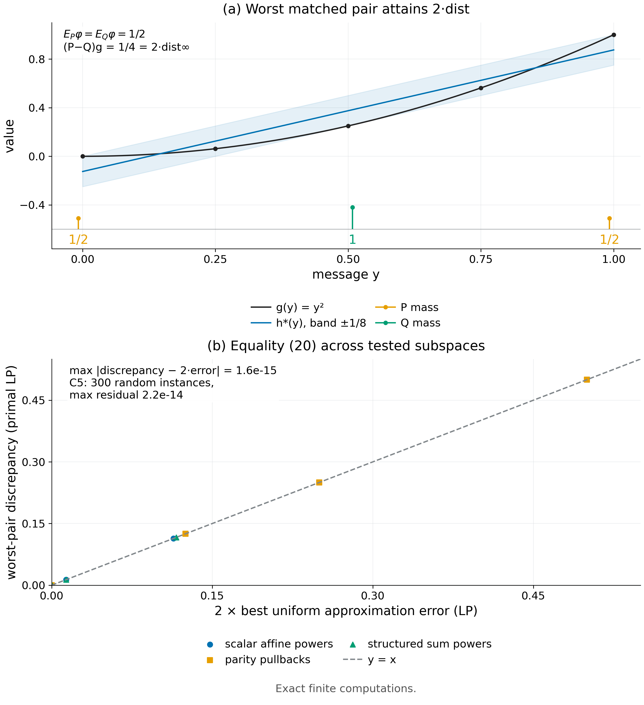

# Theorem 4.2 · Sufficiency duality and transfer

*Experiments*

[← Framework](../README.md) · [Statement](../statements/04-02_sufficiency_duality_transfer.md) · [Proof](../proofs/04-02_sufficiency_duality_transfer.md) · [Experiments](04-02_sufficiency_duality_transfer.md) · [中文](04-02_sufficiency_duality_transfer_ZH.md)

**What is tested here.** All four parts of Theorem 4.2 are tested by exact computation on random finite instances: the span criterion (a), the duality equality (b), the transfer bound (c) and the unrestricted-learner case (d). The duality (b) and the span counts (a) are re-tested on structured response families in a second check.

- **Verdict: PASS.** On 300 random instances the span criterion never disagrees with an independent LP search; the worst-pair discrepancy equals twice the best uniform approximation error to $`2.2\times10^{-14}`$; an adversary against the transfer bound reaches only $`1.1\times10^{-16}`$ above it; part (d) holds exactly for $`m=2,\dots,8`$ ([Check 4.1](#c4-1)).
- On 21 structured subspaces the duality holds to $`1.6\times10^{-15}`$ ([Check 4.10](04-06_exact_order_not_approximate_complexity.md#c4-10), summarized below).
- All computations are exact rational or exact LP; none involves a trained network.

**Setting used on this page.**

- $`\mathcal Y`$ is a finite message alphabet of size $`m`$; functions on $`\mathcal Y`$ are vectors in $`\mathbb R^m`$; laws $`P,Q`$ are probability vectors; $`(P-Q)g=\sum_y(P(y)-Q(y))g(y)`$.
- $`\mathcal G`$ is a set of responses $`g:\mathcal Y\to[0,1]`$ (the final task return as a function of the message, [Definition 1.4](../README.md#s1-4)).
- A feature interface transmits the means of $`\phi_1,\dots,\phi_d`$; $`H_\phi=\mathrm{span}\lbrace\mathbf 1,\phi_1,\dots,\phi_d\rbrace`$. A *feature-matched pair* has equal feature means; $`\mathcal M_\phi`$ is the set of such pairs. The *width* (worst-pair discrepancy) of $`g`$ is $`\max(P-Q)g`$ over $`\mathcal M_\phi`$, and the unresolved discrepancy $`\mathfrak D_\phi(\mathcal G)`$ is the largest width over $`g\in\mathcal G`$; the *approximation error* is $`\mathrm{dist}_\infty(g,H_\phi)=\min_{h\in H_\phi}\lVert g-h\rVert_\infty`$ ([Definition 4.1](../statements/04-01_feature_sufficiency_unresolved_discrepancy.md#s4-1)).
- $`d_0`$ is the least number of features with zero discrepancy; $`\mathrm{TV}(P,Q)=\tfrac12\lVert P-Q\rVert_1`$.
- Code IDs: `v014:` = `theory/independent_checks` (results `results_independent_v014.json`).

**Statement under test ([Theorem 4.2](../statements/04-02_sufficiency_duality_transfer.md#s4-2)).**

- **(a) Exact sufficiency.** $`(P-Q)g=0`$ for all $`(P,Q)\in\mathcal M_\phi`$ and all $`g\in\mathcal G`$ if and only if $`\mathrm{span}(\mathcal G)\subseteq H_\phi`$. Consequently $`d_0(\mathcal G)=\dim\mathrm{span}(\lbrace\mathbf 1\rbrace\cup\mathcal G)-1`$.
- **(b) Approximate sufficiency.** $`\mathfrak D_\phi(\mathcal G)=2\sup_{g\in\mathcal G}\mathrm{dist}_\infty(g,H_\phi)`$; hence the smallest unresolved discrepancy achievable with $`d`$ features is $`2\inf_H\sup_{g\in\mathcal G}\mathrm{dist}_\infty(g,H)`$ over subspaces $`H\ni\mathbf 1`$ with $`\dim H\le d+1`$.
- **(c) Transfer.** If every target $`g=c+\sum_\ell b_\ell\phi_\ell+r`$ with $`\lVert b\rVert_1\le B`$ and $`\lVert r\rVert_\infty\le\tau`$, then $`\sup_g\lvert(P-Q)g\rvert\le B\lVert\mathbb E_P\phi-\mathbb E_Q\phi\rVert_\infty+2\tau`$ for all $`P,Q`$.
- **(d) Unrestricted learners.** If the learner family can deploy the better of two policies (values $`a`$ and $`a+\gamma`$, $`\gamma>0`$) exactly on any event $`A\subseteq\mathcal Y`$, then $`\sup_A\lvert(P-Q)(a+\gamma\mathbf 1_A)\rvert=\gamma\,\mathrm{TV}(P,Q)`$ and $`d_0(\mathcal G)=m-1`$.

<a id="c4-1"></a>

## Check 4.1 · Span criterion, duality and transfer on random instances (Theorem 4.2)

**Verdict.** PASS on 300 random finite instances with 6,014 assertions. The span criterion is exact; the duality is an equality to $`2.2\times10^{-14}`$; adversarial search against the transfer bound reaches only $`1.1\times10^{-16}`$; part (d) holds exactly for $`m=2,\dots,8`$.

**Why.** [Theorem 4.2](../statements/04-02_sufficiency_duality_transfer.md#s4-2) turns "which distinctions between feedback laws matter" into linear algebra. Each part has a falsifier, and the check searches for each independently:

- (a) a feature-matched pair that separates a response lying in the span, or an out-of-span response the span test misses;
- (b) a feasible pair whose discrepancy exceeds twice the uniform distance $`2\mathrm{dist}_\infty`$, or no pair attaining it — (b) is an equality, not only a bound;
- (c) a pair violating the transfer inequality;
- (d) an event family whose supremum differs from $`\gamma\,\mathrm{TV}`$, or a response dimension different from $`m-1`$.

**Setup.**

- 300 instances. Alphabet size $`m\sim\mathrm U\lbrace 4,\dots,12\rbrace`$, feature count $`d\sim\mathrm U\lbrace 1,\dots,m-2\rbrace`$.
- Feature tables $`\phi\in\mathbb Q^{d\times m}`$ and three responses $`\mathcal G\subset\mathbb Q^m`$ are random rationals.
- Each instance also tests $`g=\phi_1`$, an in-span control with expected discrepancy 0.
- Transfer instances use random $`b`$ and $`r`$, rescaled so that $`g=\tfrac12+b^\top\phi+r\in[0,1]^m`$.
- Part (d) uses random rational laws $`P,Q`$ on $`m=2,\dots,8`$, with $`a=\tfrac15`$ and $`\gamma=\tfrac35`$.
- Seed: `SeedSequence([20261010, 5])`.

**Procedure.**

1. *Exact ranks.* SymPy computes the ranks of $`[\mathbf 1;\phi]`$ and $`[\mathbf 1;\phi;g]`$ to decide $`g\in H_\phi`$, and $`d_0=\mathrm{rank}[\mathbf 1;\mathcal G]-1`$.
2. *Primal LP.* HiGHS solves $`\max(P-Q)g`$ over feature-matched pairs of probability vectors, directly in the variables $`(P,Q)`$.
3. *Approximation LP.* A separate LP computes $`\min_{h\in H_\phi}\lVert g-h\rVert_\infty`$.
4. *Assertions for (a), (b).* Width $`=2\cdot`$ error, and width $`\le10^{-8}`$ exactly when $`g\in H_\phi`$.
5. *Transfer LP.* An LP maximizes $`(P-Q)g-B\lVert\Delta\phi\rVert_\infty-2\tau`$ over all pairs; the optimum must be $`\le0`$.
6. *Part (d).* All $`2^m`$ events are enumerated in exact rationals; $`\max_A\lvert(P-Q)(a+\gamma\mathbf 1_A)\rvert`$ is compared with $`\gamma\cdot\tfrac12\lVert P-Q\rVert_1`$, and the rank of $`[\mathbf 1;\lbrace\mathbf 1_A\rbrace]`$ is checked to be $`m`$.

**Result.**

| Quantity | Value | Source (JSON key) |
|---|---:|---|
| Instances / assertions | 300 / 6,014 | entry `v014:C5`, `n_instances`, `.n_assertions` |
| Status | PASS | entry `v014:C5`, `status` |
| $`\max\lvert\text{primal width}-2\cdot\text{approximation error}\rvert`$ | $`2.23\times10^{-14}`$ | entry `v014:C5`, `details.max_duality_residual` |
| Best adversarial transfer score (must be $`\le0`$) | $`1.11\times10^{-16}`$ | entry `v014:C5`, `details.adversarial_transfer_best_lhs_minus_rhs` |
| Worst residual over all assertions | $`5.76\times10^{-14}`$ | entry `v014:C5`, `worst_residual` |
| Part (d): event supremum $`=\gamma\,\mathrm{TV}`$, dimension $`=m-1`$ | exact for $`m=2,\dots,8`$ | assertions `all-event total variation`, `event response dimension` |

All values are from `theory/independent_checks/results_independent_v014.json`.



*Figure 4.1.* One exact five-message example shows a response, its best uniform approximation from the feature span, and the feature-matched pair of laws that attains twice the approximation error. The second panel plots the primal LP optimum against twice the approximation error for all structured subspaces of [Check 4.10](04-06_exact_order_not_approximate_complexity.md#c4-10) and the random instances of this check; every point lies on the diagonal. [PDF](../figures/fig4_1_duality.pdf)

**Why it supports Theorem 4.2.**

- The span criterion and the LP separation search never disagree, so the criterion of part (a) is the exact test.
- The two LPs are solved independently, one over pairs of laws and one over approximating functions. Their optima agree to solver tolerance, so part (b) is an equality.
- An adversary optimizing against part (c) cannot push the left side above the right.

**Limits.** Finite alphabets of size at most 12; the theorem itself is stated for finite alphabets.

### [Check 4.10](04-06_exact_order_not_approximate_complexity.md#c4-10) · Same maximum degree, different response-space complexity

- *What it tests for Theorem 4.2.* The duality (b) on structured, non-random response families, and the span dimension that (a) predicts for a given family.
- *Setup.* Grid $`\lbrace0,\tfrac14,\dots,1\rbrace^3`$ (125 messages); three families of maximum degree 3 (scalar affine powers, multivariate parity pullbacks, structured sum powers); for each feature budget $`d=1,\dots,7`$ a greedily selected subspace, with the uniform approximation error and the worst-pair discrepancy computed by two independent LPs.
- *Key numbers.* On all 21 (family, $`d`$) subspaces, $`\max\lvert\text{discrepancy}-2\cdot\text{uniform error}\rvert=1.6\times10^{-15}`$. The exact span dimensions including the constant are 4 (scalar), 8 (parity) and 4 (structured), the values the span criterion predicts.
- *Verdict.* PASS (21 subspaces, 1,445 assertions; source entry `v014:C19`).

## Reproduce

```bash
CUDA_VISIBLE_DEVICES='' PYTHONDONTWRITEBYTECODE=1 theory/.venv/bin/python \
  theory/independent_checks/check_v014_independent.py --only C5,C19 \
  --output theory/independent_checks/subset.json
```

`--only` preserves each claim's random stream (`SeedSequence([20261010, claim number])`), so a subset run reproduces the full-run numbers.

The check uses NumPy ([Harris et al., 2020](#ref-harris2020array)), SymPy ([Meurer et al., 2017](#ref-meurer2017sympy)) for exact rational arithmetic, and SciPy's `linprog` ([Virtanen et al., 2020](#ref-virtanen2020scipy)) with the HiGHS solver ([Huangfu & Hall, 2018](#ref-huangfu2018parallelizing)) for the linear programs.

## Artifacts

- Results: `theory/independent_checks/results_independent_v014.json` (entries `v014:C5`, `v014:C19`).
- Code: `theory/independent_checks/check_v014_independent.py` (`check_C5`, `check_C19`); specification `theory/independent_checks/SPEC.md`.
- Figure spec: `theoretical_framework/figures/specs/fig4_1.md`.

## References

Works cited on this page. The complete list, with the pages that use each work, is in [References](../references.md).

<a id="ref-harris2020array"></a>

**Charles R. Harris, K. Jarrod Millman, Stéfan J. van der Walt, Ralf Gommers, Pauli Virtanen, David Cournapeau, Eric Wieser, Julian Taylor, Sebastian Berg, Nathaniel J. Smith, Robert Kern, Matti Picus, Stephan Hoyer, Marten H. van Kerkwijk, Matthew Brett, Allan Haldane, Jaime Fernández del Río, Mark Wiebe, Pearu Peterson, Pierre Gérard-Marchant, Kevin Sheppard, Tyler Reddy, Warren Weckesser, Hameer Abbasi, Christoph Gohlke, Travis E. Oliphant (2020).** Array programming with NumPy. *Nature* 585, no. 7825, 357–362. DOI [10.1038/s41586-020-2649-2](https://doi.org/10.1038/s41586-020-2649-2).

<a id="ref-huangfu2018parallelizing"></a>

**Qi Huangfu, J. A. Julian Hall (2018).** Parallelizing the dual revised simplex method. *Mathematical Programming Computation* 10, no. 1, 119–142. DOI [10.1007/s12532-017-0130-5](https://doi.org/10.1007/s12532-017-0130-5).

<a id="ref-meurer2017sympy"></a>

**Aaron Meurer, Christopher P. Smith, Mateusz Paprocki, Ondřej Čertík, Sergey B. Kirpichev, Matthew Rocklin, AMiT Kumar, Sergiu Ivanov, Jason K. Moore, Sartaj Singh, Thilina Rathnayake, Sean Vig, Brian E. Granger, Richard P. Muller, Francesco Bonazzi, Harsh Gupta, Shivam Vats, Fredrik Johansson, Fabian Pedregosa, Matthew J. Curry, Andy R. Terrel, Štěpán Roučka, Ashutosh Saboo, Isuru Fernando, Sumith Kulal, Robert Cimrman, Anthony Scopatz (2017).** SymPy: Symbolic computing in Python. *PeerJ Computer Science* 3, e103. DOI [10.7717/peerj-cs.103](https://doi.org/10.7717/peerj-cs.103).

<a id="ref-virtanen2020scipy"></a>

**Pauli Virtanen, Ralf Gommers, Travis E. Oliphant, Matt Haberland, Tyler Reddy, David Cournapeau, Evgeni Burovski, Pearu Peterson, Warren Weckesser, Jonathan Bright, Stéfan J. van der Walt, Matthew Brett, Joshua Wilson, K. Jarrod Millman, Nikolay Mayorov, Andrew R. J. Nelson, Eric Jones, Robert Kern, Eric Larson, C J Carey, İlhan Polat, Yu Feng, Eric W. Moore, Jake VanderPlas, Denis Laxalde, Josef Perktold, Robert Cimrman, Ian Henriksen, E. A. Quintero, Charles R. Harris, Anne M. Archibald, Antônio H. Ribeiro, Fabian Pedregosa, Paul van Mulbregt, SciPy 1.0 Contributors (2020).** SciPy 1.0: Fundamental algorithms for scientific computing in Python. *Nature Methods* 17, no. 3, 261–272. DOI [10.1038/s41592-019-0686-2](https://doi.org/10.1038/s41592-019-0686-2).
