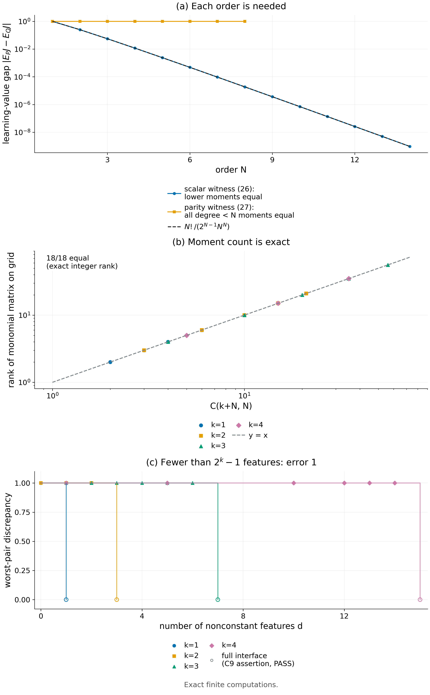

# Theorem 4.4 · Affine learners: moment order is necessary and sufficient

*Experiments*

[← Framework](../README.md) · [Statement](../statements/04-04_affine_learners_moment_order.md) · [Proof](../proofs/04-04_affine_learners_moment_order.md) · [Experiments](04-04_affine_learners_moment_order.md) · [中文](04-04_affine_learners_moment_order_ZH.md)

**What is tested here.** Each part of Theorem 4.4 has its own exact check: the polynomial form and coefficient bound of deployment values (a), the equivalence of moment matching and equal learning values (b), the necessity of every order with a constant-gap witness (c), and the exact statistic count and the binary barrier (d). A further check compares span dimensions of structured families with the worst case of (d).

- **Verdict: PASS.** Degree and coefficient bounds hold on 1,080 random and adversarially mutated deployment trees ([Check 4.2](#c4-2)).
- Moment-matched laws give exactly equal learning values for affine learners with up to 5 updates, and every single moment is detected by its monomial task ([Check 4.3](#c4-3)).
- Every order is necessary for $`N=1,\dots,14`$; parity keeps gap 1 for $`N=1,\dots,8`$ ([Check 4.4](#c4-4)).
- The grid statistic count equals $`\binom{k+N}N-1`$ in all 18 configurations, and the binary barrier is attained ([Check 4.5](#c4-5)).
- All computations are exact rational or exact LP.

**Setting used on this page.**

- Student $`p\in[0,1]^k`$: in context $`j`$ it takes action 1 with probability $`p_j`$. A deployment is a finite tree of chance, decision and terminal nodes, with at most $`N`$ decisions per path; $`J_E(p)`$ is its expected reward ([Definition 4.3](../statements/04-03_binary_context_student_affine_learner.md#s4-3)).
- Experience blocks $`Z_i\in[0,1]^k`$ are IID from a source law $`P`$ or $`Q`$. A convex-affine learner averages $`R`$ blocks with fixed weights: $`p_R=w_0p_0+\sum_iw_iZ_i`$. The *learning value* of a source is $`\mathbb EJ_E(p_R)`$.
- $`p^\alpha=\prod_jp_j^{\alpha_j}`$, $`\lvert\alpha\rvert=\sum_j\alpha_j`$, $`m_P(\alpha)=\mathbb E_PZ^\alpha`$ is a joint moment, and $`\sum_\alpha\lvert c_\alpha\rvert`$ is the coefficient norm of $`J_E=\sum_\alpha c_\alpha p^\alpha`$.
- A *linear expectation statistic* is $`\mathbb E\phi(Z)`$ for a fixed function $`\phi`$; the worst-pair discrepancy of an interface is the largest response difference between two laws with equal statistics ([Definition 4.1](../statements/04-01_feature_sufficiency_unresolved_discrepancy.md#s4-1)).
- Code IDs: `v014:` = `theory/independent_checks` (results `results_independent_v014.json`); `pkg:` = package verifier `docs/direction/v014_handoff/verify_environment_information_v014.py`, re-run into `theory/v014_repro/results_v014_rerun.json`.

**Statement under test ([Theorem 4.4](../statements/04-04_affine_learners_moment_order.md#s4-4)).**

- **(a)** $`J_E`$ has a unique representation $`J_E(p)=\sum_{\lvert\alpha\rvert\le N}c_\alpha p^\alpha`$ with $`\sum_\alpha\lvert c_\alpha\rvert\le3^N`$, and $`J_E\in[0,1]`$ on $`[0,1]^k`$.
- **(b)** $`m_P(\alpha)=m_Q(\alpha)`$ for every $`\lvert\alpha\rvert\le N`$ if and only if $`\mathbb E_{P^R}J_E(p_R)=\mathbb E_{Q^R}J_E(p_R)`$ for every deployment with at most $`N`$ decisions and every convex-affine learner.
- **(c)** Every order is necessary: the scalar laws $`P_N,Q_N`$ on $`\lbrace0,\tfrac1N,\dots,1\rbrace`$ (binomial weights $`\binom Ni/2^{N-1}`$ on even versus odd points) agree below order $`N`$ and differ at order $`N`$ by $`\Delta_N=(-1)^NN!/(2^{N-1}N^N)`$; the even- and odd-parity laws on $`\lbrace0,1\rbrace^N`$ agree on all joint moments of total degree below $`N`$ and give the parity value $`J_{\rm even}(p)=\tfrac12\big(1+\prod_j(1-2p_j)\big)`$ the expectations $`1`$ and $`0`$.
- **(d)** On the grid $`\lbrace0,\tfrac1N,\dots,1\rbrace^k`$ the least number of sufficient linear expectation statistics is $`\binom{k+N}N-1`$. On $`\lbrace0,1\rbrace^k`$ with $`N\ge k`$ and arbitrary rewards, every interface with fewer than $`2^k-1`$ statistics has unresolved discrepancy exactly $`1`$, and $`2^k-1`$ affinely independent features give $`0`$.

<a id="c4-2"></a>

## Check 4.2 · Deployment value is a bounded polynomial (Theorem 4.4(a))

**Verdict.** PASS on 1,080 deployment trees (5,400 assertions). The largest ratio of coefficient norm to $`3^N`$ found by adversarial search is $`2/3`$.

**Why.** The affine theory rests on $`J_E`$ being a polynomial of degree at most $`N`$ in the policy coordinates, with $`\sum_\alpha\lvert c_\alpha\rvert\le3^N`$ ([Theorem 4.4](../statements/04-04_affine_learners_moment_order.md#s4-4)(a)). One tree whose exact expansion has a higher degree or a larger norm would falsify it.

**Setup.**

- 90 search rounds with $`k\in\lbrace 1,2,3\rbrace`$ contexts and $`N\in\lbrace 1,\dots,5\rbrace`$ decisions per path.
- Contexts may recur along a path; chance nodes have rational probabilities.
- Each round evaluates 12 candidate trees: every fourth is a fresh random tree, the rest are random leaf, context or chance-probability mutations of the current worst-ratio tree (1,080 trees).
- Seed: `SeedSequence([20261010, 6])`.

**Procedure.**

1. Expand each tree symbolically (SymPy) into an exact rational polynomial.
2. Assert total degree $`\le N`$ and $`\sum\lvert c_\alpha\rvert\le3^N`$.
3. Assert $`J\in[0,1]`$ at 3 random rational points.
4. Hill-climb on $`\sum\lvert c_\alpha\rvert/3^N`$ to search for the worst case.

**Result.**

| Quantity | Value | Source |
|---|---:|---|
| Trees / assertions | 1,080 / 5,400 | entry `v014:C6`, `n_instances`, `.n_assertions` |
| Largest $`\sum\lvert c_\alpha\rvert/3^N`$ | $`2/3`$ | entry `v014:C6`, `details.exact_best_ratio` |
| Witness | $`N=1`$, $`J=1-p_1`$ | entry `v014:C6`, `details.witness` |
| Status | PASS (worst residual 0) | entry `v014:C6`, `status` |

**Why it supports Theorem 4.4(a).**

- Degree and coefficient bounds hold on every tree, including the adversarially mutated ones.
- The $`3^N`$ bound is valid but conservative on these trees.

<a id="c4-3"></a>

## Check 4.3 · Moment matching is sufficient and necessary (Theorem 4.4(b))

**Verdict.** PASS (46 instances, 385 assertions, worst residual exactly 0). Moment-matched laws give identical learning values in 24 random configurations with up to $`R=5`$ updates. Every single moment of order at most $`N`$ is detected by the corresponding monomial task.

**Why.** [Theorem 4.4](../statements/04-04_affine_learners_moment_order.md#s4-4)(b) has two directions, each with a falsifier:

- a moment-matched pair with different learning values for some task or affine learner (against sufficiency);
- a moment whose mismatch no task can detect (against necessity).

**Setup and procedure.**

- *Sufficiency*, 24 configurations ($`k\in\lbrace 1,2\rbrace`$, $`N\in\lbrace 1,2,3\rbrace`$, $`R\in\lbrace 1,\dots,5\rbrace`$):
  1. take a random positive law $`P`$ on the grid $`\lbrace 0,\tfrac1{N+1},\dots,1\rbrace ^k`$;
  2. construct $`Q=P+av`$ with $`v`$ in the exact null space of all moment constraints of degree $`\le N`$, mass included;
  3. draw random convex weights, a random $`p_0`$ and a random task tree;
  4. compute both learning values by exact block-moment convolution, and assert that all matched moments and both values are equal.
- *Necessity*, for $`(k,N)\in\lbrace (1,4),(2,3),(3,2)\rbrace`$ and every nonzero $`\alpha`$ with $`\lvert\alpha\rvert\le N`$:
  1. verify symbolically that the task "visit $`j`$ exactly $`\alpha_j`$ times, pay iff all outcomes are ones" evaluates to $`p^\alpha`$;
  2. construct a law pair that differs only in moment $`\alpha`$;
  3. assert that the one-update learner $`p=Z`$ separates the pair.
- *Two-context example*: equal marginals, cross moments $`\tfrac12`$ versus $`0`$.
- Seed: `SeedSequence([20261010, 7])`.

**Result.**

| Quantity | Value | Source |
|---|---:|---|
| Instances / assertions | 46 / 385 | entry `v014:C7`, `n_instances`, `.n_assertions` |
| Affine sufficiency configurations | 24, with $`R`$ up to 5 | entry `v014:C7`, `details.affine_configurations` |
| Worst residual | 0 (exact) | entry `v014:C7`, `worst_residual` |
| Status | PASS | entry `v014:C7`, `status` |

**Why it supports Theorem 4.4(b).**

- With all joint moments through order $`N`$ matched, the learning values are exactly equal; the differences are zero, not small.
- Conversely, every single moment through order $`N`$ is detected by some task, so no moment can be dropped.
- Matching marginals only is not enough (two-context example).

<a id="c4-4"></a>

## Check 4.4 · Every order is necessary; a constant-gap witness (Theorem 4.4(c))

**Verdict.** PASS (22 instances, 8,983 assertions, worst residual 0). The scalar witnesses satisfy $`\Delta_N=(-1)^NN!/(2^{N-1}N^N)`$ exactly for $`N=1,\dots,14`$ with all lower moments equal. The parity laws match every joint multi-index of degree below $`N`$ and keep the gap at 1 for $`N=1,\dots,8`$; an independent implementation agrees.

**Why.** [Theorem 4.4](../statements/04-04_affine_learners_moment_order.md#s4-4)(c) says the hierarchy is strict:

- for each $`N`$, some laws agree on all lower moments yet differ in the order-$`N`$ learning value;
- in the parity construction the gap does not shrink with $`N`$.

**Setup and procedure.**

- *Scalar witness.* For $`N=1,\dots,14`$, build $`P_N`$ and $`Q_N`$ in exact rationals. Assert unit mass, equality of all moments of order $`\ell<N`$, and $`m_{P_N}(N)-m_{Q_N}(N)=(-1)^NN!/(2^{N-1}N^N)`$.
- *Parity witness.* For $`N=1,\dots,8`$, enumerate $`\lbrace 0,1\rbrace ^N`$:
  1. assert equality of every joint moment over all multi-indices of total degree $`<N`$ (not only coordinate subsets);
  2. assert that $`J_{\rm even}`$ takes the values 1 and 0 under the two laws;
  3. assert at 4 random rational $`p`$ that the closed form equals the enumerated even-parity probability.
- Seed: `SeedSequence([20261010, 8])`.
- *Independent implementation* (`pkg:constant_gap_parity`, written by the theory author): for $`N=1,\dots,8`$, test all $`2^N-1`$ proper coordinate subsets for equal subset moments — binary coordinates are idempotent, so this covers all raw moments of degree $`<N`$ — and compute both values exactly.

**Result.**

| $`N`$ | 1 | 2 | 3 | 4 | 5 | 6 | 8 | 10 | 14 |
|---|---:|---:|---:|---:|---:|---:|---:|---:|---:|
| $`\Delta_N`$ (exact) | $`-1`$ | $`1/4`$ | $`-1/18`$ | $`3/256`$ | $`-3/1250`$ | $`5/10368`$ | $`315/16777216`$ | $`567/800000000`$ | $`\approx9.58\times10^{-10}`$ |

Source: entry `v014:C8`, `details.scalar`; all 14 values equal the closed form.

| Quantity | Value | Source |
|---|---:|---|
| Parity orders with all lower multi-indices matched | $`N=1,\dots,8`$ | entry `v014:C8`, `details.parity_all_multiindices` (true) |
| Assertions | 8,983 | entry `v014:C8`, `n_assertions` |
| Status | PASS (worst residual 0) | entry `v014:C8`, `status` |
| Independent parity gap, $`N=1,\dots,8`$ | exactly 1 (reference 1.0, alternative 0.0) | `results_v014_rerun.json → constant_gap_parity` |
| Matching proper-subset tests | $`1,3,7,15,31,63,127,255`$ | same |

The re-run file `theory/v014_repro/results_v014_rerun.json` is identical to the package's own `docs/direction/v014_handoff/results_v014.json` for this entry.

**Why it supports Theorem 4.4(c).**

- Every order $`N`$ is necessary for some scalar task, and the gap formula is exact.
- The scalar gap shrinks exponentially in $`N`$, while the parity gap stays 1 at every order. Exact necessity and fixed-accuracy hardness are therefore different properties; [Proposition 4.6](../statements/04-06_exact_order_not_approximate_complexity.md#s4-6) and [Checks 4.9](04-06_exact_order_not_approximate_complexity.md#c4-9)–[4.10](04-06_exact_order_not_approximate_complexity.md#c4-10) separate them.

<a id="c4-5"></a>

## Check 4.5 · Exact statistic count and the binary barrier (Theorem 4.4(d))

**Verdict.** PASS (22 instances, 903 assertions, worst LP residual $`2.3\times10^{-12}`$). The grid rank equals $`\binom{k+N}N`$ in all 18 configurations; deleting any of the 237 nonconstant monomials leaves a separable pair; all 32 random binary interfaces with fewer than $`2^k-1`$ features have worst-pair discrepancy exactly 1.

**Why.** [Theorem 4.4](../statements/04-04_affine_learners_moment_order.md#s4-4)(d) instantiates the span criterion of [Theorem 4.2](../statements/04-02_sufficiency_duality_transfer.md#s4-2)(a) in numbers:

- exactly $`\binom{k+N}N-1`$ statistics are necessary and sufficient on the grid;
- on binary messages with arbitrary payoffs, fewer than $`2^k-1`$ statistics leave worst-case error 1.

**Setup and procedure.**

1. *Grid rank.* For all $`(k,N)`$ with $`k\le3`$, $`N\le5`$, and for $`k=4`$, $`N\le3`$ (18 configurations), compute the exact integer rank of the monomial evaluation matrix on the grid and assert that it equals $`\binom{k+N}N`$.
2. *Removed features.* For each nonconstant monomial of each configuration (237 in total), delete it, solve the worst-pair LP, and assert that a feature-matched pair separates the deleted monomial.
3. *Binary barrier.* For $`k=1,\dots,4`$, draw 8 random rational feature tables with $`d<2^k-1`$. Take a null vector of $`[\mathbf 1;\phi]`$, set the event to its positive support, and assert that the LP discrepancy equals 1. For $`k\le3`$, also enumerate all events and assert that the optimum is 1.
4. *Full interface.* With $`2^k-1`$ generic features, assert discrepancy 0 for every indicator response and for a random response.
5. *Independent implementation* (`pkg:grid_response_dimensions`): numerical rank (tolerance $`10^{-10}`$) of the monomial matrix on $`\lbrace 0,\tfrac1N,\dots,1\rbrace ^k`$ in six configurations.

Seed: `SeedSequence([20261010, 9])`.

**Result.**

| Quantity | Value | Source |
|---|---:|---|
| Grid ranks $`=\binom{k+N}N`$ | 18/18, e.g. $`(k,N)=(3,5)`$: 56; $`(4,3)`$: 35 | entry `v014:C9`, `details.grid_ranks` |
| Dropped nonconstant features, all separable | 237 | entry `v014:C9`, `details.dropped_features` |
| Binary interfaces with $`d<2^k-1`$; worst-pair discrepancy | 32; all $`=1`$ (max deviation $`4.4\times10^{-16}`$) | entry `v014:C9`, `details.binary_barriers` |
| Full $`2^k-1`$ interface discrepancy | 0 | assertion `full generic interface discrepancy` |
| Assertions / worst LP residual | 903 / $`2.3\times10^{-12}`$ | entry `v014:C9`, `n_assertions`, `.worst_residual` |

| $`(k,N)`$ | $`(1,1)`$ | $`(1,4)`$ | $`(2,2)`$ | $`(2,3)`$ | $`(3,2)`$ | $`(3,3)`$ |
|---|---:|---:|---:|---:|---:|---:|
| alphabet size | 2 | 5 | 9 | 16 | 27 | 64 |
| rank $`=\binom{k+N}N`$ | 2 | 5 | 6 | 10 | 10 | 20 |
| minimal nonconstant statistics | 1 | 4 | 5 | 9 | 9 | 19 |

The second table is the independent implementation, `results_v014_rerun.json → grid_response_dimensions`.



*Figure 4.2.* Scalar witnesses separate at every order with exponentially small gaps that match the closed form, while the parity laws keep gap 1 ([Check 4.4](#c4-4)). The monomial evaluation rank on the grid equals $`\binom{k+N}N`$ in all 18 configurations, and on binary messages with arbitrary payoffs every interface with fewer than $`2^k-1`$ features leaves worst-case error 1 (this check). [PDF](../figures/fig4_2_moment_order.pdf)

**Why it supports Theorem 4.4(d).**

- The binomial count is exact: each nonconstant moment is individually necessary, and together they suffice.
- The binary barrier is attained by an explicit separating event, not only bounded.

### [Check 4.10](04-06_exact_order_not_approximate_complexity.md#c4-10) · Same maximum degree, different response-space complexity

- *What it tests for Theorem 4.4.* How the worst-case count of (d) compares with the span dimension of structured task families.
- *Setup.* Grid $`\lbrace0,\tfrac14,\dots,1\rbrace^3`$ (125 messages); three response families of maximum degree 3: scalar affine powers $`(a+bx_1)^3`$, multivariate parity pullbacks, structured sum powers $`(a+b\bar x)^3`$; exact rational ranks.
- *Key numbers.* Exact span dimensions including the constant are 4 (scalar), 8 (parity) and 4 (structured); the scalar and structured families are resolved exactly by 3 statistics, parity only by all 7 nonconstant directions.
- *Verdict.* PASS (entry `v014:C19`). The structured families sit far below the worst case over all tasks counted by (d).

## Reproduce

```bash
CUDA_VISIBLE_DEVICES='' PYTHONDONTWRITEBYTECODE=1 theory/.venv/bin/python \
  theory/independent_checks/check_v014_independent.py --only C6,C7,C8,C9,C19 \
  --output theory/independent_checks/subset.json
CUDA_VISIBLE_DEVICES='' theory/.venv/bin/python docs/direction/v014_handoff/verify_environment_information_v014.py \
  --output theory/v014_repro/results_v014_rerun.json
```

`--only` preserves each claim's random stream (`SeedSequence([20261010, claim number])`), so a subset run reproduces the full-run numbers.

The checks use NumPy ([Harris et al., 2020](#ref-harris2020array)), SymPy ([Meurer et al., 2017](#ref-meurer2017sympy)) for the exact symbolic expansion of the trees and exact rational arithmetic, and SciPy's `linprog` ([Virtanen et al., 2020](#ref-virtanen2020scipy)) with the HiGHS solver ([Huangfu & Hall, 2018](#ref-huangfu2018parallelizing)) for the linear programs.

## Artifacts

- Results: `theory/independent_checks/results_independent_v014.json` (entries `v014:C6`–`v014:C9`, `v014:C19`); `theory/v014_repro/results_v014_rerun.json` (`constant_gap_parity`, `grid_response_dimensions`).
- Code: `theory/independent_checks/check_v014_independent.py` (`check_C6` … `check_C9`, `check_C19`); `docs/direction/v014_handoff/verify_environment_information_v014.py`; specification `theory/independent_checks/SPEC.md`.
- Figure spec: `theoretical_framework/figures/specs/fig4_2.md`.
