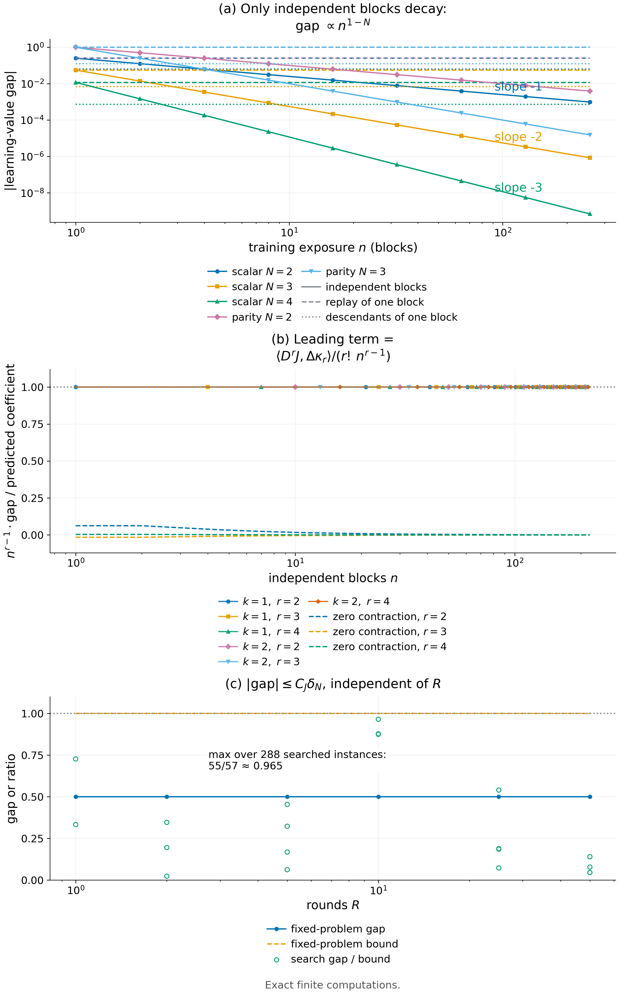

# Theorem 4.5 · 与轮数无关的界与平均化速率

*实验*

[← 框架总览](../README_ZH.md) · [陈述](../statements/04-05_round_independent_bound_averaging_rates_ZH.md) · [证明](../proofs/04-05_round_independent_bound_averaging_rates_ZH.md) · [实验](04-05_round_independent_bound_averaging_rates_ZH.md) · [English](04-05_round_independent_bound_averaging_rates.md)

**本页检验什么.** 用对抗搜索攻击与轮数无关的界 (a)；把 cumulant 展开 (b)、精确的标量律 (c) 与均值不同时的极限 (d) 精确地算成 $`1/n`$ 的多项式；并把"replay 与确定性派生不衰减"(e) 与独立块对照检验。

- **结论：PASS.** 没有对抗实例越过界；最接近的 gap/bound 为 $`55/57`$，并且在 $`R`$ 从 1 到 50 时差距和界都不变（[Check 4.6](#c4-6)）。
- 在全部六个情形中，第一个不匹配的 cumulant 同时给出衰减的指数和系数；缩并为零时首项消失；均值不同时以 $`O(1/n)`$ 的速率收敛到 $`J(\mu_P)-J(\mu_Q)`$（[Check 4.7](#c4-7)）。
- replay 和确定性派生在 256 倍曝光内都让差距保持不变，而独立块让它按 $`n^{1-N}`$ 缩小（[Check 4.8](#c4-8)）。

**本页用到的设定.**

- 学生 $`p\in[0,1]^k`$，部署至多 $`N`$ 个决策，多项式价值 $`J(p)=\sum_{\lvert\alpha\rvert\le N}c_\alpha p^\alpha`$；IID 块 $`Z_i\in[0,1]^k`$ 来自 $`P`$ 或 $`Q`$；凸仿射 learner $`p_R=w_0p_0+\sum_iw_iZ_i`$（[Definition 4.3](../statements/04-03_binary_context_student_affine_learner_ZH.md#s4-3)）。
- $`m_P(\alpha)=\mathbb E_PZ^\alpha`$；$`\delta_N(P,Q)=\max_{1\le\lvert\alpha\rvert\le N}\lvert m_P(\alpha)-m_Q(\alpha)\rvert`$ 是最大矩失配；$`C_J=\sum_\alpha\lvert c_\alpha\rvert\lvert\alpha\rvert`$。
- 一个 learner 的*差距*是 $`\mathbb E_PJ(p_R)-\mathbb E_QJ(p_R)`$。平均化 learner 为 $`\bar p_n=\frac1n\sum_{i=1}^nZ_i`$，均值为 $`\mu`$；$`\kappa_r`$ 是 $`r`$ 阶联合 cumulant，$`D^rJ(\mu)`$ 是 $`\mu`$ 处的 $`r`$ 阶导数张量。
- *标量见证* $`P_N,Q_N`$：二项式权重 $`\binom Ni/2^{N-1}`$ 分别放在 $`\lbrace0,\tfrac1N,\dots,1\rbrace`$ 的偶数点与奇数点上；它们在低于 $`N`$ 阶时一致，在 $`N`$ 阶相差 $`\Delta_N=(-1)^NN!/(2^{N-1}N^N)`$（[Theorem 4.4(c)](../statements/04-04_affine_learners_moment_order_ZH.md#s4-4)）。*parity 分布*：$`\lbrace0,1\rbrace^N`$ 中偶 parity 与奇 parity 顶点上的均匀分布。
- 代码 ID：`v014:` 指 `theory/independent_checks`（结果文件 `results_independent_v014.json`）；`pkg:` 指修订包验证脚本，重新运行的结果在 `theory/v014_repro/results_v014_rerun.json`。

**被检验的陈述（[Theorem 4.5](../statements/04-05_round_independent_bound_averaging_rates_ZH.md#s4-5)）.**

- **(a)** 对每个凸仿射 learner，$`\lvert\mathbb E_{P^R}J(p_R)-\mathbb E_{Q^R}J(p_R)\rvert\le C_J\,\delta_N(P,Q)\le N3^N\delta_N(P,Q)`$，与 $`R`$ 无关。
- **(b)** 若 $`P,Q`$ 均值同为 $`\mu`$，且所有低于 $`r`$ 阶（$`2\le r\le N`$）的联合 cumulant 相等，则 $`\mathbb E_{P^n}J(\bar p_n)-\mathbb E_{Q^n}J(\bar p_n)=\langle D^rJ(\mu),\kappa_r(P)-\kappa_r(Q)\rangle/(r!\,n^{r-1})+O(n^{-r})`$；若缩并为零，差为 $`O(n^{-r})`$。
- **(c)** 对标量见证与 $`J(p)=p^N`$，对每个 $`n\ge1`$，差距恰为 $`\Delta_N/n^{N-1}`$。
- **(d)** 若 $`\mu_P\ne\mu_Q`$，差距为 $`J(\mu_P)-J(\mu_Q)+O(n^{-1})`$。
- **(e)** 若 $`n`$ 个训练块是同一个父块 $`Z_1`$ 经固定确定性映射 $`T`$ 得到的 $`n`$ 份 $`T(Z_1)`$（replay 即 $`T=\mathrm{id}`$），则对每个 $`n`$，差距都等于 $`\mathbb E_PJ(T(Z))-\mathbb E_QJ(T(Z))`$。

<a id="c4-6"></a>

## Check 4.6 · 不随更新次数增长的差异界（Theorem 4.5(a)）

**结论.** 在 288 个对抗搜索得到的实例（582 条断言，最大残差 0）上 PASS。界 $`C_J\delta_N`$ 从未被越过，最紧的实例 gap/bound $`=55/57\approx0.965`$。在一个固定问题上，$`R`$ 从 1 增加到 50，差距和界都保持不变。

**为什么做.** [Theorem 4.5](../statements/04-05_round_independent_bound_averaging_rates_ZH.md#s4-5)(a) 对每一个凸仿射 learner 给出学习价值差距的上界 $`C_J\delta_N\le N3^N\delta_N`$，并且关于更新次数 $`R`$ 一致。证伪方式有两种：找到超过这个界的实例，或找到一族最坏比值随 $`R`$ 增长的实例。

**设置.**

- 24 次搜索试验，$`k\in\lbrace 1,2\rbrace`$、$`N\in\lbrace 1,2,3\rbrace`$，支撑为 $`\lbrace 0,\tfrac12,1\rbrace ^k`$。
- $`R`$ 在 $`\lbrace 1,2,5,10,25,50\rbrace`$ 中循环。
- 随机分布 $`P,Q`$、随机凸权重 $`w_0,\dots,w_R`$、随机 $`p_0`$，以及随机任务树（其精确多项式给出 $`C_J`$）。
- 种子：`SeedSequence([20261010, 10])`。

**做法.**

1. 每次试验对 $`Q`$ 做 12 步有理爬山（每步在支撑点之间移动 $`\le\tfrac1{20}`$ 的质量），以最大化 gap/bound，共 288 个实例。
2. 用独立块矩卷积精确计算每个学习价值。
3. 断言 gap $`\le C_J\delta_N\le N3^N\delta_N`$。
4. *固定问题扫描.* 在 $`\lbrace 0,1\rbrace`$ 上取 $`P=(\tfrac14,\tfrac34)`$、$`Q=(\tfrac34,\tfrac14)`$，$`J=p^2`$，learner 为 $`R`$ 个块的均匀平均，$`R=1,\dots,50`$。

**结果.**

| 量 | 值 | 来源 |
|---|---:|---|
| 实例数 / 断言数 | 288 / 582 | 条目 `v014:C10`，`n_instances`, `.n_assertions` |
| 找到的最大 gap/bound | $`55/57\approx0.9649`$，出现在 $`N=1`$、$`R=10`$ | 条目 `v014:C10`，`details.best_exact_ratio`, `.best_instance` |
| 状态 | PASS（最大残差 0） | 条目 `v014:C10`，`status` |

| 固定问题，$`R`$ | 1 | 2 | 5 | 10 | 25 | 50 |
|---|---:|---:|---:|---:|---:|---:|
| 精确差距 | 1/2 | 1/2 | 1/2 | 1/2 | 1/2 | 1/2 |
| 界 $`C_J\delta_N`$ | 1 | 1 | 1 | 1 | 1 | 1 |

来源：条目 `v014:C10`，`details.fixed_problem_R_sweep`。

**为什么支持 Theorem 4.5(a).**

- 对抗搜索从未越过这个界，而界与实际差距只差 4%，接近可达。
- 更新次数完全不出现在界里：扫描中差距和界都不随 $`R`$ 变化。

<a id="c4-7"></a>

## Check 4.7 · 第一个不匹配的 cumulant 决定速率（Theorem 4.5(b)–(d)）

**结论.** PASS（1,530 个实例、1,797 条断言）。精确的标量律在 $`N=2,\dots,8`$、$`n=1,\dots,30`$ 的全部 210 个格点上成立。在全部六个 cumulant 情形中，精确差距恰好从 $`n^{1-r}`$ 开始，系数与预测一致，没有更慢的项；缩并为零时首项消失；均值不同时，差距以 $`O(1/n)`$ 收敛到 $`J(\mu_P)-J(\mu_Q)=13/32`$。一个不使用 cumulant 的独立实现在 20 个情形中复现了精确律。

**为什么做.** [Theorem 4.5](../statements/04-05_round_independent_bound_averaging_rates_ZH.md#s4-5)(b) 同时预测了差距随独立块数 $`n`$ 衰减的指数 $`1-r`$ 和系数 $`\langle D^rJ(\mu),\Delta\kappa_r\rangle/r!`$。证伪方式包括：首项系数不对；出现 $`j<r-1`$ 的更慢项 $`n^{-j}`$；余项不是 $`O(n^{-r})`$；缩并为零时首项却不为零。(c) 是标量见证的精确律 $`\Delta_N/n^{N-1}`$；(d) 给出均值不同时的极限 $`J(\mu_P)-J(\mu_Q)`$。

**设置.**

- *(c) 的精确律.* [Check 4.4](04-04_affine_learners_moment_order_ZH.md#c4-4) 的标量见证分布，$`J=p^N`$，$`N=2,\dots,8`$，$`n=1,\dots,30`$。
- *cumulant 情形*，共六个，$`k\in\lbrace 1,2\rbrace`$、$`r\in\lbrace 2,3,4\rbrace`$：
  - $`k=1`$：$`r`$ 阶标量见证分布；
  - $`k=2`$：二元提升 $`(x,(x+b)/2)`$，$`b\in\lbrace 0,1\rbrace`$ 等概率；
  - 任务为 $`J=(\tfrac1k\sum_jp_j)^{r+1}`$。
- *缩并为零.* $`J=(p-\tfrac12)^{r+2}`$，$`r=2,3,4`$；它在 $`\mu=\tfrac12`$ 处的 $`r`$ 阶导数为零。
- *均值不同.* 在 $`\lbrace 0,1\rbrace`$ 上取 $`P=(\tfrac14,\tfrac34)`$、$`Q=(\tfrac34,\tfrac14)`$，$`J=p^3`$。

**做法.**

1. 用样本下标的多项式展开，把 $`\mathbb EJ(\bar p_n)`$ 精确地算成 $`1/n`$ 的多项式。
2. 由矩独立地计算 cumulant。
3. 断言低阶 cumulant 相等、$`n^{1-r}`$ 的系数等于预测的缩并、所有更慢项的系数为零。
4. 对 $`n=1,\dots,220`$，断言 $`n\cdot\lvert n^{r-1}\text{gap}-\text{coefficient}\rvert`$ 始终不超过高阶系数构成的包络。
5. *独立实现*（`pkg:scalar_exact_decay`）：完全不用 cumulant，把分布卷积 $`n`$ 次，直接计算 $`\mathbb E\bar p_n^N`$，$`N=2,\dots,6`$，$`n\in\lbrace 1,2,4,8\rbrace`$。

**结果.**

| 情形 $`(k,r)`$ | 预测系数 | 精确差距（$`1/n`$ 的多项式） |
|---|---:|---|
| (1, 2) | $`3/8`$ | $`\tfrac38\,n^{-1}`$ |
| (1, 3) | $`-1/9`$ | $`-\tfrac19\,n^{-2}`$ |
| (1, 4) | $`15/512`$ | $`\tfrac{15}{512}\,n^{-3}`$ |
| (2, 2) | $`27/128`$ | $`\tfrac{27}{128}\,n^{-1}`$ |
| (2, 3) | $`-3/64`$ | $`-\tfrac3{64}\,n^{-2}`$ |
| (2, 4) | $`1215/131072`$ | $`\tfrac{1215}{131072}\,n^{-3}`$ |
| 缩并为零，$`r=2`$ | 0 | $`\tfrac3{16}n^{-2}-\tfrac18n^{-3}`$ |
| 缩并为零，$`r=3`$ | 0 | $`-\tfrac5{108}n^{-3}+\tfrac5{162}n^{-4}`$ |
| 缩并为零，$`r=4`$ | 0 | $`\tfrac{45}{4096}n^{-4}-\tfrac{15}{2048}n^{-5}`$ |
| 均值不同 | 极限 $`13/32`$ | $`\tfrac{13}{32}+\tfrac9{32}n^{-1}-\tfrac3{16}n^{-2}`$ |

- 来源：条目 `v014:C11`，`details.cumulant_cases[*].predicted_coefficient`、`.exact_gap_polynomial_in_inverse_n`、`.gap`（缩并为零的情形），以及条目 `v014:C11`，`details.unequal_means_gap`、`.unequal_means_limit`。
- (c) 的精确律在全部 $`7\times30=210`$ 个 $`(N,n)`$ 格点上成立；状态 PASS。
- 独立实现：全部 20 个枚举差距都精确等于 $`\Delta_N/n^{N-1}`$，例如 $`N=4`$ 时依次为 $`3/256,\ 3/2048,\ 3/16384,\ 3/131072`$（`results_v014_rerun.json → scalar_exact_decay`；每一行的 `enumerated_gap_exact` 与 `predicted_gap_exact` 都相同）。

**为什么支持 Theorem 4.5(b)–(d).**

- 每个情形的差距都恰好从 $`n^{1-r}`$ 开始，系数与预测一致：指数和系数都由第一个不匹配的 cumulant 决定。
- 缩并为零时，衰减变得更快（$`n^{-r}`$），与展开的预测一致。
- 均值不同时，差距以 $`O(1/n)`$ 逼近极限 $`J(\mu_P)-J(\mu_Q)`$。

<a id="c4-8"></a>

## Check 4.8 · 独立证据、replay 与合成派生（Theorem 4.5(e)）

**结论.** PASS（45 个实例、140 条断言）。使用独立块时，差距精确地按 $`\text{gap}_1/n^{N-1}`$ 衰减（$`N=2,3,4`$ 的双对数斜率为 $`-1,-2,-3`$）。重放一个块，或用同一父块的确定性派生训练，差距在 256 倍曝光内保持不变。

**为什么做.** [Theorem 4.5](../statements/04-05_round_independent_bound_averaging_rates_ZH.md#s4-5)(b)–(c) 的速率是关于独立块的个数。(e) 预测，两种只增加曝光、不带来新证据的做法会让差距停留在单块时的值：把一个块重放 $`n`$ 次，以及用同一父块的 $`n`$ 个确定性派生训练。这把信息与曝光区分开。

**设置.**

- $`N=2,3,4`$ 的标量见证分布，以及 $`N=2,3`$ 的 parity 分布。
- 曝光量 $`n\in\lbrace 1,2,4,\dots,256\rbrace`$。
- 派生通道 $`T(Z)=(Z+\tfrac12)/2`$，一个固定的、保信息的映射。
- 种子：`SeedSequence([20261010, 18])`。

**做法.** 对每个族、$`N`$ 和 $`n`$，精确计算三种差距：

- 独立块：$`\mathbb E_{P^n}J(\bar p_n)-\mathbb E_{Q^n}J(\bar p_n)`$；
- replay：同一个块的 $`n`$ 份拷贝，$`\bar p_n=Z_1`$；
- 派生：$`n`$ 份 $`T(Z_1)`$，$`\bar p_n=T(Z_1)`$。

然后断言：独立块差距等于单块差距除以 $`n^{N-1}`$；replay 差距等于单块差距；派生差距等于单块差距除以 $`2^N`$（这个通道的收缩因子）。

**结果.**

| 族，$`N`$ | $`n=1`$ 时差距 | 独立块，$`n=256`$ | replay，$`n=256`$ | 派生，$`n=256`$ | 独立块的双对数斜率 |
|---|---:|---:|---:|---:|---:|
| 标量，2 | $`1/4`$ | $`1/1024`$ | $`1/4`$ | $`1/16`$ | $`-1`$ |
| 标量，3 | $`-1/18`$ | $`-1/1179648`$ | $`-1/18`$ | $`-1/144`$ | $`-2`$ |
| 标量，4 | $`3/256`$ | $`3/4294967296`$ | $`3/256`$ | $`3/4096`$ | $`-3`$ |
| parity，2 | $`1`$ | $`1/256`$ | $`1`$ | $`1/4`$ | $`-1`$ |
| parity，3 | $`1`$ | $`1/65536`$ | $`1`$ | $`1/8`$ | $`-2`$ |

来源：条目 `v014:C18`，`details.curves`；斜率由 $`n=1`$ 和 $`n=256`$ 两行计算。



*Figure 4.3.* 独立块让差距按 $`n^{1-N}`$ 缩小，而重放一个块或用它的派生训练，差距保持不变（本检验）。乘以 $`n^{r-1}`$ 之后，精确差距在全部六个情形中都收敛到第一个不匹配 cumulant 给出的系数；缩并为零时首项消失（[Check 4.7](#c4-7)）。与轮数无关的界在 $`R`$ 直到 50 时都成立，并且几乎取到（[Check 4.6](#c4-6)）。[PDF](../figures/fig4_3_rates.pdf)

**为什么支持 Theorem 4.5(e).**

- 只有独立证据能让差异衰减，而且衰减指数恰好是预测的 $`1-N`$。
- replay 和派生把训练曝光放大了 256 倍，学习价值差距却不变；派生只通过通道把差距缩放一次，之后不再衰减。

**局限.** 通道是所述的确定性映射。它是一个构造出来的对照，不是关于所有后处理方式的论断。

## 复现

```bash
CUDA_VISIBLE_DEVICES='' PYTHONDONTWRITEBYTECODE=1 theory/.venv/bin/python \
  theory/independent_checks/check_v014_independent.py --only C10,C11,C18 \
  --output theory/independent_checks/subset.json
CUDA_VISIBLE_DEVICES='' theory/.venv/bin/python docs/direction/v014_handoff/verify_environment_information_v014.py \
  --output theory/v014_repro/results_v014_rerun.json
```

`--only` 保留每个 claim 自己的随机流（`SeedSequence([20261010, claim number])`），所以只跑子集也能复现完整运行的数字。

这些检验使用 NumPy（[Harris et al., 2020](#ref-harris2020array)）、做精确有理数与符号计算的 SymPy（[Meurer et al., 2017](#ref-meurer2017sympy)），以及 SciPy（[Virtanen et al., 2020](#ref-virtanen2020scipy)）。

## 产物

- 结果：`theory/independent_checks/results_independent_v014.json`（条目 `v014:C10`、`v014:C11`、`v014:C18`）；`theory/v014_repro/results_v014_rerun.json`（`scalar_exact_decay`）。
- 代码：`theory/independent_checks/check_v014_independent.py`（`check_C10`、`check_C11`、`check_C18`）；`docs/direction/v014_handoff/verify_environment_information_v014.py`；规格说明 `theory/independent_checks/SPEC.md`。
- 已有的图：`theory/independent_checks/figs/C18_evidence_exposure.png`。图的规格：`theoretical_framework/figures/specs/fig4_3.md`。
