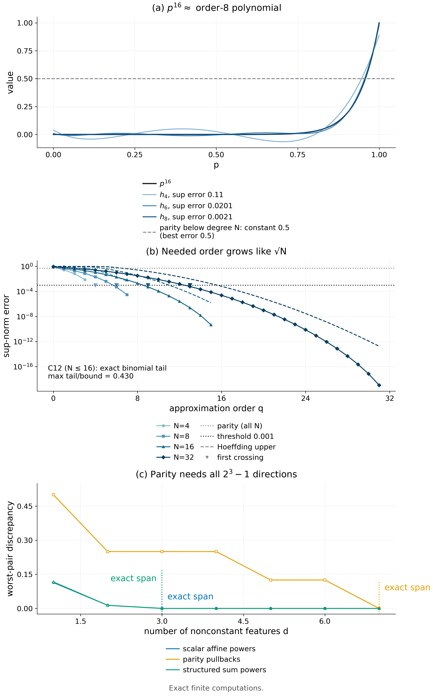

# Proposition 4.6 · Exact order is not approximate complexity

*Experiments*

[← Framework](../README.md) · [Statement](../statements/04-06_exact_order_not_approximate_complexity.md) · [Proof](../proofs/04-06_exact_order_not_approximate_complexity.md) · [Experiments](04-06_exact_order_not_approximate_complexity.md) · [中文](04-06_exact_order_not_approximate_complexity_ZH.md)

**What is tested here.** The Chebyshev identity (4.7), the exact binomial-tail truncation error and the parity minimax value of Proposition 4.6 are computed exactly; then three response families of equal maximum degree are compared to show that task structure, not degree, sets the number of statistics needed.

- **Verdict: PASS.** The truncation error of $`p^N`$ equals the binomial tail; accuracy $`10^{-3}`$ needs only $`q=4,6,9,13`$ for $`N=4,8,16,32`$; parity keeps error exactly $`1/2`$ below degree $`N`$ ([Check 4.9](#c4-9)).
- At equal degree 3, structured families need 3 statistics and parity needs 7 ([Check 4.10](#c4-10)). The same check re-tests the duality of [Theorem 4.2](../statements/04-02_sufficiency_duality_transfer.md#s4-2)(b) and the span dimensions of Theorem 4.2(a) and [Theorem 4.4](../statements/04-04_affine_learners_moment_order.md#s4-4)(d).
- All computations are exact rational, symbolic or exact LP; none involves a trained network.

**Setting used on this page.**

- Scalar task $`J(p)=p^N`$ on $`[0,1]`$ (one context visited $`N`$ times, success if all actions are 1). Parity task $`J_{\rm even}(p)=\tfrac12\big(1+\prod_{j=1}^N(1-2p_j)\big)`$ on $`[0,1]^N`$ (pays 1 if the number of 1-actions is even).
- $`T_j`$ is the Chebyshev polynomial of the first kind, $`T_j(\cos\theta)=\cos(j\theta)`$ ([Rivlin, 1990](../references.md#rivlin1990chebyshev)); $`h_q`$ is the truncation of (4.7) after order $`q`$; $`\mathcal P_q`$ is the set of polynomials of total degree at most $`q`$; $`B\sim\mathrm{Bin}(2N,\tfrac12)`$.
- For a response family $`\mathcal G`$ on a finite message grid and a subspace $`H`$ of functions containing the constants, the *uniform error* is $`\max_{g\in\mathcal G}\mathrm{dist}_\infty(g,H)`$ and the *worst-pair discrepancy* is the largest $`(P-Q)g`$ over pairs of laws that agree on $`H`$ ([Definition 4.1](../statements/04-01_feature_sufficiency_unresolved_discrepancy.md#s4-1)). A feature budget $`d`$ means $`\dim H=d+1`$.
- Code IDs: `v014:` = `theory/independent_checks` (results `results_independent_v014.json`); `pkg:` = package verifier re-run into `theory/v014_repro/results_v014_rerun.json`.

**Statement under test ([Proposition 4.6](../statements/04-06_exact_order_not_approximate_complexity.md#s4-6)).** For $`p\in[0,1]`$,

```math
p^N=4^{-N}\binom{2N}{N}+2\cdot4^{-N}\sum_{j=1}^N\binom{2N}{N-j}T_j(2p-1). \qquad(4.7)
```

- **(a)** For $`q<N`$, $`\lVert p^N-h_q\rVert_{\infty,[0,1]}=\Pr\lbrace\lvert B-N\rvert>q\rbrace\le2e^{-q^2/N}`$; laws with equal moments through order $`q`$, and the learning values of convex-affine learners with IID scalar blocks, differ on $`p^N`$ by at most $`4e^{-q^2/N}`$.
- **(b)** For every $`q<N`$, $`\min_{h\in\mathcal P_q}\lVert J_{\rm even}-h\rVert_{\infty,[0,1]^N}=\tfrac12`$, attained by $`h\equiv\tfrac12`$.

<a id="c4-9"></a>

## Check 4.9 · Chebyshev identity, exact tails and the parity minimax (Proposition 4.6)

**Verdict.** PASS (136 instances, 484 assertions, worst residual $`1.0\times10^{-17}`$). For $`N=1,\dots,16`$ and every $`q<N`$, the truncation error of $`p^N`$ equals the binomial tail and stays below $`2e^{-q^2/N}`$ (largest tail/bound ratio 0.430). An independent implementation to $`N=32`$ finds that accuracy $`10^{-3}`$ needs only $`q=4,6,9,13`$ for $`N=4,8,16,32`$. The best degree-$`(<N)`$ approximation error of parity is exactly $`1/2`$.

**Why.** [Proposition 4.6](../statements/04-06_exact_order_not_approximate_complexity.md#s4-6)(a) makes three falsifiable claims: the Chebyshev expansion (4.7) is an identity; the truncation error equals the binomial tail $`\Pr\lbrace\lvert B-N\rvert>q\rbrace`$, not merely is bounded by it; and the tail is at most $`2e^{-q^2/N}`$. Part (b) says the best lower-degree error for parity is exactly $`1/2`$; a smaller value would falsify it.

**Setup.**

- Scalar task: $`N=1,\dots,16`$ and all $`q<N`$.
- Parity: $`N=1,\dots,5`$ on all $`2^N`$ cube vertices; 10 random rational points per $`N`$ check $`\lvert J_{\rm even}-\tfrac12\rvert\le\tfrac12`$.
- Seed: `SeedSequence([20261010, 12])`.
- Independent implementation (`pkg:scalar_approximation`): $`N\in\lbrace 4,8,16,32\rbrace`$, $`q=0,\dots,N`$, 8,001-point grid.

**Procedure.**

1. Verify the Chebyshev identity (4.7) symbolically: $`\mathrm{expand}(\text{RHS}-p^N)=0`$ in SymPy.
2. For each $`(N,q)`$:
   - compute $`\max\lvert p^N-h_q\rvert`$ on a 3,001-point grid that includes $`p=1`$ and assert it equals the coefficient tail;
   - assert in exact rationals that the coefficient tail equals the binomial tail;
   - assert tail $`\le2e^{-q^2/N}`$.
3. Parity: solve the minimax LP $`\min_{h\in\mathcal P_{N-1}}\max_{\rm vertices}\lvert J_{\rm even}-h\rvert`$ over all nonconstant monomials of degree $`<N`$, and assert the optimum is $`0.5`$.
4. Independent implementation: compare $`\lvert x^N-h_q\rvert`$ on the grid with the coefficient tail and with $`\min(1,2e^{-q^2/N})`$.

**Result.**

| Quantity | Value | Source |
|---|---:|---|
| Instances / assertions | 136 / 484 | entry `v014:C12`, `n_instances`, `.n_assertions` |
| Range of $`N`$ for identity and tails | 1–16 | entry `v014:C12`, `details.N_range` |
| Largest tail $`/\,2e^{-q^2/N}`$ | 0.430 | entry `v014:C12`, `details.exhaustive_tail_best_ratio` |
| Parity best degree-$`(<N)`$ error | 0.5 exactly ($`N=1,\dots,5`$) | entry `v014:C12`, `details.parity_minimax_error` |
| Worst residual | $`1.0\times10^{-17}`$ | entry `v014:C12`, `worst_residual` |
| Status | PASS | entry `v014:C12`, `status` |

Independent implementation: all 64 rows satisfy grid error = tail ($`\max\lvert\text{grid}-\text{tail}\rvert=8.9\times10^{-16}`$) and tail $`\le`$ bound. Selected rows:

| $`N`$ | $`q`$ | truncation error | $`2e^{-q^2/N}`$ | parity best degree-$`q`$ error |
|---:|---:|---:|---:|---:|
| 16 | 4 | 0.1102 | 0.7358 | 0.5 |
| 16 | 8 | 0.00210 | 0.0366 | 0.5 |
| 16 | 12 | $`2.56\times10^{-6}`$ | $`2.47\times10^{-4}`$ | 0.5 |
| 32 | 8 | 0.0328 | 0.2707 | 0.5 |
| 32 | 16 | $`2.44\times10^{-5}`$ | $`6.71\times10^{-4}`$ | 0.5 |
| 32 | 20 | $`1.01\times10^{-7}`$ | $`7.45\times10^{-6}`$ | 0.5 |

Source: `results_v014_rerun.json → scalar_approximation` (fields `Chebyshev_truncation_error`, `grid_check_error`, `Hoeffding_upper`, `parity_best_degree_q_error`). The smallest $`q`$ with truncation error $`\le10^{-3}`$ is $`4,6,9,13`$ for $`N=4,8,16,32`$.

**Why it supports Proposition 4.6.**

- The truncation error of $`p^N`$ is exactly a binomial tail and decays like $`e^{-q^2/N}`$; the stated bound is conservative by at least a factor 2.3 in the tested range.
- The order needed for practical accuracy grows like $`\sqrt N`$: doubling $`N`$ adds only a few orders, although exact equality needs order $`N`$.
- Parity cannot be approximated better than the trivial constant by any lower degree, so the $`\sqrt N`$ behaviour is a property of the task, not of the degree.

<a id="c4-10"></a>

## Check 4.10 · Same maximum degree, different response-space complexity (Proposition 4.6; Theorems 4.2 and 4.4(d))

**Verdict.** PASS (21 subspaces, 1,445 assertions). Three response families share maximum degree 3. The scalar and structured families are resolved exactly by 3 statistics; the parity family keeps uniform error at least $`0.0625`$ (discrepancy at least $`0.125`$) until all 7 nonconstant directions are present. Exact span dimensions, including the constant, are 4, 4 and 8. On every selected subspace the discrepancy equals twice the uniform error to $`1.6\times10^{-15}`$.

**Why.** The degree of a response family does not determine its approximate complexity; the operative quantity is the approximation width, which [Theorem 4.2](../statements/04-02_sufficiency_duality_transfer.md#s4-2)(b) identifies with the worst-pair discrepancy (the worst pair is exactly twice the uniform error). This check compares three families with the same maximum degree, expecting the structured families to be cheap and parity expensive ([Proposition 4.6](../statements/04-06_exact_order_not_approximate_complexity.md#s4-6)). It also re-tests:

- the duality of Theorem 4.2(b) on structured rather than random responses;
- the span dimension that Theorem 4.2(a) predicts for a given family (the least number of features with zero discrepancy is the dimension of the span of the constant and the family, minus 1), and its relation to the worst case over all tasks counted by [Theorem 4.4](../statements/04-04_affine_learners_moment_order.md#s4-4)(d).

**Setup.**

- Grid $`\lbrace 0,\tfrac14,\dots,1\rbrace ^3`$ (125 messages); maximum degree 3 in every family.
- *Scalar affine powers* $`(a+bx_1)^3`$: 5 responses.
- *Multivariate parity pullbacks*: $`J_{\rm even}`$ composed with 8 affine maps, plus the raw parity: 9 responses.
- *Structured sum powers* $`(a+b\bar x)^3`$, with $`\bar x`$ the coordinate mean: 5 responses.
- Seed: `SeedSequence([20261010, 19])`.

**Procedure.**

1. Compute the exact rational rank of each family, including the constant.
2. Fix a finite dictionary before fitting: the response vectors, all multilinear monomials, and the scalar or structured Chebyshev bases.
3. For each budget $`d=1,\dots,7`$, select a subspace greedily and compute the uniform error $`\max_g\mathrm{dist}_\infty(g,H)`$ by LP over the full grid, and the worst-pair discrepancy for that subspace by an independent primal LP.
4. Assert discrepancy $`=2\times`$ error. Positive errors are upper bounds on the optimal width, because the greedy subspace need not be optimal; zero errors are exact.

**Result (uniform error; the discrepancy is exactly twice this).**

| feature budget $`d`$ | 1 | 2 | 3 | 4 | 5 | 6 | 7 |
|---|---:|---:|---:|---:|---:|---:|---:|
| scalar affine powers | 0.0569 | 0.0068 | **0** | 0 | 0 | 0 | 0 |
| structured sum powers | 0.0582 | 0.0068 | **0** | 0 | 0 | 0 | 0 |
| multivariate parity | 0.25 | 0.125 | 0.125 | 0.125 | 0.0625 | 0.0625 | **0** |

- Source: entry `v014:C19`, `details.families[*].curve[*].uniform_error` (and `.discrepancy`, `.optimality`).
- Span dimensions including the constant: 4 (scalar), 8 (parity), 4 (structured) (`span_dimension_including_constant`).
- Duality on all 21 (family, $`d`$) subspaces: $`\max\lvert\text{discrepancy}-2\cdot\text{uniform error}\rvert=1.6\times10^{-15}`$.
- Held-out responses from the same families: the selected scalar and structured subspaces give errors of at most $`0.017`$ at $`d=1`$ and $`0`$ from $`d=3`$ on (`heldout_uniform_error`).



*Figure 4.4.* Low-order Chebyshev truncations of $`p^{16}`$ are already close to it, and the truncation error equals a binomial tail below $`2e^{-q^2/N}`$, while parity keeps error $`1/2`$ below degree $`N`$ ([Check 4.9](#c4-9)). On one grid and one maximum degree, the scalar and structured families are resolved exactly by 3 features and parity only by 7 (this check; hollow markers are upper bounds from the best subspace found). [PDF](../figures/fig4_4_approximation.pdf)

**Why it supports the statements.**

- At equal maximum degree the scalar and structured families are captured exactly by 3 statistics, parity needs all $`2^3-1=7`$, and with 3 statistics parity still leaves worst-pair discrepancy $`0.25`$: task structure, not degree or horizon, sets the information order ([Proposition 4.6](../statements/04-06_exact_order_not_approximate_complexity.md#s4-6)).
- The exact span dimensions are the numbers the span criterion of [Theorem 4.2](../statements/04-02_sufficiency_duality_transfer.md#s4-2)(a) predicts, and they are far below the worst case over all tasks counted by [Theorem 4.4](../statements/04-04_affine_learners_moment_order.md#s4-4)(d).
- The duality of Theorem 4.2(b) holds on structured, non-random responses too, including the parity family, where the discrepancy stays large.

**Limits.** One grid of 125 messages and maximum degree 3; positive errors come from a greedy subspace and are upper bounds on the optimal width.

## Reproduce

```bash
CUDA_VISIBLE_DEVICES='' PYTHONDONTWRITEBYTECODE=1 theory/.venv/bin/python \
  theory/independent_checks/check_v014_independent.py --only C12,C19 \
  --output theory/independent_checks/subset.json
CUDA_VISIBLE_DEVICES='' theory/.venv/bin/python docs/direction/v014_handoff/verify_environment_information_v014.py \
  --output theory/v014_repro/results_v014_rerun.json
```

`--only` preserves each claim's random stream (`SeedSequence([20261010, claim number])`), so a subset run reproduces the full-run numbers.

## Artifacts

- Results: `theory/independent_checks/results_independent_v014.json` (entries `v014:C12`, `v014:C19`); `theory/v014_repro/results_v014_rerun.json` (`scalar_approximation`).
- Code: `theory/independent_checks/check_v014_independent.py` (`check_C12`, `check_C19`); `docs/direction/v014_handoff/verify_environment_information_v014.py`; specification `theory/independent_checks/SPEC.md`.
- Existing plot: `theory/independent_checks/figs/C19_response_complexity.png`. Figure spec: `theoretical_framework/figures/specs/fig4_4.md`.

## References

- [Rivlin, 1990](../references.md#rivlin1990chebyshev) — Chebyshev polynomials.
