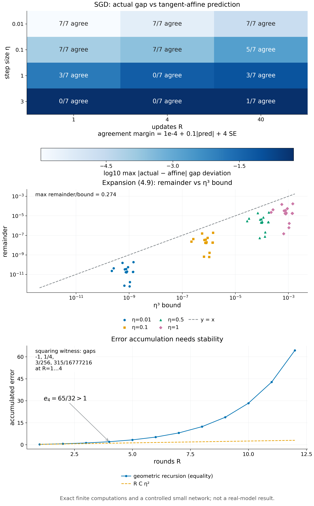

# Theorem 4.7 · 更新复合放大信息需求

*实验*

[← 框架总览](../README_ZH.md) · [陈述](../statements/04-07_update_composition_amplifies_information_requirement_ZH.md) · [证明](../proofs/04-07_update_composition_amplifies_information_requirement_ZH.md) · [实验](04-07_update_composition_amplifies_information_requirement_ZH.md) · [English](04-07_update_composition_amplifies_information_requirement.md)

**本页检验什么.** 精确计算次数复合界 (a)、它的可达性 (b)、阈值 learner (c) 以及局部 SGD 展开的余项 (d)；在精确有理数递推上检验几何误差累积 (e)；并用一个受控小网络定位 SGD 的局部仿射描述在哪里适用。

- **结论：PASS.** 12 条随机更新链的块次数全部等于复合上界，平方构造取到了它，阈值 learner 区分了两个均值相同的分布，SGD 展开的余项从不超过其界的 $`0.275`$ 倍（[Check 4.11](#c4-11)）。
- 几何累积界可以取等号；没有稳定性条件时，关于 $`R`$ 线性的理解不成立（[Check 4.12](#c4-12)）。
- 在受控网络中，切线仿射 SGD 预测在 $`\eta R`$ 小的区域内落在预先设定的阈值内，在大步长下失效（[Check 4.13](#c4-13)）。这是一张适用范围图，不是一个界。

**本页用到的设定.**

- *多项式更新.* 学生参数 $`p\in[0,1]^k`$，公共起点 $`p_0`$，独立块 $`Z_1,\dots,Z_R`$ 的分布为 $`P_i`$（参考来源）或 $`Q_i`$（备选来源），更新 $`p_i=U_i(p_{i-1},Z_i)`$ 的各坐标是多项式，关于 $`p_{i-1}`$ 的次数至多 $`a_i`$，关于 $`Z_i`$ 的次数至多 $`b_i`$。至多 $`N`$ 次决策的部署有多项式价值 $`J(p)`$，总次数至多 $`N`$（[Theorem 4.4(a)](../statements/04-04_affine_learners_moment_order_ZH.md#s4-4)）。
- *$`M`$ 阶标量见证分布*：二项式权重 $`\binom Mi/2^{M-1}`$ 分别放在 $`\lbrace0,\tfrac1M,\dots,1\rbrace`$ 的偶数点与奇数点上；它们在所有低于 $`M`$ 阶的矩上一致，在 $`M`$ 阶不同（[Theorem 4.4(c)](../statements/04-04_affine_learners_moment_order_ZH.md#s4-4)）。
- *光滑局部设定.* $`\theta\in\mathbb R^p`$，$`V`$ 是 continuation value：从 $`\theta`$ 出发继续训练时的期望最终分数（[Definition 1.4](../README_ZH.md#s1-4)）。步长为 $`\eta`$、consumed gradient 分布为 $`P`$ 的一步 SGD 把 $`V`$ 映为 $`(K^PV)(\theta)=\mathbb E_{G\sim P}V(\theta-\eta G)`$；$`\mu_P=\mathbb E_PG`$，$`M_P=\mathbb E_PGG^\top`$；$`M_3`$ 是 $`V`$ 在各步线段上的三阶导数界。
- *误差递推.* $`e_0=0`$，$`e_{t+1}\le(1+\eta L)e_t+C\eta^2`$。
- 代码 ID：`v014:` 指 `theory/independent_checks`（结果文件 `results_independent_v014.json`）；`v015:` 指 `theory/v015_checks`（结果文件 `results_v015_independent.json`）。

**被检验的陈述（[Theorem 4.7](../statements/04-07_update_composition_amplifies_information_requirement_ZH.md#s4-7)）.**

- **(a) 次数的复合.** $`J(p_R)`$ 关于块 $`Z_i`$ 的总次数至多为

```math
D_i=N\,b_i\prod_{t=i+1}^Ra_t, \qquad(4.8)
```

- 并且对每个 $`i`$ 把块矩匹配到 $`D_i`$ 阶，就使两个学习价值相等。
- **(b) 上界可达.** 对每个 $`R`$，都存在更新与一个 $`N=1`$ 的部署，使 response 为 $`Z_1^{2^{R-1}}`$，而 $`2^{R-1}`$ 阶的标量见证分布给出不同的学习价值；(4.8) 一般不能改进。
- **(c) 阈值 learner.** 对 $`p=\mathbf 1\lbrace Z>1/2\rbrace`$ 与 $`J(p)=p`$，分布 $`P(Z=0)=\tfrac13`$、$`P(Z=\tfrac34)=\tfrac23`$ 与 $`Q(Z=\tfrac12)=1`$ 均值同为 $`\tfrac12`$，学习价值却分别为 $`\tfrac23`$ 与 $`0`$。
- **(d) SGD 的局部展开.** 若 $`V`$ 在各步线段上为 $`C^3`$，三阶导数界为 $`M_3`$，则

```math
(K^P-K^Q)V(\theta)=-\eta\nabla V(\theta)^\top(\mu_P-\mu_Q)+\frac{\eta^2}{2}\langle\nabla^2V(\theta),M_P-M_Q\rangle+\mathcal E,\qquad\lvert\mathcal E\rvert\le\frac{M_3\eta^3}{6}\big(\mathbb E_P\lVert G\rVert^3+\mathbb E_Q\lVert G\rVert^3\big). \qquad(4.9)
```

- **(e) 误差累积.** $`e_R\le C\eta^2\sum_{s=0}^{R-1}(1+\eta L)^s`$，递推取等号时上式也取等号；$`L>0`$ 时线性界 $`RC\eta^2`$ 一般不成立。

<a id="c4-11"></a>

## Check 4.11 · 次数复合、上界可达、阈值 learner 与 SGD 展开（Theorem 4.7(a)–(d)）

**结论.** PASS（72 个实例、371 条断言，最大残差 0）。12 条随机多项式更新链的实际块次数都等于 (4.8) 的上界 $`D_i=Nb_i\prod_{t>i}a_t`$，按 $`D_i`$ 逐块匹配矩后学习价值精确相等。平方构造在次数 1、2、4、8 上取到这个上界。阈值 learner 把两个均值相同的分布区分为 $`2/3`$ 对 $`0`$。SGD 展开的余项从不超过其 $`\eta^3`$ 界的 0.275 倍。

**为什么做.** [Theorem 4.7](../statements/04-07_update_composition_amplifies_information_requirement_ZH.md#s4-7)(a) 断言第 $`i`$ 块上的 response 次数不超过 $`Nb_i\prod_{t>i}a_t`$，并且匹配这么多阶矩就足够；次数算错，矩充分性就不成立。(b) 断言这个上界可以取到，所以次数算松也会被发现。(c) 断言一旦更新不连续，任何矩阶都不够。(d) 的局部 SGD 展开 (4.9) 是 SGD 的一阶描述，[Proposition 5.1](../statements/05-01_optimizer_transformed_expansion_ZH.md#s5-1) 的 optimizer 变换展开正是它的推广，所以它的余项界必须成立。

**设置.**

- 12 条随机更新链：$`R\in\lbrace 1,2,3\rbrace`$，$`N\in\lbrace 1,2\rbrace`$，次数 $`a_i,b_i\in\lbrace 1,2\rbrace`$，$`p_i=\lambda_ip_{i-1}^{a_i}+(1-\lambda_i)Z_i^{b_i}`$，$`\lambda_i\in\lbrace \tfrac14,\tfrac12,\tfrac34\rbrace`$ 随机。
- 用 SymPy 做精确的符号回拉，块矩用精确有理数；第 $`i`$ 块取 $`D_i+1`$ 阶的标量见证分布。
- 另有 $`R=1,\dots,4`$ 的平方构造，以及 (c) 的阈值分布。
- (d)：$`\mathbb R^3`$ 上 15 个随机三次函数 $`V`$，配 6 个原子上的随机离散梯度分布；再用 logistic 函数 $`V(\theta)=\sigma(w^\top\theta)`$ 重复；步长 $`\eta\in\lbrace 0.01,0.1,0.5,1\rbrace`$。

**做法.**

- 展开 $`J(p_R)`$，读出每块的次数并与 $`D_i`$ 比较；在按 $`D_i`$ 匹配矩的条件下计算两个学习价值。
- 对 (d)，计算精确的差 $`(K^P-K^Q)V(\theta)`$ 与展开的前两项，把余项与 $`\tfrac{M_3\eta^3}6(\mathbb E_P\lVert G\rVert^3+\mathbb E_Q\lVert G\rVert^3)`$ 比较：
  - 三次函数的 $`M_3`$ 取常数三阶导数张量的 Frobenius 范数，它是算子范数的上界；
  - logistic 函数的 $`M_3=\lVert w\rVert^3/8`$，因为全局有 $`\lvert\sigma'''\rvert\le1/8`$。

**结果.** 数据：`theory/independent_checks/results_independent_v014.json`，`v014:C13`。

| 量 | 值 |
|---|---|
| 状态、实例数、断言数、最大残差 | PASS，72，371，0.0 |
| 声明次数 vs 实际块次数（`details.degrees`，12 条链） | 每条链都相等，例如 $`a=(2,2,2)`$、$`b=(2,2,1)`$、$`N=2`$：$`D=(16,8,2)`$，实际 $`(16,8,2)`$ |
| 逐块匹配下学习价值相等 | 12 条链全部精确相等 |
| 平方构造（`details.amplification`） | $`R=1,2,3,4`$；次数 $`1,2,4,8`$；差值 $`-1`$、$`1/4`$、$`3/256`$、$`315/16777216`$ |
| 阈值 learner（`check_C13` 中的断言） | 均值都是 $`1/2`$；价值 $`2/3`$ 对 $`0`$ |
| logistic 余项/界，15 个实例取最大（`details.logistic`） | $`\eta=0.01`$：0.274；$`0.1`$：0.274；$`0.5`$：0.270；$`1`$：0.265 |
| 全部检验中最大的余项/界（`best_ratio`） | 0.2743 |

**为什么支持 Theorem 4.7(a)–(d).**

- 次数上界在随机更新链上是精确的，平方构造也取到了它：数据源需要匹配的阶数随更新的复合而增长。
- 阈值 learner 说明，一旦更新不连续，任何固定阶数的矩都不够。
- (d) 的展开在所有测试步长下都成立，而且留有余量。

<a id="c4-12"></a>

## Check 4.12 · 逐步误差的累积（Theorem 4.7(e)）

**结论.** PASS（717 个实例、1,435 条断言，最大残差 0）。几何级数界在每个实例上都成立，并且可以取等号。反例 $`\eta=\tfrac12`$、$`L=C=1`$、$`R=4`$ 给出 $`e_4=65/32`$，超过线性值 $`RC\eta^2=1`$。

**为什么做.** 单步 $`O(\eta^2)`$ 的误差本身推不出整个训练 $`O(R\eta^2)`$ 的误差。[Theorem 4.7](../statements/04-07_update_composition_amplifies_information_requirement_ZH.md#s4-7)(e) 给出一个几何级数界，并断言它是紧的，因此线性累积需要稳定性条件。这两点都要精确检验。

**设置.** 精确有理数递推 $`e_{t+1}=s\cdot((1+\eta L)e_t+C\eta^2)`$，松弛系数 $`s\in(0,1]`$；$`\eta\in(0,1]`$、$`L\in[0,1]`$、$`C\in(0,1]`$、$`R\le40`$ 随机取值；另外在 $`(\eta,L,C,R,s)`$ 上做固定种子的随机重启加爬山搜索。

**做法.** 断言 $`e_R\le C\eta^2\sum_{s<R}(1+\eta L)^s`$，并在 $`s=1`$ 时断言取等号；搜索该界与线性简化 $`RC\eta^2`$ 之比的最大值；计算反例 $`\eta=\tfrac12`$、$`L=C=1`$、$`R=4`$。

**结果.** 数据：`theory/v015_checks/results_v015_independent.json`，`v015:V7`。

| 量 | 值 |
|---|---|
| 状态、实例数、断言数、最大残差 | PASS，717，1,435，0.0 |
| 几何级数界取到（`data.geometric_adversarial.best.score`） | 1.0（例如 $`\eta=4/5`$、$`L=1/5`$、$`C=7/10`$、$`R=13`$） |
| 反例（`data.linear_failure`） | $`e_4=65/32`$，界 $`65/32`$，线性值 $`RC\eta^2=1`$ |
| 搜索找到的最大"界/线性值"（`best_ratio`） | $`3.78\times10^{30}`$（$`\eta=2`$、$`L=2`$、$`R=47`$） |

**为什么支持 Theorem 4.7(e).**

- 几何级数界是精确的：处处成立，并且可以取到。
- 一旦 $`\eta LR`$ 不小，"关于 $`R`$ 线性"的理解就不成立；所以沿训练累积局部展开时，必须满足所述的稳定性条件或短视野条件。

<a id="c4-13"></a>

## Check 4.13 · 局部仿射 SGD 描述在受控网络中的适用范围（Theorem 4.7(d),(e)）

**结论.** 适用范围图，与定理一致。在 $`\eta\le0.1`$ 且至多 4 次更新、或 $`\eta=0.01`$ 且 40 次更新的全部 35 个 SGD 设置上，切线仿射 SGD 预测都与实际网络一致，最大偏差 $`2.5\times10^{-4}`$。到 $`\eta\ge1`$ 时，42 个设置中有 35 个偏离，偏差最大 0.53。

**为什么做.** [Theorem 4.7](../statements/04-07_update_composition_amplifies_information_requirement_ZH.md#s4-7)(d),(e) 预言：对 SGD，response 每一步由 consumed gradient 的均值决定，误差为 $`O(\eta^2)`$，并按几何级数累积。在非线性网络中，固定初始切线的仿射 SGD 预测因此应当在 $`\eta R`$ 小时准确，在 $`\eta`$ 大或视野长时失效。这一检验是看描述在哪里适用，而不是检验一个界。

**设置.** 受控小网络，不是大模型，也不是外部 benchmark。

- 网络：one-hot context，4 个 tanh 单元，sigmoid 输出；二元 cross-entropy；float64。
- 训练：每个采样块做一次普通 SGD，$`\eta\in\lbrace 0.01,0.1,1,3\rbrace`$，$`R\in\lbrace 1,4,40\rbrace`$ 次更新。
- 任务：[Proposition 3.1](../statements/03-01_static_value_not_learning_value_ZH.md#s3-1) 的两组数据源（静态价值相同而学习价值不同的反馈来源对）、$`N=2,3,4`$ 的矩分布、$`N=2,3`$ 的 parity 分布（共 7 个任务）。
- 估计方式：能穷举的用完整有限历史枚举，否则每个数据源 2,400 次独立训练。
- 比较对象：实际 policy 在初始点处的切线仿射 SGD response，即仿射递推 $`p_t=p_{t-1}+\eta A(Z_t-p_{t-1})`$，其中 $`A`$ 是 policy 在初始参数处的 tangent kernel（在初始化处线性化后的网络上做 SGD）。
- 一致性阈值在运行前写死在代码里：$`10^{-4}+0.1\lvert\text{prediction}\rvert+4\,\mathrm{SE}`$。

**做法.** 对每个设置，计算两个数据源之间实际的最终期望回报差和切线仿射预测，并按阈值记录是否一致。

**结果.** 数据：`theory/independent_checks/results_independent_v014.json → controlled_neural.details.configurations` 中的 SGD 行（代码 ID `v014:C23`）；分组汇总见 `details.observed_affine_comparison_cohorts`。

| $`\eta`$ | $`R=1`$ | $`R=4`$ | $`R=40`$ |
|---|---|---|---|
| 0.01 | 7/7 一致（最大偏差 $`1.1\times10^{-6}`$） | 7/7（$`4.1\times10^{-6}`$） | 7/7（$`2.4\times10^{-5}`$） |
| 0.1 | 7/7（$`1.1\times10^{-4}`$） | 7/7（$`2.5\times10^{-4}`$） | 5/7（$`1.9\times10^{-3}`$） |
| 1 | 3/7（0.013） | 0/7（0.053） | 3/7（0.084） |
| 3 | 0/7（0.52） | 0/7（0.53） | 1/7（0.51） |

- "SGD、步长 $`\le0.1`$、至多四次更新"这一组：28/28 一致，最大绝对偏差 $`2.52\times10^{-4}`$。
- 加性单步 null（同样的样本和权重，只改变分组方式）的参数残差恰为 $`0.0`$（`details.additive_null_parameter_residual`）。
- 同一实验中 Adam 的部分检验 §5 的 optimizer 状态结果，从 cold-start Adam（[Proposition 5.3](../statements/05-03_cold_start_adam_sign_quotient_ZH.md#s5-3)）开始；它们在 §5 的页面上报告。



*Figure 4.5.* 切线仿射 SGD 预测在 $`\eta\le0.1`$、短视野下与实际的受控网络一致，在 $`\eta\ge1`$ 时失效（本检验）。SGD 展开的三阶余项始终低于其界（[Check 4.11](#c4-11)）。逐步误差按几何级数累积，没有稳定性条件时，关于 $`R`$ 线性的理解不成立（[Check 4.12](#c4-12)）。[PDF](../figures/fig4_5_regime.pdf)

**为什么支持 Theorem 4.7(d),(e).**

- SGD 的一阶仿射描述恰好在展开和稳定性条件所指的范围内准确：步长小、更新少，或者步长很小、更新很多。
- 偏差随 $`\eta`$ 和视野增长，与曲率项和累积项一致。

**局限.** 一个小网络结构、七个任务；它定位了适用范围的边界，并不认证任何真实模型。

## 复现

```bash
CUDA_VISIBLE_DEVICES='' PYTHONDONTWRITEBYTECODE=1 theory/.venv/bin/python \
  theory/independent_checks/check_v014_independent.py --only C13,C23 \
  --output theory/independent_checks/subset.json
CUDA_VISIBLE_DEVICES='' theory/.venv/bin/python theory/v015_checks/check_v015.py --only V7 \
  --output theory/v015_checks/quick/v7.json
```

`--only` 保留每个 claim 自己的随机流（`SeedSequence([20261010, claim number])`），所以只跑子集也能复现完整运行的数字。

这些检验使用 NumPy（[Harris et al., 2020](#ref-harris2020array)）、做精确符号回拉的 SymPy（[Meurer et al., 2017](#ref-meurer2017sympy)），以及 SciPy（[Virtanen et al., 2020](#ref-virtanen2020scipy)）。

## 产物

- 结果：`theory/independent_checks/results_independent_v014.json`（条目 `v014:C13`；`v014:C23` 对应 `controlled_neural`）；`theory/v015_checks/results_v015_independent.json`（条目 `v015:V7`）。
- 代码：`theory/independent_checks/check_v014_independent.py`（`check_C13`、`check_C23`）；`theory/v015_checks/mathematics.py`（`check_V7`）；规格说明 `theory/independent_checks/SPEC.md`。
- 已有的图：`theory/independent_checks/figs/C23_controlled_neural.png`。图的规格：`theoretical_framework/figures/specs/fig4_5.md`。
