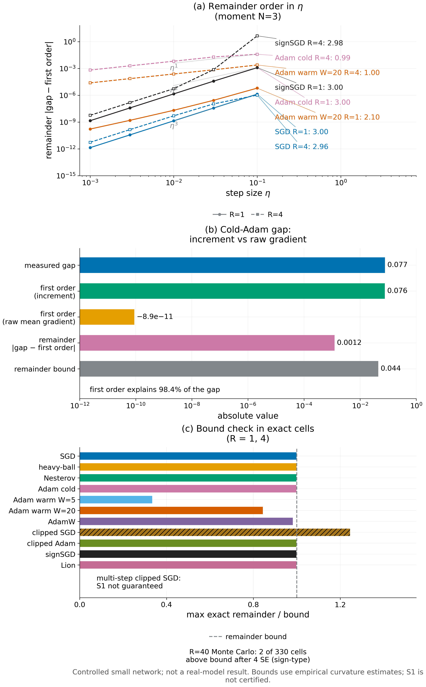

# Proposition 5.1 · optimizer 变换后的展开

*实验*

[← 框架总图](../README_ZH.md) · [陈述](../statements/05-01_optimizer_transformed_expansion_ZH.md) · [证明](../proofs/05-01_optimizer_transformed_expansion_ZH.md) · [实验](../experiments/05-01_optimizer_transformed_expansion_ZH.md) · [English](05-01_optimizer_transformed_expansion.md)

**本页检验什么.** 两项检验：用精确有理数计算检验展开式与一阶统计量的个数（[Check 5.1](../experiments/05-01_optimizer_transformed_expansion_ZH.md#c5-1)）；在受控网络中，对 11 种 optimizer 配置检验整个训练过程上的表示（[Check 5.2](../experiments/05-01_optimizer_transformed_expansion_ZH.md#c5-2)）。

**结论.**

- **Proposition 5.1（optimizer 变换后的展开）.**
  - 精确检验在 3,712 个实例上通过，残差为 0。在 140 个多项式 continuation value 上，阶数取 $`\deg V`$ 的展开全部等于真实差距；每个截断余项都在其界之内，余项与界的最大比值为 0.275。
  - 在受控网络里，每个光滑 optimizer 的精确单元格都落在余项界之内，最大比值 0.9986。这一组是诊断性的，状态为 INFO。
  - 完整状态上的一阶项预测了 `v014:C23` 中 cold Adam 的差距：预测 0.07568，实测 0.07691。原始平均梯度项只有 $`-8.9\times10^{-11}`$。

**本页用到的设定.**

下面重述本页用到的对象，以便单独阅读本页；一般记号见 [Definition 1.3–1.4](../README_ZH.md#s1-3)。

- **状态.** 完整 learner state 为 $`z=(\theta,o)\in\mathcal Z\subseteq\mathbb R^p\times\mathbb R^q`$。$`\theta`$ 是可训练参数（例如 LoRA adapter），$`o`$ 是 optimizer state（例如 Adam 的矩 $`m,v`$ 与步数计数器）。需要用到计数器时显式写出。
- **反馈与梯度.** 第 $`t`$ 轮，feedback law $`P_t(\cdot\mid z)`$ 给出消息 $`Y`$。学习器在 loss 归一化与累加之后计算 consumed gradient $`g=G_t(z,Y,\xi)\in\mathbb R^p`$，$`\xi`$ 是声明的更新随机性。若有裁剪，裁剪算作 optimizer 的一部分。
- **Optimizer.** optimizer 是一个可测的增量映射 $`z^+=z+\Delta_t(z,g)`$。被比较的 feedback law 共用同一个 optimizer 与同一个梯度映射，只在消息分布上不同。换一个 optimizer 就是换一个 $`\Delta`$，用同样的方式比较。
- **本节局部复用的字母.** 本节中 $`s`$ 表示 Adam 二阶矩已吸收的梯度计算次数（Proposition 5.8），与第 6 节的 agent 状态 $`s`$ 无关。裁剪阈值记为 $`c`$，weight decay 系数记为 $`\lambda_{\rm wd}`$。

分布 $`P`$ 的学习 kernel 为

```math
(K_t^Pf)(z)=\mathbb E_{Y\sim P_t(\cdot\mid z),\,\xi}\,f\big(z+\Delta_t(z,G_t(z,Y,\xi))\big).
```

对 $`(t,z)`$ 处的分布 $`P`$，消息层面的平均增量为 $`D_t(z,y)=\mathbb E_\xi\Delta_t(z,G_t(z,y,\xi))`$，并记

```math
\mu_t^P(z)=\mathbb E_{Y\sim P}D_t(z,Y),\qquad m_{k,t}^P(z)=\mathbb E_{Y\sim P,\,\xi}\lVert\Delta_t(z,G_t(z,Y,\xi))\rVert^k,\qquad \mathbb E_P\Delta^{\otimes j}=\mathbb E_{Y\sim P,\,\xi}\Delta_t(z,G_t(z,Y,\xi))^{\otimes j}.
```

- **Continuation value.** $`V^P_{t+1}:\mathcal Z\to[0,1]`$ 是协议 $`P`$ 的 continuation value：之后的更新都按 $`P`$ 进行，然后部署学生并用 $`F_E`$ 打分（[Definition 1.4](../README_ZH.md#s1-4)）。$`L(P)=\mathbb E\,F_E(Z_R^P)`$，$`d_t^Q`$ 是协议 $`Q`$ 下 $`Z_t`$ 的分布。
- **范数.** 在 $`\mathbb R^{p+q}`$ 上固定一个范数 $`\lVert\cdot\rVert`$，其对偶范数记为 $`\lVert\cdot\rVert_*`$。

**条件 $`(\mathrm S_k)`$（可达线段上光滑的 continuation value）.** 令 $`\mathcal S_{t,z}`$ 为 $`z`$ 与所有点 $`z+\Delta_t(z,g)`$ 的凸包，其中 $`g`$ 取遍被比较分布下 consumed gradient 的支撑。要求：

- $`V=V_{t+1}`$ 在 $`\mathcal S_{t,z}`$ 上属于 $`C^{k+1}`$；
- 对每个 $`w\in\mathcal S_{t,z}`$ 与每个 $`h`$，$`\lvert\nabla^{k+1}V(w)[h,\dots,h]\rvert\le M_{k+1}\lVert h\rVert^{k+1}`$；
- 矩 $`m^P_{k+1,t}(z)`$ 与 $`m^Q_{k+1,t}(z)`$ 有限。

**$`(\mathrm S_k)`$ 的适用范围.**

- 在裁剪或 sign 更新下，多步 continuation value 一般在这样的状态处不光滑：之后某步的梯度跨过裁剪阈值，或之后某步的更新符号翻转。此时 $`(\mathrm S_k)`$ 只在避开这些 kink 的区域成立，例如裁剪始终激活，或 momentum 主导每个符号的区域。
- 这些 optimizer 的平均增量在 Theorem 5.10 中精确算出，不需要任何光滑性。下面的余项界只在 $`(\mathrm S_k)`$ 成立处才声称成立。

**声明族.** 对 Proposition 5.1(c)，固定边界 $`(t,z)`$ 和一个 continuation value 的集合 $`\mathcal V`$，每个关心的部署任务与参考尾段对应其中一个；每个都在 $`\mathcal S_{t,z}`$ 上满足 $`(\mathrm S_1)`$，并共用 Hessian 界 $`M_2`$。令

```math
U=\mathrm{span}\lbrace \nabla V(z):V\in\mathcal V\rbrace ,\qquad \mathcal G^{(1)}_{t,z}=\lbrace\,y\mapsto\langle\nabla V(z),D_t(z,y)\rangle:\ V\in\mathcal V\,\rbrace .
```

$`\mathcal G^{(1)}_{t,z}`$ 称为一阶 response 类。

**状态标签.**

- `PASS` 表示实现的一致性断言全部通过。
- `INFO` 表示经验诊断：每个单元格单独标 PASS、FAIL 或 UNAVAILABLE，整组不作通过与否的判断。

除非另有说明，网络都是 `v014:C23` 的受控小网络：one-hot 上下文、4 个 tanh 单元、sigmoid 输出、平均 cross-entropy、float64。这些都不是真实模型。

**被检验的陈述（[Proposition 5.1](../statements/05-01_optimizer_transformed_expansion_ZH.md#s5-1)）.**

**(a) 单个边界，$`k`$ 阶.** 在 $`(\mathrm S_k)`$ 下，

```math
(K_t^P-K_t^Q)V(z)=\sum_{j=1}^{k}\frac1{j!}\Big\langle\nabla^jV(z),\;\mathbb E_P\Delta^{\otimes j}-\mathbb E_Q\Delta^{\otimes j}\Big\rangle+r_k,\qquad\lvert r_k\rvert\le\frac{M_{k+1}}{(k+1)!}\big(m_{k+1}^P+m_{k+1}^Q\big).
```

特别地，$`k=1`$ 时

```math
(K_t^P-K_t^Q)V(z)=\big\langle\nabla V(z),\mu_t^P(z)-\mu_t^Q(z)\big\rangle+r_1,\qquad\lvert r_1\rvert\le\tfrac{M_2}2\big(m_2^P+m_2^Q\big).
```

**(b) 整个训练过程.** 从相同的初始分布出发，比较协议 $`P`$ 与 $`Q`$ 的 $`R`$ 轮训练。设在 $`Q`$ 访问的每个状态上 $`(\mathrm S_1)`$ 成立，continuation value $`V^P_{t+1}`$ 的常数为 $`M_{2,t}(z)`$。则

```math
L(P)-L(Q)=\sum_{t=0}^{R-1}\mathbb E_{d_t^Q}\Big\langle\nabla V^P_{t+1}(Z_t),\;\mu_t^P(Z_t)-\mu_t^Q(Z_t)\Big\rangle+\mathcal E,\qquad\lvert\mathcal E\rvert\le\sum_t\mathbb E_{d_t^Q}\Big[\tfrac{M_{2,t}}2\big(m^P_{2,t}+m^Q_{2,t}\big)\Big].
```

因此，记 $`\Lambda_t(z)=\lVert\nabla V^P_{t+1}(z)\rVert_*`$，

```math
\lvert L(P)-L(Q)\rvert\le\min\Big\lbrace 1,\ \sum_t\mathbb E_{d_t^Q}\Big[\Lambda_t\,\lVert\mu_t^P-\mu_t^Q\rVert+\tfrac{M_{2,t}}2\big(m^P_{2,t}+m^Q_{2,t}\big)\Big]\Big\rbrace .
```

*停止版本.* 设 $`(\mathrm S_1)`$ 只在已认证的集合 $`C_t\subseteq\mathcal Z`$ 上成立。令 $`\tau=\min\lbrace t<R:Z_t^Q\notin C_t\rbrace`$（若不存在这样的 $`t`$ 则 $`\tau=R`$），$`\rho=\Pr(\tau<R)`$。则

```math
\lvert L(P)-L(Q)\rvert\le\mathbb E_Q\sum_{t<\tau}\Big[\Lambda_t\,\lVert\mu_t^P-\mu_t^Q\rVert+\tfrac{M_{2,t}}2\big(m^P_{2,t}+m^Q_{2,t}\big)\Big]\,(Z_t)+\rho.
```

**(c) 一阶的充分性、必要性与最小性.** 用 Euclid 内积，$`\Pi_U`$ 为到 $`U`$ 的正交投影。

- *充分性.* 若 $`\Pi_U(\mu^P-\mu^Q)=0`$，则对每个 $`V\in\mathcal V`$ 有 $`\lvert(K^P-K^Q)V(z)\rvert\le\tfrac{M_2}2(m_2^P+m_2^Q)`$。
- *必要性.* 若 $`\Pi_U(\mu^P-\mu^Q)\ne0`$，则存在 $`V\in\mathcal V`$ 使 $`\langle\nabla V(z),\mu^P-\mu^Q\rangle\ne0`$，且对每个这样的 $`V`$ 下式成立。所以只要一阶项超过余项界，这个任务就能察觉这一失配。

```math
\lvert(K^P-K^Q)V(z)\rvert\ge\big\lvert\langle\nabla V(z),\mu^P-\mu^Q\rangle\big\rvert-\tfrac{M_2}2(m_2^P+m_2^Q).
```

- *最小性.* 在大小为 $`m`$ 的有限消息字母表上，能对所有分布对决定每个一阶项 $`\langle\nabla V(z),\mu^P-\mu^Q\rangle`$（$`V\in\mathcal V`$）的线性期望统计量的最少个数为下式。

```math
d_0^{(1)}=\dim\mathrm{span}\big(\lbrace 1\rbrace \cup\mathcal G^{(1)}_{t,z}\big)-1\le\min\lbrace \dim U,\ m-1\rbrace .
```

**(d) 矩层级.** 在 $`(\mathrm S_k)`$ 下，设两个分布在某状态处对 $`j=1,\dots,k`$ 都有相同的 $`\mathbb E\Delta^{\otimes j}`$。则它们在该处的单边界差距至多为 $`\tfrac{M_{k+1}}{(k+1)!}(m_{k+1}^P+m_{k+1}^Q)`$。像 (b) 那样对访问到的状态求和，就得到整个训练过程差距的界。

- 对 SGD，$`\Delta=-\eta G`$，所以要匹配的是梯度矩 $`\mathbb E G^{\otimes j}`$，每轮的界为 $`O(\eta^{k+1})`$。
- 对 cold Adam，参数块要匹配的是 $`h_\epsilon(G)`$ 的矩（Proposition 5.3）；当 $`\epsilon\to0`$ 时就是联合符号矩。
- 在始终激活的裁剪下，参数块只涉及方向 $`G/\lVert G\rVert`$ 的矩。

| 检验 | 检验对象 | 代码编号 | 结果 |
|---|---|---|---|
| [Check 5.1](../experiments/05-01_optimizer_transformed_expansion_ZH.md#c5-1) | [Proposition 5.1](../statements/05-01_optimizer_transformed_expansion_ZH.md#s5-1)(a)、(c) | `v015:V8` | PASS |
| [Check 5.2](../experiments/05-01_optimizer_transformed_expansion_ZH.md#c5-2) | [Proposition 5.1](../statements/05-01_optimizer_transformed_expansion_ZH.md#s5-1)(b)、(d)；[Theorem 5.10](../statements/05-10_first_order_statistic_by_learner_ZH.md#s5-10)(d) | `v015:E10` | INFO（诊断）；所有光滑的精确单元格都在界内 |

<a id="c5-1"></a>

## Check 5.1 · 展开式与统计量个数的精确有限检验（Proposition 5.1(a)、(c)）

**结论.** 展开式在有理数运算下精确成立，每个截断余项都在其界之内。一阶统计量的个数也是精确的：少保留一个统计量，就总能找到一对特征一致、但一阶项不同的分布。共 3,712 个实例、4,978 条断言，最差残差为 0。

**动机.**

- [Proposition 5.1](../statements/05-01_optimizer_transformed_expansion_ZH.md#s5-1)(a) 是对两个分布积分后的 Taylor 恒等式。如果张量矩的记账、$`V(z)`$ 的抵消或余项常数有误，就会出现某个实例，其差距与截断展开之差超过界。
- (c) 断言投影后的平均增量恰好是最小的一阶统计量。如果计数有误，会出现两种情形之一：在所声称的维数下，有特征一致、但一阶项非零的分布对；或者有多余的统计量。

**设置.**

- *多项式.*
  - $`D=2,\dots,5`$，每个 $`D`$ 重复 35 次，次数在 $`1,\dots,4`$ 之间循环。
  - 系数取自 $`\lbrace -1,-2/3,\dots,1\rbrace`$，首项单项式系数为 1。
  - 每个实例有一个随机有理状态 $`z`$、六个有理增量，以及其上的两个随机分布 $`P,Q`$。
  - 全部使用精确运算（`Fraction`）。
- *余项常数.* $`M_{k+1}`$ 取包含 $`z`$ 与 $`z+\Delta`$ 的盒子上的系数和优函数。这是一个有理上界，不是拟合出来的常数。
- *Logistic.*
  - 在 $`\mathbb R^3`$ 上取 $`V=\sigma(q)`$，$`q(z)=\tfrac12z^\top Az+b^\top z`$，配六个增量和随机分布。
  - Hessian certificate 为 $`M_2=L^2/(6\sqrt3)+\lVert A\rVert_{\rm op}/4`$，其中 $`L=\max_{\rm vertices}\lVert Az+b\rVert_2`$。
  - 2,200 个随机实例，另加 12 次重启 × 100 步爬山搜索。
- *秩.*
  - 160 个面板，字母表大小 $`m\in\lbrace 4,\dots,9\rbrace`$，增量维数 $`D\in\lbrace 2,\dots,5\rbrace`$。
  - 增量是随机整数，梯度方向随机并张成 $`U`$。
  - 秩精确计算（SymPy），见证用 LP 求得（HiGHS）。
- 种子 `SeedSequence([150150, 8])`。

**做法.**

1. 对每个多项式，计算精确差距以及 $`j`$ 阶项 $`\langle\nabla^jV(z),\mathbb E_P\Delta^{\otimes j}-\mathbb E_Q\Delta^{\otimes j}\rangle/j!`$。
   - 断言 $`k=\deg V`$ 时这些项之和等于差距；
   - 断言对每个 $`k<\deg V`$，余项都在界之内。
2. 对 logistic 族，断言 $`\lvert\text{gap}-\text{first order}\rvert\le\tfrac{M_2}2(m_2^P+m_2^Q)`$，再用对抗搜索最大化这一比值。
3. 对每个秩面板：
   - 计算 $`d_0^{(1)}=\mathrm{rank}[\mathbf 1,\mathcal G^{(1)}]-1`$，并与中心化后的秩核对；
   - 断言 $`d_0^{(1)}\le\min\lbrace\dim U,m-1\rbrace`$；
   - 核对：落在已保留统计量零空间中的扰动，其 $`U`$ 投影为零，所有一阶项都不变；
   - 只保留 $`d_0^{(1)}-1`$ 个统计量，用 LP 求一对特征一致的分布，断言某个一阶项不同。

**结果**（`theory/v015_checks/results_v015_independent.json`，`v015:V8`）.

| 量 | 值 |
|---|---:|
| 状态 / 实例 / 断言 / 最差残差 | PASS / 3,712 / 4,978 / 0 |
| $`\deg V`$ 阶展开精确成立的多项式 | 140 / 140 |
| 在界内的截断余项 | 344 / 344；余项/界最大为 0.275 |
| logistic：$`\lvert\text{gap}-\text{first order}\rvert`$/界的最大值 | 0.183（差距 $`-0.0231`$，一阶项 $`-0.2307`$，界 1.137，$`M_2=0.823`$） |
| 满足 $`d_0^{(1)}\le\min\lbrace\dim U,m-1\rbrace`$ 的秩面板 | 160 / 160 |
| 保留 $`d_0^{(1)}-1`$ 个统计量时有 LP 见证的面板 | 158（其余 2 个 $`d_0^{(1)}=0`$）；最小的分离目标值 0.113 |

**为什么支持 Proposition 5.1.**

- (a) 与 (c) 都是有限的陈述，这里在精确运算下检验。
- 对一个光滑的非多项式 continuation value，余项界成立，并且留有余量。
- 统计量个数是最小的：去掉任何一个，都会剩下两个分布，它们在所有保留的统计量上一致，却在一阶上不同。

<a id="c5-2"></a>

## Check 5.2 · 受控网络中、跨 optimizer 的整段训练表示（Proposition 5.1(b)、(d)）

**结论.**

- 在整段训练上，两个反馈律之间的差距等于*完整状态增量*的一阶项，加上一个落在曲率界之内的余项。在 continuation value 光滑的每个精确单元格里都是如此，最大比值 0.9986。
- 在 `v014:C23` 的 cold Adam 单元格中，增量的一阶项解释了 98.4% 的差距；原始平均梯度项只有 $`-8.9\times10^{-11}`$。
- 余项的阶数符合 (d) 的矩层级。例外有两类：多轮 Adam，其二阶矩块使余项变成 $`\eta`$ 的一阶量；以及光滑性假设之外的单元格。

**动机.** 在真实网络里，这一表示可能以三种方式失效：

- 一阶项解释不了差距；
- 余项超过界；
- $`\eta\to0`$ 时余项不缩小。

本检验把三者都测一遍，并与使用原始平均梯度的朴素一阶项对比。

**设置.**

- *分布.* `v014:C23` 的标签分布：moment $`N=2,3,4`$ 与 parity $`N=2,3`$，它们在低于 $`N`$ 阶的标签矩上一致；另加在线性 logit 模型上实现的 clipped mean 见证。
- *11 种 optimizer.*
  - SGD；
  - heavy-ball 与 Nesterov（$`\beta=0.9`$）；
  - cold Adam（[Kingma & Ba, 2015](#ref-kingma2015adam)；$`\beta=(0.9,0.999)`$，$`\epsilon=10^{-8}`$，带 bias correction）；
  - 先做 $`W=5`$ 和 $`W=20`$ 步 lr = 0 moment warm-up 之后的 warm Adam；
  - AdamW（[Loshchilov & Hutter, 2019](#ref-loshchilov2019decoupled)；$`\lambda=0.01`$）；
  - clipped SGD 与 clipped Adam；
  - signSGD（[Bernstein et al., 2018](#ref-bernstein2018signsgd)）；
  - Lion（[Chen et al., 2023](#ref-chen2023symbolic)；$`\beta_1=0.9`$，$`\beta_2=0.99`$）。
- *裁剪阈值.*
  - 按任务选取，使被裁剪的概率质量最接近 50%。
  - 梯度范数相同时达不到 30%–70% 的区间：moment $`N=3`$、parity $`N=3`$ 为 25%。
- *网格.* $`\eta\in\lbrace 10^{-3},3\cdot10^{-3},10^{-2},3\cdot10^{-2},10^{-1}\rbrace`$，$`R\in\lbrace 1,4,40\rbrace`$，共 990 个单元格。
- 种子 `SeedSequence([150150, 110])`。

**做法.** 对每个单元格：

1. 计算差距 $`L(P)-L(Q)`$：
   - $`R=1,4`$ 时，完整枚举历史，精确计算；
   - $`R=40`$ 时，用独立运行估计，并给出标准误。
2. 在完整状态 $`(\theta,m,v)`$ 上计算一阶项 $`\sum_t\mathbb E_{d_t^Q}\langle\nabla V^P_{t+1}(Z_t),\mu^P_t-\mu^Q_t\rangle`$。
   - $`\nabla V^P`$ 由对精确枚举的 $`P`$-continuation 做 Richardson 外推的中心差分得到；
   - 同时记录微分误差。
3. 计算朴素项：把 optimizer 当作用当前 Adam 分母做预条件的 SGD，使用原始平均梯度。
4. 用采样和爬山搜索得到线段曲率，估计 $`M_2`$（观察到差距之后从不放大），并计算余项界。
5. 记录 $`\lvert\text{gap}-\text{first order}\rvert`$/界，以及关于 $`\eta`$ 的 log–log 斜率。

**结果 1：精确单元格中的界**（`v015:E10`，`data.optimizer_summary`、`data.cells`）.

| Optimizer | 精确单元格 | 精确比值最大值 | 超出界的精确单元格 |
|---|---:|---:|---:|
| SGD | 60 | 0.9986 | 0 |
| heavy-ball | 60 | 0.9984 | 0 |
| Nesterov | 60 | 0.9980 | 0 |
| cold Adam | 60 | 0.9981 | 0 |
| warm Adam，$`W=5`$ | 60 | 0.3339 | 0 |
| warm Adam，$`W=20`$ | 60 | 0.8432 | 0 |
| AdamW | 60 | 0.9817 | 0 |
| clipped Adam | 55 个有限（5 个导数非有限） | 0.9982 | 0 |
| signSGD | 60 | 0.9981 | 0 |
| Lion | 60 | 0.9981 | 0 |
| clipped SGD | 60 | 1.2453 | 1（多步裁剪 kink） |

**结果 2：`v014:C23` 中 cold Adam 的差距是增量的一阶效应**（`data.C23_prediction`；moment $`N=3`$，$`\eta=0.1`$，$`R=1`$）.

| 量 | 值 |
|---|---:|
| 实测差距 $`L(P)-L(Q)`$ | 0.076907 |
| 完整状态增量的一阶项 | 0.075683 |
| 朴素一阶项（原始平均梯度） | $`-8.87\times10^{-11}`$ |
| 余项 $`\lvert\text{gap}-\text{first order}\rvert`$ | 0.001225 |
| 余项界（$`\hat M_2=0.342`$） | 0.04447 |

- 两个标签分布均值相同，所以任何基于平均梯度的统计量都看不出它们的区别。cold Adam 的增量 $`-\eta h_\epsilon(G)`$ 却能区分它们（[Proposition 5.3](../statements/05-03_cold_start_adam_sign_quotient_ZH.md#s5-3)(a)）。这正是 [Theorem 5.10](../statements/05-10_first_order_statistic_by_learner_ZH.md#s5-10) 中 cold 步那一行 (d)。
- 在同一单元格中，signSGD 和 Lion 给出相同的差距与一阶项（0.07691 与 0.07568），因为它们的第一步是同一个符号映射。
- clipped SGD 的两个量都是 0.00303，而它的原始平均梯度项为 0。

**结果 3：余项的阶数**（$`\lvert\text{gap}-\text{first order}\rvert`$ 关于 $`\eta`$ 的 log–log 斜率，按任务列出；`data.optimizer_summary[*].slopes`；余项落在数值下限的单元格没有斜率）.

| Optimizer | $`R=1`$ | $`R=4`$ |
|---|---|---|
| SGD、heavy-ball、Nesterov | $`N=2`$ 与 clipped 见证上为 1.98–2.0；moment、parity $`N=3`$ 上为 3.0 | $`N=2`$ 与 clipped 见证上为 1.95–1.99；$`N=3`$ 上为 2.91–2.99；Nesterov 在 moment $`N=4`$ 上为 3.98 |
| clipped SGD、signSGD、Lion | 2.0；$`N=3`$ 上为 3.0 | 2.0–2.09；$`N=3`$ 上为 2.71–3.01 |
| cold Adam | 2.0–3.0 | 0.99（moment $`N=3`$）、1.0（clipped 见证）；其余任务 1.96–2.98 |
| AdamW | 2.0–3.0 | 0.99（moment $`N=3`$）、1.31（moment $`N=4`$）、1.0（clipped 见证）；其余任务 1.98–2.98 |
| clipped Adam | 2.0–3.0 | 0.91（moment $`N=3`$）、1.04（clipped 见证）；其余任务 2.0–2.93 |
| warm Adam，$`W=5`$ | 1.99–2.98 | 1.11–1.17（moment $`N=2,3,4`$）、1.0（clipped 见证）；2.03 与 2.92（parity） |
| warm Adam，$`W=20`$ | 2.0–3.0 | 1.0（moment $`N=3`$）、1.16（moment $`N=4`$）、1.0（clipped 见证）；3.04（moment $`N=2`$）、1.99 与 3.0（parity） |

**结果 4：多轮 Adam 的差距中一阶项占多少**（moment $`N=3`$，$`R=4`$；`data.cells`）.

| Optimizer | $`\eta=10^{-3}`$：差距 / 一阶项 | $`\eta=10^{-1}`$：差距 / 一阶项 | $`\eta=10^{-3}`$ 时的余项绝对值 |
|---|---|---|---:|
| cold Adam | $`1.90\times10^{-3}`$ / $`1.24\times10^{-3}`$ | 0.1196 / 0.0810 | $`6.6\times10^{-4}`$ |
| warm Adam，$`W=5`$ | $`4.38\times10^{-4}`$ / $`2.22\times10^{-4}`$ | 0.0663 / 0.0365 | $`2.2\times10^{-4}`$ |
| warm Adam，$`W=20`$ | $`4.44\times10^{-5}`$ / $`2.01\times10^{-5}`$ | 0.0044 / 0.0020 | $`2.4\times10^{-5}`$ |
| clipped SGD | $`1.21\times10^{-4}`$ / $`1.21\times10^{-4}`$ | 0.0115 / 0.0115 | $`2.2\times10^{-11}`$ |

**结果 5：光滑性假设的边界.**

| 位置 | 现象 |
|---|---|
| clipped SGD，clipped 见证，$`\eta=0.1`$，$`R=4`$ | 唯一超出界的精确单元格：比值 1.245（差距 0.04476，一阶项 0.04637，界 0.00129）。后续的裁剪判断使 continuation value 不光滑，Proposition 5.1 的光滑性假设不成立。 |
| $`R=40`$（330 个 Monte Carlo 单元格） | 不计标准误时，25 个单元格超出点估计的界；计入四个标准误后仍有 2 个，都是 sign 类：signSGD 在 moment $`N=4`$、$`\eta=0.01`$，以及 Lion 在 clipped 见证、$`\eta=10^{-3}`$。 |
| clipped Adam，moment $`N=4`$ | 10 个单元格在 cold 状态的零梯度坐标上中心差分非有限，记为不可用。 |



*Figure 5.1.*

- (A) 对 SGD 和 sign 类 optimizer，一阶表示的余项按 $`\eta^2`$ 缩小；两阶增量矩一致时按 $`\eta^3`$ 缩小。多轮 Adam 的余项只按 $`\eta`$ 缩小。
- (B) 在 cold Adam 单元格里，optimizer 增量的一阶项解释了差距，原始平均梯度则完全看不出差别。
- (C) 在光滑性假设成立的每个精确单元格中，差距减去一阶项都在余项界之内。唯一的超出是多步 clipped SGD。

[PDF](../figures/fig5_1_linear_response.pdf)

**为什么支持 Proposition 5.1.**

- 只要 continuation value 光滑，差距就等于 optimizer 增量的一阶项，加上一个在所述界之内的余项。
- 增量才是正确的对象。对均值相同的两个分布，原始平均梯度什么也预测不了，增量却预测出 cold Adam 差距的 98%。
- 余项的阶数符合 (d) 的矩层级：
  - SGD、momentum、clipping 与 sign 类 optimizer 为 $`O(\eta^2)`$；
  - 两阶增量矩一致时为 $`O(\eta^3)`$。
- 对多轮的 Adam 类 optimizer，余项是 $`\eta`$ 的一阶量，来源是 [Theorem 7.1](../statements/07-01_state_channel_decomposition_ZH.md#s7-1) 中的二阶矩通道。此时在 moment 任务上，一阶项只占差距的 45%–68%；从 cold 状态到 $`W=20`$ 步 warm-up，余项绝对值下降 27 倍。
  - 所以一阶排序必须满足 [Corollary 8.9](../statements/08-09_first_order_version_margin_criterion_ZH.md#s8-9) 的 margin 条件；二阶矩通道占主导时，要改用有限替换测量（[Theorem 8.8](../statements/08-08_crn_paired_replacement_certificate_ZH.md#s8-8)）。
- 超出界的单元格全部落在光滑性假设之外：多步 clipped SGD，以及 sign 类 optimizer 的 Monte Carlo 单元格。

## 复现

```bash
CUDA_VISIBLE_DEVICES='' theory/.venv/bin/python theory/v015_checks/check_v015.py --only V8,E10,V2,V3,V4,E0,E1,E2,E3,E8,E11 --output theory/v015_checks/quick/s5.json
CUDA_VISIBLE_DEVICES='' theory/.venv/bin/python theory/v016_checks/check_v016.py --only C1 --output /tmp/s5_c1.json
CUDA_VISIBLE_DEVICES='' theory/.venv/bin/python theory/independent_checks/check_v014_independent.py --only C23 --output /tmp/s5_c23.json
CUDA_VISIBLE_DEVICES='' theory/.venv/bin/python docs/direction/v015_revision/verify_v015_extensions.py   # package checks T01–T13
```

这些检查使用 NumPy（[Harris et al., 2020](#ref-harris2020array)）与 SciPy（[Virtanen et al., 2020](#ref-virtanen2020scipy)）。`v015:V2` 与 `v015:V8` 中的线性规划由 `scipy.optimize.linprog` 调用 HiGHS solver（[Huangfu & Hall, 2018](#ref-huangfu2018parallelizing)）求解。

## 产物

- `theory/v015_checks/results_v015_independent.json`：
  - `v015:V8`，以及 `v015:E10`（逐单元格记录在 `data.cells`，汇总在 `data.optimizer_summary`，cold Adam 单元格在 `data.C23_prediction`，设计在 `data.design`）；
  - `v015:V2`、`v015:V3`、`v015:V4`、`v015:E0`、`v015:E1`、`v015:E2`、`v015:E3`；
  - `v015:E8`：冻结分母、warm 仿射、cold 分离与 warmth 轨迹四个部分（最后一部分含 `per_step` 与 `fits`），以及 210 个 `data.gaps` 单元格；
  - `v015:E11`（`data.clipped_mean`、`data.always_active`、`data.warm_Adam`、`data.Lion`、`data.LoRA`）。
- `theory/v015_checks/c23_bundle.json`：精确分布、网络、optimizer 代码，以及每条历史的原始更新。
- `theory/v015_checks/raw/E8_trajectories.npz`：逐副本的 warmth 轨迹。它被 gitignore，由上面第一条命令重新生成；SHA-256 记录在 `v015:E8` warmth 轨迹部分的 `raw_sha256` 中。
- `theory/v016_checks/results_v016.json`：claim 为 `v016:C1.exact`、`v016:C1.moments`、`v016:C1.accumulation`。完整数组在 `theory/v016_checks/results_v016_raw.json.gz` 中，该文件被 gitignore，SHA-256 记录在 `raw_artifact`。
- `theory/independent_checks/results_independent_v014.json`：`controlled_neural`。
- `docs/direction/v015_revision/results_v015.json`：package checks `pkg:T03`–`pkg:T08`。
- 代码：
  - `theory/v015_checks/otlr.py`（`check_V8`、`check_E10`、`check_E11`）；
  - `theory/v015_checks/warmth.py`（`check_E8`）；
  - `theory/v016_checks/check_v016.py`（`v016:C1`）；
  - 说明在 `theory/v015_checks/README.md` 与 `theory/v016_checks/SPEC.md`。
- 图：`../figures/fig5_1_linear_response`、`fig5_2_cold_adam`、`fig5_3_warmth`、`fig5_4_learner_statistics`，各有 `.pdf` 与 `.png`；说明在 `../figures/specs/fig5_1.md` 至 `fig5_4.md`。
