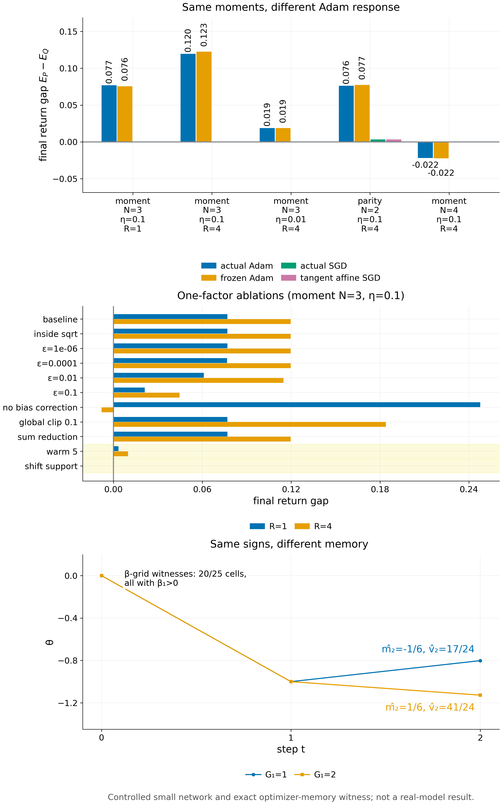

# Proposition 5.3 · Cold-start Adam：符号商与 optimizer 记忆

*实验*

[← 框架总图](../README_ZH.md) · [陈述](../statements/05-03_cold_start_adam_sign_quotient_ZH.md) · [证明](../proofs/05-03_cold_start_adam_sign_quotient_ZH.md) · [实验](../experiments/05-03_cold_start_adam_sign_quotient_ZH.md) · [English](05-03_cold_start_adam_sign_quotient.md)

**本页检验什么.** 五项检验：在随机字母表上检验 cold 映射与精确的商空间维数（[Check 5.3](../experiments/05-03_cold_start_adam_sign_quotient_ZH.md#c5-3)）；margin 误差界（[Check 5.4](../experiments/05-03_cold_start_adam_sign_quotient_ZH.md#c5-4)）；optimizer 记忆的反例（[Check 5.5](../experiments/05-03_cold_start_adam_sign_quotient_ZH.md#c5-5)）；以及两项受控网络检验，说明矩相同的分布之间的 Adam 差距是 cold-start 的符号效应，而不是特征学习（[Check 5.6](../experiments/05-03_cold_start_adam_sign_quotient_ZH.md#c5-6)、[5.7](../experiments/05-03_cold_start_adam_sign_quotient_ZH.md#c5-7)）。

**结论.**

- **Proposition 5.3（cold-start Adam）.** 五个部分全部被精确确认。
  - 在 300 个字母表上，商空间维数都是 $`s-1`$ 与 $`m-1`$。
  - margin 界被逼近到 0.994。
  - optimizer 记忆的见证对所有测试过的 $`\epsilon`$ 都给出方向相反的第二步；在 $`\beta_1>0`$ 的每个 $`(\beta_1,\beta_2)`$ 格点上都存在。
  - 在受控网络里，梯度矩相同的两个分布之间的 Adam 差距在冻结 Jacobian 后依然存在；消除符号分歧后，差距消失。

**本页用到的设定.**

下面重述本页用到的对象，以便单独阅读本页；一般记号见 [Definition 1.3–1.4](../README_ZH.md#s1-3)。

- **状态.** 完整 learner state 为 $`z=(\theta,o)\in\mathcal Z\subseteq\mathbb R^p\times\mathbb R^q`$。$`\theta`$ 是可训练参数（例如 LoRA adapter），$`o`$ 是 optimizer state（例如 Adam 的矩 $`m,v`$ 与步数计数器）。需要用到计数器时显式写出。
- **反馈与梯度.** 第 $`t`$ 轮，feedback law $`P_t(\cdot\mid z)`$ 给出消息 $`Y`$。学习器在 loss 归一化与累加之后计算 consumed gradient $`g=G_t(z,Y,\xi)\in\mathbb R^p`$，$`\xi`$ 是声明的更新随机性。若有裁剪，裁剪算作 optimizer 的一部分。
- **Optimizer.** optimizer 是一个可测的增量映射 $`z^+=z+\Delta_t(z,g)`$。被比较的 feedback law 共用同一个 optimizer 与同一个梯度映射，只在消息分布上不同。换一个 optimizer 就是换一个 $`\Delta`$，用同样的方式比较。
- **本节局部复用的字母.** 本节中 $`s`$ 表示 Adam 二阶矩已吸收的梯度计算次数（Proposition 5.8），与第 6 节的 agent 状态 $`s`$ 无关。裁剪阈值记为 $`c`$，weight decay 系数记为 $`\lambda_{\rm wd}`$。

分布 $`P`$ 的学习 kernel 为

```math
(K_t^Pf)(z)=\mathbb E_{Y\sim P_t(\cdot\mid z),\,\xi}\,f\big(z+\Delta_t(z,G_t(z,Y,\xi))\big).
```

对 $`(t,z)`$ 处的分布 $`P`$，消息层面的平均增量为 $`D_t(z,y)=\mathbb E_\xi\Delta_t(z,G_t(z,y,\xi))`$，并记

```math
\mu_t^P(z)=\mathbb E_{Y\sim P}D_t(z,Y),\qquad m_{k,t}^P(z)=\mathbb E_{Y\sim P,\,\xi}\lVert\Delta_t(z,G_t(z,Y,\xi))\rVert^k,\qquad \mathbb E_P\Delta^{\otimes j}=\mathbb E_{Y\sim P,\,\xi}\Delta_t(z,G_t(z,Y,\xi))^{\otimes j}.
```

- **Continuation value.** $`V^P_{t+1}:\mathcal Z\to[0,1]`$ 是协议 $`P`$ 的 continuation value：之后的更新都按 $`P`$ 进行，然后部署学生并用 $`F_E`$ 打分（[Definition 1.4](../README_ZH.md#s1-4)）。$`L(P)=\mathbb E\,F_E(Z_R^P)`$，$`d_t^Q`$ 是协议 $`Q`$ 下 $`Z_t`$ 的分布。
- **范数.** 在 $`\mathbb R^{p+q}`$ 上固定一个范数 $`\lVert\cdot\rVert`$，其对偶范数记为 $`\lVert\cdot\rVert_*`$。

**Adam 与 AdamW.** Adam 带 bias correction，$`\epsilon`$ 在根号外，可选 decoupled weight decay（AdamW），不用 AMSGrad。计数器为 $`t\ge1`$ 的一次更新作用在 $`z=(\theta,m,v,t-1)`$ 与 consumed gradient $`G\in\mathbb R^p`$ 上。逐坐标地，

```math
m^+=\beta_1m+(1-\beta_1)G,\qquad v^+=\beta_2v+(1-\beta_2)G^{\odot2},\qquad n=\frac{m^+}{1-\beta_1^{\,t}},\qquad d=\sqrt{\frac{v^+}{1-\beta_2^{\,t}}},
```

```math
\theta^+=(1-\eta\lambda_{\rm wd})\theta-\eta\,\frac{n}{d+\epsilon}.
```

- 超参数满足 $`\beta_1\in[0,1)`$，$`\beta_2\in(0,1)`$，$`\eta>0`$，$`\lambda_{\rm wd}\ge0`$，$`\epsilon\ge0`$。运算都是精确实数运算。
- 下一个完整状态为 $`z^+=(\theta^+,m^+,v^+,t)`$。
- *cold* 状态指 $`m=v=0`$ 且 $`t=1`$；*warm* 状态指对每个坐标 $`i`$ 有 $`v_i>0`$。

**符号映射.** 对 $`\epsilon>0`$，$`h_\epsilon(g)_i=g_i/(\lvert g_i\rvert+\epsilon)`$。对 $`\epsilon=0`$，*理想符号更新*为 $`h_0(g)_i=\mathrm{sign}(g_i)`$，约定 $`\mathrm{sign}(0)=0`$。这个约定是定义的一部分；字面上的浮点 Adam 在 $`\epsilon=0`$ 时会算出 $`0/0`$。

**效用.** *即时参数效用*是 $`\theta_1`$ 的有界可测函数；*完整状态效用*是下一个完整状态 $`(\theta_1,m_1,v_1,1)`$ 的有界可测函数。consumed gradient 的分布 $`P,Q`$ 是 $`\mathbb R^p`$ 上的概率分布；在有限情形的陈述中，它们支撑在有限字母表 $`\mathcal A=\lbrace g^{(1)},\dots,g^{(m)}\rbrace`$ 上。记 $`\bar\theta=(1-\eta\lambda_{\rm wd})\theta_0`$。

**状态标签.**

- `PASS` 表示实现的一致性断言全部通过。
- `INFO` 表示经验诊断：每个单元格单独标 PASS、FAIL 或 UNAVAILABLE，整组不作通过与否的判断。

除非另有说明，网络都是 `v014:C23` 的受控小网络：one-hot 上下文、4 个 tanh 单元、sigmoid 输出、平均 cross-entropy、float64。这些都不是真实模型。

**被检验的陈述（[Proposition 5.3](../statements/05-03_cold_start_adam_sign_quotient_ZH.md#s5-3)）.** 从 cold 状态 $`(\theta_0,0,0,0)`$ 启动 Adam。

- **(a) 第一步.** $`\theta_1=\bar\theta-\eta\,h_\epsilon(G)`$。
- **(b) $`\epsilon=0`$：联合符号分布.** 两个分布对所有即时参数效用给出相同期望，当且仅当它们的联合符号向量分布相同。在有 $`s`$ 个可达符号模式的有限字母表上，对 $`\mathcal A`$ 上不受限的分布，足以决定所有这类效用的线性期望统计量最少为 $`s-1`$ 个；这里 $`s\le3^p`$，没有零坐标时 $`s\le2^p`$。逐坐标的符号边缘分布不够：取 $`p=2`$，$`P`$ 在 $`\lbrace (1,1),(-1,-1)\rbrace`$ 上均匀，$`Q`$ 在 $`\lbrace (1,-1),(-1,1)\rbrace`$ 上均匀。每个坐标的符号边缘分布相同，两者的平均步长都是 $`0`$，但效用 $`F(\theta)=1\lbrace (\theta_1-\bar\theta_1)(\theta_2-\bar\theta_2)>0\rbrace`$ 在 $`P`$ 下期望为 $`1`$，在 $`Q`$ 下为 $`0`$。
- **(c) $`\epsilon>0`$：完整分布.** $`h_\epsilon`$ 是逐坐标的双射 $`\mathbb R\to(-1,1)`$，其逆与导数如下。所以对所有即时参数效用相等，等价于 consumed gradient 的完整分布相等。在 $`\mathcal A`$ 上最少需要 $`m-1`$ 个统计量。

```math
h_\epsilon^{-1}(u)_i=\frac{\epsilon u_i}{1-\lvert u_i\rvert},\qquad\frac{d}{du}h_\epsilon^{-1}(u)=\frac{\epsilon}{(1-\lvert u\rvert)^2}.
```

**(d) 对 margin 敏感的近似.** 设 $`F:\mathbb R^p\to[0,1]`$ 对所有 $`u=\bar\theta-\eta h_\epsilon(g)`$、$`w=\bar\theta-\eta h_0(g)`$（$`g`$ 属于支撑）满足 $`\lvert F(u)-F(w)\rvert\le\sum_iL_i\lvert u_i-w_i\rvert`$。对 $`a>0`$ 记 $`\beta_{P,i}(a)=P(0<\lvert G_i\rvert<a)`$，并令 $`\Delta_{\rm sign}(F)=\lvert\mathbb E_PF(\bar\theta-\eta h_0(G))-\mathbb E_QF(\bar\theta-\eta h_0(G))\rvert`$。则 $`\Delta_{\rm sign}(F)\le\mathrm{TV}(P_{\rm sign},Q_{\rm sign})`$，且

```math
\big\lvert\mathbb E_PF(\bar\theta-\eta h_\epsilon(G))-\mathbb E_QF(\bar\theta-\eta h_\epsilon(G))\big\rvert\le\Delta_{\rm sign}(F)+\eta\sum_iL_i\Big[\beta_{P,i}(a)+\beta_{Q,i}(a)+\frac{2\epsilon}{a+\epsilon}\Big].
```

**(e) 保留下来的 optimizer state.** 当 $`\beta_1<1`$ 时，第一个完整状态中含有 $`m_1=(1-\beta_1)G`$，它是 $`G`$ 的单射函数。

- *反例.* 取一维，$`\beta_1=\beta_2=\tfrac12`$，$`\lambda_{\rm wd}=0`$，$`\epsilon=0`$，$`\eta>0`$，cold 启动。比较梯度历史 $`(G_1,G_2)=(1,-\tfrac34)`$ 与 $`(G_1',G_2')=(2,-\tfrac34)`$。两者都给出 $`\theta_1=\theta_1'=\theta_0-\eta`$，符号历史都是 $`(+,-)`$。第 2 步的 bias-corrected 矩为 $`\widehat m_2=-\tfrac16`$、$`\widehat m_2'=+\tfrac16`$，以及 $`\widehat v_2=\tfrac{17}{24}`$、$`\widehat v_2'=\tfrac{41}{24}`$，所以下面的第二步方向相反。有界检验 $`F(\theta)=1\lbrace \theta>\theta_1\rbrace`$ 把两段历史分开，差为 $`1`$。这两段历史可以由平方损失 $`\tfrac12(\theta-a)^2`$ 在 $`\theta_0=0`$ 处实现：第一步目标为 $`a=-1`$ 与 $`a=-2`$，第二步取共同目标 $`a=\theta_1+\tfrac34`$。

```math
\theta_2=\theta_1+\frac{\eta}{6\sqrt{17/24}},\qquad\theta_2'=\theta_1-\frac{\eta}{6\sqrt{41/24}}.
```

- *记忆由 momentum 携带.* 若 $`\beta_1=0`$，任意两段 $`G_2`$ 符号相同的历史，第二步方向都相同，这类反例不存在；对每个 $`\beta_1\in(0,1)`$，这类反例都存在。

| 检验 | 检验对象 | 代码编号 | 结果 |
|---|---|---|---|
| [Check 5.3](../experiments/05-03_cold_start_adam_sign_quotient_ZH.md#c5-3) | [Proposition 5.3](../statements/05-03_cold_start_adam_sign_quotient_ZH.md#s5-3)(a)–(c) | `v015:V2`、`pkg:T03`–`pkg:T06` | PASS |
| [Check 5.4](../experiments/05-03_cold_start_adam_sign_quotient_ZH.md#c5-4) | [Proposition 5.3](../statements/05-03_cold_start_adam_sign_quotient_ZH.md#s5-3)(d) | `v015:V3`、`pkg:T07` | PASS |
| [Check 5.5](../experiments/05-03_cold_start_adam_sign_quotient_ZH.md#c5-5) | [Proposition 5.3](../statements/05-03_cold_start_adam_sign_quotient_ZH.md#s5-3)(e) | `v015:V4`、`v015:E3`、`pkg:T08` | PASS |
| [Check 5.6](../experiments/05-03_cold_start_adam_sign_quotient_ZH.md#c5-6) | 网络中的 [Proposition 5.3](../statements/05-03_cold_start_adam_sign_quotient_ZH.md#s5-3)(a)–(c) | `v015:E0`、`v015:E1` | PASS |
| [Check 5.7](../experiments/05-03_cold_start_adam_sign_quotient_ZH.md#c5-7) | [Proposition 5.3](../statements/05-03_cold_start_adam_sign_quotient_ZH.md#s5-3)：optimizer 效应还是特征学习 | `v015:E2`、`v014:C23`（Adam 设定） | INFO；冻结 Jacobian 后，45 个单元格中 39 个差距仍在 |

<a id="c5-3"></a>

## Check 5.3 · Cold 映射、商空间的精确维数与逆映射的条件数（Proposition 5.3(a)–(c)）

**结论.** 在 300 个随机有限梯度字母表上：

- cold Adam 的一步与 $`c-\eta h_\epsilon(G)`$ 相差不超过 $`4.4\times10^{-16}`$；
- $`\epsilon=0`$ 时恰好需要且只需要 $`s-1`$ 个统计量，$`\epsilon>0`$ 时为 $`m-1`$ 个；
- 逆映射的导数可达 $`10^{22}`$。

**动机.** [Proposition 5.3](../statements/05-03_cold_start_adam_sign_quotient_ZH.md#s5-3)(a)–(c) 给出三个断言，每一个都是可以精确核对的有限陈述：

- 第一步的精确公式；
- $`\epsilon=0`$ 时，立即参数所含的信息是联合符号分布（维数 $`s-1`$）；$`\epsilon>0`$ 时是完整分布（维数 $`m-1`$）；
- 逐坐标的符号边缘分布不够。

**设置.**

- 300 个随机有限梯度字母表，坐标数 $`p=1,\dots,4`$，包含零坐标。
- 对 (a) 使用独立的递推实现，用 float64 核对；平方根精确时也用精确有理数核对。
- 秩与零空间精确计算。特征少于 $`s-1`$ 个时，用 HiGHS LP 构造被分开的分布。
- 在 $`u\to1`$ 的网格上做逆映射往返，$`\epsilon=1/100`$。

**做法.**

- 把第一步与 $`c-\eta h_\epsilon(G)`$ 比较。
- 统计可达的符号模式数 $`s`$，核对 $`s-1`$ 个模式指示量已经足够。
- 对任何更小的特征集，给出一个零质量扰动，以及它分开的两个分布。
- 在 $`\epsilon>0`$ 下重复，维数变为 $`m-1`$。
- 计算联合分布与边缘分布的对照例子。

**结果**（`v015:V2`）.

| 量 | 值 |
|---|---|
| 状态、实例、断言、最差残差 | PASS、300、3,288、$`4.44\times10^{-16}`$ |
| $`\epsilon=0`$ 时商空间维数 $`=s-1`$ | 300/300 个字母表（1 至 14 个原子，$`s`$ 从 1 到 14） |
| $`\epsilon>0`$ 时维数 $`=m-1`$ | 300/300 |
| 分离的例子（`quotients[0]`） | 4 个原子、4 个模式、2 个特征：$`P=(\tfrac14,\tfrac18,\tfrac38,\tfrac14)`$ 与 $`Q=(\tfrac14,\tfrac38,\tfrac18,\tfrac14)`$ 在两个特征上一致，模式指示量却相差 $`-\tfrac14`$ |
| 逆映射的导数，$`\epsilon=1/100`$ | $`u=0.9`$：1；$`u=0.999`$：$`10^4`$；$`u=1-10^{-12}`$：$`10^{22}`$ |
| 联合与边缘 | 边缘分布相同；同号效用 1 对 0 |

另一套独立实现的检验（`docs/direction/v015_revision/results_v015.json`，`checks`），全部 PASS：

- `pkg:T03`：480 个情形，更新误差 $`\le2.22\times10^{-16}`$。
- `pkg:T04`：25 个原子、9 个符号模式，统计量维数 8 与 24。
- `pkg:T05`：平均更新相同，同号效用差 1.0。
- `pkg:T06`：在 0–2 阶上一致的两个标签分布。SGD 的平均参数差为 0，理想符号 Adam 的差为 $`1/10`$，有限 $`\epsilon`$ 时为 $`250/2703`$。

**为什么支持 Proposition 5.3(a)–(c).**

- cold Adam 一步的精确信息内容：$`\epsilon=0`$ 时是联合符号商，$`\epsilon>0`$ 时是完整的梯度分布；个数恰为 $`s-1`$ 与 $`m-1`$。
- $`\epsilon>0`$ 时逆映射存在，但条件数极差，所以实际上幅度信息几乎看不见。
- `pkg:T06` 在均值层面给出同样的结论：SGD 在一阶上分不开的两个分布，Adam 能分开。

<a id="c5-4"></a>

## Check 5.4 · 对 margin 敏感的近似（Proposition 5.3(d)）

**结论.** margin 界在 1,660 个精确实例上成立。对抗搜索得到的差距/界最大为 0.994，界几乎是紧的。

**动机.** (d) 刻画了：对正则的效用，符号商在什么时候是好的*近似*描述。它连接两件事：精确陈述（任何 $`\epsilon>0`$ 都能识别幅度），以及实际情形。

**设置.**

- 随机的有限梯度分布 $`P,Q`$。
- 逐坐标 Lipschitz 的效用 $`F\in[0,1]`$：由已知 $`L_i`$ 的分段线性坐标函数求和再截断得到。
- 随机的 margin $`a`$ 与随机的 $`\epsilon`$。
- 全程精确有理数运算。
- 对 $`(G,P,Q,L,a,\epsilon,\eta)`$ 做带重启的对抗爬山搜索。

**做法.** 在每个实例上断言 margin 界成立，且 $`\Delta_{\rm sign}\le\mathrm{TV}(P_{\rm sign},Q_{\rm sign})`$；然后最大化差距/界。

**结果**（`v015:V3`）.

| 量 | 值 |
|---|---|
| 状态、实例、断言、最差残差 | PASS、1,660、3,320、0 |
| 差距/界最大值，对抗搜索 | 0.9941 |
| 差距/界最大值，随机 | 0.837 |
| 找到的最大 $`\Delta_{\rm sign}/\mathrm{TV}`$ | 0.274 |

`pkg:T07`：1,500 个实例，差距/界最大 0.739，没有违反。

**为什么支持 Proposition 5.3(d).** 界成立，并且几乎被达到。对正则效用，符号商是准确的，误差只来自两项：接近零的梯度质量，以及 $`\epsilon/(a+\epsilon)`$ 项。

<a id="c5-5"></a>

## Check 5.5 · 携带幅度的 optimizer 记忆（Proposition 5.3(e)）

**结论.** 见证是精确的：

- $`\widehat m_2=\mp\tfrac16`$，$`\widehat v_2=\tfrac{17}{24},\tfrac{41}{24}`$，所以两条历史的第二步方向相反。
- $`\epsilon`$ 从 0 到 $`10^{-1}`$ 都保持相反。
- 在 $`\beta_1>0`$ 的每个 $`(\beta_1,\beta_2)`$ 格点上都存在，在 $`\beta_1=0`$ 的格点上都不存在。

同一对历史在网络的 optimizer 代码中复现，网络中也找到了见证。

**动机.** (e) 断言：只匹配第一步的参数信息，对一段学习 continuation 并不够，因为 $`m_1`$ 保留了幅度。要让这个反例有说服力，它必须是精确的、能由真实损失实现、对 $`\epsilon`$ 稳健，并且出现在实际的 optimizer 代码里。

**设置.**

- *精确部分（`v015:V4`）.*
  - 用 Fraction 与符号运算计算梯度历史 $`(1,-\tfrac34)`$ 与 $`(2,-\tfrac34)`$，$`\beta_1=\beta_2=\tfrac12`$。
  - 平方损失的实现。
  - $`\epsilon\in\lbrace 0,10^{-1},\dots,10^{-12}\rbrace`$。
  - $`5\times5`$ 网格 $`\beta_1,\beta_2\in\lbrace 0,\tfrac1{10},\tfrac12,\tfrac9{10},\dots\rbrace`$，每格搜索 300 次。
- *网络部分（`v015:E3`）.*
  - 同一对历史经过 [Check 5.6](../experiments/05-03_cold_start_adam_sign_quotient_ZH.md#c5-6)–[5.7](../experiments/05-03_cold_start_adam_sign_quotient_ZH.md#c5-7) 所用的标量 optimizer，$`\epsilon=0`$ 与 $`10^{-8}`$。
  - 用软标签搜索：符号历史相同、第二步更新相反的情形。

**做法.**

- 计算所有矩与两个第二步，核对两步符号相反。
- 在网络中搜索标签对 $`(y_1,y_2)`$ 与 $`(y_1',y_2)`$：第一步相同，第二步在某个坐标上相反。

**结果**（`v015:V4`、`v015:E3`）.

| 量 | 值 |
|---|---|
| `v015:V4` 状态、实例 | PASS、39 |
| 精确矩 | $`m_2=-\tfrac18,+\tfrac18`$；$`\widehat m_2=-\tfrac16,+\tfrac16`$；$`\widehat v_2=\tfrac{17}{24},\tfrac{41}{24}`$ |
| $`\eta=1`$ 时的第二步 | $`+\sqrt{102}/51=+0.198`$ 与 $`-\sqrt{246}/123=-0.128`$ |
| 平方损失的实现 | 第一步目标 $`-1`$ 与 $`-2`$；第二步共同目标 $`-\tfrac14`$ |
| 正 $`\epsilon`$ 下方向相反 | 从 $`0`$ 到 $`10^{-1}`$ 的全部 14 个取值 |
| 有见证的 $`\beta`$ 格点 | 20/25：所有 $`\beta_1>0`$ 的格点，$`\beta_1=0`$ 的格点一个也没有 |
| `v015:E3` 标量轨迹，$`\epsilon=0`$ 与 $`10^{-8}`$ | 第二步更新 $`+0.19803`$ 与 $`-0.12752`$ |
| `v015:E3` 网络见证 | 在 $`\epsilon=0`$ 与 $`10^{-8}`$ 下都找到：标签 $`(0,0.7)`$ 与 $`(0.1,0.7)`$ 的第一步相同，第二步在输出偏置上方向相反 |

`pkg:T08`：第一步输出相同，符号历史相同。$`\eta=0.1`$ 时第二步增量为 $`+0.019803`$ 与 $`-0.012752`$，阈值任务的差距为 1。

**为什么支持 Proposition 5.3(e).**

- 反例是精确的、可实现的、对 $`\epsilon`$ 稳健，并且出现在真实网络中。
- $`\beta`$ 网格把机制分离了出来：幅度记忆由一阶矩 $`m`$ 携带，所以这一效应恰好在 $`\beta_1>0`$ 时存在。

<a id="c5-6"></a>

## Check 5.6 · 网络中的 Adam 差距就是 cold-start 的符号商（Proposition 5.3(a)–(c)）

**结论.**

- 两个标签分布的 0–2 阶矩一致，梯度矩也在 0–2 阶上一致；但它们期望的第一步 Adam 更新在每个坐标上相差 $`\eta`$。$`\eta=0.1`$ 时，Adam 的回报差距为 0.0769（$`R=1`$）与 0.1196（$`R=4`$）。
- 消除符号分歧后差距完全消失；做五步 warm 的矩更新后，差距降到 0.0034 与 0.0098。

**动机.** 在受控网络里，对低于 $`N`$ 阶的矩都一致的标签分布，Adam 能分开，SGD 不能。[Proposition 5.3](../statements/05-03_cold_start_adam_sign_quotient_ZH.md#s5-3)(a)–(c) 预言了机制：cold Adam 响应的是梯度 $`G=p-Z`$ 在当前预测周围的符号分布，而不是矩。

- `v015:E0` 精确复现这一差距。
- `v015:E1` 追踪整条链：输入矩 → 梯度矩 → 归一化后的更新 → 回报；然后逐个消融各因素。

**设置.**

- Adam，$`\beta=(0.9,0.999)`$，$`\epsilon=10^{-8}`$ 放在平方根外，启用 bias correction。
- 分布：`law_scalar(N)` 只在 $`1,\dots,N-1`$ 阶标签矩上一致。
- 差距：$`\mathbb E_P[p_R^N]-\mathbb E_Q[p_R^N]`$，完整枚举有限历史（标准误为 0）。
- 消融（moment $`N=3`$，$`\eta=0.1`$）：
  - $`\epsilon`$ 放进平方根内；
  - $`\epsilon\in\lbrace 10^{-6},10^{-4},10^{-2},10^{-1}\rbrace`$；
  - 不做 bias correction；
  - 先在第三个分布上做五步 warm 的矩更新；
  - 全局裁剪 0.1；
  - sum reduction；
  - 平移支撑，使所有第一步梯度同号。

**做法.**

- 枚举每个支撑点上的梯度、梯度矩、有限 $`\epsilon`$ 下的更新及其期望。
- 与实际执行的网络更新比较，相对容差 $`10^{-12}`$。
- 每个消融都从同一个快照重新运行。

**结果**（`v015:E0`、`v015:E1`、`theory/v015_checks/c23_bundle.json`）.

| 复现（moment $`N=3`$） | $`\eta=0.01`$ | $`\eta=0.1`$ |
|---|---|---|
| Adam 差距，$`R=1`$ | 0.00757 | 0.07691 |
| Adam 差距，$`R=4`$ | 0.01892 | 0.11961 |
| 仿射 SGD 对照，$`R=1`$ / $`R=4`$ | $`-6.3\times10^{-9}`$ / $`-2.5\times10^{-8}`$ | $`-6.3\times10^{-6}`$ / $`-2.1\times10^{-5}`$ |

moment $`N=3`$、$`\eta=0.1`$ 时的链条（`data.transitions`）：

- 1、2、3 阶输入矩之差：$`0,0,-0.0556`$。
- 联合梯度矩：2 阶及以下相同（误差 $`3\times10^{-17}`$）；3 阶相差 0.056。
- 期望的第一步更新：每个坐标 $`+0.05`$ 对 $`-0.05`$，相差 $`\eta`$。
- 回报之差：0.0769。
- 在 $`P`$ 下，标签以概率 $`\tfrac14`$ 取 0、以概率 $`\tfrac34`$ 取 $`\tfrac23`$，所以输出偏置的梯度 $`p-Z`$ 为正的概率是 $`\tfrac14`$。
- 在 $`Q`$ 下，标签以概率 $`\tfrac34`$ 取 $`\tfrac13`$、以概率 $`\tfrac14`$ 取 1，同一梯度为正的概率是 $`\tfrac34`$。
- 实测映射误差：相对 $`2.1\times10^{-15}`$。

| 消融（moment $`N=3`$，$`\eta=0.1`$） | 差距 $`R=1`$ | 差距 $`R=4`$ |
|---|---|---|
| 基线 | 0.0769 | 0.1196 |
| $`\epsilon`$ 在平方根内；$`\epsilon=10^{-6}`$；sum reduction | 0.0769 | 0.1196 |
| $`\epsilon=10^{-4}`$ | 0.0767 | 0.1197 |
| $`\epsilon=10^{-2}`$ | 0.0610 | 0.1148 |
| $`\epsilon=10^{-1}`$ | 0.0211 | 0.0446 |
| 不做 bias correction | 0.2477 | $`-0.0081`$ |
| 五步 warm 的矩更新 | **0.0034** | **0.0098** |
| 全局裁剪 0.1 | 0.0769 | 0.1840 |
| 平移支撑（第一步梯度同号） | **0.0000** | **0.0000** |

平移后的支撑保留了匹配的标签矩：1 阶与 2 阶仍然相等。

**为什么支持 Proposition 5.3.**

- 两个梯度矩在 2 阶及以下完全相同的分布，第一步 Adam 更新却在每个坐标上相差 $`\eta`$。原因正是符号商：标签落在当前预测之上的概率，在一个分布下是 $`1/4`$，在另一个下是 $`3/4`$。
- 去掉符号分歧，差距就消失；把矩预热，差距就大部分消失，与 [Proposition 5.7](../statements/05-07_cold_steps_separate_equal_mean_ZH.md#s5-7) 和 [Proposition 5.6](../statements/05-06_warm_adam_first_order_affine_ZH.md#s5-6) 的预言一致。
- 在 $`\epsilon`$ 增大到与梯度幅度相当（$`10^{-2}`$）之前，差距对 $`\epsilon`$ 的取法不敏感，与 (d) 的预言一致。

<a id="c5-7"></a>

## Check 5.7 · 是 optimizer 效应，不是特征学习（Proposition 5.3）

**结论.**

- 冻结 Jacobian 后 Adam 无法学习特征，却几乎精确地复现了差距：$`R=1`$ 时 0.0757 对 0.0769，$`R=4`$ 时 0.1225 对 0.1196。冻结 Jacobian 的差距在 45 个单元格中的 39 个里依然存在。
- 在声明的 Adam 设定中，切线仿射 SGD 对照在 42 个配置里有 32 个没能解释差距。

**动机.** 与仿射 SGD 对照之间的差距，可能来自 optimizer，可能来自非线性特征，也可能两者都有。冻结网络 Jacobian、同时保留 sigmoid、cross-entropy 和同一个 Adam 递推，就能把 optimizer 的作用单独分离出来。

**设置**（`v015:E2`）.

- 从同一个快照出发的五个分支，同一来源内的历史完全相同：
  - 实际网络 + Adam；
  - 冻结 Jacobian，$`\mathrm{logit}(\theta)=\mathrm{logit}(\theta_0)+J_0(\theta-\theta_0)`$，配 Adam 及其自身的矩；
  - 实际网络 + SGD；
  - 冻结 Jacobian + SGD；
  - 切线仿射 SGD。
- 网格：5 个任务 × $`\eta\in\lbrace 0.01,0.1,1\rbrace`$ × $`R\in\lbrace 1,4,40\rbrace`$，共 45 个单元格。
- $`J_0`$ 的导数核对残差 $`\le2.6\times10^{-11}`$。
- 冻结 Adam 的差距绝对值超过 $`\max(10^{-10},3\,\mathrm{SE})`$ 时，记为*依然存在*。

**结果**（`v015:E2`，`data.comparisons`；状态 INFO）.

| 单元格 | 实际 Adam | 冻结 Jacobian 的 Adam | 实际 SGD | 切线 SGD |
|---|---|---|---|---|
| moment $`N=3`$，$`\eta=0.1`$，$`R=1`$ | 0.0769 | 0.0757 | 0.0000 | 0.0000 |
| moment $`N=3`$，$`\eta=0.1`$，$`R=4`$ | 0.1196 | 0.1225 | 0.0000 | 0.0000 |
| moment $`N=3`$，$`\eta=0.01`$，$`R=4`$ | 0.0189 | 0.0188 | 0.0000 | 0.0000 |
| parity $`N=2`$，$`\eta=0.1`$，$`R=4`$ | 0.0762 | 0.0774 | 0.0034 | 0.0034 |
| moment $`N=4`$，$`\eta=0.1`$，$`R=4`$ | $`-0.0218`$ | $`-0.0223`$ | $`-0.0000`$ | 0.0000 |

- 冻结 Jacobian 的 Adam 差距在 45 个单元格中的 39 个里依然存在。
- 在 $`\eta\le0.1`$、$`R\le4`$ 的所有单元格中，三个 SGD 分支彼此相差不超过 $`2.8\times10^{-4}`$，且都不超过 0.0034。

Adam 下的仿射对照，取自 `theory/independent_checks/results_independent_v014.json` 的 `controlled_neural.details.observed_affine_comparison_cohorts`。设定为 $`\beta=(0.9,0.999)`$、$`\epsilon=10^{-8}`$、带 bias correction、$`\eta\in\lbrace 0.01,0.1\rbrace`$、$`R\in\lbrace 1,4,40\rbrace`$，共 7 个任务分布：

| 组 | 配置数 | 一致 | 偏离 | 最大偏差 |
|---|---:|---:|---:|---|
| Adam，全部声明设定 | 42 | 10 | 32 | 0.1196（moment $`N=3`$，$`\eta=0.1`$，$`R=4`$） |



*Figure 5.2.*

- (A) 两个分布的前两阶梯度矩一致，cold Adam 仍把它们分开；冻结 Jacobian 的 Adam 复现了这一差距，SGD 则没有差距。
- (B) 消除符号分歧（平移支撑）后差距消失；矩预热后差距大部分消失。
- (C) 两条符号序列完全相同的历史，第二步方向相反，因为 $`m`$ 保留了幅度。

[PDF](../figures/fig5_2_cold_adam.pdf)

**为什么支持 Proposition 5.3.**

- 这一差距是 optimizer state 的效应，与命题所述一致。
- 在这个网络里，矩匹配（[Theorem 4.4](../statements/04-04_affine_learners_moment_order_ZH.md#s4-4)）能控制 SGD，控制不了 cold Adam。仿射 SGD 预测遗漏的部分，就是 (a)–(c) 中的 cold-start 商，加上 (e) 中的 momentum 记忆。

## 复现

```bash
CUDA_VISIBLE_DEVICES='' theory/.venv/bin/python theory/v015_checks/check_v015.py --only V8,E10,V2,V3,V4,E0,E1,E2,E3,E8,E11 --output theory/v015_checks/quick/s5.json
CUDA_VISIBLE_DEVICES='' theory/.venv/bin/python theory/v016_checks/check_v016.py --only C1 --output /tmp/s5_c1.json
CUDA_VISIBLE_DEVICES='' theory/.venv/bin/python theory/independent_checks/check_v014_independent.py --only C23 --output /tmp/s5_c23.json
CUDA_VISIBLE_DEVICES='' theory/.venv/bin/python docs/direction/v015_revision/verify_v015_extensions.py   # package checks T01–T13
```

## 产物

- `theory/v015_checks/results_v015_independent.json`：
  - `v015:V8`，以及 `v015:E10`（逐单元格记录在 `data.cells`，汇总在 `data.optimizer_summary`，cold Adam 单元格在 `data.C23_prediction`，设计在 `data.design`）；
  - `v015:V2`、`v015:V3`、`v015:V4`、`v015:E0`、`v015:E1`、`v015:E2`、`v015:E3`；
  - `v015:E8`：冻结分母、warm 仿射、cold 分离与 warmth 轨迹四个部分（最后一部分含 `per_step` 与 `fits`），以及 210 个 `data.gaps` 单元格；
  - `v015:E11`（`data.clipped_mean`、`data.always_active`、`data.warm_Adam`、`data.Lion`、`data.LoRA`）。
- `theory/v015_checks/c23_bundle.json`：精确分布、网络、optimizer 代码，以及每条历史的原始更新。
- `theory/v015_checks/raw/E8_trajectories.npz`：逐副本的 warmth 轨迹。它被 gitignore，由上面第一条命令重新生成；SHA-256 记录在 `v015:E8` warmth 轨迹部分的 `raw_sha256` 中。
- `theory/v016_checks/results_v016.json`：claim 为 `v016:C1.exact`、`v016:C1.moments`、`v016:C1.accumulation`。完整数组在 `theory/v016_checks/results_v016_raw.json.gz` 中，该文件被 gitignore，SHA-256 记录在 `raw_artifact`。
- `theory/independent_checks/results_independent_v014.json`：`controlled_neural`。
- `docs/direction/v015_revision/results_v015.json`：package checks `pkg:T03`–`pkg:T08`。
- 代码：
  - `theory/v015_checks/otlr.py`（`check_V8`、`check_E10`、`check_E11`）；
  - `theory/v015_checks/warmth.py`（`check_E8`）；
  - `theory/v016_checks/check_v016.py`（`v016:C1`）；
  - 说明在 `theory/v015_checks/README.md` 与 `theory/v016_checks/SPEC.md`。
- 图：`../figures/fig5_1_linear_response`、`fig5_2_cold_adam`、`fig5_3_warmth`、`fig5_4_learner_statistics`，各有 `.pdf` 与 `.png`；说明在 `../figures/specs/fig5_1.md` 至 `fig5_4.md`。
