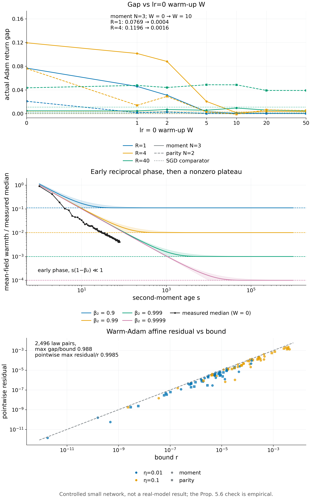
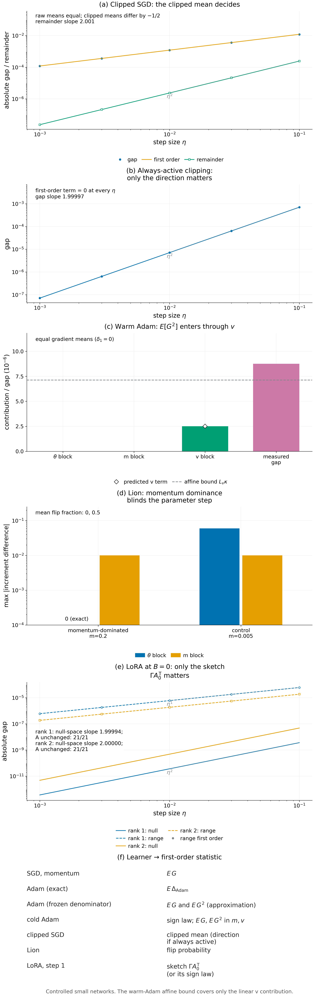

# §5 Warm Adam and learner statistics — Experiments

[← Framework](../README.md) · [Proofs](../proofs/05_warm_adam.md) · [Experiments](05_optimizer_state.md) · [中文](05_warm_adam_and_learners_ZH.md)

This page contains Check 5.8 through Check 5.18; see the [sibling page](05_optimizer_state.md) for Check 5.1 through Check 5.7, the verdict table for all §5 checks, [reproduction commands](05_optimizer_state.md#reproduce) and artifacts.

**Verdict.**

- [Check 5.8](#c5-8): PASS.
- [Check 5.9](#c5-9): PASS.
- [Check 5.10](#c5-10): PASS.
- [Check 5.11](#c5-11): PASS.
- [Check 5.12](#c5-12): PASS.
- [Check 5.13](#c5-13): PASS.
- [Check 5.14](#c5-14): PASS.
- [Check 5.15](#c5-15): PASS.
- [Check 5.16](#c5-16): PASS.
- [Check 5.17](#c5-17): PASS.
- [Check 5.18](#c5-18): PASS.

## Check 5.8 · Frozen-denominator error (Proposition 5.5(b))

**Verdict.** On 6,944 adversarially searched optimizer states there is no violation of $`\lvert\theta_i^+-\tilde\theta_i^+\rvert\le\eta\,u_i\min\lbrace\kappa_i/2,1\rbrace`$. The best ratio is 1.0000000000000002, which is equality up to floating-point rounding, so the bound cannot be improved by a constant factor.

**Why.** Part (b) is the only place where the true Adam denominator is replaced by the frozen one. If the bound failed anywhere, [Proposition 5.6](../proofs/05_warm_adam.md#s5-6) would fail with it.

**Setup** (`v015:E8`, frozen-denominator part; seed `[150150,108]`).

- Random states:
  - $`v`$ log-uniform on $`[10^{-12},1]`$;
  - random $`m`$, gradients and $`t\in\lbrace 1,\dots,2000\rbrace`$;
  - five $`(\beta_1,\beta_2)`$ pairs, including $`(0.9,0.999)`$.
- Search: 24 random restarts × 80 hill-climbing steps that maximize lhs/rhs.
- The difference $`\theta^+-\tilde\theta^+`$ is computed in rationalized exact arithmetic, to avoid cancellation between rounded updates. The direct float subtraction is also kept.
- Tolerance: relative slack $`10^{-12}`$ only.

**Result** (`v015:E8`, frozen-denominator part).

| Quantity | Value |
|---|---|
| states checked | 6,944 |
| violations | 0 |
| best lhs/rhs | $`1.0000000000000002`$; the witness is in the saturated branch $`\kappa\gg1`$ |

**Why it supports Proposition 5.5(b).**

- The bound is valid, and its saturated branch is attained.
- As $`\kappa\to0`$, the first branch is asymptotically tight as well, since $`(1-(1+\kappa)^{-1/2})/(\kappa/2)\to1`$.

## Check 5.9 · Warm Adam is first-order affine in the consumed gradient (Proposition 5.6, Remark 5.11)

**Verdict.** On actual warm states of the controlled network, the bound holds for all 2,496 law pairs, with constants fixed before any pair was evaluated. The largest gap/bound is 0.988, and the largest pointwise residual/bound is 0.998.

**Why.** [Proposition 5.6](../proofs/05_warm_adam.md#s5-6) bounds response differences at a warm state:

- Two message laws with equal mean consumed gradient differ in response by at most $`\mathbb E_{P_0}r+\mathbb E_{P_1}r`$.
- Laws with unequal means differ by at most $`\lvert b^\top\Delta\mathbb EG\rvert+\mathbb E_{P_0}r+\mathbb E_{P_1}r`$.

**Setup** (`v015:E8`, warm-affine part).

- States: actual warm states of the network, with $`t`$ between 21 and 200.
- Trainable coordinates: 1–4 output-head coordinates; the rest are fixed.
- Messages: 2–6 per panel.
- Boundary and suffix:
  - one actual Adam boundary;
  - then an IID reference suffix of $`R\in\lbrace 0,2,6\rbrace`$ updates on all-zero or all-one labels, each with probability $`1/2`$;
  - all $`2^R`$ suffix histories are enumerated exactly.
- $`\eta\in\lbrace 0.01,0.1\rbrace`$. Deployment is the moment ($`N=3`$) or parity ($`N=2`$) return.
- Constants were estimated by predeclared central differences *before* any law pair was evaluated, and never enlarged afterwards:
  - $`L_i`$ along actual-to-surrogate segments;
  - $`L_v`$ along second-moment segments, with $`\bar k=1`$;
  - $`H_G`$ as the sum of absolute Hessian entries over radial and convex-hull samples.
- $`b`$ comes from analytic forward sensitivities and is checked against independent finite differences.
- Law pairs: random and adversarial pairs, with equal and with unequal means.

**Result** (`v015:E8`, warm-affine part).

| Quantity | Value |
|---|---|
| panels × law pairs | 24 × 104 = 2,496 |
| pairs violating the two-law bound | 0 |
| largest gap/bound over all pairs | 0.988 |
| largest pointwise $`\lvert\psi-c-b^\top G\rvert/r`$ | 0.998 |
| analytic $`b`$ against finite differences | agreement $`\le10^{-8}`$ in every panel |
| warmth of the tested states (maximum over coordinates and messages) | $`\max\kappa\le0.081`$ in every panel |
| curvature constant against step size | for example, moment, $`p=1`$, $`R=0`$: $`H_G=2.1\times10^{-6}`$ at $`\eta=0.01`$ and $`1.3\times10^{-4}`$ at $`\eta=0.1`$ |

Panel C of [Figure 5.3](#c5-11) plots the pointwise residual against its bound.

**Why it supports Proposition 5.6.**

- The bound holds and is nearly attained on actual network states, across suffix lengths and step sizes.
- The curvature constant grows roughly like $`\eta^2`$, as the curvature term of the bound anticipates.
- The warmth condition is checked as a maximum over coordinates and messages, not as a quantile. This is the form [Remark 5.11](../proofs/05_learner_statistics.md#s5-11) requires.
- Limit of the evidence: the constants are estimated, so this is empirical consistency, not a certificate. The proof supplies validity. The check confirms that the stated residual terms are the operative ones.

## Check 5.10 · Cold separation and warm scaling (Proposition 5.7)

**Verdict.**

- The cold gap between equal-mean laws equals $`\lvert w\rvert\eta/2`$ exactly. For example, it is $`7/2000`$ at $`\eta=0.01`$, $`w=-0.7`$, and $`1/20`$ at $`\eta=0.1`$, $`w=1`$.
- At warm states, the gap normalized by the preconditioned step scale grows like $`\kappa^{0.9995}`$.

**Why.**

- [Proposition 5.7](../proofs/05_warm_adam.md#s5-7) says that a cold state separates equal-mean laws at first order in $`\eta`$.
- [Proposition 5.6](../proofs/05_warm_adam.md#s5-6) says that at a warm state the same separation is only of the size of the warmth term $`\eta\,u\,\kappa`$.

**Setup** (`v015:E8`, cold-separation part).

- Cold: the exact rational laws of the proposition, with $`\eta\in\lbrace 0.01,0.1\rbrace`$ and $`w\in\lbrace -0.7,1\rbrace`$, under both the ideal sign map and $`\epsilon=10^{-8}`$.
- Warm: the same unscaled laws at $`t=1000`$ and $`m=0`$. $`v`$ is swept so that $`\kappa_{\max}`$ takes 33 log-spaced values in $`[10^{-6},10^2]`$.

**Result** (`v015:E8`, cold-separation part).

| Quantity | Value |
|---|---|
| cold gap, $`\eta=0.01`$, $`w=-0.7`$ | ideal $`7/2000=0.0035`$; at $`\epsilon=10^{-8}`$: $`0.00349999986`$ |
| cold gap, $`\eta=0.1`$, $`w=1`$ | ideal $`1/20`$; at $`\epsilon=10^{-8}`$: $`0.0499999980`$ |
| warm: log–log slope of the raw gap against $`\kappa`$ | 1.4995 |
| warm: slope after normalizing by the preconditioned step scale | 0.9995 |

**Why it supports Proposition 5.7.**

- The cold gap is exactly $`\lvert w\rvert\eta/2`$, which is first order in $`\eta`$.
- At a warm state, changing $`v`$ changes both $`\kappa`$ and the step scale $`u\propto\kappa^{1/2}`$. The raw gap therefore scales like $`\kappa^{3/2}`$, and the normalized gap like $`\kappa^{1}`$. This is the $`\eta\,u\,\kappa`$ form of the warmth term.

## Check 5.11 · The exact warmth law: bounds, plateau, accumulation (Proposition 5.8(a)–(c))

**Verdict.**

- **Exact recursion.** For constant gradients, the raw second-moment recursion matches the closed form $`\bar\kappa(s)=(1-\beta_2)/(\beta_2(1-\beta_2^{\,s}))`$ to $`7.1\times10^{-13}`$ relative, for five values of $`\beta_2`$ and $`s`$ up to $`10^6`$.
- **Bounds and plateau.** Both bounds of part (a) hold at every one of 10,900 sampled ages, and the upper bound is at most a factor 1.33 above $`\bar\kappa`$. Warmth reaches the plateau $`(1-\beta_2)/\beta_2`$ and stays there.
- **Bias correction.** It leaves the warmth ratio unchanged exactly (part (b)).
- **Stationary random gradients.** 75/75 Monte Carlo 99.9% intervals contain $`\sigma^2(1-\beta_2^{\,s})`$.
- **Accumulation.** The bound of part (c) holds on all 9,000 grid points. Its linear term is needed: no purely reciprocal envelope $`c/(W+s)`$ survives once $`s(1-\beta_2)`$ is of order one.

**Why.**

- Part (a) gives an exact law for the mean-field warmth and two-sided bounds. Its main content is a nonzero plateau: warmth falls like $`1/(\beta_2s)`$ only while $`s(1-\beta_2)\ll1`$, and with $`\beta_2`$ fixed it does not go to zero.
- Part (c) turns this into an accumulation bound with a linear term $`c(1-\beta_2)R`$.
- A single wrong exponent or constant would show up as a violated bound at some age, or as a Monte Carlo mean outside its interval.

**Setup** (`theory/v016_checks`; CPU; fixed `SeedSequence` seeds).

- `v016:C1.exact`:
  - $`\beta_2\in\lbrace 0.9,0.99,0.995,0.999,0.9999\rbrace`$, constant gradient 1.7, raw $`v_0=0`$;
  - one million updates per $`\beta_2`$, run with a causal IIR filter;
  - every $`s=1,\dots,2000`$, plus 180 log-spaced ages up to $`10^6`$ (2,180 ages per $`\beta_2`$);
  - the closed form is evaluated with a stable `expm1`;
  - bias correction is compared in exact rational arithmetic at $`t=1,7,50`$.
- `v016:C1.moments`:
  - 16,000 independent replicates, with checkpoints $`s\in\lbrace 1,10,100,1000,2000\rbrace`$;
  - gradients: unit Gaussian; Student $`t_3`$ rescaled to unit second moment; Bernoulli(0.05) × Gaussian$`/\sqrt{0.05}`$;
  - intervals: Studentized 99.9% intervals for the Gaussian and sparse laws. Squared $`t_3`$ gradients have infinite variance, so for them $`g^2`$ is capped at 100, a bounded-variable Bernstein interval is used, and the analytically known tail expectation is added to its centre.
- `v016:C1.accumulation`:
  - $`W\in\lbrace 1,4,32\rbrace`$, $`c\in\lbrace 1,2,4\rbrace`$, every $`R=1,\dots,100`$ plus a log grid to $`10^5`$;
  - the capped envelope itself is summed, which dominates every admissible warmth sequence;
  - for $`c\in\lbrace 1,1/\beta_2,2\rbrace`$, the first age at which $`\bar\kappa\le c/(W+s)`$ fails is recorded.
- A nonstationary diagnostic, outside the hypothesis and outside the assertions: second moments $`e^{-s/400}`$ with $`\beta_2=0.999`$.

**Result** (`theory/v016_checks/results_v016.json`; claims `v016:C1.exact`, `v016:C1.moments`, `v016:C1.accumulation`).

| Claim id | Status | Instances | Assertions | Worst residual |
|---|---|---:|---:|---|
| `v016:C1.exact` | PASS | 6 | 32,715 | recursion $`7.1\times10^{-13}`$ relative (tolerance $`10^{-10}`$); lower-bound violation at most $`2.2\times10^{-16}`$, i.e. rounding (tolerance $`2\times10^{-13}`$); bias correction exactly 0 |
| `v016:C1.moments` | PASS | 75 | 75 | no target outside its 99.9% interval |
| `v016:C1.accumulation` | PASS | 135 | 9,045 | largest lhs − rhs $`=-4.7\times10^{-4}`$ |

Exact law, by $`\beta_2`$ (`v016:C1.exact`):

| $`\beta_2`$ | plateau $`(1-\beta_2)/\beta_2`$ | largest upper bound / $`\bar\kappa`$ |
|---|---:|---:|
| 0.9 | 0.1111 | 1.324 |
| 0.99 | 0.01010 | 1.301 |
| 0.995 | 0.005025 | 1.300 |
| 0.999 | 0.001001 | 1.299 |
| 0.9999 | 0.0001000 | 1.298 |

The upper bound is loosest in the transition, at $`s(1-\beta_2)\approx1.8`$ (for $`\beta_2=0.999`$, at $`s=1791`$). As $`\beta_2\to1`$ the ratio tends to $`\max_y(1+y)(1-e^{-y})/y\approx1.298`$.

Values at $`\beta_2=0.999`$ (from the raw arrays):

| $`s`$ | 1 | 10 | 100 | 1,000 | $`10^6`$ |
|---|---:|---:|---:|---:|---:|
| $`\bar\kappa(s)`$ | 1.001 | 0.1006 | 0.01051 | 0.001583 | 0.001001 |
| $`1/(\beta_2s)`$ | 1.001 | 0.1001 | 0.01001 | 0.001001 | $`1.0\times10^{-6}`$ |

At $`s=10^6`$ the reciprocal law is a thousand times too small, and $`\bar\kappa`$ equals the plateau.

Stationary random gradients (`v016:C1.moments`; 25 cells per family):

| Family | Interval method | Largest relative deviation of the mean | Targets inside the 99.9% interval |
|---|---|---:|---:|
| Gaussian | Studentized | 0.76% | 25/25 |
| Student $`t_3`$ (unit second moment) | Bernstein on capped $`g^2`$ + analytic tail | 5.6% (at $`s=1`$, $`\beta_2=0.9`$) | 25/25 |
| sparse Gaussian ($`p=0.05`$) | Studentized | 2.4% | 25/25 |

Accumulation (`v016:C1.accumulation`):

- The bound $`c\log(1+R/W)+c(1-\beta_2)R`$ dominates the summed envelope at every grid point. At $`R=10^5`$, the ratio lhs/rhs lies between 0.965 and 0.999998, so the bound is nearly tight.
- **The linear term is necessary.** Take the reciprocal envelope $`\bar\kappa\le c/(W+s)`$ with $`c=2\ge1/\beta_2`$, counted from the actual raw age.
  - It first fails at raw age 14 ($`\beta_2=0.9`$), 158 (0.99), 317 (0.995), 1,592 (0.999) and 15,935 (0.9999), that is, near $`s(1-\beta_2)\approx1.6`$.
  - For $`c<2`$ it fails at the first step after the burn-in.

Nonstationary diagnostic ($`\beta_2=0.999`$, second moment $`e^{-s/400}`$):

- At $`s=2991`$ the exact $`\mathbb E v_s`$ is 0.0331. Substituting the current second moment into the stationary formula gives 0.00054.
- So $`v`$ lags behind the shrinking gradients, and warmth is about 60 times smaller than the stationary law predicts.
- This lies outside the hypothesis of part (a), and it is not asserted.

*Figure 5.3.*
- (A) A lr = 0 moment warm-up removes the gap between equal-moment sources at short horizons ($`R=1,4`$). At $`R=40`$ it no longer drives the gap to zero, and where the residual is largest the SGD comparator is nonzero as well.
- (B) The exact mean-field warmth $`\bar\kappa(s)`$ for four values of $`\beta_2`$, with its two-sided bounds (band) and the plateau $`(1-\beta_2)/\beta_2`$ (dashed). Warmth falls like $`1/(\beta_2s)`$ only in the early phase $`s(1-\beta_2)\ll1`$, then levels off and does not vanish. The measured median warmth of the network trajectories (Check 5.12) lies in that early phase.
- (C) The residual of the warm-Adam affine bound never exceeds its bound $`r`$, and comes within 0.2% of it.

[PDF](../figures/fig5_3_warmth.pdf)

**Why it supports Proposition 5.8.**

- Part (a) holds exactly, including the plateau. The constant-gradient case is the equality case of the mean-field formula.
- The bounds are tight within a factor 1.33 at the transition, and exact in both limits.
- The mean-field law holds for heavy-tailed and sparse stationary gradients as well, which shows that it depends only on the second moment.
- Part (c) holds, and its linear term $`c(1-\beta_2)R`$ cannot be dropped. With $`\beta_2`$ fixed, warm Adam therefore carries a per-step non-affine floor of order $`c(1-\beta_2)`$ relative to the frozen-denominator description.
- Limit of the evidence: for nonstationary gradients the stationary formula does not apply. When the gradients shrink, warmth falls faster than it predicts.

## Check 5.12 · Warmth on actual trajectories: the early phase, and warm-up counts like real steps (Proposition 5.8(a),(d))

**Verdict.**

- The network trajectories reach at most 129 absorbed evaluations at $`\beta_2=0.999`$, so $`s(1-\beta_2)\le0.13`$ and they cover only the early phase of Proposition 5.8(a).
- There, at $`\eta=0.01`$ and $`W=0`$, the median warmth falls with median log–log slope $`-1.06`$ over 9 fitted task/source series (median $`R^2=0.999`$). This is the $`1/(\beta_2s)`$ behaviour that part (a) predicts for $`s(1-\beta_2)\ll1`$.
- Warmth depends only on the total number of absorbed gradient evaluations, whether those came from lr = 0 warm-up or from real updates, as part (d) states.

**Why.**

- Check 5.11 tests the mean-field law with synthetic gradients. Here the question is whether the early-phase behaviour shows up in the coordinatewise warmth of actual Adam trajectories, whose gradients are neither stationary nor identically distributed across coordinates.
- A lr = 0 moment warm-up is a cheap way to warm the state. It is only interchangeable with real steps if $`v`$ advances the same way under both.

**Setup** (`v015:E8`, warmth-trajectory part).

- Actual Adam trajectories of the network: moment and parity tasks, $`\eta\in\lbrace 0.01,0.1\rbrace`$, 128 replicas, $`\beta_2=0.999`$.
- Warm-up: $`W\in\lbrace 0,1,2,5,10,20,50\rbrace`$ lr = 0 steps on the reference law. Every warm-up step is asserted to leave the parameter bytes unchanged.
- Recorded: quantiles of the coordinatewise warmth at every step.
- Fit: median $`=c/(W+s)`$ for $`s=1,\dots,79`$ prior updates, with a free log–log slope.

**Result** (`v015:E8`, warmth-trajectory part).

| Setting | Median slope | Median $`R^2`$ |
|---|---|---|
| $`\eta=0.01`$, $`W=0`$ | $`-1.06`$ | 0.999 |
| $`\eta=0.01`$, $`W\in\lbrace 5,10,20,50\rbrace`$ | $`-1.07`$ to $`-1.14`$ | 0.95–0.99 |
| $`\eta=0.1`$, $`W=0`$ | $`-1.18`$ | 0.94 |
| $`\eta=0.1`$, $`W\in\lbrace 10,20,50\rbrace`$ | $`-1.55`$ to $`-1.93`$ | 0.55–0.68 |

Interchangeability (moment $`N=3`$, $`\eta=0.01`$, source $`P`$): the median $`\kappa`$ at an equal number of prior evaluations $`W+s`$.

| $`W+s`$ | $`W=0`$ | $`W=5`$ | $`W=20`$ | $`W=50`$ | mean-field $`\bar\kappa(W+s)`$ |
|---|---|---|---|---|---|
| 51 | 0.00661 | 0.00642 | 0.00619 | 0.00619 | 0.0201 |
| 79 | 0.00405 | 0.00395 | 0.00413 | 0.00379 | 0.0132 |

**Why it supports Proposition 5.8(a),(d).**

- In the early phase, the measured median warmth has the slope that part (a) predicts.
- The median sits a roughly constant factor below $`\bar\kappa`$ (0.33 at $`W+s=51`$, 0.31 at 79). That is expected: $`\bar\kappa`$ is a ratio of means, while the median of the coordinatewise ratio between a squared gradient and its running average is smaller.
- At $`\eta=0.1`$ the consumed gradients shrink as training converges, and warmth falls faster than reciprocally. This matches the nonstationary diagnostic of Check 5.11.
- Warm-up evaluations and real evaluations are interchangeable for warmth, which is part (d).
- Limits of the evidence:
  - The trajectories are too short to reach the plateau $`(1-\beta_2)/\beta_2=0.001`$, which sets in near $`s\approx1/(1-\beta_2)=1000`$. The plateau is tested in Check 5.11.
  - Quantiles describe the bulk of the coordinates. The hypotheses of Propositions 5.6 and 5.8(c) concern the maximum or the sensitivity-weighted sum ([Remark 5.11](../proofs/05_learner_statistics.md#s5-11)), and Check 5.9 checks the maximum.

## Check 5.13 · The cold window over a training run (Propositions 5.6–5.8)

**Verdict.**

- At short horizons, the gap between equal-moment sources is a cold-window effect. A lr = 0 moment warm-up of $`W=10`$ removes a median 99% of it at $`R=1`$ and 97.5% at $`R=4`$. For moment $`N=3`$, $`\eta=0.1`$ the gap falls from 0.0769 to 0.0004 at $`R=1`$, and from 0.1196 to 0.0016 at $`R=4`$.
- At $`R=40`$, gaps up to 0.049 remain for $`W\ge10`$. Where the residual is largest, the SGD comparator is nonzero as well (up to 0.011).

**Why.** Propositions 5.6–5.8 make two predictions about a full training run:

- the warmth-controlled part of the gap concentrates in the first updates, and warm-up removes it;
- the curvature part does not depend on warmth, and it accumulates with the horizon.

**Setup** (`v015:E8`, `data.gaps`).

- The branches of Check 5.7 (actual Adam, frozen-Jacobian Adam, tangent affine SGD) are reused unchanged.
- Grid: 5 tasks (moment $`N=2,3,4`$; parity $`N=2,3`$) × $`\eta\in\lbrace 0.01,0.1\rbrace`$ × $`R\in\lbrace 1,4,40\rbrace`$ × $`W\in\lbrace 0,1,2,5,10,20,50\rbrace`$ = 210 cells.
- Histories are identical across $`W`$ and across branches. They are enumerated exactly when there are at most 4,096 of them; otherwise each source gets 2,000 independent runs.
- Warm-up uses one declared IID prefix from the reference law.

**Result** (`v015:E8`, `data.gaps`).

| Horizon | largest gap at $`W=0`$ | largest gap at $`W\ge10`$ | $`\lvert\text{gap}(W{=}10)\rvert/\lvert\text{gap}(W{=}0)\rvert`$ | largest SGD comparator |
|---|---|---|---|---|
| $`R=1`$ | 0.0769 | 0.0006 | median 0.009, max 0.034 (5 cells with gap $`>10^{-3}`$) | 0.0034 over $`R\le4`$ |
| $`R=4`$ | 0.1196 | 0.0064 | median 0.025, max 0.226 (7 cells) | (same) |
| $`R=40`$ | 0.0436 | 0.0487 | not driven to zero | 0.0110 |

| Cell | $`W=0`$ | $`W=1`$ | $`W=2`$ | $`W=5`$ | $`W=10`$ | $`W=20`$ | $`W=50`$ | tangent SGD |
|---|---|---|---|---|---|---|---|---|
| moment $`N=3`$, $`\eta=0.1`$, $`R=1`$ | 0.0769 | 0.0460 | 0.0311 | 0.0032 | 0.0004 | 0.0004 | 0.0002 | 0.0000 |
| moment $`N=3`$, $`\eta=0.1`$, $`R=4`$ | 0.1196 | 0.1016 | 0.0881 | 0.0206 | 0.0016 | 0.0037 | 0.0033 | 0.0000 |
| parity $`N=2`$, $`\eta=0.1`$, $`R=40`$ | 0.0436 | 0.0477 | 0.0441 | 0.0488 | 0.0487 | 0.0391 | 0.0391 | 0.0110 |

- With $`W\in\lbrace 1,2\rbrace`$ the warmth is still of order one, so Proposition 5.6 gives no control and the gap can move either way. For example, moment $`N=2`$, $`\eta=0.1`$, $`R=1`$ goes from 0.0175 to $`-0.0194`$ at $`W=1`$.
- For $`W\ge10`$ the short-horizon gaps are uniformly small.

**Why it supports Propositions 5.6–5.8.**

- At short horizons, the gap between equal-moment sources is the cold-step separation of Proposition 5.7, and warming the state removes it, as Propositions 5.6 and 5.8 predict.
- At long horizons, warm-up no longer drives the gap to zero. The largest residuals, parity $`N=2`$ and moment $`N=2`$ at $`\eta=0.1`$, stay at 0.039–0.049 and 0.005–0.036 for every $`W\ge10`$. The SGD comparator is nonzero in those cells (0.011 and 0.0067).
  - This residual is the curvature and trajectory term, accumulated over 40 updates and shared with SGD. It is not a cold-start effect.
- In the first updates, warmth decides which statistic a feedback source must match. Over long horizons, what remains is the nonlinearity of the trajectory.
- Whether warm-up changes the predictive value of cheap proxies is a method question. It is answered in [§9 experiments](09_mechanism_and_method.md).

## Check 5.14 · Clipping: the statistic is the clipped mean (Proposition 5.9, Theorem 5.10(e))

**Verdict.** Two gradient laws have equal raw means but clipped means that differ by $`-\tfrac12`$. They separate at first order, and the predicted gap $`\tfrac\eta2\sigma'(0.4)`$ matches the measured gap with a remainder of log–log slope 2.0015.

**Why.**

- [Theorem 5.10](../proofs/05_learner_statistics.md#s5-10)(e) says that under clipping the feedback must match $`\mathbb E\,\mathrm{clip}_c(G)`$, not $`\mathbb E\,G`$.
- If clipping changed only magnitudes, two laws with equal raw means would agree at first order. A first-order gap at equal raw means therefore confirms the clipped mean as the statistic.
- The two laws are differently active. $`P`$ is always clipped and $`Q`$ never is. So the case split of [Proposition 5.9](../proofs/05_learner_statistics.md#s5-9) is exercised on both of its branches.

**Setup** (`v015:E11`, clipped mean).

- A sigmoid with a linear logit at $`\theta=0.4`$.
- $`P(G=4)=\tfrac14`$ and $`P(G=-\tfrac43)=\tfrac34`$; $`Q=\delta_0`$.
- Clip at $`c=1`$; clipped SGD.
- $`\eta\in\lbrace 10^{-3},3\cdot10^{-3},10^{-2},3\cdot10^{-2},10^{-1}\rbrace`$.
- The gradients $`4`$ and $`-4/3`$ cannot occur in the fixed network at its initialization, so a linear-logit model realizes them.

**Procedure.**

- Assert that the raw means agree and that the clipped means differ by $`-\tfrac12`$.
- Compute the exact gap $`(P-Q)\sigma(\theta+\Delta\theta)`$ and the predicted first-order gap $`\eta\,\sigma'(0.4)/2`$.
- Assert the analytic second-order bound $`\lvert\text{gap}-\text{first order}\rvert\le\eta^2/(12\sqrt3)`$.

**Result** (`v015:E11`, `data.clipped_mean`).

| $`\eta`$ | measured gap | first-order prediction | remainder |
|---:|---:|---:|---:|
| 0.001 | $`1.20107\times10^{-4}`$ | $`1.20130\times10^{-4}`$ | $`2.37\times10^{-8}`$ |
| 0.01 | $`1.19892\times10^{-3}`$ | $`1.20130\times10^{-3}`$ | $`2.38\times10^{-6}`$ |
| 0.1 | $`1.17675\times10^{-2}`$ | $`1.20130\times10^{-2}`$ | $`2.46\times10^{-4}`$ |

The remainder's log–log slope is 2.0015.

*Figure 5.4.* Five witnesses of the learner-specific first-order statistic (Checks 5.14–5.18):
- (A) Equal raw means but different clipped means give a first-order gap under clipping.
- (B) With clipping always active, equal mean directions give an $`O(\eta^2)`$ gap.
- (C) Warm Adam with equal gradient means: the first-order term is carried entirely by the $`v`$ block, as predicted.
- (D) Momentum-dominated Lion: the parameter increment does not depend on the message.
- (E) LoRA at initialization: null-space differences are second order, range differences first order.

[PDF](../figures/fig5_4_learner_statistics.pdf)

**Why it supports Theorem 5.10(e).** The raw mean gradient predicts a zero gap, while the clipped mean predicts the measured gap to first order, with an $`O(\eta^2)`$ remainder.

## Check 5.15 · Always-active clipping: only the direction matters (Proposition 5.9 with full activation, Theorem 5.10(e))

**Verdict.** When every gradient is clipped and the two laws have the same mean unit direction, the first-order term is exactly 0 and the gap is second order (log–log slope 1.99997).

**Why.** When clipping is always active ($`p_{\rm act}=1`$), the error bound $`c(1-p_{\rm act})`$ of [Proposition 5.9](../proofs/05_learner_statistics.md#s5-9) is 0. The clipped mean is then exactly $`c\,\mathbb E[G/\lVert G\rVert]`$. Two laws with the same mean direction must agree at first order, whatever their magnitudes.

**Setup** (`v015:E11`, always active).

- Two-dimensional gradients with $`\lVert G\rVert\ge2>c=1`$.
- $`P`$ is uniform on $`\lbrace(\pm2,0)\rbrace`$ and $`Q`$ is uniform on $`\lbrace(0,\pm4)\rbrace`$. Both mean unit directions are 0, and their second direction moments differ.
- The same linear-logit model and $`\eta`$ grid as Check 5.14.

**Procedure.** Assert that the first-order term is exactly zero, and fit the slope of the exact gap.

**Result** (`v015:E11`, `data.always_active`).

| $`\eta`$ | first-order term | measured gap |
|---:|---:|---:|
| 0.001 | 0 | $`7.11\times10^{-8}`$ |
| 0.01 | 0 | $`7.11\times10^{-6}`$ |
| 0.1 | 0 | $`7.06\times10^{-4}`$ |

The gap's log–log slope is 1.99997.

**Why it supports Proposition 5.9 and Theorem 5.10(e).**

- With clipping always active, magnitudes drop out at first order. Only the second-order direction moments separate these laws.
- If the two laws also had the same law of directions, their increment laws would coincide exactly.
- Limit of the evidence: for $`0<p_{\rm act}<1`$, Proposition 5.9 bounds how far "only the direction matters" is from the truth, by $`c(1-p_{\rm act})`$. That intermediate case has no dedicated numerical check.

## Check 5.16 · Warm Adam: the second moment enters at first order through the optimizer state (Theorem 5.10(c), Proposition 5.5(a))

**Verdict.**

- With equal gradient means, the parameter block and the $`m`$ block contribute exactly 0. The $`v`$ block contributes $`(1-\beta_2)\langle\nabla_vV,\delta_2\rangle=2.504\times10^{-6}`$, as predicted to $`10^{-12}`$.
- So laws with equal means are not first-order equivalent for warm Adam.

**Why.**

- [Proposition 5.5](../proofs/05_warm_adam.md#s5-5)(a) says that the exact first-order statistic of Adam is the mean Adam increment over the complete state. It is a nonlinear functional of the gradient law. Through $`\Delta v=(1-\beta_2)(G\odot G-v)`$ it depends on $`\mathbb E\,G\odot G`$.
- Two laws with equal means and unequal second moments should therefore have a nonzero first-order term, carried by the $`v`$ block with weight $`(1-\beta_2)\nabla_vV`$.
- In this witness the parameter block vanishes exactly, and so does the frozen-denominator error. The check therefore isolates the $`v`$ channel of [Theorem 5.10](../proofs/05_learner_statistics.md#s5-10)(c).

**Setup** (`v015:E11`, warm Adam).

- The network with $`k=1`$ context and $`p=13`$ parameters.
- A warm state with $`m=0`$, $`v=0.02`$ in every coordinate and step counter 20.
  - It is an admissible warm state, not a draw from an IID warm-up.
  - The symmetry of the label laws is what makes the parameter term vanish.
- Adam with $`\beta=(0.9,0.999)`$ and $`\eta=0.03`$.
- Labels: $`P`$ is uniform on $`\lbrace0,1\rbrace`$ and $`Q`$ is uniform on $`\lbrace\tfrac14,\tfrac34\rbrace`$. Both have mean $`\tfrac12`$, and their second moments differ.
- The continuation is two later updates with label $`\tfrac14`$, then the moment $`N=3`$ deployment.
- The full-state gradient of the continuation comes from central differences.

**Procedure.**

1. Compute $`\delta_1=\mathbb E_PG-\mathbb E_QG`$, $`\delta_2=\mathbb E_PG^{\odot2}-\mathbb E_QG^{\odot2}`$, and the three block contributions $`\langle\nabla_\theta V,\mu^P_\theta-\mu^Q_\theta\rangle`$, $`\langle\nabla_mV,\cdot\rangle`$ and $`\langle\nabla_vV,\cdot\rangle`$.
2. Assert that the $`v`$ block equals $`(1-\beta_2)\langle\nabla_vV,\delta_2\rangle`$.
3. Compare with the measured gap, and with the $`L_v\kappa`$ term of [Proposition 5.6](../proofs/05_warm_adam.md#s5-6).

**Result** (`v015:E11`, `data.warm_Adam`).

| Quantity | Value |
|---|---:|
| $`\max_i\lvert\delta_{1,i}\rvert`$ (equal gradient means) | 0 |
| $`\max_i\delta_{2,i}`$ | 0.1875 |
| first-order blocks $`(\theta,\ m,\ v)`$ | $`(0,\ 0,\ 2.5043\times10^{-6})`$ |
| predicted $`(1-\beta_2)\langle\nabla_vV,\delta_2\rangle`$ | $`2.5043\times10^{-6}`$ (agreement $`<10^{-12}`$) |
| measured gap | $`8.753\times10^{-6}`$ |
| warm-Adam bound $`L_v\max\kappa`$ on the linear $`v`$ term | $`7.127\times10^{-6}`$ ($`\max\kappa=0.0125`$) |

**Why it supports Theorem 5.10(c) and Proposition 5.5(a).**

- At a warm Adam state, laws with equal mean gradients are separated at first order by the $`v`$ channel, with exactly the predicted coefficient.
- The momentum block vanishes because $`\delta_1=0`$.
- The parameter block also vanishes, for two reasons:
  - its mean term is proportional to $`\delta_1`$, which is 0;
  - its warmth error, the gap between the exact and the frozen-denominator parameter increment (Proposition 5.5(b)), is exactly zero here, because the label laws are symmetric and $`m=0`$.
- The rest of the measured gap is the remainder of [Proposition 5.1](../proofs/05_optimizer_state.md#s5-1).
- The residual bound of Proposition 5.6 covers the linear $`v`$ term. [Theorem 5.10](../proofs/05_learner_statistics.md#s5-10)(c) replaces that residual by the explicit statistic $`\mathbb E\,G^{\odot2}`$.
- Limit of the evidence: this witness exercises only the case where the frozen-denominator description is exact for the parameter block. In general, the exact first-order object is the mean Adam increment, and $`(\mathbb E\,G,\mathbb E\,G^{\odot2})`$ determines it only up to the frozen-denominator error of Proposition 5.5(b).
- How the $`v`$ channel acts over a long tail is the subject of [§7](../proofs/07_second_moment_channel.md).

## Check 5.17 · Lion: under momentum dominance the parameter block is blind to the message (Theorem 5.10(f))

**Verdict.** When momentum dominates, the parameter-block contrast between two very different gradient laws is exactly 0, with no sign flips. The $`m`$ block carries exactly $`0.01\,\delta_1`$.

**Why.** [Theorem 5.10](../proofs/05_learner_statistics.md#s5-10)(f) says that a momentum-dominated sign update does not depend on the message, so even very different gradient laws give the same parameter increment. Only the $`m`$ block records the difference.

**Setup** (`v015:E11`, Lion).

- The network, with Lion ($`\beta_1=0.9`$, $`\beta_2=0.99`$, $`\eta=0.03`$).
- Two messages with labels 0 and 1, whose gradients differ by $`\delta_1`$, with $`\max\lvert\delta_1\rvert=1`$.
- Momentum-dominated state: $`m=0.2`$ in every coordinate, so that $`0.1\lvert G_i\rvert<0.9\cdot0.2`$ for every message.
- Control: $`m=0.005`$.

**Procedure.**

- Compute the per-coordinate flip indicator and the increment difference in each block.
- Assert that the parameter contrast is exactly zero in the dominated case and nonzero in the control.
- Assert that the $`m`$ block equals $`(1-\beta_2)\delta_1=0.01\,\delta_1`$.

**Result** (`v015:E11`, `data.Lion`).

| State | parameter-block contrast $`\max_i\lvert\cdot\rvert`$ | flip fraction | $`m`$-block contrast $`\max_i\lvert\cdot\rvert`$ |
|---|---:|---:|---:|
| momentum-dominated, $`m=0.2`$ | 0 (exactly) | 0 | 0.0100 $`=0.01\max\lvert\delta_1\rvert`$ |
| control, $`m=0.005`$ | 0.0600 $`=2\eta`$ | 0.5 | 0.0100 |

**Why it supports Theorem 5.10(f).**

- Under momentum dominance, the parameter increment is the same for both messages. Their first-order statistic in $`\theta`$ is the flip probability, here 0.
- Where a sign flips, the contrast is a full $`2\eta`$ step.
- The $`m`$ block always carries $`(1-\beta_2)\delta_1`$. When no later sign changes, the continuation is locally constant in $`m`$, so this channel also has no local first-order effect.

## Check 5.18 · LoRA: the first update sees only a low-rank sketch (Theorem 5.10(g))

**Verdict.**

- At $`B=0`$, $`A`$ is bitwise unchanged after the first step under SGD, heavy-ball and cold Adam, for every law.
- Laws that differ only in the null space of $`A_0^\top`$ have a first-order gap below $`10^{-20}`$ and a second-order gap (slope 2.000).
- For laws that differ in the range, the first-order term matches the measured gap to within 0.3% at every $`\eta`$, and to within $`3\times10^{-5}`$ relative at $`\eta=10^{-3}`$.

**Why.** [Theorem 5.10](../proofs/05_learner_statistics.md#s5-10)(g) makes two claims:

- At $`B=0`$, the adapter $`A`$ cannot move in step 1, so the feedback enters only through $`\Gamma A_0^\top`$.
- Consequently, a difference in the mean full-weight gradient that lies in the null space of $`A_0^\top`$ is invisible at first order, while a difference in the range is not.

**Setup** (`v015:E11`, LoRA).

- A bilinear sigmoid model $`W=W_0+\alpha BA`$ with $`d=k=4`$, $`W_0=0.2`$, $`\alpha=1`$, $`r\in\lbrace1,2\rbrace`$, $`B_0=0`$ and a random $`A_0`$.
- Messages are soft-label mean cross-entropy targets that realize prescribed full-weight gradients $`\Gamma`$ exactly.
- Three law pairs:
  - *null:* the mean gradients differ by $`\Delta\Gamma`$ with $`\Delta\Gamma A_0^\top=0`$;
  - *range:* the difference has the form $`HA_0`$;
  - *sign:* the sketches $`\Gamma A_0^\top`$ have the same sign law but different magnitudes.
- Optimizers: SGD, heavy-ball and cold Adam. The bitwise audit uses $`\eta=0.03`$; the gaps use the full $`\eta`$ grid.

**Procedure.**

1. Assert that $`A`$ is bitwise unchanged after step 1, for every law, message and optimizer.
2. For the null and range pairs, compute the exact step-1 gap and the first-order term, and fit the slope of the null-pair gap.
3. For the sign pair under cold Adam, assert that the update equals $`-\eta h_\epsilon(\alpha\Gamma A_0^\top)`$, and record the finite-$`\epsilon`$ difference.

**Result** (`v015:E11`, `data.LoRA`).

| Quantity | rank 1 | rank 2 |
|---|---:|---:|
| bitwise checks that $`A`$ is unchanged (SGD, heavy-ball, cold Adam × all messages) | 21 / 21 | 21 / 21 |
| null-space residual $`\max\lvert\Delta\Gamma A_0^\top\rvert`$ | $`2.6\times10^{-18}`$ | $`4.8\times10^{-19}`$ |
| null pair: first-order term at $`\eta=0.1`$ | $`-1.1\times10^{-20}`$ | $`2.5\times10^{-21}`$ |
| null pair: gap at $`\eta=0.1`$; slope in $`\eta`$ | $`-3.66\times10^{-9}`$; 1.99994 | $`-4.83\times10^{-8}`$; 2.0000017 |
| range pair at $`\eta=10^{-3}`$: first-order term vs gap | $`6.06362\times10^{-7}`$ vs $`6.06362\times10^{-7}`$ | $`1.86514\times10^{-7}`$ vs $`1.86509\times10^{-7}`$ |
| sign pair, cold Adam: update difference at $`\epsilon=10^{-8}`$ | $`7.1\times10^{-8}`$ | $`7.8\times10^{-8}`$ |

**Why it supports Theorem 5.10(g).**

- At LoRA initialization, the first update cannot use any part of the feedback outside the rank-$`r`$ sketch $`\Gamma A_0^\top`$.
- Differences in the null space are second order. Differences in the range are first order, with the predicted coefficient.
- Under cold Adam only the sign law of the sketch matters as $`\epsilon\to0`$. At $`\epsilon=10^{-8}`$ the two updates differ by at most $`7.8\times10^{-8}`$, which is the finite-$`\epsilon`$ correction of $`h_\epsilon`$.
