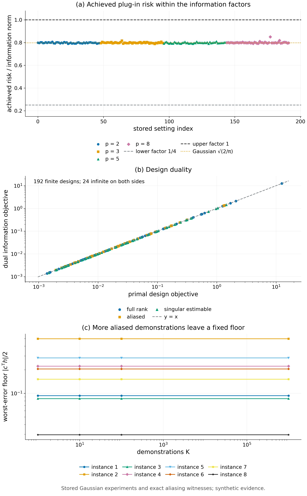

# Theorem 6.5 · 可达性；标量情形紧到常数

*实验*

[← 框架总览](../README_ZH.md) · [陈述](../statements/06-05_achievability_ZH.md) · [证明](../proofs/06-05_achievability_ZH.md) · [实验](../experiments/06-05_achievability_ZH.md) · [English](06-05_achievability.md)

**本页检验什么.** Theorem 6.5（连同 Theorem 6.3）由 [Check 6.2](../experiments/06-05_achievability_ZH.md#c6-2) 检验：在 192 个可辨识实例上，整数舍入后的 c-optimal design 下 plug-in 风险介于 $`0.789\,\mathfrak n`$ 与 $`0.850\,\mathfrak n`$ 之间（中位数 $`0.798\approx\sqrt{2/\pi}`$），落在预测区间 $`[\mathfrak n/4,\mathfrak n]`$ 之内。结论：PASS。

**本页用到的设定与记号.**

- **环境.** 环境族 $`\lbrace E_\theta:\theta\in\Theta\rbrace`$，$`\Theta\subseteq\mathbb R^p`$ 为开集，真值 $`\theta`$ 未知（[Definition 6.1](../statements/06-01_environment_family_and_distiller_ZH.md#s6-1)）。
- **oracle 反馈** $`P^*_\theta`$：若已知 $`\theta`$ 就会使用的 feedback law，例如 teacher 在学生所访问状态上的反馈。
- **数据.** $`K`$ 条独立同分布、分布为 $`P^D_\theta`$ 的示范，以及 $`n`$ 次可以自适应的查询：查询点 $`X_i\in\mathcal X_Q`$ 的结果 $`Y_i\sim P^Q_\theta(\cdot\mid X_i)`$。整条 transcript 的分布记为 $`\mathsf P^{K,n}_\theta`$。
- **蒸馏器.** 从 transcript 与私有随机性（其分布与 $`\theta`$ 无关）到 feedback law $`Q`$ 的任何可测映射。replay、改写、合成都是蒸馏器（[Definition 1.2](../README_ZH.md#s1-2)）。
- **被审计的状态** $`z_1,\dots,z_T`$：固定的 complete learner state，即参数连同 optimizer state（[Definition 1.3](../README_ZH.md#s1-3)），例如参考训练在各 checkpoint 到达的状态。
- **平均增量** $`\mu^P_t(z)`$：在 $`z`$ 上消费一条来自 $`P`$ 的消息时，complete learner state 的期望变化（[Definition 1.3](../README_ZH.md#s1-3)）。对 oracle 记 $`\mu^*_t(\theta)=\mu^{P^*_\theta}_t(z_t)`$，**学习器 Jacobian** 为 $`J_t=D_\theta\mu^*_t`$。
- **任务方向** $`g_t=\nabla V_{t+1}(z_t)`$：声明的参考尾段下 continuation value 的梯度（[Definition 1.4](../README_ZH.md#s1-4)），与 $`\theta`$ 无关。
- **学习器相对泛函** $`\Psi(\theta)=\sum_t\langle g_t,\mu^*_t(\theta)\rangle`$，梯度 $`c=\nabla_\theta\Psi=\sum_tJ_t^*g_t`$；**一阶 fidelity 误差** $`\mathrm{Err}_\theta(Q)=\lvert\Psi(\theta)-\sum_t\langle g_t,\mu^Q_t(z_t)\rangle\rvert`$（[Definition 6.2](../statements/06-02_learner_relative_functional_information_norm_ZH.md#s6-2)）。由 [Proposition 5.1](../statements/05-01_optimizer_transformed_expansion_ZH.md#s5-1)，它是被审计状态上 oracle 反馈与 $`Q`$ 之间最终任务得分差距的一阶部分。
- **Fisher information**：一条示范的 $`I_D(\theta)`$，在 $`x\in\mathcal X_Q`$ 处一次查询的 $`I_Q(\theta;x)`$。对方向 $`h\in\mathbb R^p`$，$`\mathbb I_{K,n}(\theta;h)=K\,h^\top I_Dh+n\sup_xh^\top I_Q(x)h`$。
- **learner-relative information norm** $`\mathfrak n_{K,n}(\theta)=\sup_{h\neq0}\lvert c(\theta)^\top h\rvert/\sqrt{\mathbb I_{K,n}(\theta;h)}`$，约定 $`0/0=0`$，$`a>0`$ 时 $`a/0=\infty`$。
- **增长条件 (G)**：存在 $`N\to\infty`$ 与 $`0<a\le b<\infty`$，使对每个单位向量 $`h`$ 有 $`aN\le\mathbb I_{K,n}(\theta_0;h)\le bN`$。
- **design.** approximate design $`\xi`$ 是查询空间上的概率测度，表示把 $`n`$ 次查询怎样分摊到各查询点上。$`M(\xi)=\int I_Q(\theta;x)\,\xi(\mathrm dx)`$ 是平均查询信息，$`A(\xi)=K\,I_D(\theta)+n\,M(\xi)`$ 是示范与查询合起来的总信息。

**被检验的陈述（[Theorem 6.5](../statements/06-05_achievability_ZH.md#s6-5)）.** 设 (G) 与 [Theorem 6.3](../statements/06-03_learner_relative_lower_bound_ZH.md#s6-3)(b) 的正则性成立，并且：

- **(R) 可实现性.** 对任意 $`\theta'\in\Theta`$，蒸馏器能在被审计状态上发出 oracle 律 $`P^*_{\theta'}`$，例如在 $`\theta'`$ 下运行模拟器或 teacher 模型，或对查询得到的消息重新加权。
- **(I) 可辨识性.** 存在某个 design $`\xi_0`$，使 $`\lambda_{\min}(M(\xi_0))=\lambda_0>0`$。
- **(S) 光滑性.** $`\Psi`$ 在 $`\theta_0`$ 附近属于 $`C^2`$，且 $`\lVert\nabla^2\Psi\rVert\le H_\Psi`$。
- **Design.** 使用正则化的 c-optimal design $`\xi_n=(1-\varepsilon_n)\xi^*+\varepsilon_n\xi_0`$，其中 $`\xi^*`$ 来自 [Lemma 6.4](../statements/06-04_design_minimax_equality_ZH.md#s6-4)，$`\varepsilon_n\to0`$ 且 $`\varepsilon_n\sqrt n\to\infty`$（例如 $`\varepsilon_n=n^{-1/4}`$）。
- **(E) 有效的两阶段估计.** $`\xi_n`$ 在一个用 $`o(n)`$ 次查询得到的相合 pilot 估计处计算，并舍入成整数次数。最终估计量 $`\hat\theta`$ 在 $`\theta_0`$ 的一个收缩邻域上对 $`\theta`$ 一致地满足（$`\xi_n`$ 在真值 $`\theta`$ 处取值）

```math
\mathbb E_\theta\big[(c(\theta)^\top(\hat\theta-\theta))^2\big]\le c(\theta)^\top A(\xi_n)^{-1}c(\theta)\,(1+o(1)),\qquad \mathbb E_\theta\lVert\hat\theta-\theta\rVert^2\le\frac{C}{\lambda_{\min}(A(\xi_n))} .
```

令蒸馏器输出 $`Q=P^*_{\hat\theta}`$。则

```math
\mathbb E_\theta\mathrm{Err}_\theta(Q)\le\mathfrak n_{K,n}(\theta)\,\big(1+o(1)\big)+o\big(N^{-1/2}\big),
```

并且只要 $`c(\theta)\neq0`$，最后一项就是 $`o(\mathfrak n_{K,n}(\theta))`$。与 [Theorem 6.3](../statements/06-03_learner_relative_lower_bound_ZH.md#s6-3)(c) 合起来，在局部 minimax 意义下，最小可达一阶误差介于 $`\tfrac14\mathfrak n_{K,n}`$ 与 $`\mathfrak n_{K,n}`$ 之间（相差 $`1\pm o(1)`$ 的因子）。最优查询服从目标向量为 $`c=\sum_tJ_t^*g_t`$ 的 c-optimal design。

<a id="c6-2"></a>

## Check 6.2 · 实际风险介于 𝔫/4 与 𝔫 之间（Theorems 6.3 与 6.5）

**结论.** PASS。在全部 192 个可辨识实例上，整数舍入后的 c-optimal design 下，有效 plug-in 估计量的 Monte Carlo 平均绝对误差落在 $`[0.789,\,0.850]\cdot\mathfrak n_{K,n}`$ 内。没有任何两点下界超过实际风险。

**为什么做.** [Theorem 6.3](../statements/06-03_learner_relative_lower_bound_ZH.md#s6-3) 说任何蒸馏器的误差都不低于 $`\mathfrak n/4`$，[Theorem 6.5](../statements/06-05_achievability_ZH.md#s6-5) 说 c-optimal 的 plug-in 能达到 $`\mathfrak n(1+o(1))`$。比值落在 $`[1/4,1]`$ 之外就推翻了这一对结论。design 的整数舍入是渐近定理没有覆盖的有限 $`n`$ 效应，所以这里实测它，而不是假设它可以忽略。

**设置.**

- [Check 6.1](../experiments/06-04_design_minimax_equality_ZH.md#c6-1) 的 216 个实例去掉 24 个不可辨识的：192 个实例、960 条断言。
- 把 approximate c-optimal design（[Elfving, 1952](#ref-elfving1952optimum)）按最大余数法舍入成整数次数，不改变 $`n`$；rounding loss 定义为方差 $`c^\top A^{-1}c`$ 的相对增量。
- 为示范与查询的充分统计量独立生成高斯噪声，计算 $`c^\top\theta`$ 的有效线性估计量：每个实例 30,000 次重复。这是在模拟观测，而不是从预测的方差里直接抽误差。
- 同时记录：精确的高斯平均绝对误差 $`\sqrt{2/\pi}\sqrt{c^\top A_{\rm int}^{-1}c}`$；[Theorem 6.3](../statements/06-03_learner_relative_lower_bound_ZH.md#s6-3)(a) 在最不利位移 $`\tau=\mathbb I^{-1/2}`$ 处的 Pinsker 两点界；同一位移处精确的高斯总变差两点界。

**结果.**

| 量 | 值 |
|---|---|
| 实际风险 $`/\,\mathfrak n_{K,n}`$：最小 / 中位数 / 最大 | $`0.7885`$ / $`0.7982`$ / $`0.8504`$ |
| $`\sqrt{2/\pi}`$（精确 design，不舍入） | $`0.7979`$ |
| 最大 rounding loss（即比值为 $`0.850`$ 的实例：16 个查询点上只有 $`n=10`$ 次查询） | 方差增加 12.3% |
| 高于 $`\mathfrak n/4`$ / 低于 $`\mathfrak n`$ 的最小余量（绝对值） | $`0.0204`$ / $`0.0075`$ |
| Pinsker 两点界 $`/\,\mathfrak n`$ | 每个实例都是 $`0.2500`$ |
| 精确高斯 TV 两点界 $`/\,\mathfrak n`$（同一位移） | 每个实例都是 $`0.3085=1-\Phi(1/2)`$ |
| 实际风险 $`/`$ Pinsker 界，最小值 | $`3.15`$ |
| Monte Carlo 与精确高斯 MAE 之差，最大 | $`2.91`$ 个标准误（99.9% 逐点容差 $`3.29`$） |



*Figure 6.1.* (a) 全部 192 个可辨识设定上，实际 plug-in 风险除以信息范数 $`\mathfrak n_{K,n}`$，并画出 Theorems 6.3 与 6.5 的因子 $`1/4`$、$`1`$ 以及高斯值 $`\sqrt{2/\pi}`$；少数高于 $`\sqrt{2/\pi}`$ 的点，是小查询预算的整数舍入放大了方差。(b) c-optimal design 的取值对对偶信息目标（Lemma 6.4），落在对角线上；两边都无穷的 24 个设定只计数、不画出。(c) 八个混叠实例的最坏误差下限 $`\lvert c^\top h\rvert/2`$ 随 $`K`$ 的变化，每个实例都是水平线（Corollary 6.7）。

**为什么支持 Theorems 6.3 与 6.5.**

- 实际风险落在 $`\sqrt{2/\pi}\,\mathfrak n`$ 附近，即精确的高斯值；即使做了整数舍入，[Theorem 6.5](../statements/06-05_achievability_ZH.md#s6-5) 的上界常数 $`1`$ 仍有余量。
- 在定理所取的位移处，Pinsker 两点界恰好等于 $`\mathfrak n/4`$，所以 [Theorem 6.3](../statements/06-03_learner_relative_lower_bound_ZH.md#s6-3) 中的常数 $`1/4`$ 正是证明给出的；同一点上精确的 TV 界稍大（$`0.31\,\mathfrak n`$）。
- 局限：这个模型中 $`\Psi`$ 是线性的，实验是高斯的，所以 [Theorem 6.5](../statements/06-05_achievability_ZH.md#s6-5) 的二阶条件 (S) 与有效性条件 (E) 精确成立。本检验没有覆盖非线性 $`\Psi`$ 或非高斯实验。

## 复现

在仓库根目录（只用 CPU）：

```bash
CUDA_VISIBLE_DEVICES='' PYTHONDONTWRITEBYTECODE=1 theory/.venv/bin/python theory/v016_checks/check_v016.py --only C2 --output /tmp/v016_C2.json
CUDA_VISIBLE_DEVICES='' PYTHONDONTWRITEBYTECODE=1 theory/.venv/bin/python -m pytest -q -p no:cacheprovider theory/v016_checks
```

第一条命令把本页的检验组单独重跑到一个文件；不带 `--only` 运行 `theory/v016_checks/check_v016.py` 会重新生成完整结果文件（约 104 秒）。所有检验都在 CPU 上用 float64 运行，随机种子为 `numpy.SeedSequence([160160, group, subcase, ...])`（PCG64）。检验用 NumPy（[Harris et al., 2020](#ref-harris2020array)）做线性代数和随机数，用 SciPy（[Virtanen et al., 2020](#ref-virtanen2020scipy)）做优化和统计函数。

## 产物

- `theory/v016_checks/results_v016.json`：claim id `v016:C2.risk`，每项都含断言、最大残差、失败记录与数据行。
- `theory/v016_checks/results_v016_raw.json.gz`：完整的数据行；不纳入 git，其 SHA-256 记录在主文件的 `raw_artifact` 下。
- `theory/v016_checks/SPEC.md`（`v016:C2` 两节或一节）与 `theory/v016_checks/check_v016.py`。
- `figures/fig6_1_information_bound.png`（同目录下有 PDF 版本）
