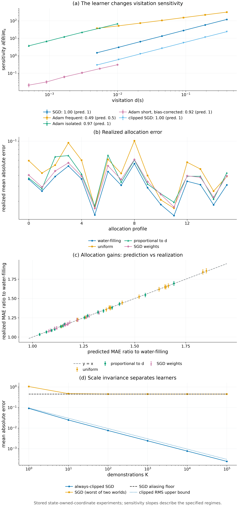

# Proposition 6.11 · SGD 与 warm Adam 的学习器权重

*实验*

[← 框架总览](../README_ZH.md) · [陈述](../statements/06-11_learner_weights_sgd_warm_adam_ZH.md) · [证明](../proofs/06-11_learner_weights_sgd_warm_adam_ZH.md) · [实验](../experiments/06-11_learner_weights_sgd_warm_adam_ZH.md) · [English](06-11_learner_weights_sgd_warm_adam.md)

**本页检验什么.** Proposition 6.11 由 [Check 6.4](../experiments/06-11_learner_weights_sgd_warm_adam_ZH.md#c6-4) 检验：敏感度关于 $`d`$ 的实测斜率，SGD 为 $`1.00`$，频繁访问区间的 Adam 为 $`0.489`$（权重斜率 $`0.98`$），孤立访问区间的 Adam 为 $`0.970`$。频繁区间的闭式（含二阶矩项）误差为 0.6–7.1%（去掉该项为 14–21%）；孤立区间的闭式误差不超过 8.6%；在 $`d\approx1-\beta_2`$ 附近两个闭式都不适用，与陈述一致。结论：PASS。

**本页用到的设定与记号.**

- **agent 状态** $`s\in\mathcal S`$，有限集；本页中 $`s`$ 表示 agent 的状态（[Assumption 6.9](../statements/06-09_state_coverage_model_ZH.md#s6-9)）。
- **逐状态的 oracle 分布.** 在状态 $`s`$ 上 oracle 消息 $`Y\sim P^*_s`$（例如 teacher 在该状态的动作或修正），取值于有限字母表；各状态的分布互不相关，不假设状态之间有泛化。
- **influence function** $`f_s(y)`$：$`\Psi`$ 在 $`s`$ 处、把 $`P^*_s`$ 向 $`y`$ 处点质量移动时的导数；在 $`P^*_s`$ 下均值为零。
- **学习器相对权重** $`W_s=\mathrm{Var}_{P^*_s}f_s(Y)`$：在 $`s`$ 上多一个 oracle 样本，对估计 $`\Psi`$ 值多少。
- **样本数.** 状态 $`s`$ 共得到 $`N_s=k_s+n_s`$ 个 oracle 样本：$`k_s`$ 来自示范（期望为 $`KH\,d_T(s)`$，$`H`$ 为轨迹长度，$`d_T`$ 为 teacher 的状态访问分布），$`n_s`$ 来自查询，$`\sum_sn_s=n`$。
- **state-owned 坐标.** 每个 agent 状态 $`s`$ 有自己的标量参数 $`\theta_s`$；每步按学生的访问概率 $`d(s)`$ 独立抽一个状态 $`s_k\sim d`$，并在那里消费一条 oracle 消息。
- **梯度.** consumed gradient $`g=G(s,Y)`$ 与参数无关（线性 response 区间）；在状态 $`s`$ 上 $`m_1=\mathbb Eg`$，$`m_2=\mathbb Eg^2`$。
- **结果** $`F=\langle\zeta,\theta_R\rangle`$，共 $`R`$ 步，学习率 $`\eta`$；$`\Psi`$ 是结果的期望变化。
- **Adam**：动量系数 $`\beta_1`$、二阶矩衰减 $`\beta_2`$，$`\beta_1<\sqrt{\beta_2}`$，$`\epsilon`$ 可忽略（Adam 的精确增量见 [Proposition 5.5](../statements/05-05_exact_first_order_statistic_adam_ZH.md#s5-5)）。

**被检验的陈述（[Proposition 6.11](../statements/06-11_learner_weights_sgd_warm_adam_ZH.md#s6-11)）.** 在 [Assumption 6.9](../statements/06-09_state_coverage_model_ZH.md#s6-9) 之外，再设：

- 每个 agent 状态拥有自己的参数坐标（state-owned coordinates）；
- 每个训练步独立抽取一个状态 $`s_k\sim d`$，并在那里给一条 oracle 消息；
- consumed gradient 与参数无关（线性 response 区间）：$`g=G(s,Y)`$；在状态 $`s`$ 上记 $`m_1=\mathbb Eg`$，$`m_2=\mathbb Eg^2`$；
- 结果为 $`F=\langle\zeta,\theta_R\rangle`$，$`\Psi`$ 取为期望结果变化 $`\mathbb E F(\theta_R)-F(\theta_0)`$，它是 $`(P^*_s)_s`$ 的泛函；
- Adam 的 $`\epsilon`$ 相对 $`\sqrt v`$ 可以忽略，且 $`\beta_1<\sqrt{\beta_2}`$。

则在各自的区间内、当 $`R\to\infty`$ 时，在首项意义下：

- **(a) SGD.** $`f_s^{\rm SGD}(y)=-\eta R\,d(s)\,\zeta_s\,(g-m_1)`$，所以 $`W_s^{\rm SGD}=\eta^2R^2\zeta_s^2\,d(s)^2\,\mathrm{Var}(g)`$。
- **(b) warm Adam，频繁访问区间（frequent regime）.** 设二阶矩的有效平均窗口内访问次数很多：有 bias correction 时 $`d(s)\min\lbrace t,1/(1-\beta_2)\rbrace\gg1`$，无 bias correction 时还要求 $`t\gg1/(1-\beta_2)`$。则

```math
f_s^{\rm Adam}(y)=-\eta R\sqrt{d(s)}\,\zeta_s\Big[\frac{g-m_1}{\sqrt{m_2}}-\frac{m_1(g^2-m_2)}{2m_2^{3/2}}\Big],\qquad W_s^{\rm Adam}=\eta^2R^2\zeta_s^2\,d(s)\,\mathrm{Var}\Big(\frac{g}{\sqrt{m_2}}-\frac{m_1g^2}{2m_2^{3/2}}\Big).
```

  括号中的第二项是二阶矩通道：一条抬高 $`m_2`$ 的消息会压低此后的每一个步长。

- **(c) warm Adam，孤立访问区间（isolated regime）.** 设 $`d(s)\ll\min\lbrace1-\beta_1,1-\beta_2\rbrace`$，且无 bias correction 或 $`t\gg1/(1-\beta_2)`$。此时每次访问遇到的都是 $`m\approx0`$、$`v\approx0`$，坐标移动 $`-\eta\,\kappa_{\rm iso}\,\mathrm{sign}(g)`$，其中

```math
\kappa_{\rm iso}=\frac{1-\beta_1}{\sqrt{1-\beta_2}\,\big(1-\beta_1/\sqrt{\beta_2}\big)} .
```

  因此 $`f_s(y)=-\eta R\,d(s)\,\zeta_s\,\kappa_{\rm iso}\,(\mathrm{sign}\,g-\mathbb E\,\mathrm{sign}\,g)`$，$`W_s\propto d(s)^2\,\mathrm{Var}(\mathrm{sign}\,g)`$：关于 $`d`$ 的标度与 SGD 相同，但消息只通过符号进入。有 bias correction 时，若在第 $`t\gg1/(1-\beta_1)`$ 步访问一个 $`m`$、$`v`$ 仍为零的坐标（例如第一次访问），位移为 $`-\eta\,\kappa_{\rm iso}\sqrt{1-\beta_2^{\,t}}\,\mathrm{sign}(g)`$：常数改变，关于 $`d`$ 的标度不变。

- **(d) 推论.** 设 $`s`$ 是高频状态、$`s'`$ 是较稀有的状态，$`d(s)>d(s')`$，两者都处在频繁访问区间，方差因子相同。权重比 $`W_{s'}/W_s`$ 在 SGD 下是 $`(d(s')/d(s))^2`$，在 warm Adam 下是 $`d(s')/d(s)`$。所以相对于高频状态，warm Adam 对稀有状态的权重是 SGD 的 $`d(s)/d(s')`$ 倍。覆盖了高频状态、漏掉学生长尾状态的示范，可以对 SGD 充分，对 warm Adam 不充分。

<a id="c6-4"></a>

## Check 6.4 · 学习器权重：SGD 按 d² 标度，warm Adam 按 d 标度（Proposition 6.11）

**结论.** PASS。每个断言的斜率都落在其 bootstrap 95% 区间加上预先声明的 $`0.1`$ 之内。频繁访问区间的 Adam 敏感度关于 $`d`$ 的斜率为 $`0.489`$，即权重斜率 $`0.98`$；SGD 为 $`1.00`$（权重斜率 $`2.0`$）。闭式在各自区间内准确，并且如命题所说，在 $`d\approx1-\beta_2`$ 附近失效。

**为什么做.** [Proposition 6.11](../statements/06-11_learner_weights_sgd_warm_adam_ZH.md#s6-11) 对每个 optimizer 预测：在某个状态上多一个 oracle 样本，会让结果移动多少。这些权重决定查询该往哪里分配（[Proposition 6.10](../statements/06-10_water_filling_allocation_ZH.md#s6-10)），也决定了 SGD 与 Adam 之间的分离。实测敏感度的斜率不对，或闭式漏掉二阶矩项，都会推翻这个命题。

**设置.**

- 每个目标状态拥有一个标量坐标；每步访问一个状态；teacher 标签 $`y\sim\mathrm{Bernoulli}(\pi)`$，$`\pi=0.35`$；梯度 $`g=c_0-y`$，$`c_0=0.2`$；$`\zeta=1`$，$`\eta=0.01`$，$`\epsilon=10^{-12}`$。
- 学习器：SGD；始终裁剪到 $`0.1`$ 的 SGD（范数裁剪，[Pascanu et al., 2013](#ref-pascanu2013difficulty)）；$`\beta_1=0.9`$ 的 Adam（[Kingma & Ba, 2015](#ref-kingma2015adam)）。三者共用访问序列与标签的随机数。
- 敏感度 $`\mathrm d\,\mathbb E\theta_{s,R}/\mathrm d\pi_s`$ 用 common random numbers 的中心差分测量（[Glasserman, 2004](#ref-glasserman2004monte)；$`\delta=0.02`$；$`\delta=0.04`$ 作诊断），扰动在共同的 burn-in 之后才开始。

| 区间 | $`\beta_2`$ | Bias correction | $`d(s)`$（对数等距） | $`d/(1-\beta_2)`$ | Burn-in | $`R`$ | 重复次数 |
|---|---|---|---|---|---|---|---|
| frequent | 0.999 | 否 | 0.005–0.4，7 个值 | 5–400 | 20,000 | 30,000 | 384 |
| isolated | 0.9 | 否 | 0.0005–0.01，6 个值 | 0.005–0.1 | 2,000 | 60,000 | 384 |
| transition | 0.999 | 否 | 0.0003–0.02，7 个值 | 0.3–20 | 20,000 | 30,000 | 384 |
| 短 horizon | 0.999 | 是 | 0.0005–0.01，6 个值 | 0.5–10（$`R`$ 内 0.1–2 次访问） | 0 | 200 | 20,000 |

- 断言的斜率：SGD 与裁剪 SGD 在所有区间都是 $`1`$；频繁访问区间的 Adam 为 $`1/2`$；孤立访问区间与短 horizon 的 Adam 为 $`1`$。transition 区间的斜率只做描述。

**结果.**

| 区间 | 学习器 | 关于 $`d`$ 的斜率 [bootstrap 95% CI] | 闭式与实测之差 |
|---|---|---|---|
| frequent | Adam | $`0.4887`$ $`[0.4827,0.4948]`$ | 频繁访问闭式：0.6–7.1% |
| frequent | SGD / 裁剪 SGD | $`1.0029`$ $`[0.9967,1.0093]`$ | 精确的线性公式 |
| isolated | Adam | $`0.9699`$ $`[0.9443,0.9969]`$ | 孤立访问闭式，$`\kappa_{\rm iso}=6.16`$：+0.2% 到 −8.6% |
| isolated | SGD / 裁剪 SGD | $`0.9970`$ $`[0.9715,1.0234]`$ | 精确的线性公式 |
| transition | Adam | $`0.6252`$ $`[0.5952,0.6610]`$ | 见下 |
| transition | SGD / 裁剪 SGD | $`1.0185`$ $`[0.9896,1.0518]`$ | 精确的线性公式 |
| 短 horizon | Adam | $`0.9166`$ $`[0.8599,0.9786]`$ | 见下 |
| 短 horizon | SGD / 裁剪 SGD | $`0.9722`$ $`[0.9172,1.0328]`$ | 精确的线性公式 |

- **二阶矩项.** 在频繁访问区间，去掉 [Proposition 6.11](../statements/06-11_learner_weights_sgd_warm_adam_ZH.md#s6-11)(b) 的第二项，会把实测敏感度高估 14%（$`d=0.005`$）到 21%（$`d=0.4`$）。完整公式的最大误差 7.1% 出现在最小的 $`d`$ 上，那里一个二阶矩窗口内只有 5 次访问。
- **孤立访问区间.** 孤立闭式的误差从 $`d/(1-\beta_2)=0.005`$ 时的 0.2% 增长到 $`0.1`$ 时的 8.6%，因为访问开始相互重叠。
- **过渡区（$`d\approx1-\beta_2`$）.** 频繁访问闭式在 $`d/(1-\beta_2)=0.3`$ 时偏差 −46%，$`0.6`$ 时 −17%，从 $`1.2`$ 起在 10% 以内。孤立访问闭式在 $`0.3`$ 时偏差 −19%，$`0.6`$ 时 −12.5%，再往上差得多（−22% 到 −81%）。实测斜率 $`0.625`$ 介于两个区间之间。两个闭式的切换点在 $`d/(1-\beta_2)\approx1`$。
- **带 bias correction 的短 horizon.** 斜率 $`0.917`$ 在预先声明的容差内与 $`1`$ 一致，但它的 95% 区间离 $`1`$ 差 $`0.021`$，这是本检验中最大的斜率残差。量级只有未修正孤立闭式的 24–33%。这正是 [Proposition 6.11](../statements/06-11_learner_weights_sgd_warm_adam_ZH.md#s6-11)(c) 对 bias correction 的预测：第 $`t`$ 步的第一次访问带有因子 $`\sqrt{1-\beta_2^{\,t}}`$，它在 $`t\le200`$ 上的平均为 $`0.29`$（粗略估算，不属于检验本身）。
- **线性学习器.** 52 次比较中，Monte Carlo 均值与精确公式之差都在 $`1.52`$ 个标准误以内（门限 $`4.5`$）。12 行的敏感度全部为正。
- **差分步长.** 把 $`\delta`$ 从 $`0.02`$ 换成 $`0.04`$，敏感度最多变化 $`1.24`$（频繁访问区间的 Adam，$`d=0.4`$，占数值的 0.4%）。



*Figure 6.2.* (a) 对数坐标下实测敏感度随访问频率 $`d(s)`$ 的变化，带逐点 95% 区间，图例给出拟合斜率与预测斜率：SGD 与裁剪 SGD 为 $`1`$，频繁访问区间的 Adam 为 $`1/2`$，孤立访问区间与短 horizon 带 bias correction 的 Adam 为 $`1`$。各区间的 horizon 与 burn-in 不同，不同曲线的绝对高度不可比。(b) 每个 profile 上 water-filling、均匀、正比于 $`d`$、SGD 权重四种分配的实际平均绝对误差；water-filling 在每个 profile 上都最低。(c) 预测误差比与实际误差比，带 familywise 区间，落在对角线上（Proposition 6.10）。(d) 误差随 $`K`$ 的变化：始终裁剪的 SGD 按 $`K^{-1/2}`$ 下降并低于其 RMS 界；SGD 在两个世界中的最坏误差停在混叠下限 $`0.45`$（Corollary 6.12(a)）。

**为什么支持 Proposition 6.11.**

- 斜率正好按预测把学习器分开：SGD 的权重按 $`d^2`$ 标度，频繁访问区间的 Adam 按 $`d`$ 标度，孤立访问区间的 Adam 回到 $`d^2`$，且只依赖符号。
- 含二阶矩项的闭式在其区间内准确，这一项也是必需的：去掉它，误差从 0.6–7.1% 升到 14–21%。
- 偏差出现在命题指明闭式失效的地方：$`d\approx1-\beta_2`$ 附近；以及短 horizon 加 bias correction 时的常数（而不是斜率）。

## 复现

在仓库根目录（只用 CPU）：

```bash
CUDA_VISIBLE_DEVICES='' PYTHONDONTWRITEBYTECODE=1 theory/.venv/bin/python theory/v016_checks/check_v016.py --only C3 --output /tmp/v016_C3.json
CUDA_VISIBLE_DEVICES='' PYTHONDONTWRITEBYTECODE=1 theory/.venv/bin/python -m pytest -q -p no:cacheprovider theory/v016_checks
```

第一条命令把本页的检验组单独重跑到一个文件；不带 `--only` 运行 `theory/v016_checks/check_v016.py` 会重新生成完整结果文件（约 104 秒）。所有检验都在 CPU 上用 float64 运行，随机种子为 `numpy.SeedSequence([160160, group, subcase, ...])`（PCG64）。检验用 NumPy（[Harris et al., 2020](#ref-harris2020array)）做线性代数和随机数，用 SciPy（[Virtanen et al., 2020](#ref-virtanen2020scipy)）做优化和统计函数。

## 产物

- `theory/v016_checks/results_v016.json`：claim id `v016:C3.sensitivity`，每项都含断言、最大残差、失败记录与数据行。
- `theory/v016_checks/results_v016_raw.json.gz`：完整的数据行；不纳入 git，其 SHA-256 记录在主文件的 `raw_artifact` 下。
- `theory/v016_checks/SPEC.md`（`v016:C3` 两节或一节）与 `theory/v016_checks/check_v016.py`。
- `figures/fig6_2_learner_weights.png`（同目录下有 PDF 版本）
