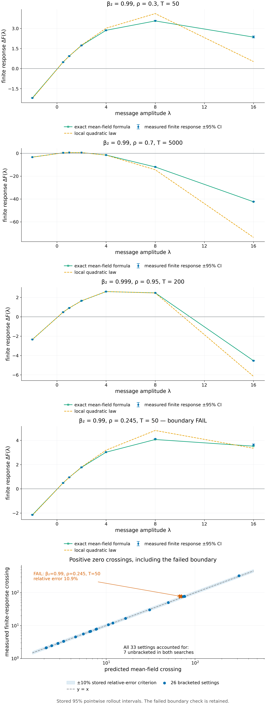
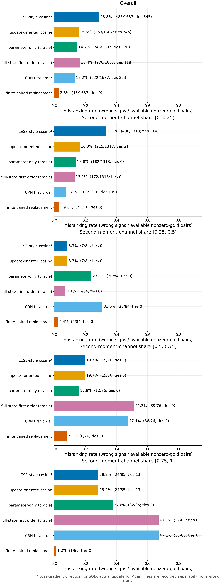

# §7 Adam second-moment channel (Theorem B) — Experiments

[← Framework](../README.md) · [Proofs](../proofs/07_second_moment_channel.md) · [中文](07_second_moment_channel_ZH.md)

**Verdict.**

- [Theorem 7.1](../proofs/07_second_moment_channel.md#s7-1), costate recursion: **PASS**. The adjoint gradient matches central finite differences in all 1,024 directional comparisons, with worst relative error $`2.8\times10^{-7}`$. The comparisons cover 256 configurations including bias correction, decoupled weight decay, $`\epsilon>0`$ and active global-norm clipping.
- [Corollary 7.2(a)](../proofs/07_second_moment_channel.md#s7-2), exact mean-field response: the formula matches the measured finite response within 2.7% of the response scale at all 213 grid points (**PASS**).
  - The predicted zero crossing agrees with the measured one within 3.9% in 25 of the 26 settings where a crossing exists.
  - Neither crosses in the remaining 7 settings.
  - **FAIL** in one setting placed next to the crossing criterion ($`\beta_2=0.99`$, $`\rho=0.245`$, $`T=50`$): predicted 68.6, measured $`77.0\pm4.0`$, relative error 10.9% against a 10% tolerance.
- [Corollary 7.2(b)](../proofs/07_second_moment_channel.md#s7-2), quadratic law: inside its range the response error is at most 1.5% (**PASS**), and the threshold $`2\lambda^\star`$ is within 0.6% of the measured crossing. Outside its range, $`2\lambda^\star`$ underestimates the measured crossing by up to a factor 5.7, as the corollary warns.
- [Corollary 7.2(c)](../proofs/07_second_moment_channel.md#s7-2), large-amplitude criterion: the sign of the exact limit classified crossing versus no crossing correctly in 33/33 settings (**PASS**).
- [Proposition 7.3(b)](../proofs/07_second_moment_channel.md#s7-3): in all 24 constructed pairs (**PASS**), the parameter-only score ranks the larger message first, the cosine score ties, and both the exact first-order value and the finite response prefer the smaller message.
- [Remark 7.5](../proofs/07_second_moment_channel.md#s7-5) and [Proposition 7.3](../proofs/07_second_moment_channel.md#s7-3) on a controlled network (descriptive): every first-order or cosine ranker has a wrong-sign rate of 11%–29% on 1,687 pairs. Where the second-moment share is at least 0.5, the full-state first-order score with the exact continuation gradient is wrong 59.6% of the time. The finite paired-replacement score is wrong 2.8% overall and 4.3% there.

| Check | Tests | Code ID | Result |
|---|---|---|---|
| [Check 7.1](#c7-1) | [Theorem 7.1](../proofs/07_second_moment_channel.md#s7-1) | `v016:C4.costate` | PASS |
| [Check 7.2](#c7-2) | [Corollary 7.2(a),(c)](../proofs/07_second_moment_channel.md#s7-2) | `v016:C4.amplitude` | FAIL (1 of 26 crossings) |
| [Check 7.3](#c7-3) | [Corollary 7.2(b)](../proofs/07_second_moment_channel.md#s7-2) | `v016:C4.amplitude` | PASS |
| [Check 7.4](#c7-4) | [Proposition 7.3(b)](../proofs/07_second_moment_channel.md#s7-3) | `v016:C4.ranking` | PASS |
| [Check 7.5](#c7-5) | [Proposition 7.3](../proofs/07_second_moment_channel.md#s7-3), [Remark 7.5](../proofs/07_second_moment_channel.md#s7-5) | `v016:C5`, `v016:C5b` | descriptive; assertions PASS |

Checks 7.2 and 7.3 share one code ID: its single FAIL assertion is the crossing comparison of Check 7.2; every assertion of Check 7.3 passes.

<a id="c7-1"></a>

## Check 7.1 · Costate recursion against finite differences (Theorem 7.1)

**Verdict.** PASS. Worst directional relative error $`2.82\times10^{-7}`$ (tolerance $`10^{-6}`$) over 1,024 comparisons.

**Why.** [Theorem 7.1(a)](../proofs/07_second_moment_channel.md#s7-1) claims that the reverse recursion gives the exact gradient of the continuation value in $`(\theta,m,v)`$. That gradient includes the bias-correction factors, decoupled weight decay, $`\epsilon`$ and the Jacobian of global-norm clipping. A wrong block anywhere in the recursion shows up as a mismatch along some direction.

**Setup.**

- Exact AdamW in float64 on quadratic and logistic losses, $`p\in\lbrace5,20\rbrace`$ parameters, terminal score $`\mathrm{sigmoid}(a^\top\theta)`$, $`\eta=0.007`$.
- Full factorial over: bias correction off/on; $`\epsilon\in\lbrace10^{-8},10^{-3}\rbrace`$; decoupled weight decay $`0`$ or $`0.03`$; $`\beta_1\in\lbrace0,0.9\rbrace`$; $`\beta_2\in\lbrace0.99,0.999\rbrace`$; global-norm clipping off or at $`0.15`$. That is 256 configurations.
- Tails of 20, 60 or 200 updates, starting from states with positive $`v`$.
- For each configuration, central differences of $`V_{t+1}`$ along random $`\theta`$-only, $`m`$-only, $`v`$-only and joint directions, with a step ladder $`h=2\times10^{-4},\,h/2`$ and Richardson extrapolation.
- A finite-difference step is halved whenever a perturbed trajectory changes any clipping decision. The decision uses forward clipping patterns only, never agreement with the costate.
- Tolerance: relative error $`\le10^{-6}`$, with denominator $`\max(\lvert\text{adjoint}\rvert,\lvert\text{FD}\rvert,10^{-10})`$. No automatic differentiation is used.

**Result.**

- 1,024/1,024 directional comparisons within tolerance; worst relative error $`2.82\times10^{-7}`$.
- All 1,024 accepted finite-difference steps stay on the same clipping branch as the unperturbed trajectory. Two attempted steps crossed a clipping threshold and were halved.
- The comparisons include the exactly zero momentum derivatives at $`\beta_1=0`$.

**Why it supports Theorem 7.1.**

- The test covers every term of the recursion, including the extensions beyond the plain Adam step: bias correction, decoupled decay, $`\epsilon`$, and the non-symmetric clipping Jacobian.
- It is a test of the identity in (a). The channel split (b) and the closed form (d) are algebraic consequences.
- Limits: the losses are smooth and low-dimensional; derivatives at a clipping threshold are excluded by design, as in the theorem.

<a id="c7-2"></a>

## Check 7.2 · Exact mean-field response and the large-amplitude criterion (Corollary 7.2(a),(c))

**Verdict.**

- The formula of (a) matches the measured finite response on the whole amplitude grid: worst error 2.74% of the response scale (tolerance 5%).
- The predicted zero crossing matches the measured crossing within 3.9% in 25 of the 26 settings with a crossing. In one setting next to the criterion boundary the error is 10.9%: **FAIL**.
- The sign of the exact large-amplitude limit predicted crossing versus no crossing correctly in 33/33 settings.

**Why.**

- (a) is exact under the mean-field substitution $`m_k/\sqrt{v_k}\to\mathbb Em_k/\sqrt{\mathbb Ev_k}`$. The check measures what that substitution costs on actual stochastic Adam trajectories, at every amplitude, including the large amplitudes where the quadratic law fails.
- (c) predicts from one number, $`\kappa_{\rm iso}(T)-\rho\Lambda(T)`$, whether a very large same-direction message ends up worse than a zero message.

**Setup.**

- Exact one-dimensional Adam without bias correction: $`\beta_1=0.9`$, $`\epsilon=0`$, $`\eta=\alpha=1`$, terminal score $`F=-\theta`$, so the response is exactly linear in $`\theta`$.
- Tail gradients IID $`\mathcal N(\rho,1-\rho^2)`$, so $`\bar g=\rho`$ and $`\bar v=1`$.
- Burn-in of $`\lceil12/(1-\beta_2)\rceil`$ steps from zero. The message $`g=\lambda\sqrt{v}`$ is injected at each replicate's actual warmed state; the noisy state is not replaced by its mean.
- 4,096 replicates. Every message and the zero-message comparator share each replicate's future gradients (common random numbers).
- Settings:
  - **Core**, 24 settings: $`\beta_2\in\lbrace0.99,0.999\rbrace`$, $`\rho\in\lbrace0.3,0.7,0.95\rbrace`$, $`T\in\lbrace50,200,1000,5000\rbrace`$, amplitudes $`\lambda\in\lbrace-2,0.5,1,2,4,8,16\rbrace`$.
  - **Criterion straddle**, 6 settings fixed in advance: $`\beta_2=0.99`$, $`T\in\lbrace20,50,100\rbrace`$, $`\rho=0.8`$ or $`1.2`$ times $`\kappa_{\rm iso}(T)/(T+1)`$. These lie on both sides of the exact critical ratio $`\kappa_{\rm iso}(T)/\Lambda(T)`$.
  - **Boundary**, 3 settings: $`\beta_2=0.99999`$, $`\rho=0.05`$, $`\lambda=20`$, $`T\in\lbrace0,1,5\rbrace`$, 128 replicates (1.2 million burn-in steps).
- Zero crossings are found by doubling from $`2\lambda^\star`$ and Brent's method, separately for the measured rollout and for the formula, on the same search bounds.
  - Core roots use the first 512 replicates; criterion and boundary roots use all paths.
  - Root standard errors come from implicit differentiation.
- Assertions and tolerances were fixed before the run:
  - grid error at most 5% of the setting's largest response;
  - crossing error at most 10% when the measured crossing is bracketed;
  - when it is not bracketed, the formula must not cross up to the same bound;
  - the exact limit's sign must agree with both crossing statuses;
  - the finite formula at $`\lambda=10^8/\sqrt{c_T}`$ must lie within $`10^{-5}`$ of the limit.

**Result.**

| Quantity | Settings | Worst | Tolerance | Status |
|---|---:|---:|---:|---|
| grid error of (a), share of response scale | 33 (213 points) | 2.74% | 5% | PASS |
| crossing error of (a), measured crossing bracketed | 26 | 10.93% | 10% | FAIL (1 setting) |
| no crossing up to the same bound, both formula and measurement | 7 | — | — | PASS |
| finite formula vs limit of (c) | 33 | $`1.0\times10^{-7}`$ | $`10^{-5}`$ | PASS |
| limit sign predicts the measured crossing | 33 | 0 errors | 0 | PASS |
| limit sign predicts the formula crossing | 33 | 0 errors | 0 | PASS |
| limit sign agrees with the stochastic-branch limit | 33 | 0 errors | 0 | PASS |

- **Grid error by group.** Core settings at most 1.69%; criterion settings at most 2.74%; boundary settings at most $`2.5\times10^{-5}`$.
- **Crossings.** In the 24 core settings, the largest crossing error is 3.85% ($`\beta_2=0.999`$, $`\rho=0.7`$, $`T=50`$: formula 312.6, measured $`325.1\pm19.0`$). All other core errors are below 3%, most below 0.5%.
- **The FAIL setting.** It is the criterion-straddle case $`\beta_2=0.99`$, $`T=50`$, $`\rho=0.245`$, which is 1.18 times the exact critical ratio 0.2074. The formula's crossing is 68.62 and the measured crossing is $`77.03\pm3.98`$ (standard error). The relative error of 10.9% is 2.1 standard errors.
  - The other two criterion settings that cross have errors of 3.2% ($`T=20`$) and 3.1% ($`T=100`$).
  - The tolerance was not changed.
  - A likely reason, not tested separately: near the criterion boundary the crossing moves fast with any model error, and the mean-field substitution ignores the fluctuation of $`v`$ around $`\bar v`$. That fluctuation is largest for the short averaging window of $`\beta_2=0.99`$.
- **Exact versus approximate criterion.** At $`\beta_2=0.99`$, $`T=50`$ the exact critical ratio $`\kappa_{\rm iso}/\Lambda`$ is 0.2074, against the approximation $`\kappa_{\rm iso}/(T+1)=0.2042`$. The two differ by 4.0% at $`T=20`$, by 1.6% at $`T=50`$, and by less than 0.1% for $`T\ge1000`$.
  - The 7 settings without a crossing are exactly those with $`\rho`$ below the exact critical ratio: $`\beta_2=0.999`$, $`\rho=0.3`$, $`T=50`$; the three low-$`\rho`$ criterion cases; and the three boundary settings, whose critical ratio exceeds 1.



*Figure 7.1.* Measured finite response $`\Delta F(\lambda)`$ (points with 95% CRN intervals) against the exact mean-field formula of [Corollary 7.2(a)](../proofs/07_second_moment_channel.md#s7-2) and the quadratic law of (b), for representative $`(\beta_2,\rho,T)`$. The quadratic law tracks the response only at small amplitudes; the exact formula tracks it at all amplitudes. The second panel compares predicted and measured zero crossings for every setting with a crossing, on $`y=x`$ with a ±10% band. The single setting outside the band ($`\beta_2=0.99`$, $`\rho=0.245`$, $`T=50`$) is marked.

**Why it supports Corollary 7.2(a),(c).**

- The exact formula is the only approximation-free statement about large messages, and it reproduces the measured response at amplitudes where the response has already turned over.
- The FAIL shows the limit of the mean-field substitution: next to the criterion boundary, the crossing location is sensitive to the fluctuations the formula ignores. The crossing *classification* of (c) was still correct there.
- Limits: one coordinate, exogenous Gaussian gradients, $`\epsilon=0`$, no bias correction. These are exactly the corollary's assumptions, so the check tests the formula, not its transfer to networks (that is Check 7.5).

<a id="c7-3"></a>

## Check 7.3 · The quadratic law and its sign-change threshold (Corollary 7.2(b))

**Verdict.** PASS. Inside the range of (b), the first-order value and the finite response follow the quadratic law within 0.31% and 1.53%. Where $`(1-\beta_2)(2\lambda^\star)^2\le0.1`$, $`2\lambda^\star`$ is within 0.6% of both measured crossings. Outside that range, $`2\lambda^\star`$ is wrong by up to a factor 5.7, as (b) warns.

**Why.**

- (b) asserts a quadratic law with an explicit error bound that shrinks with $`(1-\beta_2)\max\lbrace1,\lambda^2\rbrace`$. It says the threshold $`2\lambda^\star`$ may be used only when $`(1-\beta_2)(2\lambda^\star)^2\ll1`$.
- The check measures both sides of that boundary, for the first-order value $`\mathrm{Val}`$ (exact stochastic costates and exact message increments) and for the finite rollout.

**Setup.** Same runs as Check 7.2.

- Quadratic-law points are asserted (5% relative tolerance) only where $`(1-\beta_2)\lambda^2\le0.02`$ and $`\lvert\lambda\rvert\le4`$: 96 points.
- Crossings are compared with $`2\lambda^\star`$ (10% tolerance) only where $`(1-\beta_2)(2\lambda^\star)^2\le0.1`$: 10 settings.
- All other points and settings are reported without assertion.

**Result.**

- Eligible points: worst relative error 0.31% for $`\mathrm{Val}`$ and 1.53% for the rollout.
- Eligible settings: the measured $`\mathrm{Val}`$ crossing is within 0.24% of $`2\lambda^\star`$ and the measured rollout crossing within 0.54%.
- Outside the range. On the 9 settings with a crossing and $`(1-\beta_2)(2\lambda^\star)^2`$ between 0.5 and 18, the measured rollout crossing divided by $`2\lambda^\star`$ is:

| $`\beta_2`$ | $`\rho`$ | $`T`$ | $`(1-\beta_2)(2\lambda^\star)^2`$ | $`2\lambda^\star`$ | measured crossing | ratio |
|---:|---:|---:|---:|---:|---:|---:|
| 0.99 | 0.7 | 50 | 0.50 | 7.09 | 7.86 | 1.11 |
| 0.99 | 0.3 | 200 | 0.59 | 7.69 | 7.70 | 1.00 |
| 0.999 | 0.3 | 200 | 1.34 | 36.6 | 49.9 | 1.36 |
| 0.999 | 0.95 | 50 | 1.77 | 42.1 | 76.6 | 1.82 |
| 0.99 | 0.3 | 50 | 2.74 | 16.5 | 29.9 | 1.81 |
| 0.99 | 0.526 | 20 | 3.17 | 17.8 | 75.4 | 4.23 |
| 0.999 | 0.7 | 50 | 3.27 | 57.2 | 325.1 | 5.69 |
| 0.99 | 0.245 | 50 | 4.11 | 20.3 | 77.0 | 3.80 |
| 0.99 | 0.124 | 100 | 6.35 | 25.2 | 78.1 | 3.10 |

- **The first-order value follows the quadratic law past its range.** At $`\beta_2=0.999`$, $`\rho=0.7`$, $`T=50`$, the measured $`\mathrm{Val}`$ crossing is 55.0, close to $`2\lambda^\star=57.2`$, while the finite response crosses only at 325.1. The first-order value turns negative five times too early: the linearization overstates the harm done through the second-moment channel at large amplitudes.
- **Boundary settings** ($`\beta_2=0.99999`$, $`\rho=0.05`$; $`(1-\beta_2)(2\lambda^\star)^2\sim10^6`$). The quadratic crossing errors are 28% ($`T=1`$) and 33% ($`T=5`$), reported only; neither the formula nor the rollout crosses.

**Why it supports Corollary 7.2(b).**

- The law and its threshold hold where the corollary says they hold, with errors far below the conservative constant of the proof.
- They break down where the corollary says they may break down. The size of the breakdown, up to a factor 5.7, is the reason the corollary routes large amplitudes to (a) and (c).
- The early sign change of the first-order value is the mechanism behind [Remark 7.5](../proofs/07_second_moment_channel.md#s7-5), observed directly.

<a id="c7-4"></a>

## Check 7.4 · Parameter-only and cosine scores on constructed pairs (Proposition 7.3(b))

**Verdict.** PASS in 24/24 settings. The parameter-only score always ranks the larger message first, the cosine score always ties, and both the exact first-order value and the finite response always prefer the smaller message.

**Why.** [Proposition 7.3(b)](../proofs/07_second_moment_channel.md#s7-3) predicts that two same-direction messages with $`\lambda_1+\lambda_2>2\lambda^\star`$ are ranked in the wrong order by parameter-only scores and are not separated by cosine scores.

**Setup.**

- The 24 core settings of Check 7.2, same replicates.
- In each setting, $`\lambda_1=1.25\lambda^\star`$ and $`\lambda_2=1.75\lambda^\star`$, so $`\lambda_1+\lambda_2=3\lambda^\star>2\lambda^\star`$. The amplitudes range from 1.3 to 116.7, and the warmth $`(1-\beta_2)\lambda^2`$ from 0.002 to 13.6.
- Recorded: the parameter-only score and its derivative sign at both endpoints; the cosine score; the exact $`\mathrm{Val}`$; and the finite rollout response, each with 95% CRN intervals over 4,096 replicates.
- Assertions:
  - $`(1-\beta_1)\beta_2-\beta_1\rho(1-\beta_2)\lambda>0`$ at both endpoints, i.e. both amplitudes are below $`\lambda_{\rm PO}`$;
  - the parameter-only score prefers $`\lambda_2`$;
  - the cosines are equal;
  - $`\mathrm{Val}`$ and the rollout prefer $`\lambda_1`$.

**Result.**

| Assertion | Instances | Worst margin | Status |
|---|---:|---:|---|
| both amplitudes below $`\lambda_{\rm PO}`$ | 48 | — | PASS |
| parameter-only prefers $`\lambda_2`$ | 24 | smallest score gap 0.044 | PASS |
| cosine ties | 24 | both cosines 1 | PASS |
| exact $`\mathrm{Val}`$ prefers $`\lambda_1`$ | 24 | smallest gap 0.263 (CI lower end 0.263) | PASS |
| finite response prefers $`\lambda_1`$ | 24 | smallest gap 0.262 (CI lower end 0.261) | PASS |

**Why it supports Proposition 7.3(b).**

- The reversal holds with wide margins in every setting, including settings with warmth well above the quadratic range. So the inconsistency is not an artifact of the small-increment expansion used in the proof.
- Limits: one coordinate and exogenous gradients, the setting of the proposition; a network test is Check 7.5.

<a id="c7-5"></a>

## Check 7.5 · Rankers on a controlled network, by second-moment share (Proposition 7.3, Remark 7.5)

**Verdict.** Descriptive; all its assertions PASS.

- Every first-order or cosine ranker has a wrong-sign rate between 11.4% and 28.8% on 1,687 provider pairs.
- The full-state first-order score uses the exact continuation gradient and all three channels. It is wrong 51%–67% of the time where the second-moment share is at least 0.5.
- The finite paired-replacement score of [Theorem 8.8](../proofs/08_certificate.md#s8-8) is wrong 2.8% of the time overall and 4.3% at high share (7 of 161 pairs, against 96 for the full-state score).

**Why.**

- [Remark 7.5](../proofs/07_second_moment_channel.md#s7-5) predicts that first-order rankers are least reliable where the second-moment channel dominates, because that is where the message is large relative to $`v`$.
- [Proposition 7.3](../proofs/07_second_moment_channel.md#s7-3) predicts that parameter-only and cosine scores are not consistent rankers.
- The check tests both on a trained network with real optimizer states, where the assumptions of [Corollary 7.2](../proofs/07_second_moment_channel.md#s7-2) do not hold.

**Setup.**

- **Panel.** The frozen controlled-network provider panel of the provider-selection experiments of [§9](09_mechanism_and_method.md), read only and unchanged.
  - The network has a one-hot context, 4 tanh units, a sigmoid output and mean cross-entropy, in float64.
  - Complete states `fresh`, `warm2`, `warm5`, `warm9`. Eight recipes: Adam with $`\eta\in\lbrace0.01,0.1\rbrace`$ and SGD with $`\eta\in\lbrace0.1,1\rbrace`$, each with $`\epsilon\in\lbrace10^{-8},10^{-3}\rbrace`$.
  - Nine provider laws on two-label packets, and the frozen held-out splits.
  - All 36 unordered provider pairs at every split and cell: 1,728 pairs, 1,687 with nonzero gold.
- **Gold.** The exact difference of the eight-update outcomes: one candidate boundary followed by all 128 seven-update reference histories.
- **Rankers** (pair score = difference of provider scores):
  - LESS-style cosine between the provider's mean parameter step and the task-objective gradient. For SGD the primary version uses the positive loss gradient, as specified; the update-oriented variant flips it to the update direction. This is a LESS-style proxy, not the official LESS implementation.
  - Parameter-only first-order score: the exact continuation gradient restricted to $`\theta`$, contracted with the mean $`\Delta\theta`$.
  - Full-state first-order score: the $`\theta`$, $`m`$ and $`v`$ contractions with the exact continuation gradient, the oracle score of the first-order audit in [§8](08_verification.md).
  - CRN-measured first-order scores, which use no gradient oracle: a common-random-number directional difference along the mean increment, with the task-aligned surrogate or with a short-tail surrogate.
  - Finite paired-replacement score $`\hat S`$ of [Theorem 8.8](../proofs/08_certificate.md#s8-8), task-aligned surrogate, $`r=256`$ replicates.
- **Second-moment share** of a pair: $`\lvert v\text{-contraction}\rvert/(\lvert\theta\rvert+\lvert m\rvert+\lvert v\rvert\text{ contractions})`$ of the pair's increment contrast, computed with the exact continuation gradient.
  - Fixed bins $`[0,.25),[.25,.5),[.5,.75),[.75,1]`$.
  - Unavailable for the nonsmooth threshold task.
  - SGD pairs have share 0.
- **Conventions.** A wrong sign means score × gold < 0. Exact ties are counted separately and are not errors.
- **Assertions.**
  - The full-state oracle scores and margin rows reproduce the frozen first-order-audit records of [§8](08_verification.md): 56 margin rows out of 396, and no wrong sign on them.
  - The finite-replacement scores reproduce the `v016:C6b` measurements exactly.
  - The frozen files are unchanged.

**Result.** Wrong-sign rate (wrong / pairs with nonzero gold; ties in parentheses where present):

| Ranker | all, 1,687 | share $`[0,.25)`$, 1,318 | $`[.25,.5)`$, 84 | $`[.5,.75)`$, 76 | $`[.75,1]`$, 85 | share $`\ge.5`$, 161 | threshold task, 124 |
|---|---:|---:|---:|---:|---:|---:|---:|
| cosine (LESS-style) | 28.8% (345 ties) | 33.1% | 8.3% | 19.7% | 28.2% | 24.2% | 3.2% |
| cosine, update-oriented | 15.6% (345 ties) | 16.3% | 8.3% | 19.7% | 28.2% | 24.2% | 1.6% |
| parameter-only, exact gradient | 14.7% (120 ties) | 13.8% | 23.8% | 15.8% | 37.6% | 27.3% | 1.6% |
| full-state, exact gradient | 16.4% (118 ties) | 13.1% | 7.1% | **51.3%** | **67.1%** | **59.6%** | 1.6% |
| CRN first-order, aligned surrogate | 13.2% (323 ties) | 7.8% | 31.0% | 47.4% | 67.1% | 57.8% | 0.0% |
| CRN first-order, short surrogate | 11.4% (323 ties) | 6.4% | 26.2% | 38.2% | 65.9% | 52.8% | 0.0% |
| finite paired replacement, $`r=256`$ | **2.8%** (0 ties) | 2.9% | 2.4% | 7.9% | 1.2% | **4.3%** | 0.8% |

- **High share.** At share at least 0.5 the finite score is wrong on 7 of 161 pairs. The full-state score is wrong on 96, the CRN first-order scores on 93 and 85, and the parameter-only score on 44. The finite score improves on every first-order ranker there but does not eliminate errors.
- **Where errors concentrate.** The parameter-only score is wrong 14.4% of the time below share 0.5 and 27.3% above; its errors concentrate at high share. The primary cosine is wrong 31.6% below and 24.2% above; its errors do not concentrate.
- **By recipe** (wrong-sign rate):

| Recipe | pairs | cosine | param.-only | full-state | CRN 1st-order (aligned) | finite replacement |
|---|---:|---:|---:|---:|---:|---:|
| Adam, $`\eta=0.01`$, $`\epsilon=10^{-8}`$ | 395 | 5.6% | 4.1% | 11.4% | 13.9% | 2.3% |
| Adam, $`\eta=0.01`$, $`\epsilon=10^{-3}`$ | 144 | 19.4% | 9.0% | 18.8% | 20.8% | 2.8% |
| Adam, $`\eta=0.1`$, $`\epsilon=10^{-8}`$ | 144 | 13.9% | 27.1% | 13.2% | 29.2% | 2.8% |
| Adam, $`\eta=0.1`$, $`\epsilon=10^{-3}`$ | 144 | 16.0% | 9.0% | 12.5% | 13.2% | 0.7% |
| SGD, $`\eta=0.1`$, $`\epsilon=10^{-8}`$ | 428 | 44.9% | 12.9% | 12.9% | 2.1% | 1.6% |
| SGD, $`\eta=0.1`$, $`\epsilon=10^{-3}`$ | 144 | 49.3% | 18.1% | 18.1% | 6.2% | 2.1% |
| SGD, $`\eta=1`$, $`\epsilon=10^{-8}`$ | 144 | 45.1% | 29.9% | 29.9% | 21.5% | 7.6% |
| SGD, $`\eta=1`$, $`\epsilon=10^{-3}`$ | 144 | 45.1% | 29.9% | 29.9% | 18.8% | 6.2% |

- **By held-out split**, finite replacement against the full-state score:
  - held-out states: 0.0% vs 9.7%, 288 pairs;
  - held-out task: 1.0% vs 0.0%, 103 pairs, on which every first-order and cosine score ties;
  - held-out $`\epsilon`$: 2.4% vs 18.4%, 288 pairs;
  - held-out learning rate: 5.2% vs 21.5%, 288 pairs;
  - held-out $`\epsilon`$ and learning rate: 3.5% vs 21.2%, 288 pairs;
  - fresh to warm: 0.0% vs 9.7%, 288 pairs;
  - warm to fresh: 10.4% vs 30.6%, 144 pairs.
- **Reproduction.** The full-state scores match the frozen records to $`2.8\times10^{-17}`$ (tolerance $`2\times10^{-6}`$). The margin rows are 56/396, recomputed and frozen, with zero wrong signs on them.
- **Cost.** The exact-gradient scores used 1,044,480 oracle tail evaluations plus 184,320 for an independent directional check. The finite score reuses the `v016:C6b` measurements at no additional tail cost; its cost is reported in [§8](08_verification.md).



*Figure 7.2.* Wrong-sign rate of each ranker on the controlled provider panel, overall and by second-moment share of the pair. Every first-order ranker, including the full-state score with the exact continuation gradient, fails most where the second-moment channel dominates. The finite paired-replacement score stays low in every bin.

**Why it supports Proposition 7.3 and Remark 7.5.**

- The full-state first-order score is exact to first order, yet it is wrong on most high-share pairs. This is the failure Remark 7.5 predicts: where the $`v`$-channel matters, the first-order form misjudges it.
- The CRN-measured first-order scores fail in the same bins. The failure therefore comes from linearization, not from estimating the gradient.
- Measuring the finite replacement removes most of these errors. This is the remedy Remark 7.5 names.
- Cosine and parameter-only scores are unreliable across recipes. This is consistent with Proposition 7.3, although the panel does not isolate the amplitude mechanism of Proposition 7.3(b) (Check 7.4 does).
- Limits:
  - one small controlled network with a finite panel;
  - rates are descriptive, not estimates over independent tasks, and repeated cells appear in several splits;
  - the LESS-style cosine is a proxy for, not a reproduction of, the LESS implementation;
  - no real-model claim is made.

## Reproduce

From the repository root (CPU only):

```bash
CUDA_VISIBLE_DEVICES='' PYTHONDONTWRITEBYTECODE=1 theory/.venv/bin/python theory/v016_checks/check_v016.py --only C4,C5,C5b
CUDA_VISIBLE_DEVICES='' PYTHONDONTWRITEBYTECODE=1 theory/.venv/bin/python -m pytest -q -p no:cacheprovider theory/v016_checks
```

- Without `--only`, the full suite takes about 104 s on rai. The groups here take about 16 s (`v016:C4.costate`), 29 s (`v016:C4.amplitude`), 22 s (`v016:C5`) and 3 s (`v016:C5b`).
- Seeds: `numpy.SeedSequence([160160, group, subcase, ...])`, PCG64, float64, single BLAS thread.
- `v016:C5` and `v016:C5b` import the frozen controlled-network panel read-only. The pinned files are hashed before and after.

## Artifacts

- `theory/v016_checks/results_v016.json` — main results (claim ids `v016:C4.costate`, `v016:C4.amplitude`, `v016:C4.ranking`, `v016:C5`, `v016:C5b`): assertions, failures, per-setting maps, ranker tables.
- `theory/v016_checks/results_v016_raw.json.gz` — raw arrays referenced by JSON pointers from each row. Not committed; SHA-256 `1777069872ea80c09dfd5260d610871b68e41a10721eba2826dcd4d647874f69`.
- `theory/v016_checks/SPEC.md` — the specification (the sections on `v016:C4`, `v016:C5`/`v016:C6` and `v016:C5b`), `check_v016.py`, `c5c6.py`, `c5c6b.py` and their tests.
- `figures/fig7_1_amplitude_law.{png,pdf}`, `figures/fig7_2_rankers.{png,pdf}` and their specs in `figures/specs/`.
