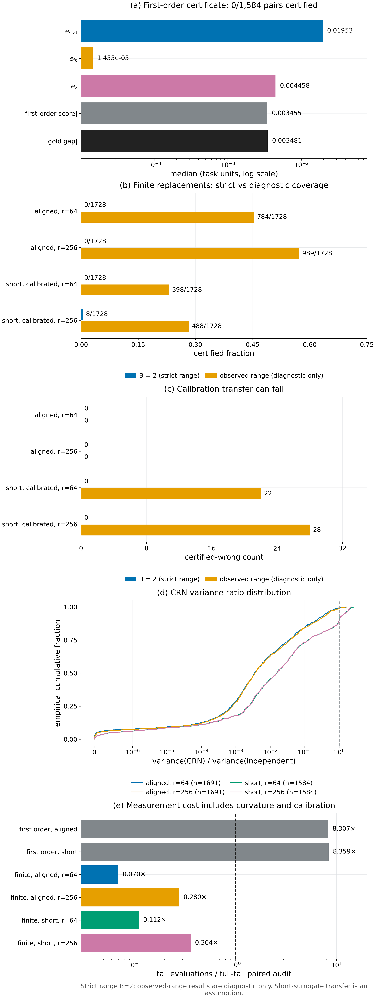

# Theorem 8.8 · CRN 配对替换证书；Theorem C

*实验*

[← 框架总图](../README_ZH.md) · [陈述](../statements/08-08_crn_paired_replacement_certificate_ZH.md) · [证明](../proofs/08-08_crn_paired_replacement_certificate_ZH.md) · [实验](../experiments/08-08_crn_paired_replacement_certificate_ZH.md) · [English](08-08_crn_paired_replacement_certificate.md)

**本页检验什么.**

- **[Theorem 8.8](../statements/08-08_crn_paired_replacement_certificate_ZH.md#s8-8)（CRN 配对替换证书，Theorem C）.** 在冻结的受控面板上（1,728 个候选对）：
  - 作为排序器，点估计 $`\hat S`$ 在 1,687 个 gold 非零的候选对中判错 48 个（2.8%）。
  - 测量所用的轨迹数，$`r=64`$ 时为全尾段配对 audit 的 7.0%，$`r=256`$ 时为 28.0%。
  - common random numbers 把配对差的方差降到独立尾段的 0.12–0.15 倍（方差之和的比值）。
  - 用先验区间 $`B=2`$ 的严格证书：与任务一致的 surrogate 认证 0 对，需校准的 surrogate 在 $`r=256`$ 时认证 8 对，没有认证错误。这正是 [Remark 8.12](../statements/08-12_open_problems_ZH.md#s8-12) 记录的缺口。

**本页用到的设定与记号.**

全节沿用 [Definitions 1.3–1.4](../README_ZH.md#s1-3) 中的对象。

- 轮次 $`t=0,\dots,R-1`$，$`z`$ 是 complete learner state。对一阶 optimizer，实际更新为 $`U_t(z,y,\xi)=z+\Delta_t\big(z,G_t(z,y,\xi)\big)`$。
- 在第 $`t`$ 轮状态 $`z`$ 处，参照发出 $`Y\sim P^0_{t,z}`$，候选 $`j\in\lbrace1,\dots,M\rbrace`$ 发出 $`Y\sim P^j_{t,z}`$。候选 $`j`$ 的 kernel 记为 $`K^j_t`$。
- 参照 continuation 为 $`V^0_{t+1}`$，$`V^0_R=F_E\in[0,1]`$。response 为 $`g_{t,z}(y)=\mathbb E_\xi V^0_{t+1}(U_t(z,y,\xi))\in[0,1]`$。对消息积分得到 kernel 恒等式

```math
(K^j_tV^0_{t+1})(z)=\mathbb E_{Y\sim P^j_{t,z}}\,g_{t,z}(Y),\qquad j\in\lbrace0,1,\dots,M\rbrace .\qquad\text{(K)}
```

- 对由候选 $`j`$ 驱动的过程，$`L_E(j)=\mathbb E\,F_E(Z^j_R)`$。所有过程从相同的 $`Z_0`$ 初始律出发。
- 候选 $`j`$ 在 $`(t,z)`$ 处的**局部优势**为

```math
A_t(z,j)=(K^j_t-K^0_t)V^0_{t+1}(z)\in[-1,1].
```

- 它表示：把一轮参照替换成一轮候选 $`j`$，之后走参照尾段，对最终得分的影响。由 [Theorem 3.2](../statements/03-02_continuation_response_characterization_ZH.md#s3-2)，整次训练的差距就是这些项在替代过程到达的状态上的和。

*配对替换分数*（[Definition 8.6](../statements/08-06_crn_paired_replacement_score_ZH.md#s8-6)）.

- 在产生它的历史条件下，固定第 $`t`$ 轮的一个被 audit 状态 $`z`$（complete learner state，含 optimizer state）。候选为 $`j=0,1,\dots,M`$，$`M\ge1`$，其中 $`j=0`$ 是参照。候选 $`j`$ 的消息律为 $`P^j=P^j_t(\cdot\mid z)`$，消息 $`Y`$ 产生增量 $`\Delta^j=\Delta_t(z,G_t(z,Y,\xi))`$（含更新随机性）。
- **surrogate 尾段** $`T_\omega`$ 用随机性 $`\omega`$ 运行一段声明的（可以截短的）参照尾段，把一个状态映到最终状态。**surrogate 目标** $`\tilde F`$ 给最终状态打分（例如留出成功轨迹的 teacher-forced log-likelihood，映到 $`[0,1]`$）。记

```math
\varphi_\omega(u)=\tilde F\big(T_\omega(z+u)\big),\qquad\tilde L(P^j)=\mathbb E\,\varphi_\omega(\Delta^j),
```

其中 $`\omega`$ 与 $`\Delta^j`$ 独立。$`\tilde L(P^j)`$ 是"这一轮用候选 $`j`$、之后走 surrogate 尾段"的 surrogate 结果。

- **副本** $`\ell=1,\dots,r`$，$`r\ge2`$：抽一个新的 $`\omega_\ell`$，并为每个候选抽一条消息，得到增量 $`\Delta^j_\ell`$。同一副本内所有候选共用 $`\omega_\ell`$（**common random numbers**）；它们的消息也可以用共同的随机数耦合，只要每个 $`\Delta^j_\ell`$ 的边缘分布正确。不同副本相互独立。
- 若候选的消息律支撑有限，可以用支撑上的精确加权平均代替抽样，此时随机性只来自 $`\omega`$。
- 有序对 $`(j,k)`$ 的分数为

```math
Z^{jk}_\ell=\varphi_{\omega_\ell}(\Delta^j_\ell)-\varphi_{\omega_\ell}(\Delta^k_\ell),\qquad\hat S^{jk}=\frac1r\sum_{\ell=1}^rZ^{jk}_\ell .
```

- 任务一侧，$`L_F(P^j)=\mathbb E\,F_E\big(T^{\rm full}(z+\Delta^j)\big)`$ 是"这一轮用候选 $`j`$、之后走完整参照尾段、按任务目标打分"的结果。用设定中的记号，$`L_F(P^j)=(K^j_tV^0_{t+1})(z)`$，所以 $`L_F(P^j)-L_F(P^0)=A_t(z,j)`$。

*它的假设*（[Assumption 8.7](../statements/08-07_certificate_assumptions_ZH.md#s8-7)）.

- **(I) 副本独立.** 在产生 $`z`$ 的历史条件下，向量 $`(Z^{jk}_\ell)_{j,k}`$（$`\ell=1,\dots,r`$）独立同分布；$`r`$ 在观察分数之前固定。
- **(B) 分数有界.** 对每一对，$`Z^{jk}_\ell`$ 几乎必然落在一个已知的、长度为 $`B`$ 的区间里。例如 $`\tilde F\in[0,1]`$ 时 $`B\le2`$。
- **(A) surrogate 对齐.** 存在 $`\alpha>0`$ 与 $`\varepsilon_{\rm sur}\ge0`$，使对所有候选对，

```math
\Big\lvert\big(L_F(P^j)-L_F(P^k)\big)-\alpha\big(\tilde L(P^j)-\tilde L(P^k)\big)\Big\rvert\le\alpha\,\varepsilon_{\rm sur}.
```

$`\varepsilon_{\rm sur}`$ 同时吸收了 surrogate 与任务目标之间的差别，以及尾段截短带来的差别。

**被检验的陈述（[Theorem 8.8](../statements/08-08_crn_paired_replacement_certificate_ZH.md#s8-8)）.** 在 [Assumption 8.7](../statements/08-07_certificate_assumptions_ZH.md#s8-7) 下，令 $`\hat V^{jk}=\frac1{r-1}\sum_\ell(Z^{jk}_\ell-\hat S^{jk})^2`$ 为无偏样本方差，

```math
e^{jk}_{\rm stat}=\sqrt{\frac{2\hat V^{jk}\log(4M^2/\delta)}{r}}+\frac{7B\log(4M^2/\delta)}{3(r-1)} .
```

- **(a) 精确性.** $`\mathbb E\,Z^{jk}_\ell=\tilde L(P^j)-\tilde L(P^k)`$，不涉及任何一阶近似。
- **(b) 证书.** 以至少 $`1-\delta`$ 的概率，对所有有序对 $`(j,k)`$（$`j\ne k`$）同时有

```math
L_F(P^j)-L_F(P^k)\ \ge\ \alpha\big(\hat S^{jk}-e^{jk}_{\rm stat}-\varepsilon_{\rm sur}\big).
```

- **(c) 判定规则.** 只要 $`\hat S^{jk}>e^{jk}_{\rm stat}+\varepsilon_{\rm sur}`$ 就判定"$`j`$ 优于 $`k`$"，则以至少 $`1-\delta`$ 的概率，所有对上都不会出现错误的判定。取 $`k=0`$，这就认证了 $`A_t(z,j)>0`$。
- 这个证书不需要 continuation 梯度 $`\nabla V`$，不需要曲率常数，也没有二阶余项。唯一需要校准的常数是 $`(\alpha,\varepsilon_{\rm sur})`$（[Remark 8.11](../statements/08-11_surrogate_calibration_and_transfer_ZH.md#s8-11)）。

<a id="c8-14"></a>

## Check 8.14 · 受控面板上的有限 CRN 配对替换（Theorem 8.8、Proposition 8.10、Remarks 8.11–8.12）

**结论.**

- **没有错误的严格证书.** 两个副本数下都没有：[Theorem 8.8](../statements/08-08_crn_paired_replacement_certificate_ZH.md#s8-8) 的断言通过。
- **严格证书几乎是空的.** 用先验区间 $`B=2`$ 时，与任务一致的 surrogate 在 1,728 对中认证 0 对，需校准的 short surrogate 在 $`r=64`$ 时认证 0 对、$`r=256`$ 时认证 8 对。$`r=256`$ 时 empirical Bernstein 半径的区间项为 0.156，而真实差距的中位数是 0.0037。因此"零错误"几乎是空洞的；这正是 [Remark 8.12](../statements/08-12_open_problems_ZH.md#s8-12) 的未解决问题。
- **作为排序器，测量是有效的.** 与任务一致的点估计 $`\hat S`$ 在 $`r=256`$ 时于 1,687 个 gold 非零的候选对中判错 48 个（2.8%），$`r=64`$ 时判错 65 个（3.9%）。
- **它便宜.** 测量所用轨迹数是同一面板上全尾段配对 audit 的 7.0%（$`r=64`$）和 28.0%（$`r=256`$）。
- **CRN 有效.** common random numbers 把配对差的方差降到独立尾段的 0.12–0.15 倍（方差之和的比值）；候选对比值的中位数为 0.0035。
- **校准的迁移可能失效.** 把 $`B`$ 换成观测区间（只是诊断）时，与任务一致的 surrogate 认证 45%–57% 的候选对、没有错误；需校准的 surrogate 认证 23%–28%，其中有 22–28 个认证错误。

**动机.** [Theorem 8.8](../statements/08-08_crn_paired_replacement_certificate_ZH.md#s8-8) 把 oracle 延续值梯度换成一个可测量的量：在被审计状态上一次有限替换的效应，用 common random numbers 估计。它的估计目标在期望上精确成立，也不需要光滑性，所以只有统计项（$`e_{\rm stat}`$）与 surrogate 校准项（$`\varepsilon_{\rm sur}`$）两类误差。这一检验回答三个问题：

- 有没有错误的严格证书（必须没有）；
- 先验区间的代价有多大（Remark 8.12）；
- Remark 8.11 的校准能否从校准状态迁移到 held-out 状态。

**设置.**

- **面板.** 冻结的受控网络 provider 面板：40 个不同的 held-out cell，九个 provider 律（一个参考加 $`M=8`$ 个候选），48 个 split/cell 组合，1,728 个无序候选对（其中 1,584 个在光滑目标上），以及 432 个 候选对参考 的行（其中 396 个光滑，就是 [Check 8.15](../experiments/08-09_first_order_version_margin_criterion_ZH.md#c8-15) 做 oracle margin 分析的那些行）。
- **gold.** 每个候选对的精确八步更新结果：一个候选边界，之后是全部 128 条七步参考历史。测量之后重新计算，与冻结记录的差不超过 $`1.1\times10^{-16}`$。
- **替换.** 对十个支撑点中的每一个，执行实际的一轮 optimizer 增量。第 $`\ell`$ 个副本抽一条新的七步参考尾段 $`\omega_\ell`$，所有候选共用；每个更新后的支撑点状态沿它继续，终端结果再按各 provider 的精确律加权。对支撑点的积分发生在非线性尾段之后，所以估计目标就是 [Definition 8.6](../statements/08-06_crn_paired_replacement_score_ZH.md#s8-6) 中的 $`\tilde L(P^j)-\tilde L(P^k)`$，不是平均更新的近似。
- **副本.** $`r=256`$ 条独立尾段；$`r=64`$ 取前 64 条。随机流 `SeedSequence([160160,66,warmup_step,recipe_id,0])`。
- **Surrogate.**
  - *与任务一致（aligned）*：完整七步参考尾段之后的有界任务效用；$`\alpha=1`$，$`\varepsilon_{\rm sur}=0`$。
  - *短尾段（short）*：一步参考更新之后的同一效用。按 Remark 8.11，在任何 held-out 测量之前，在八个单独的校准 cell（288 对）上校准，这些 cell 与 held-out cell 没有共同的 complete learner state：用 gold 精确差对实测短尾段差做过原点、系数为正的最小二乘，得到 $`\alpha`$；$`\varepsilon_{\rm sur}`$ 为最大校准残差除以 $`\alpha`$。
- **半径.** $`\delta=0.05`$ 在同一状态的所有候选对上同时成立，$`\log(4M^2/\delta)=8.5409`$，$`\hat V`$ 为 $`Z`$ 的无偏样本方差：

```math
e_{\rm stat}=\sqrt{\frac{2\hat V\log(4M^2/\delta)}{r}}+\frac{7B\log(4M^2/\delta)}{3(r-1)},\qquad \text{认证条件：}\ \lvert\hat S\rvert>e_{\rm stat}+\varepsilon_{\rm sur}.
```

- **区间.** 所有效用都在 $`[0,1]`$ 内，所以每个差都在 $`[-1,1]`$ 内：先验区间 $`B=2`$ 对每次抽样、每个状态、每个候选对都成立。另外仅作诊断，用观测区间 $`B=\max Z-\min Z`$ 代入同一公式；观测区间不是总体支撑的界。
- **对照.** 为每个候选单独执行的独立尾段，用来算 CRN 方差比。代价方面，对照是按 Hoeffding 速率每候选 1,016 个副本（$`M=4`$，$`\delta=0.05`$，$`e=0.1`$）的全尾段配对 audit，按面板上实际执行的全部候选折算：$`40\times9\times1016=365{,}760`$ 条轨迹。面板实际是 $`M=8`$，其 Hoeffding 速率为 1,154，所以这个比较对 audit 有利。
- **适用范围.** 所有候选对都适用，包括 144 个回报不连续的 threshold 任务候选对，因为 Theorem 8.8 不需要光滑性。

**结果：校准**（`theory/v016_checks/results_v016.json`，检验 `v016:C6b`，`data[0].calibration_by_r`）：

| $`r`$ | $`\alpha`$ | $`\varepsilon_{\rm sur}`$ | 最大校准残差 |
|---:|---:|---:|---:|
| 64 | 0.881 | 0.00834 | 0.00735 |
| 256 | 0.886 | 0.00830 | 0.00735 |

**结果：证书**（检验 `v016:C6b`，`data[1..8]`；1,728 对；"观测区间"各行只是诊断）：

| $`r`$ | surrogate | 区间 | 认证数 | 认证错误 | 在 396 个光滑参考行上的认证数 | 漏掉的大差距候选对（$`\lvert{\rm gold}\rvert\ge0.01`$） |
|---:|---|---|---:|---:|---:|---:|
| 64 | aligned | 先验 $`B=2`$ | 0 | 0 | 0 | 374 / 374 |
| 256 | aligned | 先验 $`B=2`$ | 0 | 0 | 0 | 374 / 374 |
| 64 | short | 先验 $`B=2`$ | 0 | 0 | 0 | 374 / 374 |
| 256 | short | 先验 $`B=2`$ | 8（0.46%） | 0 | 0 | 366 / 374 |
| 64 | aligned | 观测区间（诊断） | 784（45.4%） | 0 | 157 | 282 / 374 |
| 256 | aligned | 观测区间（诊断） | 989（57.2%） | 0 | 206 | 166 / 374 |
| 64 | short | 观测区间（诊断） | 398（23.0%） | 22 | 90（错 20） | 150 / 374 |
| 256 | short | 观测区间（诊断） | 488（28.2%） | 28 | 102（错 22） | 137 / 374 |

作为对照，[Check 8.15](../experiments/08-09_first_order_version_margin_criterion_ZH.md#c8-15) 的 oracle 一阶 margin 在同样的 396 行上覆盖 56 行，[Check 8.16](../experiments/08-09_first_order_version_margin_criterion_ZH.md#c8-16) 的实测一阶证书覆盖 0 行。

**结果：半径各项**（1,728 对上的中位数，由 raw companion `results_v016_raw.json.gz` 计算）：

| $`r`$ | surrogate | $`\lvert{\rm gold}\rvert`$ | $`\lvert\hat S\rvert`$ | 方差项 | 区间项，$`B=2`$ | 区间项，观测 $`B`$ | $`\varepsilon_{\rm sur}`$ |
|---:|---|---:|---:|---:|---:|---:|---:|
| 64 | aligned | 0.0037 | 0.0037 | 0.0011 | 0.633 | 0.0028 | 0 |
| 256 | aligned | 0.0037 | 0.0036 | 0.00055 | 0.156 | 0.00087 | 0 |
| 64 | short | 0.0037 | 0.0038 | 0.00035 | 0.633 | 0.00043 | 0.0083 |
| 256 | short | 0.0037 | 0.0037 | 0.00017 | 0.156 | 0.00011 | 0.0083 |

**结果：点估计作为排序器**（检验 `v016:C5b`，`data[0].overall.paired_replacement`，aligned，$`r=256`$）：1,687 个 gold 非零的候选对中判错 48 个（2.8%），没有平局。在同样的候选对上，一阶排序器的判错率为 11.4%–16.4%，LESS 式余弦为 28.8%；按 optimizer 配置和二阶矩通道占比的分组见 [§7 实验](../statements/07-05_where_first_order_rankers_fail_ZH.md)。short surrogate 的点估计在 1,687 对中判错 192 个（11.4%，$`r=64`$）和 182 个（10.8%，$`r=256`$）。

**结果：CRN 的方差缩减**（`variance`）：

| $`r`$ | surrogate | Var(CRN)/Var(独立)，按总和 | 候选对比值中位数 | 方差下降的候选对 |
|---:|---|---:|---:|---:|
| 64 | aligned | 0.120 | 0.0035 | 1,691 对中的 99.3% |
| 256 | aligned | 0.143 | 0.0036 | 1,691 对中的 98.8% |
| 64 | short | 0.148 | 0.0154 | 1,584 对中的 90.3% |
| 256 | short | 0.147 | 0.0148 | 1,584 对中的 90.0% |

独立尾段方差恰为零的候选对没有定义比值（aligned 37 对，short 144 对），单独计数。

**结果：代价**（检验 `v016:C6b`，`data[0].costs.by_r_surrogate`；对照为 365,760 条全尾段轨迹）：

| $`r`$ | surrogate | 轨迹数 | 占全尾段 audit 的比例 | 按尾段更新步数的比例 |
|---:|---|---:|---:|---:|
| 64 | aligned | 25,600 | 7.0% | 7.0% |
| 64 | short（含校准） | 40,960 | 11.2% | 4.0% |
| 256 | aligned | 102,400 | 28.0% | 28.0% |
| 256 | short（含校准） | 133,120 | 36.4% | 7.6% |

共享支撑点时，每个副本执行 10 条支撑点轨迹，得到 9 个候选值（不共享时需要 14 条）。独立尾段方差对照与 held-out gold audit 都是诊断，不计入。audit 的精度标准不同，所以仅凭这些比例不能说明孰优孰劣。

**为什么支持该陈述.**

- **Theorem 8.8.** 无论哪个 $`r`$、哪个 surrogate，在无序候选对和参考行上，都没有错误的严格证书。由 (a)，估计目标在期望上精确成立：点估计在 97.2% 的 gold 非零候选对上排对，不需要梯度、曲率或光滑性假设，threshold 任务上也是如此。
- **Proposition 8.10(b)、(c).**
  - $`M=8`$、$`\delta=0.05`$ 时区间项为 $`7B\cdot8.54/(3(r-1))`$：$`B=2`$ 时 $`r=64`$ 为 0.633，$`r=256`$ 为 0.156，比典型差距大两个数量级。
  - 方差项在 $`r=64`$ 时就已低于差距。
  - CRN 在总体上把方差降低约一个数量级，对中位数的 aligned 候选对则降低两个数量级以上。
- **Remark 8.12 的第一个问题.** 严格证书的瓶颈是先验区间，不是方差。若用观测区间，aligned surrogate 能无错误地认证 45%–57% 的候选对，在 396 个参考行上认证 157–206 行，而 oracle margin 只有 56 行。观测区间不是被证明的界；缺的正是一个同样大小的可证明区间，例如由 pathwise Lipschitz 界得到的区间。
- **Remark 8.12 的第二个问题；Remark 8.11.** 在观测区间下，需校准的 short surrogate 有 22–28 次认证错误。它在校准状态上拟合的误差包络，并不能迁移到每一个 held-out 状态与配方；一半的错误出现在 held-out 学习率这一 split（$`r=64`$ 时 22 个中的 11 个，$`r=256`$ 时 28 个中的 14 个）。因此正如 Remark 8.11 所说，校准迁移是一个必须检验的假设。

证书的结果见 [Figure 8.5](../experiments/08-09_first_order_version_margin_criterion_ZH.md#c8-16) 的 B–D 幅。



*Figure 8.5.* 一阶证书（[Check 8.16](../experiments/08-09_first_order_version_margin_criterion_ZH.md#c8-16)）：半径各项 $`e_{\rm stat}`$、$`e_{\rm fd}`$、$`e_2`$ 的中位数对真实差距的中位数；仅余项一项就与差距同量级，所以什么都认证不了。有限 CRN 配对替换（[Check 8.14](../experiments/08-08_crn_paired_replacement_certificate_ZH.md#c8-14)）：先验区间 $`B=2`$（严格）与观测区间（仅诊断）下的认证比例及认证错误，两种 surrogate、$`r\in\lbrace64,256\rbrace`$。其余各幅是 CRN 方差比的分布，以及相对全尾段配对 audit 的轨迹成本。受控小网络。[PDF](../figures/fig8_5_certificate.pdf)

## 复现

```bash
CUDA_VISIBLE_DEVICES='' PYTHONDONTWRITEBYTECODE=1 theory/.venv/bin/python theory/v016_checks/check_v016.py --only C6b,C5b --output theory/v016_checks/subset.json
```

## 产出文件

- `theory/v016_checks/results_v016.json`：检验 `v016:C6b`、`v016:C5b`；raw companion `results_v016_raw.json.gz`（逐对分数、半径各项、副本结果；未提交）；规范 `theory/v016_checks/SPEC.md`；代码 `c5c6b.py`。
- 图：`../figures/fig8_5_certificate`（面板 B–D）。
