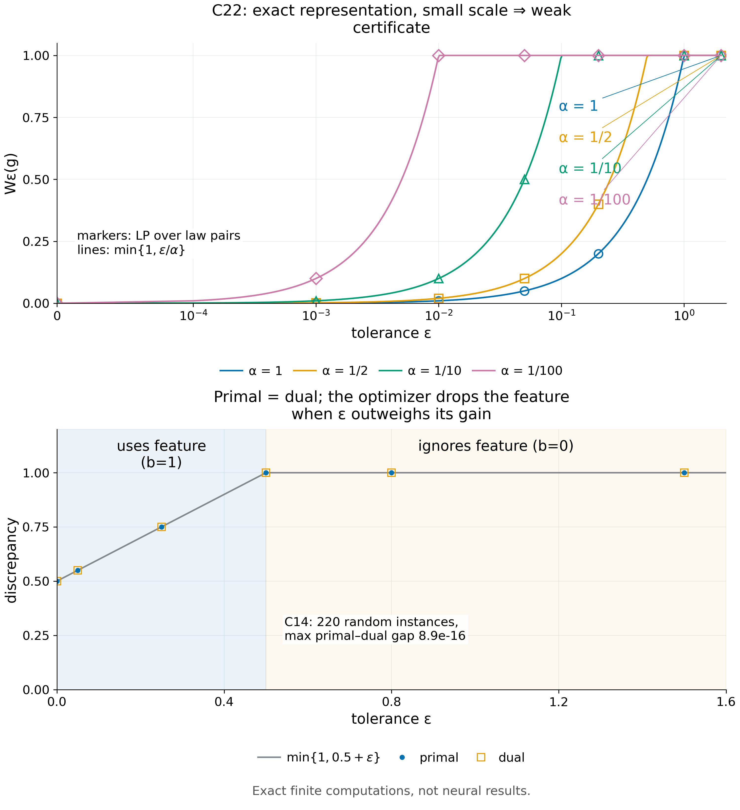
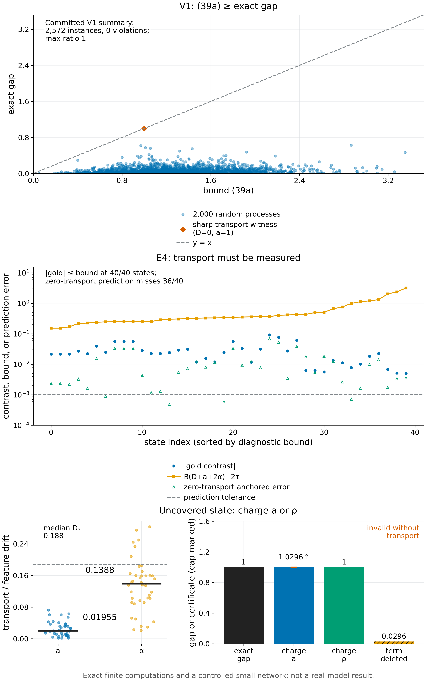
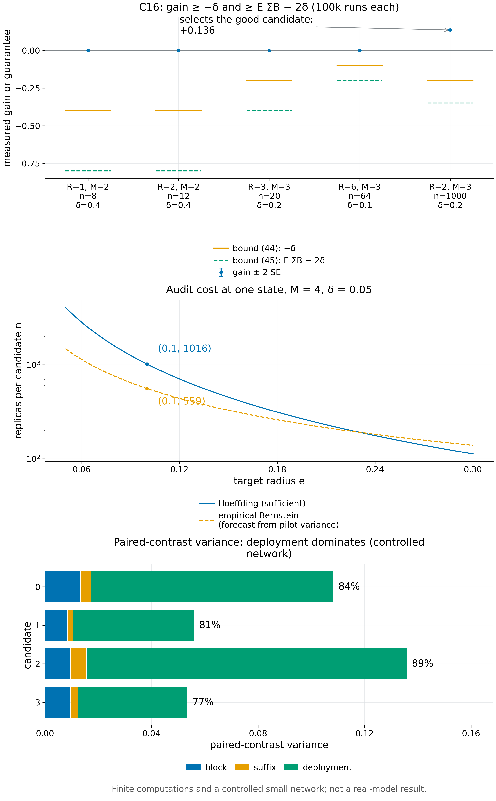
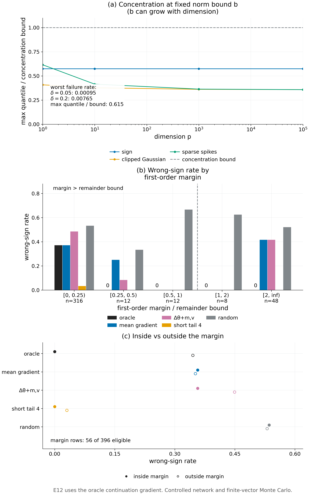

# §8 验证（Theorem C）— 实验

[← 框架总图](../README_ZH.md) · [证明](../proofs/08_verification_ZH.md) · [English](08_verification.md)

**结论.**

- **[Theorem 8.1](../proofs/08_verification_ZH.md#s8-1)（稳定性–近似权衡）精确成立.** 在 220 个随机对抗实例上原始问题与对偶问题一致，最大对偶残差为 $`8.9\times10^{-16}`$。稳定性见证在全部 28 组设定上复现 $`W_\epsilon=\min\lbrace1,\epsilon/\alpha\rbrace`$。
- **[Theorem 8.2](../proofs/08_verification_ZH.md#s8-2)（带 transport 的冻结选择）成立，且 transport 项是必要的.**
  - 在 2,572 个精确的有限训练过程上没有一次违反，最坏残差为 0；界可以取到（比值 1）。
  - 在一个未被覆盖的训练状态上，被 audit 的差异为 0，而学习差距为 1。
  - 在受控网络中，带实测 transport 的局部界在 40/40 个到达状态上都包住了真实对比；假设 transport 为零的预测在 36/40 个状态上失准。
- **[Theorem 8.3](../proofs/08_verification_ZH.md#s8-3)（实际状态上的自适应 audit）恰好在所述强度下成立.**
  - 5 组设定、每组 100,000 次运行，收益始终高于两条保证。
  - 符号恒等式在 50 个有理数实例上精确成立。
  - 下置信界与无条件形式都是必要的：见证中精确期望收益为 $`-78/15625`$，条件化偏差为 $`1/4\to119/494`$。
  - 充分的 Hoeffding 代价是每个候选 1,016 个配对副本。
- **[Proposition 8.4](../proofs/08_certificate_ZH.md#s8-4)（测量平均增量）在全部 144 个单元格、直到 $`p=10^5`$ 都成立.** 实测偏差分位数至多为界的 0.615，并且在增量界 $`b`$ 固定时不随 $`p`$ 增长，与 [Remark 8.5](../proofs/08_certificate_ZH.md#s8-5) 一致。
- **[Theorem 8.8](../proofs/08_certificate_ZH.md#s8-8)（CRN 配对替换证书，Theorem C）.** 在冻结的受控面板上（1,728 个候选对）：
  - 作为排序器，点估计 $`\hat S`$ 在 1,687 个 gold 非零的候选对中判错 48 个（2.8%）。
  - 测量所用的轨迹数，$`r=64`$ 时为全尾段配对 audit 的 7.0%，$`r=256`$ 时为 28.0%。
  - common random numbers 把配对差的方差降到独立尾段的 0.12–0.15 倍（方差之和的比值）。
  - 用先验区间 $`B=2`$ 的严格证书：与任务一致的 surrogate 认证 0 对，需校准的 surrogate 在 $`r=256`$ 时认证 8 对，没有认证错误。这正是 [Remark 8.12](../proofs/08_certificate_ZH.md#s8-12) 记录的缺口。
- **[Corollary 8.9](../proofs/08_certificate_ZH.md#s8-9)（一阶版本及其上限）.**
  - 用 oracle 延续值梯度时，一阶分数在 margin 超过余项界的 56/396 行上没有判错，与 (a) 一致。
  - 实测的一阶证书 (b) 在 1,584 个光滑候选对上认证 0 对。仅二阶余项一项就在 69% 的候选对上超过实测一阶分数、在 73% 上超过真实差距；按上限 (c)，这些候选对在一阶意义下永远无法被认证。
- **[Remark 8.12](../proofs/08_certificate_ZH.md#s8-12)（未解决问题）有数据支撑.** 把 $`B`$ 换成观测区间（只是诊断，不是保证）时：
  - 与任务一致的 surrogate 认证 45%–57% 的候选对，没有错误；
  - 需校准的 surrogate 认证 23%–28%，其中有 22–28 个认证错误，说明校准的迁移可能失效。

| 检验 | 检验对象 | Code ID | 结果 |
|---|---|---|---|
| [Check 8.1](#c8-1) | [Theorem 8.1](../proofs/08_verification_ZH.md#s8-1) | `v014:C14` | PASS |
| [Check 8.2](#c8-2) | [Theorem 8.1](../proofs/08_verification_ZH.md#s8-1)(c) | `v014:C22` | PASS |
| [Check 8.3](#c8-3) | [Theorem 8.1](../proofs/08_verification_ZH.md#s8-1) | `pkg:noisy_feature_duality` | PASS |
| [Check 8.4](#c8-4) | [Theorem 8.2](../proofs/08_verification_ZH.md#s8-2) | `v015:V1` | PASS |
| [Check 8.5](#c8-5) | [Theorem 8.2](../proofs/08_verification_ZH.md#s8-2)(a)、(f) | `v014:C15` | Monte Carlo PASS；覆盖见证按设计记为 FAIL |
| [Check 8.6](#c8-6) | [Theorem 8.2](../proofs/08_verification_ZH.md#s8-2) | `v014:C20` | PASS |
| [Check 8.7](#c8-7) | [Theorem 8.2](../proofs/08_verification_ZH.md#s8-2)(b)、(e) | `v015:E4` | PASS |
| [Check 8.8](#c8-8) | [Theorem 8.2](../proofs/08_verification_ZH.md#s8-2)(e)、(f) | `pkg:T01`、`pkg:T02` | PASS |
| [Check 8.9](#c8-9) | [Theorem 8.3](../proofs/08_verification_ZH.md#s8-3)(c) | `v014:C16` | PASS |
| [Check 8.10](#c8-10) | [Theorem 8.3](../proofs/08_verification_ZH.md#s8-3)(a)、(b) | `v014:C21` | PASS |
| [Check 8.11](#c8-11) | [Theorem 8.3](../proofs/08_verification_ZH.md#s8-3)(c) | `pkg:adaptive_gate_expectations` | PASS |
| [Check 8.12](#c8-12) | [Theorem 8.3](../proofs/08_verification_ZH.md#s8-3)(d) | `pkg:T13`、`v015:E7` | PASS；`v015:E7` 的副本数是预测 |
| [Check 8.13](#c8-13) | [Proposition 8.4](../proofs/08_certificate_ZH.md#s8-4)(a)、[Remark 8.5](../proofs/08_certificate_ZH.md#s8-5) | `v015:V9` | PASS |
| [Check 8.14](#c8-14) | [Theorem 8.8](../proofs/08_certificate_ZH.md#s8-8)、[Proposition 8.10](../proofs/08_certificate_ZH.md#s8-10)、[Remarks 8.11–8.12](../proofs/08_certificate_ZH.md#s8-11) | `v016:C6b`、`v016:C5b` | PASS（没有错误的严格证书）；严格证书覆盖率 0（与任务一致的 surrogate） |
| [Check 8.15](#c8-15) | [Corollary 8.9](../proofs/08_certificate_ZH.md#s8-9)(a)、(d) | `v015:E12` | margin 内零判错（oracle 梯度） |
| [Check 8.16](#c8-16) | [Corollary 8.9](../proofs/08_certificate_ZH.md#s8-9)(b)、(c) | `v016:C6` | PASS（实现层面）；1,584 对中认证 0 对 |

所有检验都是精确的有限计算、有限过程上的 Monte Carlo，或受控小网络。没有一项是真实模型或 benchmark 上的结果。

<a id="c8-1"></a>

## Check 8.1 · 随机实例上的原始–对偶等式（Theorem 8.1）

**结论.** 在 220 个随机对抗实例上，在律对上直接计算的容差差异与两种对偶形式都相等。最大对偶残差为 $`8.9\times10^{-16}`$。

**动机.** [Theorem 8.1](../proofs/08_verification_ZH.md#s8-1) 断言的是一个*等式*：在满足容差的律对中，最坏的 response 差异等于对特征系数的一个最小值。对偶写错，或漏掉零质量条件之类的约束，都会在某个随机实例上表现为严格的间隙。

**设置.**

- 随机有限实例：消息数 $`m\in[3,12]`$，特征数 $`d\in[1,m-1]`$。
- 随机 response $`g`$、随机特征 $`\phi`$、随机容差 $`\epsilon_j\ge0`$（包括恰好为零的情形）。
- 种子 `SeedSequence([20261010, 14])`。
- 用 HiGHS 独立求解三个线性规划：
  - 直接写在概率变量上的、对 $`(P,Q)`$ 的原始最大化；
  - 振幅对偶 $`\min_b[\mathrm{osc}(g-\Phi b)+\sum_j\epsilon_j\lvert b_j\rvert]`$；
  - 中心化 sup 范数对偶 $`\min_{b,c}[2\lVert g-c-\Phi b\rVert_\infty+\sum_j\epsilon_j\lvert b_j\rvert]`$。
- 另外断言：$`W\le\mathrm{osc}(g)`$；$`\mathbf{\epsilon}=0`$ 时退化为精确情形 Theorem 8.1(b)，即 [Theorem 4.2](../proofs/04_complexity_of_sufficiency_ZH.md#s4-2)(b) 的单个 response 形式；以及 $`\mathbf{\epsilon}`$ 很大时 $`W\to\mathrm{osc}(g)`$。
- 原始 LP 在每个实例上都是全局最大化，因此搜索本身就是对抗的。

**结果**（`theory/independent_checks/results_independent_v014.json`，条目 `v014:C14`）：

| 量 | 值 |
|---|---:|
| status | PASS |
| `n_instances` | 220 |
| `n_assertions` | 2,420 |
| `worst_residual` | $`9.80\times10^{-13}`$ |
| `details.max_duality_residual` | $`8.88\times10^{-16}`$ |

**为什么支持该陈述.**

- 原始问题和两种对偶形式在每个实例上都一致，包括零容差和秩亏的特征。
- 所以精确对偶按所述成立，不需要内点条件或秩条件。

<a id="c8-2"></a>

## Check 8.2 · 缩放特征下的稳定性控制（Theorem 8.1(c)）

**结论.** 对特征 $`\phi=\alpha g`$，差异在全部 28 组设定上都等于 $`\min\lbrace1,\epsilon/\alpha\rbrace`$，最坏残差为 $`1.39\times10^{-17}`$。

**动机.** 稳定性见证 [Theorem 8.1](../proofs/08_verification_ZH.md#s8-1)(c) 是观察稳定性项最干净的方式。让特征等于 response 乘一个尺度，$`\phi=\alpha g`$。这时近似残差为零，但随着 $`\alpha\to0`$，证书必须变差：对 $`\phi`$ 的容差 $`\epsilon`$ 只能把 $`g`$ 约束在 $`\epsilon/\alpha`$ 以内。

**设置.**

- 二值 response $`g`$，特征 $`\phi=\alpha g`$。
- 尺度 $`\alpha\in\lbrace 1,\tfrac12,\tfrac1{10},\tfrac1{100}\rbrace`$，容差 $`\epsilon\in\lbrace 0,\tfrac1{1000},\tfrac1{100},\tfrac1{20},\tfrac15,1,2\rbrace`$，共 28 组设定。
- 独立求解概率变量上的原始 LP 与容差对偶 LP，并与以精确有理数保存的闭式比较。

**结果**（条目 `v014:C22`，`details.configurations`；28 行全部与公式一致）：

| $`\alpha`$ | $`\epsilon=10^{-3}`$ | $`\epsilon=10^{-2}`$ | $`\epsilon=1/20`$ | $`\epsilon=1/5`$ | $`\epsilon\ge1`$ |
|---|---:|---:|---:|---:|---:|
| 1 | 0.001 | 0.01 | 0.05 | 0.2 | 1 |
| 1/2 | 0.002 | 0.02 | 0.1 | 0.4 | 1 |
| 1/10 | 0.01 | 0.1 | 0.5 | 1 | 1 |
| 1/100 | 0.1 | 1 | 1 | 1 | 1 |

$`\epsilon=0`$ 时，对每个 $`\alpha`$ 差异都是 $`0`$。

**为什么支持该陈述.**

- 即使表示是精确的，证书也只有 $`\epsilon\lvert b\rvert`$ 那么好，其中 $`b=1/\alpha`$。
- $`\alpha=1/100`$ 时，1% 的容差就已经让 response 完全不确定（$`W=1`$）。
- 所以小的近似残差本身不构成证书，系数大小必须进入证书，正如 Theorem 8.1 所述。

<a id="c8-3"></a>

## Check 8.3 · 一个有闭式的容差对偶例子（Theorem 8.1）

**结论.** 在一个有闭式的例子上，原始值、对偶值与闭式在六个容差处都一致；另外 36 个随机 LP 上的最大原始–对偶残差为 $`8.9\times10^{-16}`$。

**动机.** 这是理论包里的一个独立实现，用在最优系数已知的例子上。

**设置.**

- $`\mathcal Y=\lbrace 0,\tfrac12,1\rbrace`$，$`\phi(y)=y`$，$`g=1\lbrace y=1\rbrace`$；闭式为 $`W_\epsilon=\min\lbrace 1,\tfrac12+\epsilon\rbrace`$。
- 在六个容差下求解原始与对偶 LP，记录见证律与最优系数。

**结果**（`theory/v014_repro/results_v014_rerun.json`，键 `noisy_feature_duality`）：

| 容差 | 原始 | 对偶 | 闭式 | 最优 $`b`$ | `uniform_residual` |
|---:|---:|---:|---:|---:|---:|
| 0 | 0.50 | 0.50 | 0.50 | 1 | 0.25 |
| 0.05 | 0.55 | 0.55 | 0.55 | 1 | 0.25 |
| 0.25 | 0.75 | 0.75 | 0.75 | 1 | 0.25 |
| 0.5 | 1.00 | 1.00 | 1.00 | 0 | 0.5 |
| 0.8 | 1.00 | 1.00 | 1.00 | 0 | 0.5 |
| 1.5 | 1.00 | 1.00 | 1.00 | 0 | 0.5 |

`uniform_residual` 是最优 $`b`$ 处的 $`\min_c\lVert g-c-b\phi\rVert_\infty`$。`random_LP_cases` = 36，`maximum_primal_dual_residual` = $`8.9\times10^{-16}`$。

**为什么支持该陈述.** 当测量代价 $`\epsilon`$ 超过近似收益时，最优解恰好从使用该特征（$`b=1`$）切换到忽略它（$`b=0`$）。Theorem 8.1 精确刻画的正是这个权衡。



*Figure 8.1.* 左：缩放特征 $`\phi=\alpha g`$ 的容差差异（Check 8.2）；LP 值落在 $`\min\lbrace1,\epsilon/\alpha\rbrace`$ 上，所以一个精确但尺度很小的特征只能认证到 $`\epsilon/\alpha`$。右：Check 8.3 的例子，原始值、对偶值与闭式重合，$`\epsilon\ge\tfrac12`$ 后最优解不再使用该特征。精确有限计算。[PDF](../figures/fig8_1_stability.pdf)

<a id="c8-4"></a>

## Check 8.4 · 精确的有限训练过程（Theorem 8.2）

**结论.** 在 2,572 个精确的有限马尔可夫训练过程上，transport 界从未被违反（最坏残差 0），并在一个尖锐见证上取等。界中的每一项都由一个单独的见证表明不可去掉。

**动机.** 学习价值界 [Theorem 8.2](../proofs/08_verification_ZH.md#s8-2)(c) 把停止形式的 telescoping 恒等式、局部 transport 界 (b) 和 audit 事件 (a) 组合在一起。其中任何一环出错，都会产生精确学习差距超过界的实例。这里在随机和对抗实例上，用有理数算术精确计算两边。

**设置.**

- 有限马尔可夫训练过程：2–4 个被认证状态外加一个退出状态，消息字母表大小 2–4，$`R`$ 轮。
- 随机的参考与候选 kernel、随机的实际更新、随机的有界终端值。
- 显式的 response 分解 $`c+b^\top\phi+r`$、精确的 transport 误差 $`a_{t,j}(z)`$、特征漂移 $`\alpha_{zx}`$（Theorem 8.2(e)），以及退出概率 $`\rho`$。
- 种子 `SeedSequence([150150, 1])`；所有数值都是 `Fraction`。
- 做法：
  1. 用后向值计算精确差距 $`\lvert L_E(0)-L_E(j)\rvert`$；
  2. 独立地前向计算停止后的占据测度；
  3. 计算 Theorem 8.2(c) 的界，并在 2,000 个随机实例上断言差距 ≤ 界；
  4. 对候选 kernel 做爬山式对抗搜索；
  5. 加入下面的固定见证，以及 IID 仿射特例（Theorem 8.2(d)）的 120 个随机实例。

**结果**（`theory/v015_checks/results_v015_independent.json`，组 `v015:V1`）：

| 量 | 值 | 键 |
|---|---:|---|
| status | PASS | `status` |
| 实例 / 断言 | 2,572 / 28,182 | `n_instances`、`n_assertions` |
| 最坏残差（差距 ≤ 界 的违反量） | 0 | `worst_residual` |
| 全部实例上最大的差距/界 比值 | 1.0（尖锐见证） | `best_ratio`、`data.sharp_transport_witness` |
| 2,000 个随机实例上的最大比值 | 0.736（差距 0.294，界 0.400） | `data.worst_random` |
| 最佳对抗比值 | 0.198（差距 0.220，界 1.114，$`\rho=74/75`$） | `data.adversarial.best` |
| IID 仿射（Theorem 8.2(d)）：差距 ≤ 界 的实例 | 120 / 120；最大比值 1.0；对抗 0.565 | `data.affine_40`、`data.affine_adversarial` |
| 精确的 audit 事件概率（Theorem 8.2(a)），$`n=32`$，$`\delta=0.3`$ | 0.99948；最坏选择超出量 −0.605（为负表示 (a) 成立） | `data.exact_finite_audit_37_38.best` |

见证：每个见证说明界中的某一项不能去掉。

| 见证 | 精确值 | 必须计入的项 |
|---|---|---|
| 未被覆盖的训练状态（`data.regression`） | 差距 $`=1`$；计入 $`a=1`$ 时界为 $`1.0296`$（截断为 $`1`$）；计入退出 $`\rho=1`$ 时为 $`1`$；删掉 transport 项后为 $`0.0296`$ | transport $`a`$ 或退出 $`\rho`$ |
| 尖锐 transport（`data.sharp_transport_witness`） | $`D=0`$，$`a=1`$，差距 $`=`$ 界 $`=1`$ | 界是紧的 |
| 遗漏一个可达状态（`data.omission_witness`） | 到达概率 $`8/9`$；差距 $`8/9`$；把该状态的项置零后界为 $`0`$；有效的退出界为 $`8/9`$ | 每个退出前访问到的状态，或 $`\rho`$ |
| 完整状态（`data.optimizer_state_witness`） | 两个状态的 $`\theta=-1`$ 相同；$`(m,v)=(\tfrac12,\tfrac12)`$ 对 $`(1,2)`$；下一步一阶矩为 $`-1/8`$ 对 $`+1/8`$ | cell 必须定义在 complete learner state 上 |
| 系数大小（`data.coefficient_stability`） | 特征尺度 $`10^{-4}`$，$`B=10^4`$，$`D=10^{-4}`$，残差 0，差距 1 | $`B_t`$ 与 $`D`$ 相乘（[Theorem 8.1](../proofs/08_verification_ZH.md#s8-1)） |

**为什么支持该陈述.** 只要假设成立，界就成立；界可以取到；而且每个假设都不可少：

- 可达状态要么连同实测的 transport 被覆盖，要么计入退出概率；
- cell 必须是 complete learner state，而不是参数检查点；
- 系数以乘法方式进入。

<a id="c8-5"></a>

## Check 8.5 · audit 集中性与覆盖见证（Theorem 8.2(a)、(f)）

**结论.** 在四组 Monte Carlo 设定中，同时成立的 audit 事件出现频率都不低于名义值，选择不等式在其上成立。在覆盖探针上，被 audit 的差异为 0，而学习差距为 1。检验套件按设计把这一检验记为 FAIL：失败的那条断言是在探针上计算一个不含 transport 的界，而这恰好是 Theorem 8.2(f) 预言的违反。

**动机.** 检验两件事：

- 用 Monte Carlo 检验 [Theorem 8.2](../proofs/08_verification_ZH.md#s8-2)(a) 的同时 Hoeffding 事件与选择不等式；
- 一个精确的、依赖状态的 provider：它在被 audit 的 cell 上与参考一致，在一个被访问的状态上却不一致。这是必要性陈述 (f) 背后最小的实例。

**设置.**

- 四组 audit 设定 $`(M,L,d,n_0,n_S,\delta)`$，每组 3,000 次独立试验。
- 一个有限学习实例：每个 response 恰为 $`c+b^\top\phi_x`$（$`\tau=0`$），transport 精确。
- 覆盖探针：被 audit 的 cell 0，被认证状态 $`\lbrace 0,1\rbrace`$，初始状态 1，更新 $`U(z,y)=y`$，终端值 $`(0,1)`$。
- 做法：抽取 audit 样本，记录事件是否发生，计算 $`\widehat j`$ 以及选择不等式 (a) 和精确 transport 证书 (d) 的超出量。对探针，计算精确差距，以及把状态 1 当作已覆盖、不计 transport 项时得到的表达式。

**结果**（`theory/independent_checks/results_independent_v014.json`，条目 `v014:C15`，`details`）：

| $`M,L,d`$ | $`n_0,n_S`$ | $`\delta`$ | 事件频率 | 最坏超出量，(a) | 最坏超出量，(d) |
|---|---|---:|---:|---:|---:|
| 2,2,2 | 40, 50 | 0.10 | 1.000 | −0.873 | −0.238 |
| 4,3,3 | 100, 80 | 0.05 | 1.000 | −0.573 | −0.500 |
| 3,1,1 | 1000, 1200 | 0.20 | 0.99967（SE 0.00033） | −0.160 | −0.061 |
| 2,2,2 | 8, 8 | 0.40 | 1.000 | −1.626 | −0.477 |

超出量为负，表示不等式以该余量成立。

覆盖探针（`details.coverage_probe`）：被 audit 的经验差异为 $`0`$，audit 事件概率为 $`1`$，真实学习差距为 $`1`$；删掉 transport 项得到的表达式是 $`0.0296`$。套件状态为 FAIL，原因是有一条断言在探针上计算了不含 transport 的表达式（`worst_residual` 为 0.970，即差距减去该表达式）。(a) 与 (d) 的所有 Monte Carlo 断言都通过，见上表。

**为什么支持该陈述.**

- 在每组设定中，audit 事件出现的频率都不低于 $`1-\delta`$，(a) 和精确 transport 证书 (d) 在其上成立。
- 探针是被 audit 的状态与被训练到的状态不同的最小情形。只有像 Theorem 8.2(c) 那样计入 transport 或退出的界，在这里才成立；这就是陈述 (f)。

<a id="c8-6"></a>

## Check 8.6 · 正确的特征、遗漏的特征，以及带退出惩罚的覆盖（Theorem 8.2）

**结论.** 特征和覆盖都正确时证书成立；遗漏一个相关特征会藏住 $`1/2`$ 的差距；被访问但未被覆盖的状态必须通过 $`\rho`$ 计入。

**动机.** 三个有限对照把证书的三个组成部分分开：正确的特征覆盖、与决策相关的特征、状态覆盖。

**设置.** 一个 response 已知的精确有限学习过程，分三种对照：(i) 正确的特征集；(ii) 去掉一个相关特征；(iii) 训练到达被 audit 集合之外的状态。

**结果**（条目 `v014:C20`，`details`；PASS，11 条断言，最坏残差 0）：

| 对照 | 数值 |
|---|---|
| (i) 正确特征，$`n=120`$ 的 audit，$`\delta=0.05`$ | $`\widehat D=1/12`$，$`e_0+e_S=0.270`$。精确 transport 证书（Theorem 8.2(d)）：$`0.354`$ ≥ 实际三步更新差距 $`1/12`$。平方回报任务上 $`C_J=2`$ 的仿射证书：$`0.707`$ ≥ 实际差距 $`23/216=0.106`$ |
| (ii) 遗漏特征 | 两个 provider 在每个被 audit 的特征上都一致，学习价值却相差 $`1/2`$ |
| (iii) 覆盖 | 差距 $`1`$；计入 $`\rho=1`$ 时界为 $`1`$；不计 $`\rho`$ 时，不含覆盖的值为 $`0`$ |

**为什么支持该陈述.**

- 特征与覆盖都正确时，证书成立。
- 缺一个特征留下的差距，任何对其余特征的 audit 都看不见；这就是 [Theorem 4.2](../proofs/04_complexity_of_sufficiency_ZH.md#s4-2)(a) 的精确充分性条件。
- 被访问但未被覆盖的状态必须通过 $`\rho`$ 计入。

<a id="c8-7"></a>

## Check 8.7 · 受控网络中到达状态上的 transport（Theorem 8.2(b)、(e)）

**结论.** 在一个用 Adam 训练的小网络实际到达的 40 个状态上，transport 不为零（中位数 0.0195）。带实测 transport 的局部界在全部 40 个状态上都包住了 gold 全尾段对比，而假设 transport 为零的锚点预测在 36 个状态上失准。

**动机.** 在神经网络学习器中，训练会到达新的状态。Theorem 8.2(b) 的局部界（连同 (e) 的特征漂移）在这些状态上需要 transport 项。这里测量它的大小，并检验带实测 transport 与特征漂移的局部界能否包住实际对比。

**设置.**

- 网络：one-hot 上下文，4 个 tanh 单元，sigmoid 输出，平均交叉熵，float64，用 Adam 训练（即各实验页通用的受控网络）。
- 锚点：三个实际参考状态，分别在 0、2、5 次更新之后，被 audit 的差异为 $`D_x=0.200, 0.169, 0.188`$。
- 到达状态：40 个新状态，位于第 1 到第 13 次更新之间。每个状态上的消息都是同样的四个标量标签。
- provider 规则 $`Q_z=(1-\lambda)Q_3+\lambda\delta_1`$，$`\lambda=0.1+0.6\,p(\theta_z)`$，所以候选律依赖于状态。
- 全尾段：6 次实际更新，精确枚举。种子 `SeedSequence([150150, 104])`。
- 在每个到达状态上：
  1. 测量到其锚点的 transport $`a_{t,j}(z)`$ 与特征漂移 $`\alpha_{zx}`$；
  2. 拟合 response 分解，记录 $`B`$ 与 $`\tau`$；
  3. 计算 gold 全尾段对比；
  4. 与 (a) 假设 transport 为零的锚点预测，以及 (b) 局部界 $`B(D_x+a+2\alpha)+2\tau`$ 比较。

**结果**（组 `v015:E4`，`data`；分位数依次为最小 / 中位数 / 90% / 最大）：

| 量 | 值 |
|---|---|
| 40 个状态上的 transport $`a_{t,j}(z)`$ | 最小 0.0014，中位数 0.0195，最大 0.0727（`observations[*].a`） |
| 特征漂移 $`\alpha_{zx}`$ | 最小 0.021，中位数 0.139，最大 0.283（`observations[*].alpha`） |
| gold 对比落在 $`B(D_x+a+2\alpha)+2\tau`$ 之内的状态 | **40 / 40**（断言） |
| 锚点预测误差 | 0.00048 / 0.0063 / 0.0328 / 0.0681（`absolute_error_quantiles`） |
| 误差 $`>10^{-3}`$ 的锚点预测 | 36 / 40（`failures`） |
| response 残差 $`\lvert r\rvert`$ | 0.0003 / 0.047 / 0.146 / 0.540（`response_residual_quantiles`） |

**为什么支持该陈述.**

- 在实际到达的状态上 transport 不为零：中位数 0.02，而被 audit 的差异约为 0.2。证书必须测量它。
- 测量之后，局部界处处包住真实对比；而用零 transport 外推锚点 audit，在 90% 的状态上是错的。
- 局部界的中位数为 0.34，gold 对比的中位数为 0.023。这个界成立但偏松；在神经网络学习器里，有用的信息在于测出 $`a`$，而不在于它的最坏情形大小。

<a id="c8-8"></a>

## Check 8.8 · 理论包检验 `pkg:T01` 与 `pkg:T02`（Theorem 8.2(e)、(f)）

**结论.** 一个独立实现在 1,200 个实例上确认了未覆盖状态的见证，以及带漂移修正的局部界。

**动机.** 这些是修订包里的独立实现。

**结果**（`docs/direction/v015_revision/results_v015.json`，`checks`）：

| 检验 | 结果 |
|---|---|
| `pkg:T01`（未覆盖状态的见证） | PASS。差距 $`1.0`$；transport 界（截断）$`1`$；退出界 $`1`$；删掉 transport 项后为 $`0.0296`$ |
| `pkg:T02`（局部 transport 与特征漂移，Theorem 8.2(b)、(e)） | 在 1,200 个实例上 PASS；局部 差距/界 的最大值为 $`0.503`$ |

**为什么支持该陈述.** 必要性见证 (f) 和局部界的特征漂移形式 (e)，由一份与 Check 8.4–8.7 不共享任何代码的实现复现。



*Figure 8.2.* 2,000 个随机有限训练过程上的精确差距对考虑 transport 的界（Check 8.4）：没有一个点落在对角线上方。在受控网络中（Check 8.7），带实测 transport 的局部界在全部 40 个到达状态上包住 gold 全尾段对比，而零 transport 的锚点预测失准 36 个。最后一幅显示到达状态上的 transport 与特征漂移，以及未覆盖状态的见证：删掉 transport 项得到的 0.0296 不成立，实际差距为 1。[PDF](../figures/fig8_2_transport.pdf)

<a id="c8-9"></a>

## Check 8.9 · 有限学习过程上的自适应 audit（Theorem 8.3(c)）

**结论.** 5 组设定、每组 100,000 次独立训练，自适应 audit 的实测收益始终高于两条保证 $`-\delta`$ 与 $`\mathbb E\sum_tB_t-2\delta`$。被选中的漂移超过 $`\sum_tB_t`$ 的频率为 0.990–0.999，高于每一个名义 $`1-\delta`$。

**动机.** [Theorem 8.3](../proofs/08_verification_ZH.md#s8-3)(c) 给出一个高概率的漂移陈述和两条无条件的期望界。若被违反，会表现为实测收益低于 $`-\delta`$ 或低于 $`\mathbb E\sum B-2\delta`$，或漂移成立的频率低于 $`1-\delta`$。

**设置.**

- 一个小的有限学习过程：4 个状态，$`R\le6`$，每个状态 $`M\in\lbrace 2,3\rbrace`$ 个候选 kernel，真实 advantage 已知。
- audit 从真实模型中抽取有界的配对对比：完整参考尾段加 Bernoulli 部署。
- 按下置信界选择，$`e_t=\sqrt{2\log(2M/\delta_t)/n_t}`$，之后做一次新的更新。
- 压力设定：小 $`n_t`$、大 $`\delta_t\in[0.1,0.4]`$，以及均值略为负、方差很大的候选。
- 种子 `SeedSequence([20261010, 16])`。
- 每组设定跑 100,000 次完整训练（audit 加更新）；估计收益及其标准误，并以 4 个 SE 的余量检验两条界。

**结果**（`theory/independent_checks/results_independent_v014.json`，条目 `v014:C16`，`details.configurations`）：

| $`R`$ | $`M`$ | $`n`$ | $`\delta`$ | 半径 | 收益（SE） | $`\mathbb E\sum B`$ | 漂移频率 | ≥ $`1-\delta`$ |
|---:|---:|---:|---:|---:|---|---:|---:|---|
| 1 | 2 | 8 | 0.4 | 0.759 | 0.00084 (0.00091) | 0.00090 | 0.99412 | ✓ |
| 2 | 2 | 12 | 0.4 | 0.707 | −0.00067 (0.00102) | 0.00088 | 0.99002 | ✓ |
| 3 | 3 | 20 | 0.2 | 0.671 | 0.00003 (0.00106) | 0.00054 | 0.99407 | ✓ |
| 6 | 3 | 64 | 0.1 | 0.429 | 0.00115 (0.00108) | 0.00026 | 0.99628 | ✓ |
| 2 | 3 | 1000 | 0.2 | 0.090 | **0.13638** (0.00097) | 0.05153 | 0.99897 | ✓ |

状态 PASS，共 500,450 个实例、468 条断言。对 327 个不同实例做对抗搜索，最佳余量（界 − 收益）为 $`-0.199`$，即界始终低于收益（`adversarial_best_bound_minus_gain`）。

必要性见证（条目 `v014:C16`，`details`）：

| 见证 | 值 | 含义 |
|---|---|---|
| `point_estimate_exact_gain` | $`-78/15625`$ | 按 $`\widehat A`$ 选择而不减 $`e_t`$，期望上可能亏损，所以需要下置信界 |
| `zero_drift_conditioning_witness` | 条件值 $`119/494`$ 对无条件值 $`1/4`$（状态 1 上 audit 失败概率 $`9/128`$） | 以 audit 通过为条件会使终端值有偏，所以保证必须是无条件的 |
| `conditioning_probe_found_45_violation` | false（搜索了 5 组设定） | 尽管条件值有偏，无条件的界没有被违反 |
| `replicas_required_per_candidate` | 1016 | $`M=4,\delta=0.05,e=0.1`$ 时的 Hoeffding 分配 |

**为什么支持该陈述.** 保证恰好在所述强度下成立，不更强：

- 副本少、$`\delta`$ 大时，audit 几乎从不选择，收益停在 $`-\delta`$ 的下限之内；
- 副本足够（$`n=1000`$）时，它选中有益的候选，收益为 $`0.136`$，远高于 $`\mathbb E\sum B-2\delta`$。

<a id="c8-10"></a>

## Check 8.10 · 符号恒等式，以及 fidelity 与提升（Theorem 8.3(a)、(b)）

**结论.** 符号 telescoping 恒等式在 50 个有理数过程上精确成立（残差 0）；fidelity 界在三个例子中都取等，其中一个例子里，对一个无效参考的忠实复制会损失 $`0.11`$。

**动机.** Theorem 8.3(b) 是对依赖历史的 provider 选择成立的精确恒等式，(a) 把 fidelity 与提升区分开。两者都做精确检验。

**设置.**

- 50 个带状态相关 kernel 选择的有理数有限过程，外加对 $`\mathrm{LHS}-\mathrm{RHS}`$ 的对抗搜索。
- 三个 fidelity 例子：好的参考（$`\gamma>0`$）、无效的参考（$`\gamma<0`$）、中性的参考（$`\gamma=0`$），各配一个 fidelity 为 $`\varepsilon=1/100`$ 的候选。

**结果**（条目 `v014:C21`）：PASS，834 条断言，最坏残差 0，`adversarial_best_lhs_minus_rhs` = 0。

| 初始 | 参考 | 候选 | $`\gamma`$ | $`\varepsilon`$ | 候选收益 | 收益 ≥ $`\gamma-\varepsilon`$ |
|---:|---:|---:|---:|---:|---:|---|
| 1/2 | 4/5 | 79/100 | 3/10 | 1/100 | 29/100 | ✓（取等） |
| 1/2 | 2/5 | 39/100 | −1/10 | 1/100 | −11/100 | ✓（取等） |
| 1/2 | 1/2 | 49/100 | 0 | 1/100 | −1/100 | ✓（取等） |

**为什么支持该陈述.**

- 符号恒等式精确成立。
- 对一个无效参考的高 fidelity 复制并不能提升初始学生：其收益为 $`-0.11`$。fidelity 只能继承参考自身的收益。

<a id="c8-11"></a>

## Check 8.11 · 自适应门控的精确期望（Theorem 8.3(c)）

**结论.** 不用 Monte Carlo 的精确期望满足两条界；一个略差的候选以 0.00458 的概率通过乐观的门控，所以期望变化可以严格为负。

**动机.** 对自适应门控的独立精确计算，并说明保证为什么带 $`-\delta`$ 而不是 $`0`$。

**结果**（`theory/v014_repro/results_v014_rerun.json`，`adaptive_gate_expectations`；每个候选 $`n=400`$，$`\delta=0.05`$，半径 $`0.136`$）：

| 量 | 值 |
|---|---:|
| 无条件期望收益 | 0.200 |
| 被选中下置信界之和的期望 $`\mathbb E\sum`$ | 0.132 |
| 下界 $`-\delta`$ | −0.050 |
| 下界 $`\mathbb E\sum B-2\delta`$ | 0.032 |
| 失败概率 | $`1.5\times10^{-8}`$ |
| 不存在精确的不退化：误选概率 / 期望收益（$`n=20`$，$`\delta=0.9`$，候选 0.49 对参考 0.50） | 0.00458 / $`-4.6\times10^{-5}`$ |

**为什么支持该陈述.** 两条界在精确期望下都成立；反例表明，"不比参考差"只能在 $`\delta`$ 以内成立。

<a id="c8-12"></a>

## Check 8.12 · audit 的代价（Theorem 8.3(d)）

**结论.** 每个候选 1,016 个配对副本的 Hoeffding 分配（$`M=4`$，$`\delta=0.05`$，$`e=0.1`$）给出半径 0.09995，与陈述一致；它是充分的，不是必要的。在受控网络中，部署噪声占配对方差的 77%–89%，empirical Bernstein 半径*预测*只需 559 个副本。

**动机.** 定理给出的分配有效但昂贵，在任何真实模型上使用之前都必须知道它的代价。这里在受控网络中测量配对对比的方差，看对方差敏感的半径能省多少。

**设置（`v015:E7`）.**

- 受控网络，一个预先声明的 audit 轮，四个候选 provider 对一个共同参考。
- 一个参考副本在各候选间复用，并保留候选之间的协方差。
- 2,400 个独立的配对 pilot 副本，用逆 CDF 耦合。
- 方差被精确分解为 block 抽样、后续训练和部署三部分。种子 `SeedSequence([150150, 107])`。

**结果**（`docs/direction/v015_revision/results_v015.json` 的 `checks.T13_*`；`theory/v015_checks/results_v015_independent.json` 中的组 `v015:E7`，`data`）：

| 量 | 值 |
|---|---|
| `pkg:T13`：充分的 Hoeffding 配对数（$`M=4,\delta=.05,e=.1`$） | 1016；1016 时半径 = 0.09995；`is_necessary_lower_bound` = false |
| `v015:E7` 的 Hoeffding 分配 | 每个候选 1016；共享参考时 5,080 个训练分支（不复用时 8,128） |
| `v015:E7` 的 empirical Bernstein **预测** | 每个候选 559；$`n=559`$ 时半径 0.0999，基于最大 pilot 方差 0.129 |

配对对比的方差分解（`v015:E7`）：

| 候选 | 均值 | block | 后续训练 | 部署 | 总计 | 部署占比 |
|---:|---:|---:|---:|---:|---:|---:|
| 0 | −0.084 | 0.0133 | 0.0041 | 0.0908 | 0.1082 | 84% |
| 1 | −0.042 | 0.0084 | 0.0020 | 0.0454 | 0.0559 | 81% |
| 2 | −0.143 | 0.0096 | 0.0060 | 0.1202 | 0.1358 | 89% |
| 3 | 0.057 | 0.0096 | 0.0027 | 0.0410 | 0.0533 | 77% |

**为什么支持该陈述.**

- Hoeffding 分配是充分的，与定理一致。
- 配对方差主要来自部署噪声，而不是训练更新。因此一个对方差敏感、固定 $`n`$ 的半径预测能少用约 45% 的副本。
- 559 是预测值。真正的 audit 必须在固定的 $`n`$ 下计算自己的半径，不能 optional stopping。`v015:E7` 还记录了根据实测集群耗时对 12B 模型做的推算（`data.forecast`），那是规划输入，不是测量。



*Figure 8.3.* 自适应 audit 的实测收益（±2 SE，每组设定 100,000 次训练，Check 8.9）从未低于 $`-\delta`$ 或 $`\mathbb E\sum B-2\delta`$，只有副本足够、能够做出选择时收益才大。第二幅是达到半径 $`e`$ 所需的每候选副本数：$`e=0.1`$ 时 Hoeffding 的 1,016 是充分的，empirical Bernstein 曲线是根据 pilot 方差做的预测。第三幅分解受控网络中配对对比的方差（Check 8.12），部署噪声占主导。[PDF](../figures/fig8_3_adaptive_audit.pdf)

<a id="c8-13"></a>

## Check 8.13 · 平均增量的集中性（Proposition 8.4(a)、Remark 8.5）

**结论.** 在全部 144 个单元格中（每格 20,000 次试验，共 2,880,000 个实例），失败率都远低于 $`\delta`$，实测偏差分位数从不超过界的 0.615。增量界 $`b`$ 固定时，这个比值从 $`p=1`$ 到 $`p=100{,}000`$ 都不增长。

**动机.** [Proposition 8.4](../proofs/08_certificate_ZH.md#s8-4)(a) 说，经验平均增量在 Hilbert 范数下以 $`b(1+\sqrt{2\log(1/\delta)})/\sqrt n`$ 的速率集中，界中不显含维数。LoRA adapter 有上千万个参数。若存在隐含的维数依赖，会表现为失败率高于 $`\delta`$，或实测分位数随 $`p`$ 增长而逼近界。

**设置.**

- 维数 $`p\in\lbrace1,10,1000,100000\rbrace`$，样本量 $`n\in\lbrace8,32,128\rbrace`$，置信度 $`\delta\in\lbrace0.05,0.2\rbrace`$，单样本与双样本统计量。
- 三个 $`b=1`$ 的有界分布（`data.laws`）：
  - *sign*：一个有偏的标量符号乘一个固定的单位符号向量，即 $`\eta=1/\sqrt p`$ 的归一化符号型增量，在 $`P`$ 与 $`Q`$ 下均值不同；
  - *clipped Gaussian*：$`N(0,I/p)`$ 在范数 $`1`$ 处截断；
  - *sparse spikes*：均匀选一个坐标、取等概率的符号，范数为 $`1`$。
- 高维合成量利用各向同性与 Beta 角递推精确抽样，不需要构造 $`p`$ 维向量（`data.implicit_sampling`）。
- 每格 20,000 次独立试验；种子 `SeedSequence([150150, 9])`。
- 每格记录偏差超过界的试验比例（断言 ≤ $`\delta`$ 加四个二项标准误），以及 偏差/界 的经验 $`(1-\delta)`$ 分位数。

**结果**（`theory/v015_checks/results_v015_independent.json`，组 `v015:V9`，`data.rows`）：

| $`p`$ | 单元格数 | 最坏失败率，$`\delta=0.05`$ | 最坏失败率，$`\delta=0.2`$ | 最低覆盖率 | 最大 分位数/界 |
|---:|---:|---:|---:|---:|---:|
| 1 | 36 | 0.00095 | 0.00765 | 0.99235 | 0.615 |
| 10 | 36 | 0.00030 | 0.00315 | 0.99685 | 0.574 |
| 1,000 | 36 | 0.00050 | 0.00355 | 0.99645 | 0.574 |
| 100,000 | 36 | 0.00040 | 0.00335 | 0.99665 | 0.574 |

按分布看，最大 分位数/界 为 0.574（sign）、0.408（clipped Gaussian）、0.615（sparse spikes）；总体最大值 `data.max_quantile_over_bound` = 0.615。单样本 clipped Gaussian 在 $`\delta=0.05`$ 时，这个比值随 $`p`$ 下降，在每个 $`n`$ 下都从 0.406 降到 0.291。

**为什么支持该陈述.**

- 界在每个单元格都成立，且至少保守 1.6 倍；在 $`b`$ 固定时，没有任何量随维数变差。
- 如 [Remark 8.5](../proofs/08_certificate_ZH.md#s8-5) 所说，$`b`$ 本身可以随维数增长：对未归一化的符号型增量，$`b=\eta\sqrt p`$。这时一阶差异也是同一尺度，所以相对精度仍由 $`1/\sqrt n`$ 决定（`data.caveat`）。
- 这一检验只覆盖平均增量的估计。排序还需要延续值梯度与余项（Check 8.15–8.16）。

集中性结果是 [Figure 8.4](#c8-15) 的 A 幅。

<a id="c8-14"></a>

## Check 8.14 · 受控面板上的有限 CRN 配对替换（Theorem 8.8、Proposition 8.10、Remarks 8.11–8.12）

**结论.**

- **没有错误的严格证书.** 两个副本数下都没有：[Theorem 8.8](../proofs/08_certificate_ZH.md#s8-8) 的断言通过。
- **严格证书几乎是空的.** 用先验区间 $`B=2`$ 时，与任务一致的 surrogate 在 1,728 对中认证 0 对，需校准的 short surrogate 在 $`r=64`$ 时认证 0 对、$`r=256`$ 时认证 8 对。$`r=256`$ 时 empirical Bernstein 半径的区间项为 0.156，而真实差距的中位数是 0.0037。因此"零错误"几乎是空洞的；这正是 [Remark 8.12](../proofs/08_certificate_ZH.md#s8-12) 的未解决问题。
- **作为排序器，测量是有效的.** 与任务一致的点估计 $`\hat S`$ 在 $`r=256`$ 时于 1,687 个 gold 非零的候选对中判错 48 个（2.8%），$`r=64`$ 时判错 65 个（3.9%）。
- **它便宜.** 测量所用轨迹数是同一面板上全尾段配对 audit 的 7.0%（$`r=64`$）和 28.0%（$`r=256`$）。
- **CRN 有效.** common random numbers 把配对差的方差降到独立尾段的 0.12–0.15 倍（方差之和的比值）；候选对比值的中位数为 0.0035。
- **校准的迁移可能失效.** 把 $`B`$ 换成观测区间（只是诊断）时，与任务一致的 surrogate 认证 45%–57% 的候选对、没有错误；需校准的 surrogate 认证 23%–28%，其中有 22–28 个认证错误。

**动机.** [Theorem 8.8](../proofs/08_certificate_ZH.md#s8-8) 把 oracle 延续值梯度换成一个可测量的量：在被审计状态上一次有限替换的效应，用 common random numbers 估计。它的估计目标在期望上精确成立，也不需要光滑性，所以只有统计项（$`e_{\rm stat}`$）与 surrogate 校准项（$`\varepsilon_{\rm sur}`$）两类误差。这一检验回答三个问题：

- 有没有错误的严格证书（必须没有）；
- 先验区间的代价有多大（Remark 8.12）；
- Remark 8.11 的校准能否从校准状态迁移到 held-out 状态。

**设置.**

- **面板.** 冻结的受控网络 provider 面板：40 个不同的 held-out cell，九个 provider 律（一个参考加 $`M=8`$ 个候选），48 个 split/cell 组合，1,728 个无序候选对（其中 1,584 个在光滑目标上），以及 432 个 候选对参考 的行（其中 396 个光滑，就是 Check 8.15 做 oracle margin 分析的那些行）。
- **gold.** 每个候选对的精确八步更新结果：一个候选边界，之后是全部 128 条七步参考历史。测量之后重新计算，与冻结记录的差不超过 $`1.1\times10^{-16}`$。
- **替换.** 对十个支撑点中的每一个，执行实际的一轮 optimizer 增量。第 $`\ell`$ 个副本抽一条新的七步参考尾段 $`\omega_\ell`$，所有候选共用；每个更新后的支撑点状态沿它继续，终端结果再按各 provider 的精确律加权。对支撑点的积分发生在非线性尾段之后，所以估计目标就是 [Definition 8.6](../proofs/08_certificate_ZH.md#s8-6) 中的 $`\tilde L(P^j)-\tilde L(P^k)`$，不是平均更新的近似。
- **副本.** $`r=256`$ 条独立尾段；$`r=64`$ 取前 64 条。随机流 `SeedSequence([160160,66,warmup_step,recipe_id,0])`。
- **Surrogate.**
  - *与任务一致（aligned）*：完整七步参考尾段之后的有界任务效用；$`\alpha=1`$，$`\varepsilon_{\rm sur}=0`$。
  - *短尾段（short）*：一步参考更新之后的同一效用。按 Remark 8.11，在任何 held-out 测量之前，在八个单独的校准 cell（288 对）上校准，这些 cell 与 held-out cell 没有共同的 complete learner state：用 gold 精确差对实测短尾段差做过原点、系数为正的最小二乘，得到 $`\alpha`$；$`\varepsilon_{\rm sur}`$ 为最大校准残差除以 $`\alpha`$。
- **半径.** $`\delta=0.05`$ 在同一状态的所有候选对上同时成立，$`\log(4M^2/\delta)=8.5409`$，$`\hat V`$ 为 $`Z`$ 的无偏样本方差：

```math
e_{\rm stat}=\sqrt{\frac{2\hat V\log(4M^2/\delta)}{r}}+\frac{7B\log(4M^2/\delta)}{3(r-1)},\qquad \text{认证条件：}\ \lvert\hat S\rvert>e_{\rm stat}+\varepsilon_{\rm sur}.
```

- **区间.** 所有效用都在 $`[0,1]`$ 内，所以每个差都在 $`[-1,1]`$ 内：先验区间 $`B=2`$ 对每次抽样、每个状态、每个候选对都成立。另外仅作诊断，用观测区间 $`B=\max Z-\min Z`$ 代入同一公式；观测区间不是总体支撑的界。
- **对照.** 为每个候选单独执行的独立尾段，用来算 CRN 方差比。代价方面，对照是按 Hoeffding 速率每候选 1,016 个副本（$`M=4`$，$`\delta=0.05`$，$`e=0.1`$）的全尾段配对 audit，按面板上实际执行的全部候选折算：$`40\times9\times1016=365{,}760`$ 条轨迹。面板实际是 $`M=8`$，其 Hoeffding 速率为 1,154，所以这个比较对 audit 有利。
- **适用范围.** 所有候选对都适用，包括 144 个回报不连续的 threshold 任务候选对，因为 Theorem 8.8 不需要光滑性。

**结果：校准**（`theory/v016_checks/results_v016.json`，检验 `v016:C6b`，`data[0].calibration_by_r`）：

| $`r`$ | $`\alpha`$ | $`\varepsilon_{\rm sur}`$ | 最大校准残差 |
|---:|---:|---:|---:|
| 64 | 0.881 | 0.00834 | 0.00735 |
| 256 | 0.886 | 0.00830 | 0.00735 |

**结果：证书**（检验 `v016:C6b`，`data[1..8]`；1,728 对；"观测区间"各行只是诊断）：

| $`r`$ | surrogate | 区间 | 认证数 | 认证错误 | 在 396 个光滑参考行上的认证数 | 漏掉的大差距候选对（$`\lvert{\rm gold}\rvert\ge0.01`$） |
|---:|---|---|---:|---:|---:|---:|
| 64 | aligned | 先验 $`B=2`$ | 0 | 0 | 0 | 374 / 374 |
| 256 | aligned | 先验 $`B=2`$ | 0 | 0 | 0 | 374 / 374 |
| 64 | short | 先验 $`B=2`$ | 0 | 0 | 0 | 374 / 374 |
| 256 | short | 先验 $`B=2`$ | 8（0.46%） | 0 | 0 | 366 / 374 |
| 64 | aligned | 观测区间（诊断） | 784（45.4%） | 0 | 157 | 282 / 374 |
| 256 | aligned | 观测区间（诊断） | 989（57.2%） | 0 | 206 | 166 / 374 |
| 64 | short | 观测区间（诊断） | 398（23.0%） | 22 | 90（错 20） | 150 / 374 |
| 256 | short | 观测区间（诊断） | 488（28.2%） | 28 | 102（错 22） | 137 / 374 |

作为对照，Check 8.15 的 oracle 一阶 margin 在同样的 396 行上覆盖 56 行，Check 8.16 的实测一阶证书覆盖 0 行。

**结果：半径各项**（1,728 对上的中位数，由 raw companion `results_v016_raw.json.gz` 计算）：

| $`r`$ | surrogate | $`\lvert{\rm gold}\rvert`$ | $`\lvert\hat S\rvert`$ | 方差项 | 区间项，$`B=2`$ | 区间项，观测 $`B`$ | $`\varepsilon_{\rm sur}`$ |
|---:|---|---:|---:|---:|---:|---:|---:|
| 64 | aligned | 0.0037 | 0.0037 | 0.0011 | 0.633 | 0.0028 | 0 |
| 256 | aligned | 0.0037 | 0.0036 | 0.00055 | 0.156 | 0.00087 | 0 |
| 64 | short | 0.0037 | 0.0038 | 0.00035 | 0.633 | 0.00043 | 0.0083 |
| 256 | short | 0.0037 | 0.0037 | 0.00017 | 0.156 | 0.00011 | 0.0083 |

**结果：点估计作为排序器**（检验 `v016:C5b`，`data[0].overall.paired_replacement`，aligned，$`r=256`$）：1,687 个 gold 非零的候选对中判错 48 个（2.8%），没有平局。在同样的候选对上，一阶排序器的判错率为 11.4%–16.4%，LESS 式余弦为 28.8%；按 optimizer 配置和二阶矩通道占比的分组见 [§7 实验](07_second_moment_channel_ZH.md)。short surrogate 的点估计在 1,687 对中判错 192 个（11.4%，$`r=64`$）和 182 个（10.8%，$`r=256`$）。

**结果：CRN 的方差缩减**（`variance`）：

| $`r`$ | surrogate | Var(CRN)/Var(独立)，按总和 | 候选对比值中位数 | 方差下降的候选对 |
|---:|---|---:|---:|---:|
| 64 | aligned | 0.120 | 0.0035 | 1,691 对中的 99.3% |
| 256 | aligned | 0.143 | 0.0036 | 1,691 对中的 98.8% |
| 64 | short | 0.148 | 0.0154 | 1,584 对中的 90.3% |
| 256 | short | 0.147 | 0.0148 | 1,584 对中的 90.0% |

独立尾段方差恰为零的候选对没有定义比值（aligned 37 对，short 144 对），单独计数。

**结果：代价**（检验 `v016:C6b`，`data[0].costs.by_r_surrogate`；对照为 365,760 条全尾段轨迹）：

| $`r`$ | surrogate | 轨迹数 | 占全尾段 audit 的比例 | 按尾段更新步数的比例 |
|---:|---|---:|---:|---:|
| 64 | aligned | 25,600 | 7.0% | 7.0% |
| 64 | short（含校准） | 40,960 | 11.2% | 4.0% |
| 256 | aligned | 102,400 | 28.0% | 28.0% |
| 256 | short（含校准） | 133,120 | 36.4% | 7.6% |

共享支撑点时，每个副本执行 10 条支撑点轨迹，得到 9 个候选值（不共享时需要 14 条）。独立尾段方差对照与 held-out gold audit 都是诊断，不计入。audit 的精度标准不同，所以仅凭这些比例不能说明孰优孰劣。

**为什么支持该陈述.**

- **Theorem 8.8.** 无论哪个 $`r`$、哪个 surrogate，在无序候选对和参考行上，都没有错误的严格证书。由 (a)，估计目标在期望上精确成立：点估计在 97.2% 的 gold 非零候选对上排对，不需要梯度、曲率或光滑性假设，threshold 任务上也是如此。
- **Proposition 8.10(b)、(c).**
  - $`M=8`$、$`\delta=0.05`$ 时区间项为 $`7B\cdot8.54/(3(r-1))`$：$`B=2`$ 时 $`r=64`$ 为 0.633，$`r=256`$ 为 0.156，比典型差距大两个数量级。
  - 方差项在 $`r=64`$ 时就已低于差距。
  - CRN 在总体上把方差降低约一个数量级，对中位数的 aligned 候选对则降低两个数量级以上。
- **Remark 8.12 的第一个问题.** 严格证书的瓶颈是先验区间，不是方差。若用观测区间，aligned surrogate 能无错误地认证 45%–57% 的候选对，在 396 个参考行上认证 157–206 行，而 oracle margin 只有 56 行。观测区间不是被证明的界；缺的正是一个同样大小的可证明区间，例如由 pathwise Lipschitz 界得到的区间。
- **Remark 8.12 的第二个问题；Remark 8.11.** 在观测区间下，需校准的 short surrogate 有 22–28 次认证错误。它在校准状态上拟合的误差包络，并不能迁移到每一个 held-out 状态与配方；一半的错误出现在 held-out 学习率这一 split（$`r=64`$ 时 22 个中的 11 个，$`r=256`$ 时 28 个中的 14 个）。因此正如 Remark 8.11 所说，校准迁移是一个必须检验的假设。

证书的结果见 [Figure 8.5](#c8-16) 的 B–D 幅。

<a id="c8-15"></a>

## Check 8.15 · 用 oracle 延续值梯度时的一阶 margin（Corollary 8.9）

**结论.** 在 396 个光滑行中一阶 margin 超过余项界的 56 行上，用 **oracle** 延续值梯度计算的一阶分数没有一次判错符号；在同样这些行上，每个静态 proxy 都有 35.7% 判错。在 margin 之外，oracle 分数在 gold 非零的行上判错 34.1%。

**动机.** [Corollary 8.9](../proofs/08_certificate_ZH.md#s8-9)(a) 说，只要一阶 margin 超过二阶余项，一阶分数就能正确排出两个反馈律。Corollary 8.9(d) 补充：一个廉价分数只有满足 (i) 它把实际学习器经 optimizer 变换后的平均增量与实际状态上的延续值梯度配对，并且 (ii) 只在 margin 成立的地方使用，才能排对。这里在冻结 held-out 面板的同一批行上检验这两个条件，不重新拟合任何东西。它用的是每一行参考尾段的精确延续值梯度，真实的 audit 拿不到这个量；Check 8.14 与 8.16 是对应的可测量版本。

**设置.**

- [§9 实验](09_mechanism_and_method_ZH.md)中的 held-out 面板与冻结的 proxy 模型，原样读入；前后 SHA-256 哈希一致（`data.frozen_sha256_before`、`_after`）。
- 每一行是某个学习器状态上的一次候选更新，之后是声明的七步参考更新，并有精确的全尾段 gold 对比。
- oracle 分数 $`\langle\nabla V^0(z),\mu^{\rm cand}-\mu^{\rm ref}\rangle`$，$`\nabla V^0`$ 是该行参考尾段的精确延续值梯度。
- 余项界用抽样得到、未加放大的分段曲率，所以"在 margin 内"是经验上的分类，不是被认证的。
- threshold 任务的 36 行回报不连续，违反光滑性假设，不在适用范围内。
- 种子 `SeedSequence([150150, 112])`。
- 按 |分数| / 余项界 的比值分组，报告 oracle、每个冻结 proxy、实测短尾段与随机选择的判错率。预测为零不算判错，只有 gold 非零的行计入比率。

**结果：总体**（`theory/v015_checks/results_v015_independent.json`，组 `v015:E12`，`data.summary[split=overall]`）：

| 量 | 值 |
|---|---:|
| 行数 / 适用（光滑）行数 | 432 / 396 |
| margin $`>`$ 余项界 的行 | 56（适用行的 14.1%） |
| margin 内 oracle 的判错率 | **0** |
| margin 外 oracle 的判错率 | 0.341（296 个 gold 非零行中的 101 个） |
| 全部适用且 gold 非零的行上 oracle 的判错率 | 0.287 |
| margin 内的静态 proxy（输入矩、平均梯度、符号、$`\Delta\theta`$、带 $`m,v`$ 的 $`\Delta\theta`$） | 各 0.357 |
| margin 内实测 1 步 / 4 步短尾段 | 0 / 0 |
| margin 外实测 1 步 / 4 步短尾段 | 0.203 / 0.030 |
| margin 内随机选择 | 0.536 |
| 全尾段 gold | 0 |

**结果：按 |oracle 分数| / 余项界 分组**（`data.bins`）：

| 比值 | 行数 | oracle | 平均梯度 | 带 $`m,v`$ 的 $`\Delta\theta`$ | 1 步短尾段 | 4 步短尾段 | 随机 |
|---|---:|---:|---:|---:|---:|---:|---:|
| $`[0,0.25)`$ | 316 | 0.371 | 0.371 | 0.485 | 0.221 | 0.033 | 0.533 |
| $`[0.25,0.5)`$ | 12 | 0 | 0.250 | 0.083 | 0 | 0 | 0.333 |
| $`[0.5,1)`$ | 12 | 0 | 0 | 0 | 0 | 0 | 0.667 |
| $`[1,2)`$ | 8 | 0 | 0 | 0 | 0 | 0 | 0.625 |
| $`[2,\infty)`$ | 48 | 0 | 0.417 | 0.417 | 0 | 0 | 0.521 |

**结果：按 split**（`data.summary`）：

| split | 适用行 | margin 行 | oracle 判错率，margin 内 / 总体 |
|---|---:|---:|---|
| held-out 状态 | 72 | 16 | 0 / 0.234 |
| held-out $`\epsilon`$ | 72 | 16 | 0 / 0.281 |
| held-out 学习率 | 72 | 0 | — / 0.313 |
| held-out $`\epsilon`$ 与学习率 | 72 | 0 | — / 0.313 |
| fresh → warm | 72 | 16 | 0 / 0.234 |
| warm → fresh | 36 | 8 | 0 / 0.406 |
| held-out threshold 任务 | 0（36 行不适用） | — | — |

**为什么支持该陈述.**

- **margin 判据成立.** 只要一阶 margin 超过余项界，oracle 分数就从不排错，在含 margin 行的四个 split 中都是如此。比值超过 0.25 后它就再没错过，说明经验余项界是保守的。
- **在 margin 内，静态 proxy 失败是因为缺少延续值梯度.** 在比值 ≥ 2、由一阶决定的 48 行上，静态 proxy 判错 41.7%，oracle 为 0%。它们用的是同样的更新统计量，却没有依赖状态与任务的延续值梯度，因而违反 Corollary 8.9(d) 的条件 (i)。
- **在 margin 外，由尾段决定.** 在比值低于 0.25 的 316 行上，即使 oracle 也判错 37.1%，而实测四步尾段只判错 3.3%；那里条件 (ii) 不成立。
- **margin 很少见.** 只有 14% 的适用行满足它；held-out 学习率的 split 里一行也没有，那里的步长是 pilot 配方的十倍（Adam $`\eta=0.1`$，SGD $`\eta=1`$；`theory/v015_checks/proxy_split_freeze.json`，`recipe_shift_axes`）。这与 [Proposition 5.1](../proofs/05_optimizer_state_ZH.md#s5-1) 的余项标度一致。
- **证据的边界.** 分数用的是 oracle 梯度，所以这一检验展示的是一阶分数最多能做到什么；如 Corollary 8.9(d) 所说，它不是可测量的证书。



*Figure 8.4.* 左：从 1 到 100,000 的每个维数上，平均增量的经验偏差都低于界的 0.62（Check 8.13）。中：在冻结的 held-out 面板上，用 **oracle** 延续值梯度计算的一阶分数，在 margin 超过余项界的四分之一后不再判错，而静态 proxy 在大 margin 处仍有 42% 判错（Check 8.15）。右：margin 内由一阶决定；margin 外只有实测尾段可靠。受控小网络。[PDF](../figures/fig8_4_first_order_audit.pdf)

<a id="c8-16"></a>

## Check 8.16 · 实测的一阶证书及其上限（Corollary 8.9）

**结论.** 不用任何 oracle 梯度测量时，Corollary 8.9(b) 的一阶证书在 1,584 个光滑候选对上认证 0 对，对每个步长 $`h`$、两个 surrogate 都是如此；因此它也没有认证错误，但这是空洞的。原因正是 Corollary 8.9(c) 与 Proposition 8.10(b) 预言的两个：

- 仅二阶余项 $`e_2`$ 一项，就在 69% 的候选对上超过实测一阶分数（在 73% 上超过真实差距）；
- 只有八个组时，统计半径约为典型差距的六倍。

测量的代价还是全尾段配对 audit 的 8.3 倍，其中 95% 花在曲率搜索上。

**动机.** Corollary 8.9(b) 说，一阶证书必须在统计半径之外再加上有限差分项 $`e_{\rm fd}`$ 与二阶余项 $`e_2`$。按上限 (c)，一个候选对只有在其一阶项超过 $`e_2+\varepsilon_{\rm sur}`$ 时才能被认证，无论真实差距多大。在与 Check 8.14 相同的面板上测出每一项，就能看到这个上限给面板留下了多少。

**设置.**

- 面板、gold 与校准 cell 同 Check 8.14。
- 每个 provider 只有一个或两个支撑点，所以平均增量可以精确积分；$`G=8`$ 个组，每组抽一条新的七步参考尾段，所有候选共用（CRN）。
- 组分数 $`Z_g=[\tilde F(T_\omega(z+h\mu_j))-\tilde F(T_\omega(z+h\mu_k))]/h`$，$`h\in\lbrace10^{-3},3\times10^{-3},10^{-2}\rbrace`$；每个候选对选任务单位半径最小的 $`h`$，选择时不看 gold。
- 半径为 $`e_{\rm stat}+e_{\rm fd}+\varepsilon_{\rm sur}+e_2/\alpha`$：
  - $`e_{\rm stat}`$ 用 empirical Bernstein，$`\log(4M^2/\delta)=8.5409`$，区间取八个组分数的观测区间（这个观测区间不是被证明的支撑界）；
  - $`e_{\rm fd}`$ 来自 CRN 延续沿射线实测的曲率（五点模板加 Richardson 外推）；
  - $`e_2=\tfrac12M_2(m_2^j+m_2^k)`$ 来自沿实际增量射线的实测曲率搜索。
- surrogate 同 Check 8.14。short surrogate 的校准：每个 $`h`$ 下都是 $`\alpha=0.902`$、$`\varepsilon_{\rm sur}=0.0078`$。
- 144 个 threshold 候选对不适用（不光滑）。

**结果：覆盖**（`theory/v016_checks/results_v016.json`，检验 `v016:C6`，`data[1..2]`）：

| surrogate | 适用候选对 | 认证数（每个 $`h`$） | 认证错误 | 漏掉的大差距候选对 | 认证的参考行（共 396） |
|---|---:|---:|---:|---:|---:|
| aligned | 1,584 | 0 | 0 | 281 / 281 | 0 |
| short | 1,584 | 0 | 0 | 281 / 281 | 0 |

aligned surrogate 选中的 $`h`$：1,501 对为 $`10^{-3}`$，83 对为 $`10^{-2}`$。

**结果：半径各项**（aligned surrogate、选中的 $`h`$，1,584 个适用候选对上的中位数，由 raw companion 计算）：

| 量 | 中位数 | 说明 |
|---|---:|---|
| $`\lvert{\rm gold}\rvert`$ | 0.0035 | 候选对的真实差距 |
| $`\lvert\text{一阶分数}\rvert`$ | 0.0035 | |
| $`e_{\rm stat}`$ | 0.0195 | 在 94.8% 的候选对上超过分数 |
| 其中区间项 $`7B\log(4M^2/\delta)/(3(G-1))`$ | 0.0164 | $`G=8`$ 时 $`=2.85\times`$ 观测区间 $`B`$ |
| $`e_{\rm fd}`$ | $`1.5\times10^{-5}`$ | 但在 16.7% 的候选对上大于 1（曲率爆炸） |
| $`e_2`$ | 0.0045 | 在 68.9% 的候选对上超过实测分数，在 73.0% 上超过真实差距 |

**结果：代价**（检验 `v016:C6`，`data[0].costs`）：

| 项 | 轨迹数 |
|---|---:|
| held-out 分数与有限差分端点（每个 surrogate） | 43,200 |
| 余项曲率搜索 | 2,995,200 |
| 校准（short surrogate） | 18,880 |
| 实际执行的全部尾段轨迹 | 3,151,680 |
| 曲率搜索所占比例 | 95.0%（按尾段更新步数为 96.4%） |
| 测量 / 全尾段配对 audit（365,760） | 8.31（aligned），8.36（short） |

**为什么支持该陈述.**

- **上限起作用.** 按 Corollary 8.9(c)，只有一阶项超过 $`e_2`$ 的候选对才可能在一阶意义下被认证。实测分数超过 $`e_2`$ 的只有 31.1%，超过 $`e_2+e_{\rm fd}`$ 的只有 28.0%；其余的候选对在做任何统计之前就已被排除，副本再多也没用。
- **剩下的候选对败在统计项上.** $`G=8`$ 时 empirical Bernstein 的区间项是观测区间的 2.85 倍，$`e_{\rm stat}`$ 在 95% 的候选对上超过分数。这正是 Proposition 8.10(b) 的小样本区间：$`M=8`$、$`\delta=0.05`$ 时，要让区间项低于 $`0.2B`$ 需要 $`r\ge101`$ 个副本，而不是 8 个组。
- **曲率项既贵又不稳定.** 曲率搜索占尾段成本的 95%，并在六分之一的候选对上给出极大的 $`e_{\rm fd}`$。
- **两个失败原因互相独立.** Theorem 8.8 完全去掉了二阶的原因；Check 8.14 表明，剩下的统计原因归结为区间 $`B`$ 的选取。
- **没有错误的证书**，但覆盖率为零，所以这一点是空洞的；PASS 说明的是实现正确，而不是有用。


*Figure 8.5.* 一阶证书（Check 8.16）：半径各项 $`e_{\rm stat}`$、$`e_{\rm fd}`$、$`e_2`$ 的中位数对真实差距的中位数；仅余项一项就与差距同量级，所以什么都认证不了。有限 CRN 配对替换（Check 8.14）：先验区间 $`B=2`$（严格）与观测区间（仅诊断）下的认证比例及认证错误，两种 surrogate、$`r\in\lbrace64,256\rbrace`$。其余各幅是 CRN 方差比的分布，以及相对全尾段配对 audit 的轨迹成本。受控小网络。[PDF](../figures/fig8_5_certificate.pdf)

## 复现

```bash
CUDA_VISIBLE_DEVICES='' PYTHONDONTWRITEBYTECODE=1 theory/.venv/bin/python theory/independent_checks/check_v014_independent.py --only C14,C15,C16,C20,C21,C22 --output theory/independent_checks/subset.json
CUDA_VISIBLE_DEVICES='' theory/.venv/bin/python theory/v015_checks/check_v015.py --only V1,E4,E7,V9,E12 --output theory/v015_checks/quick/s8.json
CUDA_VISIBLE_DEVICES='' PYTHONDONTWRITEBYTECODE=1 theory/.venv/bin/python theory/v016_checks/check_v016.py --only C6,C6b,C5b --output theory/v016_checks/subset.json
CUDA_VISIBLE_DEVICES='' theory/.venv/bin/python docs/direction/v014_handoff/verify_environment_information_v014.py   # noisy_feature_duality, adaptive_gate_expectations
CUDA_VISIBLE_DEVICES='' theory/.venv/bin/python docs/direction/v015_revision/verify_v015_extensions.py              # T01, T02, T13
```

## 产出文件

- `theory/independent_checks/results_independent_v014.json`：条目 `v014:C14`、`v014:C15`、`v014:C16`、`v014:C20`、`v014:C21`、`v014:C22`；规范 `theory/independent_checks/SPEC.md`。
- `theory/v015_checks/results_v015_independent.json`：组 `v015:V1`、`v015:E4`、`v015:E7`、`v015:V9`、`v015:E12`；规范 `theory/v015_checks/SPEC.md`；冻结的面板输入 `theory/v015_checks/proxy_split_freeze.json` 与 `proxy_models_frozen.json`。
- `theory/v016_checks/results_v016.json`：检验 `v016:C6`、`v016:C6b`、`v016:C5b`；raw companion `results_v016_raw.json.gz`（逐对分数、半径各项、副本结果；未提交）；规范 `theory/v016_checks/SPEC.md`；代码 `c5c6.py`、`c5c6b.py`。
- `theory/v014_repro/results_v014_rerun.json`：`noisy_feature_duality`、`adaptive_gate_expectations`。
- `docs/direction/v015_revision/results_v015.json`：`checks.T01_*`、`checks.T02_*`、`checks.T13_*`。
- 图：`../figures/fig8_1_stability`、`fig8_2_transport`、`fig8_3_adaptive_audit`、`fig8_4_first_order_audit`、`fig8_5_certificate`（`.pdf` 与 `.png`；规范在 `../figures/specs/`）。
