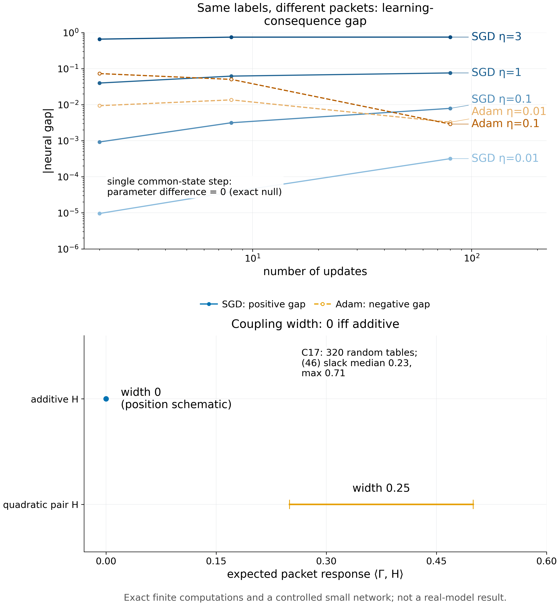

# Proposition 9.1 · 耦合宽度

*实验*

[← 框架总图](../README_ZH.md) · [陈述](../statements/09-01_coupling_width_ZH.md) · [证明](../proofs/09-01_coupling_width_ZH.md) · [实验](09-01_coupling_width_ZH.md) · [English](09-01_coupling_width.md)

**本页检验什么.** 命题的全部四个部分，用精确有限计算，并在一个受训的受控网络中检验。

- **精确检验：PASS.** 在 320 个随机的 packet response 表上：可加表的宽度恰为零，不可加表的宽度为正；界 (b) 成立，中位松弛 0.231；受限配对与严格零假设两部分精确成立（最差残差 $`9.9\times10^{-16}`$）。一个独立实现给出相同结论（[Check 9.1](#c9-1)、[Check 9.2](#c9-2)）。
- **受训网络.** 同一状态上的一步 SGD 对重组严格不变（参数差为 0）。用同样的标签、不同的分组做连续更新，最终回报的变化从 $`9.6\times10^{-6}`$ 到 $`0.75`$：SGD 下随步长和 horizon 增大，Adam 下符号相反（[Check 9.3](#c9-3)）。

**本页用到的设定与记号.**

- *packet 与边缘分布.* 训练 packet 的两个槽位从有限单元集合 $`\mathcal Y_1,\mathcal Y_2`$ 中取值，边缘分布 $`\mu,\nu`$ 严格为正；耦合多面体 $`\mathcal C(\mu,\nu)`$ 是行和为 $`\mu`$、列和为 $`\nu`$ 的非负表的集合，即保持每个单元内容不变的所有配对方式。
- *packet response.* $`H(i,j)`$ 是在 packet $`(i,j)`$ 上训练之后的期望最终回报（这里是随机表，或一个小网络的精确回报）。配对 $`\Gamma`$ 的期望值为 $`\langle\Gamma,H\rangle`$。
- *耦合宽度.* $`w(H)=\max_\Gamma\langle\Gamma,H\rangle-\min_\Gamma\langle\Gamma,H\rangle`$，$`\Gamma\in\mathcal C(\mu,\nu)`$；*可加残差* $`\inf_{a,b}\lVert H-a\mathbf 1^\top-\mathbf 1b^\top\rVert_\infty`$。
- *重组.* 同样的样本、同样的权重，分到不同的 packet 里。

**被检验的陈述（[Proposition 9.1](../statements/09-01_coupling_width_ZH.md#s9-1)）.** (a) $`w(H_z)=0`$ 当且仅当存在 $`a,b`$ 使 $`H_z(i,j)=a_i+b_j`$。(b) 对所有耦合 $`\Gamma,\Gamma'`$，$`\lvert\langle\Gamma-\Gamma',H_z\rangle\rvert\le2\inf_{a,b}\lVert H_z-a\mathbf 1^\top-\mathbf 1b^\top\rVert_\infty`$，且可能严格成立。(c) 有禁止配对时，可行宽度为零并不推出可加。(d) 在同一参数处、对所有 packet 的并集、以相同的逐样本权重做一步 SGD，与重组无关；连续多步则不然，对二次损失差别是 $`\eta^2`$ 阶。

| 检验 | 检验对象 | Code ID | 结果 |
|---|---|---|---|
| [Check 9.1](#c9-1) | (a)–(d) | `v014:C17` | PASS |
| [Check 9.2](#c9-2) | (a)、(b)、(d) | `pkg:coupling_and_additive_null` | PASS |
| [Check 9.3](#c9-3) | 训练网络中的 (d) | `v014:C23`（重组部分） | 零假设精确成立；连续更新有效应 |



*Figure 9.1.* (A) 在受控网络中，把同样四个标签分组为 $`\lbrace(0,0),(1,1)\rbrace`$ 或 $`\lbrace(0,1),(0,1)\rbrace`$，会改变最终回报。同一状态上的一步，差距恰为零；SGD 下差距随步长和 horizon 增大，Adam 下符号相反、动态也不同。(B) 期望 packet response 在耦合多面体上的取值范围：可加表是一个点，不可加表的宽度为正。[PDF](../figures/fig9_1_coupling.pdf)

<a id="c9-1"></a>

## Check 9.1 · 耦合多面体、可加刻画与严格零假设（Proposition 9.1）

**结论.** PASS：320 个实例，2,567 条断言，最差残差 $`9.85\times10^{-16}`$（LP 可行性）。四个部分在每个实例上都成立。

**动机.** Proposition 9.1 有四个断言：宽度为零的"当且仅当"刻画、用可加残差给出的界 (b)、禁止配对时该刻画失效、以及单步零假设。任何一个若不成立，在某个随机实例上都会明显违反。

**设置.**

- $`\lvert\mathcal Y_1\rvert,\lvert\mathcal Y_2\rvert\in[2,5]`$，边缘分布严格为正。
- 随机可加表 $`H=a+b`$ 与随机不可加表。
- seed 为 `SeedSequence([20261010, 17])`。

**步骤.**

1. 用两个线性规划计算宽度：$`\langle\Gamma,H\rangle`$ 在耦合多面体上的最大值与最小值；耦合多面体就是运输问题的可行集（[Bertsimas & Tsitsiklis, 1997](#ref-bertsimas1997introduction)）。
2. 用第三个线性规划计算 $`\inf_{a,b}\lVert H-a-b\rVert_\infty`$，核对界 (b)。
3. 构造 (c) 部分的禁止配对例子。
4. 在有理数算术中精确核对零假设：线性模型在同一参数处走一步，同样的样本换一种分组；再做两步连续更新并重组。

**结果**（`theory/independent_checks/results_independent_v014.json`，条目 `v014:C17`）：

| 量 | 值 |
|---|---:|
| 状态 | PASS |
| 实例 / 断言 | 320 / 2,567 |
| 最差残差（LP 可行性） | $`9.85\times10^{-16}`$ |
| (b) 的松弛：中位数 / 最大值 | 0.231 / 0.712 |
| 可行宽度为零的禁止配对表 | $`\begin{pmatrix}0&0\cr 0&1\end{pmatrix}`$ |
| 一步重组的差别（线性模型，精确） | 0 |
| 两步连续重组的差别（线性模型，精确） | $`1/32`$ |

**为什么支持该陈述.**

- 可加表的宽度恰为零，不可加表的宽度为正，与 (a) 一致。
- 界 (b) 成立但一般不紧；典型的松弛约为回报范围的四分之一，与证明中的严格性例子一致。
- 单步零假设在有理数算术中精确成立，所以任何测到的单步效应都只能是实现上的问题。
- 连续更新会产生真实的重组效应，即 (d) 证明中的 $`\eta^2H_{P_2}g_{P_1}`$ 项。

**局限.** 随机表规模小；线性模型的零假设在精确算术中核对，而不是在非线性网络中（那是 [Check 9.3](#c9-3) 做的）。

<a id="c9-2"></a>

## Check 9.2 · 独立实现（Proposition 9.1）

**结论.** PASS：可加表的宽度为 0，一个不可加的二次配对宽度为 0.25，冻结梯度零假设的残差为 $`2.8\times10^{-17}`$。

**动机.** 一个与 [Check 9.1](#c9-1) 分开编写的实现，可以排除两者共有的编码错误。

**设置.** 有限 packet 的线性规划与冻结梯度算术；不涉及神经网络 optimizer。

**结果**（`theory/v014_repro/results_v014_rerun.json`，`coupling_and_additive_null`）：

| 量 | 值 |
|---|---:|
| 可加表的宽度 | 0.0 |
| 二次配对：最小 / 最大 / 宽度 | 0.25 / 0.50 / 0.25 |
| 严格冻结梯度可加零假设，最大残差 | $`2.8\times10^{-17}`$ |

**为什么支持该陈述.** 可加表宽度为零、不可加配对宽度为正，与 (a) 一致；(d) 的冻结梯度零假设在机器精度内精确成立。

**局限.** 实例很少；它的价值在于独立于 [Check 9.1](#c9-1)，而不在于覆盖面。

<a id="c9-3"></a>

## Check 9.3 · 受控网络中的重组（Proposition 9.1(d)）

**结论.** 同一状态上的单步对重组严格不变（参数差 0.0）。连续更新之后，重组使最终回报在 SGD 下最多变化 0.749，在 Adam 下绝对值最多变化 0.073。

**动机.** 宽度是通过实际的学习后果定义的。一个训练过的网络，喂入同样的标签、不同的分组，在同一状态的一步上差别必须恰为零；连续更新之后则可能出现真实的差别。

**设置.**

- 网络：one-hot 上下文，4 个 tanh 单元，sigmoid 输出，float64。这是受控小网络，不是 Gemma，也不是外部 benchmark。
- 数据源 A 的 packet 为 $`\lbrace (0,0),(1,1)\rbrace`$，数据源 B 为 $`\lbrace (0,1),(0,1)\rbrace`$。两者含同样四个标签，边缘分布相同。
- optimizer：SGD，$`\eta\in\lbrace 0.01,0.1,1,3\rbrace`$；Adam（[Kingma & Ba, 2015](#ref-kingma2015adam)），$`\beta=(0.9,0.999)`$，$`\epsilon=10^{-8}`$，$`\eta\in\lbrace 0.01,0.1\rbrace`$。
- 1、4 或 40 个循环，即 2、8 或 80 次更新。
- 精确枚举全部确定性历史。

**步骤.** 计算两种分组之间最终期望回报的差。另外，在同一状态、相同权重下计算一步之后的参数差，并用中心差分核对手写梯度。

**结果**（`theory/independent_checks/results_independent_v014.json`，`controlled_neural.details`）：

- 同一状态单步：`additive_null_parameter_residual` = **0.0**；
- 手写梯度对中心差分：`gradient_max_residual` = $`8.7\times10^{-11}`$。

回报差 A − B（`regrouping`）：

| optimizer | $`\eta`$ | 2 次更新 | 8 次更新 | 80 次更新 |
|---|---:|---:|---:|---:|
| SGD | 0.01 | $`9.6\times10^{-6}`$ | $`3.8\times10^{-5}`$ | $`3.2\times10^{-4}`$ |
| SGD | 0.1 | $`9.2\times10^{-4}`$ | $`3.2\times10^{-3}`$ | $`7.9\times10^{-3}`$ |
| SGD | 1.0 | 0.040 | 0.062 | 0.076 |
| SGD | 3.0 | 0.658 | 0.747 | 0.749 |
| Adam | 0.01 | −0.0094 | −0.0136 | −0.0032 |
| Adam | 0.1 | −0.0729 | −0.0503 | −0.0029 |

**为什么支持该陈述.**

- 效应恰好在 (d) 所说必须为零的地方为零：同一参数处的一步。
- 在实际的非线性学习器中，一旦更新是连续的，边缘分布相同的反馈怎样组织就会改变学到的学生。SGD 下效应随步长和 horizon 增大；Adam 下符号相反、动态也不同。

**局限.** 一个小网络、一对分组；没有真实模型或 benchmark 结果。

## 复现

```bash
CUDA_VISIBLE_DEVICES='' PYTHONDONTWRITEBYTECODE=1 theory/.venv/bin/python theory/independent_checks/check_v014_independent.py --only C17,C23 --output theory/independent_checks/subset.json
CUDA_VISIBLE_DEVICES='' theory/.venv/bin/python docs/direction/v014_handoff/verify_environment_information_v014.py   # package check
```

这些脚本使用 NumPy（[Harris et al., 2020](#ref-harris2020array)）与 SciPy（[Virtanen et al., 2020](#ref-virtanen2020scipy)）；线性规划通过 SciPy 调用 HiGHS 求解（[Huangfu & Hall, 2018](#ref-huangfu2018parallelizing)）。

## 产物

- `theory/independent_checks/results_independent_v014.json`：条目 `v014:C17`、`controlled_neural.details.regrouping`、`controlled_neural.details.additive_null_parameter_residual`。
- `theory/v014_repro/results_v014_rerun.json`：`coupling_and_additive_null`。
- 图：`../figures/fig9_1_coupling.{pdf,png}`（说明见 `../figures/specs/fig9_1.md`）。
