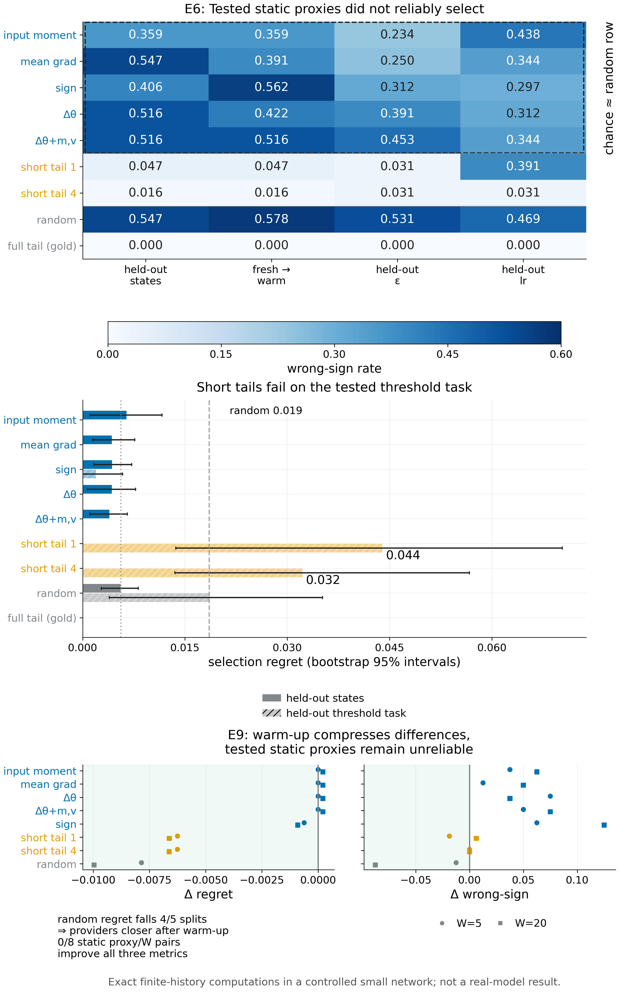

# Remark 9.3 · 设计规则的推导

*实验*

[← 框架总图](../README_ZH.md) · [陈述](../statements/09-03_derivation_design_rules_ZH.md) · [证明](../proofs/09-03_derivation_design_rules_ZH.md) · [实验](09-03_derivation_design_rules_ZH.md) · [English](09-03_derivation_design_rules.md)

**本页检验什么.** 设计规则是带有已证明推导的必要条件；下面的检验在一个受控学习器中考察：遵守 Rule 2、3、5 对选择是否真的重要——更便宜的统计量能否代替实测 response，把 optimizer warm 起来又会怎样？

- **Rule 2 与 Rule 5：实测 response 能选对，测试过的静态 proxy 不能**（[Check 9.4](#c9-4)）。在留出的学习器状态上，测试过的五个静态 proxy 判错率为 0.359–0.547（随机 0.547），Spearman 至多 0.10。实测的 4 步尾段在每一种状态、$`\epsilon`$、学习率与 warmth 的变化下判错率至多 0.031、regret 为零。在留出的阈值任务上，1 步与 4 步尾段的 regret 为 0.044 与 0.032，随机为 0.019；只有全尾段在每个划分上 regret 与判错率都为零。
- **Rule 3：warmth 重要，但 warm-up 救不了静态 proxy**（[Check 9.5](#c9-5)）。学习率为 0 的矩 warm-up 让随机选择的 regret 在 5 个划分中的 4 个下降（平均在 $`W=5`$ 时降 0.0079，$`W=20`$ 时降 0.0100），而 10 种静态 proxy 与 $`W`$ 的组合中没有一种同时改进 regret、判错率与 Spearman。
- **范围.** 受控小网络中的精确有限历史计算；没有真实模型或 benchmark 结果。这些是关于所测 proxy 的受控发现，不是对所有静态统计量的证明。

**本页用到的设定与记号.**

- *学习器.* 一个受控网络：one-hot 上下文、4 个 tanh 单元、sigmoid 输出、平均交叉熵、float64（`v014:C23` 的网络）。完整状态（含 Adam 矩 $`m,v`$ 与步数计数器）：`fresh`、`warm2`、`warm5`、`warm9`。配方共 8 个：Adam，$`\eta\in\lbrace 0.01,0.1\rbrace`$；SGD，$`\eta\in\lbrace 0.1,1\rbrace`$；各配 $`\epsilon\in\lbrace 10^{-8},10^{-3}\rbrace`$。
- *候选.* 十个双标签 packet 上的九个标签律；`reference_even` 是参考 $`P^0`$。
- *gold.* 候选的精确学习价值：一次候选边界，之后 7 次独立同分布的参考更新（共 8 次），对全部有限历史精确枚举，作为与参考候选的对比。这就是候选 $`j`$ 在状态 $`z`$ 上的优势 $`A_t(z,j)=\bar g_t(z,j)-\bar g_t(z,0)`$（[Definition 1.4](../README_ZH.md#s1-4)）。
- *proxy.* proxy 是用来预测 gold 对比的便宜分数。静态 proxy 只用候选第一次更新的统计量（输入矩、平均梯度、符号、$`\Delta\theta`$、带 $`(m,v)`$ 的 $`\Delta\theta`$）。实测短尾段 proxy 先走这次更新，再走 1 次或 4 次参考更新：即 [Definition 8.6](../statements/08-06_crn_paired_replacement_score_ZH.md#s8-6) 意义下尾段被截短的 surrogate response。对照为随机分数与全尾段本身。
- *指标.* 选择 regret（最好候选的 gold 值减去 proxy 选中候选的 gold 值，在 cell 上平均）；判错率（gold 非零的候选中，预测对比与 gold 符号相反的比例）；预测对比与 gold 对比的 Spearman 秩相关。

**被检验的陈述（[Remark 9.3](../statements/09-03_derivation_design_rules_ZH.md#s9-3)）.** [Algorithm 9.2](../statements/09-02_ced_algorithm_ZH.md#s9-2) 实现了六条规则，每条都是获得相应保证的必要条件：**Rule 1** 先获取，再编译（transcript 无法确定的事实只能由新的允许实验提供；获取多少、在哪里获取由学习器决定）；**Rule 2** 按实测后果选择（选择规则与学习价值的排序一致，仅当它是平均 response $`\lbrace\bar g_t(z,j)\rbrace_j`$ 的函数，或是在声明族上已证明对它们充分的统计量的函数）；**Rule 3** 匹配学习器的统计量，而不是原始梯度（一阶上必须匹配的是完整学习器状态的平均增量在 continuation value 梯度方向上的部分，所以 response 要按完整状态及其 warmth 索引）；**Rule 4** 拟合稳定的 response 模型（最小化 $`\mathrm{osc}(\widehat g-\Phi b)+\sum_j\epsilon_j\lvert b_j\rvert`$）；**Rule 5** 计入覆盖、用配对替换做认证、一阶 audit 只用在 margin 占优处（保证取四种形式之一：带 transport 的冻结 audit 证书、实际状态上全尾段的下置信界保证、带校准 surrogate 的 CRN 配对替换证书，或标注为经验结论的对照）；**Rule 6** 先冻结，再检验迁移（一切在评测它的数据之前冻结；迁移只能通过已核实的分解保证；方法迁移与策略迁移分开报告）。这些规则本身并不说明某个 CED 实例优于给定的 baseline。

| 检验 | 检验对象 | Code ID | 结果 |
|---|---|---|---|
| [Check 9.4](#c9-4) | Rule 2 与 Rule 5；[Algorithm 9.2](../statements/09-02_ced_algorithm_ZH.md#s9-2) 第 5 步 | `v015:E6` | 受控发现 |
| [Check 9.5](#c9-5) | Rule 3；Algorithm 9.2 第 1 步与第 5 步 | `v015:E9` | 受控发现 |

其他页面上的相关检验：一阶排序器与 CRN 配对替换分数的对比（与 Rule 5 有关）是 [Check 7.5](07-05_where_first_order_rankers_fail_ZH.md#c7-5)。



*Figure 9.2.* 选择规则的受控学习器证据。(A) 冻结 proxy 在留出的学习器状态，以及 warmth、$`\epsilon`$、学习率变化下的判错率（`v015:E6`）：测试过的静态 proxy 与随机分数相当，实测的短尾段 response 接近零。(B) 选择 regret：短尾段在留出状态上几乎选得最优，在留出的阈值任务上却比随机差；只有全尾段处处精确。(C) 学习率为 0 的矩 warm-up 的效果（`v015:E9`）：候选之间的差距缩小（随机 regret 下降），静态 proxy 没有改进。受控小网络中的精确有限历史计算。[PDF](../figures/fig9_2_selection.pdf)

<a id="c9-4"></a>

## Check 9.4 · 用冻结 proxy 做留出选择（Remark 9.3，Rule 2 与 Rule 5）

**结论.** 受控发现。在留出的学习器状态上，测试过的五个静态 proxy 判错率为 0.359–0.547（随机 0.547），Spearman 至多 0.10。实测的 4 步尾段在每一种状态、$`\epsilon`$、学习率与 warmth 的变化下，判错率至多 0.031，regret 为零。在留出的阈值任务上，1 步与 4 步尾段的 regret 为 0.044 与 0.032，随机为 0.019。全尾段在每个划分上 regret 与判错率都为零。

**动机.** Rule 2 说候选必须按它实际的"更新加尾段"response 来评判。这个检验问：当学习器状态、任务、配方或 optimizer warmth 改变时，更便宜的统计量能否代替 response。每种改变都是单独的留出划分，所以只拟合了 pilot 的 proxy 无法通过。短尾段 proxy 是尾段被截断的一轮边界 response，即 [Definition 8.6](../statements/08-06_crn_paired_replacement_score_ZH.md#s8-6) 意义下的 surrogate；阈值划分检验这样的 surrogate 在新任务上能否保持排序，也就是 [Remark 8.11](../statements/08-11_surrogate_calibration_and_transfer_ZH.md#s8-11) 的校准迁移问题。

**设置**（`theory/v015_checks/proxy_split_freeze.json`，SHA-256 `ac8f4aee…`，在任何留出测量之前写入）：

- **学习器.** `v014:C23` 的受控网络（one-hot 上下文，4 个 tanh 单元，sigmoid，平均交叉熵，float64）。
  - 状态：`fresh`、`warm2`、`warm5`、`warm9`（完整状态，含 Adam 矩）。
  - 配方 8 种：Adam（[Kingma & Ba, 2015](#ref-kingma2015adam)），$`\eta\in\lbrace 0.01,0.1\rbrace`$；SGD，$`\eta\in\lbrace 0.1,1\rbrace`$；每种再配 $`\epsilon\in\lbrace 10^{-8},10^{-3}\rbrace`$。
- **候选.** 10 个双标签 packet 上的 9 个标签分布：`reference_even`，矩匹配的 `moment3_P`/`moment3_Q`，符号匹配的 `low_sign_A`/`B` 与 `high_sign_A`/`B`，`odd_parity` 与 `middle_mixture`。
- **gold.** 一轮候选边界之后接 7 次 IID 参考更新（共 8 次更新），对全部有限历史精确枚举，取与参考候选的对比值。
- **proxy**，只在 pilot 上用 ridge 回归拟合，并冻结在 `proxy_models_frozen.json`：
  - 静态：输入矩误差、平均梯度、只看符号、第一步的 $`\Delta\theta`$、带 $`(m,v)`$ 的 $`\Delta\theta`$；
  - 实测的短尾段 response：1 次更新后、4 次更新后；
  - 对照：随机分数、任务身份、训练步数。
- **pilot.** 状态 `fresh` 与 `warm2`，任务 `moment` 与 `parity`，配方 0 与 4；72 行。
- **留出划分.** 状态 `warm5`/`warm9`；任务 `threshold`；只变 $`\epsilon`$（配方 1、5）；只变学习率（2、6）；两者都变（3、7）；只用 fresh 拟合、在 warm 状态上评测，以及反过来。留出共 432 行；seed 为 `SeedSequence([150150, 106])`。
- **指标.**
  - *选择 regret*：最优候选的 gold 值减去 proxy 选中候选的 gold 值，对 cell 取平均。
  - *判错率*：gold 非零的候选中，预测对比值符号相反的比例。
  - *Spearman*：预测对比值与 gold 对比值的秩相关。

**步骤.** 先把划分清单与冻结的 proxy 系数写入磁盘，再对每个留出划分只评测一次。任何留出结果都不改动 proxy、特征、ridge 惩罚或弃权阈值。

**结果**（`theory/v015_checks/results_v015_independent.json`，条目 `v015:E6`，`data.reports.<split>.metrics.<proxy>`）：

*判错率*（越低越好）：

|划分|输入矩|平均梯度|符号|Δθ|Δθ+m,v|短尾段 1|短尾段 4|随机|全尾段|
|---|---:|---:|---:|---:|---:|---:|---:|---:|---:|
|`held_out_states`|0.359|0.547|0.406|0.516|0.516|0.047|0.016|0.547|0.000|
|`held_out_epsilon`|0.234|0.250|0.312|0.391|0.453|0.031|0.031|0.531|0.000|
|`held_out_lr`|0.438|0.344|0.297|0.312|0.344|0.391|0.031|0.469|0.000|
|`held_out_epsilon_lr`|0.438|0.344|0.297|0.312|0.344|0.391|0.031|0.562|0.000|
|`fresh_to_warm`|0.359|0.391|0.562|0.422|0.516|0.047|0.016|0.578|0.000|
|`warm_to_fresh`|0.125|0.125|0.188|0.250|0.438|0.062|0.031|0.469|0.000|
|`held_out_task`|0.250|0.250|0.083|0.250|0.083|0.000|0.042|0.458|0.000|

*选择 regret*（越低越好）：

|划分|输入矩|平均梯度|符号|Δθ|Δθ+m,v|短尾段 1|短尾段 4|随机|全尾段|
|---|---:|---:|---:|---:|---:|---:|---:|---:|---:|
|`held_out_states`|0.0064|0.0043|0.0043|0.0043|0.0039|0.0000|0.0000|0.0056|0.0000|
|`held_out_epsilon`|0.0013|0.0013|0.0022|0.0013|0.0013|0.0000|0.0000|0.0067|0.0000|
|`held_out_lr`|0.0041|0.0041|0.0070|0.0041|0.0041|0.0007|0.0000|0.0105|0.0000|
|`held_out_epsilon_lr`|0.0040|0.0040|0.0070|0.0040|0.0040|0.0007|0.0000|0.0093|0.0000|
|`fresh_to_warm`|0.0064|0.0064|0.0054|0.0064|0.0064|0.0000|0.0000|0.0045|0.0000|
|`warm_to_fresh`|0.0000|0.0000|0.0012|0.0000|0.0000|0.0000|0.0000|0.0056|0.0000|
|`held_out_task`|0.0000|0.0000|0.0020|0.0000|0.0000|0.0439|0.0322|0.0186|0.0000|

*Spearman*（越高越好；— 表示预测为常数、无定义）：

|划分|输入矩|平均梯度|符号|Δθ|Δθ+m,v|短尾段 1|短尾段 4|随机|全尾段|
|---|---:|---:|---:|---:|---:|---:|---:|---:|---:|
|`held_out_states`|-0.00|0.05|0.10|0.07|0.07|0.95|0.99|-0.04|1.00|
|`held_out_epsilon`|0.45|0.40|0.45|0.42|0.41|0.96|0.99|-0.07|1.00|
|`held_out_lr`|0.38|0.40|0.46|0.57|0.58|0.34|0.95|0.03|1.00|
|`held_out_epsilon_lr`|0.38|0.40|0.46|0.58|0.58|0.33|0.95|0.04|1.00|
|`fresh_to_warm`|-0.00|-0.07|-0.07|-0.06|-0.09|0.95|0.99|-0.07|1.00|
|`warm_to_fresh`|0.79|0.58|0.73|0.72|0.59|0.90|0.97|0.10|1.00|
|`held_out_task`|0.63|0.58|0.73|0.71|0.84|—|0.54|-0.05|1.00|

**为什么支持 Rule 2 与 Rule 5.**

1. *测试过的静态 proxy 不是 response.* 在留出的学习器状态上，以及从 fresh 状态迁到 warm 状态时，它们与随机分数相当：判错率 0.36–0.56，随机为 0.55–0.58；Spearman 至多 0.10。同一个更新统计量，在不同的完整状态上对应不同的学习后果，这正是 [Proposition 3.1](../statements/03-01_static_value_not_learning_value_ZH.md#s3-1) 与 [Theorem 5.10](../statements/05-10_first_order_statistic_by_learner_ZH.md#s5-10) 等 optimizer state 结果所预言的。这是关于所测 proxy 的发现，不是对所有静态统计量的证明；被证明的不一致性只限于 [Proposition 7.3](../statements/07-03_inconsistency_two_proxy_classes_ZH.md#s7-3) 的两类。
2. *实测的 response 能选对.* 4 步尾段在每一种状态、$`\epsilon`$、学习率与 warmth 的变化下，判错率不超过 3.1%，regret 为 0。1 步尾段在学习率变化下变差（判错率 0.39），但仍几乎选得最优（regret 0.0007）。
3. *尾段长度是估计对象的一部分.* 在留出的 `threshold` 任务上，短尾段比随机选得差（regret 0.044 与 0.032，随机 0.019），因为它们的排序与 8 步全尾段不同。全尾段是唯一在每个划分上 regret 与判错率都为零的测量。用 [Remark 8.11](../statements/08-11_surrogate_calibration_and_transfer_ZH.md#s8-11) 的话说：在一个任务族上校准好的 surrogate，到另一个任务族上可能失去排序，所以必须核对校准迁移。静态 proxy 在这个划分上碰巧达到零 regret，但判错率为 8%–25%，在留出状态上又与随机相当，所以它们不能跨划分迁移。
4. *量级.* regret 在回报单位下为 $`10^{-3}`$–$`10^{-2}`$，每个划分有 8 个 cell（任务划分与 warm-to-fresh 划分为 4 个）。cell bootstrap（`regret_bootstrap95`）描述的是这个有限面板内部的变化，不是总体置信区间。

**局限.** 一个受控小网络、九个候选与一个有限面板；静态 proxy 是五个特定的统计量，所以本检验不能说明每个静态统计量都失败。

<a id="c9-5"></a>

## Check 9.5 · 学习率为 0 的矩 warm-up 下的 proxy 迁移（Remark 9.3，Rule 3）

**结论.** 受控发现。warm-up 压缩了候选之间的差别：随机选择的 regret 在 5 个留出划分中的 4 个下降，$`W=5`$ 时平均下降 0.0079，$`W=20`$ 时平均下降 0.0100。它没有让静态 proxy 变得可预测：五个静态 proxy 与 $`W\in\lbrace 5,20\rbrace`$ 的 10 种组合中，没有一种同时改进 regret、判错率和 Spearman，它们的判错率上升 1–13 个百分点。

**动机.** 在 warm 的 optimizer state 上，候选必须匹配的一阶统计量会改变（[Propositions 5.6](../statements/05-06_warm_adam_first_order_affine_ZH.md#s5-6)–[5.8](../statements/05-08_evolution_warmth_ZH.md#s5-8)）。这个检验问：把矩预热之后，[Check 9.4](#c9-4) 中的静态统计量会不会变得可预测。

**设置**（`theory/v015_checks/proxy_split_freeze_E9.json`，SHA-256 `f895853d…`；模型 `proxy_models_frozen_E9.json`，SHA-256 `c96065f0…`；两者都在任何新的留出面板之前写入）：

- **臂.** `fresh`、`fresh_W5` 与 `fresh_W20`。warm 臂在 `reference_even` 的一个声明好的 IID 前缀上，以恰为 0 的学习率跑 $`W\in\lbrace 5,20\rbrace`$ 步 Adam（$`\beta=(0.9,0.999)`$）。参数不变，只有 $`m`$、$`v`$ 与步数计数器前进。
- **拟合.** [Check 9.4](#c9-4) 的候选菜单、特征、gold、ridge 拟合与指标都不变。只用原来冻结的 pilot 拟合，并核对系数完全相同。只变状态的对比用原来的 warm2 单独拟合。
- **划分.** 五个配对的 cold/warm 划分：留出状态、任务（`threshold`）、$`\epsilon`$、学习率、两者都变；留出共 918 行。随机对照在各臂之间配对。
- **seed.** `SeedSequence([150150, 109])`。

**步骤.** 对每个划分、proxy 与 $`W`$，计算每个指标的 warm 减 cold 差，再按划分等权平均。改进指 regret 更低、判错率更低、Spearman 更高。

**结果**（`theory/v015_checks/results_v015_independent.json`，条目 `v015:E9`，`data.summary` 与 `cheap_proxy_results`；表中是 5 个划分上 warm − cold 的平均差，括号里是有改进的划分数）：

|proxy|W|Δ regret|Δ 判错率|Δ Spearman|三项都改进|
|---|---:|---|---|---|---|
|输入矩|5|+0.00000 (0/5)|+0.0375 (1/5)|−0.030 (0/5)|否|
|输入矩|20|+0.00021 (0/5)|+0.0625 (0/5)|−0.207 (0/5)|否|
|平均梯度|5|+0.00000 (0/5)|+0.0125 (1/5)|+0.042 (4/5)|否|
|平均梯度|20|+0.00021 (0/5)|+0.0500 (0/5)|−0.150 (0/5)|否|
|Δθ|5|+0.00000 (0/5)|+0.0750 (0/5)|−0.082 (2/5)|否|
|Δθ|20|+0.00021 (0/5)|+0.0375 (0/5)|−0.200 (0/5)|否|
|Δθ+m,v|5|+0.00000 (0/5)|+0.0500 (1/5)|−0.072 (2/5)|否|
|Δθ+m,v|20|+0.00021 (0/5)|+0.0750 (0/5)|−0.191 (0/5)|否|
|只看符号|5|−0.00062 (3/5)|+0.0625 (0/5)|−0.052 (0/5)|否|
|只看符号|20|−0.00090 (4/5)|+0.1250 (0/5)|−0.270 (0/5)|否|
|短尾段 1|5|−0.00625 (1/5)|−0.0187 (2/5)|+0.053 (4/5)|是|
|短尾段 1|20|−0.00662 (1/5)|+0.0063 (2/5)|−0.152 (2/5)|否|
|短尾段 4|5|−0.00626 (3/5)|+0.0000 (2/5)|−0.028 (2/5)|否|
|短尾段 4|20|−0.00662 (3/5)|+0.0000 (2/5)|+0.039 (5/5)|否|
|随机|5|−0.00785 (4/5)|−0.0125 (2/5)|−0.024 (2/5)|否|
|随机|20|−0.00996 (4/5)|−0.0875 (3/5)|+0.048 (3/5)|是|

各划分上随机选择的 regret，cold → $`W=5`$ / $`W=20`$（`comparisons[proxy=random]`）：

| 划分 | cold | W=5 | W=20 |
|---|---:|---:|---:|
| 留出状态 | 0.0067 | 0.0042 | 0.0034 |
| 留出任务（`threshold`） | 0.0430 | 0.0098 | 0.0039 |
| 留出 $`\epsilon`$ | 0.0076 | 0.0042 | 0.0035 |
| 留出学习率 | 0.0089 | 0.0086 | 0.0054 |
| 留出 $`\epsilon`$ + 学习率 | 0.0047 | 0.0049 | 0.0049 |

**为什么支持 Rule 3.**

1. *warm-up 压缩了候选之间的差别.* 均匀随机选择的 regret 衡量的是菜单上 gold 对比值的分散程度。它在 5 个划分中的 4 个下降，阈值任务上降得最多（0.043 降到 0.004）：warm-up 之后可选的差别变小了。这与 [Proposition 5.6](../statements/05-06_warm_adam_first_order_affine_ZH.md#s5-6) 一致：在 warm 状态上，response 在所述残差以内只依赖于平均预条件梯度，所以主要在符号结构上不同的候选会彼此靠近。
2. *warm-up 没有让静态 proxy 变得可预测.* 除"只看符号"之外的四个静态 proxy，regret 在任何划分上都没有改进，判错率上升 1–8 个百分点，$`W=20`$ 时 Spearman 下降 0.15–0.21。"只看符号"的 regret 略有改进，但符号准确率下降 6–13 个百分点。没有一个静态 proxy 与 $`W`$ 的组合同时改进三项指标。
3. *对方法的含义.* warmth 决定的是哪个统计量携带信息（Rule 3）。这里用的静态 proxy 在两种状态下都不是那个统计量，所以仍然要测量 response，并且要在记录了 warmth 的状态上测量（[Algorithm 9.2](../statements/09-02_ced_algorithm_ZH.md#s9-2) 第 1 步与第 5 步）。

**局限.** warm-up 以学习率 0 进行，所以它只隔离了 optimizer 的矩、参数保持不变；真实训练中达到的 warmth 也会移动参数。网络与面板同 [Check 9.4](#c9-4)。

## 复现

```bash
CUDA_VISIBLE_DEVICES='' theory/.venv/bin/python theory/v015_checks/check_v015.py --only E6,E9 --output theory/v015_checks/quick/s9.json
```

这些脚本使用 NumPy（[Harris et al., 2020](#ref-harris2020array)）与 SciPy（[Virtanen et al., 2020](#ref-virtanen2020scipy)）。

## 产物

- `theory/v015_checks/results_v015_independent.json`：条目 `v015:E6`（`reports`、`negative_results`、`sign_pair_audit`）与条目 `v015:E9`（`summary`、`cheap_proxy_results`、`comparisons`、`freeze_events`）。
- 冻结的契约文件：`theory/v015_checks/proxy_split_freeze.json`、`proxy_models_frozen.json`、`proxy_split_freeze_E9.json`、`proxy_models_frozen_E9.json`。
- 规格说明：`theory/v015_checks/SPEC.md`（`v015:E6`）与 `theory/v015_checks/README.md`（`v015:E9` 的方法）。
- 图：`../figures/fig9_2_selection.{pdf,png}`（说明见 `../figures/specs/fig9_2.md`）。
