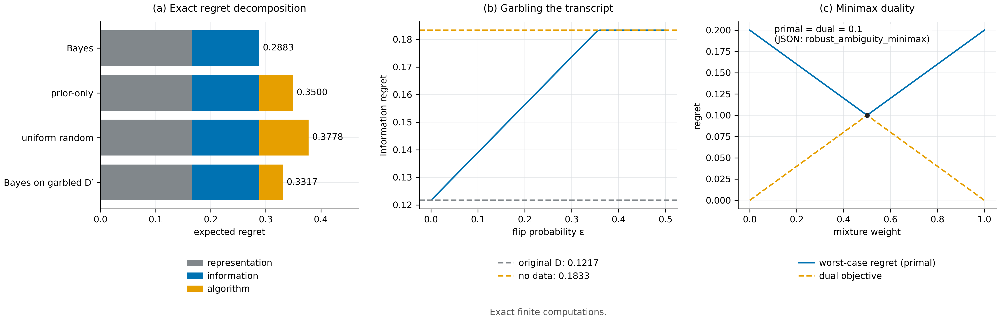

# N01 · 遗憾分解与决策歧义 — 实验

[← 框架总览](../README_ZH.md) · [证明](../proofs/N01_decomposition_and_ambiguity_ZH.md)

**结论。** N01 成立。独立检验 C1 在 500 个随机有限决策问题上，用精确有理数算术验证了全部四个命题，共 5,810 条断言，无一违例：

- 分解恒等式 (1)，以及三项均非负；
- 零信息判据 (2)；
- 鲁棒歧义值的原问题与对偶相等 (3)=(4)：在 220 个实例上分别作为两个独立的 LP 求解；
- 数据处理不等式 (5)：在确定性与随机 garbling 上做对抗搜索，$B$ 的最大增量恰为 $0$。

包内检验 `robust_ambiguity_minimax` 在经典的两世界实例上复现了 (3)=(4)，原问题与对偶都等于 $0.1$。



[PDF](../figures/N01_decomposition.pdf)

### C1 — 命题 1–3，式 (1)–(5)

**动机。** 分解是恒等式，$B(D)$、后验或学习器 kernel 的定义只要有代数错误，就会出现非零残差。判据 (2) 是"当且仅当"，任一方向出现反例都会推翻它。对偶 (3)=(4) 和数据处理不等式 (5) 都是不等式；如果漏了某个前提，随机或对抗构造的实例就可能违反它们。

**设置。**

- 500 个随机实例：3–6 个环境，先验为随机有理数；$\Pi$ 中 2–5 个策略，$\Pi_{\rm ref}$ 另加两个。
- 取值 $J_E(\pi)\in[0,1]$ 为分母为 12 的随机有理数。
- transcript 字母表大小 $\lvert\mathcal D\rvert=4$，信道 $P(D\mid E)$ 与学习器 kernel $\lambda(\cdot\mid D)$ 都随机生成。
- 每四个实例中，一个强制带平局的公共最优（对所有 $E$ 有 $J_E(\pi_1)=J_E(\pi_2)=1$），一个强制各环境最优策略不同。
- 全部运算精确（`fractions.Fraction`）；LP 用 HiGHS 求解，容差 $10^{-8}$。
- 种子 `SeedSequence([20261010, 1])`。

**做法。** 对每个实例：

1. 计算 $\mathcal R_{\rm rep},\mathcal R_{\rm info},\mathcal R_{\rm alg}$，断言三者之和精确等于总遗憾，且各自 $\ge0$。
2. 判断是否对每个 $D$ 都存在公共后验最优策略，断言这种情况恰好对应 $\mathcal R_{\rm info}=0$。
3. 用 3 符号信道对 $D$ 做 garbling：一个随机的随机化信道；前 30 个实例上再加全部 $3^4=81$ 个确定性信道，它们是该凸目标的极点。断言 $B(D')\le B(D)$。
4. 用独立的 $Z$ 增广 $D$，断言 $B(D,Z)=B(D)$ 精确成立。
5. 在 220 个实例上分别求解原问题 LP (3)（对混合策略取 min）和对偶 LP (4)（对先验取 max），断言两者相等，且值为 $0$ 恰好对应存在公共最优策略。

**结果。**

| 量 | 值 | JSON 键 |
|---|---|---|
| 实例数 / 断言数 | 500 / 5,810 | `claims[C1].n_instances`、`.n_assertions` |
| 最大残差（恒等式、LP 相等） | $1.33\times10^{-15}$ | `claims[C1].worst_residual` |
| 最大 LP 可行性残差 | $1.33\times10^{-15}$ | `claims[C1].worst_lp_feasibility_residual` |
| 单独求解原问题与对偶 LP 的实例数 | 220 | `claims[C1].details.minimax_instances` |
| 所有 garbling 中最大的 $B(D')-B(D)$ | $0.0$ | `claims[C1].details.adversarial_garbling_best_lhs_minus_rhs` |
| 状态 | PASS | `claims[C1].status` |

**说明了什么。** 分解在每个实例上都精确成立，三项都非负。零信息判据在两个方向上都与直接计算一致，包括有平局的情形。没有任何 garbling 能提高后验最优值，对抗选出的极点信道也不能。对偶 LP 总是取到原问题的值。残差只是浮点 LP 求解的量级，有理数恒等式的残差都恰为零。这些结果与命题 1.1–1.4 在有限问题上无需额外前提即成立相一致。

### 包内检验 `robust_ambiguity_minimax` — 经典两世界实例

**动机。** 这是 (3)=(4) 的一个可以手算的实例，最优混合有闭式解。

**设置。** 两个环境偏好相反的策略，遗憾矩阵 $M=\begin{pmatrix}0&0.2\cr 0.2&0\end{pmatrix}$。原问题与对偶 LP 用 SciPy HiGHS 求解。包内 v0.14 验证脚本，种子 2026101014。

**结果。**

| 量 | 值 | JSON 键 |
|---|---|---|
| 原问题 $r(C)$ | 0.1 | `robust_ambiguity_minimax.primal_regret` |
| 对偶值 | 0.1 | `robust_ambiguity_minimax.dual_regret` |
| minimax 策略混合 | $(0.5,0.5)$ | `.policy_mixture` |
| 最不利先验 | $(0.5,0.5)$ | `.environment_mixture` |

**说明了什么。** 两个世界无法区分时，任何学习器的输出分布在两个世界中都相同，可达到的最好最坏情况期望遗憾是 $r(C)=0.1>0$，即押注任一策略时遗憾 $0.2$ 的一半。这是*混合平均*意义下的遗憾（见证明页注记 3）；单个抽样策略的遗憾是 $0$ 或 $0.2$。

## 复现

```bash
CUDA_VISIBLE_DEVICES='' PYTHONDONTWRITEBYTECODE=1 theory/.venv/bin/python theory/independent_checks/check_v014_independent.py --only C1 --output theory/independent_checks/subset.json
theory/.venv/bin/python docs/direction/v014_handoff/verify_environment_information_v014.py --output theory/v014_repro/results_v014_rerun.json
```

## 产物

- `theory/independent_checks/results_independent_v014.json`：条目 `claims[id=C1]`。
- `theory/independent_checks/SPEC.md`（C1）与 `theory/independent_checks/check_v014_independent.py`（`check_C1`）。
- `theory/v014_repro/results_v014_rerun.json`：键 `robust_ambiguity_minimax`。
