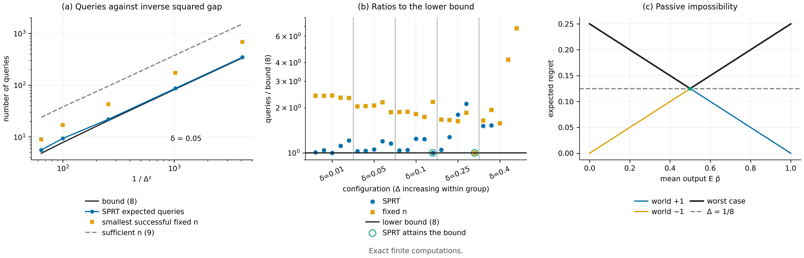

# N02 · 被动不可能，主动可达 — 实验

[← 框架总览](../README_ZH.md) · [证明](../proofs/N02_passive_vs_active_acquisition_ZH.md)

**结论。** N02 成立。独立检验 C2 在 25 组配置（$\Delta\in\lbrace \tfrac18,\tfrac1{10},\tfrac1{16},\tfrac1{32},\tfrac1{64}\rbrace \times\delta\in\lbrace 0.01,0.05,0.1,0.25,0.4\rbrace $）上精确验证了定理 2.1–2.3 与命题 2.4 的每一部分，共 540 条断言，无一违例：

- 收益公式 $J_v(p)=\tfrac34+v\Delta(2p-1)$ 与被动 minimax 值 $\Delta$，均为符号计算；
- 下界 (8)：分别与最小的成功固定样本检验、调优的 SPRT 比较，用精确二项式求和与精确的吸收随机游走递推计算；
- $n=\lceil\log(1/\delta)/(8\Delta^2)\rceil$ 的充分性；
- 编译的尾概率。

任何实际策略所需的查询数都不少于 (8) 的要求。在 $(\Delta,\delta)=(\tfrac18,\tfrac1{10})$ 和 $(\tfrac18,\tfrac14)$ 处，SPRT 恰好达到下界（比值 $1.000$），所以 (8) 一般不能再改进。



[PDF](../figures/N02_queries.pdf)

### C2 — 定理 4 与编译段落

**动机。**

- 定理 2.2 是对*所有*自适应策略的下界。只要有一个策略在两个世界中误差都 $\le\delta$，期望查询数却更少，就能推翻它。
- 定理 2.3 与命题 2.4 是充分性结论。在所述样本量下精确误差超过 $\delta$（或 $\delta_L$），就能推翻它们。
- 常数 $64$ 依赖于 $\operatorname{kl}(\tfrac12+u,\tfrac12-u)\le16u^2$，这一点用解析和数值两种方式检验。

**设置。**

- 精确的有理二项尾概率用整数分子求和计算，不用正态近似。
- SPRT 的期望样本量与误差，通过对边界为 $\pm h$ 的吸收随机游走做精确三对角消元得到，其中 $h=\lceil\log\frac{1-\delta}{\delta}/\log\frac{1/2+2\Delta}{1/2-2\Delta}\rceil$。
- 收益与被动 minimax 用 SymPy 计算。
- KL 不等式在 $(0,\tfrac14]$ 上 20,001 个点的稠密网格上检验，同时用有界标量优化器对比值做对抗最大化。
- 种子 `SeedSequence([20261010, 2])`；检验是确定性的。

**做法。**

1. 找出使阈值检验在两个世界中都以 $\ge1-\delta$ 概率成功的最小奇数 $n$（平局计为失败），并检查 $n-1$、$n-2$ 都失败。
2. 精确计算 SPRT 的期望停时与误差。
3. 断言两种停时都 $\ge$ 界 (8)，且 (8) $\ge$ 其放宽形式 $\operatorname{kl}(1-\delta,\delta)/(64\Delta^2)$。
4. 断言在 $n_9=\lceil\log(1/\delta)/(8\Delta^2)\rceil$ 处的精确误差 $\le\delta$。
5. 编译部分：对 $q\in\lbrace \tfrac18,\tfrac78\rbrace $，在 $m=\lceil32\log(2/\delta_L)\rceil$ 处精确计算 $\lvert\widehat p-q\rvert>\tfrac18$ 的概率，断言它 $\le\delta_L$，且容差范围内的每个结果的遗憾都 $\le\Delta/2$。

**结果（部分行；全部 25 行见 JSON）。**

| $\Delta$ | $\delta$ | 界 (8) | 最优固定 $n$ | SPRT $\mathbb E N$ | SPRT / 界 | $n_9$ | $n_9$ 处精确误差 |
|---|---|---:|---:|---:|---:|---:|---:|
| 1/8 | 0.01 | 8.198 | 19 | 9.918 | 1.210 | 37 | 5.1e-4 |
| 1/8 | 0.1 | 3.200 | 7 | 3.200 | **1.000** | 19 | 8.9e-3 |
| 1/8 | 0.25 | 1.000 | 1 | 1.000 | **1.000** | 12 | 5.4e-2 |
| 1/16 | 0.01 | 35.262 | 85 | 35.282 | 1.0005 | 148 | 1.3e-3 |
| 1/32 | 0.05 | 84.356 | 173 | 87.030 | 1.032 | 384 | 8.0e-3 |
| 1/64 | 0.01 | 575.661 | 1383 | 580.574 | 1.0085 | 2358 | 1.3e-3 |
| 1/64 | 0.1 | 224.703 | 421 | 233.224 | 1.038 | 1179 | 1.6e-2 |

| 汇总量 | 值 | JSON 键 |
|---|---|---|
| 配置数 / 断言数 | 25 / 540 | `claims[C2].n_instances`、`.n_assertions` |
| SPRT / 界 的最小比值 | 1.0 | `claims[C2].details.minimum_sprt_ratio` |
| 固定 $n$ / 界 的最小比值 | 1.0（$\Delta=\tfrac18,\delta=0.25$） | `details.configurations[*].fixed_ratio` |
| $(0,\tfrac14]$ 上 $\sup_u\operatorname{kl}(\tfrac12+u,\tfrac12-u)/u^2$ 的解析值 | $8\log3=8.789$ | `details.analytic_kl_sup` |
| 优化器找到的最大比值 | 8.789（< 16） | `details.optimizer_kl_ratio` |
| 编译所需 $m$（$\delta_L=0.01,0.05,0.1,0.25,0.4$） | 170、119、96、67、52 | `details.compilation[*].m` |
| 这些 $m$ 下的精确编译误差 | 4.2e-6、1.2e-4、2.4e-4、3.0e-3、3.9e-3 | `details.compilation[*].error` |
| 最大残差 | 0 | `claims[C2].worst_residual` |

**说明了什么。**

- *被动不可能 (7)。* 符号计算得到的收益恰为 $\tfrac34+v\Delta(2p-1)$，两条被动遗憾曲线 $2\Delta(1-m)$ 与 $2\Delta m$ 的交点值恰为 $\Delta$。
- *下界 (8)。* 没有任何精确计算的策略低于下界。SPRT 在这个问题上接近最优，它在两组配置上正好落在界上；在 $\Delta=\tfrac1{64}$、$\delta\le0.25$ 时与界相差在 5% 以内（比值 1.009–1.047）。因此这个界不仅阶对，常数也对。$\delta\le0.25$ 时，除 $n=1$ 的平凡情形外，固定样本检验需要界的 $1.6$–$2.4$ 倍查询，这对非序贯设计是预料之中的。
- *上界 (9)。* 在所有配置中，$n_9$ 处的精确误差都远低于 $\delta$；Hoeffding 偏保守。
- *编译。* 所需编译标签数是 $O(\log(1/\delta_L))$，与 $\Delta$ 无关，精确尾概率比 $\delta_L$ 低两到四个数量级。

由此，$\Theta(\Delta^{-2}\log(1/\delta))$ 次真实查询与 $O(\log(1/\delta_L))$ 个编译标签这两笔成本分别得到了确认。

## 复现

```bash
CUDA_VISIBLE_DEVICES='' PYTHONDONTWRITEBYTECODE=1 theory/.venv/bin/python theory/independent_checks/check_v014_independent.py --only C2 --output theory/independent_checks/subset.json
```

## 产物

- `theory/independent_checks/results_independent_v014.json`：条目 `claims[id=C2]`，键 `details.configurations`、`details.compilation`、`details.analytic_kl_sup`、`details.optimizer_kl_ratio`、`details.minimum_sprt_ratio`。
- `theory/independent_checks/check_v014_independent.py`：`check_C2`、`binomial_tail`、`walk_recursion`。
