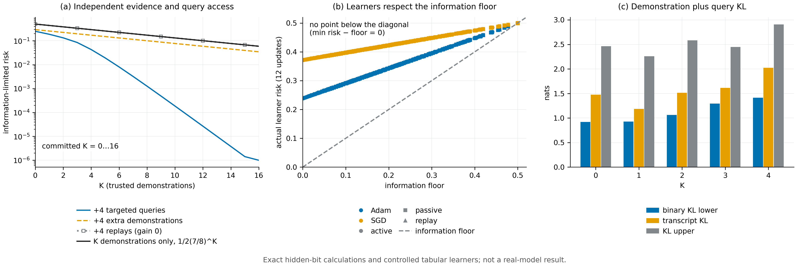

# N03 · Few-shot 信息下限 — 实验

[← 框架总览](../README_ZH.md) · [证明](../proofs/N03_few_shot_information_floor_ZH.md)

**结论。** N03 成立。所有检验都通过，除 KL 中的对数外均为精确有理数运算：

- **V5**（348 个实例，26,214 条断言，最大残差 0）。在全部 100 个穷举情形（$d\le5$、$K\le4$、$n\le3$）中，Bayes 最优风险都等于 (A11)；最优的按标签自适应查询决策树都等于按权重贪心的规则 (A13)。其中 80 个情形里一条轨迹会同时揭示多个坐标，所以结论不依赖于单点揭示。
- **V6**（297 个实例）。两世界界 (A15) 在每个自适应查询/停止过程上都成立，而且是*紧*的：比值 $\operatorname{kl}(1-\delta,\delta)/(K\kappa_D+\kappa_X\mathbb EN)$ 恰好达到 $1$。
- **E5**（944 个精确的 $(K,\text{查询})$ 格点）。replay 的收益在每个格点都是 $0$；预算相同时，定向查询优于额外的被动示范；实际的 Adam 或 SGD 学习器从未低于信息下限。
- **包内检验 T09、T10、T11** 在独立的构造上复现了同样的公式。



[PDF](../figures/N03_floor.pdf)

### V5 — 命题 A5–A6：隐比特覆盖、硬查询预算与自适应性

**动机。**

- (A11) 断言：无论同一轨迹内的揭示事件如何相关，Bayes 风险都是 $\tfrac12\sum_jw_j(1-q_j)^K$。
- (A13) 断言：任何按标签自适应的查询策略都不比按权重贪心更好。
- (A14) 断言：正部必须留在期望之内。

穷举得到的 Bayes 值或决策树值只要与公式不同，就能推翻它们；出现 $\mathbb E[(M-n)_+]<(\mathbb EM-n)_+$ 的实例也一样。

**设置。**

- 100 个情形：$d=1,\dots,5$（各 20 个）、$K=0,\dots,4$、$n=0,\dots,3$。
- 权重 $w$ 为随机有理数，揭示集合的分布定义在 bitmask 上，也随机生成。
- 穷举全部 $2^d$ 个比特世界与所有有序揭示历史，最大的情形有 2,321 条 transcript。
- 按后验取 Bayes 动作；按标签分支的查询决策树精确极小化，最大的有 271 个查询节点。
- 均匀占据下 $M_K$ 的分布用子集递推与容斥两种独立方法计算（$d=2,\dots,5$、$K\le4$）。
- 用对抗 hill-climb（8 次重启 × 20 步）搜索违反 Jensen 不等式或贪心最优性的实例。
- 种子 `SeedSequence([150150, 5])`；全程使用 `fractions.Fraction`。

**结果。**

| 量 | 值 | JSON 键（`groups[id=V5]` 内） |
|---|---|---|
| 实例数 / 断言数 / 最大残差 | 348 / 26,214 / 0 | `n_instances`、`n_assertions`、`worst_residual` |
| Bayes 风险 = (A11) 的情形 | 100 / 100 | `data.cases[*].Bayes` 对比 `.A11` |
| 自适应最优 = 贪心 (A13) 的情形 | 100 / 100 | `data.cases[*].adaptive` 对比 `.greedy` |
| 揭示集合含多个坐标的情形 | 80 / 100 | `data.cases[*].reveal`（bitmask 键） |
| $\mathbb E[(M-n)_+]>(\mathbb EM-n)_+$ 严格成立的情形 | 36 / 100 | `data.cases[*].E_positive` 对比 `.positive_E` |
| 严格见证 | $d=2,K=1,n=1$：$\mathbb E[(M-1)_+]=\tfrac12$，而 $(\mathbb EM-1)_+=0$；风险 $\tfrac5{56}$ | `data.strict_Jensen` |
| 两种占据计算方法一致；(A14) 曲线精确 | 所有 $d\le5$、$K\le4$、$n\le3$ | `data.uniform` |
| 对抗搜索找到的最大违例 | $0$ | `data.adversarial.best.score` |

**说明了什么。** 信息下限与最优查询值恰好是 N03 的闭式解，包括同一轨迹内揭示事件相关的情形。按值自适应查询从未带来好处，与独立性论证的预测一致。把正部移到期望之外，在超过三分之一的情形中都是错的。

### V6 — 命题 A7：示范信息抵扣自适应查询预算

**动机。** (A15) 必须对*任何*公共的、依赖历史的查询/停止规则成立。只要有一个过程满足 $\operatorname{kl}(1-\delta,\delta)>K\kappa_D+\kappa_X\mathbb E_vN$，就推翻了它；如果比值处处远小于 1，说明界偏松。

**设置。**

- 两世界过程：$K\in\lbrace 1,2\rbrace $ 条对称的有信息示范，$N_{\max}\le4$。
- 两个随机的二元查询信道。
- 随机化的、依赖历史的选择与停止规则，两个世界共用。
- transcript 概率为精确有理数。transcript KL 直接计算一次，再作为自适应链式和独立计算一次；对数用 float64，容差 $10^{-8}$。
- 160 个随机过程，加对抗 hill-climb（8 次重启 × 16 步），再加两个构造情形：
  - 紧情形：$K=0$，一次二元查询，信道为 $(\tfrac45,\tfrac15)$，$\delta=\tfrac15$；
  - 零信息情形：$\kappa_D=\kappa_X=0$。
- 种子 `SeedSequence([150150, 6])`。

**结果。**

| 量 | 值 | JSON 键（`groups[id=V6]` 内） |
|---|---|---|
| 实例数 / 断言数 / 最大残差 | 297 / 2,969 / 2.7e-15 | `n_instances`、`n_assertions`、`worst_residual` |
| 满足前提 $0<\delta<\tfrac12$ 的随机过程 | 159 / 160 | `data.random_premise_count` |
| 随机过程中的最大比值 | 0.9973 | `data.worst_random.score` |
| 对抗搜索中的最大比值 | 0.9760 | `data.adversarial.best.score` |
| 构造的紧情形的比值 | **1.0**（KL $=\operatorname{kl}(\tfrac45,\tfrac15)=0.8318$，$\mathbb EN=1$） | `best_ratio`、`data.tight` |
| 零信息情形 | transcript KL $=0$；两个出错概率之和为 1 | `data.zero_information` |

**说明了什么。** 在自适应停止下，KL 链式恒等式（直接计算的 transcript KL = 累积的链式和）精确成立。(A15) 从未被违反，并且单次有信息查询就能取到等号，所以它的常数不能再改进。示范和查询都不携带信息时，一致识别是不可能的。

### E5 — 隐比特的 $K$ 曲线、replay 与实际学习器

**动机。** 这组实验把理论中刻意分开的三件事区分出来：

- 独立的新证据（更多轨迹或定向查询）；
- 对已见证据的 replay，由 N01 命题 1.4，其信息价值为零；
- 信息是否可得，与学习器实际用到多少之间的差距。

**设置。**

- 精确计算 $R_{\rm info}(K,\cdot)$ 曲线：$m\in\lbrace 4,8,16\rbrace $ 个 context，$q$ 与 $w$ 均有均匀和非均匀两种，$K=0,\dots,32$，查询预算 $0,1,2,4$。计算用整数子集 Möbius 反演和有理数风险。
- 相同预算下比较三种获取方式：
  - *active*：查询指向未见 context；
  - *passive*：同样的预算用于额外的随机示范；
  - *replay*：重复展示已见标签。
- 一个实际的表格学习器（每个 context 一个 logit），在已揭示的比特上用可分的 summed cross-entropy 训练 12 次更新，优化器为 Adam 或 SGD；未见 context 的 logit 保持为 0。部署时按 Bernoulli 抽取动作。
- 种子 `SeedSequence([150150, 105])`。

**结果。**

| 量 | 值 | JSON 键（`groups[id=E5]` 内） |
|---|---|---|
| 精确格点数 / 断言数 / 最大残差 | 944 / 7,450 / 5.6e-17 | `data.curves`、`n_assertions`、`worst_residual` |
| replay 收益 | 944 个格点全部为 $0$ | `data.curves[*].replay_gain` |
| $m=8$ 均匀、$K=4$：无查询 / 4 条被动示范 / 4 次定向查询 | $0.2931$ / $0.1718$ / $0.0431$（$\tfrac{2401}{8192}$、$\tfrac{5764801}{33554432}$、$\tfrac{353}{8192}$） | `data.curves[m=8,uniform,K=4]` |
| $m=8$ 均匀、$K=8$：无查询 / 4 次定向查询 | $0.1718$ / $0.0013$ | 同上 |
| 实际学习器的记录数 | 5,664（Adam、SGD × active、passive、replay） | `data.actual_learners` |
| $\min(\text{学习器风险}-\text{信息下限})$ | $0.0$（从未低于下限） | `data.actual_learners[*].risk`、`.information_floor` |
| 12 次更新后在*已揭示*比特上的错误率 | Adam 0.239，SGD 0.372 | `data.actual_learners[*].observed_bit_error` |

**说明了什么。**

- 每条精确曲线都等于 (A11)/(A13)。
- replay 在每个格点上都不改变下限。
- 预算相同时，定向查询消除的风险远多于额外的被动示范：$K=4$、$m=8$ 时，4 次定向查询把风险降到 $0.043$，而 4 条额外示范只降到 $0.172$。这就是 (A12)–(A13) 刻画的覆盖效应。
- 实际学习器的风险始终在下限之上。超出部分来自对已揭示比特拟合得不完美，也就是 N01 中的 $\mathcal R_{\rm alg}$ 项。信息是否可得与信息用了多少，在这里可以分开看到。

### 包内检验 T09、T10、T11

**动机。** 这些是理论包里的独立实现，可以在不同的构造上做复现。

**设置与结果。**

| 检验 | 构造 | 结果 | JSON 键（`docs/direction/v015_revision/results_v015.json`） |
|---|---|---|---|
| T09 | $d=3$，$w=(\tfrac12,\tfrac13,\tfrac16)$，揭示集合 $\varnothing,\lbrace 0,1\rbrace ,\lbrace 1,2\rbrace ,\lbrace 0,2\rbrace $，概率依次为 $\tfrac1{10},\tfrac2{10},\tfrac3{10},\tfrac4{10}$（$q=(\tfrac35,\tfrac12,\tfrac7{10})$）；完整后验枚举与决策树极小化，$K\le4$、$n\le3$ | 20/20 个情形等于公式。例如 $K=0$：$\tfrac12,\tfrac14,\tfrac1{12},0$；$K=4$：$\tfrac{2099}{120000},\tfrac1{40000},\tfrac1{120000},0$ | `checks.T09_exact_posterior_and_adaptive_query_optimum.exact_curves` |
| T10 | 均匀 $d=4$，$K\le6$，$n\le4$ | 35/35 精确。$K=3,n=2$ 时正确风险为 $\tfrac1{128}$，把正部移到期望之外的公式给出 0 | `checks.T10_uniform_coverage_and_positive_part` |
| T11 | 两世界，示范分布 $(\tfrac3{10},\tfrac7{10})$，两个查询信道，按得分停止，$N_{\max}=4$，$K\le4$ | 10/10 个方向记录满足：二元 KL 下界 $\le$ 精确 transcript KL $\le K\kappa_D+\kappa_X\mathbb EN$，且 $\mathbb EN\ge$ (A16)。下界/上界比值为 0.37–0.56 | `checks.T11_adaptive_query_KL_enumeration.rows` |

**说明了什么。** 另外三个独立构造也与 (A11)、(A13)、(A14) 和 (A15)–(A16) 一致。

## 复现

```bash
CUDA_VISIBLE_DEVICES='' theory/.venv/bin/python theory/v015_checks/check_v015.py --only V5,V6,E5 --output theory/v015_checks/quick/n03.json
theory/.venv/bin/python docs/direction/v015_revision/verify_v015_extensions.py --out theory/v015_checks/quick/results_v015_package_rerun.json
```

## 产物

- `theory/v015_checks/results_v015_independent.json`：`groups[id=V5|V6|E5]`。
- `theory/v015_checks/mathematics.py`（`check_V5`、`check_V6`）与 `theory/v015_checks/experiments.py`（`check_E5`）。
- `docs/direction/v015_revision/results_v015.json`：`checks.T09_*`、`checks.T10_*`、`checks.T11_*`。
