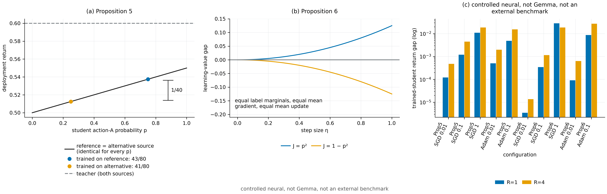

# N04 · Static value is not learning value — Experiments

[← Framework map](../README.md) · [Proof](../proofs/N04_static_vs_learning_sufficiency.md) · [中文](N04_static_vs_learning_sufficiency_ZH.md)

**Verdict.** N04 holds. Check C3 verified both propositions exactly, with 75 assertions and zero residual:

- Proposition 5: identical static values $\tfrac12+p/20$ for every aliased student, teacher value $\tfrac35$ under both sources, and frequency-learner returns of exactly $\tfrac{43}{80}$ and $\tfrac{41}{80}$ for every $m=1,\dots,30$;
- Proposition 6: equal packet means, a symbolic gap of exactly $\eta^2/8$, and its reversal to $-\eta^2/8$ under $1-p^2$.

The controlled neural experiment C23, parts (a)–(b), shows the same separation in an actual trained network. This is labelled *controlled neural, not Gemma, not an external benchmark*. The two statically equivalent sources produce different trained students in every exactly enumerated configuration, for both SGD and Adam. The sign matches the theory: the reference source is better in Proposition 5, and the independent packets are better under $p^2$ in Proposition 6.



[PDF](../figures/N04_static_vs_learning.pdf)

### C3 — Propositions 5 and 6

**Why.**

- Proposition 5 asserts an *exact* equality of static values for all $p$ together with an exact learning-value gap for all $m$. Any arithmetic slip in the table, a non-optimal teacher, or an $m$-dependent gap would falsify it.
- Proposition 6 asserts equal means but a curvature-dependent gap whose sign depends on the task.

**Setup.**

- SymPy symbolic computation in $p$ and $\eta$.
- Exact binomial expectations of the frequency learner in `fractions.Fraction`, for $m=1,\dots,30$ and both sources.
- Statewise teacher optimality is checked at all four states.
- Seed `SeedSequence([20261010, 3])`; the check is fully deterministic.

**Procedure.**

1. Expand $J_\rho(\pi_p)$ for both state laws and assert equality with $\tfrac12+p/20$.
2. Assert that the teacher's value is $\tfrac35$ under both laws and that its action is optimal at every state.
3. For each $m$, compute $\mathbb E\,J(\pi_{\widehat p})$ exactly as a binomial sum, and assert $\tfrac{43}{80}$ and $\tfrac{41}{80}$.
4. Enumerate the four equally likely label pairs: assert $\mathbb Ep^+=\tfrac12$, the gap $\eta^2/8$ for $p^2$, and the gap $-\eta^2/8$ for $1-p^2$.

**Result.**

| Quantity | Value | JSON key (`claims[id=C3]`) |
|---|---|---|
| Instances / assertions / worst residual | 60 / 75 / 0 | `n_instances`, `n_assertions`, `worst_residual` |
| Proposition 5 gap (every $m=1,\dots,30$) | $1/40$ | `details.prop5_gap` |
| Proposition 6 gap | $\eta^2/8$ (and $-\eta^2/8$ under $1-p^2$) | `details.prop6_gap` |
| Status | PASS | `status` |

**What this shows.** Both separations are exact identities, not approximations. Two sources can agree on every static quantity a selector might check for the student class, namely every aliased student's value, the teacher's value, the label marginals and the mean gradient, and still produce different learned students.

### C23 (a)–(b) — the same separation in a trained network (controlled neural)

**Why.** The theorems use an idealized frequency learner. The question here is whether a real nonlinear network trained by gradient methods also distinguishes the two statically equivalent sources. A zero gap would mean the separation is an artifact of the idealized learner.

**Setup.**

- Network: one-hot context → 4 tanh units → sigmoid action probability, with fixed initialization and cross-entropy on label blocks.
- Optimizers: plain SGD with $\eta\in\lbrace 0.01,0.1,1,3\rbrace $, and Adam ($\beta=(0.9,0.999)$, $\epsilon=10^{-8}$, bias correction) with $\eta\in\lbrace 0.01,0.1\rbrace $.
- $R\in\lbrace 1,4,40\rbrace $ updates, using the source laws of Propositions 5 and 6.
- For $R\le4$, all training histories are enumerated exactly. For $R=40$, 2,400 independent training runs are used per source, and SE counts training runs.
- Seed `SeedSequence([20261010, 23])`.

**Result (exact enumeration unless SE is given; gap = reference − alternative, resp. independent − paired).**

| Source pair | Optimizer, $\eta$ | $R=1$ | $R=4$ | $R=40$ (SE) |
|---|---|---:|---:|---:|
| Prop. 5 | SGD 0.01 | 1.21e-4 | 4.81e-4 | 4.38e-3 (1.7e-5) |
| Prop. 5 | SGD 0.1 | 1.21e-3 | 4.48e-3 | 2.10e-2 (9.2e-5) |
| Prop. 5 | SGD 1.0 | 1.10e-2 | 1.88e-2 | 2.44e-2 (2.0e-4) |
| Prop. 5 | Adam 0.01 | 5.04e-4 | 2.00e-3 | 1.54e-2 (6.9e-5) |
| Prop. 5 | Adam 0.1 | 4.91e-3 | 1.54e-2 | 2.40e-2 (1.9e-4) |
| Prop. 6 | SGD 0.1 | 3.46e-4 | 1.15e-3 | 2.0e-3 (1.1e-3) |
| Prop. 6 | SGD 1.0 | 2.86e-2 | 1.86e-2 | 1.61e-2 (2.7e-3) |
| Prop. 6 | Adam 0.1 | 8.75e-3 | 2.76e-2 | 1.23e-2 (2.4e-3) |

The values are read from `controlled_neural.details.configurations[task∈{Prop5,Prop6}].neural_gap` and `.SE`.

At small SGD steps the measured gap matches the network's local tangent prediction. For example, Prop. 5 with SGD $\eta=0.01$, $R=1$ gives 1.21170e-4 measured against 1.21171e-4 predicted (`.local_affine_SGD_prediction`).

**What this shows.**

- In a real network, as in the theorem, statically equivalent feedback sources yield different students.
- The direction matches the theory in every row, and the gap grows with the step size, as a learning-consequence effect should. In Proposition 5 it also grows with the number of updates.
- The magnitude depends on the optimizer: Adam gaps exceed SGD gaps at equal $\eta$. This dependence is analysed in N11–N12.

The scope is a controlled small network, not Gemma and not a benchmark.

## Reproduce

```bash
CUDA_VISIBLE_DEVICES='' PYTHONDONTWRITEBYTECODE=1 theory/.venv/bin/python theory/independent_checks/check_v014_independent.py --only C3,C23 --output theory/independent_checks/subset.json
```

## Artifacts

- `theory/independent_checks/results_independent_v014.json`: `claims[id=C3]`; `controlled_neural.details.configurations` (filter `task` = `Prop5` or `Prop6`).
- `theory/independent_checks/check_v014_independent.py`: `check_C3`, `check_C23`.
- Existing controlled-neural figure: `theory/independent_checks/figs/C23_controlled_neural.png`.
