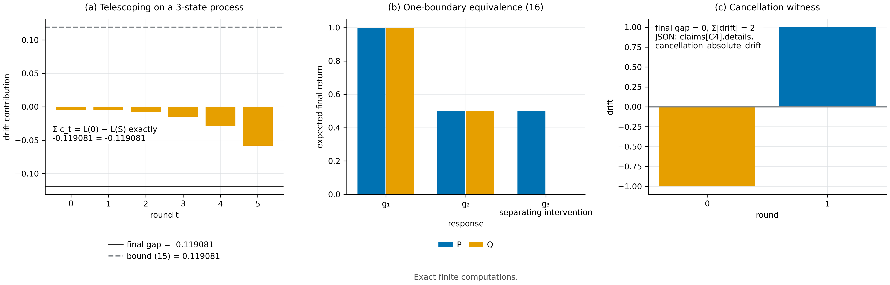

# N05 · Continuation-response 刻画 — 实验

[← 框架总览](../README_ZH.md) · [证明](../proofs/N05_continuation_response_ZH.md)

**结论。** N05 成立。检验 C4 在 45 个随机有限学习过程上精确验证了全部三个定理，共 1,867 条断言，最大残差为 0。这些过程带有*实际的*确定性更新映射和更新随机性：

- **(a)** 望远镜恒等式 [N05(a)](../proofs/N05_continuation_response_ZH.md) 以有理数精确成立，界 [N05(a)](../proofs/N05_continuation_response_ZH.md) 也成立；
- **(c)** 停止界 [N05(c)](../proofs/N05_continuation_response_ZH.md)：对认证集做对抗 hill-climb，始终没能让 $`\lvert\text{差距}\rvert-(\text{退出前漂移}+\rho)`$ 超过 $`0`$；
- **(b)** 单边界刻画 [N05(b)](../proofs/N05_continuation_response_ZH.md) 在随机快照上成立。

两个构造的见证确认了两个推论：只要分布在某个 $`g`$ 上不同，就存在分离它们的 response；不同轮次的漂移可以抵消（最终差距 0，绝对漂移之和 2）。包内检验 T12 在另外 400 个 Markov 实例上确认了停止复合：每个界都有效且都小于 1，最紧的实例达到其界的 47%。


[PDF](../figures/N05_response.pdf)

<a id="c4--n05ac式-n05an05c"></a>

### C4 — N05(a)–(c)

**动机。**

- [N05(a)](../proofs/N05_continuation_response_ZH.md) 是恒等式。只要方向搞错（例如用参照过程的占据分布代替 $`d_t^S`$），或 continuation 递推有误，随机过程上就会出现非零残差。
- [N05(c)](../proofs/N05_continuation_response_ZH.md) 断言退出惩罚是 $`\rho`$ 而不是 $`R\rho`$。只要有一种认证集取法让 $`\lvert\text{差距}\rvert`$ 超过界，它就被推翻。
- [N05(b)](../proofs/N05_continuation_response_ZH.md) 断言单边界价值之差恰好是 $`(P-Q)g`$。

**设置。**

- 45 个随机过程，状态数 $`\lvert\mathcal Z\rvert\in[4,20]`$，轮数 $`R\in[1,8]`$。
- 消息字母表大小为 2–4；更新随机性 $`\xi`$ 取两个值，概率分别为 $`\tfrac13,\tfrac23`$。
- 随机的确定性更新表 $`U_t(z,y,\xi)\in\mathcal Z`$；每个 $`(t,z)`$ 上参照与备选的消息分布都随机生成。kernel $`K_t^0,K_t^S`$ 按理论中的方式由它们构造。
- 终端得分 $`F\in[0,1]`$ 与初始分布均为有理数；全程使用精确的 `fractions.Fraction` 运算。
- 种子 `SeedSequence([20261010, 4])`。

**做法。**

1. 向后计算 $`V_t^0`$，向前计算 $`d_t^S`$。断言 $`L(0)-L(S)=\sum_t d_t^S(K_t^0-K_t^S)V_{t+1}^0`$ 精确成立，且 $`\lvert L(0)-L(S)\rvert\le\sum_td_t^S\lvert(K_t^0-K_t^S)V_{t+1}^0\rvert`$。
2. 停止界。偶数号实例的认证掩码 $`C_t`$ 全部认证，奇数号实例随机。做 35 步 hill-climb，每步翻转一个 $`(t,z)`$，以*最大化* $`\lvert\text{差距}\rvert-(\text{退出前漂移}+\rho)`$，其中 $`\rho`$ 为精确的首次退出概率。每一步都断言 $`\lvert\text{差距}\rvert\le\text{退出前漂移}+\rho`$。
3. 每轮在一个随机快照 $`(t,z)`$ 上构造实际的 response 向量 $`g(y)=\sum_\xi\Pr(\xi)V_{t+1}^0(U_t(z,y,\xi))`$，断言单边界价值之差精确等于 $`(P-Q)g`$。
4. 见证：
   - 分离 response。$`P=(\tfrac12,0,\tfrac12)`$ 与 $`Q=(0,1,0)`$ 在 $`g_1\equiv1`$ 和 $`g_2=(0,\tfrac12,1)`$ 上一致，在 $`g_3=(0,0,1)`$ 上不同。
   - 相互抵消。两个状态，$`K^0=`$ 恒等，$`K^S=`$ 交换，共两轮，$`F=(0,1)`$，从状态 0 出发。

**结果。**

| 量 | 值 | JSON 键（`claims[id=C4]`） |
|---|---|---|
| 过程数 / 断言数 / 最大残差 | 45 / 1,867 / 0 | `n_instances`、`n_assertions`、`worst_residual` |
| 对抗搜索找到的最大 $`\lvert\text{差距}\rvert-(\text{退出前漂移}+\rho)`$ | $`0.0`$（从未为正） | `details.adversarial_exit_best_lhs_minus_rhs` |
| 抵消见证：最终差距 / $`\sum_t\mathbb E\lvert\text{漂移}\rvert`$ | $`0`$ / $`2`$ | `details.cancellation_absolute_drift` |
| 分离 response 见证 | $`P,Q`$ 在 $`g_1,g_2`$ 上相等，在 $`g_3`$ 上不等 | 在 `check_C4` 中断言 |
| 状态 | PASS | `status` |

**说明了什么。**

- 学习价值之差*恰好*是各轮单边界 response 差异按占据分布加权之和，且用的是备选过程的占据分布，与 [N05(a)](../proofs/N05_continuation_response_ZH.md) 一致。
- 对手无论怎样选择认证哪些状态，都打不破停止界：一次退出的代价至多为 $`\rho`$。
- 单边界价值之差恰为 $`(P-Q)g`$，所以 response 类是正确的不变量。
- 抵消见证确认：对单一最终均值，逐点匹配不是必要的。这正是 [N05(b)](../proofs/N05_continuation_response_ZH.md) 要对所有单边界替换取全称量词的原因。

### T12（包内）— 带审计 transport 的停止复合

**动机。** 这是停止界的一个独立实现，形式接近它在后文（N14）中的用法：response 写成带常数基线的指示特征，差异在一个审计锚点状态上测量，再 transport 到访问到的状态。

**设置。**

- 400 个随机的 4 状态、3 轮 Markov 过程。参照的转移行 $`P_t(z,\cdot)`$ 服从 Dirichlet[N01(a)](../proofs/N01_decomposition_and_ambiguity_ZH.md)；备选为 $`Q=0.97P+0.03\,\mathrm{Dirichlet}(1)`$；初始状态固定为 1。
- 一半试验中状态 3 未被认证，进入它的概率质量计入 $`\rho`$。
- 每轮的界为 $`\sum_z\Pr(Z_t=z,\text{存活})\,B_t\,(D_t+a_t(z))`$，其中：
  - $`b=V_{t+1}(0{:}3)-V_{t+1}(3)`$，$`B_t=\lVert b\rVert_1`$；
  - $`D_t`$ 为状态 0 处的锚点差异；
  - $`a_t(z)`$ 为从状态 $`z`$ 到锚点的 sup 范数 transport 误差。
  总界再加上 $`\rho`$。
- 包内种子 15019。

**结果。**

| 量 | 值 | JSON 键（`checks.T12_stopped_occupancy_composition`） |
|---|---|---|
| 实例数 | 400 | `instances` |
| 差距 $`\le`$ 界 | 400 / 400（已断言） | — |
| 严格小于 1 的界（非空洞） | 400 / 400 | `bounds_below_one` |
| 最大 差距 / 界 | 0.470 | `maximum_gap_over_bound` |

**说明了什么。** 当局部差异在一个审计单元上认证、再 transport 到访问到的状态时，停止复合仍然有效且非空洞。冻结审计定理（N14）正是建立在这种形式之上。

## 复现

```bash
CUDA_VISIBLE_DEVICES='' PYTHONDONTWRITEBYTECODE=1 theory/.venv/bin/python theory/independent_checks/check_v014_independent.py --only C4 --output theory/independent_checks/subset.json
theory/.venv/bin/python docs/direction/v015_revision/verify_v015_extensions.py --out theory/v015_checks/quick/results_v015_package_rerun.json
```

## 产物

- `theory/independent_checks/results_independent_v014.json`：`claims[id=C4]`。
- `theory/independent_checks/check_v014_independent.py`：`process`、`continuations`、`process_stats`、`check_C4`。
- `docs/direction/v015_revision/results_v015.json`：`checks.T12_stopped_occupancy_composition`；代码见 `docs/direction/v015_revision/verify_v015_extensions.py`（`stopped_learning`）。
