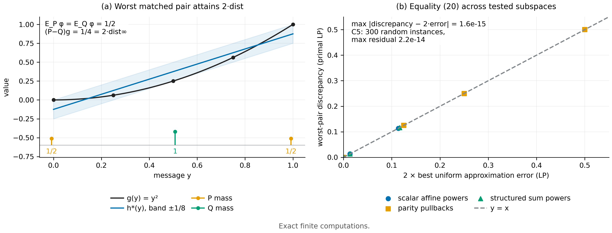

# N06 · 充分性对偶与迁移 — 实验

[← 框架总图](../README_ZH.md) · [证明](../proofs/N06_sufficiency_duality_ZH.md) · [English](N06_sufficiency_duality.md)

**结论。** N06 成立。检验 C5 在 300 个随机有限实例上检验了 Thm. 8 的三个部分和 Cor. 9（共 6,014 条断言，状态 PASS）：

- **span 判据 (a)：** 在所有实例上都与独立的 LP 分离搜索结论一致。
- **对偶 (b)：** 直接求解的最坏分布对 LP，与另一个 LP 算出的"最优一致逼近误差的两倍"相差不超过 $2.2\times10^{-14}$。
- **迁移 (c)：** 对抗地最大化迁移不等式"左边减右边"，结果从未超过 $1.1\times10^{-16}$，即在浮点误差内为零。
- **Cor. 9：** 对每个 $m=2,\dots,8$，事件上确界在有理数算术下精确等于 $\gamma\,\mathrm{TV}$，response 维数精确等于 $m-1$。
- **独立交叉验证：** C19 选出的 21 个特征子空间上，"差异 = 2 × 一致误差"同样成立，偏差不超过 $1.6\times10^{-15}$。



[PDF](../figures/N06_duality.pdf)

### C5 — Theorem 8 (a)–(c) 与 Corollary 9

**为什么做。** Thm. 8 把"反馈分布之间哪些差别有影响"变成线性代数问题：

- (a) 断言 span 判据*恰好*是正确的检验；
- (b) 断言最坏情形的未分辨差异*等于*两倍逼近距离，这是等式，不只是上界；
- (c) 给出带显式系数项和残差项的迁移界。

每条断言都有对应的证伪方式：

- 一对特征匹配的分布分离了一个落在 span 内的 response；
- span 判据漏掉了一个落在 span 外的 response；
- 某个可行分布对的差异超过 $2\operatorname{dist}_\infty$，或没有任何分布对能达到它；
- 某个分布对违反 (21)。

C5 对这几种情况分别独立搜索。

**设置。**

- 300 个实例：字母表大小 $m\sim\mathrm U\lbrace 4,\dots,12\rbrace $，特征数 $d\sim\mathrm U\lbrace 1,\dots,m-2\rbrace $。
- 特征表 $\phi\in\mathbb Q^{d\times m}$ 和三个 response $\mathcal G\subset\mathbb Q^m$ 都取随机有理数。
- 每个实例另检验 $g=\phi_1$，作为预期差异为 0 的 span 内对照。
- 迁移实例中 $b,r$ 随机，并重新缩放，保证 $g=\tfrac12+b^\top\phi+r\in[0,1]^m$。
- Cor. 9 在 $m=2,\dots,8$ 上取随机有理分布 $P,Q$，并取 $a=\tfrac15$、$\gamma=\tfrac35$。
- 种子：`SeedSequence([20261010, 5])`。

**做法。**

1. *精确秩：* 用 SymPy 计算 $[\mathbf 1;\phi]$ 与 $[\mathbf 1;\phi;g]$ 的精确秩，判断 $g\in H_\phi$；同时算 $d_0=\operatorname{rank}[\mathbf 1;\mathcal G]-1$。
2. *原问题 LP：* 用 HiGHS 直接以 $(P,Q)$ 为变量，在特征匹配的概率分布对上求 $\max(P-Q)g$。
3. *逼近 LP：* 用另一个 LP 计算 $\min_{h\in H_\phi}\lVert g-h\rVert_\infty$。
4. *(a)(b) 的断言：* 断言 $\text{width}=2\cdot\text{error}$，并断言 $\text{width}\le10^{-8}$ 当且仅当 $g\in H_\phi$。
5. *迁移 LP：* 在所有分布对上最大化 $(P-Q)g-B\lVert\Delta\phi\rVert_\infty-2\tau$，断言最优值 $\le0$。
6. *Cor. 9：* 在精确有理数下枚举全部 $2^m$ 个事件，比较 $\max_A\lvert(P-Q)(a+\gamma\mathbf 1_A)\rvert$ 与 $\gamma\cdot\tfrac12\lVert P-Q\rVert_1$，并检验 $[\mathbf 1;\lbrace \mathbf 1_A\rbrace ]$ 的秩等于 $m$。

**结果。**

| 量 | 值 | 来源（JSON 键） |
|---|---:|---|
| 实例数 / 断言数 | 300 / 6,014 | `claims[id=C5].n_instances`, `.n_assertions` |
| 状态 | PASS | `claims[id=C5].status` |
| $\max\lvert\text{primal width}-2\cdot\text{approx. error}\rvert$ | $2.23\times10^{-14}$ | `claims[id=C5].details.max_duality_residual` |
| 迁移对抗得分的最大值（必须 $\le0$） | $1.11\times10^{-16}$ | `claims[id=C5].details.adversarial_transfer_best_lhs_minus_rhs` |
| 全部断言中的最大残差 | $5.76\times10^{-14}$ | `claims[id=C5].worst_residual` |
| Cor. 9：事件上确界 $=\gamma\,\mathrm{TV}$，维数 $=m-1$ | $m=2,\dots,8$ 全部精确 | 断言 `all-event total variation`, `event response dimension`（PASS） |

以上数值均来自 `theory/independent_checks/results_independent_v014.json`。

**说明了什么。**

- span 判据与 LP 分离搜索从未出现分歧，所以 (a) 就是精确的检验。
- 两个 LP 是独立求解的：一个在分布对上，一个在逼近函数上。它们的最优值吻合到约 $10^{-14}$，即求解器精度，说明 (b) 是等式，而不仅是上界。
- 即使对手专门针对 (21) 做优化，也无法让左边超过右边，所以迁移不等式成立。

### C19 交叉验证 — 所选子空间上的精确对偶

**为什么做。** C19（主页面见 [N09](N09_approximate_complexity_ZH.md)）独立地再次使用 (b)，而且用在结构化的 response 族上，而不是随机族。

**设置与做法。**

- 在 125 点网格 $\lbrace 0,\tfrac14,\dots,1\rbrace ^3$ 上取三个最高次数都是 3 的 response 族。
- 对每个特征预算 $d=1,\dots,7$，贪心选出一个子空间。
- 然后计算：(i) 用逼近 LP 求该子空间的最优一致误差；(ii) 用原问题 LP 求该子空间的最坏分布对差异。断言 (ii) 等于 (i) 的两倍。

**结果。** 在全部 21 个（族, $d$）子空间上，$\max\lvert\text{discrepancy}-2\cdot\text{uniform error}\rvert=1.6\times10^{-15}$。由 `claims[id=C19].details.families[*].curve[*]` 计算得到。

**说明了什么。** 等式 (20) 在非随机的结构化 response 上同样成立，包括差异始终很大的多元 parity 族。

## 复现

```bash
CUDA_VISIBLE_DEVICES='' PYTHONDONTWRITEBYTECODE=1 theory/.venv/bin/python \
  theory/independent_checks/check_v014_independent.py --only C5,C19 \
  --output theory/independent_checks/subset.json
```

`--only` 保留每条 claim 自己的随机流（`SeedSequence([20261010, claim 编号])`），所以子集运行能复现完整运行的数字。

## 产物

- 结果：`theory/independent_checks/results_independent_v014.json`（条目 `C5`、`C19`）
- 代码：`theory/independent_checks/check_v014_independent.py`（`check_C5`、`check_C19`）
- 规格说明：`theory/independent_checks/SPEC.md`（C5）
- 图规格：`theoretical_framework/figures/specs/N06.md`
