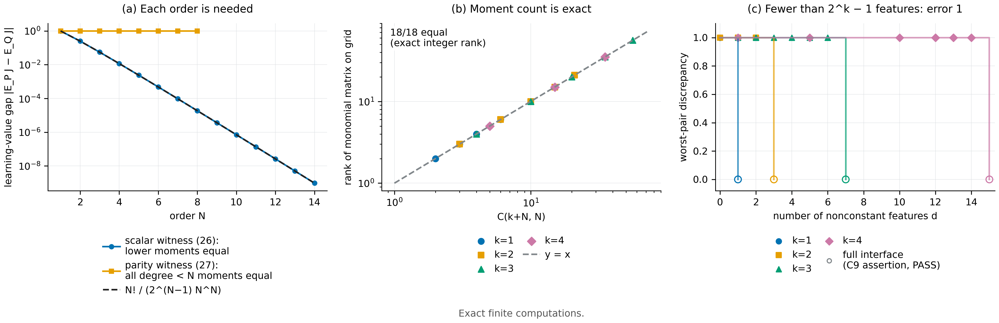

# N07 · Affine learners: moment order is necessary and sufficient — Experiments

[← Framework map](../README.md) · [Proof](../proofs/N07_affine_moment_order.md) · [中文](N07_affine_moment_order_ZH.md)

**Verdict.** N07 holds. All statements are checked in exact rational arithmetic, and every check passes.

- **Lemma 10 (C6).** Degree $\le N$ and coefficient norm $\le3^N$ hold on 1,080 random and adversarially mutated deployment trees. The largest norm ratio found is $2/3$.
- **Theorem 11 (C7).** Moment-matched laws give *identical* learning values for 24 random tasks and affine learners with up to $R=5$ updates. For every multi-index, a law pair differing in that single moment is separated by the corresponding monomial task.
- **Theorem 12 (C8, package).**
  - $\Delta_N=(-1)^NN!/(2^{N-1}N^N)$ holds exactly for $N=1,\dots,14$, with all lower moments equal.
  - The parity laws match every joint multi-index of degree $<N$ and give the constant gap 1 for $N=1,\dots,8$.
- **Theorem 13 (C9, package).**
  - The grid rank equals $\binom{k+N}N$ in all 18 configurations.
  - Deleting any one of 237 nonconstant features leaves a separable pair.
  - Every one of 32 random binary interfaces with fewer than $2^k-1$ features has worst-pair discrepancy exactly 1 (deviation $\le4.4\times10^{-16}$).
- **Span dimensions (C19).** Three degree-3 response families have span dimension 4 (scalar powers), 8 (parity) and 4 (structured sums), each including the constant, as Theorem 13 and N06(a) predict.



[PDF](../figures/N07_moment_order.pdf)

### C6 — Lemma 10: deployment value is a bounded polynomial

**Why.** The whole affine theory rests on $J_E$ being a polynomial of degree $\le N$ in the policy coordinates, with coefficient norm $\le3^N$. A tree whose exact expansion has higher degree, or a larger norm, would falsify the lemma.

**Setup.**

- 90 search rounds, each with $k\in\lbrace 1,2,3\rbrace $ contexts and $N\in\lbrace 1,\dots,5\rbrace $ decisions per path.
- Contexts may recur along a path, and chance nodes have rational probabilities.
- Each round evaluates 12 candidate trees. Every fourth candidate is a fresh random tree; the others are random leaf, context or chance-probability mutations of the current worst-ratio tree. This gives 1,080 trees in total.
- Seed: `SeedSequence([20261010, 6])`.

**Procedure.**

1. Expand each tree symbolically (SymPy), giving an exact rational polynomial.
2. Assert total degree $\le N$ and $\sum\lvert c_\alpha\rvert\le3^N$.
3. Assert $J\in[0,1]$ at 3 random rational points.
4. Hill-climb on the ratio $\sum\lvert c_\alpha\rvert/3^N$ to search for the worst case.

**Result.**

| Quantity | Value | Source |
|---|---:|---|
| Trees / assertions | 1,080 / 5,400 | `claims[id=C6].n_instances`, `.n_assertions` |
| Largest $\sum\lvert c_\alpha\rvert/3^N$ | $2/3$ | `claims[id=C6].details.exact_best_ratio` |
| Witness | $N=1$, $J=1-p_1$ | `claims[id=C6].details.witness` |
| Status | PASS (worst residual 0) | `claims[id=C6].status` |

**What this shows.** Degree and coefficient bounds hold on every tree, including adversarially mutated ones. The $3^N$ bound is valid but conservative.

### C7 — Theorem 11: moment matching is sufficient and necessary

**Why.** Theorem 11 has two directions, and each has a falsifier:

- a moment-matched pair with *different* learning values for some task or affine learner (against sufficiency);
- a moment whose mismatch no task can detect (against necessity).

**Setup and procedure.**

- *Sufficiency.* For 24 configurations ($k\in\lbrace 1,2\rbrace $, $N\in\lbrace 1,2,3\rbrace $, $R\in\lbrace 1,\dots,5\rbrace $):
  1. Take a random positive law $P$ on the grid $\lbrace 0,\tfrac1{N+1},\dots,1\rbrace ^k$.
  2. Construct $Q=P+av$ with $v$ in the exact null space of all moment constraints of degree $\le N$, including mass.
  3. Draw random convex weights, a random $p_0$ and a random task tree.
  4. Compute both learning values by exact block-moment convolution, and assert all matched moments and both values equal.
- *Necessity.* For $(k,N)\in\lbrace (1,4),(2,3),(3,2)\rbrace $ and every nonzero $\alpha$ with $\lvert\alpha\rvert\le N$:
  1. Verify symbolically that the task "visit $j$ exactly $\alpha_j$ times, pay iff all ones" evaluates to $p^\alpha$.
  2. Construct a law pair that differs *only* in moment $\alpha$.
  3. Assert that the one-update learner $p=Z$ separates them.
- *Two-context example.* Equal marginals with cross moments $\tfrac12$ versus $0$.
- Seed: `SeedSequence([20261010, 7])`.

**Result.**

| Quantity | Value | Source |
|---|---:|---|
| Instances / assertions | 46 / 385 | `claims[id=C7].n_instances`, `.n_assertions` |
| Affine sufficiency configurations | 24, with $R$ up to 5 | `claims[id=C7].details.affine_configurations` |
| Worst residual | 0 (exact) | `claims[id=C7].worst_residual` |
| Status | PASS | `claims[id=C7].status` |

**What this shows.** Matching all joint moments through $N$ makes learning values exactly equal; the differences are zero, not merely small. Conversely, every single moment through $N$ is detected by some task. Marginal matching is not enough.

### C8 — Theorem 12: every order is necessary; a constant-gap witness

**Why.** Theorem 12 shows the hierarchy is strict:

- for each $N$ there are laws that agree on all lower moments yet differ in the order-$N$ learning value;
- in the parity construction, the gap stays at 1 instead of shrinking.

**Setup and procedure.**

- *Scalar witness.* For $N=1,\dots,14$, build $P_N$ and $Q_N$ from (26) in exact rationals. Assert unit mass, equality of all moments $\ell<N$, and $m_{P_N}(N)-m_{Q_N}(N)=(-1)^NN!/(2^{N-1}N^N)$.
- *Parity witness.* For $N=1,\dots,8$, enumerate $\lbrace 0,1\rbrace ^N$:
  1. Assert equality of every joint moment over *all* multi-indices of total degree $<N$, not only subsets.
  2. Assert $J_{\rm even}$ values 1 and 0.
  3. Assert that (27) equals the enumerated even-parity probability at 4 random rational $p$.
- Seed: `SeedSequence([20261010, 8])`.

**Result.**

| $N$ | 1 | 2 | 3 | 4 | 5 | 6 | 8 | 10 | 14 |
|---|---:|---:|---:|---:|---:|---:|---:|---:|---:|
| $\Delta_N$ (exact) | $-1$ | $1/4$ | $-1/18$ | $3/256$ | $-3/1250$ | $5/10368$ | $315/16777216$ | $567/800000000$ | $\approx9.58\times10^{-10}$ |

$\Delta_N$ comes from `claims[id=C8].details.scalar`. All 14 values equal the closed form; this was re-verified from the JSON.

| Quantity | Value | Source |
|---|---:|---|
| Parity orders with all lower multi-indices matched | $N=1,\dots,8$ | `claims[id=C8].details.parity_all_multiindices` (true) |
| Assertions | 8,983 | `claims[id=C8].n_assertions` |
| Status | PASS (worst residual 0) | `claims[id=C8].status` |

**What this shows.** Every order $N$ is necessary for some scalar task, and the gap formula is exact. The scalar gap shrinks exponentially, while the parity gap stays 1 at every order. Exact necessity and fixed-accuracy hardness are therefore different properties (developed in N09).

### Package check — constant-gap parity (independent implementation)

**Why.** This is an independent re-implementation of the parity witness, written by the theory author.

**Procedure.** For $N=1,\dots,8$, the check tests every proper coordinate subset (all $2^N-1$ of them) for equal subset moments. Because binary coordinates are idempotent, this covers all degree-$<N$ raw moments. It then computes both values exactly.

**Result.** For every $N=1,\dots,8$, the exact value gap is `"1"` (reference value 1.0, alternative 0.0), and the number of matching proper-subset tests is $1,3,7,15,31,63,127,255$. Source: `theory/v014_repro/results_v014_rerun.json → constant_gap_parity`, identical to the package's own `docs/direction/v014_handoff/results_v014.json`.

### C9 — Theorem 13: exact statistic count and binary barrier

**Why.** Theorem 13 turns N06(a) into concrete numbers:

- exactly $\binom{k+N}N-1$ statistics are needed and sufficient on the grid;
- on binary messages with arbitrary payoffs, fewer than $2^k-1$ statistics leave worst-case error 1.

**Setup and procedure.**

1. *Grid rank.* For all $(k,N)$ with $k\le3$, $N\le5$, and for $k=4$, $N\le3$ (18 configurations), compute the exact integer rank of the monomial evaluation matrix on the grid. Assert that it equals $\binom{k+N}N$.
2. *Removed features.* For each nonconstant monomial in each configuration (237 in total), delete it and solve the worst-pair LP. Assert that a feature-matched pair separates the deleted monomial.
3. *Binary barrier.* For $k=1,\dots,4$, draw 8 random rational feature tables with $d<2^k-1$. Take a null vector of $[\mathbf 1;\phi]$, set the event to its positive support, and assert that the LP discrepancy equals 1. For $k\le3$, also enumerate all events and assert that the optimum is 1.
4. *Full interface.* With $2^k-1$ generic features, assert discrepancy 0 for every indicator response and a random response.

Seed: `SeedSequence([20261010, 9])`.

**Result.**

| Quantity | Value | Source |
|---|---:|---|
| Grid ranks $=\binom{k+N}N$ | 18/18, e.g. $(k,N)=(3,5)$: 56, $(4,3)$: 35 | `claims[id=C9].details.grid_ranks` |
| Dropped nonconstant features, all separable | 237 | `claims[id=C9].details.dropped_features` |
| Binary interfaces with $d<2^k-1$; worst-pair discrepancy | 32; all $=1$ (max deviation $4.4\times10^{-16}$) | `claims[id=C9].details.binary_barriers` |
| Full $2^k-1$ interface discrepancy | 0 (assertion `full generic interface discrepancy`) | `claims[id=C9].status` = PASS |
| Assertions / worst LP residual | 903 / $2.3\times10^{-12}$ | `claims[id=C9].n_assertions`, `.worst_residual` |

**What this shows.**

- The binomial count is exact: every nonconstant moment is individually necessary, and together they suffice.
- The binary barrier is attained by an actual separating event, not just bounded.

### Package check — grid response dimensions (independent implementation)

**Result.** The numerical rank (tolerance $10^{-10}$) of the monomial matrix on $\lbrace 0,\tfrac1N,\dots,1\rbrace ^k$ was checked for six configurations:

| $(k,N)$ | $(1,1)$ | $(1,4)$ | $(2,2)$ | $(2,3)$ | $(3,2)$ | $(3,3)$ |
|---|---:|---:|---:|---:|---:|---:|
| alphabet size | 2 | 5 | 9 | 16 | 27 | 64 |
| rank $=\binom{k+N}N$ | 2 | 5 | 6 | 10 | 10 | 20 |
| minimal nonconstant statistics | 1 | 4 | 5 | 9 | 9 | 19 |

Source: `theory/v014_repro/results_v014_rerun.json → grid_response_dimensions`.

### C19 — span dimension of three same-degree response families

**Why.** Theorem 13 counts the worst case over all tasks. C19 checks that the span dimension of a *given* response family is what N06(a) and Theorem 13 predict, by computing the exact rank. Structured families have far smaller dimension than the worst case.

**Setup.**

- The grid is $\lbrace 0,\tfrac14,\dots,1\rbrace ^3$ (125 messages), and every family has maximum degree 3.
- *Scalar affine powers:* $(a+bx_1)^3$, five responses.
- *Multivariate parity pullbacks:* $J_{\rm even}$ composed with eight affine maps, plus the raw parity, nine responses.
- *Structured sum powers:* $(a+b\bar x)^3$, five responses.
- Seed: `SeedSequence([20261010, 19])`.

**Result (exact rational rank, including the constant).** Scalar powers: 4; parity: 8; structured sums: 4. Source: `claims[id=C19].details.families[*].span_dimension_including_constant`.

**What this shows.** Same-degree families can differ sharply in dimension. Scalar and structured families need only $1+3$ dimensions, while the parity family needs $2^3=8$. The exact dimension is the operative quantity, as N06(a) states; the degree is not.

## Reproduce

```bash
CUDA_VISIBLE_DEVICES='' PYTHONDONTWRITEBYTECODE=1 theory/.venv/bin/python \
  theory/independent_checks/check_v014_independent.py --only C6,C7,C8,C9,C19 \
  --output theory/independent_checks/subset.json
CUDA_VISIBLE_DEVICES='' theory/.venv/bin/python docs/direction/v014_handoff/verify_environment_information_v014.py \
  --output theory/v014_repro/results_v014_rerun.json
```

## Artifacts

- Results:
  - `theory/independent_checks/results_independent_v014.json` (C6–C9, C19)
  - `theory/v014_repro/results_v014_rerun.json` (`constant_gap_parity`, `grid_response_dimensions`)
- Code: `theory/independent_checks/check_v014_independent.py`, `docs/direction/v014_handoff/verify_environment_information_v014.py`
- Figure spec: `theoretical_framework/figures/specs/N07.md`
