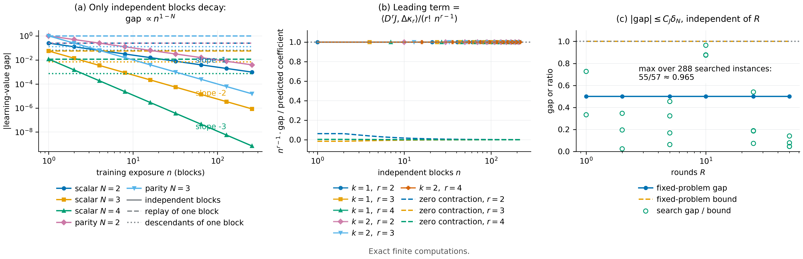

# N08 · 仿射理论中的速率 — 实验

[← 框架总图](../README_ZH.md) · [证明](../proofs/N08_affine_rates_ZH.md) · [English](N08_affine_rates.md)

**结论。** N08 成立；以下所有断言都通过，全部在精确有理数算术下完成。

- **(a)** **（C10）：** 在 288 个对抗搜索得到的实例上（更新次数最多 $`R=50`$），界 $`C_J\delta_N`$ 全部成立。最紧的比值是 gap/bound $`=55/57\approx0.965`$。在一个固定问题上，$`R`$ 从 1 增加到 50，界始终为 1。
- **(b)** **（C11）：**
  - 平均恒等式 [N08(c)](../proofs/N08_affine_rates_ZH.md) 对 $`N=2,\dots,8`$ 和每个 $`n=1,\dots,30`$ 都精确成立。
  - 在六个标量与二元情形中（第一个不匹配 cumulant 的阶 $`r=2,3,4`$），精确的差距多项式（以 $`1/n`$ 为变量）首项系数等于预测的张量缩并，且没有更慢的项。
  - 缩并为零时，首项消失。
  - 均值不同时，差距以 $`O(1/n)`$ 收敛到 $`J(\mu_P)-J(\mu_Q)=13/32`$。
- **(c)** **包内检验：** 用直接卷积的独立检验在 20 个情形中复现了 [N08(c)](../proofs/N08_affine_rates_ZH.md)。
- **Replay 与后代样本（C18）：** 使用独立块时，差距精确地按 $`\text{gap}_1/n^{N-1}`$ 衰减，$`N=2,3,4`$ 的双对数斜率分别为 $`-1,-2,-3`$。重放一个块、或使用同一母块的后代样本时，差距在 256 倍曝光内保持不变。



[PDF](../figures/N08_rates.pdf)

### C10 — [N08(a)](../proofs/N08_affine_rates_ZH.md)：不随 R 增长的差异界

**为什么做。** [N08(a)](../proofs/N08_affine_rates_ZH.md) 声称对*每一个*凸仿射 learner 都有一个偏差界，并且关于更新次数 $`R`$ 一致。证伪方式有两种：找到 gap $`>C_J\delta_N`$ 的实例，或找到一族最坏比值随 $`R`$ 增长的实例。

**设置。**

- 24 次搜索试验，$`k\in\lbrace 1,2\rbrace`$、$`N\in\lbrace 1,2,3\rbrace`$，支撑为 $`\lbrace 0,\tfrac12,1\rbrace ^k`$。
- $`R`$ 在 $`\lbrace 1,2,5,10,25,50\rbrace`$ 中循环。
- 随机分布 $`P,Q`$、随机凸权重 $`w_0,\dots,w_R`$、随机 $`p_0`$，以及随机任务树（其精确多项式给出 $`C_J`$）。
- 种子：`SeedSequence([20261010, 10])`。

**做法。**

1. 每次试验对 $`Q`$ 做 12 步有理爬山（每步在支撑点之间移动 $`\le\tfrac1{20}`$ 的质量），以*最大化* gap/bound，共 288 个实例。
2. 用独立块矩卷积精确计算每个学习价值。
3. 断言 gap $`\le C_J\delta_N\le N3^N\delta_N`$。
4. *固定问题扫描：* 在 $`\lbrace 0,1\rbrace`$ 上取 $`P=(\tfrac14,\tfrac34)`$、$`Q=(\tfrac34,\tfrac14)`$，$`J=p^2`$，learner 为 $`R`$ 个块的均匀平均，$`R=1,\dots,50`$。

**结果。**

| 量 | 值 | 来源 |
|---|---:|---|
| 实例数 / 断言数 | 288 / 582 | `claims[id=C10].n_instances`, `.n_assertions` |
| 找到的最大 gap/bound | $`55/57\approx0.9649`$，出现在 $`N=1`$、$`R=10`$ | `claims[id=C10].details.best_exact_ratio`, `.best_instance` |
| 状态 | PASS（最大残差 0） | `claims[id=C10].status` |

| 固定问题，$`R`$ | 1 | 2 | 5 | 10 | 25 | 50 |
|---|---:|---:|---:|---:|---:|---:|
| 精确差距 | 1/2 | 1/2 | 1/2 | 1/2 | 1/2 | 1/2 |
| 界 $`C_J\delta_N`$ | 1 | 1 | 1 | 1 | 1 | 1 |

来源：`claims[id=C10].details.fixed_problem_R_sweep`。

**说明了什么。**

- 对抗搜索从未越过这个界，而界与实际差距只差 4%，接近可达。
- 这个界关于 $`R`$ 一致成立：在扫描中差距和界都不随 $`R`$ 变化，更新次数完全不出现在界里。

### C11 — [N08(b)](../proofs/N08_affine_rates_ZH.md) 与 [N08(c)](../proofs/N08_affine_rates_ZH.md)：第一个不匹配的 cumulant 决定速率

**为什么做。** [N08(b)](../proofs/N08_affine_rates_ZH.md) 同时预测了差距随独立块数衰减的*指数* $`1-r`$ 和*系数* $`\langle D^rJ(\mu),\Delta\kappa_r\rangle/r!`$。证伪方式包括：

- 首项系数不对；
- 出现 $`j<r-1`$ 的更慢项 $`n^{-j}`$；
- 余项不是 $`O(n^{-r})`$；
- 缩并为零时首项却不为零。

**设置。**

- *精确律 [N08(c)](../proofs/N08_affine_rates_ZH.md)：* 标量分布 [N07(c)](../proofs/N07_affine_moment_order_ZH.md)，$`J=p^N`$，$`N=2,\dots,8`$，$`n=1,\dots,30`$。
- *cumulant 情形：* 共六个，$`k\in\lbrace 1,2\rbrace`$、$`r\in\lbrace 2,3,4\rbrace`$：
  - $`k=1`$：用 $`r`$ 阶标量分布；
  - $`k=2`$：用二元提升 $`(x,(x+b)/2)`$，$`b\in\lbrace 0,1\rbrace`$ 等概率；
  - 任务为 $`J=(\tfrac1k\sum_jp_j)^{r+1}`$。
- *缩并为零：* $`J=(p-\tfrac12)^{r+2}`$，$`r=2,3,4`$，它在 $`\mu=\tfrac12`$ 处的 $`r`$ 阶导数为零。
- *均值不同：* 在 $`\lbrace 0,1\rbrace`$ 上取 $`P=(\tfrac14,\tfrac34)`$、$`Q=(\tfrac34,\tfrac14)`$，$`J=p^3`$。

**做法。**

1. 用样本下标的多项式展开，把 $`\mathbb EJ(\bar p_n)`$ *精确地*算成 $`1/n`$ 的多项式。
2. 由矩*独立地*计算 cumulant。
3. 断言低阶 cumulant 相等、$`n^{1-r}`$ 的系数等于预测的缩并、所有更慢项的系数为零。
4. 对 $`n=1,\dots,220`$，断言 $`n\cdot\lvert n^{r-1}\text{gap}-\text{coefficient}\rvert`$ 始终不超过高阶系数构成的包络。

**结果。**

| 情形 $`(k,r)`$ | 预测系数 | 精确差距（$`1/n`$ 的多项式） |
|---|---:|---|
| (1, 2) | $`3/8`$ | $`\tfrac38\,n^{-1}`$ |
| (1, 3) | $`-1/9`$ | $`-\tfrac19\,n^{-2}`$ |
| (1, 4) | $`15/512`$ | $`\tfrac{15}{512}\,n^{-3}`$ |
| (2, 2) | $`27/128`$ | $`\tfrac{27}{128}\,n^{-1}`$ |
| (2, 3) | $`-3/64`$ | $`-\tfrac3{64}\,n^{-2}`$ |
| (2, 4) | $`1215/131072`$ | $`\tfrac{1215}{131072}\,n^{-3}`$ |
| 缩并为零，$`r=2`$ | 0 | $`\tfrac3{16}n^{-2}-\tfrac18n^{-3}`$ |
| 缩并为零，$`r=3`$ | 0 | $`-\tfrac5{108}n^{-3}+\tfrac5{162}n^{-4}`$ |
| 缩并为零，$`r=4`$ | 0 | $`\tfrac{45}{4096}n^{-4}-\tfrac{15}{2048}n^{-5}`$ |
| 均值不同 | 极限 $`13/32`$ | $`\tfrac{13}{32}+\tfrac9{32}n^{-1}-\tfrac3{16}n^{-2}`$ |

来源：`claims[id=C11].details.cumulant_cases[*].predicted_coefficient`、`.exact_gap_polynomial_in_inverse_n`、`.gap`（缩并为零的情形），以及 `claims[id=C11].details.unequal_means_gap`、`.unequal_means_limit`。恒等式 [N08(c)](../proofs/N08_affine_rates_ZH.md) 在全部 $`7\times30=210`$ 个 $`(N,n)`$ 格点上精确成立。总计 1,530 个实例、1,797 条断言（`claims[id=C11].n_instances`、`.n_assertions`），状态 PASS。

**说明了什么。**

- 每个情形的差距都恰好从 $`n^{1-r}`$ 开始，系数与预测一致。
- 缩并为零的情形中，衰减变得更快（$`n^{-r}`$）。
- 均值不同时，差距以 $`O(1/n)`$ 逼近极限 $`J(\mu_P)-J(\mu_Q)`$。
- 指数和系数都由第一个不匹配的 cumulant 决定。

### 包内检验 — 直接卷积得到的精确衰减

**为什么做。** 这是一个完全不使用 cumulant 的独立实现：把分布卷积 $`n`$ 次，直接计算 $`\mathbb E\bar p_n^N`$。

**结果。** 在 $`N=2,\dots,6`$、$`n\in\lbrace 1,2,4,8\rbrace`$ 的全部 20 个情形中，枚举得到的差距都精确等于预测值 $`\Delta_N/n^{N-1}`$。例如 $`N=4`$ 时依次为 $`3/256,\ 3/2048,\ 3/16384,\ 3/131072`$。来源：`theory/v014_repro/results_v014_rerun.json → scalar_exact_decay`。每一行的 `enumerated_gap_exact` 与 `predicted_gap_exact` 都完全相同，且该文件与包内的 `docs/direction/v014_handoff/results_v014.json` 一致。

### C18 — 独立证据、replay 与合成后代样本

**为什么做。** [N08(b)](../proofs/N08_affine_rates_ZH.md) 的速率是关于*独立*块的个数。[N08(c′)](../proofs/N08_affine_rates_ZH.md) 预测，下面两种只增加训练曝光、不带来新证据的做法，会让差距停留在单块时的值：

- 把一个块重放 $`n`$ 次；
- 用同一个母块的 $`n`$ 个确定性后代训练。

这把信息与曝光区分开：多训几个 epoch 不等于多了数据。

**设置。**

- $`N=2,3,4`$ 的标量分布 [N07(c)](../proofs/N07_affine_moment_order_ZH.md)，以及 $`N=2,3`$ 的 parity 分布。
- 曝光量 $`n\in\lbrace 1,2,4,\dots,256\rbrace`$。
- 后代通道为 $`Z\mapsto(Z+\tfrac12)/2`$，一个固定的、保信息的映射。
- 种子：`SeedSequence([20261010, 18])`。

**做法。** 对每个族、$`N`$ 和 $`n`$，精确计算三种差距：

- 独立块：$`\mathbb E_{P^n}J(\bar p_n)-\mathbb E_{Q^n}J(\bar p_n)`$；
- replay：同一个块的 $`n`$ 份拷贝，$`\bar p_n=Z_1`$；
- 后代样本：$`n`$ 份 $`T(Z_1)`$，$`\bar p_n=T(Z_1)`$。

然后断言三条恒等式：

- 独立块差距等于单块差距除以 $`n^{N-1}`$；
- replay 差距等于单块差距；
- 后代差距等于单块差距除以 $`2^N`$（所选通道的收缩因子）。

**结果。**

| 族，$`N`$ | $`n=1`$ 时差距 | 独立块，$`n=256`$ | replay，$`n=256`$ | 后代，$`n=256`$ | 独立块的双对数斜率 |
|---|---:|---:|---:|---:|---:|
| 标量，2 | $`1/4`$ | $`1/1024`$ | $`1/4`$ | $`1/16`$ | $`-1`$ |
| 标量，3 | $`-1/18`$ | $`-1/1179648`$ | $`-1/18`$ | $`-1/144`$ | $`-2`$ |
| 标量，4 | $`3/256`$ | $`3/4294967296`$ | $`3/256`$ | $`3/4096`$ | $`-3`$ |
| parity，2 | $`1`$ | $`1/256`$ | $`1`$ | $`1/4`$ | $`-1`$ |
| parity，3 | $`1`$ | $`1/65536`$ | $`1`$ | $`1/8`$ | $`-2`$ |

来源：`claims[id=C18].details.curves`；斜率由 $`n=1`$ 和 $`n=256`$ 两行计算。共 45 个实例、140 条断言，状态 PASS。

**说明了什么。**

- 只有独立证据能让差异衰减，而且衰减指数恰好是预测的 $`1-N`$。
- replay 和后代样本把训练曝光放大了 256 倍，学习价值差距却纹丝不动。
- 后代样本只通过通道把差距缩放一次，之后不再衰减。
- 通道结论的适用范围是所述的确定性通道。它是一个构造出来的对照，不是关于所有后处理方式的论断。

## 复现

```bash
CUDA_VISIBLE_DEVICES='' PYTHONDONTWRITEBYTECODE=1 theory/.venv/bin/python \
  theory/independent_checks/check_v014_independent.py --only C10,C11,C18 \
  --output theory/independent_checks/subset.json
CUDA_VISIBLE_DEVICES='' theory/.venv/bin/python docs/direction/v014_handoff/verify_environment_information_v014.py \
  --output theory/v014_repro/results_v014_rerun.json
```

## 产物

- 结果：
  - `theory/independent_checks/results_independent_v014.json`（C10、C11、C18）
  - `theory/v014_repro/results_v014_rerun.json`（`scalar_exact_decay`）
- 已有图：`theory/independent_checks/figs/C18_evidence_exposure.png`
- 代码：`theory/independent_checks/check_v014_independent.py`（`check_C10`、`check_C11`、`check_C18`）
- 图规格：`theoretical_framework/figures/specs/N08.md`
