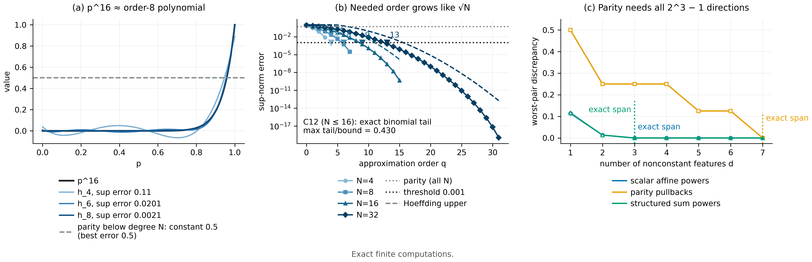

# N09 · Exact order is not approximate complexity — Experiments

[← Framework map](../README.md) · [Proof](../proofs/N09_approximate_complexity.md) · [中文](N09_approximate_complexity_ZH.md)

**Verdict.** N09 holds; every check passes.

- **Expansion and truncation error (C12, package).**
  - The Chebyshev identity (32) is exact for $N=1,\dots,16$.
  - For every $q<N$, the uniform truncation error equals the exact binomial tail $\Pr\lbrace \lvert B-N\rvert>q\rbrace $ and stays below $2e^{-q^2/N}$. The largest tail/bound ratio is $0.430$.
- **Required order (package).** An independent check covers $N\in\lbrace 4,8,16,32\rbrace $ (64 cases). The order needed for uniform error $\le10^{-3}$ is only $q=4,6,9,13$, which grows like $\sqrt N$.
- **Parity (C12).** The best degree-$(<N)$ uniform approximation error of parity is exactly $1/2$ in a full-vertex minimax LP for $N=1,\dots,5$.
- **Same degree, different complexity (C19).** Three response families share maximum degree 3. Scalar and structured families reach zero error with 3 features. The parity family keeps error $\ge0.0625$ (discrepancy $\ge0.125$) until all 7 nonconstant directions are present.



[PDF](../figures/N09_approximation.pdf)

### C12 — Chebyshev identity, exact tails, and parity minimax

**Why.** Proposition 16 makes three claims that can each be falsified:

- (32) is an identity;
- the truncation error *equals* the binomial tail, not merely bounded by it;
- that tail is $\le2e^{-q^2/N}$.

The parity proposition claims the best lower-degree error is exactly $1/2$. A strictly smaller value would falsify it.

**Setup.**

- $N=1,\dots,16$ and all $q<N$ for the scalar task.
- $N=1,\dots,5$ for parity, on all $2^N$ cube vertices.
- 10 random rational points per $N$ check the constant bound $\lvert J_{\rm even}-\tfrac12\rvert\le\tfrac12$.
- Seed: `SeedSequence([20261010, 12])`.

**Procedure.**

1. Verify (32) symbolically: $\operatorname{expand}(\text{RHS}-p^N)=0$ in SymPy.
2. For each $(N,q)$:
   - compute $\max\lvert p^N-h_q\rvert$ on a 3,001-point grid that includes $p=1$, and assert it equals the coefficient tail;
   - assert in exact rationals that the coefficient tail equals the binomial tail;
   - assert tail $\le2e^{-q^2/N}$.
3. Parity: solve the minimax LP $\min_{h\in\mathcal P_{N-1}}\max_{\rm vertices}\lvert J_{\rm even}-h\rvert$, using all nonconstant monomials of degree $<N$, and assert the optimum is $0.5$.

**Result.**

| Quantity | Value | Source |
|---|---:|---|
| Instances / assertions | 136 / 484 | `claims[id=C12].n_instances`, `.n_assertions` |
| Range of $N$ for (32) and tails | 1–16 | `claims[id=C12].details.N_range` |
| Largest tail $/\,2e^{-q^2/N}$ | 0.430 | `claims[id=C12].details.exhaustive_tail_best_ratio` |
| Parity best degree-$(<N)$ error | 0.5 exactly ($N=1,\dots,5$) | `claims[id=C12].details.parity_minimax_error` |
| Worst residual | $1.0\times10^{-17}$ | `claims[id=C12].worst_residual` |
| Status | PASS | `claims[id=C12].status` |

**What this shows.**

- The truncation error of $p^N$ is exactly a binomial tail and decays like $e^{-q^2/N}$, with the stated bound conservative by at least a factor of 2.3.
- Parity cannot be approximated better than the trivial constant by any lower degree.

### Package check — Chebyshev truncation for N up to 32 (independent implementation)

**Why.** This is an independent implementation that extends the range to $N=32$. It records the order actually needed for a given accuracy.

**Procedure.** For $N\in\lbrace 4,8,16,32\rbrace $ and $q=0,\dots,N$:

- evaluate $\lvert x^N-h_q\rvert$ on an 8,001-point grid;
- compare it with the coefficient tail;
- compare it with $\min(1,2e^{-q^2/N})$.

**Result.** All 64 rows satisfy grid error = tail, with $\max\lvert\text{grid}-\text{tail}\rvert=8.9\times10^{-16}$, and tail $\le$ bound. Selected rows:

| $N$ | $q$ | truncation error | $2e^{-q^2/N}$ | parity best degree-$q$ error |
|---:|---:|---:|---:|---:|
| 16 | 4 | 0.1102 | 0.7358 | 0.5 |
| 16 | 8 | 0.00210 | 0.0366 | 0.5 |
| 16 | 12 | $2.56\times10^{-6}$ | $2.47\times10^{-4}$ | 0.5 |
| 32 | 8 | 0.0328 | 0.2707 | 0.5 |
| 32 | 16 | $2.44\times10^{-5}$ | $6.71\times10^{-4}$ | 0.5 |
| 32 | 20 | $1.01\times10^{-7}$ | $7.45\times10^{-6}$ | 0.5 |

The smallest $q$ with truncation error $\le10^{-3}$ is $q=4,6,9,13$ for $N=4,8,16,32$. Source: `theory/v014_repro/results_v014_rerun.json → scalar_approximation` (fields `Chebyshev_truncation_error`, `grid_check_error`, `Hoeffding_upper`, `parity_best_degree_q_error`); the file is identical to the package's own result file.

**What this shows.** For the scalar task, the order needed for practical accuracy grows like $\sqrt N$: doubling $N$ adds only a few orders. For parity, every order below $N$ leaves error $1/2$.

### C19 — same maximum degree, different response-space complexity

**Why.** The degree of a response family does not determine its approximate complexity; the operative quantity is the approximation width $d_\varepsilon$ (N06(b)). C19 compares three families with the *same* maximum degree. The structured families should be cheap and parity expensive.

**Setup.**

- Grid $\lbrace 0,\tfrac14,\dots,1\rbrace ^3$ (125 messages), maximum degree 3 in every family.
- *Scalar affine powers* $(a+bx_1)^3$ (5 responses).
- *Multivariate parity pullbacks* (9 responses).
- *Structured sum powers* $(a+b\bar x)^3$ (5 responses).
- Seed: `SeedSequence([20261010, 19])`.

**Procedure.**

1. Fix a finite dictionary before fitting: the response vectors, all multilinear monomials, and the scalar or structured Chebyshev bases.
2. For each budget $d=1,\dots,7$, greedily select a subspace and compute two quantities:
   - the uniform error $\max_g\operatorname{dist}_\infty(g,H)$, by LP over the full grid;
   - the worst-pair discrepancy for that subspace, by an independent primal LP.
3. Assert discrepancy $=2\times$ error. Positive errors are upper bounds on the optimal width, because the subspace found need not be the best one; zero errors are exact.

**Result (uniform error; discrepancy is exactly twice this).**

| feature budget $d$ | 1 | 2 | 3 | 4 | 5 | 6 | 7 |
|---|---:|---:|---:|---:|---:|---:|---:|
| scalar affine powers | 0.0569 | 0.0068 | **0** | 0 | 0 | 0 | 0 |
| structured sum powers | 0.0582 | 0.0068 | **0** | 0 | 0 | 0 | 0 |
| multivariate parity | 0.25 | 0.125 | 0.125 | 0.125 | 0.0625 | 0.0625 | **0** |

Source: `claims[id=C19].details.families[*].curve[*].uniform_error` (and `.discrepancy`, `.optimality`). Exact span dimensions including the constant are 4, 4 and 8 (`span_dimension_including_constant`). On held-out responses from the same families, the selected scalar and structured subspaces give errors of at most $0.017$ at $d=1$ and $0$ from $d=3$ on (`heldout_uniform_error`). Status PASS; 1,445 assertions.

**What this shows.** At equal maximum degree:

- the scalar and structured families are captured exactly by 3 statistics;
- parity needs all $2^3-1=7$;
- with the same budget of 3 statistics, the parity family still leaves a worst-pair discrepancy of $0.25$.

Task structure, not degree or horizon, sets the information order an interface must carry.

## Reproduce

```bash
CUDA_VISIBLE_DEVICES='' PYTHONDONTWRITEBYTECODE=1 theory/.venv/bin/python \
  theory/independent_checks/check_v014_independent.py --only C12,C19 \
  --output theory/independent_checks/subset.json
CUDA_VISIBLE_DEVICES='' theory/.venv/bin/python docs/direction/v014_handoff/verify_environment_information_v014.py \
  --output theory/v014_repro/results_v014_rerun.json
```

## Artifacts

- Results:
  - `theory/independent_checks/results_independent_v014.json` (C12, C19)
  - `theory/v014_repro/results_v014_rerun.json` (`scalar_approximation`)
- Existing plot: `theory/independent_checks/figs/C19_response_complexity.png`
- Code: `theory/independent_checks/check_v014_independent.py` (`check_C12`, `check_C19`)
- Figure spec: `theoretical_framework/figures/specs/N09.md`
