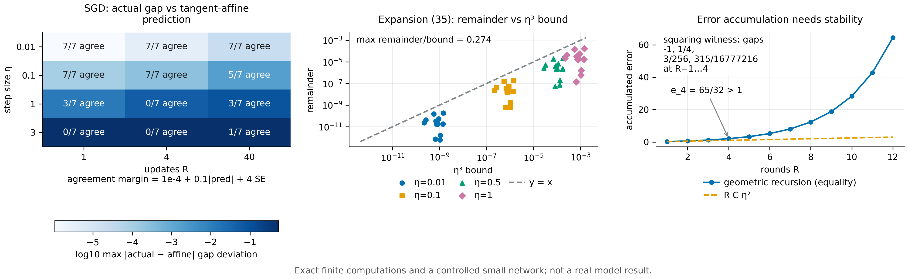

# N10 · 更新的复合会放大信息需求 — 实验

[← 框架总览](../README_ZH.md) · [证明](../proofs/N10_update_composition_ZH.md)

**结论。** N10 成立。

- **Theorem 17（次数的复合）**：C13 中 12 条随机多项式更新链的实际块次数都恰好等于上界 $D_i=Nb_i\prod_{t>i}a_t$，并且按 $D_i$ 逐块匹配矩后学习价值精确相等。
- **上界可达与阈值学习器**：平方构造的反例在 1、2、4、8 阶上把所有低阶矩都匹配的数据源区分开，差值为 $-1$、$1/4$、$3/256$、$315/16777216$；阈值学习器把两个均值相同的分布区分为 $2/3$ 对 $0$。
- **展开 (35)**：余项始终低于其 $\eta^3$ 界，余项与界之比最大为 0.274。
- **误差累积**：V7 确认几何级数界精确成立且可以取等号；没有稳定性条件时，关于 $R$ 线性的简化不成立（$65/32>1$）。
- **适用范围的边界**：在受控神经网络（C23）中，切线仿射 SGD 预测在 $\eta\le0.1$、至多 4 次更新的全部设置上都与实际网络一致，在 $\eta=0.01$、40 次更新时也一致，最大偏差 $2.5\times10^{-4}$，合计 35 个 SGD 设置；到 $\eta\ge1$ 时，42 个设置中有 35 个偏离，偏差最大 0.53。


[PDF](../figures/N10_regime.pdf)

## C13 —— 次数复合、上界可达、阈值学习器、展开 (35)

**为什么做。** Theorem 17 声称，第 $i$ 块上的 response 次数不超过 $Nb_i\prod_{t>i}a_t$，而且匹配这么多阶矩就足够。次数算错，矩匹配的充分性就不成立；次数算松，上界就取不到。展开 (35) 在 N11–N12 中被用作 SGD 的一阶描述，所以它的余项界必须成立。

**设置。**
- 12 条随机更新链：$R\in\lbrace 1,2,3\rbrace $，$N\in\lbrace 1,2\rbrace $，次数 $a_i,b_i\in\lbrace 1,2\rbrace $，更新为 $p_i=\lambda_ip_{i-1}^{a_i}+(1-\lambda_i)Z_i^{b_i}$，$\lambda_i\in\lbrace \tfrac14,\tfrac12,\tfrac34\rbrace $ 随机。
- 用 SymPy 做精确的符号回拉，块矩用精确有理数。第 $i$ 块取 (26) 中 $D_i+1$ 阶的标量分布。
- 另有 $R=1,\dots,4$ 的平方构造，以及 Proposition 17b 的阈值分布。
- 检验 (35) 时：$\mathbb R^3$ 上 15 个随机三次函数 $V$，配 6 个原子上的随机离散梯度分布；再用 logistic 函数 $V(\theta)=\sigma(w^\top\theta)$ 重复。步长 $\eta\in\lbrace 0.01,0.1,0.5,1\rbrace $。

**做法。**
- 展开 $J(p_R)$，读出每块的次数并与 $D_i$ 比较；在按 $D_i$ 匹配矩的条件下计算两个学习价值。
- 对 (35)，计算精确的差 $(K^P-K^Q)V(\theta)$ 与展开的前两项，把余项与 $\tfrac{M_3\eta^3}6(\mathbb E_P\lVert G\rVert^3+\mathbb E_Q\lVert G\rVert^3)$ 比较。
  - 三次函数的 $M_3$ 取常数三阶导数张量的 Frobenius 范数，它是算子范数的上界；
  - logistic 函数的 $M_3=\lVert w\rVert^3/8$，因为全局有 $\lvert\sigma'''\rvert\le1/8$。

**结果。** 数据：`theory/independent_checks/results_independent_v014.json → claims[id=C13]`。

| 量 | 值 |
|---|---|
| 状态、实例数、断言数、最大残差 | PASS，72，371，0.0 |
| 声明次数 vs 实际块次数（`details.degrees`，12 条链） | 每条链都相等，例如 $a=(2,2,2)$、$b=(2,2,1)$、$N=2$：$D=(16,8,2)$，实际 $(16,8,2)$ |
| 逐块匹配下学习价值相等 | 12 条链全部精确相等 |
| 平方构造（`details.amplification`） | $R=1,2,3,4$；次数 $1,2,4,8$；差值 $-1$、$1/4$、$3/256$、$315/16777216$ |
| 阈值学习器（`check_C13` 中的断言） | 均值都是 $1/2$；价值 $2/3$ 对 $0$ |
| logistic 的 (35) 余项/界，15 个实例取最大（`details.logistic`） | $\eta=0.01$：0.274；$0.1$：0.274；$0.5$：0.270；$1$：0.265 |
| 全部检验中最大的余项/界（`best_ratio`） | 0.2743 |

**说明了什么。** 次数上界 (34) 在随机更新链上是精确的，平方构造也取到了它：数据源需要匹配的阶数确实随更新的复合而增长。阈值学习器说明，一旦更新不连续，任何固定阶数的矩都不够。展开 (35) 在所有测试步长下都成立，而且留有余量。

## V7 —— 逐步误差的累积

**为什么做。** 单步 $O(\eta^2)$ 的误差本身推不出整个训练 $O(R\eta^2)$ 的误差。证明给出的是一个紧的几何级数界，并且指出线性累积需要稳定性。这两点都需要精确检验。

**设置。** 精确有理数递推 $e_{t+1}=s\cdot((1+\eta L)e_t+C\eta^2)$，松弛系数 $s\in(0,1]$；$\eta\in(0,1]$、$L\in[0,1]$、$C\in(0,1]$、$R\le40$ 随机取值。另外在 $(\eta,L,C,R,s)$ 上做固定种子的随机重启加爬山搜索。

**做法。** 断言 $e_R\le C\eta^2\sum_{s<R}(1+\eta L)^s$，并在 $s=1$ 时断言取等号；搜索该界与线性简化 $RC\eta^2$ 之比的最大值；计算反例 $\eta=\tfrac12$、$L=C=1$、$R=4$。

**结果。** 数据：`theory/v015_checks/results_v015_independent.json → groups[id=V7]`。

| 量 | 值 |
|---|---|
| 状态、实例数、断言数、最大残差 | PASS，717，1435，0.0 |
| 几何级数界取到（`data.geometric_adversarial.best.score`） | 1.0（例如 $\eta=4/5$、$L=1/5$、$C=7/10$、$R=13$） |
| 反例（`data.linear_failure`） | $e_4=65/32$，界 $65/32$，线性值 $RC\eta^2=1$ |
| 找到的最大"界/线性值"（`best_ratio`） | $3.78\times10^{30}$（$\eta=2$、$L=2$、$R=47$） |

**说明了什么。** 几何级数界是精确的：每个实例都成立，并且可以取等号。一旦 $\eta LR$ 不小，"关于 $R$ 线性"的理解就不成立。所以沿训练过程累积局部展开时，必须满足所说的稳定性条件或短视野条件。

## C23（SGD 部分）—— 局部仿射描述在真实网络中的适用范围

**为什么做。** N10 预言：对 SGD，response 每一步由消耗梯度的均值决定，误差为 $O(\eta^2)$，并按几何级数累积。在真实的非线性网络中，这意味着固定初始切线的仿射 SGD 预测在 $\eta R$ 小时应当准确，在 $\eta$ 大或视野长时应当失效。

**设置。** 受控神经网络设定，不是 Gemma，也不是外部基准。
- 网络：one-hot context 接 4 个 tanh 单元，再接 sigmoid；二元 cross-entropy；float64。
- 训练：每个采样块做一次普通 SGD，$\eta\in\lbrace 0.01,0.1,1,3\rbrace $，$R\in\lbrace 1,4,40\rbrace $ 次更新。
- 任务：Prop. 5 和 Prop. 6 的数据源、$N=2,3,4$ 的矩分布、$N=2,3$ 的 parity 分布。
- 估计方式：能穷举的用完整有限历史枚举，否则每个数据源 2400 次独立训练。
- 比较对象：实际策略在初始点处的切线仿射 SGD response。
- 一致性阈值在运行前写死在代码里：$10^{-4}+0.1\lvert\text{prediction}\rvert+4\,\mathrm{SE}$（prediction 为预测值）。

**做法。** 对每个设置，计算两个数据源之间实际的最终期望回报差和切线仿射预测，并按阈值记录是否一致。

**结果。** 数据：`theory/independent_checks/results_independent_v014.json → controlled_neural.details.configurations` 中的 SGD 行；分组汇总见 `details.observed_affine_comparison_cohorts`。

| $\eta$ | $R=1$ | $R=4$ | $R=40$ |
|---|---|---|---|
| 0.01 | 7/7 一致（最大偏差 $1.1\times10^{-6}$） | 7/7（$4.1\times10^{-6}$） | 7/7（$2.4\times10^{-5}$） |
| 0.1 | 7/7（$1.1\times10^{-4}$） | 7/7（$2.5\times10^{-4}$） | 5/7（$1.9\times10^{-3}$） |
| 1 | 3/7（0.013） | 0/7（0.053） | 3/7（0.084） |
| 3 | 0/7（0.52） | 0/7（0.53） | 1/7（0.51） |

"SGD、步长 ≤ 0.1、至多四次更新"这一组：28/28 一致，最大绝对偏差 $2.52\times10^{-4}$。加性单步 null（同样的样本和权重，只改变分组方式）的参数残差恰为 $0.0$（`details.additive_null_parameter_residual`）。

**说明了什么。** SGD 的一阶仿射描述恰好在展开 (35) 和 Proposition R 的稳定性条件所指的范围内准确：步长小、更新少，或者步长很小、更新很多。随着 $\eta R$ 增大，它就失效了；偏差随 $\eta$ 增长，这与曲率项和累积项一致。N11–N12 对 Adam 进一步刻画的，正是这条边界。

## 复现

```bash
CUDA_VISIBLE_DEVICES='' theory/.venv/bin/python theory/independent_checks/check_v014_independent.py --only C13,C23 --output theory/independent_checks/subset.json
CUDA_VISIBLE_DEVICES='' theory/.venv/bin/python theory/v015_checks/check_v015.py --only V7 --output theory/v015_checks/quick/v7.json
```

## 产出文件

- `theory/independent_checks/results_independent_v014.json`：`claims[id=C13]` 与 `controlled_neural`。
- `theory/independent_checks/figs/C23_controlled_neural.png`：原始的 C23 图。
- `theory/v015_checks/results_v015_independent.json`：`groups[id=V7]`。
- 检验代码：`theory/independent_checks/check_v014_independent.py`（`check_C13`、`check_C23`），`theory/v015_checks/mathematics.py`（`check_V7`）。
