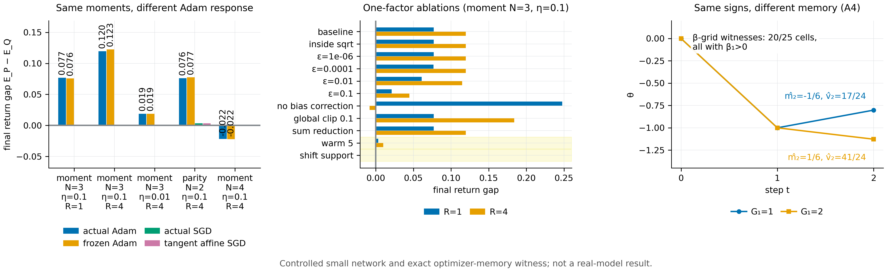

# N11 · 冷启动 Adam 的商结构与优化器记忆 — 实验

[← 框架总览](../README_ZH.md) · [证明](../proofs/N11_adam_cold_start_ZH.md)

**结论。** N11 成立。

- **A2（冷启动商）。** V2 在 300 个随机有限梯度字母表上确认了三点：
  - 冷启动的 Adam 一步等于 $c-\eta h_\epsilon(G)$，误差在 $4.4\times10^{-16}$ 以内；
  - $\epsilon=0$ 时恰好需要 $s-1$ 个统计量（既必要又充分），$\epsilon>0$ 时需要 $m-1$ 个；
  - 逆映射 (A8) 的导数 $\epsilon/(1-\lvert u\rvert)^2$ 可达 $10^{22}$。
- **A3（margin 界）。** V3 在 1,660 个精确实例上成立，对抗搜索得到的差距/界之比为 0.994，界几乎是紧的。
- **A4（优化器记忆）。** V4 和 E3 复现了精确反例：$\widehat m_2=\mp\tfrac16$，$\widehat v_2=\tfrac{17}{24},\tfrac{41}{24}$，两个第二步方向相反。对 $0$ 到 $10^{-1}$ 之间测试过的每个 $\epsilon$，方向都保持相反。在 $(\beta_1,\beta_2)$ 网格中，凡 $\beta_1>0$ 的格点都找到了反例，$\beta_1=0$ 的格点一个也没有，与 Corollary A4′ 的预言一致。
- **机制在受控网络中的体现（E0–E2）。** 两个在 2 阶以内所有矩都相同的标签分布，其梯度矩在 2 阶以内也相同；但它们的 Adam 第一步更新期望在每个坐标上相差 $\eta$。$\eta=0.1$ 时，Adam 的回报差为 0.0769（R=1）和 0.1196（R=4），SGD 约为 0。
  - Jacobian 冻结后，差距仍然存在（0.0757 和 0.1225），所以这是优化器效应，不是特征学习；
  - 把 support 平移、让所有第一步梯度同号，差距变为 0；
  - 先做 5 步 warm moment，差距降到 0.0034 和 0.0098。


[PDF](../figures/N11_cold_adam.pdf)

## V2 —— 冷启动映射、精确的商维数、逆映射的条件数（Prop. A2）

**为什么做。** A2 包含三个结论：第一步的精确公式；即时参数信息在 $\epsilon=0$ 时是联合符号分布（维数 $s-1$），在 $\epsilon>0$ 时是完整分布（维数 $m-1$）；逐坐标的符号边缘分布不够。三者都是可以精确检验的有限命题。

**设置。**
- 300 个随机有限梯度字母表，坐标数 $p=1,\dots,4$，包含零坐标。
- 对 (A6) 另写一个独立的递推，用 float64 检验；在平方根可精确求出的地方再用精确有理数检验。
- 精确的秩和零空间计算；当特征少于 $s-1$ 个时，用 HiGHS LP 构造可被区分的分布。
- 在 $\epsilon=1/100$、$u\to1$ 的网格上做逆映射的往返检验。

**做法。**
- 把第一步与 $c-\eta h_\epsilon(G)$ 比较。
- 数可达符号模式数 $s$，验证 $s-1$ 个模式指示函数足够。
- 对任何更小的特征集，给出一个零质量扰动以及它区分开的两个分布 $P,Q$。
- 在 $\epsilon>0$ 下重复，得到维数 $m-1$。
- 计算联合与边缘的对比例子。

**结果。** 数据：`theory/v015_checks/results_v015_independent.json → groups[id=V2]`。

| 量 | 值 |
|---|---|
| 状态、实例数、断言数、最大残差 | PASS，300，3288，$4.44\times10^{-16}$ |
| $\epsilon=0$ 时商维数 $= s-1$（`data.quotients[*].necessary_and_sufficient`） | 300/300 个字母表（1 到 14 个原子，$s$ 从 1 到 14） |
| $\epsilon>0$ 时维数 $= m-1$（`finite_epsilon_dimension`） | 300/300 |
| 区分示例（`quotients[0]`） | 4 个原子、4 个模式、2 个特征：$P=(\tfrac14,\tfrac18,\tfrac38,\tfrac14)$ 与 $Q=(\tfrac14,\tfrac38,\tfrac18,\tfrac14)$ 两个特征都匹配，但某个模式指示函数相差 $-\tfrac14$ |
| 逆映射导数，$\epsilon=1/100$（`data.conditioning`） | $u=0.9$：1；$u=0.999$：$10^4$；$u=1-10^{-12}$：$10^{22}$ |
| 联合 vs 边缘（`data.joint_vs_marginal`） | 边缘分布相同；同号效用为 1 对 0 |

包内检验（独立实现；`docs/direction/v015_revision/results_v015.json → checks`）：
- T03：480 个例子，更新误差 $\le2.22\times10^{-16}$。
- T04：25 个原子、9 个符号模式，维数 8 对 24。
- T05：平均更新相同，同号效用差 1.0。
- T06：在 0–2 阶上匹配的标签分布，SGD 的平均参数差为 $0$，理想符号 Adam 为 $1/10$，有限 $\epsilon$ 时为 $250/2703$。

**说明了什么。** 冷启动 Adam 一步所携带的精确信息，在 $\epsilon=0$ 时是联合符号商，在 $\epsilon>0$ 时是完整的梯度分布，所需统计量个数恰为 $s-1$ 和 $m-1$。T06 在均值层面说明了同一件事：SGD 在一阶上分不开的分布，Adam 能分开。

## V3 —— 对 margin 敏感的逼近（Prop. A3）

**为什么做。** (A9) 定量刻画了符号商什么时候是正则效用的一个好的*近似*描述。它连接了精确结论（任何 $\epsilon>0$ 都能辨识梯度幅度）与实际情形。

**设置。** 随机有限梯度分布 $P,Q$；逐坐标 Lipschitz 的 $F\in[0,1]$，由已知 $L_i$ 的分段线性坐标函数求和后截断构成；随机的 margin $a$ 和 $\epsilon$。全程精确有理数运算。在 $(G,P,Q,L,a,\epsilon,\eta)$ 上做对抗性的随机重启加爬山。

**做法。** 在每个实例上断言 (A9) 和 $\Delta_{\rm sign}\le\mathrm{TV}(P_{\rm sign},Q_{\rm sign})$，并最大化差距/界之比。

**结果。** 数据：`groups[id=V3]`。

| 量 | 值 |
|---|---|
| 状态、实例数、断言数、最大残差 | PASS，1660，3320，0.0 |
| 对抗搜索得到的最大差距/界（`data.adversarial.best.score`） | 0.9941 |
| 随机实例中的最大差距/界（`data.worst_random.score`） | 0.837 |
| 找到的最大 $\Delta_{\rm sign}/\mathrm{TV}$（`data.sign_TV_adversarial.best.score`） | 0.274 |

包内检验 T07：1,500 个实例，最大差距/界 0.739，没有违例。

**说明了什么。** (A9) 成立，而且几乎是紧的（0.994）。对正则效用，符号商的准确程度只受零附近的梯度质量和 $\epsilon/(a+\epsilon)$ 项影响。

## V4 与 E3 —— 携带幅度信息的优化器状态（Prop. A4）

**为什么做。** A4 断言：只匹配第一步的参数信息，不足以保证后续学习一致，因为 $m_1$ 保留了梯度幅度。这个反例必须是精确的，能由真实 loss 实现，对 $\epsilon$ 稳健，并且在实际的优化器代码里也出现。

**设置。**
- V4：用精确的 Fraction 和符号运算计算 $(1,-\tfrac34)$ 对 $(2,-\tfrac34)$（$\beta_1=\beta_2=\tfrac12$）；平方损失的实现方式；$\epsilon\in\lbrace 0,10^{-1},\dots,10^{-12}\rbrace $；以及 $5\times5$ 的 $\beta_1,\beta_2\in\lbrace 0,\tfrac1{10},\tfrac12,\tfrac9{10},\dots\rbrace $ 网格，每格搜索 300 次。
- E3：同一对历史放进 E1/E2 所用的标量优化器，取 $\epsilon=0$ 和 $10^{-8}$；并在受控网络中用 soft label 搜索"符号历史相同、第二步方向相反"的例子。

**做法。** 计算所有矩和两个第二步，检查它们是否异号。在网络中搜索标签对 $(y_1,y_2)$ 与 $(y_1',y_2)$：第一步相同，但第二步在某个坐标上方向相反。

**结果。** 数据：`groups[id=V4]`、`groups[id=E3]`。

| 量 | 值 |
|---|---|
| V4 状态、实例数 | PASS，39 |
| 精确的矩（`data.exact`） | $m_2=-\tfrac18,+\tfrac18$；$\widehat m_2=-\tfrac16,+\tfrac16$；$\widehat v_2=\tfrac{17}{24},\tfrac{41}{24}$ |
| $\eta=1$ 时的第二步 | $+\sqrt{102}/51=+0.198$ 与 $-\sqrt{246}/123=-0.128$ |
| 平方损失实现 | 第一步目标 $-1,-2$；第二步共同目标 $-\tfrac14$ |
| 正 $\epsilon$ 下方向仍相反（`data.positive_epsilon`） | 从 $0$ 到 $10^{-1}$ 的全部 14 个取值 |
| 存在反例的 $\beta$ 网格格点（`data.grid_fraction`） | 0.8 = 20/25：所有 $\beta_1>0$ 的格点都有，$\beta_1=0$ 的格点都没有 |
| E3 标量轨迹，$\epsilon=0$ 与 $10^{-8}$（`data.scalar`） | 第二步更新 $+0.19803$ 与 $-0.12752$ |
| E3 网络中的反例（`data.neural_witnesses`） | $\epsilon=0$ 和 $10^{-8}$ 都找到：标签 $(0,0.7)$ 对 $(0.1,0.7)$，第一步相同，第二步在输出 bias 上方向相反 |

包内检验 T08：第一步输出相同，符号历史相同，$\eta=0.1$ 时第二步增量为 $+0.019803$ 和 $-0.012752$，阈值任务差 1。

**说明了什么。** 这个反例是精确的、可实现的、对 $\epsilon$ 稳健的，并且在真实网络中出现。$\beta$ 网格的结果分离出了机制：携带幅度记忆的是一阶矩 $m$，所以该效应恰好在 $\beta_1>0$ 时存在（Corollary A4′）。

## E0 与 E1 —— C23 中的 Adam 差距就是冷启动商

**为什么做。** 在受控网络中，Adam 能区分在 $N-1$ 阶以内所有矩都相同的标签分布，SGD 不能。A2 预言了机制：冷启动 Adam 响应的是 $G=p-Z$ 关于当前预测的符号分布，而不是矩。E0 固定精确的复现；E1 追踪"输入矩 → 梯度矩 → 归一化更新 → 回报"这条链，并逐个因素做消融。

**设置。** 受控神经网络，不是 Gemma。
- 网络：one-hot context 接 4 个 tanh 单元，再接 sigmoid；mean BCE；float64。
- Adam：$\beta=(0.9,0.999)$，$\epsilon=10^{-8}$ 放在平方根外，开 bias correction。
- 分布：`law_scalar(N)` 只匹配 $1,\dots,N-1$ 阶的标签矩。
- 差距：$\mathbb E_P[p_R^N]-\mathbb E_Q[p_R^N]$，用完整有限历史枚举计算（SE 为 0）。
- E1 消融（moment $N=3$，$\eta=0.1$）：$\epsilon$ 放进平方根内；$\epsilon\in\lbrace 10^{-6},10^{-4},10^{-2},10^{-1}\rbrace $；关闭 bias correction；先在第三个分布上做 5 步 warm moment；全局 clip 0.1；sum reduction；平移 support 使所有第一步梯度同号。

**做法。** 枚举每个支撑点的梯度、梯度矩、有限 $\epsilon$ 的更新及其期望，与实际执行的 `neural_step` 比较（相对容差 $10^{-12}$）；然后从同一快照出发重跑每个消融。

**结果。** 数据：`groups[id=E0]`、`groups[id=E1]`，以及 `theory/v015_checks/c23_bundle.json`（`laws`、`raw_runs`）。

| E0 复现（$N=3$） | $\eta=0.01$ | $\eta=0.1$ |
|---|---|---|
| Adam 差距，$R=1$ | 0.00757 | 0.07691 |
| Adam 差距，$R=4$ | 0.01892 | 0.11961 |
| 仿射 SGD 对照，$R=1$ / $R=4$ | $-6.3\times10^{-9}$ / $-2.5\times10^{-8}$ | $-6.3\times10^{-6}$ / $-2.1\times10^{-5}$ |

E1 中 moment $N=3$、$\eta=0.1$ 的转换链（`data.transitions`）：
- 1、2、3 阶输入矩之差：$0,0,-0.0556$；
- 联合梯度矩：1–2 阶相等（误差 $3\times10^{-17}$），3 阶相差 0.056；
- 第一步更新的期望：每个坐标 $+0.05$ 对 $-0.05$，相差 $\eta$；
- 回报差：0.0769。

原因在于：$P$ 下标签以概率 $\tfrac14$ 取 $0$、以概率 $\tfrac34$ 取 $\tfrac23$，输出 bias 的梯度 $p-Z$ 为正的概率是 $\tfrac14$；$Q$ 下标签以概率 $\tfrac34$ 取 $\tfrac13$、以概率 $\tfrac14$ 取 $1$，梯度为正的概率是 $\tfrac34$。实测映射的相对误差为 $2.1\times10^{-15}$（`maximum_measured_relative_error`）。

| E1 消融（moment $N=3$，$\eta=0.1$） | 差距 $R=1$ | 差距 $R=4$ |
|---|---|---|
| 基线 | 0.0769 | 0.1196 |
| $\epsilon$ 在根号内；$\epsilon=10^{-6}$；sum reduction | 0.0769 | 0.1196 |
| $\epsilon=10^{-4}$ | 0.0767 | 0.1197 |
| $\epsilon=10^{-2}$ | 0.0610 | 0.1148 |
| $\epsilon=10^{-1}$ | 0.0211 | 0.0446 |
| 关闭 bias correction | 0.2477 | $-0.0081$ |
| 5 步 warm moment | **0.0034** | **0.0098** |
| 全局 clip 0.1 | 0.0769 | 0.1840 |
| 平移 support（第一步梯度同号） | **0.0000** | **0.0000** |

平移 support 后，原先匹配的标签矩仍然匹配（`preserved_moments`：1、2 阶仍相等）。

**说明了什么。**
- 两个分布的梯度矩在 2 阶以内完全相同，Adam 的第一步更新却在每个坐标上相差 $\eta$。原因正是 A2 的符号商：标签落在当前预测之上的概率，一个分布是 $1/4$，另一个是 $3/4$。
- 去掉符号上的分歧，差距就完全消失；把矩预热，差距大部分消失。
- 在 $\epsilon$ 增大到与梯度幅度可比（$10^{-2}$）之前，差距对 $\epsilon$ 的放法不敏感，与 A3 一致。

## E2 —— 优化器匹配的冻结 Jacobian 对照

**为什么做。** 相对于仿射 SGD 对照的差距，可能来自优化器，也可能来自非线性特征，或两者都有。冻结网络 Jacobian、但保留 sigmoid、cross-entropy 和同样的 Adam 递推，就能把优化器的作用单独分离出来。

**设置。** 从同一个快照出发的五个分支，各数据源内的历史完全相同：
- 实际网络 + Adam；
- 冻结 Jacobian $\mathrm{logit}(\theta)=\mathrm{logit}(\theta_0)+J_0(\theta-\theta_0)$ + Adam（有自己的矩）；
- 实际网络 + SGD；
- 冻结 Jacobian + SGD；
- 切线仿射 SGD。

共 5 个任务 × $\eta\in\lbrace 0.01,0.1,1\rbrace $ × $R\in\lbrace 1,4,40\rbrace $ = 45 个格。$J_0$ 的导数检验残差 $\le2.6\times10^{-11}$。

**做法。** 每格报告五个差距；若冻结 Adam 的差距绝对值大于 $\max(10^{-10},3\,\mathrm{SE})$，记为"保留"。

**结果。** 数据：`groups[id=E2].data.comparisons`。代表性的格：

| 格 | 实际 Adam | 冻结 Jacobian Adam | 实际 SGD | 切线 SGD |
|---|---|---|---|---|
| moment $N=3$，$\eta=0.1$，$R=1$ | 0.0769 | 0.0757 | 0.0000 | 0.0000 |
| moment $N=3$，$\eta=0.1$，$R=4$ | 0.1196 | 0.1225 | 0.0000 | 0.0000 |
| moment $N=3$，$\eta=0.01$，$R=4$ | 0.0189 | 0.0188 | 0.0000 | 0.0000 |
| parity $N=2$，$\eta=0.1$，$R=4$ | 0.0762 | 0.0774 | 0.0034 | 0.0034 |
| moment $N=4$，$\eta=0.1$，$R=4$ | $-0.0218$ | $-0.0223$ | $-0.0000$ | 0.0000 |

45 格中有 39 格保留了冻结 Jacobian 下的 Adam 差距（`persistent_frozen_gaps`）。在所有 $\eta\le0.1$、$R\le4$ 的格上，三个 SGD 分支彼此相差不超过 $2.8\times10^{-4}$，绝对值都不超过 0.0034。

**说明了什么。** 一个无法学习特征的 Adam 几乎原样复现了 Adam 的差距，所以这是优化器状态的效应，正如 N11 所述。在这里，矩匹配（节点 N07）控制得住 SGD，却控制不住冷启动的 Adam。

## C23（Adam 部分）—— 仿射描述失效的区域

**为什么做。** 这是 N11 所解释的原始观察：在同样的分布下，切线仿射 SGD 对照对 Adam 失效。

**设置。** 同节点 [N10](N10_update_composition_ZH.md) 的 C23 部分，但用 Adam（$\beta=(0.9,0.999)$，$\epsilon=10^{-8}$，开 bias correction），$\eta\in\lbrace 0.01,0.1\rbrace $，$R\in\lbrace 1,4,40\rbrace $，共 7 个任务分布。

**结果。** 数据：`theory/independent_checks/results_independent_v014.json → controlled_neural.details.observed_affine_comparison_cohorts`。

| 组 | 设置数 | 一致 | 偏离 | 最大偏差 |
|---|---|---|---|---|
| Adam，全部声明的设置 | 42 | 10 | 32 | 0.1196（moment $N=3$，$\eta=0.1$，$R=4$） |

**说明了什么。** 对 Adam，仿射 SGD 的预测在大多数设置下漏掉了差距；E0–E2 表明，漏掉的正是 A2 的冷启动商和 A4 的动量记忆。

## 复现

```bash
CUDA_VISIBLE_DEVICES='' theory/.venv/bin/python theory/v015_checks/check_v015.py --only V2,V3,V4,E0,E1,E2,E3 --output theory/v015_checks/quick/n11.json
CUDA_VISIBLE_DEVICES='' theory/.venv/bin/python docs/direction/v015_revision/verify_v015_extensions.py   # package T01–T13
```

## 产出文件

- `theory/v015_checks/results_v015_independent.json`：V2、V3、V4、E0、E1、E2、E3 各组。
- `theory/v015_checks/c23_bundle.json`：精确的分布、网络、优化器代码和逐历史的原始步骤。
- `theory/v015_checks/figs/E2.png`：原始的冻结 Jacobian 对照图。
- `docs/direction/v015_revision/results_v015.json`：T03–T08。
- `theory/independent_checks/results_independent_v014.json`：`controlled_neural`。
